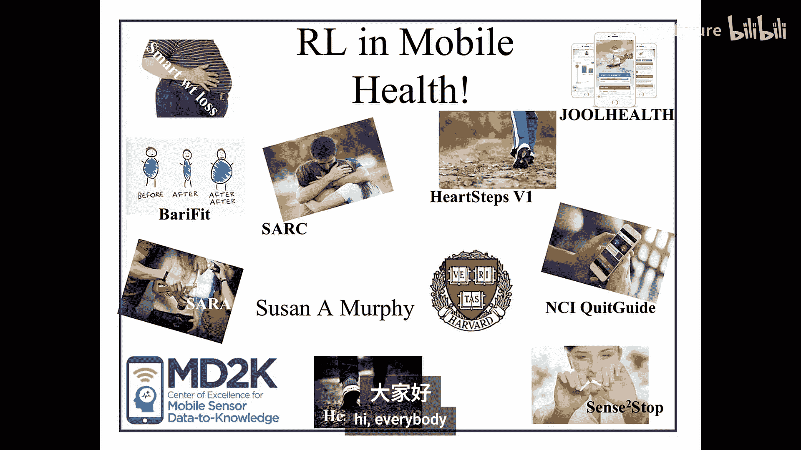
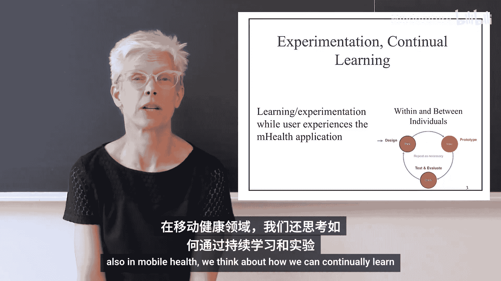
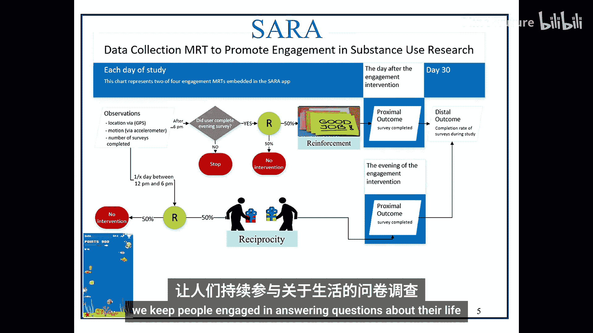
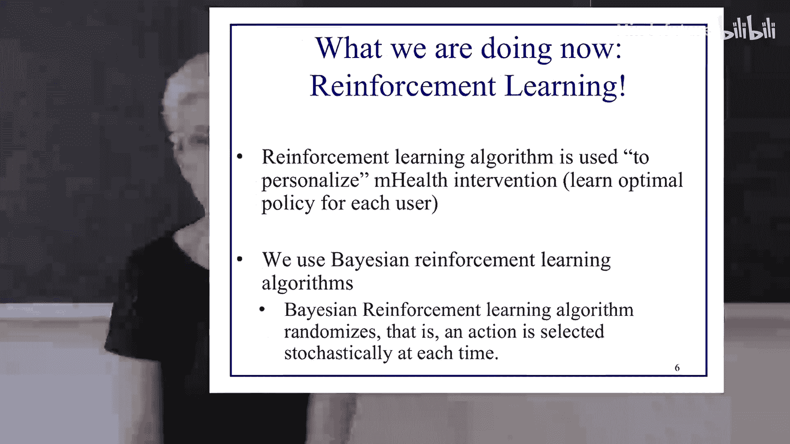
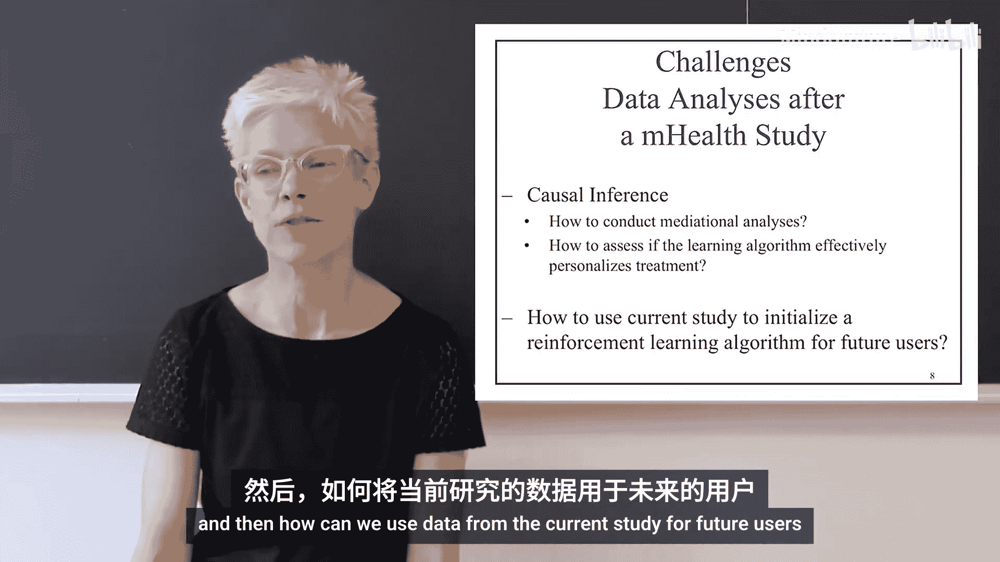
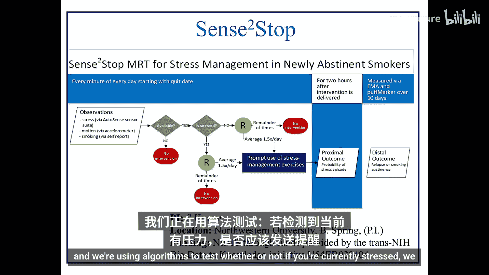

# 【阿尔伯塔大学】完整的强化学习系统 ｜ Complete Reinforcement Learning System p17 P17_Susan Murphy 论移动健康中的强化学习_04_02_03 -BV1VHYJz1Ee8_p17-

Hi everybody I'm Susan Murphy， I'm at Harvard University。

 I'm joined in statistics and in computer science and what I do is I look。

 I work in mobile health and in particular I work on how we can use reinforcement learning in mobile health and on the slide in front of you you can see all the different kinds of ways the kinds of studies that we've been involved in。

 many of the studies involve addictions， a lot of them are involved aescence and so on。

So in mobile health what do we want to do what we want to do is we want to help people who are struggling with a problem often these are chronic illnesses like someone who's struggled with addiction and how are they going to stay clean might be someone who's struggling with depression and so on so long term support to someone we also want to be able to test causal inference so we really want to understand does this treatment action an action in the case of RL does it really impact that person or not。

Also in mobile health， where we think about how we can continually learn。

 we can continually experiment so that we can always improve the mobile health application for each person。

 and that's what this slide is talking about。😔。

So it's the basic setup so in the for any given user they can receive a whole variety of interventions that is actions。

 I listed some on the slide， you see reminders， maybe reminders to take your medication。

 reminders to practice certain types of exercise and so on。

 suggestions about what you can do in your life how you can link you up with someone else who's been through similar problems and so on and this can happen repeatedly over time。

After each time we may we deliver a different type of action treatment treatment action。

 we observe a reward so the reward could be for example。

 total step count over the next 30 minutes if I'm trying to help you be more active could be how long it is until you become stressed again if I'm trying to the app is trying to help you manage your stress on the next slide i'm going to show you a study that just finished and in this study our goal was to。

Help people be more active in answering questions about their stress and loneliness and this study。😔。

Recruited young adults， adolescents and college students age。

 not always college students who were in trouble they were recruited out of our emergency room because they had been drinking too much and the idea was if we can learn about what。

Their feelings of loneliness are how depressed they are then we can develop an app which helps them manage that so all the actions in this RL problem have to do with how do we give you reinforcements so that you will stay engaged and answer our questions you can see we had a gamified interface it was an aquarium and as you answered questions you built your aquarium became more and more rich and you also could level up to higher levels in the aquarium environment but I was mostly interested in。

 how do we provide rewards to you if you answer questions that's the top line in this diagram whether or not what kinds of rewards memes gifts will help you be more engaged that you'll answer our questions tomorrow I was also interested in if we give you a gift a present today are you more。

to answer our questions this evening， so the whole goal of this study is to find good policies for how we keep people engaged in answering questions about their life。

😔。

So what are we doing now， we're using these kinds of studies to initialize reinforcement learning algorithms in mobile health。

 and the idea here is that the reinforcement learning algorithm should personalize the app to each user。

From our perspective， years in mind， this is the same as learning an optimal policy for each user in our lab in my lab we mainly use Bayesian reinforcement learning。

 I don't think you've learned about Bayesian reinforcement learning but the main tool for us the main advantage。

 one of the main advantages of Bayesian reinforcement learning is the way it updates information on an individual user over time and also it selects actions at each time in a random way stochically and this helps us learn about learn from the data after the study is over as well。

So what are the challenges to reinforcement learning when you try to use it in my setting that is in mobile health Well one of the issues is if you've ever download an app。

 you know exactly what I'm talking about。It can get really aggravating when the app notifies you a lot。

 so normally apps have a lot of potential to help you in the moment。

 so positive effects on immediate rewards， but negative delayed effects。

 this is the classical setting for reinforcement learning。

Some of the things we have to figure out how to do are how to approximate the value function so that we can learn fast。

 yet not make mistakes in choosing actions。If we always have many users， they're all very different。

 each person is different， but how can we use one user's data to personalize or find or determine a good policy for each particular user。

 this is a big challenge we're working on now。Also after a study is over。

 we always want to conduct causal inference studies is we want to help scientists learn more about how to why people enact certain behaviors。

 why do people relapse to drug use water why did they relapse to smoking。

 all these are causal inference questions how can the treatment help them so that they don't relapse so we want to use this data to do this and even though the data is collected via reinforcement learning algorithm we want to use the data for that and we have to figure out how。

 and then how can we use data from the current study for future users so that they will be able to benefit from what we learn from the current study？

Okay I want to show you this is my next slide my last slide and I want to show you one more study。

 this study is pretty cool， it's almost over and in this study each person is trying to quit smoking the study starts on the day they decide they are going to quit and they're wearing a whole variety of wearables and they go through their whole life and all this sensor data streaming in and it's used。

 the sensor data is used to form a whole variety of predictions and one prediction in particular is whether or not they're currently physiologically stressed and we're using algorithms to test whether or not if you're currently stressed we should provide a reminder to practice stress management exercises Of course the longterm goal is to determine find a optimal policy for each user thanks。

Good luck on your class by。