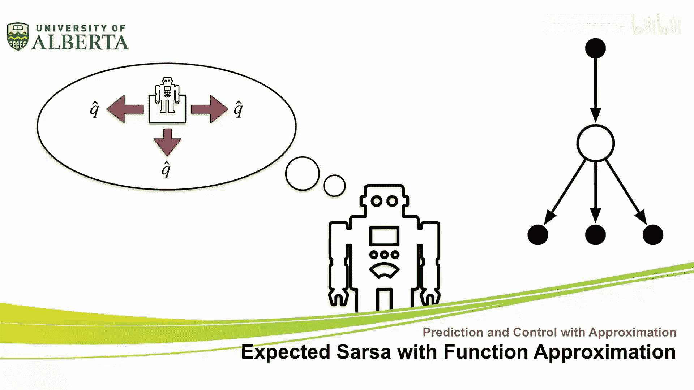
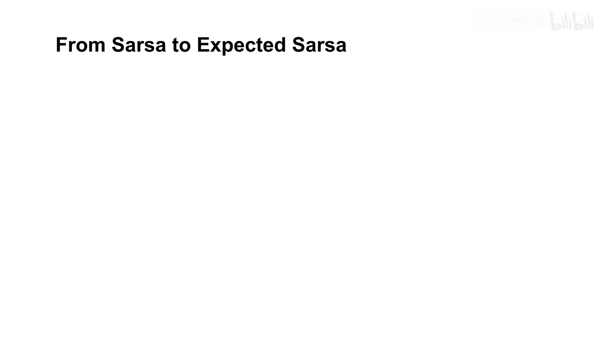
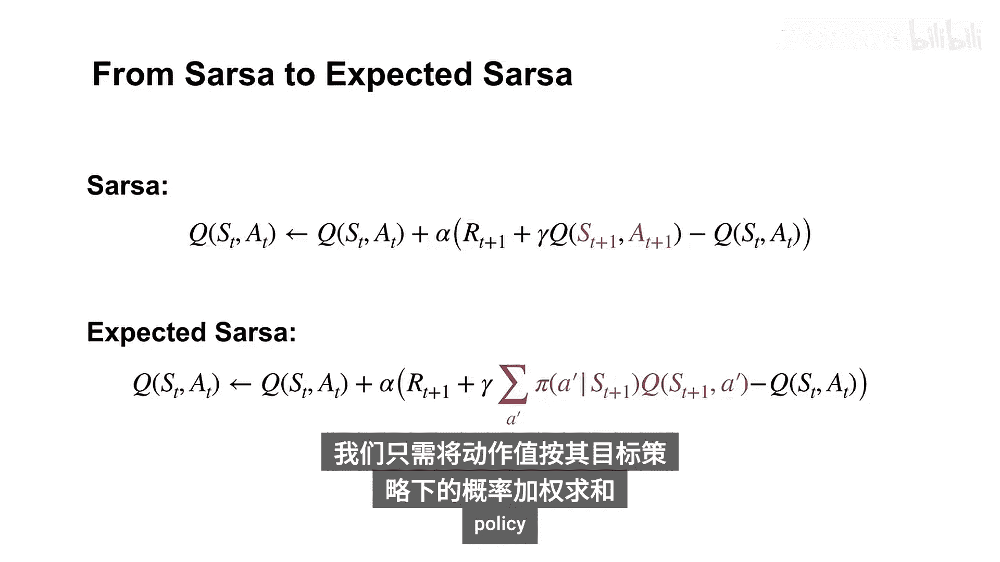
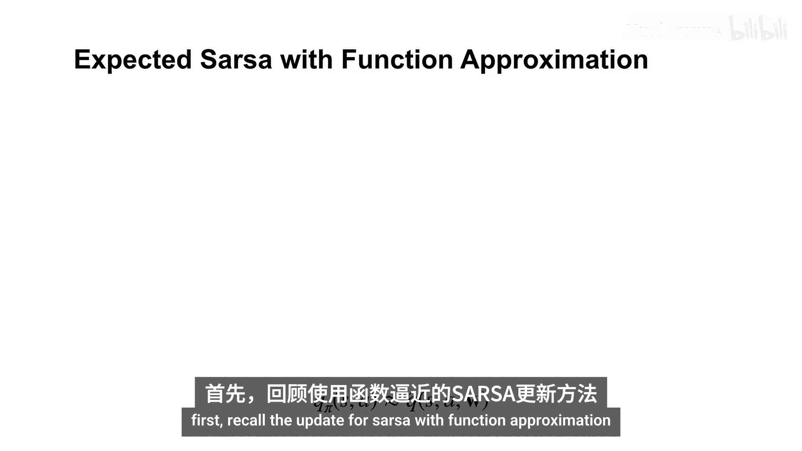
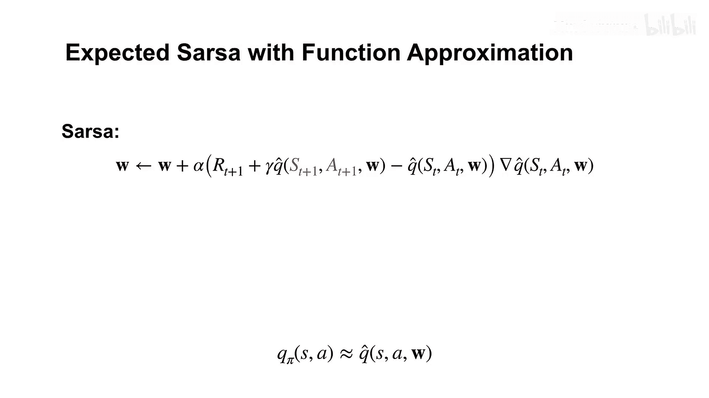
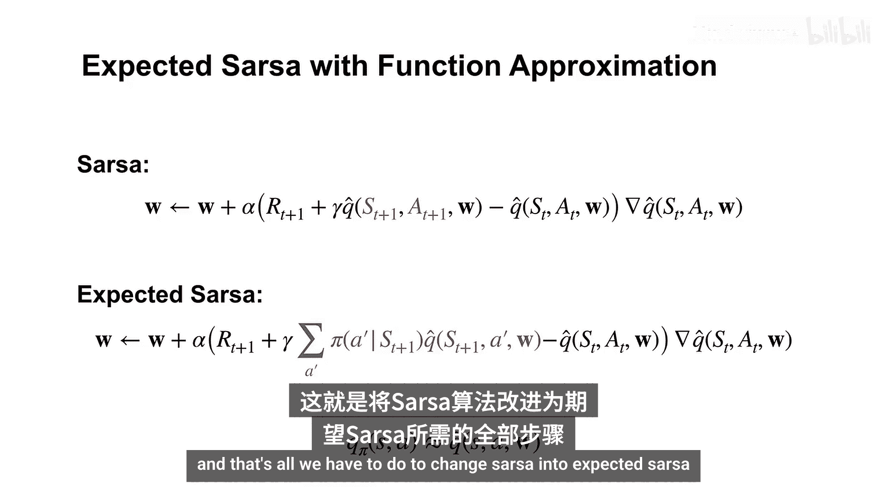
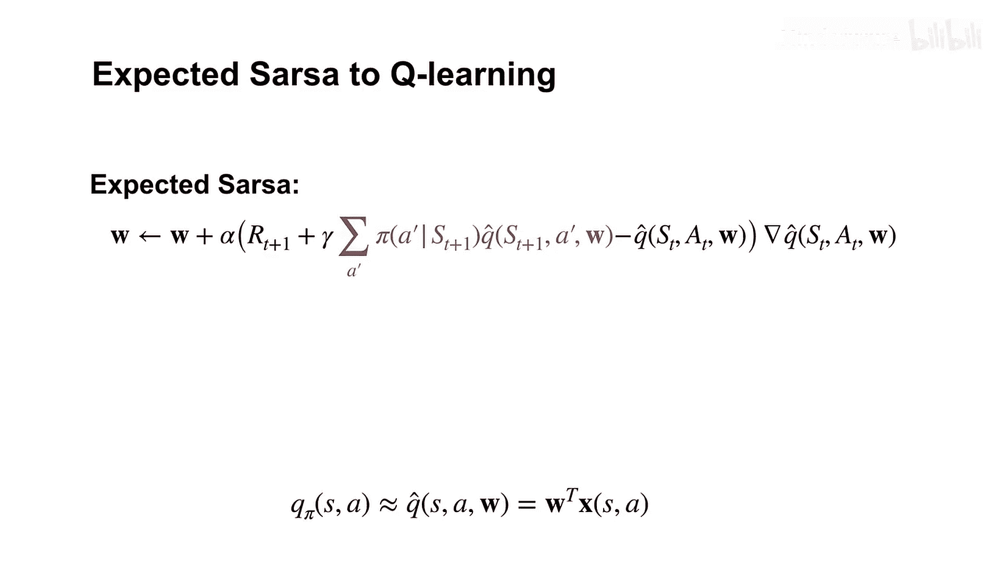
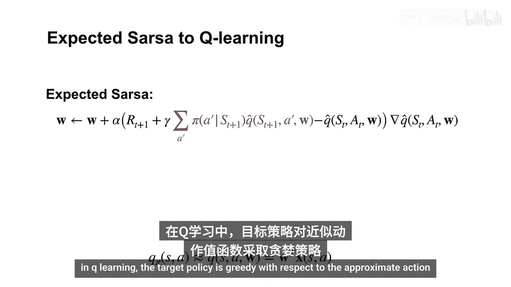
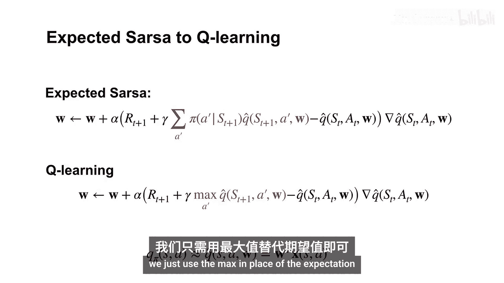

# 【阿尔伯塔大学】完整的强化学习系统 ｜ Complete Reinforcement Learning System p20 P20_让我们回顾具有函数逼近_05_02_02 -BV1VHYJz1Ee8_p20-

So far we've talked about using SArsRSA with function approximation。

 let's continue our journey through approximate control methods and look at expected SArsSA。

By the end of this video， you'll be able to explain the update for expected SARSSA with function approximation and explain the update for Q learning with function approximation。

Let's see how we can turn SARSA into expected SARSSA when using function approximation。

Recall the update equation for SARSSA。SARSA's update target includes the action value for the next state and action。

Now recall that expected SARSSA instead uses the expectation over its target policy to compute the expectation we simply sum over the action values weighted by their probability under the target policy。

The same expectation can be computed even when we use function approximation。

Let's see how to do this。First， recall the update for SArsRSA with function approximation。

It looks similar to the tabular setting， except the action value estimates are parameterd by the weight vector W。

We also have a gradient term to distribute the error to the weights appropriately。

Expected SArsa with function approximation follows a similar structure；

 we compute the action values from a weight vector for every action in the next state。

Then we compute his expectation under the target policy。

And that's all we have to do to change SARSA into expected SARSA。

Now how do we do this for Q learning with functional approximation？

Fortunately， Q learning is a special case of expected SARSa in Q learning。

 the target policy is greedy with respect to the approximate action values。

Computing the expectation under greedy policy is the same as computing the maximum action value。

So the Q learning update with function approximation is actually quite straightforward。

We just use the max in place of the expectation。

And that's it for this short video today we introduced expected SARSSA with function approximation。

 and we also showed how to extend it to Q learning with function approximation。

Next time we'll think about how to do exploration with function approximation until then。

 don't get lost。