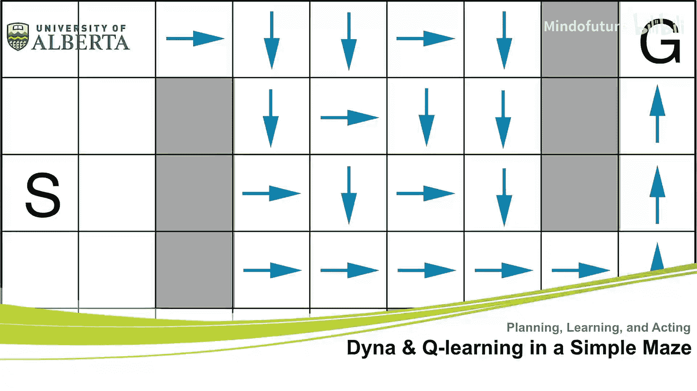
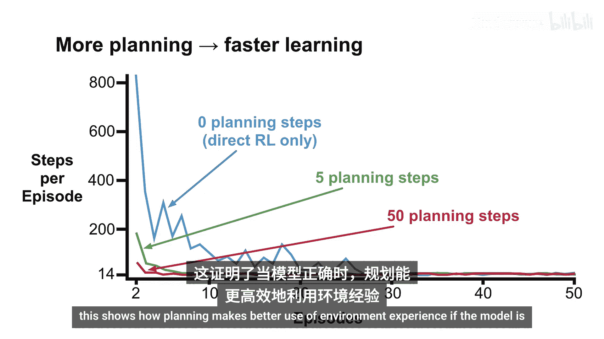
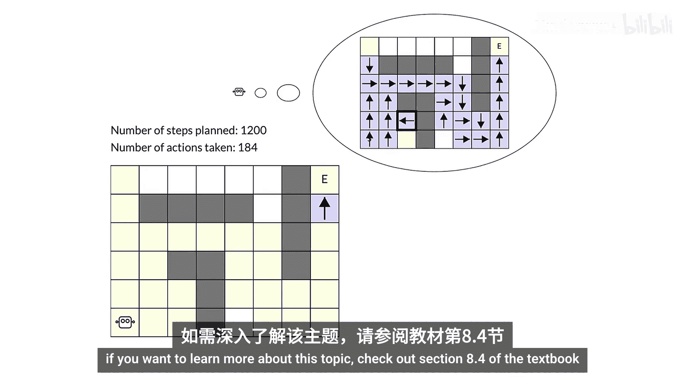

# 【阿尔伯塔大学】完整的强化学习系统 ｜ Complete Reinforcement Learning System p21 P21_让我们回顾简单迷宫中的Dyna-Q-leaning_05_02_03 -BV1VHYJz1Ee8_p21-

We've discussed the Dner architecture。And how it combines planning， learning， and acting。

We have also studied how DynnaQ operates in a grid world。

Let's get down to business and run some experiments to see how well DnoQ really works。In this video。

 you will use a small grid world to compare tabular Donna Q and model free Q learning。

By the end of this video， you were able to describe how learning from both real and model experience impacts performance。

You will also be able to explain how a model allows the agent to learn from fewer interactions with the environment。

Today we will run some experiments on this small maze environment。

 like before the agent has four actions。Transitioning into the Gulf state generates a reward of plus one。

All other transitions generate a reward of zero。This problem is episodic and we will use a discount of 0。

95。Let's compare DnoQ with different amounts of planning。We will compare three agents。

Each one will use alpha equal to 0。1 and epsilon equal to 0。1。

We initialized the action value estimates to zero for all three agents。

We ran the experiment for 50 episodes 30 times and then average the results Let's have a look。

We can plot the average number of steps the agent took to complete each episode after more and more episodes。

If the agent is doing well， then the number of steps should decrease with more episodes。

That is lower on the Y axis is better if we run DinoQ with zero planning steps。

 we get exactly the Q learning algorithm。As we can see， it slowly gets better。

 but plateaus at around 14 steps per episode。If we run Dna Key with five planning steps。

 it reaches the same performance as Keing， but much more quickly。

Dinina Q with 50 planning steps only takes about three episodes to find a good policy。

DnaQ is far more s efficient。Look at the Y axis after two episodes the policy found by Q learning still requires hundreds of steps to escape the maze。

For the same number of environment interactions， DinnoQ can learn a lot more。

This shows how planning makes better use of environment experience if the model is correct。

Let's visualize what's going on in a slightly different maze。

We use an arrow to show the greedy action according to the estimated value in each state。

A state without an arrow means that every action is equally likely under the policy。

After one episode， Q learning updates just one action value。

The one corresponding to the up action in the state next to the goal。

This is the only state where a transition with the non zero reward was experienced。

It would take several more episodes to bootstrap the state's value back to other nearby states。

Let's look more closely at how search control impacts planning。

Our robot will do things slightly differently than Dna Q。

But that's just emphasize our point more clearly。We will start with 10 planning steps and call the planning loop 10 times in a row。

So that's 100 steps of planning in total。As you can see。

 many of the planning updates fail to change the value function。In fact。

 the agent only updated the values of two state action pairs after 100 steps of planning。

Let's keep going this time we will try 100 planning steps per call and let the agent run a bit longer。

Even with the 100 planning steps， the first few calls update only a handful of action values。

Why does the agent need so many planning steps to learn the value function and a reasonable policy？

The agent needs many planning steps because search control samples state action pairs randomly。

The planning update will not have any effect if the sampled state action pair produces a zero TDR。

This happened a lot in this environment because all the rewards are zero。

 and so are the initial values。What would happen if we ordered the state action pairs in a more efficient way？

It turns out the agent could learn a good policy only using a six of the planning updates。

In large environments， random search control becomes even more problematic。

If you want to learn more about this topic， check out section 8。4 of the textbook。

In this video， we tested the tabular DNQ algorithm in a simple grid world。

We saw how planning can dramatically speed up learning。In our experiment， the more planning we did。

 the better the agent performed。Bye for now。