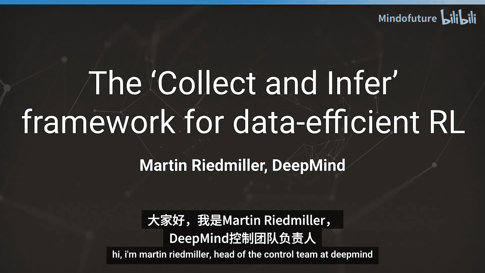
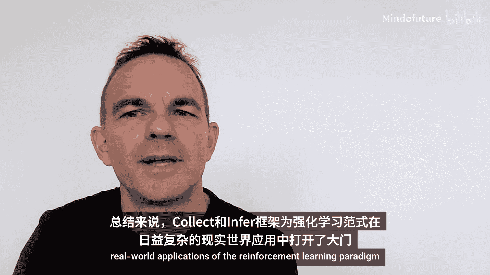

# 【阿尔伯塔大学】完整的强化学习系统 ｜ Complete Reinforcement Learning System p23 P23_Martin Riedmiller 论用于数据高效强化学习的收集和推断框架_05_02_05 -BV1VHYJz1Ee8_p23-

Hi， I'm Martin Reedmer， head of the control team at Deep Mind。

And I've been working for more than 20 years on newer reinforcement learning agents for the control of dynamical systems。

🎼Today， I want to introduce you to a particular viewpoint or perspective on reinforcement learning。

The collect and inferred framework is particularly suited for the design and development of data efficient learning agents。

The control of real world dynamical systems is an attractive application area for reinforcement learning controllers。

Like control of autonomous cars。Control of soccer playing robots。Or slot car racing from pixels。

They all share the same principal feedback control structure。A controller gets the observation。

 computes an action， and applies it to the environment。

Classical control theory would first model the process as a set of differential equations。

For which then a control law must be analytically derived。A tedious job， in particular。

 if the systems are complex or highly nonlinear， reinforcement learning， in contrast。

 promises to be able to learn the controller autonomously if only the overall control goal is specified。

This is typically done by defining the immediate reward。

🎼ERL controller optimizes the expected accumulatemd sum of rewards over time。

🎼Reinforcement learning therefore offers the right framework to tackle feedback control of dynamical systems。

 We are looking for a policy that optimizes expected accumulated reward over time。

 This can be done in a model free setting by iterating on a cube value function。

 Since in most control applications， we are typically dealing with continuous states and actions。

🎼Well be using a neural network with inputs S and A to compute Q。

 The above Belelman equation is then transformed into a quadratic loss function that is minimized by grading descent over the network parameters。

😊，🎼The core question when it comes to learning on real systems。Is how to do this data efficiently。

🎼In classical RL， the update rule for the value function is applied in an online fashion。

The agent observes an input。Compututes and action。And observes the resulting state。

And then updates its controller accordingly。Every transition is used only once。Empirically。

 this leads to highly data consuming learning behavior。

Which might be okay if our environment is a simulator and provides us with infinite data。

🎼But typically does not work for real world system where data is not abundant。🎼If data is limited。

 then the core inside reads。Data is precious， and data is true。

So we shouldn't throw away any transition experience S A S prime。

 but instead store all of them in a transition memory。😊，Learning is then done on the entire dataset。

In this step， we infer knowledge from our transition memory。

🎼The inferred knowledge can only be as good as the data in the transition memory。Therefore。

 collecting the right data is the second important component of our framework。

🎼These two steps together build a so called collect and infer framework of reinforcement learning。

This perspective keeps us focused on the two main question of data efficient RL infer。

 which means squeezing out the most of a given set of transition data and collect。

 which means sampling the most informative data from the environment。In the interest of time。

 we will only concentrate on the infer part for the remainder of this lecture。

🎼The neural fitted Q algorithm fully embraces this idea of learning from a stored set of transitions。

Given the set of n transition tuups， we first set the training set M equal to the whole data set D。

 Then we compute Q target values for every sample in M based on the Q iteration rule。

Derived from dynamic programming prints。Once the targets are computed for all the transitions in M。

 the neural network is fitted to these target values by an ordinary supervised learning step。

 The outer loop can be repeated for an arbitrary number of dynamic programming steps。

Until the optimal value function， Q star is approximated within a satisfying accuracy。Finally。

 the control law is given by the greedy evaluation of Q star at S。

 NFQ basically turns reinforcement learning into a series of supervised learning problems。😊。

It assumes to always do updates on the whole available set of transitions。

This might be impractical for very large data sets。

🎼DQN is a popular variant of NFQ that uses mini batches of samples for the updates and some additional adaptations to deal with huge dataset sets。

🎼As an example， consider the classical carpo system in reality。

It's learned here completely from scratch。The reward function definition is rather simple。

It's one if the pole is upright and zero else。Optionally。

 one could also consider the card position as an additional input to the reward function。

Classicical online  T0 needed about 1 million of trials in a simulated version to learn to balance a poem。

With NFQ， training needs less than 300 trials， several orders of magnitudes faster。

🎼This makes it possible to apply newer reinforcement learning to real world systems directly。

🎼To summarize。The Collect and Infer framework opens the door to increasingly complex real world applications of the reinforcement learning paradigm。

