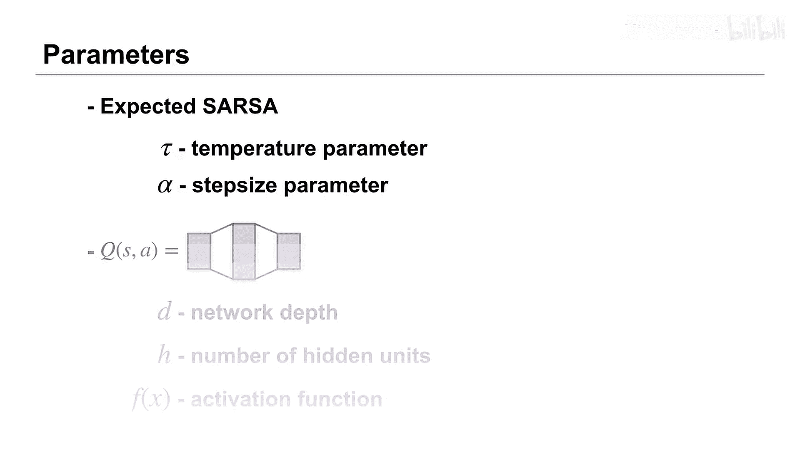

# 【阿尔伯塔大学】完整的强化学习系统 ｜ Complete Reinforcement Learning System p24 P24_与亚当的会议-强化学习中的参数研究_06_01_01 -BV1VHYJz1Ee8_p24-

嗯。

This is it， the final week of the Capstone project。After completing this week's notebook。

 you will have successfully implemented a complete reinforcement learning system from problem specification to careful selection of meta parametersas。

Today we'll discuss that careful selection of metapara part。

Recall all the key performance parameters that we identified in an earlier part of the capstone。

We need to pick good values of each of these if we have any hope of building a successful learning agent。

In practice， we will likely have to use rules of thumb for many of these choices， however。

 in some cases， we have the opportunity to study the impacts of the parameters to gain insight。

For example， when learning in our simulator， we can test our agent with many different configurations of the parameters。

 this can help us identify a good range for a particular parameter。

This might also help us set the parameter when we deploy the agent on the moon in research。

 we might test our algorithms in a variety of simulated problems with many different parameter settings。

This can provide insight into how our algorithms might behave in general。

Running such scientific studies is not just useful for scientists。

But it's also useful in industry too。In both cases。

 it is important to truly understand the methods you deploy。

Let's think about how we might better understand how our algorithm behaves with different parameters。

We can pick a range of each parameter and test several values in that range。

We can visualize the results with a parameter sensitivity curve。

On the Y axis we have some performance measure， for example， if we ran the agent for 50 episodes。

 this measure could be the sum of the returns over these 50 episodes。We call this the total return。

We then average this across multiple runs to get an average total return。On the X axis。

 we have the values of the parameter we are testing。

We do a complete run for each value of the meno parameterameter。

 This means we run the agent for the allocated number of steps， say 10。

000 steps for the desired number of runs， say 30 runs。

We compute the total return for each run and average those numbers over 30 runs。

We plot these averages for each chosen met parametermeter to obtain this sensitivity curve。

This curve provides insight into how the algorithm behaves for a range of its metaparameters。

 as well as how difficult it might be to pick those parameters。If the curve is very pointed。

 then it indicates there is a narrow range of good parameters。If you did not know this ahead of time。

 then it is unlikely you would find this good parameter setting。

Even if you manage to pick a met parametermeter， very near the best one。

The performance could be much worse。So even though in the best case， the algorithm can perform well。

 in practice， it could perform significantly worse。You might think， well。

 once I have found this good setting， I can just use that metaparameter and get the good performance。

 Unfortunately， for a new problem， the best metaparameter is likely different。😊，Rather。

 this analysis suggests you might have a hard time picking the met parameterameter。

 so we need to be careful in deployment。On the other hand， if the range of good parameters is broad。

 then it is more likely you will be successful in choosing a good one。Further。

 it might indicate the your algorithm is not too sensitive to its metaparameter in general。

This is even more likely to be true if you observe similar sensitivity to the metaparameter across problems。

We do have to pay attention to a couple factors to produce meaningful curves。 First。

 we have to test a sufficient number of values for the meta parameterss。 Otherwise。

 our approximation to the true parameter sensitivity curve will be poor。To see why。

 imagine that the true curve with respect to alphapha looks like this。

If we subsample only a few points to test， we may accidentally jump over the best value of those parameters。

We also need to test a sufficiently wide range of the parameters if we choose a range that the best value is at one end of the range。

 we may miss out on better values of the met parameterameter。Don't worry。

 we will not ask you to exhaustively test each combination of the meta parameterss。

You will only get to sweep over one of the parameters for your expected SARSSA agent。

That way you will gain some experience doing a parameter study。

 but you won't have to wait hours for your program to run。

We will suggest good values for the remaining parameters。

It is important to note that we do not use parameter sweeps to actually select parameters for real problems。

Rather， this is a strategy for understanding our algorithms in simplified settings。

It is typically not feasible to systematically test the agent with many met parametersameters。

 how can we test landing the module on the moon over and over with bad metara settings that might cause repeated crashes？

You would be fired in no time。It is so important to understand our algorithms and how they might behave this is especially true in deployment in the real world。

 or in this case in outer space。And that's it for today's video。

 good luck in the final part of the Capstone project。

