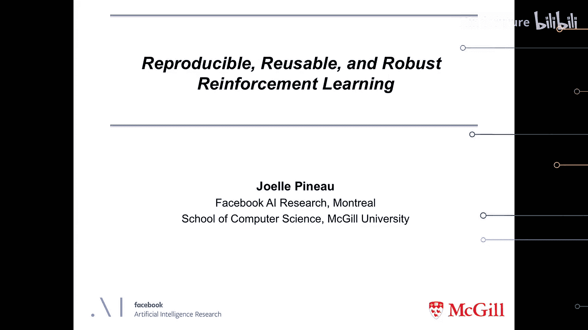
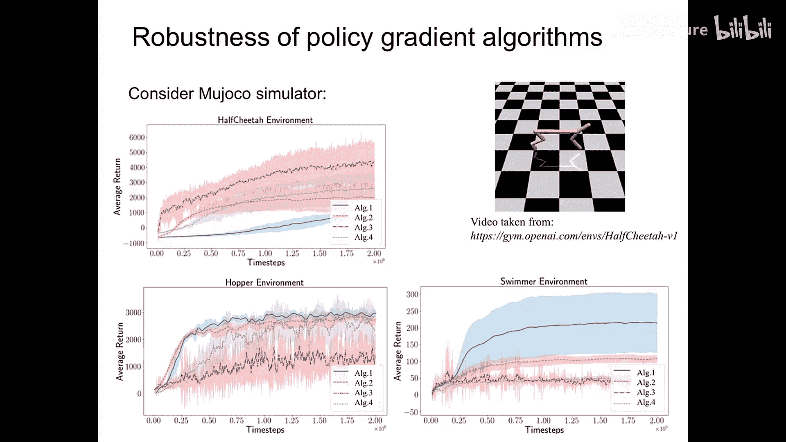
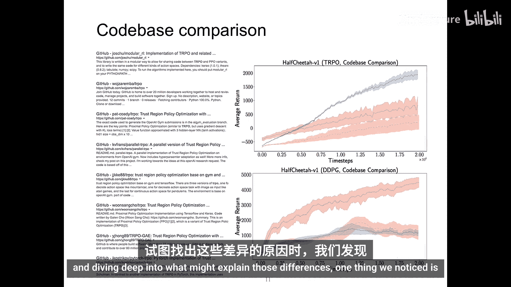
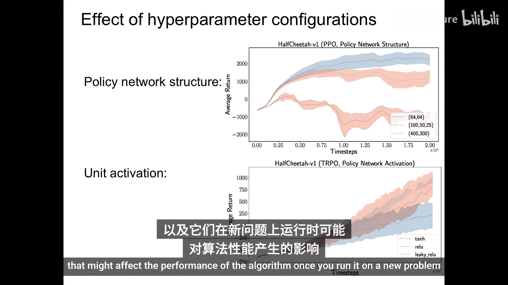

# 【阿尔伯塔大学】完整的强化学习系统 ｜ Complete Reinforcement Learning System p26 P26_论重要的强化学习_06_02_02 -BV1VHYJz1Ee8_p26-

Hello， my name is Jo Pino and I'm a faculty member at the School of Computer Science at Miguill University and I'm also a research manager at the Facebook AI Research Lab in Montreal it's my pleasure to be here today and tell you a little bit about some of the work we've been doing on the issues of building systems that are reproducable。

 reusable and robust in particular for reinforcement learning。

And so it may be interesting to you to know why do I tie these three R's together。

 what do they have in common and let me draw from this quote from the National Science Foundation that says that reproducibility actually refers to the ability for a researcher to duplicate the results of a prior study。

Using the same materials that were used by the original investigator and reproduceproducibility is also the minimum necessary condition for finding to be believable and informative。

 and so as scientists， all these components are actually very important to how we practice science。

 but it's also very important in terms of how we share the findings from our work。

There's been talks of this reproducibility crisis in science broadly， not just in machine learning。

 and so the journal Nature ran a very interesting study in 2016， surveying 1。

500 or so scientists asking them whether they thought there was a reproducibility crisis in their field and a large number of them said yes。

 there's either a slight crisis or a serious crisis going on。

Now in some of our work we've been trying to figure out。

 you know it's one thing to be alarmist and answer some surveys。

 but then it's also another thing to look carefully at what the data tells us when we conduct our own comparisons。

 and in the case of reinforcement learning， it's been very impressive the rate of progress we've seen in the last couple of years。

 really， systems demonstrating the ability to play。

 in many cases play games at a performance level exceeding the best humans。

And where we thought some of these games were really difficult， might be decades away from solving。

 we've had some impressive results in particular on the game of Go。

 but also on some challenging video games where our REtrain system are able to achieve these really good results。

Doing well in games and simulation is wonderful。😊，Makes us see the potential for the technology。

 but what we care about in the long term is really how well can this technology， our algorithms。

 help us solve real world problems。And so in an attempt to understand how far the science has come and how close we are to solving these hard。

 difficult real world problems， we started digging in the literature， the recent literature。

 and we looked at the last 25 years or so of papers in R so you see the curve it's actually growing very rapidly。

 early 200s， just a few hundred papers on the topic published every year。

 more recently upwards of 20，000 papers being published on this topic。

 and so that's a lot of new findings coming out every year。

 and when we're asking what of all of these methods actually works in the real world。

 it makes it difficult to sift through all of that information and so going back to the core topic for today。

 it becomes very important that the way the findings are reported in the papers。

Match our criteria in terms of reliability， robustness， reproducibility。And so to check this out。

 we conducted our own little investigation and we picked four papers out of the whole bunch of them。

 we picked four， in particular four that were very well cited， commonly used。

 that was code available， and we started looking at how robust were the findings in those papers。

And the message today that I'm going to deliver actually goes beyond those papers and is really looking at how we practice empirical science in this field。

And so we started comparing some of these four different methods。

 these are policy gradient algorithms， different flavors of policy gradient on this training of an。😊。

A very simple agent which learns how to walk we call the half cheetah domain sort of a cheetah cartoon split in half so only two legs it has to learn to run without falling on its belly and we compare four different algorithms and on the left you see a plot with those four algorithms and on the basis of this you would probably think that the red algorithm is doing quite a bit better than the other doesn't really matter which of the algorithms is which on this really our message is about how do we do a fair comparison to our conclusions of a robust from this so based on this one it seems this red algorithms doing better。

Now we extended this to slightly different variations of controllers。

 there's another example which is a hopper another one that's called a swimmer。

 slightly different versions of this character that we have to control and when you look at the bottom two plots what you see is actually the blue algorithm seems to be doing a lot better and in the left bottom side the blue algorithms doing quite well with a really tight confidence interval whereas on the right side the blue algorithms doing well。

 but with a really wide confidence interval， and so taking all these results together you would think if you try the performance of each algorithm on more domains。

Have a better understanding of how well it works and better prediction of whether it might be useful in the real world and what we found here。

 we just got more and more confused with each of these experiments because the results just were not consistent from one to the other。

We started digging in a little bit more about what might be going on behind the scenes we thought well we didn't implement these algorithms on our own。

 of course we use some available open source code to do that so we thought maybe we didn't get the right source for that maybe we got some poor implementation somewhere we started digging out different implementation and that what I'm showing you in the plot is three different implementations publicly available from one of these four algorithms called TRPO and what you see here is one of these versions a blue version does a lot better than the other two。

We thought maybe TRPO is a policys gradient method that's a little bit unstable。

 code is hard to implement， we looked at some other cases， very similar results。

 you go from one code base to the other， it's purporting to be the same algorithm should work the same right。

 and yet we're seeing really significant difference in the empirical performance。

As we were asking more and more questions and diving deep into what might explain those differences。

 one thing we noticed is that in many cases there's a lot of different hyperparameters that have to be configured。

 and depending how you set those you get very different results。

Most of the code bases come with a default set of hyperparameters and it's very tempting to take that default set。

 not change it and use it as is out of the box and what we found is once you start manipulating these different hyperparameters。

 it really changes the performance of your algorithm so that's one lesson to take home。

 really be very careful about what are the hyperparameters。

 how they're set and how that might affect the performance of the algorithm。

 once you run it on a new problem。

You might be tempted to say， you know were comparing different algorithms。

 the most fair way to do those comparisons is to give them the same amount of data。

 same amount of computation， everything's right， but from our analysis as I've mentioned。

 what we really found is that to draw robust conclusions were to think a little bit more deeply about the issue in particular and acknowledge the fact that different algorithms are going to have different hyperparameters。

 you can't just use the same from one to the other。

The different methods are going to have different sensitivity to those hyperparameter。

 you might need to search longer and more carefully about some of them than others。

And which method is best often depends on how much data you have and how much computation you can afford。

 and so that's going to change drastically from one application to the other depending where your data is coming from and on what kind of platform you're trying to deploy your AI system。

Taking all this together， stepping back to the main question。

 I think my main message for you today is that we have to be very careful about how we interpret the information that we read in papers。

Be very careful about how we've set up our experiments， how we compare different methods。

 and when we do that we can draw much more robust conclusions and really it goes back to the foundation of science Science is an activity。

 collective activity in which we engage and the purpose of it is really to understand to explain phenomenon and to do that we always have to be very careful about the way in which you're doing it。

Thank you very much。😊。