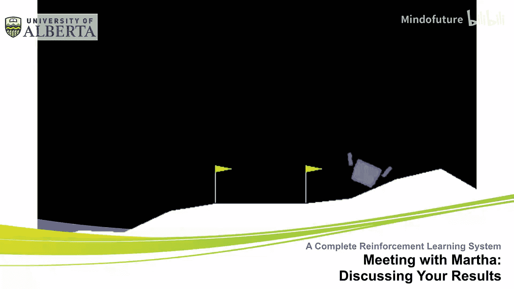

# 【阿尔伯塔大学】完整的强化学习系统 ｜ Complete Reinforcement Learning System p27 P27_与玛莎的会议-讨论你的结果_06_03_01 -BV1VHYJz1Ee8_p27-

Congratulations， you finished your capstone project。

By successfully completing each of the steps in the capstone。

 you should have been able to train an agent to land a module on the moon。

And you should have some insight into how sensitive your agent is to one of its meta parametersameters。

You already know a lot about the details of your solution and have seen learning curves and parameter sensitivity plots。

So in this video， we're instead going to get some insight into the agent during learning。

 we'll visualize the agent in one run to get a sense of how an agent might learn on this problem。

And of course， because it's fun to actually see our agent learn。

This is a video of our agent after some training you'll notice that the policy still isn't perfect。

 but it is quite good， but the agent definitely did not start there。

 remember it did not know anything about this world and had to learn by trial and error Earl on in training。

 the agent behaves in clearly suboptimal ways For instance。

 perhaps the agent only decided to turn on one side thruster for the entire episode that obviously didn't work out。

After that， sometimes the agent learned to only use the bottom thruster， however。

 this pushed the agent far off screen， making it receive a large negative reward。

If the agent can't use the main thruster all the time and it can't use a side thruster all the time。

 obviously the correct choice is to just do nothing at all。

We can try to hypothesize some reasons why this might be happening One possibility is that the neural network is producing poor representations early on。

For example， the agent might be overgeneralizing if the sin thrust action led to high negative reward in one state。

 the agent may overgeneralize that the side thrust action is terrible in all states。

As the representation improves， the agent is better able to discriminate between states； of course。

 this is just a hypothesis， isolating the real cause will require some experimentation。

After many more episodes of learning， the agent is performing much better。

 the agent is falling just a little too quickly， causing one of the corners to hit the ground。

 but fine tuning as policy from here is relatively easy。

And that's it for this video it is fun to watch videos of your agent landing。

 but can also be a useful way to debug and understand your agent whenever it's possible it's worth taking the time to do this visualization to gain more understanding of your agent。

