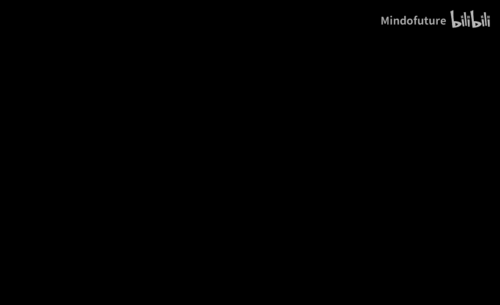
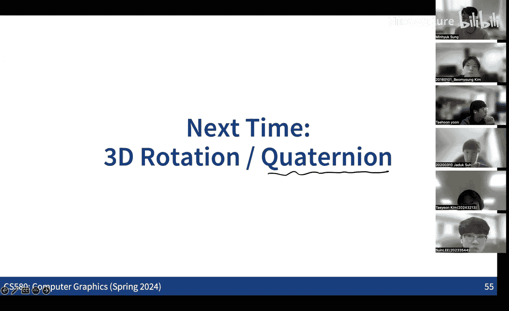

# 【韩国科学技术院】计算机图形学 KAIST CS580 Computer Graphics (Spring 2024) p01 P01 Lecture 02 - OpenGL Graphics Pipeline (KAIST CS580, Spring 2024) -BV1he7mzjEc1_p1-

Okay so welcome to the second lecture， this CS58 computer graphics and today we are going to discuss the basics about the open geo based geographics pipeline。

So last I gave some kind of the quick introduction about the course。

 and then I mentioned that we're gonna have the three major parts in the course。 So first。

 we're gonna recap some of the basics about the comparative with the graphic pipeline and then we're going discuss more like the advanced the rendering the techniques and then we're gonna also do some kind of the basic ideas about the new rendering techniques。

 So for today and also for the next week we're gonna have some kind of the discussions about the the basics of the graphic pipeline and then we're gonna move on to the rate tracing based some the techniques And also please note that we are not going have the lecture next Wednesday。

 So we' going have today's lecture and also the lecture in the next the Monday and we're gonna have a break for the next Wednesday and then we're gonna resume after that。

So please also check out all this scheduling our the course web page。So yeah。

 let's get into the basics about the graphics。 So basically like what we do in the graphics。

 the pipeline is basically kind of like simulating the situation that we are basically shooting a film So when you think about like a film。

 there can be some kind of the some essential components that we can think about in terms like how are you're gonna basically sort of like mathematically like represent older things So there can be some multiple things。

 So basically we will be able to basically represent some kind of the 3D objects in the scene and with some kind of representations about their geometry and also the appearance as well。

So these are like we are having some kind of the objects and the actors。

 whatever some kind of the buildings， whatever kind of things in our these 3D scene and once we have these kind of some 3D objects。

 we also should be able to basically make some kind of the animations which is kind of like giving some directions。

 for example like to the actors in terms of that they can make some kind of actions in the 3D space and for that we should be able to basically somehow represent the transformations in the 3D space and also some kind of thes as well。

So once we have these kind of the objects and they're the animations。

 then now we should be able to basically capture all the things into the image。

 so that's basically the things that we should be able to small model the camera so basically how we're going to basically capture all these kind of activity things into the2D image So for that we should be able to basically see basically how the camera basically works in terms they capturing all the things。

And also for that， we also should be able to basically have some kind of the models of the lighting as well。

 So in terms of that we are simulating the light transportation in this space in terms of that。

 like all the large of basically coming into the lens of the camera so that we can make some kind of images。

So what we basically discuss in the introduction course in the CS3A is basically discussing all the kind of things like very basic things about like all the things about the objects and the animation。

 the delight and the camera basically how we're going represent all things in with some basically numbers so those are basically the basic ideas that we are discussing these CS3A and in this advanced of course we're going to focus more on the basically appearance and the lighting and the camera in terms of how we can do some more like the precise some kind of opts simulation in terms of like we are making some more realistic images so that's basically what we are going to discuss over the semester in this course。

😊，And in terms like capturing all these 3D things into the 2D images。

 actually there are two main kind of pipelines that you we have discussed offer in in the compact graphic to the history。

 So until the like 9080 what people are mostly focused on was basically this like reization based the framework which is still being used in the many graphics the application so especially for many kind of the pipeline it is based on the open gel and also many other kind of things。

 basically the basic rendering the framework is the reization based framework which is basically projecting all these 3D things into the 2D plane and do some kind of processing in the image space and this is what we are going to briefly review for today。

And the other basically the random framework is the ray tracing based the system。

 which is not projecting3 things that directly into the 2D plane。

 but actually shooting the array from the 2D plane into the 3D space in terms of like we are sort of like following the reverse way of the lights and basically start from the images and see how the lights basically reaches some kind of the light source with some kind of the intersections interactions with some kind of the3 objects。

So these two might be basically some major kind of rendering the frameworks that we can see in many kinds of graphic applications and the focus of the CS3 AD was basically discussing the risk。

 the pipeline， and then in the CS58， we're going to discuss more about this rate tracing basedD frameworks。

So what we are going to discuss more details in the rest of the lectures in the entire semester。

 you'll be basically about these like rate tra based D techniques。

 but for today we are going to briefly review the basic ideas about the restorationization。

So what we are going to do for today is basically briefly review what we have discussed in the CS3 AD。

 especially for the students who did not take this course or who may not remember what we have discussed this basically course。

So let's briefly review the open gear based demographic graphics pipeline。

 so we are basically starting from some kind of the row geometry。

 as you can see on the left hand side。And then we are basically having some multiple the components that we are processing this kind of the geometric information。

So actually， we are not only having the geometric information。

 we also have some kind of the appearance information like the texture and the lighting all the things。

 some material information as well。And we are going to discuss this kind of like material and delight lighting information in the list of the course so we are going to skip those parts。

 so we're going to focus more on basically how are were going process the geometric information for today's day lecture So when you have some kind of some geometric information there are some kind of the multiple components we are having some the vertex processor and also the restizer and also the fragment the processor and all these outputs in terms of that we are getting the final images。

So as you can see those are some kind of the components that some of the components are something that actually we need to implement。

 so if you see the openGLD framework in the very classical the framework in the openG like 1。

0 like all these kind of the components are basically implemented it's kind of hardware implemented kind of the components but in some kind of the modern the openger based kind of framework from like 2。

0 actually you can implement the ver processor and the the processor as you want so these two are basically kind of programmable the components while the retorizer the repir writerator and the other components are basically some sort of the fixed components which is already implemented in the hardware so which means that you can implement the verex processor and the fragment the processor as you want based on the shadow language so we have the protect the shadow language and before the shadow language for the fragment the processing as well but there are some kind of the typical ways to basically。

Imment these two components。So in for today， we are going to focus on basically how we need to basically implement this vertex processor。

And then we're going to also see how this like restaurant also works in the open J pipeline。

So let's first see basically how we're gonna represent the raw geometry first。

 So there can be actually the multiple ways that we are representing the row of some kind of the 3D geometry。

 but the most conventional way to represent some kind of the 3D geometry might be using some triangle image。

 So basically triangle me is basically nothing， but basically having this kind of some sort of the net like some kind of the sort of the graph structure。

That we are having some kind of the a collections of the 3D purposes and then connecting them in terms of that we are forming some kind of the loss of these some sort of the triangles in the 3D space。

 so it does not need to be exactly some triangle mesh it can be any kind of the poly d mesh。

 but the triangle mesh is the kind of the simplest form in terms of representing the surfaces in the 3D space in a kind of the compact way。

So typically for the triangle dimension， we're going to have some kind of the A set of the deep vertices。

 which is basically the 3D points in the space， and then we are connecting them with some kind of basically forming some kind of deep faces。

 which are basically the triangles by just takinging three vertices。And for each of the projects。

 we're going to have some also some sort of the extra information that can be the surface normal information or some color information or some texture coordinate or many other things。

So let's think about that we are basically having this kind of some the geo information。

And then we're gonna have the bartex processor， which is also having some kind of the multiple the small components as well。

 So these kind of the components that you can see in this kind of the pipeline are actually no kind of like having some many kind of details。

 actually， there are some kind of even multiple legal lectures to discuss all the details for each of the components。

 but we're going to basically go very quickly for each of the things and see what we need to do。

So in the model view the transform so this is basically the process that we are basically placing some 3D objects in the scene。

 so when you think about like making some kind of the some 3D but scene。

 we're going to have some kind of the 3D objects which are basically defined based on the local coordinates so as you can see we are having these bos。

In the 3D space which is now defined with its own the 3D local deco coordinates and we want to place this kind of de box in the 3 the space in a way that we can basically composite the multiple the objects in the same。

 which will be basically the kind of the process we are converting the local coordinates into the global coordinates。

 so we are basically defining some kind of 3D objects into the local deco coordinates。

 but now we are projecting the same object based on the global the coordinates which is defined based on the camera pose。

So precisely like what we can say here is that see we are having some monoic coordinates。

 which is actually called the world coordinatease。And we can think that like given this kind of the word coordinates。

 we are having the object coordinates and also the camera coordinates as well。

So what we want to do is that we are placing all these 3D objects in the word coordinates and then also transforming the entire things in the word coordinates into the camera coordinates in terms of that we are basically seeing how those kind of the 3D object will be seen from the given the camera and this kind of the two way of the transformation from the object coordinate to the word coordinates and the word coordinate to the camera coordinates。

 these two processes actually can be like just like oh that's kind of the one the model beauty transformation。

So that's basically what we typically do in the graphic pipeline。

And also for those kind of de transformationation， actually。

 there can be some multiple types of de transformationforms and we're going to consider the off transformations。

But here the question is that what's the off transformation so actually there are lots of the types of the transformations right so we can actually there can be some multiple ways that we are basically classing all these kind of the transformation so we can think about the risk transformation。

 Euclidean transformation and also dissil transformation and off transformations and the protect transformations。

So can you class those kind of classifications and what would the kind of the differences of like these transformations。

So let's think about the differences of those things and please type your answer in our select channel so you can find the lecture two channel in the select default work space and let's think about the differences of those transformations and please type your the answer about the ways that how we distinguish those transformations。

So I will give you two minutes to think about the differences of these transformations。

So your answers for the quies will be counted for the participation score。

 So please post your the answer and your answer does not need to be correct。

 So let's just think about this and just like type your the answer。

Yeah maybe can go one by one so when we typically talk about like raised transformations。

 those are basically the transformation that we can see for some kind of the raised body the objects。

 so let's think about the case that we are basically doing some kind of the objects in the scene then the transformation that we're going to see would be basically some kind of the some translation and also the rotation as well right。

Like just like moving some kind of the objects in the scene。

 then those might be basically some translation and the rotation that we can typically see in many kind of some robotics and situation。

 moving some kind of objects， whatever， those kind of things。

And when you talk about the Euclidean transformation。

 that basically includes everything in the risk transformation and plus the reflection as well。

 so those are basically the cases that we are having the translation rotation the reflection。

And when you also talk about the similarity transformation。

 this is typically the case that we are seeing as kind of like adding the uniform scaling。

 so if we have the translation rotation and the reflection and also the uniform scaling。

 these are the similarity transformations。A fine transformations are basically some broader the classical of these transformations that we are also adding some kind of the non uniform scaling and then sharing as well。

 so sharing is kind of like shifting some parts of the objects while basically preing me the parallelism。

 as you can see here。This image so those are basically security cases of the open transformation and the project transformation is basically you know including everything。

 including the project as well。So those are basically some kind of the classic of the transformations and for many kind of the some graphics and also the vision the applications so you might need to basically see what's the kind of the exact the definitions of the transformations。

Actually， there are also lots of the details that we can discuss about this kind of the the transformations。

 Basically， there can be some kind of the properties that will be preserved or that will not be。

 They may not be preserved for some types of the transformations。 So there are some kind of details。

 but we are not going discuss all those things。But basically the thing is that so here the question is how we can represent this kind of the offline transformations with some kind of the numbers。

 some in kind of the mathematical way and the kind of the typical way that we are representing this kind of the offline transformations is to basically using some kind of the four by four matrix and also the homogeneous coordinates。

So we are basically extending the 3D the coordinate system with the X O Y Z by adding one number with the one here。

 Then now all the kind of the of transformations can be represented with the four by four matrix while having the last rule to be basically 0。

0，1，0，0，01， right。So when you have these kind of be 12 numbers。

 then now we can represent any kind of the appointment transformation。

And especially the transformations that can be represented with the first three by three matrix here is also called the linear transformation。

 so linear transformation is basically a fine transformation minus translation so all the transformations that can be represented with the the three by three matrix here。

 and then we are adding the translation here as well。

So those are basically all types of the transformation that we're going to represent in our kind of the model of the transformations。

 so basically the model transformation is basically represented with a single can be represented with a single the four by four matrix。

 which comprises the linear transformation and the transformation like this。And in the next lecture。

 we're gonna get into slightly more details about the 3D rotation。 But before that。

 let's also briefly think about some kind of the 3D rotation。

 So let's think about So let's check whether you have some kind of the basic understanding about the 3D rotation。

 So let's think about the older angle representation。

 So even you don't need to know what's the meaning of the older angle representation。

 So let's just like ignore this。 But we are going to have a 3D rotation。

 which is basically combining the 3 rotations。The first rotation is basically rotating along the x axis with the angle upper per。

 and then we are rotating along the y axis with the angle the beta。

 and then we are also applying the rotation along the z axis with the angle degema。

 so when you have this kind of the sequence of the the3 the rotations rotating along x axis and then y axis and then z axis。

 all this kind of rotation can be represented with the full4 matrix。So let's think about this。

 And please tighten your D message。 So you can actually just like write down those thing to the U the paper and just take a photo and post the photo in this lab。

 So this is the second question。And also you don't need to basically make a single four by four matrix。

 actually， as you can see， this will be represented as kind of the multiplication of the 4 by 4D matrices so you can just like put the like the multiplication of the the matrices without exactly car all the multiplications。

 the multiplications， good。This type piece。So， yeah。

 basically we are multiplying the coordinates on the right hand side。

 which means that if we want to rotate from the axis X axis and the y axis and the G axis。

 then we're going to multiply the mat in this order， right from the。로테디스 로 로디스스。

So those are basically what we are going to do so those are kind of some very basic things if you also find some kind of typos in my slide please let me know but yeah so those are kind of the very basics about the some transformations in the computer graphics and for any many kind of some graphics the applications you might be able to basically handle these kind of transformations that you want so so we are not going to basically discuss such kind of details but just giving this quiz just to let you know that we are assuming that you have those kind of background for these course。

不。So yeah， these are basically some ways that we are also representing some kind of the defined transformations and especially for these 3D rotation。

 there are some kind of the other ways around basically to represent other things so there can be some other ways that you know some so we're gonna basically discuss some kind of the quaion in the next lecture。

 so which is also another way to represent some kind3 rotations。

So but here the basic idea is that we are presenting all this kind of the some model view。

 the transformation into a， you know using some kind of the four by four matrix。

 which is basically the case that we are transforming the old coordinates into the camera coordinates。

 typically through the world coordinates as well， but we are basically skipping that sort of the details。

Then the next step might be that now we want to basically project all this kind of is reallyD over in machine into the 2D plane。

 So that's basically the things that we are doing with the the camera projection。

We is now converting the camera coordinates in the system into the clip coordinates。

 so this is kind of converting from the camera coordinate system and clip coordinates and this is like all about basically the projection。

So actually there can be some kind of the more precise way to basically model the camera the capturing。

 but let's think about the simplest the case， which is basically having the penal the camera model。

 So this is the case that we are assuming that we are basically having some very tiny hole in the box we are basically we are projecting all the kind of the you know things in the 3D into the 2D plane like this。

And so let's think about how we can model this into some kind of some sort of the mathematical default in the open GLD pipeline。

 So we are assuming that now we are seeing the 3D scene along the minus the traction。

That makes sense。 So this is kind of the conceptual image for the 2 d key that we are only having the y axis and the z axis。

 and here the best idea is that the G axis is the direction to the to the bur and we are basically seeing the 3D scene along the minus G axis。

 right。So there are some kind of the objects now we are having the arrow here in the here in basically this the 2D space。

 but it can be kind of like something in the 3D space So we are having this point in this 3D space that we are seeing which is having the two coordinates like y and the z and let's assume that we want to basically see how this kind of the objects in the 2D or the 3D space it's projected through the Por here at the origin into the image plane which is defined that the z becomes the1 z is equal to1 So this is the image plane where we are projecting everything through the Pal at the origin here right So this is the pin。

Then where is this point P， which is having the y and the g coordinates projected into the image plane。

 so given this kind of the P here， which is having the y and the G coordinates。

 which is will be projected in the image plane， which is also the plane that the z is equal to1。

 what's basically the coordinates of the P prime here。嗯 this this this is easy question。

Well this is basically nothing， but we are having the Y and the Z and we want to make the same ratio with the y prime and the1 right then what we can see is that y prime is nothing but。

喂 over there。So that's the kind of thing so we're going to basically have the y plane the p prime which becomes like having this coordinates。

 so that basically means that the projection is basically the step that we are basically calculating this kind of converted the coordinates from the given the y and the z。

But the kind of the problem is that we really do this kind of projection。

 then we are basically having this kind of the upside down the flip image。

 So we want to flip again in terms of that we want to get the correct images like this。

 So let's think about the process that we are projecting into the these equal to one plane and then flipping the image right。

Actually， these kind of the two no steps， like projection to the z is equal to one plane and deployping is actually exactly the same as like we are just projecting to D z is equal to minus one plane。

So what we can actually do is that instead of like doing these two steps like projecting to this image plane and the flipping。

 we can consider like we are flip， we are now just projecting into the Z equal to minus1 plane。😊。

Then we get the peace coordinates， right？P double point which becomes like minus y over the z and the minus1 coordinates。

 so this is basically the final the kind of the coordinates that we see we want to see through the projection。

 which is the same as like we are projecting into this image point right。Then also。

 this is kind of the things like how we should basically represent this kind of the projection the operation。

 So basically， what we want to do is that we want to have any kind of the3D coordinates。

 Let think about that。 Now we are having the X， Y， Z 1。

And we want to map this into models that like minus x over z and minus y over z and the minus 1 n1。

 right？Then here the question is that how can you also represent this kind of the mapping operation？

This mapping operation。 and the thing is that this mapping operation can be also represented as a single4 by four matrix if we utilize the properties of the homogene coordinates。

So the meaning of the homoous the coordinates is not just like adding the one at the end。

 but we are also having this kind of property， which is basically that if you multiply any kind of the constant this color。

 the value， to the all the kind of the four the coordinates here。

 then we just treat them as kind of the same coordinates。

So this is basically the basic idea about the homo according in the system。

In terms of that we are augmenting the 3D coordinates here by adding the one here。

 while basically also tricking them like multiplying any number。

 the non0ro number when the w is not zero basically multiplying any kind of the nonzero number to all the four coordinates is basically making the same the point so that is basically some kind of the augmentation of 3D coordinates into the4D piece using the homogene coordinate system。

So we need basically have this kind of property。And when you want to map the X， Y。

 Z1 to some the the coordinates of the minus x over Z minus y over the minus1 and1。

 can you represent this mapping using some kind of the a single four by four matrix。

So this is the question will be projection。So let's think about the a sample four by four matrix that can now map the these points into these points。

How can we make this kind of the four by four matrix？Well。

 some a kind of hint is that in the home system。 now we can see that actually these are exactly the same as we have。

So if you multiply minus c for all the the points， then we get x， D y and z and the minus Z， right？

So actually， we it's the same that we are mapping X， Y， Z1 to the X， Y， Z minus Z， right？

And also one thing is that we can actually you know have this like the matrix for this mapping without having any numbers here。

 XYz， so we can have just like all the constant numbers in the matrix for so which means that for any you know XYz coordinates。

 which can just like multiply a constant the value of the matrix in terms of having this mapping。

Yeah， so as you。Posting now， actually what we can simply see is that this is nothing but basically。

 you know for the X and the y and the G， we are just。

 we want to just get right to the same thing like X， O Y Z here， The only thing is that for the last。

 the last， the the coordinate that we are adding in the homogene the coordinateord system。

 we want to map the one to the minus G， right。That what we need to do is that in the matrix， we can。

嗯。Yeah， make the matrixs like this one， one one and having the minus1 here so that we can get the minus c。

 which will be divided by all the coordinates and we get this kind of the project the coordinates。

So here the thing is that this kind of the projection can also be represented with the single the four by four matrix and also with the homogeneous coordinate system。

 so which is good because everything can be just like representative with the single the matrix。

 the simple the matrix， the multiplication。And also。

 the thing is that when you have this kind of the projected transformation。

 now we are no longer just having the4 by4 matrix with the 00，01 in the last row。

 but if we start up some kind of some some other kind of the numbers in the last row。

 then now we can define some kind of the projection， as we can see here。

So this is also the basic idea， like making some kind of the some projections。

But this is kind of the most basically simplesistic case that we are making some kind of production。

 but what we typically do in the real graphicity pipeline is that we are basically defining this kind of debutbuing trust so you can think that we are having this kind of the image plane in this 3D space and then we are shooting the array into this 3D space and these kind of our basically region that we are basically assuming that you know we are seeing in the 3D space。

And then we actually instead of just projecting this B firstro into the 2D plane。

 actually we want to somehow you know map this kind of the Bro into the some kind of the uniti box。

 which is called the canonical thebu， the volume like this。

So this is basically the volume which is having the un scale from the minus1 to the plus one for the all the x and the y and the z axis。

So given that we are having this kind of the left side。

 the bound of the B fluossom and also the right hand side， the bound and also the top and the bottom。

 and also some kind of some range of the along the Z axis from the near to the far。

 which is defining this kind of the B flusom， the3ish piece。

 actually we want to define some kind of some projected transformation which is mapping this kind of some truncated some kind of the con shape into this kind of the unit box here。

 which becomes our projection， the matrix that we want to do in our camera of the projection。

So when you basically define this kind of the B phom with the left right bound and the bottom top the bound and also the far near。

 so the near is basically the the z axis， the end point or one of the z axis the range and also the far point here。

 so when you have this kind of some range along the x and the y and the z axis。

 which is define the B phom， we want to map this blue phoom into this kind of unit box in terms of we want to do some kind of the processing。

 with this kind of the normalized some kind of the coordinates。

So this is what we typically do with some kind of the projection。

So a kind of the homework that I want to give you is to also think about the four by four the projection the matrix。

 which is mapping this kind of the cluster defined with the the range along the X Y z axis into this kind of the Unii cube defined with the minus one to the plus one the range4 to the axis So think about。

This kind of the four by four matrixs doing this kind of the projection from the B Fom into the subun cube。

Okay， so that can be the please in the next lecture。

But that you might think that why do we need to basically map the B flow into the Uni cube。

 so instead of that we could just like consider basically simply mapping everything into the 2D plane。

 right？So that's what we have seen in the previous slide。

 but instead of like just doing the projection into the 2D plane。

 why do we want to map everything into some kind of union cube？

So that is basically the process that we are not only projecting into some kind of the 2D plane。

 but actually we want to preserve some kind of the depth information。

So here what we do is that we are not only getting the kind of the2 d coordinates in the project the plane。

 but we want to basically somehow you know， keep some kind of the information along the Z axis along this direction into the union queue。

So we are now having X Y and also thez axis deco coordinates in the normalized decoding system。

 and this information will be used in the depth test。

So what we do after this kind of deertex the processor is that we are basically interpolating all this kind of deertex information for each of the pixel in the image space。

 so this is basically what we are going to discuss in the rest of these slide。

 which is basically the case that like when you have this kind of the three， for example， like thees。

For the triangle， for all the pixels included in each of the triangle。

 we're going to interpolate the ver information and then basically fill out the pixel information based on the interpolation。

But in this process， what we are going to do is that we are basically you know also scoring the depth information。

 the Z axis， de normalmalize the z axis information for of the pixel in terms of that when you basically drew multiple the triangles in the images。

 we can see whether we need to overwrite the overwrite the information in the images where we need to just like keep the information。

 the images for now and then just ignore some kind of the new triangle the information。

So let's think about this simple the case。 for example， like when you have is kind of the。

I don't know whether this is the golden triangle or some green triangle when have this kind of deal like one triangle。

Then we're going to have like the projection of like the3 portes and then we're going to start to basically interpolate all these like the poty information for the inside the pixel。

 which is like interolating many things as we're going to also discuss in the later these slide。

 but also we are interpolating the tax information， the Z access information as well。

 which is basically giving the information about the distance from the image plane to the point in the 3D space。

So actually we， let's say like we do this some kind of the greenish the triangle and then now we want to draw this gray triangle as well。

So let's think about like this point。So we already have the information for the this kind of the greenish de triangle with some kind of depth information and then now we are also calculating the information based on the three vertaes of this kind of the gray triangle right？

And then we're can also interplaylate the depth information。

So if the new depth information is basically， you know。

Similarmaller than the depth information that we already calculated with the previously triangle。

 which means that the new triangle at this point in the new triangle is closer than the point that was drawn by the previously triangle。

 which means that we can overwride the information， right？But let's think about this point。

For this point now we can see that the point over the right triangle， the the triangle。

 which basically the better than the point over this kind of the greenish the triangle。

 which means that we should not overwrite the information。

 we just need to keep the information right。So to determine whether were going to overwrite or not based on the depth information。

 actually that's the reason that basically why we need to basically not just projecting everything into the 2D plane。

 but actually we need to also have some kind of the pressure of the Z the depths。

 the information in terms of like know that we are doing some kind of the depth test just checking whether we need to overwrite or not。

 so that's basically what we also need to do in the restoration this the next component。

So that's the reason that we are basically having this kind of the 3D coordinates。

 which is called the normalized device coordinates。Yeah。

 so this is basically the coordinates that we are getting through the project themetrics。

 which is still kind of some 3D coordinates。Doesn't make this。Yeah。

 and also kind of the thing is that now we can assume that everything in the Unii cube is the only kind of the things that we are going to render into the image。

 which means that so one。This is the only useful premier and the same scene many times， right。

Re this in one then we only need one that is the project。W to drink。We only render this scene once。

 and we only need one that test protect。In온 to plain。One depth test yeah。

 I couldn't get exactly you mean but basically even for the like rendering like one scene。

 there can be some kind of the multiple triangles， right。

 So we are not just like rendering a single de primitive。

 but there can be some kind of the multiple de primitives here are the primitives basically mean the triangles。

 but there can be something else right， So even when we basically render one the scene there can some kind of the multiple de primitives and for like rendering the multiple de primitives in the pixel level。

 we need to be able to see like what are the kind of the the primitives that were going render for each the point。

Then for that， basically we need to do some kind of the test。

 then we need to preserve the Z information， so even when we render the same ones。

 if we have some multiple deploymentative， still we need to preserve some kind of the Z information and do some kind of adapt test。

That this answer the question the。Yeah， so that's kind of the process。

And some kind of be some hack way that we can basically boost up the rendering the process is that now we can assume that everything in the Unii cube is the only information that we want to render into the images。

 so which means that we can ignore some kind of the triangles that are not present the inside of the cube so for the all the triangles that are outside of the cube we can simply ignore them so these are kind of the calling the process。

So these are basically the calling it was kind of the and callinging so basically we are ignoring all the triangles outside of the cube and also we can define some kind of the front facing of each of the triangle so when so for each of the triangle we can see whether the triangle is visible from like this side or the other the side right so we can think that the triangle is kind of having two faces like and only one face is kind of the visual face and the other is basically not visible the face so then basically we can check whether we are seeing the kind of the visible side of each of the triangle and if we are not seeing the visual side of the triangle then we can also ignore this kind of the faces so these are also kind of the cases that we are taking some sort of the back face callinging。

And also for some the triangles that are basically on the border of the cubes that we can basically cut out these kind of triangles。

 as you can see here。So here in a way that we can basically only consider this kind of some visual area of the triangles。

 so these are also the process that we call as the clipping so these are kind of some kind of the techniques to basically speed up the rendering the process in the ra paper。

Okay， so this is basically the camera of the projection step。

And what we say about the divide by by w that we're going actually get into that later is that now。

 you know what we can actually think about that is that so we are not actually directly getting the normalized Ds。

 but as I said， actually the projection is actually the case that we are multiplying some kind of the four by four matrix。

 right？So simply just multiplying the four by4 matrix actually can be considered as kind of the full d linear de transformation。

And actually it becomes the projective transformation when you divide the coordinates by the last the coordinates。

 so when you divide the final D output by the W coordinates。

 that it becomes final D output of the coordinates in the projection。Actually。

 this becomes the the real， the normalized， sorry， yeah， the device。Cーテネ。

And then before dividing by DW， this will be called col coordinates。

So we call this clip ordinance because we can now perform the clipping with the clip ordinance before we do this kind of the division by the W。

But we're going to basically separate these two， so we are having this like click coordinates which is like just the output of the multiplying the 4 by4 matrix and once we do that if we basically be divided by W if we yeah then we're going to get the final the coordinates that we're going to see after the projection so we are having the device de normalizedmalize device the coordinate system with and the XYz and here basically this the new the G information is used for the depth test。

So that's basically what we are going to do。this great。

So we're going to see like why we separate this tool。

 like why we have the clip coordinates and the normal light coordinates。

But the next step is basically simple， like once we get basically the normalized the D coordinates。

 then the Z axis information is used for the depth test and then now the x and the Y coordinates should be also mapped to the screen coordinates so now everything what we have in the normalized the D by the coordinates is that we are having everything in the range from the minus1 to the plus1 right for each of the axiss we are having the some coordinates in from the minus one to the plus1 d range for each X Y z axiss。

But what we want to do is that at the end， we want to map everything into the image coordinates。

So when you say that the image has size of the width of the W and the height of the H。

 then what we want to do is that we are mapping the upper left corner and the row right corner into the here zero to0。

And this coordinates， so this is nothing but basically just like scaling the 2 dD space in terms of that now we are mapping all the coordinates into the image coordinates where basically we are having the left corner。

 the 0。0 and the right corner into the W point H so it's like doing some kind of the nonuni scaling in the 2D space in terms of like matching the image coordinates while basically also preing the G information with some kind for the depth test。

So this is basically all the process that we are doing in the vertex processor。

 so we are having the model transformation。Wwhich is converting the opening coordinates into the camera coordinates and the camera projection。

 which is basically multiplying the4 by4matics mapping the camera coordinates into the clip coordinates。

 and then we divide by W so that we can get the real the final the output of some kind of coordinates in 4D projection wire pull the G information for the depth test and then we also apply some kind of the 2D non- uniform disc scalinging in terms of also matching the image deco coordinate system or with real the image design。

So that's theport transformation。And then we that we basically feed all this information to the next the restaurantizer。

It is clear， any question on this。No question行。So what we can simply see is that like the first deep transformation here。

 the mod transformation was the basically 3D of fine transformation， right？And also。

 the last step also can be seen as kind of the part of the 2D of fine transformation that we are applying some kind of 2D。

 the non uniformform scaling。And this camera projection was basically for the linear transformation。

 just multiplying some kind of the four by4 matrix and it becomes the the projective transformation when basically divided by W so this is basically sort of one the only one step that is making non of transformation。

So bigなき in時。Okay， so once we have basically apply this kind of game。Processing for thees。

 then now we are going to basically use this kind of the projected or the transform the vert information to fill out each of the the pixel information。

 So that's basically happening in the restizer。So the restorationization is actually kind of the process。

 which is implemented in the hardware， so we are not you know typically we do not implement this process。

 but we just use the pre implementedment function in the hardware to basically fill out the pixels using the kind of the vertex information。

 the projected the vertex information。So in the hardware。

 what is happening is that for the all the pixels that are included by the three detices。

 the project the 2D plane， we are filling out all the pixel information by basically project interpolating the information defined for all the three detices。

So that is automatically done in the open G the based the framework。

 so you dot need to implement this part， but this is kind of some hardware implemented function in the typical correct fix the system。

So what would be basically the information that we're going interpolate so there can be some kind of the multiple types of the information that we can define for each of the purposes so there can be some color information or some texture coordinate and obviously there should be the depth information as well for the depth test we also should be able to interpolate the depth information and some kind of information like normal or whatever like there can be some multiple kind of information。

So depending on the information that you are interpolating， you can also process them as you want。

 so that can be really any kind of arbitrary information that you want to interlate and utilize in the later the flag mod shade。

A flagment processor。So flagment here basically means the pixel so when once we basically interpolate the vertex information into each of the pixels into the fragments。

 then you may want to also process that information to apply some kind of the textures or to apply some kind of lighting。

 whatever kind of things as you want， so that is also basically happening in the flagment the shaper。

But here the question is that basically how we should basically interpolate the information for each of the pixel。

 so let's think about that we are having these kind of 3D vertex the positions in the 2D space with the ABC。

 those kind of C port and then for this pixel P。We want to basically inter these 3D pert information。

So how can you do this？Well， I mean， these are basically applying linear the interpolation twice。

 right so we can think about that we first basically drew a line like this。Can you see this。

 then based on the ratio like these two， the line segment。Here and the here。

We can first interpolate the information of the vertex A and the C。

 right so that we get the new point M here。And then， no， based on the ratio like these two。

You can apply the linear to gain and then we get the final point P as， right？So basically。

 we can compute the interpolation by applying the linear interpolation twice。

But the interesting thing is that once you basically compute all the interpolation。

 actually that becomes the same as basically we are calculating some kind of the interpolation devices for each of these three in this way。

So what actually we can see is that the。The P， actually。

 let's say like the some kind of property of the P is like like denot that's kind of the example。

 like P。And then we are having the information of the B A and the B E B and the B C。

 So let's say these are some kind of the properties for each of the A V C purposes。

 then we want to basically basically you know compute some kind of the interpolation the weight。嗯。

Yeah。Like嗯 W A like W， B， like W C。So we basically want to do some this kind of the interpolation of the properties of the perex A。

 P， and C， then this weight。Where the interpolation actually can be compute based on the areas of the triangles。

 so if you divide this triangle into these three small pieces like this。

 the weight for this cortex can be computed as the area of like this triangle。

Over the area of the entire de triangle and also the you know weight for the partux B can be compute as the ratio of the area of the a2 and the entire de triangle in the same way。

 so these are actually exactly the same computation actually as you do the linear delation twice by just throwing the line like this and just doing the linear deple D twice。

So you can actually check yourself now， how can you get this kind of the some of the weights for those kind of cases。

So actually these weights for the interpolation， basically these weight for the interpolation to calculate the properties at the parts P is called the very centric coordinates。

 and you can easily actually verify that how we can get these kind of informational theses by just like calculating the interpolation yourself。

And also this is the case that the sum of the waste becomes the one， right。

 because we are having this kind of formulation。itク。えに超えちゃうんです。So this sounds like you know。

 once we have three vertices in the 2D point and if we basically specify any point here。

 then we can basically for the pixel inside of like the triangle。

 we can basically perlate the ver on the coordinates as kind of the weight for thet then we can just like do some kind of the you know some combinations。

 calculate the combinations of the vertex properties， so there will be kind of simply process right。

So this sounds like what we can see in the reization。

 but it turns out that this is not exactly a step that we are doing the restorationization。

 so let's think about this case。So what happens is we interpolate the parts properties using the waste calculated as the presented coordinates。

It sounds like the right way that we are doing some kind of interpolation。

 but it turns out that this is not the correct way that we should do so let's think about this。

Do you think that these two are the same so there can be two cases。

 we can first interpolate the perex properties in the Swedish space and then project。

And the other way around is that we first project the divers into 2D plane and then inter into the 2D space。

Are these two the same。So yeah、 obviously the answer is no so thats why we to discuss this。

 so these are basically the two cases。So basically what we want to do is the first case so actually we want to do interpolate first and then project in this space。

 then the the competition becomes like more like you know trickier because like we don't know what's the kind of the interpolateed point in the 3D space that will be projected into each of the2 d pixel so competition wise this is like not easy。

Like competition wise this is like much simple right。

 but the thing is that if you project first and then interpolate in the2D space。

 then this is what were going to get So we are seeing there some kind of detergent in the output in the you know render images。

This is because of the fact that actually these two are not exactly the same。

 so if we project first and then interlolate， this is not the same that we are interping first and then projecting。

So if we just like do the interlation in the two this space， then we will see this。

 So this is not we want to see， right， actually， we want to see this。

So here the question is that how we can properly compute all this kind of interpo。

 so this is kind of issue in the restaurantization。So again， like。

 know what we want to do is that like， know， I want to basically calculate the pertex properties some kind of the properties。

This pixel， which is included by thesele three vertices by interlating the properties of these three surrounding thetices。

So this is like what we want to do， right？So then what we can do is that from the projected the in the 2D space。

 we can calculate the very decos as kind of the weights for the interlation。

So let's denote this kind of de coordinates as the a here。

And this basically coordinates will be automatically calculated in the open J Reizer。

 so we don't need to even contact that， so that's good。

But the problem is that if you integrate the properties using these des。

 then it gives us the wrong output so actually we should not use these weight。

So if you basically want to match the results of the interpolation with the output of this。

 let's say here like so if we want to get these results。

The left hand side the instead of theア here what should be kind of the new inter device that we should use。

So let's see that like we are heading these very simple equations。

 which is basically defining the pixel point that we want to calculate the properties by the intertlation。

But for the interpolation， actually， we should not successfullyfully use these ways。

To get the proper outputs， right， So then what should be kind of the waste that we should use instead of this output while we are basically specifying the position of the pixel using this output。

So that's kind of be some big question in the restaurant。And for that。

 what we are going to briefly see is that let's briefly check out the off combination。

 so off combination is basically kind of the linear combination which is defined like this。Basically。

 doing some kind of the combination combination like this with only the constraint that the sum of the weight should be one。

So this is basically the the combination and the reason why we call this as kind of the off combination is that this combination is invariant under any kind of the off transmission。

So whether you basically compute the combination of those things and then apply the aligned transformation。

 or whether you first apply the same the defined transformation into these decos and then compute the combination。

 the output of these two are exactly the same。So that's kind of the like one important property that we need to remember。

 Okay， so for the any kind of the applying combination where the sum of the weight is one。

Whether you first know interpretlate and then apply the transformation or whether you first apply the transformation and compute the combination。

 the output should be exactly the same， so that's kind of the property of the off combination without the proof so let's basically you know keep this。

Then what we can see is that all the interpolation that we are basically seeing is basically the Comx combination。

 which is basically a subset of the defined combination。

 so even we are not having the constraints that the sum of the weight is one。

 but we also have some kind of constraints that the waste can be should be in the range of the zero to1 right so for the birth coordinates we cannot have some kind of the negative weight and also the weight greater than one right。

So this is kind of the even the， you know， the case of the subset of the a combination。

 which is called the complex combination。 So which means that basically all the interpolation that we are calculating is a kind of a part of the off combination。

 right。And also any kind of the linear transformation is also the defined transformation。

 so linear transformation is also the subset of the defined transformation that we are not having transformation。

 right？And also one thing is that， look， the a sequence of the of transformation is also a transformation。

So which means that if we are basically having the off combination as the the interpolation and we only have the off transformations。

 then actually we don't need to worry about those kinds of things。

 we can just use the exactly the same the weight for the interpolation that we're want to get the same the outputs。

So if we get back to our the part processor。What we can see is that we have some kind of the multiple the components here right for the model bit transformation and also for the projection until these points。

 so those are like the off transformation and the4D immuno transformation for those cases it's okay to use the same devices。

And also for this the point transformation， this is another2 of point transformation。

 so this is also okay to use the same the interpoent ways。

The only part that we are having some issue is this part。

 so if we start to divide the clip coordinates by the W value。

 then this is basically breaking everything so this becomes a kind of the non transformation and this is the part that we should not use the same the interpo device。

So this is the only part that we need to handle for the proper depolation。Does least make sense。

So here the question is that what we are going to do is that we calculated the interpolation the waste。

 the aRPRP using the the normalizedize the D by the coordinates。

 so we have the normalizedized D by coordinates Q with the weight of the ARPA。

 so this is kind of kind of the weight that we are specifying the pixel where we want to interpolate the properties。

 right。So then what what the things is that we want to basically interpolate the code coordinates with the new waste better in a way that we get the same results。

So we want to basically match that these two be exactly the same with interpolation of the here in a way that we choose the new interpolation thes better here。

So this is the case that we are basically interpolating the first and then kind of be projecting instead of like just know。

 projecting first and then interolating。So to match these two cases to be the same。

 what should be kind of the the better that we need to pick that satisfies the off combination here。

So this is the last question or the two。嗯。So what we have seen is that no we have seen that no interolating first and then projecting is different with the like projecting first and then interolating。

And we specify the pixel that we want to interplaylate older things by the A。

 which is computed by project first and then interplay， so based on the basic coordinates， right。

To get the same output with the interpoating first and then projecting。

 we need to recalculate the interpolation delays。Let's say， which is the better。

Then what should we kind of the better here that also satisfies the of combination。

So since we are running out of time so let's think about this so also you can think about this after director so this is a the kind of the tricky part in the restoration so actually the answer is basically this so if we basically compute better like this then this becomes the new kind of the interlation device waste that also satisfies the another the combination。

So from this， what you can see is that for any kind ofex properties now actually we need to interpo this theex properties not using the a。

 but with this beta， which is also defined based on the a and the W here。Actually。

 they we're going to get the results like this。 So these are basically the output。

 When you basically interpolate all the products properties using the new weight better here。

Then actually what we can see is that this is basically nothing。

 but we are dividing this interpolation or like interpolation of the perex properties over the W。

U the no the weight of the here and dividing this by thepo of the one over the one over the W3 with the weight of the the percent coordinates。

So which means that now if we can have the information of the three the B over D W and one over D W。

Then we can simply interpolate these two quantities using the interpolation devices alpha。

 which is computed with the coordinates。 So the interpolation with the alpha。

With the very coordinates， we will be automatically calculated using the reization， the pipeline。

 so even you don't need to do that the only thing that you need to do is that you just like have this quantity we over the W and also the one over w。

Just having this quantity to be ready to be interpolated with the restD pipeline。

 And then you just like divide the interpolation like this by the interpolation like this。

 one of the W。 So this is kind of the exact setup in the。啊， the restaurant进。

So if we see some the details in the clip coordinates， in the exact the open Gen pipeline。

 we're going to have the X Yz， the coordinates so we're going to have the X Yz coordinates or the clip coordinates and also the W parts of the clip coordinates and also some kind of the parts properties that can be normal color。

 whatever kind of things。And then when you actually divide by W or this kind of the process。

 this is not only actually simply dividediding by W。

 So we're gonna actually having some kind of the new coordinates divided by the W here。

And then we just keep this。So this is just kind of the extra information that we actually to compute some kind of the interpretation properly。

So this is basically the information that we're going to use for some kind of the to compute the inter with aRPpa using the pre coordinates。

 and we just keep this extra information。One over Dw。

 then what we do is that sorry we interpolate these two quantities like this using the restoration。

 the pipeline and then we compute this this over this in a way that we can calculate interpolation of the properties properly。

 so this is kind of some sort of be some details that are basically happening in the。

So this is basically concluding the parts of the reization。

 so we have the parts processor and the reizer and then in the fragment the processor we're going to also have some kind of the parts that we are also further processing each of the pixel information by adding some kind of the texture。

 the image of the kind of views based on the interpolated the texture decos and then we can also apply some kind of the lighting information as well based on some kind of the interpolated the me of as well。

 so we're going to skip those kind of the details but we're going to get into some more details about the lighting the rest of the course。

Any questions on this。So this was kind of like very super quick summary of like what we are also discussing in the introduction the course。

 So if you have any questions and if you want to know more the details about this those kind of things。

 I also recommend you to check out the CS 380 course web page so you can find some kind of the materials there and also feel free to add some questions if you have any questions on those kind of things。

And then next time we're gonna get into some more details about how we can also represent the3D rotations in a different way using the qua。

 So these are kind of like re some kind of the basics about the transformations and open gen pipeline。

 And after that， we're gonna have some kind of deep break on the next Wednesday。

 And then we're gonna get into the details about the rate tracing the techniques。

So in slide 47 do you mind say for those questions that you posted on the chat。

 please post the same question in this slide。Then I will basically also follow up those things after the lecture。

Please just。Copy the same thing into this select， whatever kind the channel。

 and then I've follow those things。Any other big questions？So if you have any questions。

 please post the questions on the selected， and I will also basically follow those questions。

And then I will see you next Monday。Okay。Thank you。喂。

