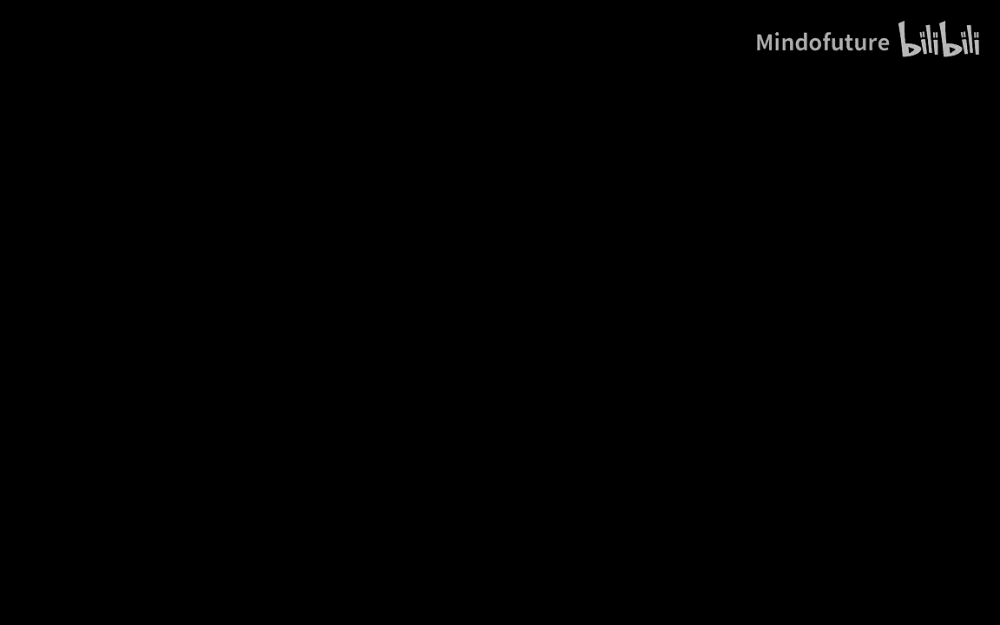
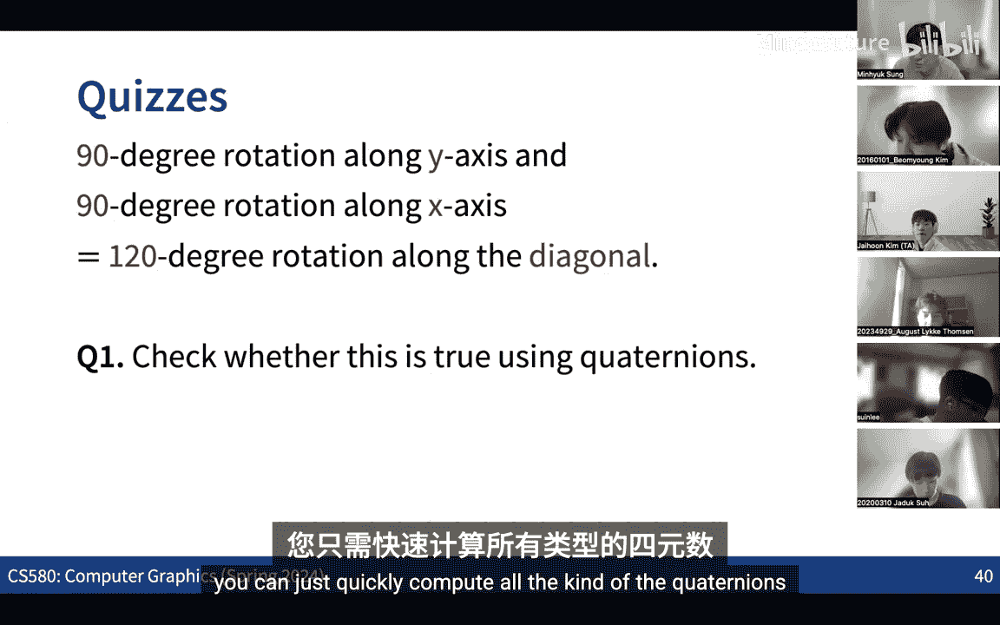
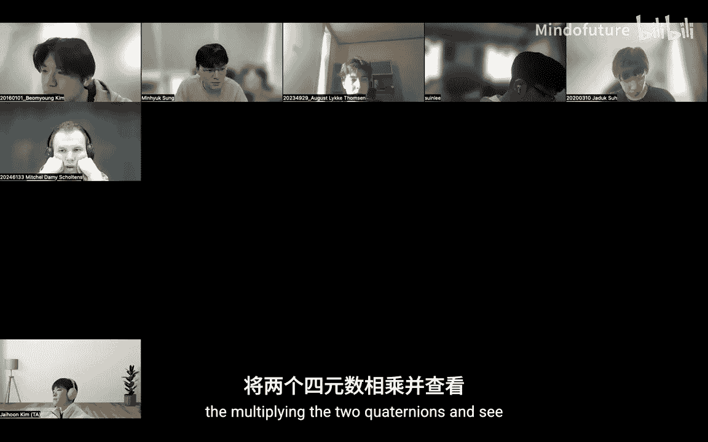
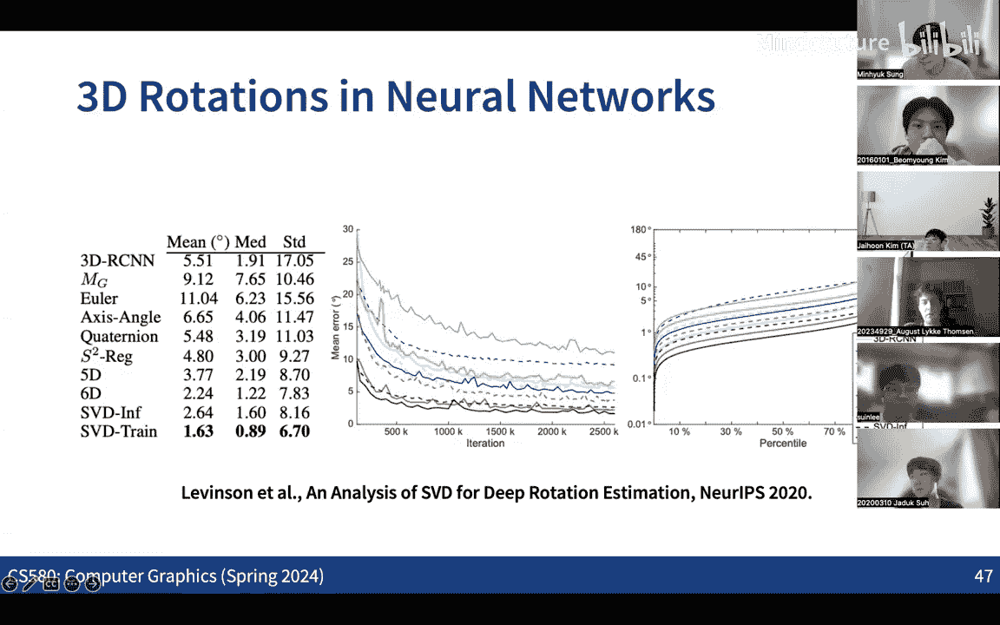

# 【韩国科学技术院】计算机图形学 KAIST CS580 Computer Graphics (Spring 2024) p02 P02 Lecture 03 - 3D Rotation   Quaternion (KAIST CS580, Spring 2024) -BV1he7mzjEc1_p2-

Welcome back to CS5 AD Comp graphics， so this is our second time at least third time。

So until today we are going to briefly review some of the basics in the counterctic that actually we already have discussed in the introduction of the course。

 so last time we discussed the basic the pipeline of the openG rest the framework with some kind of the components of the birdtux processor and the fragment processor and then we're going to also discuss the3D rotations and the quas today。

And also the important announcement is that we are not going to have the lecture this Wednesday。

 so we are going to take a break this Wednesday， so please check out this scheduleing or the course page so there is no class this Wednesday and we're going to resume the lectures next Monday and we start to work discuss some kind of the ideas about the rate tra next week。

Okay， so last time we briefly discussed some of the ideas about like some transformations。

 so do you remember what are the differences between across these transformations？So yeah。

 we discussed those kind of details or know basically the of transformation was kind of transformations that we are typically applying for many kind of the cases like having the model view the transformation。

And today we're going to discuss more about the risk transformation， which is basically the rotation。

 the combination of the rotation and the translation。

So rigid transformations are basically one of the very the common type of the transformations that you can see in many applications。

 for example， in many graphics the applications， you we consider making some kind of the virtual scene like this that we probably will basically compose some kind of the 3D models in basically placing those kind of the 3D objects in the virtual scene in a way that we are making some kind of new scene and basically like placing all these kind of the objects in the same would be basically applying some kind of the rigid transformations。

 basically translating the objects and also rotating the 3D space so those might be basically one of the way that we are oranging some kind of the objects in the 3D scene with the rigid transformation。

And also to make some kind of the animations like this。

 so we need have some kind of the articulated some 3D characters typically we're going to have some kind ofkeleton information basically have some kind of the joint and some kind of the bone information with some kind of information about the association between the surface of the objects and also the bones。

 points of the bones in a way that if we apply some kind of the rich transformation for each of the joint。

 they're going to also see some kind of some animations like this that basically how each of the parts of the objects the movie every time when apply some kind of the wrist transformation for each of the joint so those might kind of be of the applications and not only in the graphics but also in the robotics like the rich transformation is the most the common type of the transformation that we can see so we basically somehow many play some kind of robots to basically interact with some kind of the real objects or the real scene we will basically need。

basically apply some sort of the re transformation project the joint of some kind of the artology robots in a way that the antifactor of the robot can basically interact with some kind of the real the objects。

And also in the computer region， we can see many kind of the applications like utilizing this kind of the risk transformation。

 like one of the kind of the most common sort of the representative。

 the example might be the structural motion the structural motion is basically case from the multi view images we are basically estimating the pull of each of the cameras。

 the mod the transformation for each of the camera in terms of having some sort of the finding there some the relative the transformation。

 the rotation and all the the camera de are basically representative as the risk transformation。

 so basically the goal of the structure motion， the problem is that even a set of the kind of the multi images。

 how we can estimate the relative the rotation， the translation。

 so that's basically might need to basically learn from some kind of the computer visions。

And also at the end of the old lectures， we going also discuss some neural rendering topics and also in the neural rendering。

 basically this structure for motion is the most kind of the fundamental kind of technique so we basically assume that we are having a set of the multi view images and also the camera pose information then we are obtaining this kind of the camera poing information by allowing some kind of the structural for the kind of method which is basically getting this kind of the relative of the camera pose information represented as the risk transformation。

So here the question is that how are we going to basically represent this kind of the risk transformation basically one simple way is to use the matrix form that we discussed last time。

 so what we discussed last time is that any kind of the defined transformation can be basically represented as a kind of the four by four matrix and also with the homogeneous coordinates right so if we have the X Y z coordinate mis。

And having additional the qua for the homo just de coordinate is。

 then any kind of the arbitrary or fine transformation can be represented as a kind of the 4 by4 matrix by having the last low to be 0001。

When you feel bestP any arbitrarybit2 the numbers here。

 that will basically become the one of the online transformation。And also。

 what you can see is that herekDD screen numbers。ARe translation， right。So basically。

 when you basically pick any numbers here， those will basically present the translation。And also。

 if you basically want to represent some kind of the scaling or sharing。

 then what we can do is that while we basically making the identity matrix in thisline part。

 if we basically change the numbers in the diagon part。

 which is basically changing the scaling right？Or basically why we basically make this part to be identity matrix if we change two parts。

 the non diagon the elements， that will be the case that we are making some kind of decision in the transformation。

So here the question is that if we want to basically make some kind of some 3D the rotation。

 for example， like if we want to rotate some kind of 3 objects along some specific di axis with some kind of the angle。

 then how we can represent such kind of 3D rotation into the matrix form。

 which is actually not that straightforward right， so if we want to basically make some kind of rotation along the for example。

 like some diagonal the axis with some kind of 45 degree whatever how should we basically change all the numbers in the matrix form in a way that the matrix can represent the desired the 3 rotation。

 so that's basically not the simple way。So today， what we are going to do is that we are going to discuss some kind of ways to represent these kind of three rotation in a kind of the more the compact form。

So here the first question is that how many kind of the do we need to represent a 3D rotation。

 do you have any guess， if we want to represent any arbitrary 3D rotation。

 what would be kind of the minimum number of the the？Do you have any guess for them。

 so please post your answer on this slide。Yeah， so well， I mean。

 I'm not sure whether we can represent all the arbitrary 3 rotations3 the parameters。

 obviously the minimum number of the parameterss to represent any arbitrary 3D rotation is to have the three numbers。

And the simplest way to basically represent any arbitrary 3D rotations with the three numbers is to use the Ouler angles that we actually briefly discussed last time。

 so the Ouler angle is basically the angle which is basically the representation introduced by that Ouler who is famous with the Ouler Oulerient the pass idea with the 70 British in the city like finding some kind of the pest that is like passing the bridge like only one time。

 so he is basically the Swiss the mathematician in 18th century who was basically introducing many kind of the interesting ideas about like representing kind of things。

 we're gonna see what he has done in terms of the representation the 3D rotations today so the simplest idea in terms like describing any kind of 3D rotation is to basically have some kind of 3 numbers along each of the X Yz axiss。

So basically as we have seen in the last lecture， what you can do is that through of the X， Y。

 z axis， we can basically have some kind of the rotation angles， through each to the axis。

 and then we can sequentially apply those kind of the three rotations。

 so they can be simplest way to represent all these3D rotations and actually this way can basically cover all the possible three rotations。

 so that's kind of interesting。And these ideas of like you having three the angles for the three rotation was actually first introduced to basically control some kind of the flight of the aircraft actually those kind of three angles were basically called the pitch ya and the roll so here basically pitch is the angle basically controlling like either lifting or lowering the aircraft and the roll is basically the angle basically to control the rolling the left and the right like this and also the ya is basically the angle that we switch controlling the direction that the aircraft is basically heading to obviously these a basicallycu three terms。

To represent the three angles， especially in terms of like controlling the the flight of the aircraft and this kind of the idea like having the three angles to represent the3D rotation has been used in the many applications。

 so I'm not sure whether you absentbs seen this kind of the camera de stabilizer。

Have you seen those kind of things so this is kind of the some des stabilizer of the camera in terms of making some kind of the swim treasure cr when you basically shoot some kind of video using the camera。

And you can see that actually those kind of some devices have this kind of the zmb。

 which is some kind of the hardware implementations of the order gang。

So as you can see we are basically we are having these three rings and each of these links are basically making some kind of the implications for each of the axis in a way that we can make any kind of arbitrary these3 implications。

 so this kind of the gimbbo tree can be seen in kind of many kind of the some hardware devices so this is really really some kind of other implementations of the over end。

And as you can see and also the order like applying these kind of the rotations。

3 rotations are basically making some kind of the differences because the 3D rotations are basically not commutative。

 which means that if you apply the rotations in the order of the x and the y and the Z。

 or if you apply the same rotations in the order Dz and the y and the x。

 those two will basically make some kind of the different outputs， so the order is really important。

And there are kind of multiple ways to basically define this kind of the order or like applying these radio agentss。

Let me move to the next slide yeah so depending on the order that we are applying this kind of rotations actually there are some kind of the philosophy of the combinations even you don't need to apply the rotations along the three axiss so you can just like repeat applying the rotations along the same axis but still those all these cases or basically the cases that we can cover the the possible three rotations。

And but the interesting kind of thing in terms of this kind of the hardware the implementations of the order of the angles is that there are some kind of the limitations。

 which is called the gibo lab。So what's the kind of the problem of the jingbo lock。

 so basically the idea is that we are having these three numbers to represent all the possible these three differents。

 right？Which means that if we fixs one of those kind of the de parameters。

 then we will still have the two degree of the freedom， right？

So we guess two basically cover like the two degrees with for of the de rotations。

But some kind of dis situation is that if we somehow set the number for it to be one of the3D depro。

 actually then we can see some kind of the cases that actually the two out the rotation the parameters play the same role。

 which means that we are not only losing like one degree with the freedom。

 but actually we are losing two degree with freedom by only setting the one of the depro。

 that's kind of the interesting the cases， so let me show a video what this means。哦。

So how does Ouler work， This gimbal machine shows us。Each part is linked to one another。

 so when the parts slide around。We can see how the rotations are passed on。

By spinning each of the machines's three arms， we can rotate the jet into any angle。

But notice when the jet points up。How two of the circular arms match up？

This is exactly the same effect of gimballock， causing two circular arms to rotate on the same plane。

So yeah， as you can see here the problem is that actually we originally have some kind of three numbers like making all the possible like these3D locations。

 which means that if we know fix like one of the three numbers。

 then we're going to still have the two more the numbers that we can control， right？

But in some specialty cases， like when you basically set some kind of the number for one of those de parameters in this kind of specialty cases。

 the other the rest of the two numbers will play the same role basically making the same rotation。

 which means that while we basically set one of the numbers。

 we we are losing that only one of the derivative of the freedom。

 but we are losing two degree of the freedom。So that's kind of the problem that is called the gibo law。

 so depending on how we define the gimbal， actually there are such kind of cases that we can easily as we lose like2 deal5 the freedom by basically setting like one of the numbers。

So you please see this kind of the such kind of the cases in like the neural deformation。

 this is like one of the examples， so this is the case that we are having this kind of the X Y z model。

 which means that we are basically applying the rotation the alone the z axis first and then the y axis and then the x axis。

in this case， if you find the cases of the demo log。

 so what they can do is that if we set the 90 degree of the rotation along the y axis here。

That what you can see is that we end up seeing this kind of de rotation， as you can see here。

 the rotation along the x axis and the rotation along the G axis is we making the same rotations。

So this is one of the examples that we are losing two degrees of freedom by basically setting one number of these three parameterss。

いいです for you。Any questions on this。So if you any questions？If you don't have any questions。

 all of the questions that I have is that so now we are seeing this form will be 3D rotation right。

And can you guess what would be kind of be the axis of the rotation。

 like this final de rotationation。 So now we need basically control one of those the two numbers。

What do we kind of the rotations on which axis that we're going to see？いいです。So yeah。

 I recommend you to play away this kind of video rotations with some bunch of the cases。Yeah。

 it looks like rotation alone be some specific axis like z axis， y axis and the X axis。

 actually the answer is that the rotation of this matrix is not that simple the rotation。

So if you want to check what the kind of the rotationt that we're going to see using this kind of the matrix。

 I just posted the link， which is basically the kind of the website so you can convert any representation of the rotations into the other form so check yourself go to this website and see for any kind of variable 3D are in the gimma what be kind of ir rotations that we're going to see so key the thing is that while these matrix look simple。

 actually the rotation that we are making with this rotation is that that kind of simple rotation。

So this is kind of thingSo this kind of thing。 So we we can see this kind of the symbol of the cases with the order。

And also kind of thing is that while this kind of the older angleV representation looks quite like intuitive。

 there are kind of in many cases， let's say like for example。

 we want to make some kind of the compositions of the 30 locations。

 we have the rotation on the y axis with the 90 degree and also after that we also want to apply the rotation on the x axis within the 90 degree 90 degree。

 then model B kind of the final the output over the composition of these two rotation。

Well obviously it's not some kind of like simple the arithmetics like just adding these two angles like so we are not actually getting the 180 degree rotations that you add by combining these two。

 but interestingly like if pre combine these two rotations that we're going to actually see the rotation which is making the rotation along the divval the axis with the 120 degree。

So these are basically some kind of some complicated things in terms how are we going to easily see then we need combine some multiple and rotations。

 what do we kind of define all the rotations that we're going to see。

So in terms of like doing this kind of the calculationulation。

 actually the oiler angle is not the kind of the best， the intuitive representation。

So that's basically what we are going to discuss some kind of the other representation。

 which is especially good for this kind of composition of the rotations。

 so that's basically the idea of the quas that we're going to mainly discuss today。So at this point。

 before we move on to the quattans， do you have any questions or the overall angles？

Is everything quick。So yeah feel free to leave some questions both on the Z chat or this slide。

 so especially if you leave some questions on this left then it's easier for me to follow all the questions even after the lecture so lets and then yeah so let's then move on to the Quis。

So actually we want to find some kind of the another some representations for the three rotations。

 which is especially good for some kind of compositions。

And then before we actually discuss some kind of 3D rotations。

 let's briefly discuss some of the cases of the 2D rotations。SoFor the 2D rotation。

 we're going to also briefly see the ideaWB over the formula， the same over here as well。

So basically what we are going to see is that let's think about the。

 the2D space of the complex number， so we are having the real number the axis here and the also the imageaginary the axis here。

 so having these kind of the two the axis。Then what we can see is that any kind of the point over this 2 d plane is basically representing like one complex number。

 right？This is Korea。And we're going to also draw a kind of uni circle over this kind of B 2D space。

 then what we can see is that any point over the circle is basically corresponding to the1 2D rotation rate。

Because if we pick any kind of the point over the circle， then we can see the rotation。

 the angle from here to this kind。So there's the thing。

 like you can say that like any big point over this circle is basically corresponding to the 2D location。

And what you can see is that basically any point over the circle is basically having this kind of phone or the complex number。

 right？This is simple but we are basically having the little number of the axis as kind of the x axis and also the image if the number is kind of the y axis basically when at these two basically we are having the one the complex number。

 which is basically indicating one of the point over the two discle。喂。

And what the Ouler formula says is that actually this point。This complex number。

 the cosine pi plus the I sign pi actually can add this on。

 So these two are basically are exactly the same。It's kind of the interesting the part that this kind of the complex number are represented with the stmetric dysfunction functions actually can be rewritten with the exponential reform。

 I guess this is like oh both of you。Learn some kind of the person of your some kind of math courses people So yeah。

 so these are basically the oldester so it can also quickly see like how we get this kind of the results basically this is kind of the there are actually multiple ways to prove this one of the ways to basically having the the the expansion for the exponential deform and you you rewrite everything kind of in this way。

 they can see that actually this exponential de form becomes the same with the good sign the X plus the I sign。

So this is the oldest formula。And from the oldest formula。

 actually what we can see is that now if I go back to the previous slide。雪。

So what this means is that， no， every 2D rotation。Now can be represented into this form of the exponential rate。

Every 2D rotation with the angle the pi now also can be represented into this form。

 So there is some kind of the correspondence between the 2D rotation with these kind of exponential form。

So we can say that this is kind of the one of the ways that we are representing the2 de location。

And so what we can see is that if we multiply these two of these kind of the exponential deforms。

 that becomes the combinations of the two mutation right。Because。So as we can see here。

 if we multiply the two the unit de complexity numbers that becomes like some kind of another de complex number。

 which is also the unit complex number and also representing the combinations of the 2D rotations because that will result in the case that we are adding the two rotation demos。

So this is like useful effect， what we're going to see like how this can be extending this reading is。

 or this is like something that you need to keep in mind that we are basically having some kind of the form of the complex numbers that has these properties like the multiplication like these two complex numbers becomes the complex number which is corresponding to the combination so the two the occasions。

So this is kind of the interesting effect that we want to see。ああ会ちさんです。

So then the question is that how we can find such kinds of things， or the 3D rotations。

So like the question that the mathematicians in the 9th century had for regardingvering this kind of thing was that so yeah。

 we can see that we have this kind of the 2D space of the complex numbers we can have this kind of the present some kind of the correspondences in terms of the multiplications of the complex the un complex numbers becomes the combinations of the 2D rotations then the question is that can we also find some kind of the 3D space where the points over the Uni here corresponded to the 3D rotations and also their multiplication corresponds to the combinations of the 3D rotations can you see these kind of extension so that's what the mathematicians do like finding this kind of generalization。

So this was kind of the question that people have in the 19th century。

And only the mathematicians basically have some kind of the difficulties like having this kind of some 3D case and what the William Deron Hamilton found in the 1843 was basically the fact that actually we need not the 3D space。

 but actually 4D space， to help seen this kind of the relationship between the complex number and the three locations。

 so basically we are now having some kind of mapping of the 4D the Unipher。

In the 40 space to the 3D rotation。So there was kind of some great some kind of discovery by Hamilton。

 he was kind of the mathematician， Irish mathematician， the island。

 and he basically found this kind of the came up with this kind of the idea on the way that here basically heading to kind of some Royal of the Irish economy on the Royal the canal。

 so what you can find is that you have any chance to go to the doublin in over the Royal the canal on the bridge you can see this kind of some sort of the stone deepre which is saying this kind of thing。

特别。Next slide， so if you go to the doublin then you can find this kind of stem track。

 which is basically sort of like celebrating this kind of discovery by the Hamilton Disc the Quitonius。

Dius idea is covered that the fundamental de formula with quattonion so that's basically why we are calling this is kind of the quattonion because now we are not having the three dimensional space but the four dimensional space to represent the three de rotation。

This was kind of very interesting ideas in Tom like。

 extending the August formula into the 4D case for the 3D delocations。So yeah。

 if you have any chance to go to the W and just find this kind of storm problem just let you see。

Oh yeah， this is kind of the also the book that he introduced the idea to continue at the first time。

So we're going to briefly see what the kind of the meaning of the quoion how it is basically defined and also how it is basically related to the treat application。

So let's briefly go over with some kind of very muchip basics of thes。So quatonion is basically key。

 and now we are having the one real number。And then three imaginary numbers。Yeah。

 actually the mathematicians possibly were finding some kind of the all the combinations like having like one real number and the two complex number。

 the two imageaginary numbers and two real numbers say like one imageary number like all the combinations but the all the combinations in these 3D piece was not really working in terms like finding the mapping to the3D locationss and the answer was actually we need the whole image piece we did one real number D axis and threeD image imageaginary the number the axiss。

Well let's think about this kind of the new types of the complex number having these one real number and three missing numbers。

So now we are having the even three different types of the image written numbers， I， J and AK。

And since all these are the imagery numbers， they basically satisfy this constraint。

 this curve of like each of the image the number becomes the minus1。And additionally。

 that you are having this property， I times z is K。

 D times K is I and also K times I is a having this kind of property。And also here。

 the key thing is that the multiplication is not comm K， which means that when the I times j is k。

 j times I is not K。So having this kind of like non commicative property is actually one of the essential the property to find the mapping to these rate patients there。

So here the question is that so if the multiplication is not commut。

 when you know that i times j is k and j times k is I and it's k times Iz。

 what should be the J times a I？So let's point the answer of this。Yeah。

 so some of you might just like remember what the answer is。

 but you can actually also gear out the question in multiple ways。

 so if you just like drive all the kind of things then can say that actually j times Ie becomes the minus k。

SoCheck this out yourself so we are having like all those kind of the properties that。

Yeah these are some kind of essentially the properties of the quaus。

 like all this curve of each of the image the numbers becomes the minus1 and i times j becomes k j times k becomes I and k times I becomes J and the other way around like j times I becomes minus k and k times j becomes minus I and also the same and also the multiplication like all the image3 image in the numbers becomes the minus1 is coming from the previous two kind conditions。

Oh， this is clear， right？And we're going to also briefly see some kind of be some deinology with the quas。

 so we can first define the rule。So the norm of the dequatonia can be defined the same way with the defector。

 so when you basically think like we are having the four dimension defector the norm of thequatonium becomes the L to norm of the defect vectoror at this。

 so this is the norm of thequitonia。And we can also。

 as we define the conjugate for the typical complex number。

 we can also define the conjugate for the Potania Ne。

 which is the case that we are taking the minus for the all the image numbers。

And what we can see is that the multiplication of the quatonian Q。

 when each conjugate the Q bar becomes the security norm thequaion like this。

So this is the clear you can calculate this yourself and you can see that actually the multiplication between these two becomes the norm multiqu。

And also we can define inverse， so inverse is basically a kind of the quatonion。

 which basically results in that the multiplication with the original dequattanium becomes the one right。

For there the other way aroundで well。If we find this kind of the Quettanian that becomes some sort of the normalized the conjugate of the Quetanian。

 so this means that if the Qtanan is the Uniiquatanian where the normal thequattanan becomes the one。

 then the conjugate becomes the same with inverses of the Quettania。

So for the cases when we have the Uniquaion， the conjugate becomes the same way the inverse of the quaion。

And as we see like these kind of properties where the matrix the multiplication。

 which what we can also see is that the conjugate and the inverse of the product becomes the product of the conjuggate and the inverse but in the reverse order so we can also see in these kind of things for the inverse of the matrix and also the multiplplication。

 so it's kind of the same in the qua case as well。So if you take the conjugate and inverse of the product of thequas。

 that actually becomes the product of the conjugate and the inverse but in the inverse order。

 so those are kind of the properties that we can。So these are basically all the things that we can derive from the properties。

 the essential the properties that we discussed the previous slide。えにョ村です。

So yeah we're going to quickly also see another kind of the term which is the conjugation。

 so conjugation is basically different with the conjugate。

 so conjugation is kind of the operation defined by a kind of the quattonion which is also applied to the another quation。

 so we need talk about like the conjugation of the P by Q which is basically making some kind of the operation with the quation the Q which is now applied to the quattonion the P。

So again， this basically means that conjugation of the P by Q means that we are basically making the conjugation the operation with the Q。

 making this kind of the security operation， which is basically applied to the other the quatonia P here。

So you can see that this operation has this form， basically if you multiply the quaion Q and it conjugate on the left side and the right hand side。

 then it becomes this some kind of operation of the conjugation。

And the reason actually why we are seeing this like the conjugation de is that we don not see the reader also one kind of thing is that while this is kind of the multiplication like these two quas in the left side and the right hand side like this。

 actually this operation actually can be represented as kind of the linear function。

 which means that if you have this kind of like even the quation theq which is having this form。

If you make this kind of the four by four metrics， then when you also represent。

the quattonion D key into a kind of de form here， if you multiply this kind of matrix。

 that becomes kind of the output of the conjugation。

 so you can see how we can derive this kind of matrix from the definition of the conjugation here。

So it is clear so while we define the conjuation in the operation like this。

 actually like having this kind of the the multiplication piquitonian can be the same as kind like we are defining this kind of the four by four matrix and having the back form of the another thequitonian and doing some kind of de multiplplication to get defined of the opposite and that becomes the same operation as this。

So the ability because this conjugation operation defined with some kind of specific decoqu in the queue can have some this kind of the linear function。

 linear map default。And the interesting thing is that this conjugation the operation has many kind of the interesting properties。

So this is kind of the main part so what we can see is that if we see the norm of the each of the column of this kind of the matrix。

 we can see that the norm of the every rule and also the every column becomes the of the the norm。

Or the the input quo in the Q。And also， what you can see is that all the rules and also the all the columns are orthoslugonal to each other。

And also， if we compute the determinant of the entire the 4 by 4 d matrix。

 then the determinant becomes the eight times of the norm of the inputted quanttonia。He comesです。

Then can you see some kind of sub relationshiplation from this to the3D rotation？here， basically。

 what we can see is that if we have the input the quatonion Q。

 which is defined define this conjugation as kind of the unique quatonion。

So let's say that the norm of these Q， the quatanium becomes the one。

 what we can see is that the norm of each of the row column becomes one， right？

All the ruless and the collapses are also on each other。And the detroinance also becomes one one。

Or theユニコト on the case。Then if we only see this part。A thematics。

So it will be also the same and because like here the other the parts of S 000 and also the 000 from this。

 what we can see is that each of the row and the column will have the normal each of the row and the column will be one and or the rows and the columns will be ortho thrown to each other and also the determinant will be one。

This means that these parts of these kind of four by four matrix will correspond to the end of this radio rotationation。

So these are basically the properties of the rate rotation right。

 the matrix of this rate rotation has the property that each of the norm of the rows in the columns becomes the one and also the determinancies or one and all the rows in the columns are displayed also not the each other。

So from this kind of the linear map kind of some the deform of the conjugation the operation for the unique Catia。

We can see this kind of some kind of correspondence between each of the Uniquattonion and also the3D patient by having this kind of the contribution the operation。

So this is kind of the way that we can find some kind of the mapping between the uniquequas and these three rotations。

I this screen。Any questions on this。哦。Let me know一片 minute。Yeah。

 so this is kind of the operation that we can see some kind of the mapping between the unquatanion and the Sw rotation。

Then some kind of the analogy that we can see with the oldest formula for the 2D case is that also in the 2D case。

 what we could see is that the unit de complex number in the two dimension or de complex space was corresponding to the 2D rotation rate。

So now what we can see is that in this kind of the full dimensional space， the unique conion。

Is basically corresponding to each of the 3D rotation rate。So this is like one nothing thing。

 so also in the 2D case we just need to row the unisoccle and one of the points there was's corresponding to the 2D application and also for the 3D case now we are thinking about some kind of the some sort of the imageary some sort of the 4D manular dispute。

 which is called the3D3。you can see that the3 sphere basically means there some kind of some hypersphere in the4 dimensional space at any point over the hyperspher in the4 dimensional space is actually now corresponding to the 3D location。

And also the thing is that we also could see that the multiplication of the2 the unique deco complex number was basically representing the combination of the 2 d rotation。

And what we can also see without the proof here is that if you also multiply the two uniquequiania。

 then you can see that actually there is this kind of property。

So if basically compute the multiplication of between two uniquetonia and take the conjuation。

This becomes the same especially you first take the conjugation。

 the linear mapping the function and then multiplying these two。

 so you can from the definition of the conjugation in the previous slide。

 you can check this yourself so I'm just like omiing the proof。

 but from this definition actually you can check that the product of the quattanion and taking the conjugation。

 it's actually the same as taking the conjugation， the format format matrix takes from each of the unique quattanion and taking the product of these two。

And from this product， since we also see that each of these four by four matrix coming from the conjugation is also corresponding to the 3D rotation。

What we can see is that the multiplication of the Uniquatonion is also corresponding to the combination of these radio locations。

So this is also the same with utilities twoities。So this is basically what we wanted to find in this re teaching case。

 so in the 2D case we had some this kind representation that the multiplication is corresponding to the combination of the two。

 we also seeing the same case， the multiplication p unique conion is corresponding to the combination of these re。

So I recommend you to check this out of whether this is true or。

And also the other thing is that these are the cases that we are having this kind of complex number where the real number parts becomes the cosine of the pi。

 so when the 2 d rotation is represented with the angle of the pi。

 the real number part becomes the cosine pi， and the image the number becomes the I times the sine pi。

 so we are having this kind of two numbers in the 2D rotation piece。

And then what we can see in the 3D case is that also the real number parts becomes the cosine of the not the theta。

 but the half of the theta， so when the rotation is basically having the angle of the theta along the axis the u vector U。

But what we can see is that the real number per becomes the good sign of the of the data。

So this is the difference， so we are not just having the cosine the real number parts。

 but we are having the cosine of the faculty that the real number part。

And also the norm of the imagery the， the coefficients of the imagery de。

 the norm of those kind of coefficients becomes the sign of the faculty filter。

So this kind of analog we need to the case， but the thing is that we are not telling at the top but here what the faculties about here。

And also the coefficients of the 3D inity numbers also represent the axis of this radio attention。

So that's kind of the analogy between the 2D and the3D。Inter。

So you might be wondering like how we can basically derive these kind of results。

 like how we can see that know from the unique quatanion know how we can see this kind of correspondence with the angle axis representation of the the rate rotation actually one way that we can also represent represented rate rotation is to just have the having the axis of the rotation and also the angle。

So when you also want to know the axis of the de rotation and also the angle of interpretationplicationtation from the Uniquatania。

 we can find those kind of axis and the angle in this way。

And the question might be is how we can derive this kind of demand from Uniquaunia to the axis angle and there can be some multiple ways to do this。

 so I'm going to skip some of the details here， you can also check out some of the more details in the slides one of the ways that we can check this out these basicallycu using the loadris deform the Holland Greek is also the French the mathematician was also working on those kind of things and the loadri and the Ouler those two people were bis basically deriving all these kind of formulations in 19th century so you can check this out。

Do the over and the lowest formula， what we can see is that let's think about that we are making the rotation along the unifactor decay with the angle is set up。

So here the question， first question is that when you want to make some kind of 3D rotation with the axis k with the angle thezeta。

 rotating the vector v with the rotation the axis k and the theta。

 how we can represent this rotation， having this kind of the axis k and thezeta into the 3 by 3D matrix wall。

SoThis is like all about the lous deformmeter， so you can basically check out those details later。

 but briefly what we are doing here is that for the given the vector B。

 we can decompose this vector B into the parts which is parallel to the vector k。

And then vector the depart which is orthoal to the vector decay。

So given any kind of arbitrary director debris， we are decoating this to the two parts。

 like one is per to the axis key and the other one is the it was to the axis key。

But then what we can simply see is that the federalroll reports。Doess not need to rotate。

It goes this re parallel to de axis， so we can hit this part。

We only need to apply the rotation for the part which is also known to the rotation the axis。

 then what we can see is that the vector which is also known to the rotation， the axis key。

 especially just very applying the 2D rotation， right？So in this kind plane。

Wwhich is basically orthoal to the rotation to exist k。

 basically taking the axis k as kind of the norm， so in this kind of the 2D plane we can apply the 2D rotations for this kind of the orthoal part。

So these are all the conditions about this， so we keep the app parallel the and applying the2D rotations for the orthoal part then you can basically derived all the formulation here is like one small。

 the detail is that this is kind of the notation that we are representing the first product as kind of the matrix for。

So when you're basically having like the two3 dimension major D vectors like having the course product。

 actually this kind of operation actually can be bewritten by just taking a kind of the matrix form be writing this。

Actor and the cross product into the three by3 matrix form so this is representing replacing this kind of cross product into the three by3 matrix making some kind of chssymmetricmetric matrix you can talk about some details later。

So from basically this kind accumulation， what we can see is that given the rotation。

 the axis k and the angle visit， we can derive this kind of B。Yeah。Matrix form。

 three by three matrix form of the rotation， which is basically derived from the rotation the axis a and the rotation de axis data。

Check this out yourself later and what we also see is that if we has some kind of uniquequaunion with the a answer。

B。A plus B I plus Cj plus Bk when you have this kind of the unique quattonion representing a3 rotation。

 the conjugation the operation also basically mapped this quattonion to the this 3 by3 dimension matrix right。

This is exactly coming from the previous slide。So， and these two should be identical。

So here the question is that how we can find the rotation Dx key and OzD deelta that makes these twomet to be the same。

These are all these kind of some simple population yeah， you can check yourself。

 So what you can see is that if you basically make this the sum of the diagonal to be the same for those and these two matrix So the sum of the diagonal2 to be the same right So if you check this out then you can see that the a should be cosine of the half of the setup also basically take sum of the sum parts of the diagonal thumb。

 you can see that the B should be these and C and D should be those kind of things from this kind of the information。

 you can see that when you have the。So these are some kind of details， but so when you have the。Yeah。

 here having this kind of the。uniquequaia with the coefficients of A，B and D。

 then we can directly derive the rotation the axis and the angle。到啲就我过佢。Iに questionちさです。Yeah。

 so I'm skipping some details， but you can also check out those details in our the slide I will I already posted the slide on the course of page。

Okay， check this one so from this also what we can see is that you now can see how we can convert across the multiple the representations。

 given the like the oiluler the angle。Okay it's each to see how we can convert this into some kind of this3 by 30D matrix one。

And also from the uniquequa tan。We can also convert this unique qua into three by three matrix should be and also from the Uniquaion。

 we can also convert this into the axis and the angle from。

So we can do all kind of conversion of course the all different representations of these radio。

So yeah， so we check out this kind of the way that no we are。嗯。Yeah。

 making some kind of some convergence across the different representations of this reader。

Any questions on this？So here， actually also the interesting equation is that。

Is the mapping from the unique qua to these 3D rotations is the search active is it the own term mapping。

 which means that for any kind of the arbitrary this 3D rotation，Does it exist， I mean。

 can you find some kind of un quatonia that represents any arbitrary reation？It's the O relationship。

Yes， actually toC is true so for any kind of the arbitrary rot rotation you can find any kind of uniquequatonia that satisfies this kind of the。

D四 relationship。Yeah， so if you have any kind of three rotation with the RV3D axis and the angle。

 you can always find some kind of unique quaunion that is corresponding to three rotation。

 which means that the mapping from the unique quatanion。

The mapping from the uniquet to the 3D rotation has the subjective mapping。

There always exist a uni quatanion that is basically mapping to the arbitrary discrete rotation or any arbitrary rate rotation we can find a Uni。

And the other question is that， is this mapping the one one mapping？Its those of the inject。

So for the so we know that for any arbitrary rotation， there exists a。

There should exist one or the many Uniquatonia right。

 but then the equation is that is thequitonion is like is there like only one single decoquattonion where there can be some multi decotons to the three location？

So here the answer is that actually there areligages always two distinct the Uniiquatons that corresponds to the3 rotation。

 the thing is that if we see that the Uniquatania Q is correspondinging to some specific3 rotation which is as theR。

 and we can see that actually the minus Q is another Uniiquatania that is also corresponding to the same3D rotation。

So that's kind of thing， so if you basically derive older thing that you can see that actually when the Q represent the rotation of the axis of the U and the angle deta。

 actually the minus Q becomes a unique quatonion that represent the rotation with the direction rotation that axis with the minus u and the two pi minus theta。

So whether you have like rotating like this。this way。

 and fliping the rotation de axis and then rotating only two minus minus theta the degree， the angle。

 and these two becomes exactly the same。Along rotating along these axises with the pi and rotating along these axises with the two pi minus is that become the same rotation right？

So this is kind of an interesting fact。There always exist two distinct decoquiuns。

 Uniiquuns that represent the same rotation。So this basically means that there are some interestingly two2 mapping between the uniquatonia and theseations。

And we know that basically the unit continuous specific some kind of points over the unit sphere。

 unit hyperspe in the full dimension space。So there can be。

 we can also see that there are some basically two to one mapping between the points over the four dimensional sphere。

 the sp to the three euro stations。Especially the two the opposite points， two antipos。

 the opposite points over the 4D rotation， 4D spheres。

 the 4 some imagery 4D spear are basically corresponding to the 1 3D rotation。いすく？So yeah。

 some kind of the imperson mapping so you basically make some kind of the cut of this pair that you can see this kind of auto mapping but so you should be careful because on the border of this kind of the cut you also the two points so it kind of complicated so basically we are having this kind of the two to one mapping between the all manually the unit pair with this radio rotation this was the very interesting binding by the Hamiltonton with coordinates。

Any questions on this？喂。嗯。So if there is no question。

 then let me ask some question and see whether you have understanding of this。

So in the previous slide we have seen that the rotation along the y axis within the 90 degree and followed by the rotation of the O the x axis within 90 degree actually becomes the same with the rotation of O the dion the axis with the 120 degree de rotation。

Then you check whether these two are actually the same using decoquas。So let's check。

 so you can basically calculate the combinations of the two rotations using the quatania and see whether that quatanion needs would be the same way the quattania is presenting these rotation。

So let's check this and please post your answer on this slide。So we have enough time。

 so I'm going to give you five minutes to work on this。

Yeah maybe you can check out the answer yeah I also post the but you can just keep only compute O be kind of the。

The quarter， the multiply the two quarter years and see。

呃， let me行。If you can can you see my。Yeah， you can check out the multiplication of the two buttons and see whether these two are。

The same way theこに the one2 degree of the。Oh so those are kind of things。

 so let me also kick quick over some kind of thing more the properties of the quos。

The first question might be that given a unique quaion of this。

Which is corresponding to some specific rotation。We the rotations， we the rotation they are here。

If we take the conjugate the quatonia， or this is the Uniiquatonia。

 so the conjuggate should be the same with the inverse of the quatonia。

Then what does this kind of the conjugate word imverse we continually represent in terms radio location？

아你不问题す。No， this is question， by。不一。Can you see my slide？So if I'm asking this question。

So given a quarter when you know that this quation is corresponding to this rotation R。

 if we take the conjugate or inverse of the quotion。

 then what does this kind of the inverse of the conjugate represent the。あW threeの。

So basically flipping the axis of the rotation if is some kind of relationship with axis and you can see that they conjugate what inverse of the unique quattanion is flipping the rotation should the axis。

 which means that it now represents also the inverse of the rotation rate， so it basically simple。

 the imverse of the unique quation represent the inverse of the rotation。

And given the two rotations represented with the two uniquecons of the QG and the Q1。

 and how can you also represent the relative rotation from the Q0 to the Q1。

So what we can see is that let's say the R0 is basically rotation3 rotation corresponding to the Q0 and the R1 is the rate rotation to this 3D corresponding to the Q1。

 so let's say this QR0 and the R1， these are the 3D matrices representing the rotations。

 then the relative rotation of these kind of the matrices。

We will pigant as the r you inverse at times the R1， right？So it's the thing。

 so when you take the represent the relative rotation from all those the properties。

 we can see that also the relative rotation can be represented into the quaion form as's going to be Q0 inverse times Q1。

This is clear， right， well the inverse of the quatonion is corresponding to inverse the rotation and also the multiplication the quattonion is correspondingpon to the multiplication of these 3D rotation emerge。

And also the other thing is that so when a unique qua  Q corresponds to the rotation。

 we the axis a and the data。あい pickデフイデの。You to我的ポtaia。Q to the 0。5。

 then what does the this rotation， this quatonion represent this three rotation？

Because what we can see is that somehow if we can have this quaion。They pre multiply these twice。

MD cBQ， right。Which is to becoming this rotation。So it means that the sort of the secure route to the ktonia should represent the halfway way of pur tissue。

Pdically。Pro what you can see is that basically the sort of the secure loop to the continuous should represent the halfway of the kind of rotations。

With the hypo of the angle while having the same access。

You can also check this out basically in some kind of more technician。

So we can also general this fact， so in terms of if we have the Q T。

 this will be the case that we are having the rotation to aR with the same axis with the t times the theta。

可。你话，你写微。So from this， what we can see is that so actually as kind of one of the applications of all these kind of 3D rotations and the rigid transformation。

One of the application was making some kind with animation measure， right？

So let's say we have the rotation of the r and0， let's say three by three matrix， and also the r1。

We want to interpoint between these two 3D rotations。

Which also has the corresponding the quatania theQ0 and also the corresponding quaion DQ1。

And we want to smoothly inter between these two locations。

 that these kind of very essential things when you want to make some kind of animations moving the camera or moving some kind of the objects or moving the joint。

Partity objects。And how can you make this kind of the interpretation？

So what we can see is that the relative rotation from the Q0 to Q1。

Can be represented in the previous slide。In the previous slide。

 what you can see is that the relative rotation can be represented as this。

So what this means is that we can interpoint between these two rotations by extracting from the Q0。

And applying this relative rotation while wearing this。NoT。

 we are basically making the quaion the power of B T。

 while basically bringing this T to be zero to one。So by taking this kind of the competition。

We can interpolate the3D rotations with the quaion。So this kind of also kind of easiest way， I mean。

 one of the applications thequaunion that can be also used for some kind of interpolation of these radio rotations。

And also here， the question might be is that， then how can you compute the power of the un right？

So given this kind of the fact， when you have the cutivity， you all diqutaia。

 how can you compute this？Well actually competing this can be done kind of opposite way because we know that Qity T should represent this rotation。

 so this will be the case that we are having the axis of the a and also the angle of the T times the right。

If we know the axis and the angle， then the other way we can compute the Uni quaunion corresponding to this rotation。

 so this can be the way that we can easily compute the cut。

And once we have the way that we can compute the Q to T。

 then we can interpolate the two 3D rotations by living。Theses kindop be formulations。Make sense。

And also one more interesting effect is that if we do this kind of interpolation with the quatans。

 actually that becomes exactly the same as kind of like we are interpoolating over the olddiaginous sphere a Uniquatanion with some kind of the constant of angle。

So this kind of the interpo over this sphere is open called the slope， speaker linear inter。

So it we take the slope speaker linear toppolation interating over the full dimensional sphere with the constant angle starting from the Q0 representing the sort of the initial de rotation and Q1 the target rotation。

 so it could take speaker de interoppolation over the full dimension space。Actually。

 this kind of installationulation with the constant angle becomes exactly the same having。呃。

D competition。嗯あなこな。Prorovbide all the proof for this because if you take another these means。

 you can if you are interested in some more details。

 then you can check out those kind of things in so many kind of the articles on the online and this I posted a link on this slide but this is like one of the kind of the material that you can check out this kind of relationship。

Us the quaia， you can also compute this kind of in of rotation。

You can also check out these are all the identical some kind of formulations for the same data populations。

And one quick finalmark is that we can also think about like how we're going to use these kind of some representations of the3 rotations in neural net tasks。

 so this is not the machine learning or the learning differencess。

 but there can be actually many kind of some graphics related applications that you might need to idealize some kind of neural net。

 which is predicting some sort of the 3D rotations， right？Then actually， as you can see。

 there are multiple ways to basically make the neural to predict some parameters of the3 rotations。

 we can use the axis angle representation or o angles or the quauns。

 even having these three by3 matrix， right。So which representation is the best。

 so there can be lots of kind of be some kind of ways that we can make some kind of neural predicting three ir rotations and which representation is going to be the best for those kind of tests would be kind of interesting questions so if we also increasing those kind of things。

 I also recommend you to check out these paper that I posted on the slide so these papers will discussing some kind of some details about which representation is the best or is some neural prediction between3s。

Lots of the interesting things。Any questions？So this was kind of the quick overview of some kind of some essential things about some restorationization and some three rotation kind of things and I hope that these would kind of be useful for many kind of other so when you implement some kind of applications and also especially for the New Orleans during the contest that we are going to do at the end of the the course and we are as I said。

 we are not going to have the lecture this Wednesday and we're going to read them all the lectures next Monday we starting to discuss some of the ideas for the re。

And if you have any questions on those kind of things。

 please leave your question on this left and I will also go over your questions and follow with that。

Okay。Thank you。はい。

