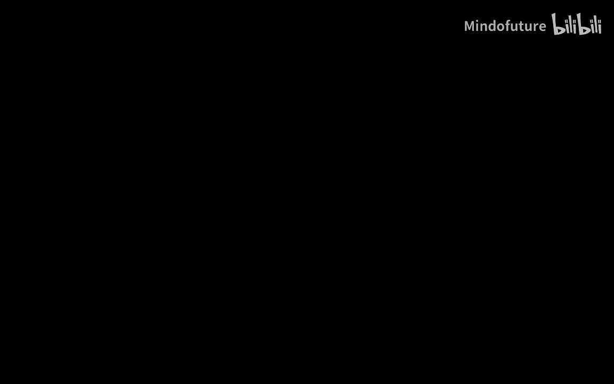
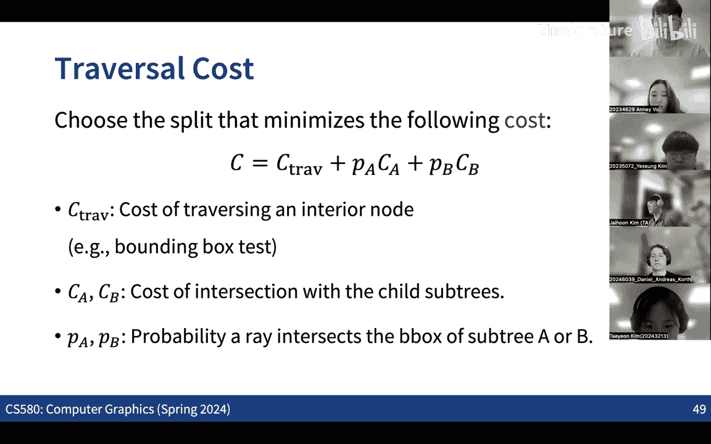

# 【韩国科学技术院】计算机图形学 KAIST CS580 Computer Graphics (Spring 2024) p03 P03 Lecture 04 - Ray Tracing (KAIST CS580, Spring 2024) -BV1he7mzjEc1_p3-

こ。

Okay， so yeah， let's discuss things that for today topic。

 So last time we are basically discussing some kind of the very basic the open gel the the rendering field pipeline。

 which is basically utilizing the re the idea and also be discussed some kind of some ideas in terms of how we can express some kind of the 3D transformations using the the 3D rotations using the quas so those are basically some kind of images that we can easily render using some kind of the open gel based code。

 we can say that it looks kind of be okay with some kind of the sample the shape and also kind of the texture and color information we can basically render some kind of the some 3D object into the two images。

And this are typically something that you can also basically get as kind of the the outputs of the assignments of the introduction of course the CS3A course basically all the assignments are basically implementing something within the open gelL and basically getting this kind of the outputs which is involving quite some kind of programming you should be able to basically program of the things in the project shader and the fragment shader。

 many kind of the complicated things， you also should be able to basically manipulate all this object in terms of the transformations which means that you should have some understanding for the quatan and many things but you might be kind of disappointed。

 actually the output are all kind of complicated the programming。

 it turns out that we are getting this kind of the quality of the outputs actually what we are basically expecting as kind of the output of the rendering is this quality images So this is not a real quo but some kind of the output of the rendering where you can see some kind of。

Very realistic photo realisticistic details in terms of like having some very details of the old geometry。

 but also having the lighting and the shading and the shadows and basically having all these kind of some high details and kind of quality is in terms of like all the part of images。

So the focus of like this course is basically how we can achieve this kind of rendering the outputs by switching the rendering the pipeline。

 so that's basically what we are going to do and discuss in this course。

So what we have discussed in the previous time especially the re addition， the pipeline。

 while what we are going to discuss today is more about the rate testing and also the rate tracing。

So the difference between the respiration and the ray tracing is actually nothing but its more about whether were going to basically project all the things in the 3D into the 2D plane first and do some kind of the process in the 2D plane。

 or are we going basically not just like protecting things into the 2D plane first。

 but actually shooting the array from the camera through the 2D plane into the 3D space。

 in terms of that basically not just like port things。

 but kind of like fetching some kind of the color or some kind of material information from the region where we're placinging some kind of the intersection between the array and the 3D objects。

So that's kind of the major it differs between the retro and also the rate testing and the rate tracing。

So in PC a little bit more details about each of the algorithm buddism， the respiration。

 the pipeline typically has this kind of form， so what as we discussed in thequise lecture。

 what we are basically having is that we are first basically initialize the Z buffer which is having the same size with the render the image and for each of the all the triangle we are projecting those triangle into the 2D plane and we start to par about each of the pixel inside the triangle which also so called the fragments so for each of the fragment we are basically interulating all the information that are basically defined for each of the purposes of the triangles。

 so interolulating information defined the purposes of the triangle in the 2D plane defining some kind of the colorline information and also the depth information and if the depth information that we are calculating is basically closure。

 that the depth that was this stored in the G buffer that we are basically updating the information in the image。

So this was the very difficult idea， the pipeline of deter。It is clear。

 so these orders is something the we discussed cost last time。

So we first project all the 3D triangles into the 2D plane and for each of the triangle。

 we start to see what are the pixels that are included early to the projected the triangle。

And in the 2D plane， we are interolulating the information that are defined over the purchases that will basically determine the color and the depth many things according to the pixel。

And basically we are getting the depth information from the completionation of the triangles。

 and if these depth information is get closer than the depths that we are having in the depth buffer。

 then we are replacing the information， the color and the depth information for the pixel。

So we keep it creating this kind of process for every single bit triangle for we also to the old depicts of information。

So this is the very typical framework for the arrestization。

And what we can see is that FD ray tracing and also ray caing is kind of the opposite。

 so we start to care about all the pixels， not all the big triangles。

 so for every single pixel what we do is that we are now shifting a array from the thermal decenter you making the array which is the present theory of the pixel。

And see you which you know where this ray is basically intersecting with some kind of 3D objects。

 so you can see some kind of the intersection between the ray and some 3D objects that we can now retrieve some kind of the color or dimension of information from that the point we are seeing the intersections so in that way we can basically update to the pixel。

So this is kind of different way that we have basically updating each of the pixel information。

Which sounds kind of very similar with the restaurant edition。

 but we're going to see it was kind of the advantage like this kind of approach。

It is clear the difference between the ra radiation and the tracing。

So in the re is basically you know object first， for each of the object。

 we are projecting them and then see what are the pixels that are included virtually triangle best updating all the pixel information。

And the array tracing is basically the pixel first。

 So for of the pixel we should array and see at which point over the 3D object we are making some kind of intersection between the array and the objects and then eting the color over the me information from the point of the3 objects to update the pixel information So that's kind of the major difference between the reization and the array。

Actually， this rate testing is basically a very old idea， which was first introduced in 1968。

 which is 56 years ago， so it's quite a very old idea。

 so we chose basically the idea that we kind of like sulating the lighting kind of this okay for the process。

So basically the idea case that we are really simulating the optical process might be is actually starting from not from the camera but actually starting from the light spur。

 so as you can see if we really wanted to have some very precises simulationation of be optics what we can do is that were really simulating all the kind of light tubosome so starting from the light spurs we are fitting all the ways of the light and see where basically these laser are basically intersecting with the video objects and also know basically tracing all the kind of the ray in terms of like know which what are basically the rays which are basically reaching to theplain。

So in a way that we are really basically assimulating all this kind of dis tra of the rays。

 they are basically reaching to the user and then basically calculating multi information。

But the problem like this kind of the process is that there might be a very small amount of bes which are really arriving to the in plane。

 so there might be very low kind of the heat late in terms of when you see like how many of the arrays are really basically you know coming back to the basically image plane。

 there might be very few number of bes， which means that the computation will be very inefficient。

So in terms of like handling this kind of intficiency， actually we go in the other way around。

 so we are not starting from the light source， but actually we are starting from the image plane。

 which means that we are back tracing all the ray from the image plane to the light source。

So what we can basically do is that instead of like shooting the array from the laserrs。

 now we are shooting the away from the eye point from the camera the centerer for each of the footage of the pixel we basically shooting the array and check the intersectionction point with any of the 3D objects。

As you can see here， we are shooting the three。Yeah， right here。

And we see some basically interesting point here。And the way that we can basically update the pixel information might be that we can somehow retrieve some kind of the color hours and any other information from this point。

 which will basically update this pixel information， right？

But here let's say what we also want to do is that we also want to determine the color information not only based on some kind of the some you know inherent kind of property of this surface。

 but also based on the light here。So what we actually do is that we are not only basically checking this point。

 but we actually should read again to the line source。To check whether this point。

 not only visible from the eye point， but also from the light source。

Which means that if there are some kind of the occlusion。

 which it is clearly occluding this point from the Lyrs。

 then this point will will not display receive some kind of the ray from thely source， right？

Which means that this point will be dark， so we should basically bring some kind of color information from this point。

So basically what we are going to actually discuss in the rest of this course is that basically how we can model these kind of thele kind of things in terms of when the calculate the color information at this point。

 we are not only basically car about some kind of the surface property at this point。

 but also some kind of the light information from here and also checking whether this point is also visible from the light source as well。

In terms of that we can calculate the color information based on this service property and also the license source property and then updating this pixelix information。

So for some more details about the reflectionle system in terms of how we're going to really calculate the color at this point using both the surface property and the the lightrs the property。

 we can also discuss all these kind of things in the rest of the course。

But this is basically the basic idea for the ray testinging。

 which is basically caring about utilizeers in terms of updating the color information。It is great。

 Any questions on this？So this is basically the basic idea for the raycasting。

 but the thing is that if we really wanted to have some precise dissimation for the optic system you know the light。

Thelect at this point would not just like come from the directly from the light source。

 but there can be some many other kind of the passeses that is like coming from the license sources to this point。

 right？So there can be many other ways around basically some， I don't know。

 make some kind of reflections with the authority3 objects and also the the light arrives at this point。

So to basically handle all these kind of the cases。

 actually we need to be we should be able to be basically iterly update this kind of the information。

 so what we typically do is that we are not only basically caring about the first the point。

So let's say when you shoot the array from the camera center to this3D space。

 and this might be the first point that we are seeing some kind of intersection。

Then also what we can do is that we are also know checking no。

where the array basically should be reflected using some kind of the reflection model as well yeah so basically when you specifically have some kind of a spectral reflection。

 then we can calculate where the rate should be reflected to like this。

Then we are also having the on intersection into the 3D objects。

And we can repeat this process right so until we have some kind of some speculative reflections over these 3D surfaces。

 we can iterate having this kind of be secondary that having another intersection with these 3D objects in terms of like tracing all the path of these 3D objects into the 3D space like this。

So as you can see， this is the case that we're having some lead selection。

So the ray is basically reflected over this surface and this is another case that we are basically seeing some kind of the inf。

 which is the case that even the array is like passing through the objects。

 which is basically not making branch of the arrays。

 so we keep it all this kind of like the process basically shooting the second ray in terms of that we are really reaching to either the laser source where we are basically reaching to some kind the maximum iterations。

And then now we can calculate the color of each of the pixel here by accumulating the color information that we are calculating all the intersection the point。

And when also when you basically determine the call information for the all the intersection the point。

 we also should the ray to the light source to check whether this point is really basically visible from the laser source or not。

 whether we have some kind of the equationence here or not。

 so based on whether this point is basically includedd or not。

 we can also determine the call information at this point by combining the material information at this surface and also the light information。

Which are basically seeing this point。So this kind of the iterative process， like basically。

 really traverscing a tracing all this kind of kinds of the arrays are basically they call the rate tracing。

So the difference with the rate testinging is that rate testinging is the case that we only care about the first intersection point。

And at this in that first intersection point， we determine the color information by shooting the array to the light verse。

 which is called the shadow array。And the array tracing is not only car about the first intersection point。

 but we also really trace this kind of tu of the arrays by shooting the second array。

 which does be determined based on the reflectionle the model。

So at this point we should be another secondary which is the direction is determined by the some the recollection kind of the model and also the another array based on the reflection as well。

 so we keep it creating all this process in terms of like having this kind of the trajectory all the arrays and for every intersection the point we also should the shadowy to the lightrs to determine the all the kind information。

In the final the pixel the color information means to be determined based on some kind of the linear combinations of those colors。

 so this is kind of the rate tracing system。And你 quite this。So as you can see。

 especially when you see this kind of like re the system。

 the major difference with the restorationization is that for the restorationization。

 we cannot really deal with kind of the you know some kind of the light interactions with the surface。

So since we are basically shooting the reallyD array into the 3D space and so since we can not trace all the arrays into this kind of the second array in the path。

 now we can really calculate this kind of some， we can do some kind of the more precise sort of the OPs innovation in terms of precisely determining all the color information and also finally basically calulating color information for the pixel。

But in the restorationization， since everything is basically just like projected into the 2D plane。

 we cannot really have this kind of the calculation。

 which is really caring about this kind of the ray and the object the intersection and also updating the color information based on the line source。

So which means that the rate tracing can be kind of the sorry the reization can be some kind of the faster system。

Wwhich is also typically basically accelerated by some kind of the hardware or the implementation。

 but this cannot be some kind of the accurate create some kind of the rendering the system in terms of that we cannot track all the lines in this way space。

And compared to the reization， the advantage of the rate tracing is that this is becoming more accurate some kind of simulation of the light tripole。

 but obviously it is having like more the computations in terms of having the second rate and also the shadowter rate holds more kind of the precise the competition。

 which is involving much more the competition and also the competition becomes like much more expensive。

So that's the basic idea and also a big comparison based on the re and also be rate tracing。

Any questions on this？So how long does it take some time so if we actually see go back to this kind of the very basic kind of the rendered image。

 so this is basically the image which was first introduced in the 1979 some years ago。

 so as you can see this was kind of the first kind of the rendered image which could be able to basically handle this kind of the transparent object。

So with the restorationD pipeline， it is impossible to have this kind of be some sort of transparent object because we don't know how we can deal with these kind of things in the re DD pipeline。

 but in the ray tra the pipeline， we can should be ray not only basically having the reflection over the surface。

 but making the rate to be to pass through inside objects and having some more the precise dissimation。

So now we can start to render this kind of the sort of the transparent object in the same。

So this was kind of the first image which was basically rendering some kind of the transparent object using the ray tracing the system and at that time when this image was introduced。

 it was taking 74 minutes to render the simple image， which is taking lots of the time。

 but after like some decades later， using some kind of the better the computer now we can render those kind of things in the six seconds and if we use the GPU now actually takes like real time basically taking like130s of the seconds。

But how about like if we have some more de complicated creative kind of things？

So in the sort of the history of the comparative the animation。

 one of the kind of the famous example like which is fully utilizing this kind of the array tracing the system is this animation。

 the curve from the pixel， which was really in the 2006 so actually some kind of the characteristic of like this animation was that this was kind of the case that there are lots of some kind of the3D objects that have this kind of spec the materials over kind of the the surface。

 so basically all the curves but basically having the metals which means that all these surfaces are basically some spec materials。

 which means that we really need to calculate these kind of the selection of the array over the surface which will invoke lots of the computation and this is also the animation that you can see tones of the curse in a scene so actually if you see how this animation was created if you they were taking tos of time for the competition so even for like when。

During a single frame the mission， they said that actually sometimes it took like in average it took 17 hours using the machine at the time and sometimes just like to render a single frame。

 they say that it took like a week so which is kind of the output of the super heavy computation for every single defect so this was kind of the sort of the extremely case of like fully utilizing all the ray tracing the system took at some very know precise and realistic images by assimulating all this kind of the rate tra。

Any questions on this？So basically in the programming the assignments。

 what you will need to do is basically implementing the very basic system。

 which is rendering the images using rate tracing the pipeline。

And the first step to basically implement this kindundolent ray tracing the system is basically to implement the ray surface in the intersection。

Obviously that this is the first step， so for each of the camera model and to the image plane。

So like the task drill in the pro the assignment is to basically shoot array from the camera to first to the image for of the pixel in the image screen。

 and then you should be able to basically check whether this three is basically intersecting to the any of this video projecting the scene and what's the exactive point that we are having the intersection。

So we should be able to calculate these kind of things。We see its actually very essential task。

 not only for the array facing the system but for the many other things。

 so this is also required not only to check the intersection between the array from the camera to the3D objects。

 but also when you shoot the shadow array when you also shoot the array from the object to the light source and check any kind of the occlusion also need this kind of the process and also for many of some kind of the geometry processing this kind of some ray intersection the check it's kind of the very the essential and the pageD task。

So this is like very simple but basically probably know very slowly test。

 so for every single delay and also every single discrete object you should be able to check this kind of infrastructure。

So let's do some kind of the simple dealculation， so let's think about this case that we are having a array which is starting from this point。

So I will denote the origin of the camera center as' kind of the O tda。

 and we are shooting the array into the D direction， so which is the vector here。

So now the array equation can be defined like this right so for any kind of the time t which is like0 where thegrade on the0。

 we can basically specify the point over the rate right。We now define this going to be ray equation。

So as kind of the simple example， let's think about the case that we are checking the intersection between the array and the plane。

 so now the plane is defined with the annuality point over the plane。

 which is actually the tillna here and also the normal direction over the surface。Then here。

 the simple question is that if we assume some kind of the infinite plane with antibody point and the surface numer。

 then how can we calculate the intersection between the ray and the plane？So this is the first place。

 so please post your uncertainty over the mis。So let's think about the case if we're having this ray equation and plane equation。

 then how can I calculate the intersection between these two？

So just to clarify like what I explained about the array tracing。

 so the thing is that it we should a from the camera through the image plane and see some kind of intersection with some 3D objects。

So yeah， I mean， then no， based on this intersection。

 the point we will determine the color information at this picture， right？

But what we do is that we do care about basically the lighting。

 so how much the light basically affects the color at this point。

 So we're going to discuss this kind of the reflection the model in terms of like how we determine the color at this point based on the demetric information and also the lighting information。

Which means that we need to check whether this point is visible from the light source or not， right？

So if we have this like the array and the introduction， the point。

 and then we should array from this point to the light source in terms of to check like whether this point is also visible from the light source or not。

And this rate that we are shifting from the intersection point to the laserrs is called the shadow array。

If this was the which was basically the from the camera to the object and this is the from the object to the light source。

 this is to basically check whether this kind of the light source is basically visible from you from this point or not。

 so if this light source is visible from this point。

 then now we can basically determine the color information based on this material and the light source。

Or if this point is not visible from this light source。

 then this is not the light which is basically determining the color information at this point。

 so this point should be dark this is the only light source。

 but there can actually multiple the light sources as well。

 which means that we also need to shoot the shadow rate multiple times。

And you also stop like shift the ray at this point and they see that this is the case that we are having the ray casting。

But if we also recursively like should delay read based on the reflection at this point。

So if we have the plane， like that's what we also learned in high school， like know。

 if we have the incoming rate at this point with the incident the angle here。

 then when this is the normal direction， and we can also see that the lay is basically lipslectic with the same amount of the angle here。

 right？So based on that， we can also define some this kind of the some lit action of the array at this point we can recursively repeat this process like between the array again。

 finding another intersection the point and shooting the shadow array again。

 so if we have this kind of the recursive of the system。

 this is the case that we are having the ray tracing。

So this is kind of the terminology that we are using in the graphics， so just keep this in mind。

Yeah so this is basically what we are doing so for that we need to be able to basically calculate the intersectionction point and obviously I have the calculate intersection point book these two then we can basically calculate the time T like this。

So if this time T is negative， which means that the plan is only the behind the rate right。

 so there is no intersection point so we are having the intersection point when only the T is basically zero or the greater than zero。

 so this is the case that we are having the intersection。So this is great。

And also this kind of the ray and the plane intersection becomes like much simpler if we have the axis aligned the plane。

 we're going also see this kind of cases that we are having the axis aligned the plane。

 but if we have this kind of like axis aligned the plane then for example。

 like when you have the plane， which is parallel to the Yz plane having this kind of the plane。

 then the intersection becomes can be calculated into the simple form。

So these are also kind of ob decarc。The question is next do we recursively create both the reflectionction rate and the reflectionction rate for each intersection point yes actually it depends on the property of the material so we're going to also discuss that point so here the question is that whether we really create both the reflection and the leaf action of the rate so it depends on how we define the material of the property so we're going to get into this in the rest of directors。

Any questions for the rate facing rate testing？X路ri secondary。

So what we mean with the second rate is basically when you should the second rate from thecur in the rate tracing system。

 that's the case that we're have in the second rate。嗯。Yeah。

 so this was the case that we are calculating the intersection between the ray and the plane。

Well actually what we also have seen in the previously lecture is that we typically represent a 3D object as kind of a set of the triangles。

 right？So we typically case that we're having the lots of deep triangles in the SwD space。

 which means that we should be able to heart the intersection。

 not only with the some infinite finite the plane， but with this kind of the finite deep triangle over the plane。

So here the question is that how we can really check whether the ray is really intersecting with the triangle。

 which means that when you find the inters in the point we array in the plane。

 we should be able put also check whether that point is included in the triangle or not。

 so this is kind of the another de calculationculation that we need to do。

So the kind of the simplest way that we can really check the intersection with the triangle that we did playing is to leverage the paracentric de coordinates。

So we briefly discussed the birth coordinates in the second lecture。

 but let me briefly review this idea。So in the so let's first see the line interpolation。

 so when you have the two point P1 and the P2， what we can see is that any point over lines the line segment connecting these two points。

 so given any two points and the P1 and the P2 any point over these line segment connecting these two points can be actually represented as kind of the linear interpolation between these two points right。

So when the ratio， like the D segment and the this segment is 2 t and the1 minus d。

 then this point interpolating these two points can be calculated like this。

So this is the case that we're having the some linear population。

So the basic idea for the pericentric interpolation is to basically having this kind of interpolation that only will be aligned。

 but also for the triangle as well。So let's think about the case and now we are having the three points and defining a triangle。

We have the P1 and the P2 and the P3。Then any point P tilda over this de triangle can also be represented as kind of some linear depolation。

Having the like 3 d parameters， 3 d coefficients， let's say this is kind of， I don't know。

 like a and also the U and the V。And what we can see here is that as we can also see in the previous line population decay。

 so let me briefly go over this。So here basically， when you take some kind of interpolation between the two points。

The sum of the coefficients should be one， right。So as you can see。

 when you have the des for the P1 and the P2， the sum of the coefficient should be1。

 so that's kind of the constraint to have some kind of the interpolation。

And also the thing is that each of the coefficients should be also greater than zero， right？

We say more de greater than0。 So that's the case that we are having the interpolation。 Otherwise。

 if we also allow the negative coefficients， then what's this going to be the case。

If we start to allow some kind of be negative coefficients， then what's the case。Yeah， I mean。

 if we start to allow the negative coefficients， that's the case that we are starting to see some kind of the extrapolation。

 right？Very often， I mean， which means that now we are having not only points inside this line segment and also having the points outside of this line segment。

 but also still on the straight line。And also this kind of the case where the sum of the coefficients are basically the one and also each of the coefficients is basically non negative the number。

 so those are the cases that we are having the comebacks the interpolation。

So when you have the complex interpolation for these two cases。

 where we are basically drawing some kind of decline， which is connecting these two points。

So which is kind of similar in the final case as well， So when you have the sorry。Three points。

Having these three coefficients for each of the point。

 if the sum of the coefficients is one and also each of the coefficients is not negative thevalue for those cases。

 basically having the Comvex interpolation， if we have the Comvex interpolation。

 then we are basically defining a triangle， which is connecting this kind of three differences。

It isク。And also I recommend you to check this out， but the thing is that this kind of the weight。

 the coefficient which of the point can be actually determined based on the area。

This is also what we discussed last time， for example， like the coefficients for the second point。

 P two here can be defined as kind of the ratio of the triangle。The area basically me using the P1。

 v2 P3。And then p t p one and p three。So the area of this part。

 which is the opposite of this point over the entire the triangle。

 so this ratio basically becomes the coefficients at this point。

So I recommend you to check this out how we can really approach this。

 So those are kind of the way that we can define some kind of interlation or the triangle。

So here basically， the thing is that any kind of point over the triangle defined with the three thes are basically defined based on the three coefficients。

The coefficient for each of the purposes。And these 3 d coefficients are called the verycentric deco。

So what this means is that for any point over the 3D space。

 if that point is included in the triangle defined with the3 porttoes。

 we can either represent the point with the X， Y z coordinates。

 where we can represent the same point based on the 3D equations defined for each of the P1p to3 p3 the 3 portes。

 so that's another way that we can basically express the position of dD point。

 especially when the point is located inside the triangle。呃，一。

And from the constraint that we know that the sum of these three coefficient should be one。

 actually we can drop one of the sorry one of the coefficients here and having the only the two the parameters。

So instead of like having these 3 d parametersers， we can make these to be1 minus u minus3 and just having the two parametersers。

Which means that now we can even express any the point， not with the 3D numbers。

 but with the two numbers， U and D here。Makeix sense。いいです great。

Then what we can do is that we can just select plug in this kind of the verycentric the equation of the each point into the our gray equation。

Then we can see these two should be the same， so the left hand side is basically the equation for the array and the right hand side is basically the equation based on the present coordinates。

So based on these kind of constrain that these two should be exactly the same。

 we can just solve this kind of the linear equation with the three theprometers here。

So if you basically solve this kind of the linear the system， we can determine the T。

 which also determine the position over the rate。あ、イーディスクリュ。Here。

 one quick question is that what would be the case that this matrix is not inable。

 so we cannot have any kind of solution。We can so what do we indicate we can have this some unique solution。

不信。So what is kind of the case that this matrix， this matrix is not inable。

 so we cannot specify the unique solution。I mean there are multiple such kind of cases。

 but one case might be that the triangle has the zero area that's kind of the exception of the case。

 but if not such kind of some extreme cases， that we have some kind of the nonzero area。

 the kind of triangle then as you can see like these are kind of the two vectors which are paintingning the subspace defining the plane that includes this kind of the you。

Triangle if this matrix is not inverable， which means that this direction of the array is basically dependent to the subspace or to vector。

 which means that this direction of the array is basically the parallel to the kind of the image plane。

 the triangle3。Yeah。So when the ray is basically the parallelel to the triangle， that plane。

We cannot find the interesting point so that will be one the case is that we cannot determine the unique solution。

 there is no solution for that case。So for those kind of cases。

 these metrics will not be importboable and we can solve this linear system。

And also based on the output of the t and the U and the you know if we find this an intersection point。

 then all this kind of constraints should be satisfied。

 which means that t should be non negativity number and also the U and D should be the number inside the0 and the1 range right and also the U plus B should be in this range so when we satisfy the kind of the outputs that you know satisfy all these kind of constraints that we can see that those are the cases that we are finding some kind of intersection between the array and the triangle。

Some simple re calculation。So let's do move one more kind of be some simple the calculation。

 So by the way， those are kind of sort of things that you will need to implement you deploymenting the assignment another some kind of be simple the。

Calculation is that if we have the ray and also the sphere as well。

 experience some kind of the primitive。So the cases when we want to see some kind of this as kind of our deployment prims is that sometimes we also represent some kind of the three objects as kind of a set of the points。

 So we call those kind of things ass kind of the point cloud。

 so when you have the point cloud sometimes we might also want to assign some kind of the volume for of the points。

That might be the case that we are representing each of the point as kind of this。

 as you can see here， or actually those points can be represented as the disk or the ellipsoid all this。

 actually the case that I mentioned very beginning of the lecture。

 having the out split those are actually the cases that we are representing each of the point as kind of the ellipsoid which is slightly more complicated than this。

But lets think about it like simple case that we are having some kind of the a set of the points and potentially actually the of the points are not just that point。

 but having some volume， so we can be presented as a sphere。So if we have the ray and its peer。

 then also how can you find the first inter point？Let's also work on this。关咗。眼镜。

So did you get this kind of like automatic formulation？

So you will see that actually we are getting this kind of the quadratic formula。

 so you please solve the quadratic formula， then there might be three cases。

 so if there is no solution， which means that there is no intersection between the ray and the sp。

And if we also have root the solutionution， having the single dis solutionution。

 that might be the case that the array is basically having intersecting the point at the single point like this。

 where typically we're going to see this kind of the cases where the array is basically intersecting at the two points disappear。

So we can pick the point one of these the two solutions， which is like having the similarity。

 but still the non negativity， so that might be kind of the first intersection point between the ray and the peer。

So for any kind of de primitives， we can consider basically solving all those kind of things and then finding the intersecting point。

So also for the fast competition， it might have developed like how we can be efficientlyly compute all the kind of things。

One more case might be is that now we can also consider representing all these3 objects and the scenes。

 not as some kind of some explicit objects， but as kind of some implicit surface。

So we can also get into the idea of like having the input service later。

 especially for these neural rendering things， but those are some of the cases that we are now representing all these kind of the 3D objects in the scene。

 not as some kind of the mesh or it point cloud， but actually as a the function。You see。

 there are also the multiple ways that we' are having some implicit representation， but for example。

 we can represent this kind of sphere as kind of like this kind of some implic function。

So if we say that like when you calculate this， if this number is basically greater than one。

 which means that that point is outside of sp right and if that point is like less than one that means that the point is inside this sphere and only we these two are basically the same you can see that that point is exactly over the surface。

So like having this kind of the formulation for each of the objects can be one of the way that we can represent some of the three objects in a kind of the indirect way using some kind of de formulation this is kind of the impliced representations and we also call impliced services。

So when also have this kind of like in policy surface。

 how we can basically find the in point between the three and this kind of the objects。Well。

 the simplest way is that we are basically marching the。

 so from the starting point like along the this， like we are basically making some kind of steps and every step we can check whether the point is exactly over the surface or not and if the point is basically having the positive the kind of value with the function。

 which means that the point is outside of the objects then we can go one step further right and we can basically create this kind of process until we have that this value become zero。

So this is kind of this simple idea in terms of how we can find the intersection point between the array and the input these surface。

But actually， there can be some more efficient way。

 especially when you have this kind of some signed distance representation。

The Hib basicallyky design distance means that we are having some kind of dysfunction function。

 which is taking any kind of point over the surface， over the space。

In terms of the this function is now representing if this value is basically positive。

 which means that the point is outside。Negative means that the point is in sight。

And if the point is zero， then that means that the point is exactly over the surface。

So this is kind of design distance function representation really three the objects。

And if we have this kind of design this transform， how clean what be kind of be efficient way that we are doing some kind of the marching array over this case。

Any ideas？Yeah， so let me just move on this so the simply kind of the way is to is to this kind of like peer tracing so here the basic idea is that let's say we start from here。

And let's say we fetch the kind of the signed distance value and if this distance is basically negative or equal to0。

 then we can stop marching the rate。But if this value is greater than 0， which means that。

So see if this is like greater than zero。Actually， this means that the closest point。

From this point to the annual of the point over this the surface might be。第四。

So we need basically measure the distance from this quality point to be any of the closest point over the surface that becomes our design distance。

 right？This basically means that it's now safe to merge the with amount of like this distance because like until this distance in this pair。

 there should be no obstacles in this3 thing if there are some kind of any objects here。

 which means that the sign distance should be shorter than this。不证面先。

I mean it's basically very simple here， so every point we are basically calculating design distance。

If this distance is zero we relative and we stop emerging， right？

But if this distance is created positive。Let's see having some kind of the distance D。

 which means that in this pair， defined with the radius of the D。

 there should be no any kind of D some obstacles， because if there are some obstacles。

 then this distance should be smaller than D right。

So it's safe to march the ray until like the end of like this sp， the bound of this sp。

So we go this step。And then we calculate the sign distance again。Then there was a defined dispute。

And we itate this me。So this can be slightly more efficientient way in terms of no。

 we are seeing how much we can basically proceed this kind of marching based on the scientist distance we are getting every single point。

是。That makes sense。So this is the basic idea which is called this pieizing。

And can you guess some kind of be some extreme cases that this kind of big process becomes like very inefficient？

Any of those。Okay， this is already showing some kind of the extreme cases， but for example。

 like we are shooting the in this direction。And some objects are basically having this kind of the shape。

Then what we can see that these really should have the intersection at here， right？But actually。

 on the way to going to this intersection， we are basically approaching to this region。

 which basically making the assigned distance to be very small。So at the very beginning。

 the spirit will be big like this， right？But as you go further， were gonna have a very tiny pair。

 which means that as you get closer to the any kind of the the some kind of surface over the objects。

 the kind of the。Inter of the demaring becomes also the smaller。

 So we get very small know slower here， and then we get some kind of the bigger dispute like this。

So depending on the what sort of the objects and which the rate strategy you have。

 actually this spirit tra can even become less efficient than some kind of the other VIs。

 so there can be some kind of processing console like having this kind of the approaches。아니こ쳤です。可以。

Yeah， so these are all the examples that we are checking the intersection between the ray and the some of the objects in the scene that are defined as kind of the plain triangles pure or implicit presentations。

But here also the question is that how can you also accelerate this kind of the computation for the section？

So because like what we we need to end up doing in the re tracing the system would be that。

For every single the pixel and also every single the objects for all these kind of the combinations。

 we really need to basically check this kind of the intersection。

So depending on the number of the rays， basically number of the pixels and the number of the objects in the scene。

 this competition will be extremely heavy。Like once some kind of example is that this is a kind of scene which is basically rendered using some kind of de tracing the system。

And can you guess how many triangles we have do we have in this thing。

To represent all the details in the leads， like all these kind of things。

 I don't know also for some kind of defined details over the back part of the chair。

 how many triangles do you need and your guess？Any anyで我 잘못す。one million two million ten million。

5 under actually， this is the case that we are having the 10 millions， 10。

7 billions of the triangles， so which means that we have some hundreds thousands of the pixels and having the 10 million the triangles。

 we need to calculate all the intersections for the all the combinations like these two。

Which will be extremely heavy， right？This is another even more extreme case。

 we are having the 20 million the triangles。Like having this kind of like mill of the triangleles is quite commonly mean kind of some graphics。

 some kind of the outputs。So here the question is that how can we efficiently basically compute all these kinds of intersection in a way that we can boost off the rate tracing the system？

So the basic idea for those kind of the acceleration in the computation is to have some kind of de bounding the volumes。

So the basic idea of pretty bound in volume is that we are encapsulating some of these three objects into using some kind of the pin。

 it's that we know it becomes much simpler so currently this kind of the intersection。So for example。

 like when you have this kind of like some complicated k shape。

 we are basically you encapsulating these kind of objects into the simple de bounding bus in a way that the computation of the intersection becomes we the ray and the bounded bus becomes like much simpler compared to computing the intersection with the ray and some real discrete objects。

So what kind of techniques can you use， we can use this peer because we also already know how to conduct the intersection with this peer and boxeses whatever anything that we want to do。

One of the kind of the ideas is using the access aligned the bony boxes。

So if we use the axis on aligned the boundary boxes。

 then what we need to do is that we can see that actually all the boxes can be represented as kind of the three pairs of these these sbs。

 So for each of the X， Y， Z axises， we are having the two parallel planes。So in the 2 d case。

 for example， here， we are having the these。And another pair， right？And in this3 case。

 we're going to have these three pairs of these stepss。

And we have seen in the previous slide that computing the intersection with the axis along the planes is really simple right so this becomes really the simple calculation。

So given this kind of the intersection with the three pairs of these lipss。

 which is basically giving the kind of the minimum and the maximum the values of the time for array。

 we find we can check whether the array is basically intersecting with the bony box or not。

So what this specifically shows is that for each of the axis。

 so this is the case that for this axis we are having D S and D S。Given these two s。

 we can basically see the inter point， two interession points。

 which are represented as the T mean and the T max。

And we can compute this kind of the range of time for each of the axis， right。

 so for each of the axis axises， we're going to have the T mean and the T max。

Where the X and the y won't receive the this range and also G willt also have the this range， right？

And given these kind of the 3D ranges of the times。

 how can you check whether the array is intersecting with a box or not？啊， another question。

Yeah basically， if the maximum of the all t mean values for each of the you know X and the y and the z is basically three T mean。

王志明。一。Itcomes basically smaller。Then the minimum of the T maxs fully took the axis。

 that it will be the case that we are having some kind of intersection between the array and the bound boxes。

So yeah we are running out of time， but I recommend you to check out how we can find the check the intersection between the array and this kind of the axis aligned the boundary boxes based on these kind of the three ranges defined with the three these sbs filtering the axis。

So yeah， so this is kind of good。 So then now we can see you know we can basically somehow represent some kind of groups of the objects the our passes。

And here so the question is then how should we basically define the bounding boxes。

 so when we have this kind of the same， should we basically make like one big giant de bounded box that includes everything or should we basically make the bounded boxes for each of the objects right？

What we kind of depressed way。So the problem is that if we have like one big bounty box。

So it can be good to for some of the cases that like when the array does not hit any of the objects。

 so if the ray does not hit any of the objects like this。

 then we can just quickly check the intersection between the ray and the bounding box and if we see that the array is not hitting the box。

 then we can ignore all the objects in the scene， that's good。

But the problem is that if the restarts the hit the bounding box。

 which means that now we need to check the intersection with all the prim tips are included the boundty box。

 then it's not efficient at all。Also the other cases around is that if we have the boundary box for each of the objects。

 then if we have the end number of the objects， then were also having the end number of the boundary boxes。

 then there is no acceleration right？So here the basic idea is that so let's think about the case there we have being some kind of the binary search in the 1D。

 so if we have this kind of the sequence of the inteigger number and given any kind of the query number。

 let's say I don't know like nine or I don't know。When the K is for example， like 11 or something。

 then what's the kind of the best way that we can find some kind of the number in the sequence。

 which is closest to the given the query number。Then what we learned in the algorithms course might be that we are doing some kind of defining binding search。

 right， So given this claim distort sorted the sequence of the number， we take the mediumn here。

And check whether our the query number level is basically smaller and the greater than this kind of be some P number。

Then we can basically take out all these kind of the parts on the left hand side。

 We only care about this， right， And then we pick the mediumn at the subset again and comparing with the query number。

 just repeating these kind of things。 So in this way， we can make some kind of the the complexity。

 the time complexity search to be basically low， right。

So here the question is that how can we do the kind of same things and destroy this space as well？

So as we basically define this kind of the binary research tree。

 we can consider making some kind of the hierarch tree in the3 space in terms of that we can basically accelerate this kind of the search process。

So that's the basic idea of the bounding volume de hierarchy。

 So here the basic idea is that we are starting from this kind of the big bounding box。

And then basically splitting this kind of the the biggest des into the two district des。

We here the thing is that we are making the two these two sets of the prim tipss。

 basically dividing the set of the prim tips into the two subsets。

 but still when you see some kind of the bound bus those of the two subsets。

 those bound buses can overlap in the space。So what you can see is that this is the case that we are split the prims。

 not this space。We're going to also see the other way around。

 so as you can see structuring the biggest the set of different print tipss。

 we split the set of the prim tipss and making the two bony boxes and we can iterate this kind of process in terms of like making some kind of tree。

The basic idea for that is that for little be the step of the exploiting， we are choosing the axis。

As or align the axis and then we are having some kind of the candidate display which is defined as this kind of the airplane plane the space so we can basically define this kind of the candidate display the planes basically some kind of uniform dis sampling where you know adaptive dis sampling those kind of things by the end point of a primitives。

And then given this kind of the candidate planes for the split， we are choosing the best one。

 among the best one， and then we repeat this kind of process， really took the axis。

 having some kind of the candidate planes for the split and choose one of the best。

Now here the question is that what's kind of the best play in this kind of case？

Let me give you some kind of example。 So we have this kind of the same。

And then we are basically having some kind of the multiple candidates of disability disciplines。

 which I example here。And how are you going to basically choose these three things？

Can you divide this set of discipline， any ideas？Yeah， let's make this case kind of be a lot quiz。

What would be kind of the best way to basically divide these seven dec primitives into the two subgroups and why？

So since we are running out of time。 So let me go a little bit quickly。

 But so the reason that Im asking this is that if we follow the binary research。

 that what we need to do is that were going to basically pick the medium right。

 So we are having like sorted the here from the left to right。

 So we are having the like one to three。3啊。So in the given the auto of this sort thing， like  one，2。

3，4， like I don't know 5，6， seven，8。So since we have having the eight different tips。

 if we basically divide these into the two sets， then the kind of the if we follow the binary search。

 then kind of the two sets might be like。です。😊，And this。Right，I mean。

 if we just like simply just follow the binary search。

 so this is like basically what we're going to see when you just like divide this into the two subsets that are basically having the equal norm of the plaintiffs。

 then we're going to get this。But we can actually see that this is quite inefficient， why。

 because we are having this kind of the big bouning path。

So actually it's better to have some kind of the tight bound box in a way that so for all the ray that are passing through the empty space。

 we should not basically check the perception we did any of the some de prims， right？

So basically when you have some kind of these sort of the tight de boty boxes。

 we can reduce this kind of the some sort of the you know first part of the cases where basically the ray is basically intersecting with the boty boxes while the ray is actually not intersecting with the any of the plaintiffs so the here the key is basically how we can minimize this kind of sum of the volume of each of the boty boxes in a way that becomes more the efficient system。

So for that， basically we can think about how we're going to basically know define some kind of the most efficient case like dividing the bound boxes so we can define this kind of the trappers of the cost so here basically。

This is kind of the constant term。 basically's be checking whether you know some kind of the course of the troubleful with some kind of the interior note。

 So basically some boing box the test。 And then we're gonna also some kind of the cost for the lap sub3 and also the course of the rise of three。

 with some kind of the probability whether the rate is really intersecting with the left set the bouning box and also the device set the boing box and there are some kind of ways that we can approximate for each of the tongue here。

So since we are running all the time， I'm going to resume those things in the on Wednesday。

 but I'd like to recommend you to check this out， as what kind of the best way that we are defining this kind of hierarchical degree we boundarying boxes in a way that we can make a more efficient system that can really accelerate this kind of computational intersection。

So let me stop here and I will basically region this part in on Wednesday。Are any questions on this？

So especially the things that we discuss today， the ray and the printing inter。

 those are basically things that you will need to implement your the program in the assignment。

 so I recommend you to check out the program the assignment as always possible and see what the kind of things that you need to implement there and if you also have any questions for the program in the assignment please let us know the step。

 then I will see you on next Wednesday。嗯。请叫。

