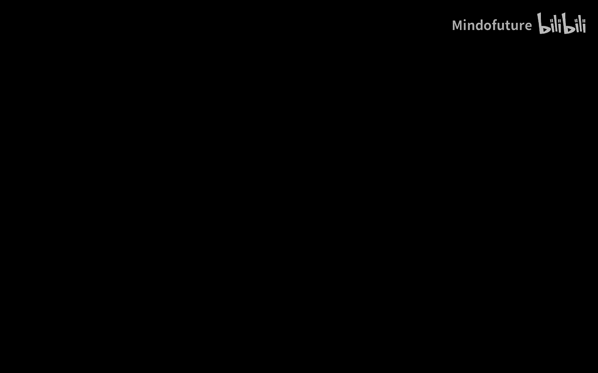
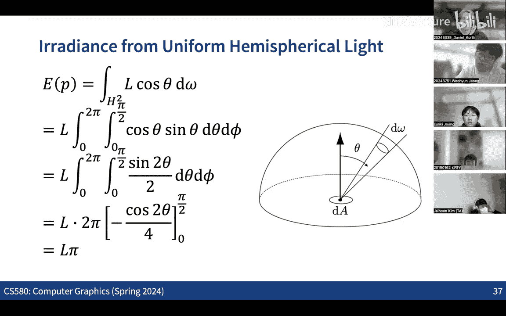

# 【韩国科学技术院】计算机图形学 KAIST CS580 Computer Graphics (Spring 2024) p04 P04 Lecture 05 - Radiometry   Photometry (KAIST CS580, Spring 2024) -BV1he7mzjEc1_p4-

Okay， so last time we started to discuss the idea of the ray tracing which is one of the basic idea in terms like doing some render in the graphic pipeline and which is basically radically different the approach with the re so in the graphic department we can consider very fundamental delay waves that we can basically render some 3D things into the 2D image like one is the reation and the other thing is the ray tracing so what we mostly just focus on in the inter the course was about the reization。

 basically projecting all the 3D poly in the 2D plane and also doing some kind of the processing in the image space image plane while the difference with the ray tracing is that in the ray tracing。

 we are not basically projecting things in the 2D but actually it the opposite the other way around we are shooting the arrays from the camera center into the 3D space through the image plane in terms of that we are now fetching of the some color many other。

The information from these video objects from the point where we are seeing some kind of intersection between the ray and the these video objects。

So the algorithm voice， what we could see is a kind of a difference is that in the re addition。

 we for all the triangles that we are having in the imagemesh。

We are projecting them into the 2D plane and then we start to care about some of the pixels that are included in the each of the triangle and then basically interpoolrating all the colorline detectioning information and then basically updating the final images when the depths that we're calculating is basically shorter than the depth that we're having in the depth structure。

So this are the higher level of the algorithm of the exploitation while the recasting is kind of the opposite。

 so now for each of the pixel on this screen that we are shooting the into the3 space and checking the interesting point with the3D objects and basically affecting all this information from the3 see。

And ray trace ray testing was the case that we only care about intersection the first the hit point。

 the intersection point with the3D space while the ray tracing is kind of the more complicated the framework that is not just like checking the intersection with the array and the objects but actually back tracing all the tests of the objects by basically following the the secondary array So for of the intersection the point now we also basically see where the ray actually came from。

 So actually what we can see here is that it's more about sort of the reverse engineering。

 So if we actually wanted to do some kind of more basically correct some kind of simulation for the light trouble soap then we could actually start this kind of tracing of the rays from the light source but then the problem might is that there might be tones of the rays that are not arriving into the image plane so the computation will be very inefficient so actually thats kind。

Reion that we are doing some kind of the back tracing。 So we are not starting from the light source。

 but actually we are starting from the camera point and then we are doing some kind of the know back tracing of the all the trajectory lights in terms of that and also for each of the interesting point。

 we are seeing where the rate came from from the which would kind of be from the intersection the know。

The heating with the objects and then we are shift the all the secondary arrays until we see that whether the arrives at the Ly source or the kind of the iteration。

 the recursion basically reaches to some kind of the maximum the number so this is the basic idea for the rate tracing and once it basically the factories all this kind of the path arrays for every single the interest the point。

 we also shoot the into the laser source in terms of the to calculate basically the color information for each of the interest the point。

So actually as you can see there are two main things。

 so when you see some kind of the intersection between the ray and these video objects we should be able to basically compute the secondary rate。

 basically where the rate came from from the intersection so basically calculating this kind of reflection at the point is one of the things that we are going to discuss in this course and also for each of the the point。

 we also should be able to calculate the color information by just like also fetching the information from the light first。

 so based on the maturity property for each of the objects and also based on the light information we should be able to basically on determine the color information for each of the point so that's also about basically some maturity properties so basically the objects and these are things that we are going to discuss the rest of this course。

So we also discussed many of the ideas in terms of like how we can really calculate this kind of the ray and the object the intersection。

 so we also do some kind of some calculation， with some kind of be plain and detriable and secure and also we did implicit representation we also discuss basically how we can calculate this kind of the intersection point。

So those are basically very basic things that these are also the things that you will need to implement in the program the assignment。

And then basically the question is that so then the problem is that this is the case that we need to calculate the intersection between all the arrays。

 basically for all the pixels in the image and also all these video objects that we have in the 3D space。

 we should be able to basically calculate all this kind of the intersection。

 which will take tons of time， especially to have like lots of the triangles in the 3D space。

So here the kind of some technical idea was that how we could not basically accelerate this kind of the computation of the intersection So one of the kind of simple idea is basically making some kind of the bounding volumes for some kind of the subset of the 3 d objects some triangles in a way that we can basically basically take this kind of the intersection of the competition with some kind of the simple geo so especially consider some kind of the axis aligned the bounding the deep boxes those will be the cases that we are having the three pairs of the slab for each of the axis。

 then we can see the competition of the intersection becomes much easier for those kind of the axis aligned the bounding boxes。

The the question is that how should we also define these kind of the bounty boxes So we also discuss the two extremetd cases like if we make like one giant de bounty box for the entire scene。

 the problem is that if the hits that bounty box， then there's no difference Basically we need to also consider all the objects in the scene to check the intersection with the objects we the So thats also not that efficient way and if you also consider like having the bounty box for every single the So that also does not make any kind of difference in terms of that still we have the n number of the kind of the bo boxes。

So here the equation is that how we can make some kind of some highererarch structure of the bound boxes or some kind of some bounding in a way that we can do some kind of the more efficient the computation So basically what we are going to do is that we are sort of like extending the idea of the binary search tree in the one search so perhaps this kind of sequence of the integer number and if we want to let the query when you have some kind of query number and finding some kind of the closest the integer in the sequence then how we are going to do this kind of the search in a more efficient way So one of the idea that we learned in the algorithm curve might be using having this kind of the binary search So every time like given the sequence of the integer the number we are taking the media number。

And making this kind of the two subsets and for each of the subset we also pick the media number and making the two subset again。

 so in this way we can make some this kind of the tree structure and basically and then basically this kind of tree structure makes the complexity of the competition to be low ground here。

 right？So here basically the idea is that how we are going to do the same thing。

 not only in the only space， but also in this three space。

So for that basically we discussed the idea of the bounding volume the hierarchy。

 so this was basically the case that like we are splitting the one basically big the bounding box into the two basically these2 three cents。

So this is the case that we are having the this big bo box and we want to split this into the two doing the sets of the the prims。

Here basically one thing is that we are basically finding these the sets of the primitive。

 but for those kinds of cases， the bounding boxes of those sets can still overlap in the3D space。

 so we are basically repeating this kind of like making some sort of sub bounding boxes in a way that we can build some kind of some binary tree in the3D space。

So for that I mean there can be some multiple ways to basically construct this kind of structure and what we can do basically is that for each of this step we are first determine the axis that we are going to do some kind of display so we can basically choose this kind of axis that's going to be one of the X or Y Z axis。

And then we can also start to make some kind of some candidates of the split the planes in the space。

 So this is kind of the two big example that we are having some multiple kind of the object in in the space and for these given the axises for these axises we are making some kind of the candidate the planes So there can be also many kind of the heuristics in terms of like how we going to make this kind of the split planes。

 So this is the example that we are having some uniform the interval of the all these split planes but we can also basically determine this kind of the candidates based on the shape of the geometry we can first for example。

 like make the all split the planes that the corner like at the end of each of the the primitives were based on the centralroid or many other things so there can be some kind of multiple ways that we can propose some kind of the candidate deep planes。

Then here the question is that we are choosing one of the best plane that will basically you know somehow makes them more efficient start。

 so here the question is that how can you determine that which plane is which split is kind of the best split。

 so that was kind of the question。So what we discussed last time is that。

 So we discussed this specific example。So when you have this kind of the objection between this space and if we are finding some kind of the some best display split plane in terms of making the two bounding boxes。

 how are we going make this kind of split So if we just like follow the idea of the binary research tree that what we are going to do is that we might basically sort those things。

 So based on the order， we can see like this like 1，2，3，4，5，6，7， a， So we are having the8。

The primitives here， then the if we just follow the binary search。

 then we might want to basically split those kind of things by just having the one bounding box。

 which are basically having the have of the prim tips and the another de bound box。

 which are basically having the another the of the the prim tipss。

So this will be the example that you can see here。Havingaving these kind of two bounding boxes。

 those are the cases that we are having the same number of the primitives for each of the cases。

 And that's actually what we have done in the binaryaries of three right So if we just follow that。

 then we want to have this and as you can see， the problem is that now we are having like two big bounding box So as we basically have the bigger the bounding box。

 there is like more chances that the race would basically behave this kind of the bounding box。

 which means that we start to also investigate like all the kind of the primitives that are included in this bounding box。

 So for basically making some more efficient the search。

 kind of the important thing is that it's better to have some kind of the tighter the bounding box like this right。

So as we basically have some kind of the smaller boing boxes during the basically less chances that the rates basically hit each of the bouning boxes。

 then we can easily ignore some kind of the all the prints that are included in each of the bo boxes。

イデスク。So here basically the idea is that how we are going to make some kind of display or the bounding boxes in a way that can basically make a more kind of efficient search while having seen this kind of the type de bounding boxes。

 so there can be lots of the heuristics for them， one of the heuristics that we can choose my piece that so we can somehow define this kind of the troubles of the cost。

So here basically the troubles of the cost means that we are having some kind of the cost of like visitinging each of the interior the node so basically we can do some kind of de boing box the test and then now we care about like these two things for each of the two subrees so we are going to have the two subrees we can calculate how likely a ray will basically hits each of the de boing box of the substratere and also what's the kind of the cost over like basically troublereing all the things inside each of the substratere so these are basically two quantities that we can define right。

Does't make sense for basically we are having some kind of the constant the or like weing each of the bo bugs。

And for each of the candidates display split plain。

 we will be able to define the left sub and the right sub。 And for each of the sub。

 we are going to somehow measure like how likely the kind of the random rate will hit the bound box of the old the sub and also what will the cost like visiting each of the the the sub。

 So somehow we are going to。Some will approximate these kind of quantities in a way that we can define some kind of thes or the cost。

 then what we can do is that given the set of the candidates of these planes。

 we can basically calculate this kind of thes or the cost for each of the plane and that we can best choose the one that is giving the minimum the cost right any question on this。

Any questions？So yeah， I mean， this is kind of like one model in terms of like how we are going to measure the efficiency for each of these play planes and we can basically model this kind of the cost of the troubles in this way and here the question is that how we are going to also the model this probability and also the this cost with the sub there can be many other ways we can do this very simple the idea that people could use to construct the。

De bounding volume， the hierarchy is that。We simply we can approximate the cost of like bting each of the sub3 as the number of the primitives。

 so that will be the case that we want to basically not basically having this kind of like too many de prim breach of the deposit bounding boxes right so once the very simplest the way would be that we are approximating this cost of like bing each of the subre as the number of the primitives that will be included each of the sub3。

And here the more important part might is that how we are also going to the measure of the probability that a randomly will hit the bound bus of the sub tree。

 And for that， what people typically do is that people need basically care about the the ratio of the。

The surface of the the bounding boxes。 So， for example。

 like when you have let me go back to the previous。Yeah， so when we have this kind of the the cases。

 we're going have this kind of the sort of the parent node， the bound box of the parent node。

 and we're gonna also have the bound box of this upgrade， right。

For each of the bounding primitives here， the bounding primitives are the boxes， right。

 we can basically measure the surface of the bounding boxes。

So when the S N is the surface of the boundary boxes of the parent node and the S A is basically the surface of the bound boxes of the one of the the sub。

 the a sub3， we are basically using this as kind of the the ratio of like how likely the basically will hit the this bounding box when the array basically comes into this kind of the bigger the boundarying box。

So using this kind of the ratio the surfaceice of the bounding between dip is kind of the one very simple ahuousistic that we can use。

And this kind of the idea is for the surface area theturistic。

Wwhichch is also assuming that the arrays is be randomly distributed and also there is no closure in this case。

 so when you have this kind of the assumption that we can simplify the kind of the approximation of the probability。

 how likely the array will will hit each the sub based on kind of the era ratio of the surface area of the boundarying boxes and that can be kind of the onesome twist kind of way that we can somehow measure the troubles of the coast。

So it turns out that this kind of de cost becomes like this formulation。

 So we are having some kind of the constant cost。 And for each of the ratio of the surfaces。

 we check how many kind of the。You know， the primitives are basically included for it to be de bound box so that means that we can given these candidates thatll be candidates or display split thes。

 we can calculate this kind of the trouble the cost for to the plane and then we can choose one that is giving the minimum the cost so thats kind of very typically the fe the idea in terms of like building the boundingvol hierarchy。

Any questions on this？So I know that in our the programming or the assignment。

 there is no such part like making some sort of the data structure that can make the rendering process to be more efficient。

 basically reducing the computation of the intersection。

 but if you are interested and I also recommend you to try to implement the boing volume hierarchy in terms of you can also render very large scenes within lots of kind of the objects in the scene。

 basically accelerating this kind of computation with this kind of structure。Any questions。可以。Yeah。

 so this was kind of the one example that we are making some kind of the hierarchical structures by basically splitting the primitives in the space。

 basically making some kind of the two sub kind of the sets of the the prim tipss in the space。

But actually the other way around making some kind of the some specialty data structure is actually not dividing the given set of the prims。

 but actually dividing the region in the3D space。So the leftse is kind of the example that we are having the bound in volume the hierarchy。

 this is the case that we are having this during the sets of the painting tipss so as you can see you know we are having this kind of the blue set and the yellow set and blue basically be the sets that are including these kind of the left side。

 the painting tipss and we are having another the set but this is the case that the bounding volume of each of the subsets pan overlap in this case。

So this is basically give one example。And the other way around this basically part in this space。

 so now we are hearing the this during the sets of the regions。

So we split this space into using this kind of plane in terms like making these two of you know these joint de bounty box in the space。

 but then the problem is that here the one primitive can be can belong to the multiple the sets。

 so this is not the case that where basically the partitioning the sets of the prim tipss。

 but partitioning the space。So one of the famous examples for this might be the Kd tree or the oak tree menu of things。

 right？And in terms of like utilizinging these kind of structures in the ray tracing the framework。

 what would be kind of be proic points， can you guess？The first question。

When you use these different structures of the some hierarchical the data structure。

 what be kind processing。And also the question was that cost of the ray printing intersection is also calculated by the bounding box test。

 yeah， so it also depends on how we define all the things。

 but at the end of the older things like at the leaf node。

 if we have like bounding box for like one single printed then that can be also the things and also at the end we will need to basically have some competition of like checking the intersection with the ray and the prims in the leaf node so that should be included in the lymph node。

So let's think about some scenarios where like one of those kind of structures can have some more the advantages over the other one。

Yeah， so actually， my question is that in which case， like one can be better than the other。

Let's think about some cases。Any ideas？Yeah， so there might be many special cases that one can be better than the other。

 For example， like as someone also mentioned in this this neck。

 like we we have some like really two very the set of theitives like we are having like one set here like having some like some one set of primitives on the left hand side and also the other set of the pen on the right hand side it can be more efficient that we are having these kind of the two bounding boxes instead of like partition in that space。

 right， So this can be better way that we are really making some kind of the the type。

De power passeses， so depending on the arrangement of the objects。

 actually one can be better than the other， right？But also one of these some specialty cases is that actually。

 the one question is that for each of the cases， let's say we are making some kind of the binary three。

 which means that each of the intermediate den node will basically have some kind of the two children。

 right， two children。But here， the question is that they say we check that the ray is hitting the one of the the children node。

 Then can you just ignore the other， the the other， the the child node。For example。

 in this case let me try to shoot in。你 this。Yeah， I don't know you can see。 So yeah， as you can see。

 like this is kind of the ray， which is coming here from the outside of the box and just hitting the yellow thefangle。

And what we can see is that like， you know， let's say。

 like we first check the intersection with the array and this wrapped de boundary box。

And we're going to basically see some kind of this intersection with these three and these point parts。

But as you can see， actually。You know， at the end， like what it can see is that the object。

 the primitive， that should have the first intersection。

 the point we the ray should be this yellow triangle， not any of the blue triangle right。

 but still we are seeing some kind of the intersection with this kind of the left bounding boxes because we are also not partitioning this piece with the bounding boxes。

So which basically means that there are lots of the cases like when you shoot the ray and when you find some kind of the intersection with did one of the children load in the bound volume of the hierarchy。

 actually there is a chance that actually the array will have some kind of the intersection with the red primitives that are not included in the left set。

 but actually in the right side。Which means that since the bounding boxes are not basically partition in this piece。

 we should not just ignore the other the bounding boxes in the same level。

Like we need to do this kind of the intersection the checks with all the bound boxes in the same level。

 while this is not true for picture the space partitioning the case。

 since we are partitioning the space， we find some kind of the intersection with the one set of the children one of the basically the children the node。

 then we can immediately basically ignore the other the child node so that's basically kind of the difference between the two。

So which means that for most of the cases， except for some kind of the extremetic cases。

Except for some of the extreme cases that we are really having some of some con various parts。

 some kind of some groups of some kind of the primitives for many of the cases。

 it is known that this space partitioning can be more efficient in terms of that we can terminate the search we see some kind of the first hit or the de bound boxes。

But the problem is that when you start to have some kind of some dynamic sense。

 so first some of the cases， when you have some kind of the animation and all the primitive basically be moving in that space。

 then the problem is that we will need to basically reconstruct all this kind of de bonding about the higherarch people the structure for the space partition in the case。

While in the case that we are having the primitive departitioning。

 when you still have some kind of some dynamic de movement to deal with all the primitives。

 we can just keep the same the hierarch structure so that can be kind of be good in terms of the when you have some kind of the dynamics these。

 the bo de hierarchy can be more efficient in terms of that we don't need to reconstruct everything。

So those are kind of some protic ones and there are many kind of the other proic one。

 so we can also discuss those insulator。아니快上 this。This clip。我贵阵。Okay， so if there is no question。

 let's move on to the main topic that you need to discuss for today。りておでです。

Okay and everyone see my slide。Yeah， so yeah， so let's discuss the main topic for today。

 which is the radioometry and thepotmetry。So those are also the things that we briefly also discussed in the introduction of course。

 but these are basically very basic theinology that we will keep utilizingizing for all the discussions in the rest of the course so you will need to get familiar with all the terms that we are discussing for today。

So as I also mentioned at the very beginning， basically we are discussing these rate tracing the system。

And here， the key thing is that basically how we somehow model this kind of the reflection of the race。

 So how are we gonna determine the direction of the secondary thes and how we gonna determine this kind of the color and all the information from the combination of the matter information and also be light source information。

 So those are basically the main things。 And for that。

 what we are going to do is that we are doing some kind of the optic simulation as much as possible。

 obviously， the thes simulation that we are doing may not be that no。

 very fish collect some kind of the approximation。 but still kind of like approximation。

 So we are going to basically discuss some of the terms that are used in the optics and see how these terms will be basically calculated in some kind of oursim set。

So that those are basically many things。So as kind of the first step to basically model all these kind of like reflection of the things。

 basically modeling this kind of illumination， we are going to discuss some terms that are basically typically used to basically measure some these kind of illumination and the lightinging and basically were also going to discuss some company some of the units。

To measure those things。 So there are four remaining quantities。And as you can see。

 these names are basically quite confusing， very similar。

 but you need to get used to the difference of like those kind of data。

So we are first going to discuss the ratingdiant fluxs， which is basically about the power。

And the raant intensity is basically about the power power per power per unit the solid angleangle。

 So were gonna see what's the meaning of the solid angleangle。

 but it's more basically more about some kind of direction or be light。

And relaance is not the power per the solid angle or de。

 but it's more about the power per the unit area。So this is another term and also the radiance is basically the power default flows per unit area and also per unit solid angle。

 so those are basically the four main terms that we are going to discuss for today。就 keep啲前米。

So what's the kind of the goal of the like having these the four terms。

 So all the kind of things about the radiomentary is to do some kind of the calculationc of the lighting。

 you know， physically collect the manner。While we are having some kind of some of the assumptions here and obviously we are assuming that lights are basically traveling in the straight lines。

 So basically this is is assuming that lights are basically traveling in the empty space and there is no influence by some kind of gravity in all the things So basically all the lights basically travel in the straight lines and obviously we also assume that all the objects at the size which is like much larger than the wavelengths。

 So if we have like very tiny small the objects， and all the assumption that we are having here might be just broken So we are also obviously assuming that the objects are like big enough compared to the wavelengths which is very tiny kind of things and we don't model any kind of the deflection or the interference we only care about some kind of reflection the model can typically see。

So those are the assumptions for the radiometry and let's also briefly see how the light basically works。

 I mean， those are some kind of the basic things might be in the the physics。

 but this is not the course， so we are not going to get into the very much details for all the things。

But very highlighted some kind of the assumption here is that basically all the lights are basically generated by basically consuming some energy。

 so what we are going to see is that basically lighting is kind of the process that we are consuming the energy in terms of that some of the energy is turned into the heat。

And some of the other part of the portion of the energy is basically turned into the foots。

 which are basically delivering some kind of the amount of the energy through the light。

 so this is the basic assumption。And what we typically do in the computer graphics is that we just assume that the ratio of these two。

 basically turning the energy into the heat， energy。

 turning the energy into default photos is basically constant。For each of thely source。

 so we don't care about like how this kind of ratio is basically changing over time。

 but for each of thely source， we are having the same the ratio like digital turning into the heat and turning into default photos。

 which means that the power which is delivered by default photos。

 we will be basically proportional to the kind of the energy that we are consuming to generate thelyce。

So for this region， we are going to use two terms power and the energy as kind of interchangeably because these are based kind of the proportion of the quantity in the lighting。

Oh， you are still seeing some old slides。So you are not seeing this light for the lighting。Oh， sorry。

哦。Let me stop sharing in the spacehir。我哋消息频。Can you see this link now？

Is this different slide with what you have seen before？哦。yeah， thank you for letting me yeah。

 so let me then briefly Ill go back to the previous slide。So， yeah。So yeah。

 so I was basically saying that these are the 34 deep that we are going to discuss。by the way。

 like you can also find these slides in the link that I also posted on the slide so you can check out those slides as well so those are the four terms that we are going to discuss and then yeah so we are having this kind of assumption like the light surface struggling straight liness basically the objects has the bigger size and the wavelengths and no modeling for the deflection and data appearance。

And yeah， so those are things。 Basically， we are going to assume that。

Like when we basically the kind of the light source， like the light bulb is consuming the energy。

 we are having the constant ratio of the photons that are also basically delivering this kind of some portion of the energy into the the light so in this reason I mean in terms of that we are having the constant ratio that we are turning the energy into the heat and also turning the energy into the photons we are going to basically interchangeably used to the terms power and the energy so power is basically the energy which is basically delivered by the light and here the energy basically means that the amount of the energy that we are consuming to generate this kind of the light。

So this is which we debate the assumption。And also the other thing is that we are going going to discuss some different terms like also interchangeably in terms of that。

 so what we are going to mainly discuss is some terms that are defined in the radiome。

The radiometer is all about basically the power of the light or some kind of the quantities that are basically defined based on the power of the light。

 so those are kind of the quantities defined in the radiometer。

And the photome is kind of different in terms of that these are some quantities that are defined based on the brightness that is really recognized by the human eyes。

So those are like all about the brightonness， the photometry and the radiotry is all about the power which is delivers by delight。

 but also the thing is that for all the quantities that are defined the radiome。

You're going to see that there are some kind of the color parts that will be binding inly。

 so you can see this kind of the different names that are kind of like indicating similar things。

そう、どぞカのデページェッティングす。So the things that we are going to discuss from now might be a little bit boring in terms of that I just keep saying some kind of the new terms so but yeah you will need to get used to those kinds of terms to discuss the rest of kind of things but I also recommend you to check out these kind of the definitions after the lecture and see and what's kind of the differences。

Okay， so let's first get into the radi energy。 Energy is basically just nothing basically the energy。

 which is usually delivered by the light and also the energy has the。

The unit of the jewels this is quite the things that we also seen in the physics And when you also talk about the radiant the fluxs。

 which is about the power， which is basically the energy。

 which is either emit or reflected or transmitted or received receipt per unit time So this is basically some energy over the time。

The disease des。So basically for the power or the fluxs， we are having the unit to the white， right？

So this is basically the unit wely using the radiometry and the counterparts of the unit in the photometry is the lumen。

So those are basically two different kind of things。 So when you talk about the radi the flows。

 the same kind of the quantity， some corresponding the quantity in the photometry is called the luminous fluxs。

And for that， we are having the unit of the quantity which is the。

And here the question is that then are these two the same。

 so if we have some kind of the 10 watts sort of the light bulb。

 then is the case that we had in the 10 lumen， obviously you know， as I said。

 like the watt is basically the energy， basically for the power and the lumen is basically un for the bness。

But we are basically assuming that kind of the ratio like these two will be the same for each of the light source。

That also means that if we have like different delay light source。

 so depending on when you have the LED bulbs where some kind of flucent the the tubes。

 there can be some more efficient delay light source。

 which is making brighter less with the while consuming the same amount the energy right So that might be the case that we are using the similar the amount the。

The power basically while making some kind of the lighter the。

 where there can be some kind of like less inefficient kind of the light source。

 which is basically making the same deep brightness of the light while consuming the more energy right so depending the light source that we are having there can be some kind of the ratio between these kind of two units。

So if you actually buy some kind of the light bulb。

 then you can check out how much of the white the what is consumed while making how much of the lumen of the brightness the the light bulb is basically generating so those are basically two things and based on these two quantities you can check out the kind of the efficiency of the light bulb。

That' it mix sense。So this is the basic thing， the original flux。

 which is about the power of the light。 And then we are going to discuss some kind of the different things in terms of like the intensity。

 which is about the power per each of the direction is basically about like the per direction or the power slowly angle。

And also we can think about the light， which is like falling on some kind of specific point over the surface。

 so it's about per the surface per kind of the area。

And also we can think about some basically the light the array， which is traveling in the space。

 which is the irradiance is the per solid tang and per the areas we're going to get into those things。

So the next thing is about the radiant， the intensity。

 so basically intensity is now the power over the solid angle。

And the solid angle is basically about the kind of interaction so and also we're going to see this solid angle has the unit of this radian。

Yeah we're going to see like what this basically means and it previously divides the woman by thetorian。

 then we get the another kind of new unit for the photometry。Which is about the candlelar。

 which is about the intensity。So here the question is that what's the solely angle， right？So。

 we know the angle。So we are going to extend the concept of the angle into the solid angle。

So when you basically talk about the angle， which is basically the ratio between the length of the arc。

Wehi is that the sub caned by the angle here， with the the the radius of the so。

 So let's think about like this the so here， right。Then if we define any kind of the angle like this。

 then we're going to see some kind of the the arc， the curve here。

 which is basically subended by the given the angle， right？Which means that for each of the angle。

 we're going to have some kind of the corresponding the length of the curve。

Which is defined by the the you know subtending this kind of given the angle， right？

They basically measure the ratio of this like the length of the curve with the radius of the sample。

 then this becomes the our some kind of the unit of the angle， right。

 So this is the quantity which is defined as the radian， right。あ、いです two。So basically。

 a circle has the two pi radance。And for any kind of the angle。

 we can basically have the radian as kind of the unit for the angle。

 which is basically calculated as the rank， the ratio of the length of the r curves and also the radius。

So what we are going to that we are going to extend these things into the sum for the3D peer。

So this was the case for the food circle。 So if we extend the same thing for the three disappear。

 Now， we can also think about like having a some sort of the angle。

This is actually the solid angle which also will basically you know be extended into some kind of the not a kind of the region here。

 but into the volume right， so we can think about a kind of the con which is defined with some solid the angle right that will be projected over the3D。

Then we can also define the region over this sphere， which is defined as kind of the you。

 which is subended from the given some sort of the solid angle here， right？

Then as we have done for the angle case， now we can also define the unit of the solid angle as kind of the ratio like of this area。

Which is subended from the given the solid angleangle over the not the radius。

 but the the cur radius。So now this becomes some kind of the unit of the solid angle。

 so we can see that solid angle is kind of the angle for some kind of the phone in the Swish space。

 and now we can have some kind of the unit of the solid angleangle by calculating this ratio like a is the area which is subended by the given the solid angle over the basically security the radius of this pi。

So that becomes the definition of the solid angle。And what we can see is that since the surface of this pair is four times five items are scaled。

 then which means that the solid angle of this pair we will be four pi right。

 so we're going to give by this pair are scale then we're going to have the four pi the storeoradian which is the name of the unit。

 the solid angle。あイデすク。Any question on this。喂。唔识你。Yeah。

 so what we can see is that let me give you some kind of example。 So we are on the speak， the earth。

There is a moon and the sun， right。I don't know's way far from the movement and actually we can also see some kind of the define some kind of dee like this。

making the each of the moon and the sun is kind of some kind of the objects that is defined as kind of some sort of the sort of dissection of the80 con。

You right。So you let me give you some better detail than this。So like given this kind of the。

The earth here and the moon and the sun， we can also define some kind of the solid angle。

 which is defining some kind of the projection of each of the moon and the sun。

 many other things over the earth and this kind of projection actually can be defined with the solid angle。

So the interesting thing is that if we really calculate the no。

Soli dangle which is like obtaineded by the sun and the moon。

 we can actually see that the solid angleangle of these two are almost the same as the 60 microdi gradients。

And where can you see this kind of the evidence that these two solid angleangles are not the same？

we know those kind of things right。When can you see this kind of the evidence that these actually the solely angles of the sun and the moon are almost the same？

攞一啲。Have you seen the， yeah， solar elllipse， the total elllipse。

When we see some kind of the cases of the total the ellipse。

 you can see that actually the sun is totally occd by moon while making some kind of the very thin ring right。

 which means that sun and the moon are basically having almost the same the you know the solid angles。

 basically making the almost the projection， the area over the earth。

 which is very interesting kind of some natural kind of the phenomenon the fact yeah so that's kind of thing so that's kind of thing so so we are basically having almost the same the solid angle for the sun and the moon。

So which means that if we know the surface area of the Earth， then we can also calculate the region。

 the area of the region of the projection from the each the and the moon。

 which will be almost the same So can you quickly calculate those things what to be kind of the the area of the projected the regional de and the moon。

Yeah， maybe I can go quickly because we have meetings to discuss virtually today so like this will be case like four pi is story and we will have the 510。

嗯。撩人。Secured kilometer， which will should be the same with the 60 micro leoraddian with some kind of the。

Area， right， So if we basically calculate these things that what we're going to get is the。水以。Yeah。

 this kind of the amount of the the size of the region。

Which is like four times bigger than so or better， so quite big recently。

 so we can basically do this kind of a calculation。So based on all the solid angles。

 actually we're going to do many kinds of the calculations and so one of the calculations that we're going to do is basically diving some kind of the differential the solid angles。

So when you have some kind utilize the speaker decoiness for the surface over this sp。

 we can define the differential of the area like this right so if we utilize the speaker decoiness。

Yeah， the differential area over this sphere can be calculated in this way by just like multiplying r times the theta here。

And the r signs at the D pipe， which is by defined here。Basically， these length。

These length and these links can be multiplied to define the differential area which is point like this and based on that we can also define the differential de solid angle we should be differential area divided by the secure the security ras then we're going to see that actually differential the solid angle can be calculated as this one by multiplying these two angles and the the sayar。

And also for the rest of the kind of the the part of the slice。

We're going to basically use this kind of mega kind of some mathematical denotations to denote some kind of direction detector better So actually also what we can see here is that if we have some kind of the light source。

 which is like emitting all the lights with the uniform the intensity into the only direction。

 then what we can see is that and also when we see that this is the amount the fluxs。

Wwhich is emitted by the light source， so then think about that we are having some light source which is having this pi amount of default fluxs and also emitting the light into the uniform intensity into the old direction then we can calculate this uniform intensity as kind of the pi over pi over the the four pi。

So this can be compete based on the definitions of these solid languages。佢。啊，Some questions你这这。Yeah。

 and so so we can really do some kind of some very， no practical speculation。

 So when you see some kind of the light ver， which is saying that that test the 815 D。Then， you know。

 how can you calculate some kind of the intensity for that the candleula。

 So the way that we can calculate the candleize that if we assume that the light bulb is basically emiting all the lights into the with unit from the intensity。

 that we can simply divide this amount of the。Develops by the story again that we can calculate the intensity like this。

Here， like one quick question is that then let's think about some special case where the light verb is not emitting the light into the uniform intensity into the all the directions。

 but somehow if the light is basically making some kind of the cone like shape。

 which is like concentrating all the emission of the light into the some cone。

We the diameter the or the the the angle is kind of be 20。

So let's say we have in the light bulb here。Some of these light bird is especially like emiting the light into only into the this kind of bit。

Then how can you compute the intensity in this case？

So this is the question and actually you realize that this con is not very simple because the quantity of the storyraian is defined based on the area over the surfaceway。

So which means the。When you also define some kind of cone with the angle of this data here。

 we should be able to compute the area。Of the you know， this region。

 which is making some kind of be defined based on the intersection of the core and this， right？

So this kind of region， which is defined based on the angle here and also the radius here。

 is called this speaker cap。AndSo it I give you some kind of a hint in terms of how we can calculate all of things。

This area of this speaker cap can be actually just simply calculated as kind of the2 pi Rh here the H is these length。

And since we are having the angle theta here， the diameter like the Hr of the earliest angle of the con。

 actually you can see that the h is the same as the r1 minus cosine theta。

 then we can see that actually the area of this speaker cap becomes this。So from this， actually。

 we can calculate the intensity for the cases that when the light is basically concentrated into the coin with get 20 the degree。

Yeah。あ theこ。Then based on this， can you calculate this？So， let me give you a hint。

So if we know this fact， the speaker they S this area， then based on this canny car plate。

The intensity here。Yeah mean。Maybe you can really just corporate the the final number and see what you get。

Yeah， obviously Italy basically the81，5 overall like。To buy like。四ワンマイナス。Good sign ten do we right。

So if you calculate this， then what you get is that actually I just calculate this using the chatGT and it was giving me like this。

Which is basically sorry。Yeah， way higher than the intensity that we can see when the light is basically emitted with the same intensity rate。

So yeah， we can do all this kind of the calculationculation with the。

 I mean the soy den go and many other things。Any question chance on this。So， we discussed defaults。

And also， the intensity。Which is like blocks。By the solid angle。

So those are basically two quantities and we're going to also see the definition of the E audience reance is not the power per the folded angle goal。

 but actually the power per the unit area， which is like coming into the over surface。

 So we're going to basically compute this term in terms of basically c in the amount of the light which are to basically arriving at the same point over some kind of 3D space。

From the old directions， basically the light comes can come from the all the other directions from the all different sources or even from the reflections from the many other of the objects。

 so this is basically the quantity the real basically define kind the power per the unit area。

And now we are also having some kind of the new big link for this lowmen over the securitymeter。

 which is now the minus the looks here。And also you can see some kind of the typical number be looks for the many kind of things so the sunlight has the like more than 100。

000 de looks and some kind of this in the sunrise it is decreasing until like 40 it's very you know small and also the moonlight even has the like even smaller than the one looks it's very so we can see that the sunlight is like way much more brighter than the moonlight so we can have this kind of the quantities for the radians。

And also， when you talk about like related are all the kind things like one kind of the important thing is basically the remember the cosine law。

So what we can also see is that， let's think about that we are having the same kind of the light source。

 which is kind of the making the fluxps with some kind of the beam of the light。

So let's think about that we are having this sort of some area light。

 which is the heading the same area， basically emitting the light。

So making some kind of the slinnder like the beam in the space。

 we are receiving this kind of lightning over the plane like this， right？

So then what we can see is that when we basically have this kind of the direction of the light。

 which is basically perpendicular be the plane， then the amount of the orlediance that we're going to get would be basically when this high kind of flux in age the area。

 then the ordiance will be deployed over the area， so this will be basically radance that we're going to get。

The this is basically the power per unit the area over the surface， right？

But what we can see is that if we basically have some kind of the slanted angle of the light is emitting to the the surface。

 while this direction is not the same with the normal direction of the plane。

 but hitting some kind of some slanid angle， then we can see is that for the same this kind of light source with the same the area of the light。

Actually， this light will basically cover the bigger region right as we basically have some kind of some tilted the disruption delight。

 this kind of light source we basically start to basically cover some kind of bigger region。

Which means that when he measures the relegdance， which is the flux per the area per unit area over this pi over the surface。

 as we basically is basically covering the larger region。

 which becomes like larger as kind of the a over the cosine deceta。

 basically the relegdance for each of the region will will be decreased。

So that's basically what we typically see does it makes sense so as we basically no somehow change the direction of the light in terms of the the light is basically not seeing the the plane in the kind of the perpendicular direction but with some kind of some slany anglem the same the area light we will basically start to basically write the bigger region which means that for each of these some kind of the unit area。

 the amount of the light the surface is basically receiving will be decreased and the amount of the decreasing can be calculated kind of the one of the basically is kind of coine theta right。

As some kind of de projected， the surface here will will be increased as kind of the A over the cosant。

 right？So which means that as we basically have some kind of some slanid the angles of the light source coming from the kind of space into some bigger the surface。

 we're going to see that the irraance is basically being decreased。With amount of the cosine et ce。

 so this is the kind of the law， which is called the lamb the cosine law。

And this is actually one of the reasons I mean actually the main reasons that why we are having the seasons now so we are in the spring season and we also see the winter season so when you have the spring season then we can see that actually the attraction of this kind of the surface over here and the direction of the light coming from the sun。

Basically this angle is basically kind of the small。

 which means that we are more directly getting all the kind of the energy of the light。

 so which means that we are getting some kind of the more kind of the power of the light。

 but when you basically have is kind of the winter season where basically the angle between the surface normal and the light direction becomes larger then thelaance for each of the region will be decreased。

 so we are basically getting some kind of the less amount of the energy for each of the region。

 then we are basically having the winter So this is kind of the reason that why we are having the season。

Also， the for of you know， as we basically， so let's think about that we are having the light。

 which is。L stores emitting the lights， so when you receive the the light with some kind of smaller deators like this。

 or when you receiving the same light with the bigger deators like this。

Obviously as we get farther and farther from the light source。

 the energy of the light that we are receiving for each of these the region over this sp will be decreased。

 which means that the irlaance will be decreased as we basically get water from the given the light source。

Any questions on this？So we discussed fluxs， which is about the power and the intensity loop。

Which is like blocks over the solid angle， and this is the l evidences。

Which is like blocks over the each of the area。And the last topic that we are going to discuss is the radiius。

So raddiance is basically the power emit reflective。

 transmitted received by a surface per unit folded angle and also the per area。

And also this basically has the unit of that which is dividing the lumen by this story again end also the squaremeter。

 which becomes the need。But this is basically another kind of the unit for the in the photo。

But here also the key thing is that we are not basically just like having this kind of quantity for just the per area。

 but actually we are having this quantity per the projected area。

So that's basically why we are also having the cosine theta here。Yeah。

 so we are not just heading this like D here， but D in the cosine。

 this is basically based on the same reason of the the lamb the cosine law。

So here this is not the case that we are basically were the having the same ras same same the fluxs。

 this is not the case that we are basically changing the region to be covered by the same the。

 but while this is actually the case that while we are having the same D how much of this kind of the。

The solid angle of the of life from the different distractions will be changed。

 So while actually we are having the so kind of the different way to interpret this in my understanding is that in having this project area it's basically the same that we are having the same E。

 same kind of differential area while basically adjusting you know。The solid ankle fleet of de。

So what you can see here。Is that no it previously basically have some kind of thislany angle here while we are fixing the differential area here。

 then what we're going to get is that actually this will be the case that we are having this projected the area。

 which is perpendicular to the light direction and this。

pendicular the project area will be Dine this， which means that if we fix the differential area to be D。

 this will be the case that we are decreasing the slowly angle to be you know。Theおメがてコサで it that way。

So based on the angle that we are seeing the same region we are also adjusting。

 so this can be interpreted that we are defined the either defined the raity based on the project area or we are having the same the differential area while adjusting you the solid angle as the by multiplying the cosineta。

So that's basically the definitions of the。Yeah the radius。

 so keep this in mind that we are basically having this quantity as kind of the per unit solid angle and also the per unit the projected area。

 so that's why we are having the cosine center here。Yeah。

Basically the idea came from the numbers decent rule。So yeah。

 these are also some kind of common the quantities。

 the numbers of this quantity from the sun we are having the like what' the billion or two billions of gu。

 while we are also having some very small kind of den from the。

And also we can think about like two types of the irradiance。

 like one is kind of the like incoming instant radiance。

 so for each of the region we can basically think about basically having some kind of the incident delight。

From many different directions。That will basically be contributing to calculate re at one point。

 right？So for to the point， we're going to have this kind of like incoming ingredients。

 which will be basically cur used to calculate the early audience at each of the point。

And activity selection， we we will be also able to define the existing radius。

 which is the amount of the the light。Wwhichch is basically also leaving this the surface into into the some specific direction。

 so basically we are having the two types of derance which is like one is about like incoming derdance and the other is about like the exiting derdance。

So the reason that we are basically talking about those kind of things is that we really need to differentiate like these two。

 so we need basically have this kind of like incident deradiance for some specific de。

 it obviously does not mean that we are also basically emitting the same amount of light into some specific into that same deions。

So what we actually we are going to do for the allD rendering the process is that we are going to accumulate all these kind of the incoming the irrs from the all the different directions and based on our some kind of the diffra of the model。

 we're going to also calculate this of the outgoing irrance as a kind of with some kind of calculation。

 so basically we're going to distinguish the incoming the instant regionsance and also the exit regionss based on the already deforms。

I need quite for someです。So yeah， radiance is kind of amazing。

 it's the fundamental quantity that basically factor like all the distribution of the light and also we are obviously assuming that the radance is basically you know imvariant along the array and all the arrays are basically moving like straight like in a straight line and basically delivering the same amount of the radiance over the space without basically assuming that any kind of the occlusionion in the space。

And what we are going to do with the so called the rendering equation。

It's basically all robot basically calculating this kind of the radance or the ir radiance over the space that can basically change basically with some kind of delete selection with the ray and the the objects and then by accumulating all this kind of some changes of the radance we're going to basically get final on the render image。

And these are the quantities that we discussed。 So given the energy， we also define the power。

 which is the energy over the time。Intensity is the powerable the solid angle and re is basically power over unit the area and also the radius was basically the powerable the project area and also the solid angle and for those kind of cases。

 we also have some kind of the counterpart in the photometry the field and also there are some kind of the units that are defined based on the brighties。

Any questions on this？Yes， so before we end the two base data， let's just briefly see one more thing。

 So let's see some kind of a simple example like how are we going determine the elaius based on the information of the incoming ir radius。

 right。So what we can see is that basically we can determine calculate the elaance from the given the informationable like the raddiance over the all direction。

 right？So when you think about like one single point over the spheree and when you basically define assume some kind of the flat plane so that we can consider only the hemisphere for the all directions。

 so over the all the directions like defined with as kind of point over the hemisphere if we can have some kind of information about the incoming the irradius。

 then we can basically calculate the eladius as kind of the integral like this form right so we have the cosines that are here because of the definitions of the irradius right。

So we're going to also call like this kind of become。

The amount of the ir radiance times the costheta and the solid angle。

 this is kind of the differential the irlaance which can be used to calculate define the irlaance。

 so what we need to do is that we are taking the integral of the differential irlaance over the hemisphere and this differential the irdiance is now defined as kind of the multiplication of the irradiance and the costheta and the the solid angle。

So this means that if we assume some kind of be constant the。

The incoming irrs were the all directions， so let's say L is basically the constant。

 the incoming irrance from the all directions， then we can actually just calculate that end of like all calculation we can say that then the elegance by accumulating all the things can be now calculated as kind of the L times pi。

So these are some types of the calculationciv that we are going to do in the rest of the course。

Any questions問 thisす？喂。Yeah， so we discussed some kind of multiple the tos。

 the commoninology of the radiome， which might be quite confusing like these very similar names like radiant fluxs in raladance and ir radiance。

 those they are like all very similar names with some kind of be different some kind of units for each of them。

 but it's also important to see that we are basically why we are having this selectedcentta tone。

 which is coming from the Lamber decoble， and how we also define the solely angle， right？

These are kind of the basic kind of things in terms of defining those things。

So what we are going to do is that given some kind of the sum information， as you can see here。

 given the information of the incoming irradance， we're going to compute the radiance and based on that we going also calculate like outpoing you know the radance based on some kind of the metalities so what we are going to do for the rest of the course we will be like doing all this kind of the calculation based on those quantities and how were going to also kind of life。

Make it efficient to calculate all those kind of things in some kind of discrete manner。

 so that's kind of the basic ideas， so I strongly recommend you to get used to basically the all these kind of the names and the concepts of those quantities so that we can discuss more about the random equation in the next time。

Any questions？佢。So yeah， if you have more questions。

 please feel free to ask questions on this web and from the next week。

 we are going to start to discuss some maturity properties and also the rendering questions so how exactly you're going to calculate all these kind of quantities in the rate tracing system so or'll see you next Monday。

你叫喂。

