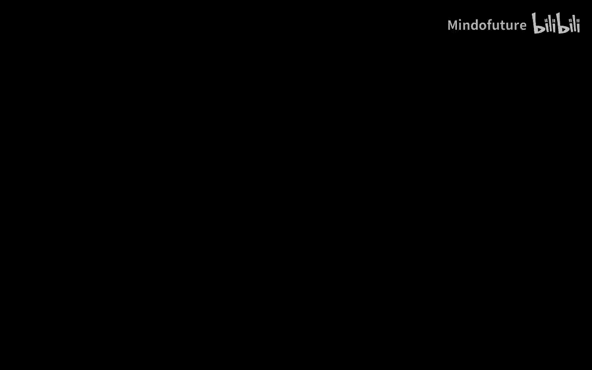
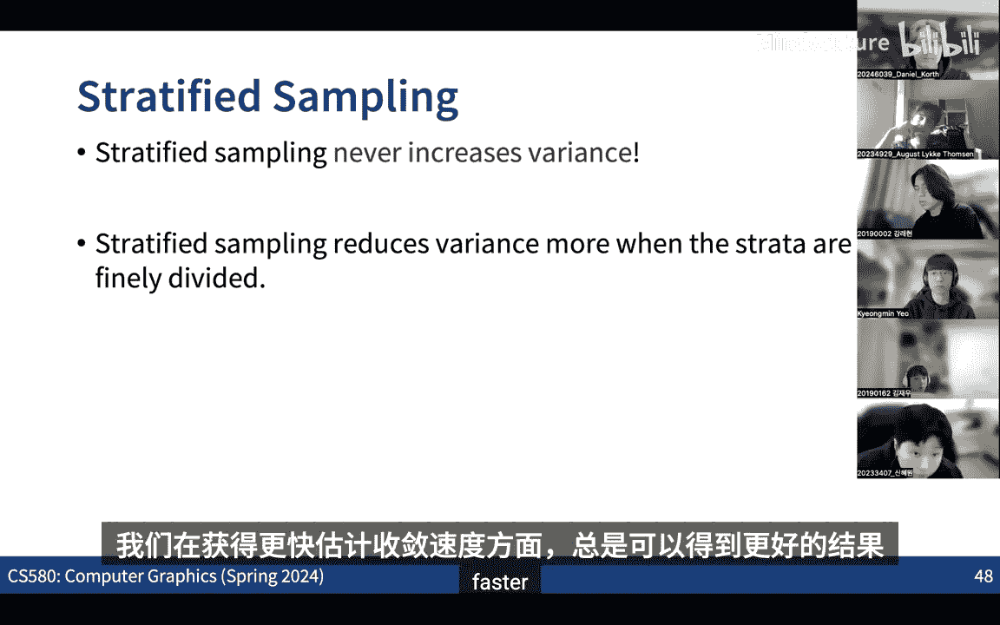

# 【韩国科学技术院】计算机图形学 KAIST CS580 Computer Graphics (Spring 2024) p05 P05 Lecture 06 - Monte Carlo Integration 1 (KAIST CS580, Spring 2024) -BV1he7mzjEc1_p5-

Co okay， so we come back to658 of perfect。 So last time we discussed some kind of the basic terms。

 the commonology about the radiome and theome which are basically some kind of the ideas in terms like introducing some kind of the some measures and also the units about the illumination for the lighting。

 So we mainly discuss these before main the concepts like the first one was basically about the flux。

 which basically indicates the power delivered by the the light。

 and then there are basically three subsequent the concepts what the first one is basically in testing radio in testing basically indicates the flux per the unit solely angleangle。

 So we also discussed the idea of the solid angleangle and also in contrast to that。

 the reance was basically the flux per unit area。So we teach more about basically im the light which is like coming into some specific point over the surface and the ir radance was specific the flux per unit area and also per unit the solid angle so we saw basically the kind of the quantity of the light which is deliberate part for the for the given the ray ob right so we are basically having these kind of the 3D concepts。

And one there are some kind of the multiple important things like one also important thing was that the radance was physically defined as kind of the the flux per unit solid angle and also the per unit the projected area so we are basically having the pu and setta term here so we discussed like why we are having this term in the last lecture and based on this definition of the radance。

 we could also compute the ra in terms of like having this kind of the terms of the differentialable early radance which is basically defined as kind of the radance multiplied by the Po and de setta and also the differential of the solid angle。

And based on that， we can like given the information about the incoming irraians from the old interactionss。

 we could basically hardate the regulator for to the point。

 so this was basically the big idea in terms like seeing the relationship across different kind of the quantities of the measures of the lights。

So what we also could see is that if we have some uniform the raddiance from the old directions。

 from the all the incoming directions， then we could basically de right that the irradance is also defined as kind of the L times the pi so when the L is basically the uniform deradance from the OD directions so we should be able to basically do this kind of O decarpo based on this kind of the concepts of these the measures。

So what we are going to do of course is basically like measuring calculating all these kind of measures given the scene and the right information so we're going to get into the be the idea of the render information today and then we're going to also start to see how we can exactly calculate all this kind of bin so as you can see like the rendering is basically all about basically calculating the radance for each D so if we basically have the radiance information for each D then we are like collecting all this information to basically calculate the final the hot information for each of the pixel and for that as we also discuss the ideal of B rate decreasing tra basically we will need to be able to basically calculate the selection of the surface。

So the basic idea is that when we basically have some kind of the radiance information for the all the incoming thes。

 they are already collected at theing point of the reflectionlection of the surface。

 and then based on that we will be able to basically update kind of theradiance information for the all the outgoing disruptions so for every kind of the point for the incoming for the outgoing direction we are having some kind the different kind of quantities。

 different kind amount of the the radius because the radance will be basically changed depending on the that we are making for the surfaces。

And also each of the surfaces they have some different patterns of the reflection and this kind of the pattern of the reflection is basically defining the property of the material for each of the surface。

 so that's also what we are going to discuss in the rest of the course in terms of how we are going to define the reflection of the models。

So there can be basically very different ways to just defining this kind of design models。

 but depending on the property， the service that we're able to define。For instance。

 like if we assume some kind of the perfectly flat the surface without any kind of thek in any kind of the microdevelop。

 and what we can assume is that that we can say that no。

 as we also learn some kind of the some high school kind science kind of the course。

 no when you have this kind of the incoming the light direction based on the surface normal here we can directly calculate what do the direction that be lift like to。

So this will be the case that we are having the idea or the specular de reflectionle。

So when you have some kind of assuming that we having some kind of one single the incoming array which is like reflected over this surface。

 then based on this kind of the incoming direction。

 I'm not sure whether you can see my the mouse point so based on kind of the incoming direction and also the surface normal。

 we can basically define a kind of the plane defined with this two vectors and then we can also calculate the outgoing direction the light based on the angle between this incoming the rate direction and also the surface number。

 so we you basically calculate the outgoing direction by just making this angle between the incoming rate and the normal and also the angle to the outgoing rate to be normal to be the same this is the case that we are exactly transporting transporting all the light information coming from the incoming array into this the outgoing array so this is the case that we are having the perfect this paper dere。

 which is also assuming that the surface is。Perfectly flat， there's no bump over the surface。

So this is kind of some kind of characteristics that we can see for some kind of the materials like the meters and the metal kind of the materials so this is the case that we're having the spectral de。

 and also there can be some other the cases that we are having some idea or some deepuse reflection。

 which is' assuming that in the microrel， the surface is having like last de bumps which means that we don't know exactly know what to be kind of alject for the interaction because like the surface is very bumpky at the local point。

 we cannot see all the bumps， but in the microrevel we are having kind some bumpky kind of the surface at the point。

 which means that the rate can be reflected into any random kind of structure。

And when you assume that this kind of the probabilityability or like being reflected into the direction is kind of the uniform。

 then we are basically getting some kind of the idea or some diffuse reflection Those are some of the cases that we can see in the clay they can see here where some kind of the wooden material for those cases we're going say some kind of the ideal diffus reflection。

But for most of the cases， we're gonna see something between the perfect spec collection and the perfect deffusitive collection。

 So the example might be like having some kind of glossy spec fraction。

 which is not exactly basically reflecting the incoming rate into this specifically outing the。

 but having some kind of be some distribution near that specific output direction。

 So even have this collect these incoming rate， the rate can be not like you know reflected into the all all the directions uniformly。

 but basically having these specific direction， but can be basically a little bit into some kind of near other some kind of directions So this might be kind of like more typical cases that we can see many some plastic shapes where many kind of sotherly materials。

And there are also very special types of the infection one of the cases might be the retrorelect the cases。

 which is the case that the light is basically reflected back to the incoming interaction so those are very special cases that we can see so many kind of the traffic signs are basically having this kind of the material so that the driver basically can notice this kind of be signs in the night。

So those are also some special cases like regular reflect de material kind of cases。

 so those are basically all the things that we can define so we can define this kind of the material de properties by defining the reflection the functions so depending on how we define the reflection the functions we can have this kind of the different kind of appearance of the shapes as you can see here like those are the cases we are in some perfect the spectral reflection。

 perfect differential reflection and also some other types of the reflections depending on the material de property so what we can do is that release of the material the real the scene the kind of the the objects we can really really measure this kind of some reflection。

 the which is described as kind of some reflection the function and it can basically simulate the same reflection in our differential render the pipeline that we can really have this kind of same the appearance of these some kind of real de materials。

So this is the main idea。So how exactly we define this kind of the some reflectionle the Peine to function。

So what the thing that look for many of the the practical cases。

 this kind of some kind of the reflection fraction of dependence parents are basically characterized as kind of the ratio between the differential the ir radius the incoming ir radance and also the differenti of the the outgoing irradius So this is a different with like what we can easily in so we can consider like having the ratio between the differential of the incoming deradance and alsoi of the outgoing irradance but actually for most of the the materials。

 they are the characteristics are basically captured when see the ratio between the differentialiable。

 not the incoming radi， but the incoming the differential of the ir radance and also differentialiable differential of the outgoing ir raddiance。

So when you see this kind of be a ratio for all the directions。

 we can basically you know when also have the function for this。

 we can basically characterize this experts the property which should be material。

So this is the function， which is called the BDF， which stands for the bidirect or the reflectance distribution function。

 so BRDF would be basically the function be the name of the function that you will basically hear from many places in the contemporary kind literature。

So BRDf is basically the function which is taking both the incoming direction and the outgoing direction and these incoming and the outgoing direction can be also represented with the two this speaker the coordinate this way。

 which means that this is the function which is taking the four numbers like two number for the incoming direction and or another two numbers for the outgoing direction and this function is basically describing the ratio between the outgoing the ir radians compared to the incoming the differential gradientdiians。

 so we're going to have this kind of the ratio。So basically here the idea is that for any kind of the material that we want to know express in our the pipeline。

 all the material now can be re as a BRGF， so that's the main idea。

And what we are doing in the rendering pipeline is that basically we are partculating the reflection according to the point in this way。

So what we can see is that for kind of the information for the incoming d raddiance for the old directions now we are calculating differentiable the irs in this way and then basically taking the interval of some kind of ratio like how much of the differentiable the elegance for of the incoming direction we will be reflected into each of the specific the outgoing direction especially represented by this dlDF。

 so when you basically take this kind of the weighted sum weighted interval of the differential of the interval with this kind of ratio described by the PlDF and then we also when you add some kind of the the outgoing d radance。

 which is like purely emitted from the surface， so especially for the cases when the surface is also the emitting some kind of light as well when it basically some all these kind of things that basically describes the outgoing direction the radance for each of the specific fraction。

So this is the speed render equation， which is basically calculating the reflection for each of the point。

So yeah， you can say that this part is basically incoming the raddiance and also we are taking the differential of the incoming the ras by multiplying the question that here and then we are taking the weighted some kind of the weighted sum of the differential of the l raddiance for the old directions with the ratio which is describe by B of the。

 then this basically describes the outputpoing the radiance for the specific direction that we are considering here and when you also add up some kind of the emit the radance as in the case when these surface was emitting some kind of the light。

 then we can basically calculate this kind of selection。So as you can see。

 so we're going to get into some more details about how exactly we can calculate all the things from the rate tracing the pipeline and you can。

 as you can guess， this is quite complicated kind of process。

And also here the key thing is basically how we can calculate this integral here So as you can see。

 like the random equation is basically the overall of basically computing this integral and also this is the case that typically we cannot have any kind of the analytical solution for the integral so we need to have some kind of numerical approach in terms of like approximating this integral here So basically we need to some kind of the tricks to approxi this computation So that's basically what we are going to discuss for the rest of the course。

 how we can calculate those kind of things。But before we get into some more details。

 do you have any questions on this？嗯。喂。Yeah， so what we are going to discuss mainly today is basically how we calculate this kind of interval in the system when we don't have we don't know the a solution and for that。

 we're going to get into the basic idea which is about the Montecolor in or know the method。

Is there anyone who has heard about the Bote carloten method before？

Is evident only with the Monte method。我程诺。😔，So if you know well about the method this will be very basic introduction for the method。

 So those things might be very quite easy to follow。

 but for some of the people who didn't really study those kind of stuff let's briefly go over these things So actually the things that we are going to discuss for today is more about some kind of the very simple the math sorry there's no graphics here So just like being some kind of decarpo。

 So let's get into the basic idea for the the method。So basically。

 why is it called the Mon the method。 So yeah， So this is basically the basic idea in terms like calculating only the integral with some kind of stochastic disse。

 which was basically primarily developed by the Polish mathematician。

 I'm not sure how I need to pronounce this name waslum So and he basically named this method as theello method is by the Monte casino the Monco。

 So which is basically doing some kind of the gambling。

So before we get into some more details of this， I guess most of you obviously they took the introduction。

 the statistics course， well let's briefly get into some of the base idea here。

 so we will need calculate about the random variable， which is basically indicating a value。

 which is obtained by samplinging from a kind of the probability the function， the distribution。

When you also have some kind of the function of the A value， the random variable。

 that becomes another the random variable for。And then we can also define the expected value of the function。

 which is also define the random variable， which is like reasonably some expected value for the function。

 So which is if we define some kind of the weighted sum weighted interval of the function value both deployed by the probability of the random variable。

 and we can also define the variance which is the expected value of the difference between the function value and the expected the function value。

So these are all the basic things right。And also from the property of the expected value and the variance we can see those kind of things。

 so when you have the expected value of the function multiplied by a skill which is the same as kind of like having the expected value multiplied by a skill after that right。

Where the variance is different in terms of if you have the skeleton here。

 then it's the same as you are taking the variance first and then multiplying the square of the skeleton here。

 right？And also those are basically also coming from the all the definition the expected value in the variance。

 especially like the sum of the the variance of the sum of the function is the same the variance。

 some of the variance of the function only when the all the random variables are independent of each other right So what happens if we have the random the variables that are not independent with each other then what should we do for those these in the first。

quick question， whether your have。Checking whether you have some kind of background in the statistics。

If the random variables are not independent to each other。

 then how should we change this default here？Yeah， I mean the answer is that we need to basically add the covariance term right so for when the only the random bes are independent each other then the become0 then we don't need to add the covariance rate otherwise we typically basically have some kind of the covariance term in this case。

From all these kind of divisions and also the properties of these developing the variance that we can also de right that the variance of the function becomes the same as kind of the expected value of the cur the function minus this cur the expected value of the function。

So those are already some basic things for these statistics I'm assuming that you know all these kind of things just in case that you are not familiar with those kind of things I also posted a link in our this slack of space that provides like some more some kind of introduction of those kind of some basic things so please check out the link on this lack of space to just in case that you don't have the background on those kind of things。

Okay， so actually the Monte the interval is basically very simple the idea。

 So let's get into the the simpleistic case。So let's say we want to compute the 1 d interval of the function F here in the range from the A to P。

That what we are going to do is that so this is the data case that we are assuming that we cannot derive the analog solution for this integral。

 so we want to take some kind of the numericalmer of the approach。

 so one of the ways that we are taking the numerical of the approach is that we are basically having some loss of the independent and the distributed the samples or the range from the a to the so basically we hear what we mean with the independent and the identical distributed sample is that we know meaning of the independent right the identical distributed sample basically means that particularly this means that all the samples are from the same the probability distribution rate。

So for those cases， what we do is that instead of like you know having some kind of analogy form of this interval。

 what we are going to do is that we are going to take this kind of the IIED samples as many as the possible in the range and then we are taking the sum of this the function value and then finally we get this kind of the estimator。

the interval so as you can see you know this becomes some kind of some kind approximate of the one the interval and then we're to also see like why this is kind of the good estimate of the interval and one of the reasons that why this is kind of the approximate of the interval is that it we take the expected value of the estimator。

 then we can actually easily see that the expected value the estimator becomes the same with the interval here。

So let's quickly prove this based on the properties that we have seen in the previous slide you will be able to see that actually the expected value of this meter is equal to the interval。

 so can you quickly prove this？Yeah， I mean， we can see that the show basically follows the rules the lab numbers。

 but I mean， it can also basically be right exactly how why the expected value of this se me becomes the same with the interval。

Maybe you can write down the formal agent。So by the way I'm not sure whether you can see the web page。

 but all the materials that we are discussing today can be found in this PBR the book。

 so this is the book， titled like fish quality base render。

 and the good thing is that this is like obviously one of the most the famous book about the Ras。

 especially the things about the graphics。And the good thing is that everything is publicly available。

 so you can check out all the materials in the book in the webage。

 even without like buying this book， so you can check out some more details in this website and you can also basically follow some of the details that are introduced in this textbook。

So while we are posting your answer， probably we can rer that these tri project the same based on the property that we discuss in the previous slide right so you can see that like these are all the same。

What be。Yeah， so we are seeing that the sample is like a sample from the uniform distribution right。

 which have to probability the1 over b minus a for any point of the domain so we can test out this probability is the B a here that we end up getting this basically seeing that the expected value the function becomes a same with the trueability when we want to see。

So this is basically very natural idea in terms like approximating the quantity we want to see basically integral and we can also see that mathematically we expecting the value of these estimators become the same with the integral that we want to see。

 so this is really good。And also the good thing of like this simple idea is that it can be extended into any dimension。

 So we have seen this kind of example in the 1D interval。

 but for the any kind of some multidi or the in， for example in the3D case What we need to do is that we can simply also sample any kind of the points in the given the domain we don't either maybe some kind of reaching kind of some random they probably best the distribution we also discuss in the later the slide。

And based on that， we can basically help this kind of the estimate of each row in this way。

So the thing is that whatever kind of dimension of the space that we have。

 we can choose the number of samples arbitrary regardless of the dimension all in the function。

 so that's also kind of the point in terms of the extension to the arbitrary dimension is very straightforward so this is like very simple the idea。

So let's briefly see what we can do with this kind of the Monte the sampling and Monte the method the most the basic and the famous must be the example might be competing the area of the sample or competing actually we can apply the idea to compute the area of any region or volume in any kind of some kind of objects in this 3D space So let's think about this case。

 like we consider a sub or any kind of some region in2 dimension of the space which is the noted as the omega here。

 and what we want to do is that we don't know let's assume that for the sample we obviously know。

 but let's assume that we don't know some kind of the anatic the way to calculate the area or be specific given the region。

So what we are going to do is that we are going to define the axis' aligned the boundary box for the region。

 the given region which is having the range from the x0 y0 to the x1 to the y1 and given this kind of the domain and the region we are going to use the mon de method to compute the area of the given the region。

 the omega here， then what we kind of the basic wave that we can utilize the integral de method to compute the area of the given division。

So let's think about this。So the first thing that we need to do is how we are know。

know express the area of the region as kind of the form of the integral right so we should be able to basically define a function and define the area as kind of the form of the integral and we will then we will be able to see how we can compute the estimate integral using the mostte method right。

So basically what we can do， we can see in the formulation is that we can first define a function like this。

 so we are define the function F like this in terms of that it becomes the one when the query point is inside the region and zero otherwise。

Then the area of the given region will have this kind of internal form。

 basically taking the internal this kind of function in the given the range of the bounding box。

And from this kind of the Monteral Dest that we have seen in the kind of the previous this slide。

 we can have this estimator， then we can also see that this estimator will also have the expected value。

 which is matching given the area of the region。So here basically what we can see is that here the n is the number of the samples and we are also having this sum of the function and since the function is defined like this and we can see that this sum of the function becomes the number of the points that are basically included in the given region。

And the this thermal development side becomes the area of the bo box。

 So what this basically mean is that one basically sample velocity of the points。

In the kind of the given the boundary box， we can also count how many the samples are basically included in the given region。

And if you compute the ratio of the inside count and it be multiplied by the boundary of the area。

 that becomes kind of the estimate of the area of the given division。

So that's also very straightforward way， a straightforward for the way to basically estimate some kind of the region of the kind of the the objects in the 2D space that can also be done in any kind of arbitrary dimension。

And also the good thing is that we can see that this kind of simple way。

 the simple the estimate of the integral can be kind of be good in terms of that the expected value basically matches the output that we want to see。

 we want to get。Eィスク any question on this？会以。So this is like per idea， the mon or the method。

 And here， the question might be that do we really need to take the samples from the uniform distribution。

 So what if we as the samples， which is not following the uniform distribution。

 but some kind of be any arbitrary some probably density function。So in this case， like I mean。

 we can also have this kind of the same the multi the estimate， so we had the b minus a here。

 which is basically the same is basically one over the probability t here So when you also have some kind of the nonuniform the random variables instead of like multiplying the B minus a here we can simply multiply the one over the probability here。

 so that becomes the same kind of the types of the multi the estimate for the same integral。

So let's also briefly check out whether these some generalized deversion of the estimate also has the expected value which is basically matching the given the interval。

 so let's quickly check this out。Did everyone get the same results with？

So actually it becomes more obvious like why we had the B minus8 come here。

 actually those supposed be the the function value by the the probability for of the random variable。

 then no way you have this kind of like more over the probability the random variable that becomes a cancell here in the insert rule and then we're going get that the expected the value of the estator becomes the same with integral like this。

可以呃。So this is like good in terms of that quite like you know intuitive way that we are approximating given kind of integral with some kind of the discrete number of samples。

 And also what we can see is that the first thing is that we can see that the expected value of these  estimates that the matches the output we want to get。

 So that's kind of good。 And also whether we have some kind of the uniform dis samples within non uniform samples we can also have the same type of the the estimator for the integral So that's kind of the good thing。

So now we can see like for any kind of interval， we can use this kind of method in terms of like estimate getting some kind of approximate or derivative we want to see。

But here also， the question is that then how fast the kind of estimator converges to the true barrier that we want together。

So by the way， this is like all the cases that we are getting the results that the expected value of the estimator basically become the same with integral。

 So that's the case that we call unbiased we can also see the biased case as well。

 but before we get into the bias the case， let's also briefly talk about the the variance which is the expected value of the error。

 so basically our the goal is true so minimize the variance in terms of that the estimator converges like faster or to the true variable。

Then here the question into how fast does the estimatedator convert to two so we then immediately need to basically measure some kind of de variance。

 right？So what we are going to briefly see is that like you know。

 let's first see some kind of the simplified kind of di versionest meter。

 which is just like taking some kind of the average of kind of the given these samples。

So many of the kind of the multiple of the estimates becomes like have this kind of the form hitting some sort of the average of some kind of the samples。

Then you could actually check out the variance of this estimate in a case that when each of the IID samples have the mean of the mu mu and also the variance of the s this。

 if we compute the variance of this estimate after all this kind of irriation based on the moves that we discussed in the previous slide。

 we can see that actually the variance of this kind of base meter becomes like proportional to be one of the number of the samples。

あイデク。So what we can see here is that the variance of the estimate becomes like imversely proportional to the number of the samples。

Which means that when you see the variance basically decreases linearly when you basically increase the number of the samples the end。

 so when you also see that the variance is the same with the square root of the error。

 we can basically also say that the error is basically sort of the proportional to the number one of the square roots of the number of samples we actually is kind of quite slow the convergency rate so if we can actually have some kind of the faster convergence that can be better。

So actually we are going to consider not only basically some sort of correctness of the estimate。

 whether the expected value of the the estimate is really matching some kind of the output that we want to see。

 but also how fast that we are basically getting into that number。

 so how many samples do we need to basically closely basically approximate the given the outputs and this kind of the speed of the convergence rate is basically representative kind of the variance。

But we might also want to consider， so when you talk about some kind of efficiency of the the estimate we might also consider not only the variance。

 but also the competition time for to the sample。 right So let's's talk about the discuss the efficiency of the estimator in this way。

 So let's think about like to two types of the estimators like one is the F1 and the other one is the F2。

And those are also kind of be some style kind of be the estimator in terms of that their the variances are basically inversely proportionately number of samples。

But the thing is that let's say like the variance of the second the estimator has half the variance of the first the estimator。

 while the second D estimator takes like three times longer to complete the original the samples。

Then in terms of the efficiency of the estimator in terms of getting close getting close to the true value with the samples。

Which one needs to the better so we can also know think about like know defining some kind of efficiency guess meter by taking care of like not only the variance。

 but also the computation time as well right。You just say like me Chinese better and why？So。

 let's pick one of them and also think about like why one is better than the other。Yeah。

 some people say app1， some people say it like E2。Well， okay。

 one way that we can think about this might be the like， let's say like this。

 So let's say like the variance of the F1 is different like this。

 Then the variance there two is the have the variance of like this one。

 So we gonna get this for the variance there2。But these are the cases that that when you have the same number of examples。

But when you think about like same amount of the competition time。

 then the app one will basically especially three times faster than two。

 which means that F one will basically have be three times more samples for the same amount of the time。

So when you have the not at the end number of samples， but three n number of samples。

 then the the various becomes a decrease to this。So we need to compare these variance with the variance the to here。

 right， Then we can see that for the number of samples that we can get for the during the same amount of the time。

We can see that the variance of the1 basically becomes smaller than the variance of the F2。

 which means that there is a like higher chance to that we can get closer to the the bros the output the interval。

 right。So from this analysis， we can say that actually app one is better than the app2。

So this is the case that we are not only hearing about the variance。

 but also the competition timing of in terms so basically somehow assessing climate efficiency of the of the estimator。

it is great。So this means that basically when you define the efficiency of the estimator。

 we can basically consider define the efficiency in this way as kind of like one over not only the variance。

 but also the competition time as well， so this means that like as we have the higher efficiency by considering the competition time as well we can check which of these basically more efficient based on kind of the number samples that again again during the same amount of the competition time。

Is this correct any question on this？Oh so based on this。

 what we can see is that yeah we can have the Montepolo the estimator which is having the which are basically theed unbiased estimator。

 which is expected variable basically match the interval we can also measure kind of the sort of the convergence rates based on the variance of each of the estimator and then basically we can pick the estimator which is giving the I know expected value matching the output and also having this kind of the higher the efficiency right。

嗯。Explain the F on that app2 efficiency one more time。 So， I mean。

 you can check out this example for me。 So this is the case that， no。

 that we are having the two estimators and there the variances。

 But no we are not comparing these two variances。 We actually competing the variances with the number of samples that we can get for the the same amount of the time。

So when you see that like F1 is basically faster than the app2。

 so this in case the F1 is like three times faster than the app2 right。

 then what we need to do is that we are not taking the n number of samples but three n number of the samples。

 right。Then the variance of therefore basically decreases to basically this amount of the de variance。

 right？So instead of like multiplying these three into the equal1 we can also divide three divide the variance depth two by the three right then this will the case that we are basically doing some kind of apple to equal comparison between the variances with the number of samples that we can get in the same amount of this time。

Then I mean， if we consider this kind of number of samples in the same computation time。

 then we can define the efficiency in this way so yeah。

 maybe you can check out this by comparing these two slides。So this is basically kind of formulation。

 which is not only caring about the variance which of the estimator， but also the competition time。

Which basically affect the number of the samples that we can get for the same amount of data time。

Please， any questions on？Yeah， so those are kind of things。 So what we can say might be is that yeah。

 we can， when we have some multiple transmit meter， we can pick one。

 which is like one unbiased and which is also giving the the， you know best efficiency。But actually。

 there are some of the cases that we are having some kind of the estimator。

 which expected value does not match the value that we want to see。 I mean， the value interval。

 So those are the cases that we call the biased the estimator。So for more。

 you can see that this is the case that the difference between these two。

 the expected value of the estimator and the integral value， this difference comes like non zero。

So let's think about like one of the famous examples of this kind of bias testmeter that you would learned in the status course。

 the simplistic case。So let's think about that we are hitting some kind of the IID samples。

 multi and number of these samples， which are also all coming from the same the probably the function。

 which is having the mean of the mu and the variance of the signal is。

The thing is that while we know that all these samples are coming sampled from the same the probability density function。

 let's say we don't know the variance， right， So we want to have the estimate of the variance of the probability digest density function。

Then what be kind of the best way that we can define that's kind of the estimator for the variance。

 so this is the very basic the setup that we you to learn in the aesthetic course。

Then the simply is the way that we can define some kind of s made for the the variance might be this form。

 right？あのテ basicallyその following kind of the definitions ofデベ right。

Well it turns out that actually this is not the onbi thismeterter for the de variance。

So this is basically they know that by the， which is named as kind of vessel expression。

So can you know how can you check whether this is kind of be biased or unbiased so you can I recommend you to check this out yourself after direction if you basically go down into some more details here then we can see that the expected value of this estimator can be can be rewritten like this。

Then basically also from the rules of the the variance。

 which can be that the variance can be rewritten as kind of the expected the secured the random variables minus the secured of the expected the value of the random variabless right from this we can derive this so you can check out those details So what you can see is that the first term has the variance plus the mean and the second term has basically one over n the the the plus one over the n times the variance plus the secured the mean so you can check out the this comes from the definitions of the x which is the mean of the samples right。

Now what we can say is that these two are canceled out and at the end what we are getting is that actually we get n minus one over n times the difference as kind of the expected value of this kind of estimate。

 right？So while basically this you know， estimate looks very intuitive it kind of like getting like estimating the。

 actually this the expected value。Oh this estimate is actually not matching the variance that we want together。

So in terms of that， we can see that this is kind of the biased estimator。

Then how can you basically modify the estimator to get the unbiased estimator？

So when you know that this S curve is kind of the biased estimator or this s sigma s curve。

 then what's the kind of the unbiased estimator？Yeah。

 I mean simply just multiplying n over n minus1 right so if we basically multiply n over n minus1 to this estimator。

 this becomes the unbiased de estimator of the variance。

So know this is why that we are basically not exactly you know。

 just simply following some kind of the I think theres some kind of type here yeah you know we are not using this kind of like form of the estimated estimate。

 which looks more natural in terms so like you know estimating difference。

 but if we actually want to get the unbiased deestimator actually we should have this kind of form this is kind of the case that we are having the the the correction to properly estimate。

Deance of given some kind of the probability density functionion。

 whereas we don't know the kind of de。I this any question on this？啊。Actually。

 what we need to see is that so we need to get some very clear the idea what's the kind of the difference between the unbiased estimator and the bias estimator so when you talk about some kind of the biased estimator。

 it does not mean that it's kind of some wrong kind of estimate for the outputs。In terms of that。

 basically if we increased in number of samples and to the infinity。

 So if we have like lots of the samples， which is really like going into some kind of the like having some some to infinite finite the number of samples。

 then we can see that actually this bias estter also converges to the ground the the total output。

 right。So when you talk about the bias estimmeter， this is not the case that we cannot never， I mean。

 we never get some kind of the total value。 If we have like paws of these samples。

 then we can still get closer to the total values。 But this is just not the case that we are having some kind of the expected value of this meter。

 which is not exactly matching the， you know。D two标准。

So we need to get the sense of like what's the difference between the unbiased estimator and the bias estimator So even when the bias estimator。

 while the expected value does not match the in， if we have like tos of samples， then the estimator。

 we will basically converge into the basically the true value。

So in terms of that the biasestter still can be useful。

So especially the biosestmeterter can be still useful when we can see that it convertgees much faster than the obitemeterter。

This is the new for bill。I mean for I couldn't get the question this is only for estimating the variance and it expected。

Can you。Elaborate this question yeah I couldn't get the meaning on the。

So let me first move on while are working on this equation。

 So so this is the thing while the bioestter does not have the variables matching the interval。

 So the case it can be more useful is because when does it converges like more faster than the onbi the estter。

Why still getting close to correct results。So let me give you some kind of example for this so let's think about very simply the case that we are basically taking some kind of the II samples from the uniform distribution from the range from the A to B。

 So before we get into some more details about this example。

 let's briefly first check like when you have some kind of like one single sample we is samples from the uniform distribution what's the expected value and also the variance of that this random variable can you quickly do our this first。

Yeah， from the definitions of the expator derivative。

 you can quickly describe all the things that you can see that the mean becomes like this and differencence becomes like this like secured like e minus a over 12。

 right？So yeah， based on this， like what we can see is that like。

 let's think about like very simple the example， which is not that kind of a practical case。

 but let's think about that we are we want to basically the mean of this kind of the uniform distribution。

 the random distribution over this kind of interval from the0 to1 not to the a to B Let's think about like uniform distribution over the interval from the0 to1。

 and we are measuring this kind of the mean using some kind of the some。

Samples are drawn from the the info distribution。 We have like n number of the samples。 So。

 and then let think about like this kind of two estimator。

 The first one is like more basically you know， in way to estimate this the mean of the info distribution。

 right， That like taking the mean of the all the samples。

But the thing is that the other way also basically have is kind of like hitting the estimator for this mean of the income distribution is just taking the maximum variable and then taking the half of the maximum variable。

Then what we can see is that will the first estimator， which looks more intuitive。

The all we can get is that what they mean， yeah， the expected value is that meet basically it matches the ground tools basically the true value we want to get。

 right？But for the and also the variance， we are basically getting this variance。

 which is basically showing that the variance is basically proportional to the oneul over number of samples。

 right？But for the second estimator， as you can guess from the form of this estimator。

 it becomes hard to see， expect to see that the expected value of like this estimate basically matches the true value。

 so typically we get some kind of the value which is smaller than the real value。

But actually we can see that this estimter convertges much faster than the first theesttimemeterter。

 so I'm going to skip some details because the derivative of the expected value and the variance in this case is like much more complicated what we can see is that the expected value of this estimter it comes like the one over two one second times like n over n plus one。

 which means that when the normal sample is smaller。

 we're going to get the expected value which is smaller than the true value。But as you can see。

 like when basically increased normal samples to the infinity。

 obviously this as also converge to the right derivative。when we see the variance。

 actually the variance is now proportional to the one over the number of samples。

 which means that while this one has the the expected value， which is smaller than the true value。

 the variance basically decreases much faster with the number of samples。

So this is kind of a good thing so for those kind of the cases when you see that the estimator it can converge it faster while in this like biased that we can consider using this kind of estimator in terms like having some kind of the more efficiency so this is kind of some of the cases that we can also consider some kind of the biased estimator as well。

えにこちさんです。So this is basically all about basically how we can guarantee to basically get some kind of the correct the answer with this kind of the estimate。

 why we also keep some kind of the efficiency or like getting closer to this kind of central value as fast as possible。

 right。So here all the question is basically how are we going to improve this kind of efficiency of the estimates So the typical way that we are basically achieving this kind of efficiency is to basically have some kind of be some having some good sampling this strategy。

So let me briefly discuss some kind of the two ideas for re samplingling this strategy。

 like one is the spec sampling。So here the idea is that how we can basically decrease the variance of the estimate or that like one way we can do is that we are basically partitioning given the domain of the inter into some kind of the non orruping regions like this and allocating samples which each of the region。

And then once we basically compute the estimate for each of the region。

 which is also called the trade。So once you complete the estimate for to be。

 we sum them up to get the final the estimate。And let's briefly see like why this kind of strified sampling is better in terms like peak these areas。

So let's assume this kind of simple case， like for some kind of simple。

 let's assume that the even the domain of the interval is defined like this kind of the simple de parts and then we are having the M straightta basically hardioning the region into the nonworking regions。

And let's say VI is kind of the fractional default volume of each of this freedom。

 basically some kind of the ratio， which of the volume for each of this freedom。

Then let's say let's think about a simple case that we are distributing the normal these samples based on the dis of the area of the thisstrra。

 so let's say like the an which is the normal samples for of the Istrrano is the point is kind of like BI times the total number of the samples。

And also we're going to use some kind of a simpler way that we are defining the probability test function for of this ph as kind of uniform distribution over there。

Then now we can define the monocollo estimates like this。

 so we are basically defining the final the estimate as kind of the sum of the estimate which straight on and for straight on based on the even the definitions of the Montecollo the method we are having this the estimate。

 so this is basically we the estimate。So this is the case that we are having the uniform distribution right So as we have the B minus a in the per slide here。

 we are having the VI here and if we take the sum of these only estimate that becomes the final estimate。

 right。So given this kind of the multiple the estimates。

 we de by sampling and when you also know that the mean of each of the random variable and also the variance of each of the So second the random variable and also the variance of the random variables defineds like this when you have this information what is the variance of like this final the estimate。

 and you quickly calculate this。SoSince we are running out of time。

 maybe you can check out the answer later， so I will also let you know post these slides in the course page。

So you're gonna see that we end up getting this like know。

 So here basically we cancel this N with this this here we a seen that with this N is basically n times per I。

 So we can basically cancel this and we end up getting this， right。

So we can see that the variance of like this estimate basically has this form while we could compare this with the on straight by example in the case。

The answer by samplinging is basically not dividing the region into some kind of thetra small regions。

 but just having the minimum samples over the entire the space， right？

And just for the sake will be comparison， actually this un straight by sampling can be seen as kind of the cases that we are sampling each of this freedom first。

 and then conditionally sampling of the point for each of this freedom。So this is kind of equivalent。

 so just for the sake like comparison， if we basically also derive the variance based on these kind of the conditional cases。

 that we can see that actually the variance of like this un by example in the case。

 have this kind of de variance， which is basically the case that we are having some kind of the the additional term here。

 which is the nonne devalue。So from this， like what we can see is that I just skip some details here。

 but when you compare these kind of the two variants like these for the straightified sampling decay keys and also for the un straightified sampling decay keys。

 what we can conclude is that from the straight by sampling let's case straight by sampling the dividing region into the multiple some small pieces never increases the variance。

 so it means that strified sampling is always better than any kind of un straightforwardatified sampling。

And also we can further reduce this de variance when you have some kind of be more like finer grain distance with trade。

 so we you need basically more like dividing the region into these smaller pieces and allocating the examples strategicly approach of this freedomum。

 we can always have some kind of development results in terms of like having the much faster the convergence of the estimate。

So I'm not sure whether you can see the difference between these two。

 the red one is the case that we are using the on street quite dis samplingling to render this image and the right one is the case that we are using this straight white samplingling for it to render this image I'm not sure whether you can tell the difference between these two。

 but can I recommend you to checkout by downloading these slides and see in your screen whether you can see some difference between these two。

Okay so I will also post all the slides in our the course page and next time we're going to continue discussing some kind of the ideas in terms of improving the efficiency of the estimates and we're going also get into basically how we're going to utilize this kind of the idea know we're kind of de rendering the pipeline so that's what we are going to discuss the next Wednesday。

And if you have any questions， please feel free to post the questions on slack and then I will continue this thing next Wednesday。

Okay， thank you。Bye。