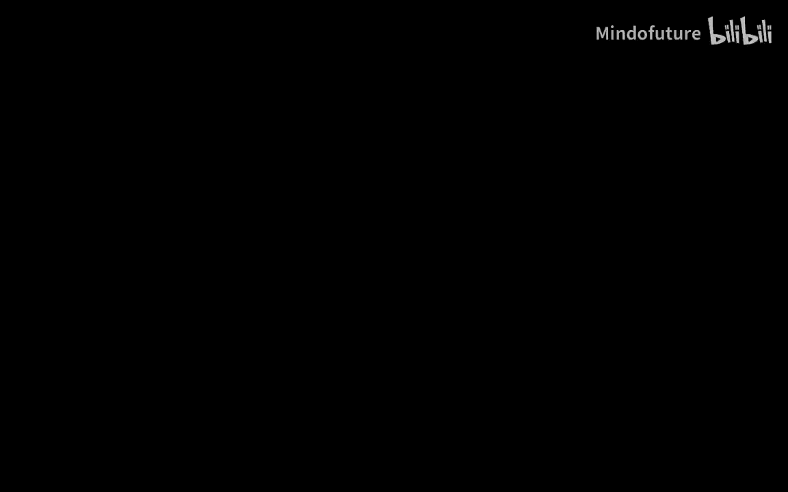
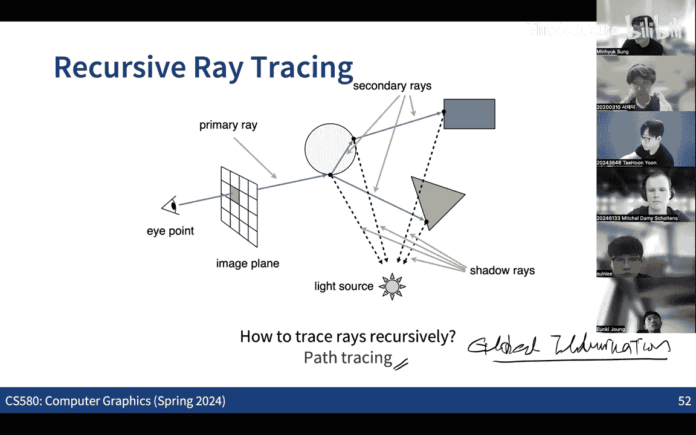

# 【韩国科学技术院】计算机图形学 KAIST CS580 Computer Graphics (Spring 2024) p06 P06 Lecture 07 - Monte Carlo Integration 2   Direct Illumination 1 (KAIST CS580, -BV1he7mzjEc1_p6-

Okay， so yeah， let's get started so last time we started to discuss some ideas about the onetecurity method and the basic idea for the montecurity method is the basically overall basically how we going do some kind of the numericalmer we get some kind of numerical approximation for the integral the computationmplication。

So in case when we cannot basically find some kind kind of the analytical solution for the interval。

 we are just taking some kind of the nuity approach to get some kind of the approximate。

 some kind of estimate for the interval and then actually the other ways around basically being some kind of get some kind of estimate for the interval but the power of the mon the method is in simplicity so it's kind of the stochastic approach in terms of that once you have some kind of the samples that basically samples from some kind of the certain probability the density function based on that we can define the mon the estimter shown in this slide shown here for any kind of even probably the density function we can basically have some kind of loss of the samples and we can use those samples to basically estimate any kind of integral so it doesn't need to be one the integral。

But in any kind of the multi dimensionmen the space。

 we can use the same approach by just having this kind of some of the samples and the estimate。

And the good thing of the Montero estimator was that it was basically unbiased the estimator。

 which means that we can expect that the output will be the same will be equal to the interval。

 so which means that calculate expected value， the estimator we can prove that the expected value is the same with the interval。

 so that's the case that we are having the unbiased the estimator。

And we could also basically consider some kind of the efficiency of this kind of estimter。

 so we need basically care about like both the the variance of the estimator and also the competition time of the the estter based on that we could also define the efficiency of the estimator。

So those are basically things in terms of defining some kind of estimator and while we also discuss some kind of unbiased deestmeterter。

 there can be some kind of other types of the some biased deestimator。

 which is the case that the expected value does's not exactly the match even the interval believe function that we are correctly aging。

But actually the kind of good thing was that I mean the key thing was that even in this kind of the case that we are having the biased estimator。

 the thing that we need to do we need to basically check out is that this still might be the case that we can they see some kind of convergence to some kind of the true value so that is kind of the example that we are seeing the last lecture so also for the pesoistic correction the case even with some kind of the biased the estimator of the variance。

 we could see that actually the estimator can converge to some kind of the true value when the number of examples is going to the infinity。

But it's just like the bias， which means that when we do not get the kind of inite the number of these samples。

 the output may not exactly matches the number that we want to get。

But in some of the cases that kind of the bias estimter still can be useful。

 especially when the convergence the rate is much faster than the unbied de estimator。

 so which means that in practice in many of the cases and obviously we can have some kind of the unbied estimator。

 it's always good to have some kind of the unbied estimator。

 but in some very special cases when we can define some kind of the bias estimator。

 which convertverges much faster than the onbieded estimator then we can consider using this kind of the bias de estimator。

 so this was kind of the one keeping thing。And it kind of the way to basically improving some kind of efficiency in terms like calculating this kind of the estimator。

 one of the idea that we also discussed last time was basically the strified dis sampling。

 so this was the idea that we are partitioning the domain of the intro into some kind of some multiple divisions and then allocating the samples into each of the partition based on kind of the probably the density function that we are also defining for each of the partition。

So one of the key thing that we also could say last time was that basically this kind of stratified sampling is not increasing the variance at all。

 so which means that it's always good to basically try to do some kind of stratified sampling basically dividing some region into some kind of some kind of multiplly pieces and basically doing some allocating the samples into each of the region。

 so one of the simples idea in terms of like allocating the samples into the region was based on using the kind of the area of each of the area or the volume of each of the region and doing some kind of uniform sampling regions。

 so this was kind of the very simple but effective way to basically decrease the variances and also getting some kind of the more accurate estimate of the kind of deal。

the interval， so this was kind of the basic idea that we discussed last time。

And today we are also going to discuss some more ideas in terms of how we can also improve the efficiency of the computation。

 the estimate。So really the most important part in the multiple the estimator is basically utilizing some kind of important sampling。

So here the key idea is that when we define a multiple gasmeterter like this。

 what actually we can see is that if we so it's all basically matter like how we define it probably the density function here。

哦 yeah here。So the good thing of the modest is that we can choose any arbitrary the probability density function for the samplingphony。

 so the simplicity idea was basically just using the the uniform the distribution。

But depending on basically the probably this function that we are picking here。

 actually we can see some kind of different kind of the convergence the for the asmeterter so actually one kind of the example is that if we pick the PDF function here as kind of the function which is basically proportional to the function value of the F here。

 then we can actually see some kind of the very fast convergt rate so let if we think about like this kind of very special case when the PDF is defined as kind of the same as the function divided by basically the integral of this function。

So this can be kind of the one way that we can make some kind of the PDF that basically satisfy some kind of conditions for the PDF right the integral of this the PDF the function or the domain should be one right so this can be easiest way that we can make some kind of the PDF from the function of the and in this case what we can see is that if we plug in into this our the mon de that we can see that for any kind of the random variable this kind of the F divided by the P this time becomes the constant right。

That's kind of the dis integral value。Then this becomes the case that we are kind of getting the achieving the zero variance。

 so we can always get some kind of perfect offers。But obviously it doesn't that make sense because our goal here is to basically estimate this interval So it's kind of like chicken and egg problem So if we can obviously get some kind of the interval of this function。

 then we can also get the like zero variance the estimator then actually actually we don't need the estimator because we already know this variable。

So this is really kind of chicken the problem so here the question is that in the case that when we cannot basically have the full access of the information about the function F and also when we cannot actually calculate the integral the function F how we can basically define some kind of the probably density function which is kind of like having the similar shape with the function F here in terms of like basically decreasing the variance of the estimator so that's kind of the key idea of the important sampling。

So let's do some kind of be some simple the exercise with this kind of function。

 So let's say like we are hitting this type kind of the shape。

Maybe here basically assume that if we don't know the analytic form of this function。

 we just have some kind of the sense that the shape of the function will look like this。

So when you have this kind of some very weak information for the function that the function will basically look like this。

 what do it kind of the way that we can define some kind of the simple the probability density function that basically had the similar shape with this in terms of like decrease div variance do you have any kind of suggestion in terms of like doing some important technique for the PDF here？

Yeah， so there are many kind of the answers here mean yeah obviously there can be the multiple the objects like one simple kind of the way would be basically having this kind of the head like the shape of the the function so we are having this kind of the probability the density function in terms of that we are having the very low the probability for the region here。

And high probability for the region that we can see some kind of a concentration dysfunction function。

So actually， depending on the probability density function that we are picking here。

 we're going to get some kind of have the different variances。

 so I also strongly recommend you to basically try to calculate the variance for each of the different choices of the probability density function。

So without any kind of some special PDFf， but when you just use the simple the uniform distribution。

 then we can get actually we can see that the variance becomes the 0。0365。So actually this number。

 the variance here is the number that I also calculated using the ChurchBT so actually I just copied this example from the fish quality based rendering the book and can I just verify that the number in the book it the same that the churchBT can also calculate the variance with its function。

 but I also recommend you to basically try yourself basically cculating the variance using some kind of the function。

There you get and especially these are the variant that we we just have the uniform distribution and if we choose different the distribution here。

 then we will we're going to get some kind of the different variance。

 so especially in this case when you pick this kind of the PDFf function here。

 then we can see that the variance basically decreases into the 6。

7 times multi smaller which means that we're going to get see some much faster thevergence rate with the number of samples。

So yeah， I recommend you to basically try to calculate the variance using the PDF that you're answering here and see how much you can decrease the variance with the choice of the PDF。

But here also the question is that like know when as we pick any kind of the PDF here。

 which means that like when you have the PDF dysfunction。

 we also should be able to basically sample based on the probability the density function rate so for some simple cases or some specialty cases like that we are having the uniform distribution or some gausian distribution for those cases we know basically how we can simply the sample the points based on the PDF。

But also the question here like this is that when you have some kind of the arbitrary DP dysfunction function then how we can also generate samples based on this PDF。

So this is also what we are going to briefly see here。

So let's first see some kind of the simplest case here。

 so let's assume that we are having the discrete the probability distribution like this。

 that we are basically having some kind of the n number of the discretevalue X here with some kind of the probability relative of thevalue。

And since we are basically having the PDF then the probability best should satisfy these kind of the two conditions。

 right， would some of the probability should be basically one。

So when you help is kind of like the and the pairs of the3 numbers。And also the probability。

How can you basically sample one of the values based on the probability。

 what should be kind of the basic idea for this？Any ideas。

 like when you have the n number of the values and the correspondinging the probability the value。

 what's the way that we can sample one of the valuess according to probability the density。Yeah。

 this is something that you should have to learned indeed。Introduction to statistics course。Now。

 one simple way that we can think about this is that basically we are thinking about some kind of the cumulative the distribution the function。

 so we are basically accumulating the probability the density for you know in the order that we are having the O values。

Then what we can see is that each of the value in the discrete set。

 we can assume that basically each of the value in the discrete set is basically partitioning the range from the0 to 1 right so if we see some kind of thed the probability the density for each of the value。

 this might be the cases that we are basically seeing some kind of the display of the range from the0 to1。

 we accumulated kind of the the probability density for each of the values。

So what we can see is that actually we can sample based on theative the probability the density。

 so which means that we dec the probability density should basically satisfy this kind of rules only in numbers be in the range from the2 to one and at the end we should the accmulative the density should be discrete in one。

So what we can do is that we are now sampling based on this accumulate the probability density。

 which means that once we basically have some kind of the uniform sample in the range from the zero to one here。

Based on the sample， now we are basically choosing the discrete value。

 which is corresponding to the that specific， the range of the aative， probability the density。

So this is basically the very simple the idea that we have being some kind of the inverse transform disseling。

 right？So this is basically nothing， but when you have some any kind of the PDF function。

 we compute the CDF， the cuulative the density function。

 and then we are sampling based on the the cuative probability density。

 which means that we're having the un the random variable in the range from the0 to1 picking one of the amulative the probability density and then finding the discrete which is corresponding to this kind of accmulative the probability the density。

So this can be like the very simple the idea that we can apply into the any type of the。

 you know probability the density。And we can also apply the same idea not only for discrete the probability distribution。

 but also for the continuous the probability distribution。

 we can do the same thing right so when you have the PDF here we can also calculate theative the probability the density function by taking the intro like this。

And then we can also apply the same idea， the sampling with the PDF here becomes the same that we are first sampling the uniform。

 the random variable in the range from the short to one。

 and we are taking the imversese function of the CDF in terms of finding corresponding the with this kind of the cud the probability the density。

So this is the very simple idea， right。But here also one thing is that this basically means that we should be able to basically compute the not only the CDF。

 but also is inverses of the CDF， so this means that basically when you define some kind of the PDF。

 we should be able to consider like how we also calculate the inverse of the CDF as well。

So when we can basically define the imverse of the CDF。

 we can easily sample based on the probability density function and then we can apply the idea of the importance the sampling。

Some simple idea， so let's also do some kind of the simple， some kind of the exercise。

So let's first try to see like no， let's say like we are having the function that is just like nothing but like x curve in the range from the zero to one。

 then if you want to find the probability the density function。

 which is basically proportional to the given the function。

 what basis kind of the function the Px here。SoMaybe you can take some time in terms of like we calculate such kind of the PDFf the function and also the CDF function。

And also is inverse as well。If you found the PF B PX here， that start to calculate the CF。

Px here and also the inverse of the CDF as well。Yeah。

 so this is like just the simple case that we are having like what kind of the Px so the here the ratio C can be easily calculated by just making the integral like this function to be one。

 right？Then we can easily see that like the C becomes like 38。

 then we have the obtaining the Px like this。And this these obesity function that we can easily calculate the CDF as well。

 So the CF really becomes like one eighth of the the X DQB。

And the inverse of the CW will be defined like this。

So this is kind of like one simple example that when you have any kind of the alytic form of the PDF especially into the the poly the function。

 then we can easily perlate inverses of the CDF and then we can do the sampling based on the PDF using the technique of the inverse transform dis sampling。

哦有。So yeah this版 kind of be simple example。So I mean important sampling is one of the actually also important the technique in the mono the estimates。

 so we're going to also get into some kind of the example like how you you this technique for the ray tracing the framework and you actually see that like all the things that we are doing in the ray tracing the system is' overall about basically doing some kind of the Monte like the integral the competition with some techniques of the sampling so those might be kind of the main idea that you're going to see in the ray tracing the system。

So yeah， so in terms of the sampling， actually even not for the you know the important sampling。

 if there are some many kind of some specialty cases that we need sample not only in some kind of some you know sample the area which is defined as kind of some bo boxes。

 but we can also consider sampling from some kind of some you know specialty regions or some kind of the even some kind of nonun or some non many for some kind of space so as a kind of one of the examples。

 what we are also going to see is that like if we also sample like the points。

 especially uniformly sampling the points in kind of the unit dis then what we kind of the best way to do this。

So let's get into like this specific example， so if we want to like uniform example in kind of the uni circlecle。

 one kind of simple the idea might be utilizing the polar ports， right？

So we are basically representing any kind of the point with the R and the datata。

And then one simple way that we can do some kind of sampling in the unioccle might be is that we are uniformly sampling some kind of the angle deta in the range from the zero to the two pi and also sampling the radius from the range from the zero to one。

Then we going to get this kind of some X Y point， right？

Does this make sense what the kind of problem that we are having this kind of disseling so actually if pay sample like this。

 then actually we are not getting some kind of the uniform dis samplesles。What the reason for that。

你个。So if I give some mores like why we are not getting the uniform dis samples。

 then actually the output of this this sampling becomes like this。

So you can see that we are having some central to the concentration at the center of theso。

While the real the new sample that we want to see is basically this kind of output。

We are having some kind of the more like distributed points in this case。

And the here question is that why we having some kind of a concentration at the center。

So here the region like Hawaii， we are basically some kind of the more concentration at the center would be because of the fact that we are uniformly sampling the radius well。

SoWhich means that when you think about every some kind of be some the circle like this。

 some kind of ring。Let's say like were having some kind of ring here。

 with some kind of the infinitesimal de of this kind of ring， right？

So when you think about this kind of like infinite testal the width of the ring or hitting some kind of the would be some kind of area for each of be circle。

There is basically all this kind of subtle at the same deep probability to be picked because we are having the uniform the samples of the radius。

 right？So basically those kind of disciples might have the same probability to be depict。

 but we can see that like the you know。The area of each of the ring is basically different because the area will be basically different points quantity2 pi r times of the delta R。

 right？So as you can see， you know， as we basically go further from the center to the outside of theoccle。

 we're going to basically see that the area of this kind of the wind is being increased while we're having the same probability to pick each of the theoccle right？

So that's why we are basically having some kind of concentration at the center。

 since as we get closer to the center， the area of the region to become smaller while we are having the same priority to kick that region。

So here the question is that how we basically change our the sampling。

 the probability the density function in a way that we can get some these kind of the uniform samples。

So what we can actually see here is that let's see this kind of the case。

 so let's say like we are completing some kind of the infinite testimal area of any kind of the point in the uncle using the the polar coordinates。

Then we can see that for of the point here， the area of this kind of region becomes like Dr or times R etc cetera。

 right？So from the definition of the angle here。So these length will be subtended from the symbol angle the dseta here。

 right we can see that this small region is basically has the area of the R you know D actually times R deseta。

 so that becomes this right。So the infinite test area according to the point becomes this。

And then what we want to do is that we want to define our the probability density function in terms of that that becomes basically proportional to this infinitetimal area。

Which means that we want to define the probability density function key here in terms of that this becomes the function。

 which is basically proportional to this area。So this basically is that we want to define the property the PDF here。

 which becomes like as the some certain constant ratio where the radius are here。いいです。

Then here the question is basically， how are we going to define this kind of the PDF？

And what we can see is that now we are defining sampling this data with some kind of the uniform distribution。

And then what we are seeing is that we are now sampling this art and this datata independently。

 so we can see that now this PDF can be decomposed into this one。

And also you hear what you can see is that this Pf is decompposed like this。

 and we know this probably the density， which is the uniform distribution。

And here the question is that when you know this kind of defect and when you want to make this kind of the this PDF to be。

 you know have some proportional to the radius R here。

 then how should we define this kind of the PDF for the latest theR and how can we also sample based on the PDF？

So let's think about this。Yeah， so as you can see， like this might be kind of simple in terms of that we are now seeing that。

Thiss like the PDF or the setupta becomes like thatiumos like1 over the two pi， right？

And we want to make the probably the density function for the R to be perhaps this form。

 So it's similar of us going to find in this kind of the constantum C here， right？

So by taking the integral of this kind of E PDF， we can see that the C C should be basically one of the point。

And based on that， we can see that the PDFF now becomes2 to the two times R， right？

So which means that if we want to have some kind of the uniform samples in the inside the unit circle。

 we should not have some kind of the uniform distribution for the。The radius theR。

 but actually it is no PDF for the R to be some kind of the linear function with the latest R here。

And based on that， what we can also see is that the CDF。

 the aulative discrete function for the R comes to the R curve。

Then we know we have the all the information about the PDF and the CDF。

 and it can also have some kind of calculate the inverse of the CDF here as well， right？

So based on that， if you really want to have some kind of uniform samples inside the UniIoccle。

 then what we can do is that for the radius， this becomes some kind of our the inverse of the E for the angle deta。

 we can also have the inverse of the like this。Then what we need to do is that we are basically sampling the two uniformly random variables in the range from digital to one。

And then we can basically you know take the secure roots of the first one and also two pi times the secondone is kind of the R and the set like this。

So this can be some kind of simple way that we can also do some kind of the uniform sampling in the un circlecle。

Doest make sense。Obviously， we can even try some like even simpler the way。

 the other kind of simpler way that we can do this kind of thing might be that we are basically some kind of rejection sampling。

especially when we do have some kind of life， not having this kind of some simple the region。

 but when you have some kind the complicated some kind of de shape where basically we need to do some kind of sampling。

 we can consider having this kind of de bounduning boxes and basically you're sampling inside the bounduning box and you' rejecting some the samples that are outside of the region。

Obviously， the problem here might is that we are losing some kind of samples for the points that are not inside and written。

 so you can also think about some kind of the success rate， the efficiency of the samples。

 like how many of the samples will be really used in the final dec calculationc。

So this can be anotherly simple approach。So let's also do some kind of the extension from the fo or in the tool this space or into this pair。

So that's actually kind of the name purposeable like doing all those kind of things。

So if we can as this sample inside the unit this sample。

 what about like the case that we are sampling the points on the unit sphere。

 So this is the case that like we now want to sample the points over the surface of the unit this。

So in these cases we can also represent each of the point with the speaker decos right。

 having this theta here and also the pi， so now the theta becomes the angle between axis to the northpo to each of the direction and also the pi becomes some kind of axis of the angles of the asmos right。

So actually， the meaning that this is that if we can uniform sample points over the surface of the in sphere。

 this is basically means that we can do some kind of the uniform sampling of the direction in the Swedish space。

So without this killinging， if we want to do some kind of the uniform de samplingling of the traction over the 3D space。

 we can actually consider sampling the pointss over some kind of the unit sphere。

So those are also the cases that each of the points can be represented as some kind of the having some kind of the infinitefinsimal the area。

 which is basically correctly like this one。And since we are also having the unit disappear。

 the RQ becomes the one， right？We are having this kind of the infinite textim of the area。

And we want that probably the density function for the piece it play to be basically proportional to this kind of the infinite testim area right。

For these cases， how should we define the probability the density function for the P theta。

And it was a DP pipe。Then let's also see how we can also compute the CTF and how we can also do some kind of sampling based on this kind of probability intensity function。

So let's try this up。Yeah， so we are sampling on the surface of this pi。

 We can also think about the case that we are sampling inside this pi so that will be kind another be exercise。

 but let's just think about the case that we are sampling on this surface of this pi。Yeah。

 we can also just sample these three points and normalize them， but what's be the problem with them？

You please simply example30 points and you normalize them。

The problem would be is that they do not be having the uniform sample， right？So in the case select。

 so we can also think of like sampling the points on the circle， right。

 not inside the circle for those kind of cases， we can also consider basically sampling the points。

Insteadside any kind of20 points and normalize de points， right？Actually。

 we can say that like this kind of the simplicity approach may not be really having some unon samples。

是。So let's think about the case that we are only sampling this data in the file and this is the case that we are having the unit sphere。

 which means that already is fixed to be one。So this is kind of like similar toity case that in the previous case。

 we had the PR deceptta， which should be proportionly R in the 2D thecle case。

 Now in this kind of like 3D case， we see that the P setta pi。

 this is the same set but the different deceptta T should be basically proportional to the sine set。

 right。Or if you even get results like this。Is it the same as you like？You calculate。

So it's exactly the same approach that we are basically now finding some PDFf for the the pi in terms of the that becomes the function。

 which is basically。Proport to the science setup。we also want to sample the set and the pie independently or basically fixing the PDF for the pie to be kind of uniform the distribution and we can see that now the PDF for the set should be have this phone。

 right？And if we calculate the C here， then we can see that actually this P is datata。

 the Pf or the Dta should be basically they have the design that type。会以。Is the results that you got。

And then if we take integral to compute this CF of the data。

 then we can now have this form of this kind of D the CF to function。

So if this is not the same with your calculationc， maybe you can check this out after the lecture I will also post all these slides in our the course web page。

So these are some kind of the peration in terms of how are we now do some kind of the uniform sampling only the unit disappear。

Then what we can see is that according to the CDF in the previous slide now we can basically calculate sample the C time D pi with the two the uniform the random variables if we think about this pick the coordinates the x and the Y and the z coordinates becomes like this So why we having some kind of some sort of the some complex terms here。

 what we can see is that we can first calculate the z with the model of the random the variables and then by just taking z here we can calculate the x and the Y like this。

So this days it' kind of like one simple way that we can do some kind of the uniform sampling on this period。

And this like the uniform sampling on a Uni sphere is actually one of the very essential parts in the rec。

And can you guess why。So yeah， we're gonna get into that。

 So we're gonna see start to go back to this kind of the reflectionle the equation。

 But what we are basically doing in our renderling equation was basically calculating the output in the ir radius by basically collecting all the information from the incoming the ir radius。

 which means that for all the kind of direction which is represented with the solely dangle we should be basically able to do some kind of sampling。

 So which is really sampling of the direction in the3 space So and then as I said。

 like sampling interaction， this space actually become the same as kind of like sampling points over the unitphere or some kind of the unit the hemisphere So for those kind of sampling of this solely dangles。

 you can actually use this kind of technique basically exactly this form。

 So this is basically what we are going to see。And as you can see like all those things like you we were so able to see that the algorithmsomecra and the samples sampling also becomes like easier。

 so maybe you can also think about like how we can do some kind of the un the sampling on some kind of the the unit。

 the hemisphere， so that can be also another thing and also we can consider un sampling the points。

 not only the surface or the surface， surface of the sp but also just the inside， the unphere。

So those cases what should be kind of the。They are the and point that we are taking。

 so those might be other kind of things。And also if we are basically sampling points inside the units disappear。

 we can also consider like having some kind of rejection disseling。

 but if we take some kind of ir rejection disseling， then what would be kind of a sub rate。

 almost this kind of resling would be kind of the efficient depending on the bond of the so those might be some kind ofcur that we can consider being some kind of re samplingling。

Any question on this？It great。So these are basically some kind of the basic things in terms that like you know doing some kind of dealculating the Montero in。

 and we are going to see basically how we can apply this kind of the idea in our the calculation of the rendering。

So let's first see some kind of the cases that we are taking some kind of the calculating some directect de illumination。

 so if we go back to our rendering the equation。So the rendering equation was defined like this。

So as I said in the previous lecture， the the render is all obviously calculating the irraddiance for each of the direction and what we also see is that if we have some kind of the liftle of the surface。

 the liftle is basically the case that we are collecting the information of the incoming the irradance from the old direction and then taking the interval with some kind of the ratio of some kind of refle for each of the incoming and the outgoing direction and then adding some kind of effect of the emission in the case that when the surface is also kind of emiting some kind of line source and then we are calculating the radance for each of the outgoing direction。

So this was kind of the basic the equation of the the render green and this kind of this function defining some kind of the ratio some kind of the light transport from the range of the incoming and the outgoing directions was the function。

 which was called the BRDF right？And we have seen that this like BRDf。

 is basically characterizing some kind of the maturitycur properties of each of the surface。

So as you can see here are the key part that we should be able to basically sample the solid angles over the hemisphere。

 right？So when you have this kind of theurice that we are assuming that locally。

 this is kind of the point， we are having some kind of the flat deep plane。

 we are basically sampling the direction into any kind of the points over the hemisphere。

So this is really the case that we are sampling the points over the hemisphere and then basically' calculating all these kind of pumps and this integral now can be estimated using the Montecur method。

 so this is kind of the basic idea。When words like random equation。

 there are some kind of specialty cases that we may not need to use some kind of demonticity method。

 like one specialty cases is that we we have some kind of dis spec D BRDF。

So as I also mentioned last time， we can also have some kind of the some sort of the mirror like shape where basically see that the BD the function is defined point like this。

So here basically we get some kind of the you know。

 the value of the one for the P or the F when the incoming and or the outgoing the direction of the vectors basically satisfies the angle of the deflection。

 rate？So when you see that no like this angle and the this angle are basically the same with respect to the serpen normalmal direction here。

 so basically when you specify the outgoing direction。

 where are basically we want to calculate the outgoing ir radians and for each of the incoming the direction。

 if we see that these two directions basically satisfy the condition of the angle of the ref。

 then we are basically making the B D to be one。Otherwise we are making this to be0， right？

So this is the case that we are having the some this kind of deduct deta function right。

 but basically here the delta here means basically the deduct de function that when this becomes the these PRR depth becomes one when these two these two are basically the same otherwise this BDF becomes the zero right。

 So this is the special case that we are having the perfect the speculity refra。

And this specifically like this spec reflection is characterized。

 not with the incoming the differential irlegance， but with the differential with the incoming irrad and the outgoing ir。

 so we are having this kind of the B the top which means that the rendering equation。

 and it turns out that we are having this kind of this rendering the equation where we do need to take any kind of in so this is kind of the special case that we can directly calculate this rendering the equation without calculating the integral。

And also the other special might be that we are also having some kind of directional delight。

For example， when you assume that the light force is very far from the point that we are calculating the reflection。

 for example， like when you have the sunlight， so those might be the cases that we can basically have some kind of the be the function like this。

It's not the function， sorry you kind of we can see that the incoming there is defined like this。

So which is the case that we are having the incoming raddiance when the incoming direction is the same。

 we the light direction， otherwise we are basically having the zero the incoming deraddiance。

For those kind of cases we can also see that we can calculate the outputpo in the direction like this。

 so here we are basically plugging this kind of the visibilityibility tone so unless we are having some kind of the occludeers here and is calculate some kind of selection。

 then we can directly calculate all this kind of to but if perhaps some kind of the occludeder basically includinging this kind of light from the light source。

 then we are basically having the zero the visibilityibility here that we are making the outputpoing the regions to be0。

So those are some kind of the special cases that we can calculate the output irrs without calculating the inter。

 but for some kind of de general cases， as I also dimension。

 we can consider using the kind of the multi estimate here right？

So when you have this kind of reflection fraction equation。

 what we can do is that we are doing some kind of like sampling some kind of the solid angle over the hemisphere so we can consider having some kind of the uniform sample So the good thing of like having the uniform dis sample is that we know that the probability basically becomes the cost of the number then the voltagecle of the estimation becomes like much easier right So we need to have like this term right。

TX。It can me some of like those things with。So if we know that this you know the probability is kind of the constant value then the competition becomes like much easier so that can be kind of the way that we are not utilizing the important sampling but making the competition becomes like easier right for those kind of cases we can do some kind of the uniformi sampling over the hemisphere having some kind of the uniform distribution of the all solid angles and doing some kind of the you correlation here and having this kind of the monlo the estimate right？

So from the previous slide then we see how we sample from sample the points over this sphere actually you can also calculate this right。

 so when we represent each of the solid angle with some kind of the sitta and the pi with the speaker or the coordinates instead of like directly sampling the from the solid the angle we can sample the theta in the pi and then calculate we can calculate the probability the density here。

So for those cases based on this， we can do some kind of the have some kind of demon monical estimate of this kind of reflection。

So this is really kind of the very basic idea of like how we do some kind of the recurring and how we calculate the rendering the equation。

 right？But actually， for many of the cases， this kind of the simple demonest kind of issue what would be the problem that we are having this kind of demon estimate？

I also give some kind of hint for this。When you do some kind of knife dis samplingling。

 we they it and go that we are getting this kind of output。

While the right one is basically something that we want to get right。

 So this is kind of like very simple the example that we are having the light source here。

And then some kind of occluder in the middle of the space with。For those cases。

If we uniform sample the solid angle over the hemisphere， then we get this。はい。

But actually the answer is kind of simple， like for all this kind of like the calculationulation of the illumination。

 we want to see the effect of the light source right how much of the some kind of the light which is coming from the light source is basically affecting some kind of the illumination for each of the points。

But here， kind of the key thing is that if we just like uniformly sample like all the direction over the hemisphere。

 there might be actually very few examples of the points， actually the directions。

which are really hitting thely sourcerus and contributing the illumination。

 but many of the kind of interactionss will not really hit thely source。

 which means that these are basically some kind of the samples that are not really contributing the final decarpolation。

So kind of the practical the way that we can do some some sort of some you efficient dis sampling or some important sampling is that we are not sampling the directions。

 but actually we are sampling the points over the light source。

So that's especially I think about this kind of the case that we are having some kind of the area light source here。

So now the light source is defined some kind of dis some plane or some kind of diss in Nor region。

 some 2d deep plane in this rate space， for those kind of cases。

 like instead of like sampling some directions over the hemisphere。

 what we can do is that now we are sampling over some kind of the points over the area of the light source。

So for those cases， now we can replace the differential solid angle like this because from the definitions of the solid angle。

 what we could see is that the area， which is basically the perpendicular to the direction of this kind of direction from the point to the  laserrs。

This basically area， the area which is perpen this direction becomes the area which is basically subhanded by the so the angle right。

 so which means that when this area is basically D times like cosine de setta so here d setta is basically setta here the angle between the direction from the point to the Lyos here we dis this number of the area thelyos。

Were given this angle this no。The projected area， which is also not to be the direction。

Becomes like B A times like cosine de cea。From the definition of the solid angle。

 we can see that this becomes the same with the R square times like the differentialable of the Soviet angle。

From this， what we can see is that now we can replace the differentiable distortic angle into this term。

 right？So this can be the same kind of de formulationation that we are simply replacing the differential of the solid angle with the differential of the area over the area the light source。

And then we can now also have some kind of the constant delay light source。

 so maybe we are assuming that the incoming raddiance coming from any point of the area thely source is let' stay the same So we are having the constant the incoming radance here and then we can also easily plug in the visibility where we some kind of the oload or So this basically's some kind of additional tone to calculate the visibility。

So yeah， so this is similarly the stacase， but we are now sampling not some kind of direction uniformly。

 but actually sampling the points over the surface of the laserrs uniformly by the area and then converting the solid angleangle into the differential of the area and then now you can also compute the same onte the estimate into this form。

So this is nothing but we are basically replacing the sampling of the de into the sampling the points over the light source。

And what be kind of the distance， so this is the problem？

this term should be basically nothing but basically one of the area， right。

 because we are uniformly sampling the points over the laserrs。

So this can be sort of like considered as kind of doing some sort of the important sampling right so we are basically changing the kind of the the domain where we are basically sampling some points in a way that we can do we can have some kind of the different the estimator for the same the selection the equation so this is the case and now calculating some kind of the estimator by sampling the solid angle and this is the case that we are having the same the estimator for the same the equation but not by sampling the solid angle but sampling the points over the area light source。

So which can be kind of the more effective way because we can see that like all the points that we have sample over the light source will contribute to the best the computation of the elimination。

Make sense。Yeah， so those are some of the cases that we are now sampling the points over the licensed。

 then we can get some kind of the much better the quality of the outputs with the same number of the samples。

Andに quite from thisす。Yeah， so these are like some kind of cases that we are currently in some kind of like single step delete section and here one of the questions might be that then how many really there's some kind of the final the rendered image right for the final de rendered image what we are going to assume is that we are going to assume that in the film the plane if we do not even though some kind of effect billions。

 the camera billions then we can just assume that what we are recording with the film is especially the information。

 theance。So qualitative the pixel in the fill plane。

 now we can calculate the es basically calculating this。

And this can also have this kind of form in terms of also sampling the points over the surface。

 then using the samete method， we can also find calculateulate all the reance for each of the pixel and that becomes the information that we are basically recording into our basically render image。

And as we also discussed in the last lecture， as we have some more examples。

Of these kind of demontegr estimates， we can see that the variance will basically decrease linearly with the number of examples。

So these are some of the examples， like when you have the only one single array version of the pixel or when you have the 16 rate version of pixel or those with the two cases。

 we can see that we are getting the kind of the sum and so the rendered image which is really kind like getting closer to the ground was kind of the outputs。

And these are some of the examples， like when you also increase the number of the samples。

 how much we can as decrease the error of the rendering so these are the number of these delays that we are killing。

And we can to can also just see some video for this。对。So as we have some more number of the samples。

 we can get some kind of the rendered image， which is like getting closer to some kind of the real vehicles。

Let me play this again。So these obviously basically I mean as we basically increase normal samples。

 we can get some kind of be some more like binary outputs with some variability quality。

Yeah also important sampling is also important for the rendering as well so depending on some kind of the situation like you so this is actually the cases that we are having some multiple delay light sources。

 then here the question is that how should we basically sample the light sources depending on which information so if we just uniform sample all the light then we can get this kind of the output but if we use some kind of tweak of the input sampling in terms of like sampling the light source proportion to the power of the lights that are basically emit for the of the light source then we can also get a much better quality of the outputs using the same number of the array so those are some of the examples。

아に quiteそです。Yeah so here the question might is that so we just have seen some very simple example we are calculating some kind of the like once step the reflection with some kind of the mon the estimate。

 but actually what we discussed for the rate tracing is that actually ray tracing is kind of the recurs there so we are not only caring about some kind of reflection like one single the point but actually we need to basically trace all the trajectory of the array in terms of really considering the entire the scene and also the multiple decline line sources so here the question is that how we exactly trace all these kind of ray and in terms of like accumulating all this kind of the information the reflections。

 so this becomes like much more the complicated the computation which also involves either some kind of some tracing some kind of procedure which is called the past tracing where we can consider doing some kind of the global the optimization to calculate all these kind of some interactions across the objects and the line source。

So these are a robot that we can discuss in the global illumination。Yeah。

 so we just have seen some kind of the simple case of the direct illumination and then next week we're going to start to discuss some kind of the ideas about the global illumination really tracing all this kind of like the rate triples of syn。

Yeah， so this is the end of the today this lecture， Any questions on this？Okay。

 so we basically discuss some kind of the basic concepts of the Monteco the estimates。

 so I recommend you to basically review those ideas and see how those can be basically applied into our illumination de competition and then we're going to start to discuss the global illlimination from next week so I will see you next Monday。

哎。Thank you。はい。

