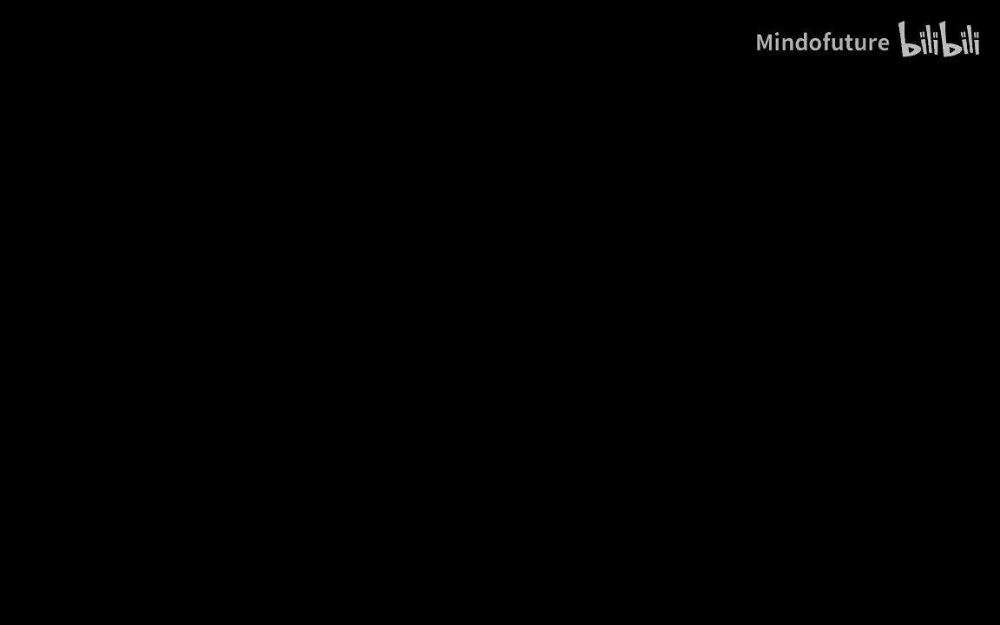
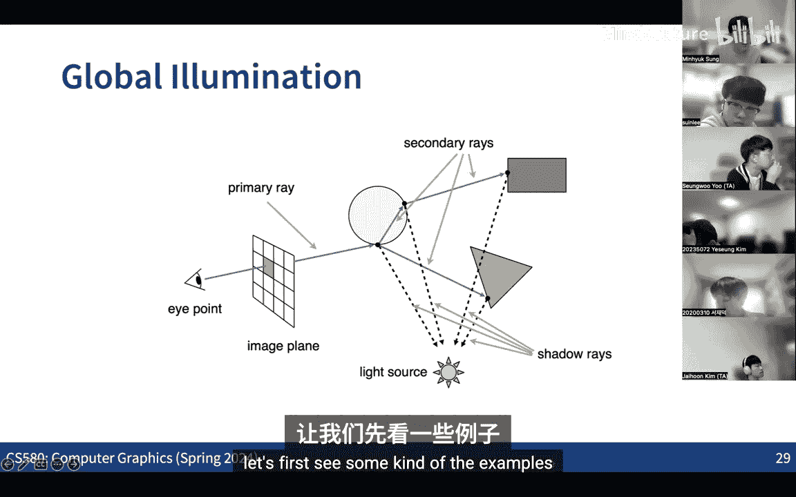
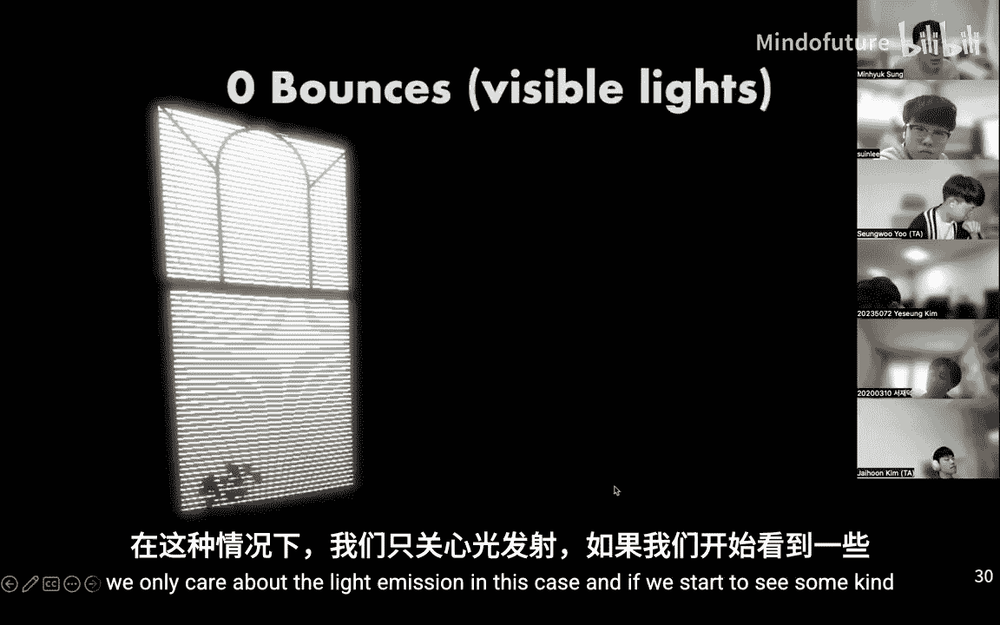

# 【韩国科学技术院】计算机图形学 KAIST CS580 Computer Graphics (Spring 2024) p07 P07 Lecture 08 - Direct Illumination 2   Global Illumination (KAIST CS580, Sprin -BV1he7mzjEc1_p7-

so yeah welcome back to CS 580s。 so last time we are discussing some kind of the ideas about the Montecolor the estimator and also how we can apply this kind of technique with the direct illumination to complete the reflection with our the rendering the equation So last time we some basic idea about the input sampling which was the case that we basically through the samples based on some kind of the probability distribution depending on which probability distribution that we choose。

 actually we can see that the estimator can have some basically faster convergence will slow the convergence。

 depending on which the probability distribution that we choose So the best option might be that if we choose the probability distribution which has the similar shape with the function that we are basically taking is interval。

 then we can get the best kind of the convergency rate。So yeah。

 and once we basically choose any kind of the probability density function also the question is that how we can also draw the samples based on the probability distribution。

 so the basic idea for that was basically using the technique called the inverse transform disse。

So this was the case that if we can basically compute the cumulative distribution dysfunction function from the probability the density function and also take the inverse of the CDF。

 then we can basically throw some kind of the samples from the uniform distribution in the range from the zero to one and basically map this sample into the domain they were taking basically the samples。

 actually drawing the samples using the inverse of the CDF。

 which means that we should be able to compute not only the CDF。

 but also the inverse of the CDF basically to draw the samples based on the probability distribution。

So this was basically the basic idea， the fundamental idea of the important sampling and so the question is that how we can apply this kind of idea into our the reflection equation。

 so basically what we are doing in our the radiation system is basically all about basically computing some kind of interval so the formulation is basically design in terms like taking sum of this animation of the light from the point that we are calculating the reflection and also integratingating all the incoming the radance from the old directions and then basically compute some kind of reflection using our given the BD of the function and also taking the interval that so that becomes the outgoing the kind of radance that we are calculating so this is basically the overall computing some kind of interval and here the basic idea then how we can also apply the mono estimate the idea to compute those kind of things。

So we have to also see kind of the two different cases in terms like computing this integral。

 the first one basically case that we are sampling the Soviet angleangles and the other one was slowly sampling the points over the kind of the area。

 when we assume that the light source is given us kind of some area like so those are kind of like two different ways and in this specific example that we are basically having this kind of area。

 the light source they could sampling the points over the area the light source was that we can basically take all the kind of ray that we will basically contribute to the competition of the going the radians while the kind of the limitation like kind like taking the samples of the all angle was that many of the ratess we will not basically hit the light source。

 which means that those ray we will not contribute to the kind of computational reflection。

So that's why basically we can get some kind of very de convergence rate with the area dis on the right hand side。

 why we are basically having some kind of the higher variance in the soil language samples because of some main kind of the cases that they era or not basically hitting the area laserrs。

So those are like two different ways that we can basically define some kind of estimator for the reflection the equation in terms of sampling these all examples and sampling the points over the area。

 so depending on which estimator we choose actually we can some kind of different conver of debates and these are actually some kind of examples of doing some sort of the important sampling。

 so we are not basically defining some kind of some basically some kind of probably the density function for the important sampling but basically we are sampling over the points over the area the light in terms of that we take some more the that can really contribute to the final computation the interval so this was kind of some practical way that we can do some kind of important sampling。

Any questions for the topics that we discussed last time？

So the plans for today is that we are going to discuss a bit more kind of things about this kind of like direct the illumination。

 and then we're going to move on to the full illumination。

So one thing that we are going to discuss a little bit more about the direct illumination is basically more people import sampling which important sampling so here the basic question is that so in the previous slide we have seen that the area the sampling is better than the soil language sampling。

In that specific case， but is it always true for any other cases as well？

So what we are going to see is that let's briefly to basically revisit the important sampling。

 to debate the idea for the important sampling was that to estimate integral the function d F here。

 what we are going to do is that we are going to choose a sampling the probability D density the function DPX。

 which is close to some kind of function which is proportional to the function theyt right。

But the case that we are going to see for today is that what if we are taking integral the function which can be decomposed into the two functions。

 so let's say like we are taking integral the F F function here。

 which can be actually represented as the product to the F1 and the F2 and let's say that F1 and both of the F1 and the F2 basically relatively the simple D function and we also have the information about those the functions while the product of like these2 can be some a kind of the I comp function。

So for these kind of the cases， what the kind of depressed way that we are is be kick doing some kind of important sampling。

So what me kind of some real example of this case in already some kind of rendering the equation。

 so if we go back to our the rendering the equation。

 actually we can see that the rendering equation actually can be seen as kind of the taking integral of the product of the BRBF and the license versus the incon re function。

 right？And also for the both the BRDf and also the light the source the function these are kind of the given information rate so we have all the information of like where the light resources are basically been the scene that is basically define the incoming deradency function rate and also the VRDf is kind of the the material information for the surface and this is also kind of the usual defined information so basically and also typically these two functions are relatively like simpler then the product of like these two so for those kind of cases what kind of the best way we can do some kind of the important sampling so this is kind of the basic question here。

So one of the things that we can think about might be that yeah so we know these kind of the two components and these two functions basically relatively the simply function。

 So let's think about like making some kind of the sampling distribution which is close to the each of the function which means that we can somehow define some kind of sampling the distributed function which is proportional to either the BD or either the light source so either the BRD risk means that given some kind of the outgoing direction we can see what are be kind of solely than the directions that is giving some kind of more contribution to that specific the outputpoing direction so based on this kind of some concentration like where most of the light subject coming from that are basically directly to that specific direction。

 we can do some kind of the important sampling。Where we can also do some kind of important sampling based on the light source。

 because if we know the kind of information of the light source。

 as we have done in the previous slide we can basically sample the coins over the search of the light source so those are the really two options。

So when you have like these kind of the two strategies。

 so like sampling the points for these kind of the two cases， let's say for the left case。

 the yellow， basically the yellow thingss are basically project in some laserrs。

 so the left hand side where this kind of along the the laserrs。

 which looks at some kind of the area like in the3 space where the line in the 2D space。

And also very， you know， go see the ref the BDF which is almost cool the perfect spec reflection。

 while only the right hand side， but we are having some very tiny the light source。

 which almost looks like some kind of the point light source with some kind of the wider distribution with the BDF。

So for both of the cases， when you use the two different ex strategy。

 like one is sampling based on the BRDF and one is like sampling based on the L。

 which are seems the better for each of the cases let's think about this。

So this is a simple question right， so as you can see the left and side。

 this would be better to sample based on the VR there because we can see that some of the lights that are coming from some specific direction is the mostly contributing to the computation of the outgoing ir radance which means that we don't need to basically should many ways into some random direction。

 but we just need to sample to the kind of direction that we can see some kind of the most of the kind of the contribution to the outgoing eras。

 this is basically case that we are missing some kind of the policy sea reflection。

 which is actually almost close to some perfect the speaker reflection。

 which means that the direction coming from there， so the lies coming from that directions mostly basically important kind of the lies the kind of the final computation。

While we have this kind of case on the right hand side。

 this is the case that we have some kind of the very tiny delay light source which almost looks at some kind of the point light source。

 which means that when you also kind of the sample based on the DRDM also be basically array we will not basically hit the light source。

 which means that these ways we do not basically count in the final computation。

 so in this case obviously it's better to basically sample based on basically the light source。

 which is the case that we sampling the points over the light source。So as you can see。

 depending on some kind of sub arrangementrangement of this kind of scenes and also depending on the BDFD functions or each of the points of these these services。

 the strategy can be changed so we can choose like sampling based on the BD have sample holding based on the era source。

 but which is kind of some some kind of the manual things so it sounds like we need to do this kind of making some kind of decisional like choosing the strategy depending on how these scenes are basically arranged and how also all the services have some kind of somesymmetric properties。

 so here the question might be that one kind of the best way that we can have some kind of the sub of unified some strategy of the samplingling that can be basically applied to any kind of situation right？

So here basically what we can see is that more specifically if we have this kind of some the function app。

 which can be composing to the F1 to the F2 for those cases。

 if we choose like one of the kind of the function and also find a probably the density function。

 which is basically proportional to that function。 So let's say like we are some kind of the sample distribution the P1。

 which is basically proportion to the F1， obviously even in some kind of the cases is obviously possible to pick some kind of the the probably the distribution which is proportional to some kind of the any function。

 but let's even assume that we can do that like we can basically find some probability the density function。

 which is perfectly proportion to the one of the function。 let's say that's the F1 in this case。

 but still in this case what we can basically see that。

Then the variance of the kind of the output becomes also the proportion to the variance of the function of the F2 here which may be high right so actually like choosing the sampling the distribution which is following one of the functions may not be the kind of the best strategy for most of the cases so this is really kind of some practical kind of issues that we can see in many kind of the rendering the processes。

So actually these are two different images， which is like using one of the samplingling this strategy。

 like one is sampling based on the BRF and one is sampling based on the laserrs and can you tell like which one is render using which sampling this strategy。

So actually， you know these images show that know none of these two is kind of the ideal like the sampling project in this specific case。

 but when you choose one of these dis sampling the idea。

 we can get some kind of different kind of the outputs as you can see here。Yeah， so as you can see。

 yeah left is the case that we are using the light import sampling so over the images basically the bright while it is not basically preciselyly capturing this kind of the gloss see reflection the effect over the surface of the car right on the right inside we can see that the me de property of the cur surface is better captured with the DDR important sampling while the over the images is darker than the left one because it is not sampling from the laser source。

So these are the speed differences， depending on like which sampling in this strategy you choose。

Make sense。then here the question is that how can you make some kind of some sort of the universe or some kind of the input samplingling the idea that can be applied to any kind of the situation without doing some kind of theme。

 sort of the fine training or resseling this strategy？

So here basically what we can think about is that let's assume the cases that we are having the n different the sampling distribution。

 which means that we have the n different the sampling the probability， which are a as the PI。

 and we are thinking like drawing the NI， the number of samples for each of the the probability distribution。

So for those cases。What we're going to do is that we are going to define the the multi sample case meter like this。

 So this is kind of dissimilar with the multi of the estimatess。

 but we are basically having this kind of the new weighting function here。And also here。

 we are going to define the weight function in a way that for the same kind of sample x here。

 the sum of the weight becomes one over the all probability the digest density function。

 so this is the condition and also the weight function should be0 wherever basically the probability becomes0。

So if we can basically define this kind of the weight function。

 then we can also define this kind of multi sample the estimator。

And the good thing of the monetary the estimator that we have seen the previous data actually is that the Monte de estimator is basically a unbiased the estimator right so that's a kind of the good thing in terms that we can see that we do basically see some kind of the expected value which is the same really the true value right？

So here the thing yeah， So also one more thing is that here the ways basically do not need to be constant。

 we can have some kind of the constant the for whatever the sample that we have。

 we can have the constant waste， but it does need to be some kind of the constant waste。 actually。

 it's better that we are think some kind of the the waste that are basically being adjusted depending on the sample。

So let think about the we this kind of be way to function， they here to question is。

Whether this kind of the multi sample estimter is also a un biased the estimator。

 so can you quickly check whether this kind of de estimator also has the expected value which basically is developed to the so the inter function that we are comp。

电冇睇。有咩啲意见。You can check this out after director so I'm let first move on so you can also I'm also going to post the slides in the slide later。

So yeah， I guess you can easily get this kind of the results from the rules that we also discussed in the。

So it basically it becomes like taking the expected value for this term and like these two probably the for the samples that is canceled out and also these are canceled out because like taking some kind of average and then we this is the coming from the property of the weighting portion that we are defining so this was becomes one then we can see we can see that actually it comes beyond another the unbiased the estimator so let's check this out after the you can check this out after the electron was open to post all the the slice。

So yeah， let's first move on。 So yeah。Because here the main question might be that how we can choose the weight function or the weighting function in this case。

 actually there can be multiple ways that we can choose some kind of the good the weight function。

 but actually we can choose the weight function based on the kind of the situation that we are seeing based on the arrangement of the objects and also based on the V of kind of the metro of the pertuity surfaces and one simple kind of some heuristic way that is basically practically used in many kinds of the rendering pipeline is basically the balanceistic which is defined like this。

So you can see this formulation， this is basically defined as like choosing the wave function here as' kind of like taking the product of the number of the samples and the probability and also dividing this with sum of the product of the number of the samples and they probability。

So let's also do one more kind of quick things， so can you also quickly rewrite the following the multi sample of the estimator with the ob weight function and let's see how it looks like and also what's the meaning of having this kind of the balance decreased。

そう、権に結構ウえばいい。So basically if we see the minimum disability heuristic， this is actually nothing。

 but when you basically see that assume that the normal samples for each of the sampling the probability density function are basically all the same。

 then we can see that this is nothing， but we are basically seeing some kind of the relative the probability or the samples for each of the density function。

 right。So when we basically see that the sample has the higher probability you once specific the P with the probability function。

 then we basically increase the weight， which is quite obvious so this is kind of like very simple kind of the trick in terms of that we are basically adapting this kind of the weight based on kind of the probability the samples for each of sampling is strategy and taking some kind of the normalizedize the probability in a way that the weight becomes some the weight where the PDF becomes one that is also giving us some kind of the unbiased the estimator。

This is be very simple idea then we can see that we can rewrite the same estimator with this specific weighting function。

Then we get results like this here basically just nothing but like dividing one over and here and in a way that we can see that this becomes some kind of a ratio the number of samples over the total number of the samples and it basically the total number of the samples here。

So we get this so what we can see is that after we we write everything like we can see it actually this becomes the difficult standard the transmit while be making some kind of the another the PDF that looks like this。

So this， you can see that this becomes some kind of the。

So some sort of the weighticked average of the all the kind of the PDFs that we have。

So this is very simple the idea in almost likely least some kind of the adaptation of the weighting based on the PDF and while this is really simple kind of trick that we can very easily implement what we can also basically the proof is that so let's think about like this kind of the true estimator like F is the typical the multis the estimator with some kind of any arbitrary weight function。

 and let's say F hat is basically multis the estimator with some kind of the balance through the weighting function that we have then we can see that the gap of the variance of this two estimator。

 let's have this kind of the upper bound as you can see here we can also find the proof of this kind of the information in this link here。

But before we see some kind of before that this kind of be。

 let's see so what does this mean when you see this kind of be the upper bound big gap of these two variances。

 what would be the meaning of that we have seeing this kind of be the upper bound of the gap。

Basically， what we can see is that the right hand side of this tongue is always positive， right？

So the minimum number of B andI should be equal or smaller at the sum of B andI， right。

This means the D should be bigger and this is curve。

 this means the the right hand side should be always part bigger。

And there is like positive the amount of the gap， when you take the difference from the variance of the baary function。

 the multi sampled x theory balance function with some any arbitrary function。

 which means that actually the variance of the the most of the aster with the balanceary function can be bigger than the variance of the estimated with arbitrary function rate。

So this does not mean that the variance of the iPad。

Is smaller than the variance of the arbitrary between theest meter f。啊所以 should be。理润。We the same。

SoActually， what we can see from this is that this does not actually say that the variance of the F head is smaller than the variance of the F F is basically this meter with the arbitrary weight function。

 so here basically the question is that when you take this kind of the balance risk as kind of weighted function would there be any kind of the other ways that we can define the weighted function and does can this kind of the other the weighted function be better than the balance electricity right。

So basically here the question how good the balance。 So here basically。

 the thing is that there can be some kind of the another the some RBT， another the the weak function。

Will the multi p meter but still be the gap between these two is basically bounded by this amount of the kind of some quantity。

 which means that when you basically pick any kind of find some kind of another some kind of the weighted function。

 it cannot significantly decreasegrade the variance more than some kind of the de variance of the kind of the estim we de balance the heuristic。

 which means that still while we can see some kind of the improvement in terms like reducing the variance the estimator by choosing some kind of the better the weighted function。

 still be kind of the improvement we will be bounded by this amount so we are seeing this kind of some kind of the upward bound or leave in terms of like making some kind of improvement from some kind of balanced heuristic with some kind of another kind of weighted function which means that the balance heuristic is kind of good enough in。

So like having this kind of the small amount of kind of the gap with some kind of another。

 some the upper bound of the gap with the other the arbitrary deter。

And also the thing is that even these gap get closer to zero as we have some more number samples for it to be probability the density function as you can see in this as we see that the ni becomes kind of the larger and the larger and the larger these two。

 the difference between these two will get closer to the zero。

 which means that also the gap between the estimator we the the deep and also the estimator with some other the weight functions the difference between these two in the variance will be basically decreased with this amount of the upper weight so basically the meaning of like equation so please check this up so yeah。

 so these are basically some basic idea of the multiple the important sampling。

So if we see some kind of thecomp with the different disseling distribution。

 so the top left is the case that we are executing some kind of uniform device disseling。

And the second top right is the case that we are taking the light inputton sampling and also the bottom left is the case that we are taking the BRDF。

 the sampling， so typically takes some kind of multiple the input sampling which incorporates both the BRDF and the laserrs in the one the estimate the computation。

 we can see that we can get some better dissocing terms like having some kind of the bright image which basically captures the light information correctly and also seeing all these kind of some gloss in this the surface that also captures the BDF correctly as well。

So this is kind of the basic idea， like the multiple the important sampling。

 and we will be able to see that when you will be kind of the re tracing the pipeline。

 basically you utilize is kind of the idea for the multi estimated computation。

Any questions about the multiple important sampling？

The deformulation that we had in the paper slides， I recommend you to check out some more details and see what's the minimum PP deformulation。

And CPU you have some other questions， please feel free to post your questions。

So this was kind of the last compliment about the direct illumination。

 and then now we are moving on to the Google bird illumination。

So what's the difference between the direct illumination and the equilibrium eumination so in the lecture in some weeks ago we have seen this kind of the that shows some kind of some conceptual the idea about the rate tracing so the direct illumination is the case that we only basically consider some kind of ray casting as shifting array from the pixel the plane and seeing the first in the point and at that point we also shoot the ray to the light source in terms like combatting the reflection the kind of first imp position the point so if we only incorporate all this information to determine the final the live information coming into the pixel that becomes kind of the ray casting case and that becomes the direct illumination the case that we have seen in the previous slice。

But what we also have seen in the previous lecture is that actually what we want to do in the kind of the rate tracing is not just like taking account the single points of the first instruction。

 but we also should the secondary rate which basically tracing kind of the path of the lines in the back in terms of the we are incorporating some multiple the balances of the lights over some kind of the multiple the points so the idea of global eumination is how we are going to incorporate or this kind of the secondary array in terms of that we really basically trace the lights with some kind of the multiple electrons over the surface along the way that we basically reaching to the light source with some kind of multiple balances。

So this computation basically becomes like way morely complicated。

 we're going to see some kind of the basic idea basically how we're going to calculate those kind of things。

And before we see some kind of some ideas and how we're going to calculate all these kind of things。

 let's first see some kind of the examples， So this is basically kind of the case that we are having the zero bound。

 which means that no reflection over the surface so we only basically care about some kind of information which is to directly coming from the light source so we can only see the light source in this case。

We only care about the light image in this case and if we start to see some kind of one bounce we basically the direct domination of the key。

 then we can start to see some kind of ingredients。

 which is basically visible from both the camera the perspective and also from thely source the perspective right so when you can see that the light can basically cl from thely source to any the point and also to the pixel the the plane then those basically the points will be basically considered the final the computationmplication of the image right？

So now we are seeing some kind of abbreviions that are basically visual from the both of the camera and the device source。

But still like the other parts of the regionss of its paper very dark。

 while this is not the real case in some kind of real things。

 we can also see that from the sunlight coming from the window。

 we can see that the other parts of the scene also can become de bright。

So if we start to increase the number of deposit that we are basically shooting the secondary rate and basically the device in the scene。

 then we can see that the scene becomes bit brighter like this。And when you have some more data。

 we can see that。Yeah， we can some kind of be more realistic the image like this。

 And after like eight boss， like we can see this kind of office。

 we should really have some kind of be more accurate at the precise the simulation of light the reflection。

Makes sense。So this is another example with a more of complex scene。 So if you see a point here。

 a P point here， which is very dark because like this point on the pillar is basically behind the kind of some other kind of things from thely source from the sunlight light so basically this point P is basically occlude by the pillar from thely source。

 basically so when you only hear about the di eumination， this point becomes very dark like this。

Actually this is not the real case right so in the real environment we can see that actually this point also have some kind of the lights from some kind of the multiple reflections from the other places so if we start incorporate some kind of the indirect denomination with some kind of the multiple de bounces or some reflections over this are piece we can see that over scene becomes be bright like this。

 so these is also results with 16 de bounces of some kind of global over denomination then we can see that some of the lights actually can reach to this point with some kind of the reflections over this thing。

Does it look more realisticistic？So this is another example。

 which is created by the rain tracing I can see that while we some kind of the lightrs outside of the windows。

 we can see some kind of the bright the in， these things like this。And another example。

 you can see that some of the regions on the flu has some kind of the effect of the di illumination。

 while also the other parts of the flu and also the other objectss have some kind of some kind of colors because the air or seeing some kind of lights that are reaching to those points with some kind of the multi reflectiones。

So this is basically effects of the indirect elimination。Yeah so in the global emination。

 like one thing that we are going to see is that so basically we are going to make some kind of a small de from the rendering equation that we have seen So the rendering equation that we have seen was basically some kind of the flex equation so we are going to turn this into the light transport the equation which is almost the same but we are going to see some kind of difference there so basically the key principle during the light transport equation。

 the LT here is basically the energy balance basically in the system that we are defining。

 so in the same thing that we are basically some kind of de rendering we are obviously going to assume that the difference between the power of the outgoing the power and incoming power should be basically exactly the same with the difference between the power which is basically emitted from the light source and also the power which is absorb by some kind of the surfaces so we basicallyote the outgoing the power and the incoming power and the emitted power。

The ob power is kind of like those kind of things that we can say that they should have done this kind of the relationship。

 right？And also， if we send the incoming the power onto the right hand side。

 that we can see that we also have this equation。So the difference between the incoming power to the object of the power actually can be some kind of portion that we are seeing some kind of some action。

So when you see this kind of the equation actually this is basically exactly the same that we are seeing with the rendering equation that we are seeing。

 so actually the rendering equation that we have seen in the previous slide was like having this kind of the three termss so what we are going to do is that we want to basically compute the outgoing the irradians as kind of the sum of the emity light and also the lit flag right right。

So those are like bake sweet typess。So in the globalial oation。

 one thing is that so here the question is but what should be the instant the should be。

So we basically separate this with the outpoing ir in the previously case。

 But if we think about like what we kind of instant the ir ingredients should be。

 basically here some of the assumption is that we assume that there is no basically the participating media。

 which means that the space is basically empty right So there's basically nothing is kind of defecting the space while we will the environment is basically not this kind of case。

 there is obviously some kind of participating the media So we are also going to discuss the boandering in the next week but for now let's assume that the space is basically empty not in there defective space So in this case we can assume that the irradiance is basically the constant along a。

That in the global e， basically what we can assume is that the incoming rate。

 which is basically reaching to the point P from the direction of the omega i here。

 is basically the same that which is basically coming from some kind of the other objects。

From the point P there， which is basically the first intersection point from the ray which is from the point P with the W the omega here。

 so let's say like we are basically calculate we want to get the information about the incoming the radius from this direction at the point P along the direction of the omega here right then actually this incoming regionss from at this point from this direction actually should be the same with the outputing direction at this point which is the first intersection point from this ray into the opposite direction right。

你有俾姓。So basically in the global don， the way that we are were basically going to calculate the incoming de radius is basically taking the outgoing raddiius from the previous de balance。

 previous deflelationction。So basically simply what we can do so rate tracing is kind of the sort of the reverse engineering we obviously basically back tracing all these kind of troubles of the lights so what we can see is that if we want to get the incoming reency commission at the point P along the direction of the omega here。

 we just should a find the intersection point here。

And then basically take the outgoing regions over the opposite direction， so that becomes this term。

 right？So now we can replace the incoming radance here with the outgoing raddiance in the scene。

 so that becomes this。So when you calculate the outgoing lant here。

 this is the same being rendering the equation， or while we are just thinking that no these incoming rate sum is kind of be outgoing radis from the first imp point with the output structure。

it is great。So then this is nothing， but also that kind of thing is that now then we are seeing some kind of the licur form。

 we are having the output ingredients here and also here as well。

 so this is kind of the some licur city equation。So basically。

 that makes the competition more kind of complicated， right？

So in general is there some kind of the analytic dis of this obviously the answer is no right when you think about some kind of complexity of like all the kind of license and also kind of the BR and many kind of things。

 it would be really hard to basically derive some kind of the anatic solution for this kind of university equation。

So that's why we are also going to use the multi estimate in this case。

But let's think about some very specialty case that we can somehow think about some kind of the analytic solution。

So this can be like one specific example that we can think about some kind of the aly solution。

 So consider some kind of be the interior sphere as kind of scene that we are considering。

So and basically when you have this stellar interview the surface。

 we assume that all the points the surface have the perfect diffus reflection。

 the universal reflection， which means that the BLDF becomes constant。

So let's think go like this specific case。And also the all the points basically the big sphere is kind of be light first in terms of the all the points where this sphere emits a constant amount of irrainess into the old direction。

 so everything is the constant post the BR depth and also the light emission。

For this kind of the case， painting somehow derive some kind of the analog solution。

 the light transport the equation。So that's the question。

So we are just like considering a special case that we can somehow come up with some kind of the analogtic solution of the LP。

SoBut to compute this， you will need to check out the slide of the computing the reance in the previous lecture。

So we need have some kind of epi hemisphere like how we compute the ingredients from the constant incoming regionsius。

You can recall what you have done in them。Qu is in the previous lecture。

Did they won't get the same resources like this。So here。

 like one actual important thing is that like while we had， you know。

 this kind of discussion of the equation。Actually， is kind of ridiculous form。

 which means that we need to think about like how the L is basically being updated for every single kind of it。

 So actually we can see that actually， this is kind of the this kind of the。B will be new Manies。

 which is taking this summer over like discount。And the things that when you see this kind of be human reach。

 these series only converges into some kind of a certain defined idea number when this like you know this the C times the is one worthy less than one。

 Otherwise it will explode。Yeah， so this is not shown in this equation。

 but you could actually see that you it's like recursive form that you can see that actually this is the like this kind of these series。

 which is converging to this equation and this can be also compute from the equation that we are seeing in the in program。

So this is like very specialty case that we can somehow calculate the analog solution to LTE and also the things that we need to check out that actually this is kind of the recursive form。

 which means that know some certain situation actually the。The equation will explode。

 which means that BCc should be basically some kind of a certain amount in terms of that EOT can convertverge into some kind of a finite number so that it can make some kind of BC seen that we are seeing some kind of the energy pillar in the。

But this is kind of a special case for most of the cases。

 it will not be possible to basically have some kind of the analogy solution and that's why we are going to also have some kind of the mon estimate for the light transmit equation。

And as we have seen in the previous slide， let's also convert this kind of the LT into the area form。

 So we also converted the sampling with the based on the solid angles into sampling with the points over the area So we can do the same thing in this case。

 So we are now rewwriting this LT into the socalled three point form First we are replacing the differentially solid angle with the differential the area as we have seen in the previous slide。

 this is exactly the same。 and this like changing the notation So the out point So this is the case that we are seeing some kind of the right P also from the P double plane to P plane to P So the light goes in this way。

While our competition will be the reverse way， so obviously the way that we are doing some kind of decrease in might is that we should e gray from the P and into along this direction going into the opposite direction rate。

 then the first inter point， let's say the first inter point is the P prime and at this point we are basically calculating the reflectionle from the points from the Bp prime which is also from the unly surface right。

So we basically go into this kind of reverse way to traverse the trace the basically the light the treasure peak。

 while the light is coming from the pe prime to be p double prime to pe prime to pe， right？

So the outgoing raddiius becomes the the radiance from the P prime to P and the incoming radiance becomes the P double prime to peak prime。

 right？And also the PRD app also has another the kind of the presentation that we are having the reflection from the P P double point to P prime to P right and also as we have seen in the previous slide we are also going to introduce the visual E data to check the olusion from the P double point to P prime right。

Then we can just like rew writeite the same LTE with this kind of the new locations for each of term。

 then we're going to see this kind of term， we can see that now we are having the new the visibility term here right。

And also replacing the differential solid angle here with the differential of the area here。

To simplicity， let's also basically introduce a another of the kind of the， which is the G here。

 then we can also introduce the LT into the area form like this。Make sense。小布。

Here one quick question is that why do we only care about the visibility between the P Tu line to p prime or not the P and the p prime in this equation？

Is it weird， we only care about the visibility between key though flying to keep trying？

But not between the P and the P prime。In this是贵常会。If you didn't feel that this is weird。

 then you either understood everything correctly or you either didn't look into the details。

hint is that let's think about like what's the situation that we are calculating this equation。

 so we are basically be some kind of decreasing。Yeah， so if I just briefly explain the things。

 so this is like the situation that no， actually we are starting from the point P。

And then we are shooting the ray on the opposite fraction of this， the omega they R here， right？

And the first intersection point was the peak crime。

And now we are calculating the reflection at this point to compute the output interaction。

 the raddiance from the P line to P。And then we're going to do this kind of like you know recursive delay from the p prime。

 we're going to also shoot array almost some specific tension and then we're going to also do these kind of things。

 right？Which means that in this kind of way tracing the computation like peak prime it was basically the first intersection point from the peak and that was the along this structure so that is the reason like why we are calculating the reflection at this point that the peak prime。

So which means that if this P point was not visible from the P。

 then we don't need to compute the reflection at the P point。

 then we will basically have another first point and we will calculate refction at that point， right？

So obviously if we are calculating the deflection the P prime to the Dp。

 which means that P prime was basically the firstlection point from the P when you basically do this kind of ray tracing。

 so which means that there was no occsure。Does it make sense。

So think about as how we are basically doing some kind of great ph So we are starting from the pixel of the image plane shifting a array into a certain specific direction and then finding the intersection the point So let's say like for example like P was kind of the point of the image plane and the key plane is basically first point along that direction and then we calculate the reflection the point key plane by transferring all the other kind of the arrays from the the P double plane。

So we are calculating the reflection at the P by because that its the first inter point from the point P。

 which should be feasible point from the P so if P does not feasible point。

 then we obviously should have another inter point and we should calculate the reflection at that point so that's why we don't need to have the visibility thumb between the P and the P primary。

That makes sense。So you need to think of basically how this equation will be exactly implemented in our the rate tracing system。

So yeah。think about this kind of re tracing the system。

So basically we're going to have this kind like some recordss before we are starting from the P0 the P0 which is the point that the image plane finding the first intersection point which is the P1。

 then were going to have this kind of the LT equation from the P0 to P1 so we are doing some tracing the race in the opposite direction rate。

 so we are going from the P0 to the P1 for that we are percolulating the outgoing raddiance from the P1 to the P0。

喂。For this computation， actually we're going to have this two term well one is about the emission and gather is for the selection rate。

Then we're going to also have this kind of tone which is from the light from P to the P1 right for the all light for the P to the P1。

 actually we can also replace this term with another the L equation like this。

So which means that we're going to have some kind of the this kind of recursive form so we writeite everything。

 then we're going to have this kind of form taking the multidial integral with some kind of the subsequent terms like this。

 then we can see that the first one here becomes of the past of the length one so we are basically seeing some kind of the direct the light emission the terms here。

The second one becomes the di deumination with a single balance with the pass of the length2。

And this third case is starting to see some of the cases of the indirect illumination with the length of the3。

 and we also of some of the terms。So you can check out and if we just like substitute this tongue here with the LTE Form here。

 then we can see that this kind of the output and also recursively like replace some all the things。

And the same equation also can be rewritten like this。

 so when this P and bar is kind of the trajectory of the n plus one number of the points over the scene。

 then we are basically calculating this kind of the outgoing the radi。From the trajectory。

 which has this kind of the equation。Taking some multi the integral will be in the multid space。

And also for the simplicity policy， we're going to name this term as kind of the throughput of the path。

 which is denoted as the T， which is you can see that this equation basically has the meaning of the like calculating the reflection of the light from the light source at the end point of the trajectory。

 reaching at the kind of the first point at the image plane。

 so that becomes like this concrete big deformation。So in the simplest case。

 the way that no we can calculate this is that no， we can think like we are shooting some kind of the multiple risk。

 like having some kind of the trajectory and that becomes basically one of these kind of the peak case here。

And each of the key equation with the trajectory can be estimated the simplest case with the single the trajectory with the single sample of the path。

 so we have the Monte the estimate of H ofBP here and then the light coming from this specification into the pixel p at image plane。

 which can be computed as this kind of the sum of the single sample the estimate of the Montecolo estimates from the kind of multiple the trajectory。

So this will be kind of the basic idea of like taking the integral will be multiple passeses。

 which sounds kind of like quite complicated， right？

But basically I recommend you to basically get the sense of like what we are doing with this equation and this will be also basically the basic idea or like what we are also doing in our the programming assignment in the path tracing so the programming assignment we will not basically involve the part of like implementing some parts of the path tracing。

 but I strongly recommend you to check out how exactly this path tracing is working and also that is kind of like the simplest di version of the path tracing。

 and if you want to see some kind of the more the complete version of like the path tracing。

 I also strongly recommend you to check out this book the basically based rendering which has all these contents aligned publicly so you can check out even you don't need to buy the book check out every content here and also the good thing of like this textbook is that this book does not only not only show some kind of the equation。

 but also explains how exactly all these kind of things can be implemented in code。You++。

 so I also strongly recommend you to check this out and see get the sense of like how this kind of the monetaryte assessment with the multiple devices are basically implemented in code。

So next time you're gonna to see some more details about like how we exactly we do the path tracing and you're gonna also discuss some kind of validity function models。

 And next week， we're going to move on to the volume and also do some topics in the neural render。

This is for today， any questions。So if you have any other questions。

 please post your questions on that if you want to discuss more Mr， so I will see you next Wednesday。

对。调摆。

