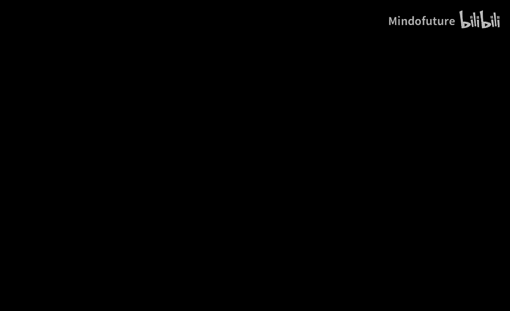
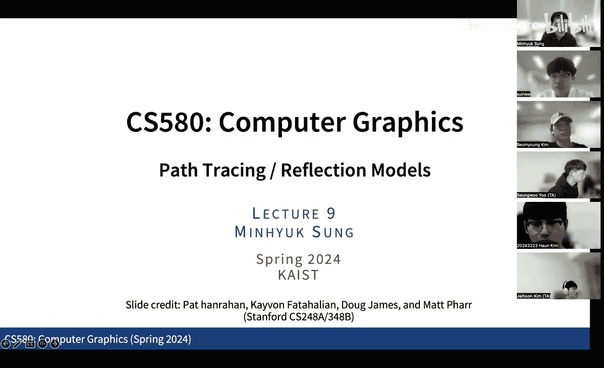
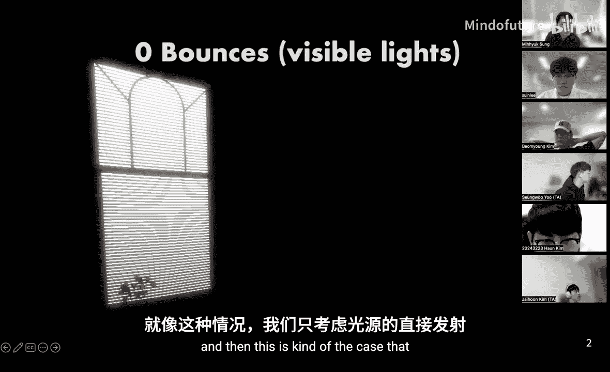
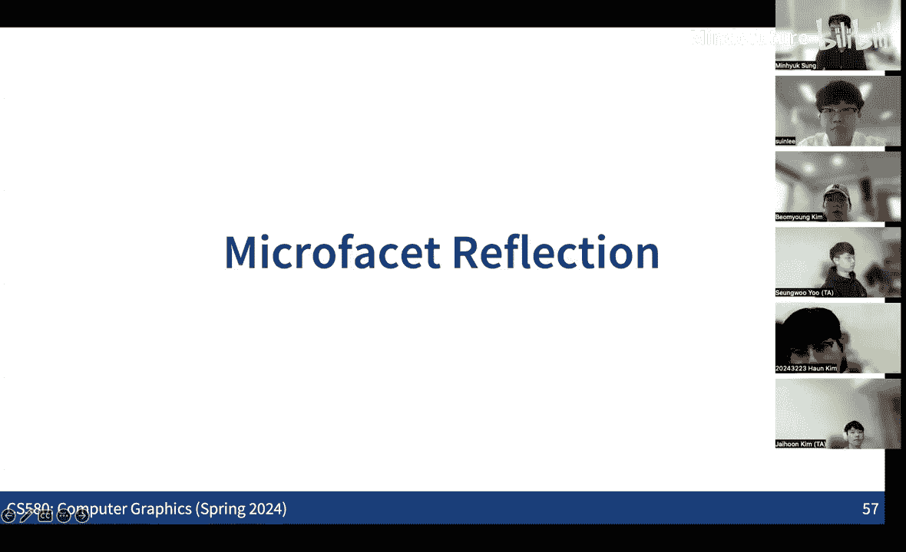

# 【韩国科学技术院】计算机图形学 KAIST CS580 Computer Graphics (Spring 2024) p08 P08 Lecture 09 - Path Tracing   Reflection Models (KAIST CS580, Spring 2024) -BV1he7mzjEc1_p8-

So yeah come back to the C58 computer graphics so last time what we have discussed is that we started to discuss like how we can apply the idea of like the of the estimate in terms of like calculating not only the local illumination but also the gl illumination so we start to see some kind of the effect of the indirect illumination in terms of basically accumulate the pathis in the re tracing。

 we the multip the bias like this was the case that we only basically carrying about some kind of the direct the emission of the light from the light source and then this is kind of the case that we are also accumulating the direct illumination with the single doubts of the pathis and if we start to basically accumulate some more kind of some indirect illumination that we can start to see some kind of the more like natural kind of illuminations that we basically show this kind of the outputs。

So with some kind of the indirect eumination， we be able to see some kind of the regions in the fors we seen。

 which are not directly visible from the light through and also debutbuing the current direction。

 but some kind of like the parts that can be illuminated by some kind of the multiple the balances of the lights。

So those are kind of some of the outputs and for that basically what we have done last time is that we are kind of like rewriting the re equation as kind of the light transport equation。

 which is basically having both the light source term on the left hand side and the right hand sides so in terms of the we are having some kind of the bigpress form of the equation so we could basically rewrite the light light transport equation into this kind of the three point the form in terms of like having coning the area of the kind of regions and those three light sources and when you basically introduce this new term the G which basically incorporate the visibility and also this kind of the cosine the terms we can basically have this kind of simplifyimified the form of the light transport equation。

So here basically the question is that how we basically per this kind of the complex form。

 so especially if we also rewrite this kind of the recursive form by replacing substituting the license source the with some kind of the per which is from the next kind of the bound of the trajectory we can see that actually the recursive form can be rewritinging like the way so we are basically accumulating this kind of the some light equation from the path of the length of the want which is the case that we are setting like which we light and the path of the length2 is the case that we are having the direct lumination and path of the length3 is the case that we have in the indexdirect lumination and so on and so on。

 so we are basically adding up all those kind of things。

 then we can see that this equation can be seen as like this basically adding all these kind of the terms represent de that's the P which is that they defined kind of a path basically the。

でス？Here， basically this paper indicates a kind of the trajectory very。

 which basically involves multiple kind of policies in the scene。

 and every kind of the point P is basically indicating the point of the surface that we are seeing some kind of the reflection of the kind of the lights and then we can see that the kind of this pome can be defined as kind of the multidimenal integral over the path while this basically looks the complicated this is basically kind of like nothing。

 but basically we are multiplying the emission of the light from the lightos the through of the path and this through the path can be seen as kind of the fraction of the light from the light at the P and at the end like we are reaching to thelyos and then basically we are seeing the fraction of the light that is really coming into the point the between。

 So we basically calculate is kind of the。The multiplication of the lightrs and the zero foot of the paths and when investigate add up all these kind of things for all the multiple passes that will investigate tracing in the scene。

 we can get the final basically the light information where the pixel will be displayed。

So the simply the idea that we can basically calculate these things using the multiple of the estimate might be the basically for of the pton。

 we are basically having the single the sample of the path。

 then basically the multi of the estimate for each of the pton can be defined in this way。

 having some kind of the multiplication of the light emission， the radius。

 multiplly by the throw good。And also dividing this by the probability how likely we you want sample that trajectory and if we sum this up then we can get some kind of the estimate of the basically the final the outputing irrance that is actually coming into the pixel in the。

So that was the basic idea of some kind of the global illumination and what we basically do with this kind of the rate tracing based at the rendering system is basically implementing these things。

 with some lots of some kind of details in the implementation。

 obviously we are not going display because all the details whether there are like lots of kind of some things that we can really consider especially to make some kind of more efficient the estimate。

 but we're to best see some kind of the very basic idea in the two days lecture。

Before we move on do you have any questions on this？So yeah， let's see。

 so basically here all the things is basically how we trace all the paths of the rendering the ray tracing this system in terms of like calculating this kind of interval and the first idea of like this was actually introduced almost like 40 years ago by Kaia in 1986。

 so this was kind of the first image which was basically rendered by this kind of ray tracing this system which is by this tracing the path of the lights。

And this has been basically used in the many kind of physically correct some kind of rendering the pipelines and as you can see as we have some kind of the more number of deepes。

 we can get some kind of the variable outputs which looks like more realistic so this is kind of the case that when you only have like one sample of the trajectory de pixel obviously there are many basis that we have some kind of the dark deep pixels and as we have basically have some more the samples of the trajectory for the pixel we can see some kind of the more slightly more realistic images。

 but still there are some of the dark the pixels that are basically not really reaching to theers。

And as you have some kind of the more the number of samples for each the singlely pixel that we can get some kind of be more the accurate outputs。

 but as you can see this is the case that we are having like 1024 samples for every singlely pixel so when you to think about the number of the pixels。

 you can see that this basically in books like cus computation to basically you know get this like single image so to get the realistic image like this is kind of like difficulty computation that might be involved in to get some kind of these little the realistic images。

So' basically all about basically how to make this kind of be theing pipeline more efficient so the main two equations in the rate case the the test tracing the system is basically how we basically estimate the value of the sum of the infinitefin number of these kind of the ps within the finite amount of decomp so least some kind of the best quality and also given the particular the how we generate one or the more number of the passes to compute the most estimate of these the multidi the in two so those are basically two main equations to make some kind of efficient the past tra the system。

So one simple kind of idea that we're gonna also basically see here is basically this kind of example。

 so basically what we have seen in the previous slide is that we will see some kind of the the shorter deep passes basically as you can see here。

 we can decompose some of the kind of the peakome with the multi people deter into of some of of p times for the shorter deep passes for P1 is basically case that we have in the pass of the length1 which means that we are taking care of by the way the light the emission。

 and the P2 is basically basically for the pass of the length2 which is the case that we are thinking like the diumination and this is kind of the case that we are starting to see some kind of indirect with the path of the length3 as we also have seen in the previous slide。

 actually this kind of the three cases with some kind of shorter deep passes actually contribute the most the。

in deciding the final image， so while we basically have some kind of the when you basically have some kind of the trajectory with the longer passes can make some kind of the more realistic outputs。

 actually the contribution of the longer passes is kind of the smaller compared to the passes with the shorter basically delay length but basically when you have some kind of longer the passeses。

 that basically involve some like more the heavy computation。

So here the simple the idea that we can be with some kind of calculation with some kind of the limited amount of thecom resource would be basically just like ignoring some this kind of the longer the passes。

 so for example we just limited the length of the pass to be like n to be equal less than the three that we just like totally ignore these part。

But this is not good in terms of that we are also making the bias in our the kind of the estimate。

 so obviously we total just like ignore this kind of the terms where the longer the passes。

 then we're going to see some kind of the case that we are having some kind of the estimate which is with expected value is not exactly the same with the intro that we want to calculate。

So here at Best PD one， the question is that how can you make the estimator to be unbiased wireless basically flow so reducing the competition。

 the heavy competition we get over the passes。So that's basically what we are going to we typically want to do right obviously we want to limit the length of the passes to basically limit basically the computationm the and power。

 but then here the question is how we can still make some kind of the unbiedtemeterter in terms of having some kind of the limited amount of the some kind of the length of the passes in the computation。

And here the basic idea is SpD of Russian rule， so the question here is that we are basically defining some kind of new estimator in this way。

So let's say like the F4 is basically the estimator of like some of these like Pome4 the places。

 which length is like four were longer than four。So here the question is how we can make the competition like this part to be efficient。

 right？And in here， what we are going to do is that we are going to define some kind of the new estimator。

 which is defined like this。So here， basically what we want to do is that we are going to draw a same kind of sample from the uniform distribution region in the range from the drone one。

And we also have some kind of this threshold deprompter， which is the Q。

 also the Q should be basically inter range from the0 to 1。

And if this sample has the value which is greater than this threshold that we set。

 then we basically have this quantity as the output。Otherwise。

 we are basically having some kind of constant value as kind of the output of the estimator。

So here basically what you can see is that so we are having the two parameters like one is Q and the other one we see。

And if we make this seat to be0， then what we can see is that like these things like the canceled down。

 then basically when the random sample is greater than the threshold。

 then we somehow kill the the estimator。We still compete based on this one。Otherwise。

 we just like give some kind return like the value zero。

So this is kind of like our the new estimator。And can you quickly see like what would be kind of the expected value of like this new estimator？

So we'll see here basic idea is that the expected value of like this new estimator is the same with the expected value of the F4。

 which means that this is kind of like one way that we are making some kind of the unbiased the estimator while basically having some kind of the chances that we are we can basically ignore more the competition like this whole part。

But we need to see like why we need to have this kind of some scaling and the upset tone to make the O buses meter。

 so let's quickly check out whether these two are the same or not。He didn' even get this result。Yeah。

 so we can actually quickly see that actually the expected value of like this new estimator becomes the same with the expected value of the original estimator so actually basically here the idea is that we know that the passes with the longer kind of the length。

basically typically giving some kind of the less contribution to the final the output so we want to ignore with some kind of some estimate with the longer the passes。

 but we just let simply just ignore this kind of the estimate then that will basically result some kind of the biased the estimate so here the basic ideas that we are basically introduce some kind of the statistical way to throw out those kind of things so if you are formally or we the throwout kind of things engineer the neural net we can see that this is kind of a similar kind of idea so we are basically randomly throwout is kind of the longer pass the computation by setting some kind of the threshold and also doing some kind of the random sample。

Now from the uniformly distribution。So basically typically we set the C to be0 and what we can do is that every time when we have some kind of the longer plastic the computation。

 we basically set a kind of draw some kind of sample from the uniform distribution and if the sample has the greater better than the threshold then we basically calculate the estimate while scaling it we basically one over the one minusQ otherwise because like stop the sampling and basically term the computation so this is kind of the aesthetic the weight that we can basically cut down some kind of the computation we longer the passes so that's also kind of the interesting kind of the idea。

Then what we can see is that if we have some this kind of new estimator that has the direct illumination and those the light emission and direct illumination and also the length of these three will be kind of indirect illumination and having this kind of the lot rule the estimator then we can also result in this kind of the unbiased estimator and we can also apply this kind of saying the Russiansian rule the idea for the every depth of this sample。

So that was kind of the some of the ideas that it can make some kind of more efficient computation。

But here also the question might be that it's always good to have this kind of like Russian de ruleette obviously there much some kind of some things that we are basically compromising with this kind of dropping out the longer the passes so some of the questions that we can think about might be that how much the variances will be increased especially like whennie said like the threshold will beq barrier depending on how we choose this kind Q barrier。

 how much the variances will be basically be be changed obviously the variance will be increased right so there will be kind of less changes that we be converging to some kind of the right answer as we basically cut out some the computationplication so we can also think about like artulating the variance and see how much the variance will be increased depending on the threshold will beq barrier so this might be some of the things that we can think about in this Russian ruleette system。

And also the thing is that like these will be basically the cases that we are sampling the points over the surface of the objects。

 so the typical kind of system of the decreasing would be is that we are having some kind of the arrangement of these radio objects in the thing we are basicallyscap some kind of surfaces of these kind of multiple disra masses in the scene。

And then we will need to know sampling some of the points over the surfaces and here the question is that every time when you basically increase the length of the pest。

 how we sample kind of the new point in the scene and also the typical idea for this is that we first sample a object based on the surface area so if we have some kind of the multiple objects in for example an indoor scene with chairs and the tables。

 desks like were some kind of the other words overs many kind of things we are first selecting the object where we are going to sample a point based on their kind of re surface area and then for sampled this kind of the object in the scene that we are also sampling a point over the object the surface and then what we are going to do in kind of the pest construction is that starting from the kind of the point in the image plane。

We are basically constructing a pass in the incremental way。

 so what we do is that for every de point PI in the trajectory。

 we first basically sample the solid angle based on the BDF that we have for that point。

And then we basically we generate a new traction。And then we simply basically you know trace the rate and we the next intersection the point。

 the P plus one， and we are basically repeat this process until we reach the kind of the limit of this kind of length of the pest where until we basically reach to some kind of the laser so this is like very simple high the idea。

 obviously there are lots of the details in the kind of the real the system。

And also one small thing is that we are not only basically sampling based on the BRD。

 but because we are also competing since we are competing the LTE。

 the light of the equation as kind of the integralable the surface。

 we are basically correcting this kind of sampling PD like this based on the kind of the relationship。

 the differentiable the solid angle and the differentiable the area that we also have seen the the lecture。

So the relationship between these two was basically fine like this right so since we are basically now taking the integral the surface not integral the solid angle。

 now we are basically not only sampling based on the PRDf。

 but somehow let know recing the PDE the PD using this kind of the equation。

 but in a way that we can basically sample based on surface。

So these are basically the basic idea about basically incrementally constructing some of the pests and also doing some kind of the pest tracing to calculate the LTE。

So this is like some kind of be highlighted the idea in terms of how we can really do the past tracing。

 but for some of the details I recommend you to check out the code so Ki our deploying the assignment is not included the parts of the past tracing which is actually quite might be the complicated the implementation but while the past tracing is not included ining the assignment for you only the programming actually the past tracing should be basically included in the base code so I recommend you to check out in the code and also more the complete version of the past tracing I also recommend you to check out the physical based rendering the code so they have like all the ideas of this path traacy implementation。

Do you have any questions on this？So this was kind of the re of some of the basic I global illumination and today the main topic is about the reflection models so I'm going to briefly explain some of the ideas that we did not discuss in the previous lecture。

So the light transport equation and also for the reflection equation we are basically assuming that the PRDf is basically given as kind of the material property for the surface。

 so PRDf was basically the bidirectal reflectance distribution function which is basically define some kind of the ratio between the differentiable。

 the outgoing the and also differentiable， the incomingleg so when you basically define this kind of ratio between these two。

 this is basically define some kind of the properties of the material then we can basically set of the surface of the objects。

So we are going to discuss some of the more the details about the PRD and also so far we only discuss some of the cases that we are only having the ref。

 but in the real cases we can also see some of the cases that the light basically going path through the objects right since is the case that we also see some kind of this transmission as well so we are also briefly going to discuss some of the ideas about like how we can combine the ref and the transmission as well in this kind of the rendering the pipeline。

So before we get into the discussion about the reflection transmission。

 let's briefly see some of the some major properties of the PRRD。

Espec when you want to do some kind of like physically correct delivery。

 we need to basically satisfy these kind of the constraints for the BRDF the first property is that only the output of the basically yeah all the output of the BRD should be basically the non negative number because we are not define kind of the negative quantity for any kind of the like the radioactive kind of things there is no basicallyivity quantity for the weight and all the things so we the BRDF this kind of ratio so should be some kind of the nonnegativity number。

SoThis is the first property。And for many kind of some situation also the reciprocity should be satisfied which basically means that if we have some kind of the ratio with the incoming direction and the outgoing direction。

 the opposite side also should have the same de ratio so we basically the incoming and the outgoing direction so we are basically hitting the outgoing direction is the incoming direction and also the other way around。

 we also should have some kind of same the ratio of this kind of theors so this is also kind of the second property and this is also the property actually we have seen in the previous lecture。

 the energy the contra。Obviously total the energy delight that is basically reflected from a specific direction should be equal where the less than of the energy that we are basically receiving as kind of the incoming the so what we can see is that when you take the integral of this kind of the BRDF for the outgoing direction some of these kind of the basically some of these kind of the BRDF for the old instructionss of the outgoing delight should be one or the less than one so this is kind of the property for the energy conservation。

So what's the objective case that we are having the less than one of this kind of the integral of the BDf？

If this kind of the integral this kind of PR therefore the injection is。

Less than one not equal to one， there might be kind of be such kind cases。Qu two。

So the question is like what would the case that the integral like this B orD F for the output direction is less than one。

 not equal to one。Yeah， obviously there to be the case that the light is specifically how life was basically observed。

 some pro of the power was basically observed the surface by the reflection。

So when you basically see that this is basically exactly equal to one。

 that's the case that we have to be conserving the energy without any kind of absorption of the light the power of the light。

 but if this integral is basically less than one that means that sum of the part of the light be power was basically observed by into the surface with the reflection。

 so this was the case。So we also have seen that like we need to basically those kind of things。

 not to basically see some kind of the data divergence some kind of exclusion of the the power in the previous diffuse this period the case in the previous lecture。

So these are basically 3D main properties for the PRRDF and also some of the other properties that we can think about might be that whether the the PRRDF will be istroic or the unisotropic。

So for many of the cases for some kind of the papers， or some kind of the paint。

 many kind of the cases， actually we are seeing some kind of the isotropic the material。

So the isotropic the macro is defined in this way， so if you choose a point on this surface and rotate the this surface around each three normal access at the point。

 then the distributed of the light reflected that the point does not change。

So this is kind of the case that the depict kind of be asked for material。

So this means that while we fix the direction of the incoming delay and also kind of the viewing direction。

 if we only change rotate the surface of the kind of objects with respect back to the normal direction of the point that we are seeing some kind of。

 then the distribution of the light reflected at the point is not being changed。

So for those kind of the cases， typically for the PRRDF。

 we are basically having some four the right were having the speaker decos for the incoming light direction in the outgoing the right direction。

 which means that the typical D PRRDF will be four parameter dysfunction function。

But if previously basically assume that we are having the isotropic the BRDF。

 then we don't need to actually have the 4D parameters， actually three parameters sub this。

 then how can you also define some kind of the three parameter function for the isotropic D BRDF。

With this definition of the thispic coordinateiness。

 basically the cta is basically indicating the elevation and the pi is indicating the asthmathoid。

This is actually the case that we are only rotating we are not rotating kind of like incoming light interaction or some viewing interaction or rotating。

 for example， the surface， so for example， like when the surface is like the paper。

 I think about that like we are having some kind of the paper of the table and we are rotating the paper on the table while having the same the environment of the light and also sort view interaction and we see the same the distribution of the light those cases。

这。Basically this means that like actually this is not because that we can just ignore the outpoing the ethmus of the outcome direction。

 but actually what this basically means that we just need to consider the relative the asthmaths between the two。

 the incoming and the outcome directions。Does it make sense？

So if we want to see some kind of effects that we are seeing some same the distribution。

 whatever kind of some you rotations of the surface that we see。

 then we can actually define the BD in terms of having the elevation of the incoming and the outgoing direction and taking actually just like relative the relative the asthmus between the two directions。

 so this is kind of like the way that we can define some kind of the three parameter function for the isotropic the material。

 so which is kind of like some more some like more generally cases we can see in many kind of the real the objects。

But obviously there are some kind of the uniceropic de material which is basically having some kind of the some parents of the openly surface。

 so for the CD here or some kind of the hair and the clothes for those kind of the cases。

 we cannot define some kind of three parameters for those of some kind of the uniceropic cases。

 meaning the4D parameterss。So those are some kind of the basic properties that we can think about BPRD。

And一ぱ justの。Lby some of the basic types of the reflection which is defined with some kind of a BRB。

 then we can also as we discuss in the PI lecture， we can think of some eitherpic de reflection and also either the diffus reflection or some kind of other types of some spec reflections。

So if we briefly review those kind of the ideas， for all those cases。

 what we can think about is that if we only care about the。You know the xs of the light。

 so when you basically define some kind of local coordinates。

 with respect to the normal direction of the surface you we only see some kind of the projected direction of the lights the surface which is you know defined with kind of the surface normal here。

 then we can see that the projected the direction the or basically go straight right the light was basically coming like this in the projected direction and the project direction of the outgoing the light it should be basically the same direction going to the same so we can see that when you basically have the direction to the kind of thebuing kind of the view here and also the outgoing the direction to some kind of the objects。

We can see that the as muscles will be flipped 180 degree in this kind of the project space。

While when you consider some kind of the elevation of the angle of the light。

 then for the either reflection the case， then we can compute this kind of the elevation of the outcome direction and also the incoming direction。

 with the role of the reflection right so this is also think that we learn in the high school kind of things so when you basically define some kind of the angle of the incidence of the light angle of the incidence of the light here and also the angle of the reflection which are basically defined with respect to the the surface number we can basically define some kind of incoming and the outcome direction in a way that these two angles to be the exactly the same for the elevation so this is basically simple the row of the reflection。

And here also the thing is that in terms like computing the list flash equation and also the LTE and the path tracing。

 these basically know result in this kind of the de function for the BRDF， right？

So if we think about basicallys P or theF this kind of like idea or the spectral reflectionle。

 we only have some kind of some constant value when the incoming direction is exactly the same with some kind of the reflectionle direction of the outgoing the direction rate。

 otherwise the function should basically be times0。

So basically this will be the case that we are involving some dropta function in RDp and the F。

 that means that when you take the integral of like this kind of like reflection the equation。

 actually the integral like this equation will become some kind of the value that we can directly compute。

So in this case we don't need to basically compute in kind of the theal estimate。

 we can just directly see what the kind of direction that we need to shoot the ray in the rate tracing and we can just directly compute this kind of the light the outgoing deradance。

So would be be good for the rate the competition or。

Do you think that like so if we only have some kind of the ideal speculative reflection of the metricss in the scene。

 do you think that this will basically make this kind of computation easier or not？

Any thoughts on this？So we can think about some kind of the some very， like， of course。

 some sort of the indoor scene that is like。Composed by some kind of all the glass light the objects in the scene。

 some great room。that we're going to basically render the things using some this kind of PLDF that involvesvokes the druglta the function。

That looks like we can just like avoid the competition of the Montete estimate because we don't need to take the integraltro of it。

Then what of the issue that we are hitting this kind？I direct to default function in the equation。

Actually， you having this kind of directed function like involved many kind of the challenges in the array tracing because like if we have some kind of distribution in our DPRDF and we can sample some of the points in terms of that we can reach to some kind of the surface some kind of the point。

And at the end， you can really even example the points of the laserrs in terms of that you can really get some kind of the competition from the like the light emission from the light source。

 right？But if we only have the idea discussion， which means that there is like only one specific direction that we can really get some kind of the。

Some contribution over like this kind of equation， right？

Which means that there is no sampling of the direction。

 there is only one direction that we can basically should deray in our de racing。

And we don't know how many kind of the balances that we need to reach out to some kind of the one of the point of the light source。

 actually in some kind of diversity cases， we may need some kind of the tones of kind of the reflections。

 the balances to reach out to some of the one of the point in the light source。

Which actually means that while it looks like we are making the computation the easier。

 actually it can involve some kind of the computation with the very long the path of the computation。

 otherwise there is no way that we can really calculate this kind of the integral。

So if they actually have some like only cases that we are only having the idea this particular reflection。

 the competition actually becomes much more challenging in terms of that actually we may need some kind of the very lonely passage of the trajectory to reach out some of the points in the light source。

So actually， this is not that easy case to get some kind of the realistic the images。对。

Obviously in many kind of real cases， it's heard to assume that we are having some perfect spectral reflection。

 we're going to see this kind of some sort of the gloss sea reflection that we are having not exactly shooting the array into the opposite direction。

 but having some kind of the distribution near this kind of the opposite direction right？

For those cases， so we can define the gloss reflection like this by having some kind of some sort of the dot product between these two with some kind of the power of this kind of the dot product while controlling this kind of the distribution of the lights with the kind of the power term here with the prompter here。

So this is like also the simple the idea， which was introduced in the 1970s by building and de phone。

 so this is called the Bo and de phone the model。For some kind of a gloss ceiling inf。

For the also diffuse the the reflection for the perfect diffusitive reflection because this is the case that now also the BRDf becomes some kind of the constant value。

 so when define the BRD as the constant value like this with the u over the pi then we can see that the you the reflection the equation can be calculated like this。

 so basically says nothing but multiplying this constant value by the incoming the eadance right。

So this was basically the definitions of the raance。

 so we can basically compute the kind of the reflection equation by just taking the multiplication like this constant with the incoming the raance。

So yeah， actually this is like one of the reasons like why we are defining the BDf as kind of the ratio between the incoming between the outgoing the differentialr and the differential differential irradance。

 because like then we can define the idea or the differential reflections kind of the constant like this。

So here， one of the question might be that like why we are defining this constant elementsments not just like the one single value。

 but especially the rule over the pi。So here the question might is that what's the meaning of the rule here。

 right？Do you can you guess what's the meaning of your rule here？

Why don't you just like don't you define this as kind of some content you see here？

So actually we can see that the rule means the kind of the ratio between the outgoing the rediance and the incoming radiance。

 so for the diffuse the reflection， what we can see is that the outgoing the radiance should be constant over the old directions。

 right？So you we also compute the outgoing the radiance in this way that we can see that actually it is defined as kind of the rule times the incoming deradance。

 so from the definitions of like know how we define the B and theF we can see that the rule time there is basically defined the kind of ratio between the outgoing deradance and the incoming outgoing the rediance over the incoming de radance which should be basically less than one to basically have some kind of the satisfy the energy the conservation of the property。

So this is basically the way that we can define the perfect spec reflection and also the perfect diffus reflection。

 right？So this kind of be simple the BIDF for some very specialty cases of like perfect the specative reflection and also a perfect differential reflection and also some of the kind of gloss in reflection actually has been discussed even before like people start to work on some kind of the ray tracing。

😊，So it is just briefly review what we also have discussed in the introduction to counter graphics course in this S 38D。

 typically even in the main kind of some old kind of the complexity pipeline especially using some kind of the restorationization we can see that the illumination。

 the local emination is typically kind of like represented as kind of a combination of some kind of the ambient light and also some kind of the diffused reflection and the spectral reflection so when you basically like just like add up all those kind of things this kind of like simple the way that we can define some kind of the some local de illumination and this also has been used for some decades even in the simple the the ref the basically the pipeline in the open gel so this is still being used in many kind of the open gel the pipelines。

 while if we start to see some kind of some more complexity be there we can actually start to define some kind of the more realistic。

Each week they collect some kind of the illuminating the models with some kind of specialty B idea。

So this was kind of the basic the idea and the connection with some kind of the some old idea in 1975。

Any questions on this。Well today we are also going to briefly discuss like how we can also define not only the reflection。

 but also the transmittance as well， so now we are also going to discuss not only the BRDF but also the BTDF。

Which is now defining bidirectal transmitanceal dysfunction。 So when you also combine the B RD。

And the BtDF， this can be also called like BDF by directional scattering deal dysfunction。

And also I think I paper this slide for today， but so there are some kind of the more complex model like the subsurface scattering so here what we are basically will be assuming is that the light is basically reflected at a point like this。

 well like light is transmitted inside into the medium so this is transmittence but there are some of the cases that we can see that the light is basically going through inside some kind of the medium and popping up from the different depositions。

So this is the case that we are seeing like the subsurface Katherine。

So we can also think about like defining some kind of the bio infectionction the for those kind of cases。

One good question is that if we define this kind of the subsurface sing then how many the parameters do we need So for the BRDF for some gene cases that we are also question some kind of honesttro the BRDF。

 we have seen that we need the four parameters。But if we also define some kind of the subsurface scattering。

 then how many parameters do we need？Yeah it obviously depends on like how we define this upsurface scattering right but and it's like we will need the six parameters like two for the incoming light two for the outgoing direction and also the two for basically the direction that we are moving over the surface so if we have the polar coordinates for this kind of like so offset over the surface then we will need it means like six de。

So we're going to also briefly discuss the basic idea about the subsurface sing next time。

But let's move on to some kind of the ideas for the transmittance。

So as we have seen some kind of examples， like having some sort of data selection。

 now we can also see some kind of cases that we have in some kind of transmittance of some kind of delight into the surface。

So the how we can define some kind of be you know， compute direction or the transmission。

So basically what we can see is that like we can recall some of the kind of the ideas that also we have learned in the high school kind of things。

 so we can basically calculate the outputing direction of the transmission with this business law。

By the way， all of the things that we are going to discuss for today is not any kind of the precise like simulation of the all the optics kind of things。

 so you can say that this is like very simple some kind of the approximation of some kind of some physical ideas for some kind of the make some kind of the competition to be like efficient。

 right。So this is basically some very review of some kind of the very basic some kind of the physical difficulties properties。

 and we are going to focus more on basically how going to model these things for the computation right。

So if we briefly review some of the properties of transmission。

 basically this will be the case that we are having some kind of like one medium here， which will be。

 for example， like the air， and we are having another the medium， which might be like the water。

 like the glass， whatever kind of things， right？Then the light is basically。

 coming from the air and then you know getting into some kind of the medium that can be the world or something。

 right？Then the traction， so when you have some kind of incoming direction of delight。

 the outgoing direction is will be basically determined based on the index of the reflection right？

我的以 of the media。So when you have the two medium each of the medium we have the different may have the different index of the。

 which is basically indicating the skin reduction of the light each of the in medium and what we need to care about is that we only need to care about the relative index of the so when you have to like the sign the theta I then we actually need to just like think about like。

谢神。So depending on like， what's the kind of the ratio the index of the result of the like the two media were gonna see then how much the light is basically dependent。

Yeah， with this kind of like mis， right？So here one quick question is like。

 if we have some kind of the relative index of the reflection greater than the one。

 and what's the kind of dependinging of the lights that we're going to see。

If this select like relatively index of the reflection is greater than one。

 then what's kind of the trend that you're going to see？Yeah。

 let me move on quickly So obviously this is the case that mean this is very typically the case like the incoming the medium will be typically air or some kind of vacuum or then the some kind of another de mediumium might be something else which might be water or something and typically in the vacuum like the case like the index of the reflection is just like the one and the index of reflection。

 the other de medium will typically greater than the one right so this is typically the case so when what does this mean is that like when you increase this value then this will be decreased right so which means that the light will be bending toward the surface the surface number going like this as the number is increased。

So the answer is that the live lucky light will bounce towards a surface。And the actually。

 the opposite case will be this。 So， so the question might be that like now we can calculate the。

The reflectionle the angle like this， but if the sign of the reflectionle the angle is greater than the1。

 then what the kind of situation that we're gonna see for those kinds of cases。

 So as the know the sign of the reflectionle， the angle like get closer to the zero then what we're gonna see is that the light is basically reflecteded near the the surface like this and if this value becomes like greater than the one then we're gonna see is that there is no reflection。

 we're gonna to also just decide that the light is like only just like reflectedlected without kind of the ref。

So this is kind of the people kind of the case here that you can see so based on this what we can observe is that you might perhaps you know have seen this kind of the image like which is called the O called the manhole。

 so under the water what we can typically see is that like the light is coming into this kind of the con like the shape。

And the reason why we are basically seeing that the sunlight is like coming into some kind of the corne like the ship under the water is that you know inside the water。

 what we can see is that the all lights are basically reflected or only in this kind of the cone like the region。

ForAll the authority regions， we are seeing the total the。Sorry。Yeah。

 basically we are seeing some kind of the total the internal reflection in the outside of region。

 so we are seeing some kind of the dark region outside of the pond while we are basically seeing that all the suns are coming into into this kind of specific port。

 so that's why we are seeing this kind of like optical demand。

And also some of the properties of the BtDF for the by direction of the transmitters。

 the direction of the function is that the BTDFs are basically not the reciprocal anymore。

 so which means that when you flip the incoming in the outcome direction， the ratio can be changed。

 so this is quite obvious when you think about kind of the properties of the transmitters。

The transmission and also the thing is that the index of the reflection is not constant over the wavelength。

 but it can be actually changed depending on the wavelength that we are basically having footage of the the light。

So which means that depending on the color， we may basically way have some kind of different kind of the index of the deflection and also different the patterns of the kind of like the reflectionions。

 different angle of the reflectionle， right？So what we can typically see is that like when you have some kind of the constant index of the reflection。

 we're going to see this kind of de render image， but if we basically apply this kind of some kind of de varianceance so the index of the reflection depending on the wavelength that we're going to see that the color is being changed like in the of the rendered image。

So these are basically all of how we determine basically the angle of the reflection and also the reflection。

 right？And here also the question would be that So when you have some kind of the like。

 which is like in coming into some kind of the boundary of the two media。

How we can also determine the proportion of the light。

 which will be deflected and also be defflated So this is more basically how much of amount of light will will be best deflected and also reed。

So there is kind of the loss of the theory in the opts about how we determine this kind of the proportion we like to select reflection reflection。

 but as a long tradition， what you can see is that when you see the light as kind of the electro magnetic wave。

 we are having this kind of the electro field and also the magnetic field。

 which is like also not the electric field。So if you just briefly see the page idea here。

 we can basically see the light as kind of the20 the lights right so one is basically the S2 is light which is basically the case that the elect field is basically the perpendicular to the plane of the instance for those cases。

And the other type of the light is basically the case the P polarized the case that we're having the left field which is parallel to the plane of the instance。

 so you can think that this like the two types of the polarized lights and depending on like this kind of the polarization of the lights actually we can check that the proportion or like being reflected is basically being changed so this is kind of the proportion of the light that will be reflected when we have the S polarized device and this is kind of the reflection of the the proportion of the reflectionle when have the P polarized lights。

But when you basically simplify all this kind of the explanation and you'll see that like we're having some kind of the unplized delays。

 we can simply basically compute the proportion of the reflectionle into this kind of form。

So this is kind of the freshen of the equation and using this like freshreenening equation。

 we can easily calculate basically it's kind of like simply the approximation in terms of like calculating the proportion of the lift section into this way。

But here basically one thing is that like one thing that we need to notice is that basically this kind of like the proportion of the reflection is also determined based on the angle of the incidence of the light。

 so it is basically not constant depending on the property of this surface。

 but actually the proportion is determined not only by the natural de properties。

 but also basically by the angle of the incidence of the light。

So which what you can see is that we can see this kind of breath when you basically see that the light is like coming into the glass from the vacuum。

 when the relative index of the reflection is 1。5， we can see that depending on the angle of the instance。

 the freenal， thes， the fraction of reflection is being changed like this。

So this is the case that we need just like know divide the fraction of the reflection that the reflection is kind of the half and half。

 but we need basically calculate the proportion more like correctly using the fraction of the equation that we can see is can be more realistic the image。

Then here the question is that how we can also compute both the lift reduction and the transmission using our kind of the LP deformation？

So these will be the case that we only have this kind of the you know the reflection the equation now we are having kind of the two factors like one is basically having some kind of the idea the specity reflection。

 and also this is the case that we're having the idea the specity transmission。

 which is basically divided by the kind of the proportion that we are completing with the present the equation。

That what we can see is that this will be the case that we are shooting the for this kind of like the perfect spectral reflection this transmission。

 we're going to shoot a two rates like one is for the deflection with this proportion and this will be the case that we are shooting the transmission array with this proportion。

Then we can do the same kind of the re tracing with the pest the tracing in terms like for every kind of the bounce of the degree。

 intersection with the point， we are basically shooting the two rate like one is for the inction and not one to basically refle transmission into the surface and basically doing all this kind of the pest tracing。

Wch will basically results in basically some exponential growth in terms of the normal de right。

 so every de of thes we're going to have the two ratess right then we're going to see that actually there are lots of kind of some delays that we can construct passes。

So we one of the ways that we can also simplify this kind of the multiple estimates for those kind of cases。

 might be that we also know randomly sampling either of the reflection and the transmission delays based on the probability。

Of the deterren which is defined with thereenal coefficients so when you also draw in some kind of the random sample from the uniform distribution when this sample has thevalue which is smaller than thereal the thes then we should be refle array otherwise we are shifting some kind of transmission array so this is what's kind of the statistical delay that we can make some kind of the more efficient competition for the monte estimate by basically changing which visual arrays we we going to ship。

someベが。And also some kind of the more the common cases that we're going face in many kind of the rendering the situation is that we are also having some kind of the thin plate with some kind of the some some。

 you know index of the reflection。 So for example， let's think about that we are having some kind of the very thin the in the air。

 which means that we're going to actually have some kind of the two boundaries of the different media。

So for those kind of cases， when you have kind of like incoming array from the air that we're going to see that we're having the one deep collection the transmission arrays。

 and then we're going to do these kind of things again in at this surface。

Havingaving another reflection the transmission then we're going see that we're going to repeat those kind of things having the two ray。

 then this will be the case that we're having the transmission reflection and transmission rate and so all the reflection can be considered as kind of the accumulation or like those the like ray accumulating basically the reflection after also like transmitting under this kind of the medium right。

And also the transmission can be considered as kind of the summation of all those kind of cases。

So if you see like the reflection the case， this will be the case we are just saving the single bound the reflection and then transmission reflection transmission。

 right？And the next rate might be that transmission and the 3D deflelation inside the medium medium and also the transmission and the next one might be that like one transmission and the five times of the reflection and then transmission。

 right？So we can think that like the ref can be considered as kind of like accumulation of like all those kind of cases。

And can someone like make some kind of the simple phone or like seeing some kind of the convergence of this kind of the series right so we have seen that in the previous lecture the a newman this is converging to this right when basically the airplane is basically the re one。

So when you assume that those kind of things， can you see some kind of be what kind of be some point that we are basically converging for those kind of these。

 let's only see the convergence of the our。Yeah， so as you can see。

 this will be the case that we are having this kind of the autumn。

And t times R times t and after that what we are seeing is that we are having the like two more reflection right so we are having a two more reflection in the transmission and two more reflection in the transmission so every time we are basically multiplying our cured。

So what we can see is that this is the same especially r plus。

And then we are basically starting with the t times the R。

And then we're going to see like one where one minus like R secured right？

So we can see that aTC is basically the same that now we are slightly modifying the fraction of the reflection by adding this amount of the term。

 right？while from the energy the conservation， what we can see is the t prime also to be basically the same with the1 minus r prime。

 right？So you can say that from this kind of these of the converts like those three。

 when you have like not assuming having some kind of objects but actually having like the shares like the object。

 having only the surface in the scene， we can also calculate upbe basically theff fractionction of the reflection and the reflection。

 the reflection， the transmission by adding this amount of the term into the proportion of the reflection and also taking the one minus the R prime for the transmission and you can see that in the graph as we basically vary the angle of the instance actually the difference between the single interface and the double interface is not making big difference but obviously you can see that the thin is basically having slightly higher the ratio of the reflectionle in this case。

So based on that， we can also try to render some print of the thin plate like the thin glass like this。

So those are basically the basic ideas that we can also incorporate so transmission in the rate tracing the system。

So I'm going to stop here， So there are some of the ideas for the microface the model for the scattering and also I briefly mentioned about the sub subsurface scattering。

 So next time I'm going to briefly review those ideas about the microface the reflection and also the subsurface the scattering and so far we assume that the light has been moving in some kind of the vacuum space basically empty space but typically I mean will be kind of the environment is not empty having the air in the scene and also the light basically may pass through the inside some kind of the smoke or water or something So having some kind of the participating media So for those kind of the cases when some kind of the participating media how will the rendering the system will be changed those are also the main topic that we are going to discuss next time So this is the idea about the mananderaring and if we also start to discuss the mananderaring。

 this is also the basic idea about the recent the neural。Tchique as well。

 so we are going to also going to move on the neural render we did the notified here and also we are also going to discuss some very decent ideas about the neural render as well。

So that's the plan for the next deco couple of bi。And if you have any questions on those things。

 please feel free to post on the button on the slide so we can also discuss the select after direction。

Any questions。Okay， then I'll see you next Monday。 thank you bye。

