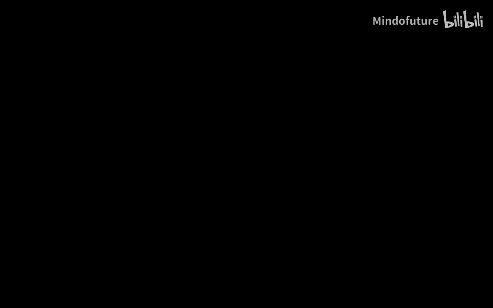
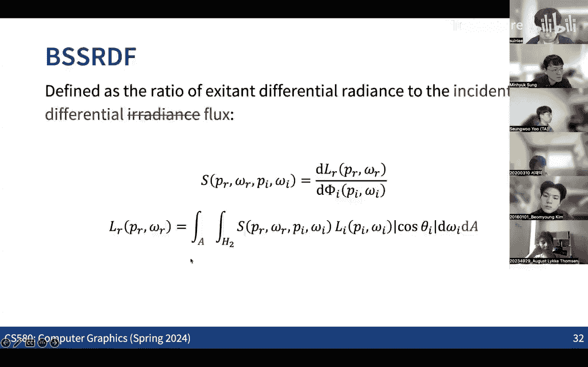
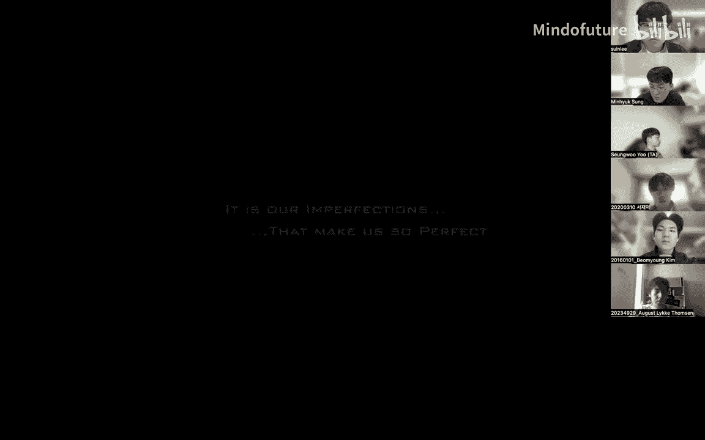
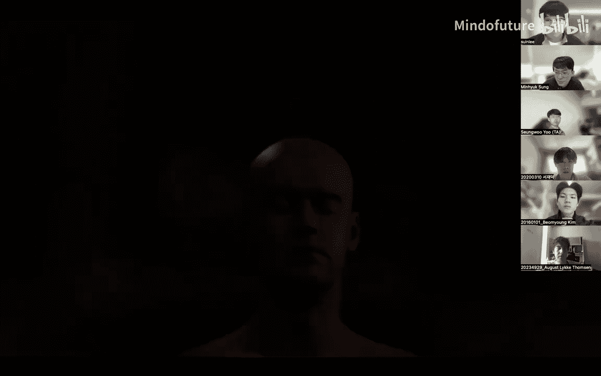
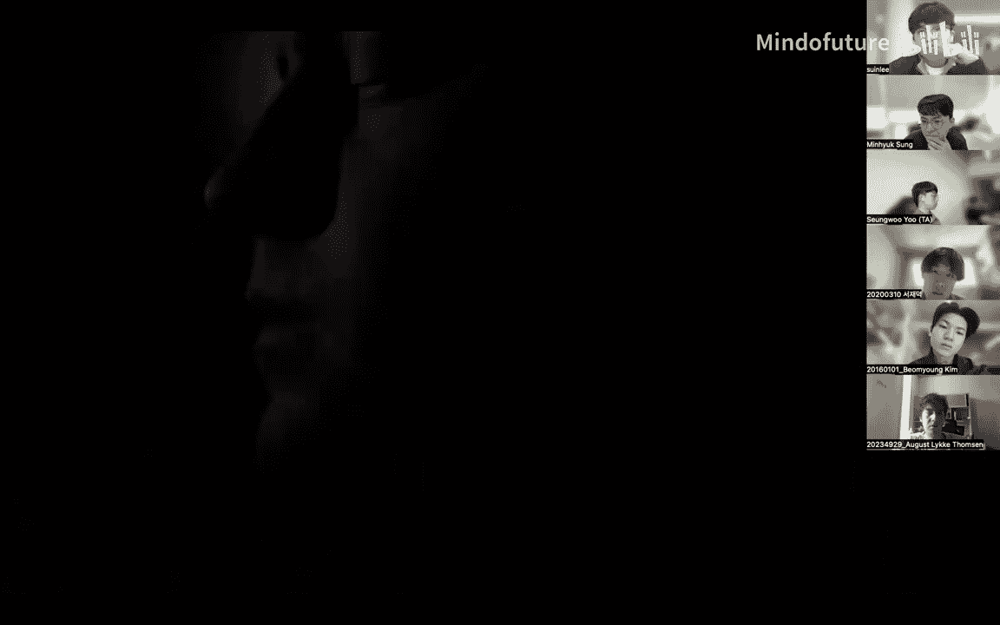
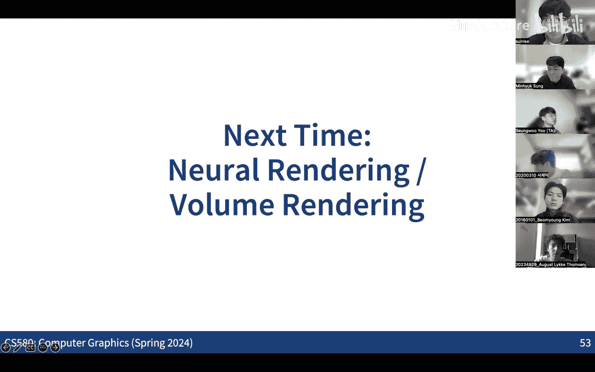

# 【韩国科学技术院】计算机图形学 KAIST CS580 Computer Graphics (Spring 2024) p09 P09 Lecture 10 - Reflection Models 2   Color (KAIST CS580, Spring 2024) -BV1he7mzjEc1_p9-

， so yeah， welcome back to the CS58。 So last time we are discussing some of the ideas about the reflection the models with some slightly more details about the BD app and also some of the ideas like how we also incorporate not only the reflection。

 but also the transmission of the device as well。And we discussed some kind of the basic ideas in terms of like how we also compute the proportion of the light to be reflected and be reflected。

 so that was kind of the idea of the flnel of the equation and based on that we can basically compute some kind of the coefficients for that。

And also we discuss some kind of ideas in terms of how we can also compute some kind of the proportion of like those things for the thin plate as well。

 so those are kind of the basic ideas and today we are going to wrap up the discussion about the reflection the models with the microface models and after that we are also going to discuss some other kind of components about the rendering including some the camera measurement and the color as well。

So the microface at the model is basically assuming that there are some kind of the tiny。

 some kind of some the surfaces that are basically you know describing some kind of the details of the material properties。

 so this is like one of the example that we can see like is kind of the rendering the output with the microface that is scattering the model。

So the basic assumption with the microface that iscap the model is that we's basically modeling some kind of the surface as a kind of the collection with small disp the patches。

 so we basically denote kind of the entire de surface as kind the macro disurice and will be small dis patch basically is dennoted as the microDur。

And this kind of be some distribution would be some small di basically affect the final de renderndering。

 especially ref and also this transmission as well based on kind of the variation of the surfaceomer。

So here basically some of the assumption is that we are basically assuming that the perpendicular the projection of the microdeurice basically covers the micro surfaceice as well。

 so this is basically some of the location that we are going to see over the rest of the slice。

 so when the omega here basically den the surface numbermer the microface at the surface number at the point P we can see that basically sum of the projected area which back to kind of the norm of the microdeurpice they become the same as kind of you the area of the microur as well。

 so this is kind of like basically。So the couple of things that we are going to see in this kind of the microurface this model is that we are going to basically describe some of the characterization of this kind of the model is kind of the recent kind of distribution the function so basically the microface that the function is basically describing the relatively differential of the area of the microface that with respect to the surface number of the omega am here。

 so basically basically describing how many the proportion of the micro the basis basically having this specific the surface number so basically we have this kind of relationship。

Discling the ratio be surfaceomer with respectly given the surfaceomer。

And given the kind of property that we have seen in the previous slide that we projected the area of the microde that should be the same with the area of the macrodeservice。

 we can basically see this kind of the normalization， the constrain。

 so all the kind of the microde that the is function D here should basically satisfy this property。

Make sense。So from this like one thing that I can ask be that what to be basically the microface that the digital in the function for a perfectly smooth micro surfaceice。

So when we know that the micro surface has the surface normal the end， the n vector here。

 it does not have any kind of de bumpy kind of things。

 but it's perfectly this peculiar disice and then watch basically this microface that is really depture in this case。

So check out the definition of the microface distribution function。

 which is basically describing the proportion of the microfacer that has some certain the surface number。

 the omega I am here and if you assume that the surface is perfectly you know you know smooth the surface with some kind of the。

No be zero bump perfectly flat。 then what should be the microb that is function in this case。

Well yeah， in this case， basically， we can say that the output of these two function should be one only when the Uomic I am becomes the same with the as the detector vector n here。

 right？アドバイ人ゼロ。そう。We can basically represent this function as kind of the direct function。有。

So the output should be basically direct function， taking the difference between the Oome M and the effect n as the input rate。

Yeah， so that's basically the way that we are defining the properties of the microspace at models。

So there can be some multiple ways that we are defining this kind of the microface at the distributed function there can be theres many kind of some different ways actually this kind of has started from the 1960s and from that time actually there are some kind of the multiple the models that people proposeosing So this one was basically the oldest one depending the distribution was introduced in 1963 So we are going to skip some of the details in terms of how we exactly derived。

 but this specific distribution was defined based on that we are assuming that some of kind of some bumpiness of the surface iss defined based on the Gaussian distribution of the micro at the slopes So we basically define somewhat consider some sort of the Gaussian distribution of the microb at the slopes we can define the distribution as like this so we can control some kind of。

Some parameters the A here in terms like having observed different kind of the models。

Yeah also the famous model is thetrobri the right model which was introduced in the 1975 and the same model was also reinvented in the 2007 Ne。

 which was called the CGX the model， so those also the cases that the microface the model is basically the case that were somehow representing some kind of the micro surfaceface as kind of last of some kind of the eipoidal debs or those kind of the cases we can also see kind of the distributed function。

 which came to also controlled by some kind of the parametersters。

 the X and Al Y here so those are some of the kind of some specific cases defining the microface at the distributed functions。

And these are some of the different images that are rendered with some kind of different distribution defaultions。

 so can you see some of the tells some difference between these two？

So you can see some kind of the I guess， you know， yeah I hope that you can somehow tell some kind of some the properties of the materials here。

 having some sort of be it's not exactly seeing some kind of the bumps so making some of the bumpy kind of the images that we can also see。

 but it's basically having some kind of literally any some micro kind of the small patches that only just the effects in the kind of section of the models with some kind of the variation of these are basically enormous。

So depending on the parametersers that we are bearing。

 we are seeing some kind of the different effects of like having the microspace models。

So here basically we only saw that how this kind of the distribution can basically vary the thenumer direction are at each point of the surface。

 but the things that if they also have this kind of the bumps over the surface。

 the other thing that we also need to consider is basically some kind of the occlusion because like one microbaet can basically occlude the other one right so that we also affect some theV outputs。

basicallyically to approximate all this kind of effect of this kind of the masking。

 like occlusion of like one microface by the other。

 the Bruce sum was also the person who basically introduced some of this approximation deproation to model this kind of the mask。

 which also also introduced in the old time the 1967。

So in the Smith approximation there are some couple of some kind of things。

 The first thing is that we are assuming that we are only seeing a subset of the microface set which is visible from the each of the view。

 obviously when you see some the specific macro surface here。

 know we are only seeing some kind of this kind of the projected division it kind of the visible area。

 so this will be basically the subset of the microface that will be visible from each of the view。

And also the thing is that the micro facet can be demaked out because some kind of the back facing so especially we have this kind of the microfar。

m sure that you can see my the mouse theor for those kind of the microface set which the normally basically on heading to the back side we inspect the direction。

 those will basically some of upload it basically not visible from the view direction。And also。

 some of the microfaces can be acclued by the other microds。

So this is basically some kind of like changing our some kind of the normalization。

 the contrain formulation into this form。So this is the specify case when you best depict the omega as kind of the direction。

 so this is kind of the more degene case without considering any kind of the direction。

 but when you start to consider some kind of debut direction which is specified with omega here that we can see that we can derive this kind of the or of deform。

Here basically one we can see is that we are assuming that we can only see a subset of the microface from this the view。

 which is basically incorporated in this， we are taking not one， but the core here。And also。

 some of the my the micro face that which is basically。

Or some of like the map out because of the back based calling is also the incorporated by the taking the max here。

 right？So if the degree between these two direction is greater than the 90 degree then we just even know those kind of the microdeacor。

And also to model this kind of the occlusion of the microfacer by one by the other。

 we are introducing another become the here。Which is basically describing the accion across the micro thepha test。

But this is kind of the another some kind of the condition that we are considering for the definitions of the microface at the distributedtri function here D here。

And as you can see， what you can see is that once we define the distribution the function D here。

 then from this kind of the constraint， then we can also derive this kind of the domestic the function G1 as well。

So that's basically what we are going to do。But obviously this computationmplication is quite complicated。

 so we are going to also introduce another one more kind of the assumption。

 which is basically assuming that the height and the numberss of the different points over where the surface basically statistically independent。

 which is basically very strongly assumption this is assuming that each of the macro surface is kind of the soup。

 the only some of the small patches without only thinking about how those kind of patches will be connected to each other。

Does having a kind of suitable the small de patchches。

 So when you have this kind of be very strongly the assumption that we can also assume that the messaging basically becomes like becoming independent of the micro that de。

 which means that now we can remove this kind of the ome mome here because were assuming that the messaginging becomes independent with respect to the Microsoft de normal。

 then we can take out this G term out of the interior like this。

So this is basically the smooth approximation that was introduced in the 1967。

 then what we can do is that for each of the this function be here。

 and we can literally calculate this massing function here the Gi。

So we are not going to basically work basically how we can exactly know derive those kind of things。

 but as' kind of like one case， like if we take thetro the write model as kind of the our the microb that the distribution function the D here。

 then the G can be solved like this so G can be derived as kind of this kind of equation So this is also the basic idea。

 then if we have any kind of the microb that the distributed function。

 then we can also derive the masking function like this。Makes sense， I quite on this。

And also one more thing is that the masking function is basically describing the fraction of the micros phases that are basically visible from each of the direction。

 the omega here， so if we take compute these masking function for the outgoing direction the omega R here that becomes about the computation of the masking how much of the fractions of the microphas will be uploadd basically not visible word visible from each of the algorithm in the direction。

But if you also compute the same thing， the masking function， not about the outgoing function。

 but also for the the light incoming direction that is also competing about the shadowing how much of the micro faces will be shaded by the due to some kind of occlusion。

So what we are basically going to do is that we are going to define this kind of the joint themasing and the shadow term shadowing term which is assuming that this the masking and the shadowing are basically statistically independent events。

 we can simply multiply these two which can is basically now incorporating the masking effect from the outing direction and also the shadowing effect from the incoming direction as well。

So once we basically define the microface that the distributedive function B here。

 then based on that we can compute the G function， which is about the masking。

 and then we can take this masking function both for the output interaction and then income interaction that we are basically incorporating both the masking and the shadowing effect in our bestV rendering equation。

So that's basically what we are going to do。And this is kind of the effects of the the south shadowing。

 So when you also incorporate the shadowing as well from the incoming the direction。

 and then we can see this kind of the difference that we are having some kind of the shadows in the some bump area like this。

Makes sense。So yeah， we basically discussed some kind of the basic idea that how we define the microdeface the model。

 So basically what we are going to do is that based on all this kind of the assumption and also the definition that were modeling the microdeface the surface Now we are going to derive a BDf we this kind of the model which also specify the idea that was introduced in the 197067 from the difference this from the model。

So here basically there are some couple of also the assumptions the basically we are assuming that a surface。

 the macro surface is like the collection of the perfectly smooth the mirror the microface set。

 so when you consider each single every single the microface set we' are assuming that those are basically the small depatch we are having perfectly spec the reflectionle right。

So given this kind of the assumption， what we can see is that in our D PRRD。

 basically if we specify the incoming and the outgoing the rate direction。

 that we only need to care about the micro face set that test the half angle vector as the surface tumorer。

Doest make sense？So what we need to see here is that if we have the， in the BRD app。

 we basically specify the incoming and the outcome interaction rate。Yeah。

 so it is passedssed by the incoming and the outgoing direction。

Then only the subset of the microface set that has these vector as the surface numberer。

 we will basically read flexible some the lights from this incoming specific incoming interaction to this specific the output interaction。

 right？So it's memorableable like basically calculating the proportion of the microface set that has this happen vector as kind of the surface number。

And these he angle vector can be completed as kind of some sort of the geometric de mean of these two vectors。

You see so we are having this incoming and al interaction and this becomes the have anglengd vector that only this microface set that has this normal vector as the surface numberomer will basically reflect light from this specific income interaction to this specific outcome interaction。

And this is some kind of the diagram which is basically showing some kind of the examples。

 so when you have like these specific aling interaction every time when you bury the incoming interaction in this like the range of the green D area。

 we are also having this kind of the have as you know angle detectorduct， the distribution like this。

So here let's see in this kind of figure， green shows the kind of the region。

 the distribution of the instant direction and the proper reason is showing some kind of the corresponding the region showing the distribution of the half angle of the direction。

Makes sense so when you have this kind of the output injection every time when you basically make some kind of the perturbation of the incident injection here that we're going to see that no they have the angle vector is basically varying over this kind of the purple area。

Some kind of visualization of their kind of relationship。喂以。So based on that。

 we are going to derive the trans part of the model into this in the 19767。

 which may not be that kind of be precisely like some kind of accurate， some physical kind of really。

 some kind of model， but we're going to basically see how we can somehow make some kind of the assumption here。

Based on kind of the ideas that we have discussed in this course so far。

So basically by definition of the radance， the differential the fluxs can be defined like this right so actually the radance was defined as kind of the fluxs differential fluxs over some kind of the differentiable the solid angle and also differential know projected the area right so this is basically biodifin of the the radance。

And this is also incoming differential default fluxs， which is defined the same way。

 But now we want to consider only the subset of the microface set that has the this have the angle detector as the surface normal。

 right， so we can rewrite the incoming differential blockss like this。

And the what kind relationship between the incoming differential flux and the outgoing differential flux。

So basically the proportion of the outgoing differential delus with respect to incoming differential deluuxs will be basically described with the thelational equis that we discussed last time。

 so this is kind of only the proportion that will be reflected over the surface so I think another portion of the light which will be leafred basically transmitted inside the material right。

And we are also incorporating the joint the and the shadow here as well。

 so now we can see that the relationship between the outgoing differential fluxs and the incoming differential flux can be represented like this by incorporating both the lessoner quotations and the joint demand shadow income。

喂。And also by definition of the microface at the distribution。

 which was describing the relative differential area of the microface that the surface number of the omega h here。

 which can also rewrite like this。Let's say thePRDF is now defined like this based on the definitions。

So by incorporating all this kind of the components that we have discussed offer。

 can you now derive the BR。So this is basically nothing but just like rewriting this period of the function with some kind of some equations that we are seeing in this slide。

So to save time for some discussion for the paper presentation。

 let me just go over with the next slide， but I recommend you to basically derive the formulation yourself after direction this will be basically quite straightforward basically just rewriting everything we to to the basically the BRD function here so basically you substitute many of the terms here with the kind of the other things that youll be able to see that actually now the BRDF can be derived like this。

They say basically nothing but or just rewriting everything really specifically derivative function that you get like this kind of detail。

But when you have this kind of equation， you can see that you are having the ratio between the differentiably solid angle for the half the angle vector and the differentiably solid angle for the outgoing de。

 right？And what we are going to see is that this kind of deviation between these two can be also substitute as kind of D one of the one over the four times the cosine the set h here。

 set h is basically the angle between the output interruption and also the， the angle， the vector。

It should also the same with the angle between the app and with the vector and also the incoming direction。

So if they also further or replace this part into this equation。

 then we can basically derive the final the trans disparity model like this。

So here basically what we can see is that once you define any kind of specific model for the microface at the distribution the D here。

 based on this microface that distribution the D now it can derive a masking function。

 which is the genomeome and also this kind of the joint。

 the masking the shadow tone is basically also derive as kind of the multiplication of the two masking the function。

 most for the incoming interaction and the outputgoing the interaction。And based on that。

 you can now derive the BRDF as kind of this form， so this is kind of the equation that we can see which is basically independently the choice of the microface and is the function D here So whatever the distribution function D here you have based on this D now you can compute the G function to doing masking shadowing the function and also derive the BRD function like this。

So which means that you can basically using this nu model。

 you can just like plug in any kind of the micro that distributed to function T here。So yeah。

 I'd like to recommend you to basically check this out yourself and was one more quick thing is that if we you know。

See why we have this kind of thing know one easy way that we can basically derive this kind of formulation is that if we also consider a speaker the coordinate system。

 which is taking the incoming direction， the omega I as the z axis is here。

 So we like this the z axis is the direction of the incoming direction。

 we basically set up this kind of the specific the speaker the coordinate system。

 we can see that the omega R， the outputing direction when this like the omega R。

 the output direction is represented as the this kind of the asmus， the elevation like this。

We can see that the half angle vector omega H is now becomes a vector。

 which is sharing the same the asthmus while taking half of the elevation this is here。

So when you see this kind of relationship between these two vector and also when you see that these kind of the differentiable the solid angle can be basically place as kind of the science at the the D pi。

 then basically based on this kind of effect， we can basically derive this kind of formulation。

 So let me just go over to like those kind of thing。We basically know rewrite like this。

 showing the relation the ratio between these two， we can basically know rewrite these kind of per based on the fact that you know。

The he angle the bacteria is now represented as the FOP elevation and also the elus here， right？

Now we can basically write that this kind of duration between these two can be also these fragments come of the one over four times the coang in this。

So yeah， we are just like skipping some details here。

 but I also recommend you to check out those details in the slide right after the lecture。

So this was kind of the very specific model of like describing the microface at the kind of distribution。

But also there are tons of the other kind of delays。

 so this was kind of the model that we are seeing here， which was introduced in 1967。

 but there are also many other kind of some theoretical models as you can see here and also even there are some kind of the in paper models as well。

And also one kind of big thing that we did not discuss in our D class was specifically how we also capture this kind of the BDF from some kind of the materials of the some real the objects。

 So there are a kind of the some kind of ways that we can capture this kind of some material properties from the real the objects so you can also even check out some of the kind of the database that we only describe some different kind of the materials the panel like this so there are some kind of the famous the BRDf。

 the databases， the merge the database， the MERA， the the databases。

 one of the famous kind of the databases。For the PRR D as well。

 and also there is also another famous de the database from the EPFL so you can check out those kind of things if you want to utilize these kind of de properties in your rendering the pipeline。

So those are kind of be some wrap up or of the reflection the models。

 do you have any questions on this？Yeah， so I skipped some of some details in the formulation to save some time。

 but I recommend you to check this out after the lecture。

 I was going to post all the details of the slides in the course page。

So before we move on to the next topic， I'd like to show one more thing which is about the subur pace category。

About the P S S RD F。 So we were discussing the PR RD F。 So now this is about like B S S RD F。

 which is about like bi directioner scattering surface distribution function。

 So which is robot the sub service scattering。So there are some kind specialty types of the materials that we are also seeing some kind of the the cases that the light basically also。

Not path through the objects and undergo some kind of some reflections under the surface and basically popping out from the point of the surface so this is the case that we are also seeing some kind of the subsurface discovery。

So we are not going to discuss any kind of some technical details about the BSSR yet。

 but we are going to mostly to see all of the kind of the cases that we need to have these kind of models。

So typically when you have some kind of some translucent materialss。

 having some kind of this kind of the some very dense the liquid or some of the cases that when you have some kind of the multiple the layers in our kind of the material。

 we might consider having this kind of the Bs or the or adding some kind of the subs scatterttering the properties。

 so these are some kind of the different the rendering the outputs。

 that when you just use the BR the function for the milk but when you also use some self scattering the models like this where you are seeing some kind of the more realistic de rendering the outputs which you can modeling that the light basically can pass through under the surface。

 but basically popping out from the otherD points。What would be some kind of the other kind of the examples that we also need to have since kind of the subsurface dis capturinging the models。

One of the most important examples that we need to have this kind of model is for the human skins。

 so when you have some some the classical the rendering the models。

 typically that is kind of some plastic like kind of some natural the feeling because like the BDF cannot properly properly they capture all these kind of the metal de propertiesities of the human skins。

Part typicallyically the human skin should be basically represented as some kind of the having some the multiple layers。

 so the light can best be penetrate through the sum of the layers。

 but can be also reflected in some kind of the intermediatet delay layers of the materials so those might be some kind of the cases that we also seeing some kind of the suburface the scattering so when you start to have this kind of more the complex the models the sub the scattering。

 we can also represent some more details of the human skins with some more the realistic the outlook like this。

So as I said， we are not going to discuss all the details about the PSRD what basically the first idea was introduced in the 2001 in the thick of the paper。

 so I also recommend you to check this out so this was basically the first paper as first I describing this idea and after that it also immediately affected in some kind of the industry the graphic industry in terms of making some more realistic models。

So the basic deform is that now we are defining the ratio between the extent the differential regions to the not the instant differential the radius。

 but the instant the differential the flows because we are also going to take the interval。

 not only over the solid angles but also over the area as well。

 so now we are taking the six parameters basically three of the beam is basically about three eight parameters。

 so basically having some kind of position and the incoming direction and also the outgoing the position and also the outgoing direction at well so we are taking basically this four the kind of the types of the values。

And then the final the radius for each of the specific the pollution and also the output direction。

 the radius is basically compute by taking the integral over the solid angles but also the area though。

 so this is basically the deformation。都。While basically skipping some of the details about the BSRDF if I just show some of the effects like having this kind of the subthpic sing。

 so this also a very famous work in the 2010 that's started to make some kind of the more realistic the human skins so now you can see that you some kind of some wrinkle some details of the human skins and also some of the details about reflection over the human skins can be very represented with the subterpy scattering。

So this was showing the 2010 and also this is even like seeing the albums that we are seeing the 2015。

See like some more the details are way more realistic。嗯。

So to show some kind of the more interesting output。

 let me quickly also share some of the video showing some of these。Reultles。听你边声 b哔。

你你想。So did you see watch the video？So this is basically the output based on the subsurface catering so it is also like huge topic that we might also need some more like a few more lectures to discuss all the details。

 but we are running out the time so let me skip all the details。

 but actually these are specific a technique that also immediately affect in the graphic fix industry。

So I'm not sure how many of you know the pattern。 Do you guys know pattern。

Kind of the legend the researcher in the Compographics Also Penn is also the winner of the Ting Award in the 2019 with his kind of the pioneer in the work in the Comps actually many kind of things that we are discussing in this course is based on his work in the 1980s and 1990s and actually as far as I know he's the kind of the the winner of the T award as kind of the second time in the Compographics the first time we know the T award in the graphics was the someone in the 1988 do you guys know who is the first the person in the Comps who won the T award。

耐ing a。你系点。A Pan Sorant was also another of the pioneer who won the T Award in the Comp graphics in the 1980。

 as far as I know those are only the people who won the T award in the Comp graphics Aan Soend is also kind of the some early pioneering researcher that is basically also introduced we kind of some basic the concept that should we discussed in the introduction to Comp graphics of course。

 so yeah and also the pet is also the one of the billionaire is kind of the co found of the tableism and also the found employee depict。

among his many kind of achievements， actually he's also the winner of the Academy Awards with some some technical contribution in the couple graphics。

 so he actually overed the Academy kind of award for the three times。

 one with his basically the randomment which is the random software developed by the Pix。

 and one is based on his the physically based rendering the book that I basically referring to in this lecture piece。

そう。I recommended it to check out this book this is basically the book that also describe all the details about this kind of the rendering pipeline and the good thing is that the content of this book is now publicly available so even you need to buy the book check out the book website with some more the details and one of the kind of the the Os that he basically received was based on his work about the subsurface scattering with some kind of because the first idea was intuitive it one that but it immediately basically used in the many kind of the movies and the films can you guess what the kind of the that was using of the suburface scattering。

The roller rings， the guom was thejector that was also rendered using the surface scattering and also indicators in the avater was also used as known as kind of the render that's kind of the using the subsury scattering the technique。

And this is also the comparison between the two cases that rendering the same scene without this suburface scattering and also with the suburface scattering in the rapid by pixel really in 2007 so you can see some kind of the tell the difference so the electron one looks more like some kind of the plastic kind of things while the right side one is basically more looks like some real food so you can see is kind of the difference。

So if you are also interested in the subscateing， I recommend you to check out some more details in of the past paper。

 versus some other papers in the20 and also you can check out more details in the paper book as well。

So these are kind of some very quick kind of the intro for the subcateing and as kind of some last component of the rate tracing。

 while we there are to of so many kind of some technical kind of components that can be incorporated the rate tracing the system as kind of the last component to see how exactly we get the final the image in the rate tracing system。

 let's go over the color measurement and the color of the system。Before we move on any questions？

So I'm also going to go quickly with these kind of pe topics and especially for the color we also discuss some details in the introduction to Comp graphic the course。

 so if you are more interested in some of the details。

 I recommend you to check out the CS3 AD course， but we are going to quickly basically go over some of the ideas there。

So basically as I also mentioned in the previous lecture。

 so once we have this kind of the path tracing BRDM only reflection the system。

 we era tracing the framework how we going to exactly calculate the final the image which how we can also determine the color for each to the pixel we is exactly what we are going to do right so we did not discuss some details those kind of things。

So let's get over that so as I also briefly mentioned in the previous lecture。

 what we are doing at the end in the our directing the system is that actually we are competing the rediance at each of the point at each of the pixel let's be in the the plane。

 the ratings will be basically competing in this kind of deform。

But actually what we exactly basically measure using some kind of the photographic or the CCD or the symbol was dec sensorens in the digital dec camera is basically capturing the amount of the radiant。

 the energy over some the smooth area for the pixel。

 which means that to precisely get this kind of the information about the radiant the energy。

 we need to take the integral over the radiance over the sensor the pixel area and also the time range of by definition of the ir raddiance so to get the power information basically we need to compute the integral or the rediance over the area over the surface and also the time obviously if we assume some kind of the uniform the the area for of pixel and also the same amount of the time for each of the pixel then we can consider the radiance is is some kind of the property which is basically proportional to the final the radiant the energy that we are complete。

So this basically what we do as kind of the final step with the render。

But here the question is that how we exactly get the RGB dec information for of the pixel？

So what we are going to do is see is that you know basically all the radiometric quantities that we are defining some kind of raant energy reance or derivativerdance。

 those things， because all the quantities basically generally vary as a dysfunction of the wavelength。

 right。Which means that actually we need to compute those the quantities for every sample of the wavelengths。

Then how we can basically define some kind of dev scene where we can basically get some kind of depict pixel the color information。

Obviously the simplest kind of way is that we are basically defining all the quantity for each of the RGB channels。

 so if we have the RGB the three channels for the color then we can define all the quantities as kind of the3D vectors that we can basically also get final the radiant energy for each of the channel so they can be actually the simplest way that we are making some kind of the ray tracing the system right。

A slightly more like in accurateate way to calculate the things would be basically having this spectral rendering。

 which is also the technique which is used in the PB the code in the PRD book， the textbook。

So basically， what we here do is that now we are having the all the samples of the wavelengths。

And then we compute the， you know， theent energies for the sample of the wavelengths。

 and then we determine the final color with the color matching function that we are going to discuss in the the next slide。

So basically what we do with this paper rendering is that we are not just having the RGB3 channel to define those kind of quantities。

 but we literally basically sample the wavelength and then basically define all the quantities for these the sample the wavelengths and then define on the color is determined based on the distribution like those quantities over the wavelength。

So this kind of the distribution of the radiant energy defined with some kind of the over the wavelengths will be called the spectral distribution。

Then here， the question of might be is that like why do we need to do this spectral de render。

 So basically as we have seen in the previous lecture。

 all this kind of the BRDFD function can vary depending on the wavelength。

 we also see that many kind of things like the or coefficient many things can be changed over this kind of depending on the wavelength that we are having。

So these are some of the examples that， depending on like the wavelength。

 we are seeing some kind of the different kind of the outputposts and also the PRR defaultulions。

And also the more important thing is that the color is not defined as kind of the quantity for specific sample of the wavelength。

 but actually the color is defined as kind of the integration over the multi the wavelengths。

 the samples over the wavelengths the domain， so this kind of thing。

So to get some kind of the coloride formation board like basically accurate way。

 we are going to basically have some multiple samples of the blank and having the radio the radiometric quantities for those kind of samples and take some kind of the interval to determine the final the color。

And also one kind of the assumption in this spectral the rendering is that fully we can easily assume that the light in the different wave wavelengths basically is basically decocod。

 which means that the energy that we are calculating for specific the wavelength will not basically affect the energy that we are calculating for another wave wavelengths。

 which means that this kind of the computation like all these kind of the rhmetric quantities can be compute for every single the wavelength dis sample as kind of the independent way。

 so without any kind of the some effect across the wavelength。

Some exceptional case is for the cases of the fluoreorescence the materials or those kinds of the cases that the energy can be redistributed over the different the wave lenss。

 those will be the cases that is kind of the reflection the effect actually should be encoded with some kind of the M by N the matrix when n the number of these spectral samples。

So this is kind of complicated cases that we need to somehow consider how much amount of the light energy it basically transferred from the one wavelength dis sample to the another the wavelength dis sample。

 but except for those kind of cases， we are going to assume that all the radiometric quantities are basically calculated for each of the wavelengths dis sample。

 so that's the I。Then how exactly the color is basically calculated so basically each of the color is basically defined as kind of the color match function。

 so when the S the randomda here is the spectral distribution Sd radiant errors that we are calculating for each of the sample of the wavelength that we can basically take the integral into this form we is kind of the coefficient function。

 which is the color matching function here and depending on how we define this match function we are defining the kind of the property of each of the color and we can calculate the final color by taking this kind of integral。

So here the quick question is that how can we calculate this kind of integral in our the re system？

Well I mean the answer is the mon estimation right all the integral can be computed with the mon the estimation with some kind of the important sampling so we can do the same thing。

 we can do some we can sample some wavelength space on kind of the probability distribution and calculate order in and then we can take the final integral as kind of the mon the estimate。

This is kind of the example of the columnimetric function which was basically introduced in the 1931 so this is kind of the first work of like introducing some columno matching dysfunction function and then after that there are some kind of the many other different variations that we could see so here the interesting thing is that even the columnometric function goes to the negative derivative way。

So if you are interesting like why we also seeing some hyper negative coefficients。

 also I direct recommend you to check out the S38D course visual decrease we're also describing some more details about the collection function。

So let's be all these kind of some color pieces can be represented as kind of the combinations of the color changing function。

And obviously， as you have some more the samples over the wavelengths。

 we can see that some kind of we can get some more realistic and more accurate the outputs。

 as you can see in these kind of cases， obviously as we have some more the samples。

 it does not really affect some kind of accuracy as some kind of point， so in this specific example。

 if we have some more number of the more than eight number of the dis samples for the wavelengths。

 that you can see that actually the differences basically quite marginal for those kind of cases。

 so depending on some kind of the complexity of the thingss and also the lighting and also many of other kind of things。

 we can consider the number of the wavelengths the samples the final the outputs。

So in the code of the PBRB book， typically people use the full the samples of the wavelength as kind of some kind of default number。

 but you can increase the number of the wavelengths， the samples to the 816 to the 32 as。

 so these is kind of examples。And also， instead of like having this kind of the RGB the color spaces。

 you can consider rendering the final the image into different color spaces。

 So those are some of the examples that you can check out as kind of like different the color spaces。

 And as I said， all these color spaces can be basically defined based on the color matching function。

 So this the way that we are defining some color spaces。So here。

 like one specific very special dec piece is basically this X Y D class piece。

 which was basically also invented as kind of the first co specific model in the 1931。

 which is the case that is kind of like following the human decoor perception。

And the thing is that this X， Y z， the color space is now being used as kind of the base deco space for the almost all the other deco space。

 which was especially defined like this， some normalized with this kind of be y time here。

And the reason why this like X Y z co space is like being used as kind of the basis of the other dec class spaces is basically this property that the input this spectral distribution can be approximated as this kind of the linear combination of those kind of things。

 so this is kind of the very specialty properties of the X Yz the class space that we are having taking this assumption of or like some kind of almost kind of several decades to define many kind of the color spaces。

So from this specific property that we can approximate the spectral distribution as kind of the linear the combination。

 what we can do is that we can do some kind of the conversion across the color space。

So this is like one specific example， like how exactly we convert the X， Y。

 Z class space into the RGBD class space。So we could basically substitute the spectral distribution here as kind of linear combination like this。

 that we can see that this like e vector with the3 dimension detector vector with the X Y z value can be basically mapped to another the3 measure detector vector describing the RGB。

 the color devalue。And you can see that like all these kind of deter terms can be precomp based on the definition of the column function for each of each other。

Which means that all this kind of the sub 3 dimension measure detector vector describing the color in each of the color piece can be mapped to the color in the other deco piece using some kind of B3 by 3D matrix。

So you can check out all these kind of some kind of the mapping from the one class space to the other dec class space and manual vehicle spaces can be basically mapped through the linear mapping like this。

 so we can also check out these website to see how exactly this kind of conversion was defined。是。

And also the one final remark is that also different color spaces also cover different ranges of the colorva。

 which means that there can be some of the color spaces that are basically having some kind of the larger the range then some kind of the colors that are visible from the human eyes for those of the cases。

 so what we can see in this kind of picture is that each of the triangle basically represent one of the color space。

So when you have this kind of the peak triangle， this is the case that the color piece even can live some of the colors that are not visible to humanize as all or those kind of areas here。

And also here， this is kind of the area where basically the color speciess can represent the color。

 but those are the colors that are not visible to dehumanize。

For for some of the other cases we are having some smaller the triangle for those cases。

 these color space may not be able to represent some of the colors that the humans can see so basically here the idea is that how we are basically defining some kind of the exact color space that can basically cover the visible the color。

 the areas as much as possible while not taking too much kind of the some regions that are basically representing some invisible the colorsors。

So those are basically the basic ideas for the class spaces。Any questions on this。So yeah。

 I went through those details quickly to basically discuss some more the topics。

 So next time we are going to discuss the neural rendering and also the volume rendering as well。

 And then we' are also going to move on to those kinds of some more neural rendering topics next time。

So if you also have any questions on this， please post the questions on this one。

哦 and let me。