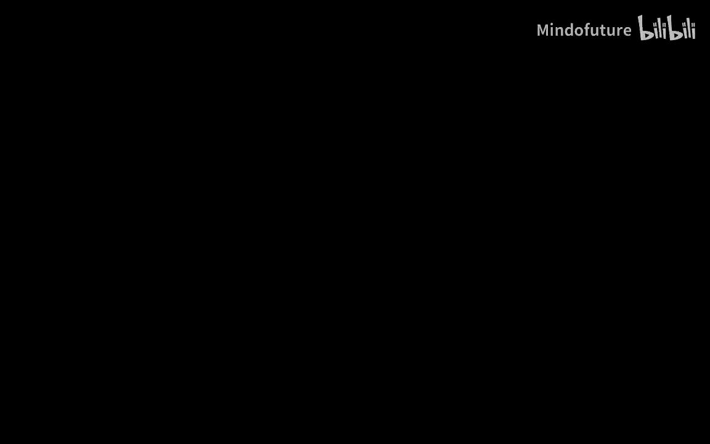
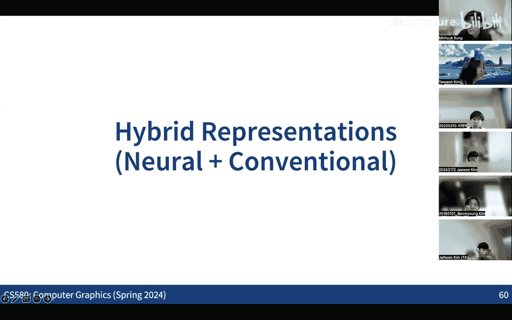

# 【韩国科学技术院】计算机图形学 KAIST CS580 Computer Graphics (Spring 2024) p10 P10 Lecture 11 - Neural Rendering   Volume Rendering (KAIST CS580, Spring 2024) -BV1he7mzjEc1_p10-

Oh so yeah， let's talk about the rendering the volume rendering for today。

 So I guess many of you have seen this kind of video So this is kind of the demo from the nerve studio which is basically making some kind of the some you know a year kind of the applications with some kind of3 construction So what you are basically seeing in this video so can even see the video okay。

Yeah， I'm not sure whether there might be some kind of latency in the gym session。

 but basically this is kind of some sort of the demo。

 the AR demo based on some kind of 3D reconstruction So what let me play this again So this is case that we are basically reconstructing some real scene making it is kind of some v scene and then basically augmenting the scene with some kind of some the characters here and making some nice video by composing some real images and also some but kind of objects here。

 So there can be also many other applications in terms of like doing some kind of reconstruction with 3D scene and making some kind of some nice this kind of demo。

So what actually we are going to discuss for today is slightly different kind of the perspective in terms of the like what we typically discuss in the contra graphics is more about basically how we make some kind of the 2D images from some virtual 3D So that's basically what we all discuss in the 38D the introduction to counter graphic course and also discourse as well。

 So we assume that we are having some kind of the virtual the 3D environment where we are basically define some kind of also some virtual objects and virtual some kind of light and some metric properties like all those kind of things and we do some kind of some physical sort of simple simulation in terms of basically projecting some 3D things into the 2D plane So that's basically how we get the 2D image from the 3D。

But kind of the perspective for the 3D， especially from the computer the the aspect is more about basically how we reconstruct 3D from some kind of the observation of some kind of real scene into some kind of the 2D images So what we can also think about is that when have some kind of the collection of the 2D images that are basically captured from the the viewpoints in the real scene here the question is basically how we are going to actually reconstruct 3D from the observation。

 the real scene from the 2D So you can see that this is kind of like quite opposite the direction。

 So graphic the focus is more about basically 3D2 d2D like basically 2 d rendering but the vision perspective might be about like 3D reconstruction from the 2 d2D to 3D So what we are going to discuss today is basically slightly more about the division perspective in terms of like how we do some 3D reconstruction from the 2D but you can also see that actually this kind of the 2D to 3D reconstruction is quite related to the render。

ing the process to3D to the2 So we are going to see how these kind of be two different perspectives can be basically interveed with some kind of be rendering the pipeline。

And especially like what we are going to discuss for today is more about not exactly about the threed construction。

 but actually the ultimate goal was more about basically Nobel view synthesises so what we basically mean with the Nobel view synthesis is that we are assuming that having some kind of collection of the2 images that are basically capture from technology viewpoints and then what we want to do is basically actually synthesizing a image from the different build so basically giving a collection of the two images how we get a image from the new the Nobel view is actually exactly the problem that we want to slope using some kind of the the neural rendering the pipeline So one example is this so this is also from the nerve the paper so as you can see the left hand side is basically showing the kind of the images that we are having we capture from the real things so given this kind of some discrete samples of the2 images how we can make some kind of all the images from the RV。

Bs in terms of like， then we can make some kind of the very smooth。

 the trajectory is the motion of the camera and then making some kind of video like this。

So this is moreover of SPD， no use synthesis， so that was kind of the decor for the original decor of the neural render。

So basically here， the focus is more about basically not。

Doing some kind of reconstruction for these 3D， but it's more robust synthesizing some kind of the Nobel view the images and also here the assumption is that we only have the images as kind of the given data so we don't have any kind of supervision。

 any kind of the information about the 3D that we can learn about we only have the information for the 2D so in these kind of the cases when we do not have any kind of information for this 3D。

 how we can do some kind of some you know the synthesis of the images from the Nobel view this is kind of the basic idea。

And also what we are going to see in thener pipeline， especially in the machine learning perspective。

 is that obviously this is not a machine learning the course。

 but so we are not going to discuss like all this kind of the perspective here but here the main key thing is that if we think about like making some sort of the MLLD system。

 So let's say we are having making some kind of the neural net that is taking some kind of the a set or the2D images as kind of training data and given some kind of the new the camera pose we want to basically make some kind of the new image then actually we can think about some sort of the black box the neural net right。

So the black box in neural your net is basically yeah， let me if you go to the next slide first。

 so we can think about some sort of the black box in neural net which is taking the camera matrix as the input in the kind of the inference time and the output becomes some sort of the toD image。

 right？So we can think about making this kind of be some blackboxy system。

And this network can be trained in a kind of spot by the way。

 So we assume that for some of the samples of the camera images。

 we are having the ground through the2 images， then we can train this kind of neural net using some kind of loss function。

 So the simples the loss function might be just L to loss we just compare the output the render image and basically given the ground truth image and just measure the color difference。

 the L to loss and basically doing some kind of backag for the nerve for sorry the neural network right。

But the kind of interesting aspect of the neural rendering is that the goal is basically not to make some sort of the black+ decoder and actually if you just try to make this kind of some random the neural net that is basically taking the input and making things kind of prediction for the output which you will see that is's quite challenging to make some kind of the working the neural net is really kind of challenging the problem。

 but here the kind of the go in the machine learning the perspective is that actually we want to make some kind of the more interpretable。

 some kind of the image decoder， which is not just like decoding the image using some kind of the conversion neural network or the transformer。

 but actually making the image it's kind using the rendering the process from the 3D presentation So here the goal again like it becomes like coming back to the 3D again like so making some sort of the 3D in terms of that we can produce the image using some kind of the rendering the pipeline so this is basically the basic goal in the neural rendering。

kind of the framework I mean so there is no any kind of the as far as I know any like specific like exact the definition of the new rendering。

 but in my understanding the new rendering would be this kind of cases。

 we want to basically make some kind of the image decoder。

 which is basically produce not using some kind of the black box deco decoder。

 but using some kind of the rendering the process which is like starting from the 3D presentation。

So this is kind of a quite interesting perspective， I think in terms of that know。

 actually when you liver is some kind of more interpretable some kind of system producing the two images。

 and especially when you utilize the rendering equation that we have been using in the many kind of the graphics。

 the pipeline actually problems way better than making some kind of the flatbox the neural the decoder。

 so how can you also make this kind of the system utilize this kind of like rendering equation in the decoding process is kind of the key aspect in the neural rendering。

So this is quite different that we are seeing in many kind of the the machine learning kind of the framework。

 so in many of the cases we are making some sort of the you know some giant the architecture that somehow decos something in a way that we cannot understand right。

 but this is really a case that we are decoding the images in a way that we can really understand I mean we kind of exactly rendering the pipeline that we have seen in the graphic framework。

So this is kind of the perspective here and also let's what we are going to do is that we are making the system that is taking the camera matrix as the input and making the2D images that is the output。

So as I said like how we are going to basically generate the 2D images。

 so what we are going to do is that actually we are going to going back to the kind of the graphics kind of pipeline。

 we are going to do some kind of the 3D console can first and then render this into the 2D image that's basically the way that we are review some kind of physical properties for the 2D image generation then the equation becomes how we going to basically do some kind of the 3D generation or 3D construction so this also kind of the big problem some years ago especially kind of some region graphics area and there are some basically many attempts in terms of how we' going to do some kind of the 3D construction。

So as we also have discussed in this course like the you know mesh is the kind of the most the common representation for this 3D right So there are basically some kind of the papers like this。

 So I'm not sure how many of you know this work this is the work that was quite famous at that time。

 in pixel to mesh which is basically taking a image as input and making some 3D as kind of output like this。

So this was kind of like one of the example that we are doing some kind of the 2D to 3D construction using the neural net and here the basic idea is that we are starting from some kind of the template d mesh。

 which is the Iipoid me in this case on the left hand side。

And then doing some kind of some iterative de deformation in a way that the final image can be aligned with the input image like this。

 so we assume that we are having some kind of the mask of some kind of the for round region in the 2D image and we can either even have some kind of the multiple images from the different views for those kind of cases like we are somehow doing some kind of the itreative de deformation for the3 image in a way that the output theme can be aligned with the silhouette of the full round region for the images。

 so this was kind of be some very sort of the early attempt doing some kind of the 2D to 3D construction。

But obviously there are some kind of be many limitations in this system。

 so what do be kind of some limitations for this system？Anyで？Well。

 basically the system is not just like learning for a single image。

 so we are also trained in neural net for the multiple images and the multiple objects。Yeah。

 so there are many good answers， I mean obviously the topo might be one thing so as we are basically starting from some kind of ellipse with the mesh unless we do some kind of you know some tiring or some kind of sort doing some surgery like cutting some parts of the mesh or something it is hard to basically change the topology to be shipped so that is kind of the one only the the problem and obviously the other thing is that for some kind of the unseen region there is no way I mean for the unseen region it should be more about basically learning some kind of generated the models。

 so it's basically checking all kind of the possibilities for some unseen images and also this is not really basically creating some kind of color information but that can be actually done by adding some kind of additional the neural network。

Or yeah， so there are many kind of issues in terms of like also describing some early details for some kind of part of shapes as you can see for some kind of thin parts of the shape we're gonna basically those kind of things by just like deforming some the eipme so its really also kind of challenging problems there are some kind of some loss of the limitations for these line of the work I also did not paper the slides for many other examples doing some kind of the 2 d to 3D the but also there are some kind of the cases that know generating some kind of demees by really basically you know creating a sequence of the portes and connecting all these portses into to make some kind of the faces the triangles as well and this is also quite sort of the fl of the system in terms of that we can make some kind of the loss of the in demees making some kind of random connections of the portes and making some very wrong faces so actually making。

E me HD output is really know challenging the task while there have been lots of the attempts。

 we actually have seen that like the diverse generation D mees werent not basically performing well。

actually， one of the reasons that we are also seeing some kind of the bad output for those kind of theD cases is because of the slow de convergence in the learning in terms of that。

 so basically we're gonna compare the output the mesh we of given the input the image or some kind of the mask So the process of like align these two might be actually using the recasting the system like we are shooting the array from the 2D image and basically finding the intersection point between the 3D and then doing some kind of the comp between the 3D and the 2D So for those kind of the cases what we can see is that we are only basically updating the one single point per pixel which is basically the first intersection point which means that for every single pixel we are basically doing some kind of the update for a single point over the 3D mesh and that is basically making some kind of the very slow the process of like updating all the things。

So here also the question is how we can do some kind of the make some kind of investor。

 the convergence in this kind of learning process。So this was also kind of some concerns in disruption。

And also what people have basically seen you know the recent kind of the work actually five years ago was defected and it's also good to utilize some kind of the input functions instead of the mesh so the idea for the input function which is also representations basically which also utilizing many other graphics the pipeline as well。

 is basically having some kind of representing the 3D some kind of the shape as kind of function。

 so when you basically pick any kind of the point in the 2D or the 3D space either we are basically having some information but the occupancy whether the point is inside or the outside shape where we can take some kind of the distance information which is basically design basically the distance information and plus some kind of the occupancy as well。

 like just indicating the inside and outside that kind of assigned。

So the good thing of like having this kind of the you know implicit representation is that it's much more some sort of the flexible de that you know as we're going see or in the pipeline and you know it's also good for basically describing some moral details and without having any restriction for the topze so this was kind of the many kind of other band pages that we could see for the implicit functions。

So actually， if they see some kind of literatureer in terms like how the 3D generation where the reconstruction the neural networks have been basically developed。

 we can see that actually the input function was kind of one of the best of the choices in terms of like getting some kind of the accurate this relationshipship。

But also here the problem is that once we basically reconstruct some 3D things into some kind of the implicit representation。

 if we want to compare this output with the given the 2D images。

 then we also need to involve some kind of the rendering the pipeline for the comparison between the 2D and the 3D right then here the question is that how we can basically render that's kind of the implicit representation。

So for example， if preha basically designed the distance the function then how we can render the design distance function into the image。

 so this is kind of also the one big problem。So what we can basically do for this kind of rendering of the implicly function is this kind of peer tracing。

 so which has been introduced in the 1995 like almost like 30 years ago。

 and which is really kind of the popular idea for the rendering of the implic function。

So here the basic idea is that if we have a kind of defined distance function。

 then what we can see is that at this point， let's say we are starting it from this point， right？

So from this point， what we mean byhead the signed input the function is that for any point in the space。

 we can get the information about the distance to the closest the point， right？

So that's basically the meaning of the distance right so for each of the point we basically query that point with in terms like you know retrieving the distancetancing information and the distance basically indicates that you know there is no obstacle in the sphere which is defined with the radius of that distance right？

Does it make sense， so if we start from this kind of the point if we get the kind of the distance information and if we draw this kind of this sp in the3D space。

 then there should be no obstacle inside this sp because the close is the point over the surface should be basically having this kind of the distance right。

So we can basically along the specific direction， we can proceed。

 we can march along the array with the amount the distance that we basically at this point。

And we can just like you know repeat this process so once we basically march along the amount of like this distance。

 then from this point we are again basically know getting the distance information。

 which means that if we to rule this peer there should be basically no kind of the points that we are making the intersection then we proceed there so we can basically do this kind of the iteration until we basically will be reach to some kind of the the inter second point。

So this was basically the very simple but very effectively idea in terms of rendering with the implicit function。

But obviously like you know， this kind of is peer tracing the idea also has lots of the limitations so。

 so what be kind of the limitations of this peer tracing。

 especially like running some kind of some 3D reconstruction degeneration in the neural pipeline。

So think about the framework basically we are doing some sort of the 2D to 3D some generation or the reconstruction then we once we basically make some kind of the predict some kind of the 3D shape represented as kind of imp the function then we're gonna basically render this 3D thing into the 2D images and do some kind of comparison with the 2D images and the back with some kind of loss measuring the difference between the 2D and the render this 3D we will basically affect the input the function。

 basically updating the given the input the function So for this kind of system if we use this kind of pure tra as kind of the rendering the pipeline what to be kind of challenges for that。

Yeah， so as you can basically expect to say， I mean this kind of framework is not that differentiable right so there might be basically inping lots of kind of the nondiffer kind of these steps and obviously there are some kind of attempts to make some kind of the differentiable spirit tracing kind of the pipeline iss kind of making some kind of modificationification but still we is kind of some differentiable tracing kind of the idea。

 the problem is that it's quite computationally the heavy because like it involvesvoke kind of the multiple iterations so this is kind of some of the kind of examples that actually we can have lots of kind of the steps to reach to these first intersection the point so especially when you have some kind of the objects that becomes closer to the rate that we are shooting then that we will basically invoke lots of kind of iterations because it makes the size of the spiritly small so this is kind of like one example like also this is kind of the one sort of the corner case like maybe actually shooting。

Which does not hit any point in the3D space， but still there can be some kind of the loss of the iteration。

 So we want to actually see that， you know， we are havingaving all the small theses along the way and after like all the iterations realize that actually this is three which is not hitting any kind of point over the in the3D surface。

 So you can see that actually this is like1 in both lots of some kind of the heavy computation。

 which is also not that helpful to basically train such kind of neural。

So these are all the kind of issues and these are actually really something that people have tried to some kind of 2D2 3D degree reconstruction and there are lots of such kind of issues。

And interestingly， the solution that people found was actually breaking some kind of official rules。

 so what actually we typically want to recon is some kind of some solid the object so we are basically some sort of be some objects that are presented with some plastic all those kind of things so it's not just kind of the volume but we know that there should be some kind of the intersection over the surface of the objects and that's what we also do in our basically some re the system in many kind of the graphics the pipeline。

But for this kind of like2 to the ra reconstruction。

 what people found is that actually sometimes in terms of efficiency like training this kind of neural。

 it's better to break the physical rules in terms of we are seeing all these radio objects as kind of some sort of the volume。

 So now we are going to assume that the rate can basically pass through the objects So basically penultrating all kind of the surface and the rate can basically go inside the objects and passing through the objects and by having this kind of the assumption that we are now seeing some kind of some solely objects but having some kind of the volume we can basically utilize all these kind of somes So like having the implicit representation without basically using some kind of peer tracing kind of some computationally heavy some rendering the pipeline and also basically not just like wind the first intersection point but basically some update with like one single delay we will basically also update kind of。

Not just like single point， but in many parts of the 3D space。

So they were actually in terms like the efficiency of between the neural net。

 this kind of volume representation will give you some kind of loss of the other advantages and also give some kind of the output。

So this is kind of the basic idea for the recent the neural rendering kind of pipeline。

 so people that actually there are some kind of the many authority attempts in terms of using some different representation。

 but now some kind of the know the output that we are seeing is that when we utilize some kind of the volume representation for the3D。

 even when we recon some sort of the solid， the object actually we can get some kind of the much better the outputs。

 so that's the basic idea that we are utilizing kind of the volume the rendering the ideas。

And for that basically we also need to render this kind of some 3D volume into the2D images and also the key thing is that for this kind of the rendering of the volume。

 actually we can also utilize some kind of the some classical de bo rendering the equation which has been very extensively the studied and in the compographical literature more than about like the 30 years。

 so the first paper which is doing some kind of the bo render was introduced in the 1984 which is like exactly 30 years ago and so what we are going to do in the neural landing pipeline is basically nothing but just simply utilize this kind of some very classical the bo render the pipeline in terms of getting some kind of making some interpretpreable the image decoding the system。

So this is kind of the basic idea。And before we discuss some kind of the main idea for the nerve。

 let's also see some kind of the relatively you know all work。

 So the deepboxs was kind of the some all the work doing some kind of the nobel building this。

So here basically the idea is that we are basically having some sort of the 3D deboxoxs and also we are having some kind of the and the number of the images which are all captured from the different the camera depos and here basically we assume that we are having the all the camera depoology information for the images。

And in the deep boxes， basically what we do is that we are doing some kind of the hybrid of the neural encoding decoding and also some classical some rendering kind of projection。

 the pipeline in the complex graphics。So this is kind of the diagram。

 which is basically showing the 1 d to 2 d the examples。

 but actually about the same thing can be you know someone imagined indeed 2 d to 3D so in the kind of the includingd the process。

 what we do is that we are still ending the 2D images。So you can say that we are pretty。

 So let's say like now the image is kind of like one0 things。

And we are having some kind of kind of the conul in neural that。

 which is basically giving some kind of the teacher vector or pixel。

When what we do is that we shoot a ray for each of the pixel。

 doing some kind of be array testing by shooting the all arrays to the 3D space。

 and then we propagate the feature vector for each of the pixel into the 3D space。

So this is like you know showing some kind of the， you know。

 this kind of propagation from the 2D pictures into this reading。

And also what they can do is that perhaps some kind of the multiple images。

 even we can also accumulate these kind of the 2D features in the 3D space。

 so it's kind of the hybrid things right so we are utilizing some mirror including while also doing some kind of the typical array tracing to basically spread out only 2D information in this 3D space。

And then decoding step is exactly the opposite， so now what we can do is that now we know you project all these 3D information into the 2D plane along the race doing some kind of another aggregation of the features that are encoded in the 3D boxess to basically put them into one into the pixel in the 2D image and then we decode this feature back to the image so this is exactly the opposite step right and you can see that also this is kind of some combination of 3D2 d 2D projection and also some kind of decoding。

Makes sense。But here one more thing is that for typical this kind of rendering the pipeline。

 we also need to consider some sort of the occlusion right。

 if we consider like there are some sort of some real solid objects in this 3D space。

 some kind of the objects that are occluded by the other objects should not be considered in our the projection V pipeline。

And to remake this kind of some occlusion kind of the situations。

 what we can also do is that they are basically into some kind of some beibility de testingest neural network。

 so once you basically have all these kind of features that are stored for each of the 3DD boxes for each defectductory we also predict how likely this kind of this box will will be visible for each of the array that is like giving some kind of de probabilityability here。

But you can see here。Os。For each of the3 d pixel for each of rate。

 we also get some kind of the probability， which is indicating how likely the box will be visible from that rate and then we are doing some kind of the。

 you know， weighted some of the features in terms of basically getting some kind of the doing some sort of the projection。

So this is kind of some newer equationcc aware sort projection using another neural network。

 which is giving some kind of the visibilityibility information。

So very simple the idea but this was quite effective in terms of doing some sort of the Nobel view synthesis so these are some of the examples you can see that the right hand side here is basically the input images even the set of the discrete set of the images and then we are doing some kind of the interpoations of the views by moving the camera so you can see that the actually output looks quite good this was kind of the work five years ago。

And let me also show some more video。Some of these video does not let me just skip this。呃。不能。

And yeah， and this is also kind of the comparison when you use the occlusion neural network。

 where when you do not use the occ collisionlusion neural network。

 as you can see when you use this kind of like having some sort of the notion of the visibilityibility。

 we can get some kind of the more better the outputs。

 So actually at that time this was really kind of the very impressive。

 the impressive work in terms of that we can do the reconstruction for the all these kind of the tiny details we are seeing that all the letters especially when you use the occlusion neural network。

 we can get some more the precise the outputs like this。

So this was kind of the interesting example in terms of that we are still using the neural network。

 but doing some sort of the， you know， making some hybrid divergence in terms like doing the encoding and the decoding。

 not only using the you know the neural network， but also using some kind of the 2D to 3D and also the 3D to 2D some sort of rendering the pipelines。

And also we could see that like having some kind of the notion of the occlusion。

 the visibilityibility was basically giving some kind of the parallel outputs。But as you can see。

 like this kind of high grade diversion is also making some sort of the issues and can you also guess some kind of the limitations of like this framework？

Yeah。Yeah， so do sound like one of the limitations would be basically high is quite memory the heavy system in terms of the and this is the case that we are somehow training all these kind of things for the single the object right just to represent a single object we will need basically some 3D box of representation while also st some kind of the high dimension of the feature vector for the box So this will be also the case that we are having some kind of the memory issue basically having taking lots of the memory just to represent a single kind of the object So you gonna also I mean this kind of some issue also can be resolved when you start to use some kind of implicit representation。

 So that's also what we are going to say in the nerve framework。

And also another kind of thing is that while we are having some kind of the notion of the visibility。

 like having some kind of neural net， which is giving some kind of information about the visibilityibility。

 actually， this no occlusion， the aware projection may not be physically the。

 So can you think about some of the situations that know the the visibilityibility。

 the testing the neural network might be giving some kind of the wrong information。

This is the key part that we are going to discuss in the todays lecture。

the case that what that I mean is subsequent cases， let's say like we should be we。

And we're going to have some kind of the loss sub some2 deep boxes in the 3D space。

 And let's say the visibilityibility here is kind of like 0。1， which is quite low， right。

 but let's say like we are also having some kind of the points behind this box。

 which is having like 0。9。Does it make sense。So if we see that the is like close zero。

 which means that there is like the high chance that there is something which is occ this box， right。

So if we cannot see this debauffle， which means that this was basically accded by something else here。

 right？Which means that all the points along this way should not have some kind of high visibility。

Make sense， so if we have some kind of the some bgD square here like the 0。5 or something。

 then all the points behind this point should have the 0。5 or less than 0。

5 the BgD square otherwise it doesn't make sense， basically。It is clear。

But this is kind of key thing， like when you talk about some kind of some visibilityibility along the array from this kind of viewpoint。

 if we have some kind of the visibility score at this point。

 then all the points behind this point should have like equal or less than the visibility score。

 which is like equal to less than the score at this point。But this kind of the visibility。

 the testing digital neural network does not guarantee this kind of the some you know physical correctness for the conclusion。

 it's giving some kind of the random score for the visibilityibility。So actually， physically。

 this is not really not making sense， I mean， there can be some kind of many interesting situations that。

 you know some kind of the closure theoxs is not visible while the father deoxs are more visible。

So there is no such kind of like guarantee to satisfy this kind of the op the constraint。

So that's why actually we are going to not just using some sort of the some randomcoding decoding kind of framework。

 but we're gonna to see how we can incorporate some kind of the boroom render equation in this case and the nerve was kind of the famous the in terms of like when showing that actually when makes a more physically you know correct kind of system for the rendering actually problemss were way better than making some kind of some newer random newer some kind of the framework。

So when you see some kind of the differences between the nerve and the deep boxes。

 is that there are some multiple people some sort of the major differences here。

So one key difference is that we are not going to use the boxes。

 but we are going to use the implicit representation。

 which is basically giving the more the efficiency in terms like consuming less amount of the memory。

 And it's also the resolution free。 So we don't need to specify some specific resolution the only3D boxes。

 but we can have some kind of the resolution3 the outputs。 So that's kind of the one thing。

 And also the other thing is that we are not going to encode some kind of the latent pictures。

So this is not about some kind of the subneural decoding of the things。

 we're going to really basically include some kind of the physical property。

 which is the density information and also the color information。

But instead of like just having the color information actually we're going to have some sort of the build dependent the color information。

 so what's the kind of the build dependent color information in this case see in terms of the radiometer。

What do we mean by like the view depend on the colors。明得啲。Radance， yeah。

 so we we discussed how we exactly did the color information at the end in the the rate tracing the system。

 right and we discussed the spectrum render the pipeline。

 But the simplifyimplified the version would be basically like competing all the things for each channel of the RGB channel of the the color。

 right， then the some kind of the view dependent color information actually。

Here basically means some kind of the view dependent there some kind of light information which is basically some radiance information。

 so it's all basically encoding the amount of the radance which is basically emitted from the volume and also some kind of dense information。

 so which is really storing some sort of the visual the quantities instead of some sort of the random some sort of the latent features that will be decoded using some kind of the black box the quarterr。

So this is like another big difference and the other kind of the kind of thing is that we are not going to also use the neural net for some kind of the bibilityDD test。

 but we are going to use the balloon then during the equation that has been used in the compographics framework for these 30 years so as you can see some of the major key changes from the debus for D nerve is basically making the system to be more basically making more sense。

 so that's kind of the main idea here。And these are some of the some outputs of the nerve。

 as you may know for that you can see on the nerve the web page。

So here the key idea is that we are going to use the volume landing the equation and here the assumption is that we are basically assuming some kind of the volume in this 3D space that is basically emitting either emitting or basically observing some of the light but let's only think about some of the cases that we are just emitting having the volume which is like emitting the light and the volume is basically emitting the light at every single point。

 so whatever point that you pick inside the volume we're going to assume that that kind of the point inside the volume is basically some of like generate some kind of the light so that kind of the information and the amount of the light that is basically encoded at each point almost each the specific direction will be stored as kind of the radiance man so we are having this information。

And while we are not having any kind of be some surface in this case。

 we're going to assume that the volume is also kind of the full of some kind of the particles。

 which means that the rate can basically collide with some kind of the particles inside the volume。

So how likely the wave will basically provide we and kind of the particle in the volume is basically represented as kind of the density。

 So we are having another the map which is the density map。So this kind of the two information。

 the dense team map and also the radiance map， these two are basically something that we are going to represent as the implicit functions and these implic functions are basically learned basically also represents as the neural net so we are basically having the two neural networks which are basically describing these two implicit functions like one is the radance map which is giving the information about like how much of the amount of the radius that the volume is basically imaging at that specific point and also the direction so for the radance map we are taking the two information。

 the position at the point and also the direction。And we are also basically having this kind of radiance information for each of the RGB。

 the color channel， so we are basically having these three image detector。

And also as kind of the the density map， we are also having some kind of information about like how likely the rain will hit something at the kind of the point。

 which is giving some kind of the density information。

So the goal here is basically training a kind of the two neural networker which is giving the radance map and the dense map and actually we're going to see it actually these two maps can be represented with a single neural net so we're going to see also the architecture and basically in a way that we can do some sort of the neural network。

So here the main question is that let's assume that we are having the both kind both the radius map and the dense map。

 the density map in this3D space， and given these two information how are we going to make some kind of be rendering the equation。

So for today we are not going to consider any kind of the complicated the global elimination。

 but let's only think about the simple the local elimination。

 so what we are going to do is that when you should a ray into some specific direction in this 3D space。

 were basically see how we can calculate the output the radiance。

 given this kind of the density and also the incoming source be the radiance information。

So this is basically the question that we are see。So basically what we can see is that these two are basically the neural network。

 the first one is giving the density information。And also the second one is giving the radius information。

 which is basically the amount of delight emit at the specific point and the direction。

And based on that， we are taking this kind of integral and what we can see is that we are having this kind of the extra top。

 which is some robot in transparency。So here we see the transparency is also defined based on the density。

 so if we take this kind of interval we are taking the this transparency information。

 then the final the sort of the output ir radiance is compute as kind of the some you know the sum of the multiplication of the transparency and the density and the radiance information。

We can basically see that this is kind of intro， this kind of multiple these outcomes。

 like the first one is the transparency and the second one is the density and the third one is basically the radiance。

So we're going to see the menu like each of them， so before we get started into some more details。

 do you have any questions for this equation？So here the key thing is that no。

 no key questions might be like what's the meaning of the density here？And also。

 the key thing is that the transparency is also calculated from the based on the the density。

So also you know， what's the meaning of like having this equation。

 this might be some of the key questionss here， right？

So let's now dive into some more the details here， So what basically we want to see is that first。

 what's the exact meaning of the density。So if we see some more the details in terms of how we exactly define the minimum D density。

 let's assume that we are shooting a ray and specific ray can be considered as kind of the very thin cylinder。

In this space。So let's assume that the ray is kind of the very thin cylinder in this3D piece and wed like to see some kind of the slice the section of this kind of the the array。

 the long cylinder， so let's say this is kind of some kind of the slice of the array of the long cylinder。

 so we are having this kind of these right。And the reason kind of infiniteiteimal the width will be the the section of the kind of the thelin basically the Delta T here。

And here basically E this E denotes the area of the section of the cylinder。

 so were having this kind of the E the area of dissection， and also the infinitesimal。

 the kind of amount of the time which is the delta t and then basically the volume of this kind of the slice of the is now becoming like e times the delta T right。

Make sense。And basically， we are going to assume that we are having some kind of the some particular density information。

 which is actually raw T here。And then what you can also see is that you know a is kind of some sort of the constant the amount of the projected the area of the particle。

 So if we should a array and your assume that all the some kind of the particles look like this。

 then basically this will be basically the area， the project。

 the area of the projection along this specific pressure rate。

So just to simplify all these kind of things， we' going to assume that every single particle had the same projected the particle。

 the area along the project of like distribution， right？

So this is bekey density of the particle and this is about the projected the area for each of the single gate particle。

 and this is Bketi know， this was bequidi volumeium。Of this section right。

 so if you multiply the density and the volume， then that becomes the number of the particles right。

Mes。And here basically what we are going to see is that how its all calculated how likely the ray will collide with any of the particles here and for that we are basically going to calculate the ratio of the up the area。

 so what we are going to see is that the ratio is basically defined as kind of the area。

 the sum of the area， they projected the area of the particles inside this section。

 this slice divide by the area of the section here。

So if we basically calculate the sum of the project area for the only number of the particles and dividings the area of this kind of dissection here。

 that will give us the information about like how likely the rain will hit something inside this section。

So actually， what we mean by you know this function is that while people typically call this function as kind of the density function。

 but it's exactly not about the density。 So it's actually about how high really will hit something。

 So it's more about the probability。So that's basically the a times this kind of duration so this is basically all about basically you know calculating this kind of probability about how likely the array will hit something it is kind of the slice of the array and this is basically actually called the extingent equation or the opacity information。

So while people just easily use the thumb as kind of the density for this function。

 the information that actually we want to get is basically more about some sort of de problem。

So actually we are having this op function is giving the information about the probability of like or something at this point。

And given this information， what we are going to calculate is about the transparency。

 So we didn't see yet like why this you know transparency is basically defining this way。

 but what we want to know see as kind of this transparency is also about the probability but about basically not colliding anything until we reach that point until the time。

So we are having these two properties so and in the final equation。

 what we do is that if we go back to here， we are multiplying this transparency with the opacity。

 right， So having the multiplication， the transparency and the opacity So what does the mean of like having the multiplication is that the multiplication of these two is basically giving the probability that the ray will co something at this point while not having any kind of col until that point。

Makes sense。So when you do the multiplication of the transparency and the opacity。

 that basically means how likely the rain will fly to that point without any making any collision and then stopping at that point by making the collision the point。

So how likely the ray will reach the point without any collision before that？So then no。

 we can see that actually， this equation is basically nothing。

 but it's more about basically sort of like taking the expected value。

So this is more about the raddiance at the point and this is more about basically how likely the Arabia will basically reach that point。

 then we are basically taking the multiplication of these two and taking the sum。

 so which is basically taking the expected value of the radance by having all this information。

Is this clear？Any question on this？So what we have seen in the deep box of the case is that we did not basically decole this term into these two things。

 So now we are having the both the transparency and also the opacity。 But in the deep box of case。

 these two。These two term was specifically just predictive as kind of single devalue。

 the basically score using the neural that。But now we are presenting the same D as kind of some multi polyly digital terms。

 one is the density and the other one is the transparency。So now let's see like no， then no。

 and also the thing is that the transparency is calculated based on the opacity that we are having right。

 then how should we basically calculate the transparency。So the by definition of the transparency。

 which is about the probability， well how likely the ray will not hit any kind of things up that point。

 if we see the transparency at this time， like the t plus the delta T。

The transparency at this point should be a multiplication like these two So the meaning like the multiplication like these two is that the ray should not anything until time T。

 right？And this is more about how likely the ray will see something in that specific section of the time T。

And you predicted1 minus this， that means that the rate is also not teaching anything in the section。

 right。So if we basically see some kind of be ray like this， and we are having the deelta T here。

 then until that point we are having the time T， right？

So this means that the ray is basically not hitting until this point。

To reaching this point right and also multiplying this also means that Ray also does not hear anything in this specific dis section that becomes the transparency until the point of the key plus gravity。

 right？So we just like simply multiply these two because these two are basically independent the events。

 so we can see that the transparency basically we should basically satisfy this kind of condition。

And if we just rewrite this into kind of the OD formulation like this。

Then we can see that actually this becomes kind of the OD formulation and this OD formulation has this solution so also the kind of initial condition is that at the very beginning the transparency should be basically one which means that obviously at the the starting point there's no hit right so the probability of like 918 should be basically one right when you have to collect the initial decocondition if you find a function which is like basically satisfying this kind of the constraint that becomes this exponential default。

So this is calculated， the transparency is basically calculated in this way by just taking integral format behaving the exponential form like this。

 using the opacity information。It is clear。 Any question on this？Yeah。

 so you don't need to see how exactly we solve the OD。

 but here the key thing is that know how exactly the transparency is specifically defined so by the piece of the transparency the transparency at the point of the t plus the delta t should be the multiplication of transparency the time t multiplied by the1 minus this top which is basically showing like how likely the needs of the de section。

Then the kind of the interesting kind of thing is that now we are taking the exponential of the minusrs of this kind of interior。

 right？And the sigmaom here is basically the probability。

 which means that it should be non negativity number。

So we are taking kind of the accumulation of the not negativeivity number。

 which means that it puts the only this part。There should be non decreaseative function， right？

It should be， it should not decrease because we are accumulate some kind of non negative quantity。

So since this part is basically the non decreasing the function， if we see the entire deform。

 the exponential minus of this interval， this whole thing now should be non you know。

 non increasing function， right。So if we see the exponential de here。

 then we're going to typically see this kind of de。

It means that the transparency should become is now becoming some sort of nonin function。

 which makes sense right， so physically when you really define some sort of transparency。

 if we have some kind of transparency at some point，So this is more of sort divisionly， right？

So if we have any kind of the probability of like how likely you know we going to reach at this point without hitting any kind of things。

And we also see the transparency at the point which is behind this point。Then obviously。

 the transparency at the second point。Be no， equal or less than  the2 at this point， right。

 It cannot be increased。Physically by definition of the transparency right and our formulation of transparency is basically satisfying this kind of the property of the know having the non increase dysfunction function。

So which is really aligned with much overly the physical concept about the occlusion。

 which is also making some kind of major difference with the default kind of the flavor。Ex sense。

So this is basically the basic idea for the volume then the equation。

Do you have any questions on this。So again， like the basic idea is that we are basically taking some kind of the expected value。

Like， how likely the ray will stop at the point and also the incoming sort of emititate the irraians at the point。

And this kind of the probability is basically computed as kind of the multiplication to transparency and also the opacity。

The transparency indicates like how likely the ray will not collide with anything until that point。

 And also the signal here is basically about the opacity。

 which means like how much the ray will hit something at the point。

And this transparency is basically calculated based on the opacity。

 which is basically making the non inre function， which is naturally basically aligned with the physical concept about the occlusion。

So this is kind of like the basic idea for the Bo and during the equation。

Then what we have discussed with all the right in the system is basically you know all of obviously how we exactly calculate this kind of integral with some kind of discrete samples。

 right？So as we also discussed in the mon estimate。

 what we are going to do is that we are going to do some kind of the sort distified dis sampling。

 that's dividing the array， the region of the range of the array into some kind of the even dis spaced kind of the beans and even as they simplify older things。

 so we're basically going to sample like one point for each of the kind of the uniform kind of the region of this some kind of the beans and doing some kind of the calculationc。

So let's think about some of the cases that now we are doing some kind of the some sort of estimate by having some kind of the end number of the regions。

 some intervals along the rate and taking some kind of the one of the samples here。

So let's say we are basically having the end time samples for to the point that we are taking some kind of the you know opacity information and also the incoming dereency information。

So given this kind of the all the information， let's say we are heading the and this quick T the samples for the having some kind of the density。

 so the oldacity here and also the radiance information。

 how we can exactly calculate this kind of the integral from here。

Let's take some time to think about some basic ideas。

So we can do some kind of the you know estimate or doing some kind of the approximation with these kind of end samples。

 what we kind of the best way for this。Yeah， let's think about the bold estimate and see how we can do。

To save time， let me first move on， but maybe you can think about some kind of ideas for this。

 this might kind of be some basic things that we can come a bit， right。

Doing some kind of simple sort be multi estimate， which is the same with the lean money on this song。

即力。有。This is basically some sort of the basic form of the mon estimate that we have seen the structure。

 right？But taking sum of like all these kind of samples with the kind of the range of the each of the in total so that becomes the final the output I mean so basically we can calculate the final of the output the radance in this way and also this transparency is also another the form of the integral right？

So at the very beginning， the the transparency should be just like so it should be just like the one here。

 So this is kind of the yeah and the thing is that。For all the other the cases。

 we just we can also basically approximate the integral as kind of the form of the sum at this way。

And this also become the same as multiplying this kind of the exponential。Mes， I mean。

 this is the simplest de that we can calculate you know。

 the integral with some kind of the end discrete number of the samples。But actually。

 we are going to see a slightly the better version of calculating these things。

So we're gonna basically see the same de formulation in slightly different perspective in terms of that now we are taking the integral for each of the interval like this。

 so now we are let's say we're having some kind of the n sort of the interval with some kind of the T to the T plus one for each of the interval and then we are taking the integral for each integral like this and taking the sum of these。

Then how we can basically calculate these into， so this is kind of the like one thing。

 so this is kind of the de here。So maybe can just。Take like one minute and see what's the meaning of this。

我要出见我你方唔会信息。But this is basically nothing but like we are having the transparency here。

 which is defined like this。any kind of some tea which is in the range of the T i the T i plus one。

And then we just split this region of the interval of the interval gain from the G to TI to T I to T。

And these parts of the the transparency just can be calculated as TI as we define in the simple dissolution mode。

There is middle of risk we are having this time。And no。

 we can also assume that the opacity is constant in that specific interval。 then this sum。

 this integral like the simple this form。Then the only thing is that we just need to take the integral of this part。

Then what we kind of the difference of like this formulation with the simplest default。

 can you tell the difference with the simple de with this formulation？

So basically the major differencepressal like this formation with the simple deform is that now we are taking this amount of the transparency。

 so in the previous simple solution actually we just like ignore word this amount of the transparency basically basically assuming that the transparency so if we think about like having some multiple the intervals。

 so when you say this specific interval with the T to the T plus one then for any point in this specific interval we assume that the transparency is basically the same with the transparency that we are calculating until like this point right。

But now we want to calculate the transparency until like any specific point inside this interval total。

 so this kind of be some sort of the offset point， this region becomes some kind of transparency or like this term right from the T I to the T。

So for more precise de calculationculation， we additionally incorporate the transparency until in this term。

And while we are still assuming that the opacity is basically constant in the specific divides。

 So this is like giving us like slightly more the precise the equation for the same thing。

 So when you have the simple solution， had the sum of it like this sum。

 but when you basically incorporate the extra the transparency inside the tu now we are seeing that the same formulation can be converted like this one。

 So this is like different formulation which is given some slightly the more like the precise the outputs。

So if you see the nerve paper， we can see that Nadia also using this better solution for this kind of like discreteretization。

 so please check out what's the kind of the difference between the simple formulation and the patterns formulation。

Yeah， so as I said， we can see that now this becomes some kind of the term for the probability like how likely the array will collide for kind of any point inside the ice the interval over3。

Then we can see that these should be kind of the expected value of the regions we see here since the W is kind of the probability living。

But the thing is that if this was kind of really some kind of the you know expected value。

 the thing is that this W should be kind of be having some sort of probably the distribution。

Which means that if we just detect the sum of the all the probability。

 the sum of the probability should be exactly one。 right， That's the of the probability distribution。

But do we really need there' such kind of resource？Well， actually sometimes don't。

 sometimes there would be some cases that this sum of the probability becomes less than one。

Then what's the meaning of like having that the sum of the de becomes like less than what？

I specifically that means that there was like no collision until we pass the entire range of array。

 if we are just shooting some kind of the empty space。

 there should be no collision and there's nothing that we are basically catching any kind ofraance information。

So for more precise kind of computation， one of the things what we need to do is that actually we need to define some kind of the background kind of things kind of with some sort of infinite the distance and we are basically mixing some sort of the background world with some kind of some constant kind of the radi information and also having some kind of the probability or like how likely we will not basically head through the only empty space and hit the basically the background that the infinite the distance so the final kind of theform actually can be defined like this incorporating the final the for the background then we can really see that this formulation will only become some sort of the expected value for the radance。

So basically making more sense， right。So this is creating all the information that are basically utilized in the norm pipeline。

 so since this is not the much known course， I'm going to skip some all the details about how we exactly implement these things using some kind of the neural network。

And also， there are some details in terms of how we can get some better results with some kind of position including and also the kind of thing is that in the typical multi estimate。

 what we also do some sort of important sampling， right。

But we just discuss some ideas about the the sampling and how we can also do some sort of the important sampling So for that actually know the iner framework is actually utilizing the two networks like one is sort of the core sampling give some kind of the rough idea about the probability once we get some kind of the predicted the probability according to the point and now we are using this information for the adaptive sampling and that we do another some sort of the calculation in some kind of the more of the samples So this is also kind of some technique basically utilizing some important sampling in the rate the rendering the pipeline。

 the problem rendering the pipeline。So yeah so these are some kind of the basic idea in terms of how we can incorporate the volume render the equation in the neural rendering and get some kind of the much better the results。

 so compared to the default boxes you can see that now we can much more precisely describe all the details for the3D thing seen so this was kind of the interesting outputs。

But still yeah， there are lots of the limitations in the nerve。

 so I also recommend you to check out this slide， see and what are the kind of the limitations and how these kind of the limitations were addressed in any kind of so many recent work。

next time what we are also going to discuss is that so these are all based on the implicit representation。

 but we can also consider having some kind of more like some hybrid version representation。

 combining some more neuraler things and also some conventional things like the vox point clouds and the mesh and all things especially like these days people using the Gaussian split representation which is also based on some split representation So next time we are also going to discuss the some other hybrid representation and especially some kind of key ideas in the Gaussian split the representations and also in May 15 we are also going to invite the author of the Gausian split and so here will be able to give some more ideas about the Gaussian split as well。

Okay， so this is kind of the quick introduction for the nerve and if you also have any other questions about the nerve and the neuro rendering poly Mananderaring please let me know and please post questions in also go over the questions。

 Any questions。Okay， thank you。 and I will see you next Monday。系。

