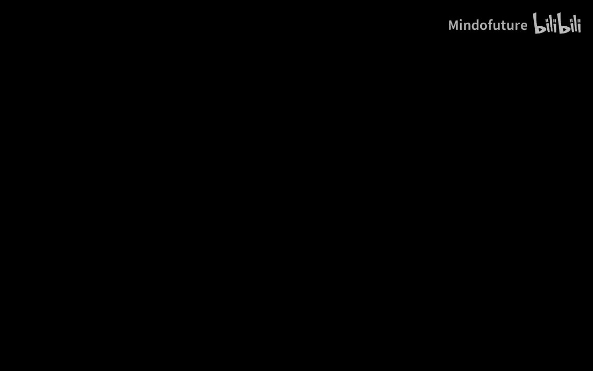
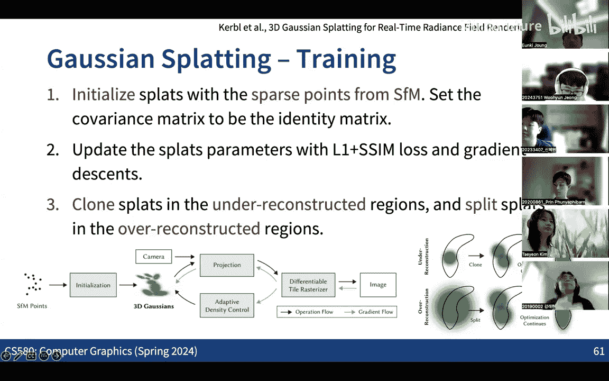

# 【韩国科学技术院】计算机图形学 KAIST CS580 Computer Graphics (Spring 2024) p11 P11 Lecture 12 - Gaussian Splatting (KAIST CS580, Spring 2024) -BV1he7mzjEc1_p11-

Okay， so let's get started with the and split split so last time we started to discuss the problem of the novel synthesisthesis。

 the basic idea is that we have some kind of given a whole of the2 images that are captured from the all different views。

 we want basically synthesize a new image from the basically new viewpoint。And for that。

 the basic idea that was really successful in the Earth pipeline was especially doing some kind of public construction of the 3D。

 but not into any kind of solely form， but into any kind of volume in a way that we can have some kind of flexibility in this 3D construction。

And then for that what we need to do is that we are not using the difficult some kind of rendering equation。

 but we need to actually incorporate some kind of the volume lengthing the equation。

 so that's why we start to see this kind of like the volume rendering the equation here basically basically three components like one is about the opacity which is about like how likely the will hit something at that point at the along the。

And the irregency is basically some kind of emitted some kind of color information or emitted into that specific direction at that point and based on the opac information。

 we are also calculating the transparency which becomes some kind of the nonincreasing function So here basically transparency basically meant like how likely the ray will basically travel until that point without hitting any kind of things so we multiply both the transparency and the opacity that becomes the probability like how the ray will basically know travel onto that point without eating any things and then stuck in there by with some kind of fluid region at the point。

And they also derive some kind of the discreteform like this kind of the integral。

 this was basically converted like this， so you could see that this really becomes some kind of the calculating expected value of the dity the light information with the probably the term here which was basically defined as kind of the multiplication of the transparency and the opacity。

 so this was kind of the basic deformation。And see one thing that I really like to basically remark here is that while this was kind of very recent the paper。

 which was like published in 2020， the basic idea that we are basically hitting some kind of inlic representation for the 3D and taking some kind of the bo boundarying was actually quite old idea So this was actually the case that we are revisiting some kind of some old ideas in the paras in a way that we are integrating this idea the neural net so that we can do some kind of 3D construction with some very place ideas in the compare graphics So this was really nice example and if you can find that there are some kind of the multiple the previous works more than like 20 years ago about like 30 years ago for some of the cases。

They are basically having introducing some different ways to define these kind of the implicit representations。

 so I would like to recommend you to check out this kind of old work。

 so sometimes there are some kind of the hidden gem in some kind of the old work thats they visited and basically get some like shine again in some kind of the recent neural literature。

actually， yeah， so those are already cases that we are only using some kind of impulive representation and after that。

 like the people are started to look into making some kind of the hybrid representation basically combining some you impive representation and the explicit representation So since this is not the neural network because course I'm going to skip some details and briefly just over some data ideas。

 so there was some kind of the previous work which is also utilizing some kind of box the representation so instant GPp was also one of the very famous cases that is basically reducing the computation time of the construction and also rendering dramatically so it was really be able to basically construct some things in some kind of some minutes where even in some seconds in a few seconds while basically taking lots of the memory with some kind of bucks。

And Tri playing was kind of a good tradeoff in terms of taking too much the memory。

 but still basically reducing the competition time for both the construction and also the rendering。

 not hitting some kind of every single box on the 3D space。

 but representing all the kind of quantity the point in these 3D space as kind of the combination coming from the project they point in the 3 the planes。

Like X Y plane， Y Z plane and Z X plane， so like having this kind of defect planes。

 we could basically have some kind of be you know interestingly trade off like when combining some input representation and also the explicit representation。

The point cloud based renderling was also the interesting case that we are basically having some sort of the rough the construction of the3 shape into the point cloud and doing some kind of the same the volume render by the shifting delay and basically checking some kind of the nearest kind of the points along the way so this is kind of also some sort of the base work that we are also going to discuss。

in the garden this。And also there are some kind of researchers are also using the mesh as kind of some sort of the e evolved structure of with the3D shapes and basically adding some kind of the neuraler the attributes over the surface of the mesh。

And the main thing that we are going to discuss for today is basically the split based representation。

 so here basically the idea is that we are now basically having some sort of the some 3D Gausians as kind of the some basic deployment prim tipss so instead of like using the points which only has the position information now we are define some kind of 3D Gausians which becomes some kind of the point and some kind of small volume in the 3D space in a way that they can basically have some kind of the better expressions for these 3DD shapes。

So let's get into some more details about the0 20， I guess most of you have seen this video。

 let me replay this again。Yeah， so I guess many of you would be familiar with this video。

 So this was not just like video that was captured the real scene。

 but actually its really kind of the video by just like navigating some kind of the reconstructed but3 the thing So what they have done is that they just like capture some kind of lots of the images from the some real scene and these some kind of3 construction using theus2 algorithm and then navigating some kind of reconstructionconstruct scenes by just like you know。

Changing the position and the viewpoint。 So it like we really maybe some kind of the the space in the team like we are basically doing this kind of some rendering and you could see that these are like all the rendering in real time。

 So this was the case like having the 16 frame per second in the rendering and also the reconstruction takes like how much a small amount of time compared to not So this was basically very interesting they work in terms of the to reduce the rendering time into like 60 frame per second。

 So which is really enabling some kind of the real time rendering with this kind of the neural net based some kind of reconstruction。

And here the gauge idea is that instead of like using some pure imp representation。

 we are basically heading some sort of the combining some explicit representation。

 which is basically using some kind of ellipseoid as I said in the previous the slide so in the underlying the scene we are heading this kind of some ellipseoid structure。

 if we just directly render those kind of ellipseoid and see those kind of things。

 but when you basically combine some sort of some newer the properties attribute for of the the Gaussians and basically use some kind of the volume and the equation we can get much kind of realistic images as the output。

Yeah， so basically what we want to do what we want to achieve some kind of the neural rendering the pipeline。

 basically we want to get some kind of the very accurate the rendering the outputs。

 basically when we render some kind of things improve some kind of the viewpoint we want to basically match the render the image ground to the image that we have and also the effect rendering is also want to be important part in the neural rendering。

 so if we use the typical of the the pipeline， you can see that actually it takes lots of the time because we need to shoot the array for every single pixelel and need to sample the points over the and basically integrate all the things over the array this basically involving lots of the time for the computationmplication。

So the question is that how we can also achieve this kind of the demand during the speed even in the real of time and also the memory efficiency obesity nerve is kind of good in terms of achieving the memory efficiency because everything is into the in function start to basically incorporate some kind of explicit presentation then typically we have some kind of the trade off so basically have some faster the competition。

 the time we should the case we are also taking the more de memory so here the question is that while having the fast the competition time how we can also reduce the memory consumption so there's also the one question and also how much is is to integrate into some kind of existing graphics。

 the pipeline is on the questions。And for that basically Ga this splitting was kind of algorithm that was basically achieving all these kind of things。

 so the Gaussian splitting basically provides obviously very high accuracy in terms of like matching the case and Arabobs quantum images with the other escaped or the nerve methods and also is super fast。

 which you can see is basically rendering things like taking rendering more than 60 frames of the images per second。

 so it's really fast and also for the reconstruction it' stick much less time to the binary the nerve。

And also it's quite the minority efficient which can be so many many kind of the Gaus and split outputs can be actually rendered even in the mobile devices。

 and also interestingly the Gaus sense plant became very famous in terms of being integrated into many pres。

 the engines into the unity on neural engines for those cases you can see some kind of plugging of the Gaus sense plant now。

 so it's really becoming really popular in many kind of graphics the pipelines。

So it's the basic idea for the Gaussian split so basically the Gaussian split was inspired also by some kind of old work。

 so that's why I'm saying then there can be some also the hidden gems in the main kind of be old work so actually Gaussian split is based on the point based render which was first introduced in the 2001 so there the type here so it should be like southern one。

And at that time like more than the 20 years ago， people actually started to look into some kind of the ideas about the point based graphics in some multiude reasons。

 so actually one of the reasons that why people started looking into the points based graphics is that at that time we started to see some kind of some advances in the GPU the techniques in terms of now the GPU at the time can render like more than 100 millions of the purchase which was quite fast the completion speed。

At the time and if you also start to basically describe all the kind of details of the 3D shapes。

 then only the triangles becomes very small so here that question is that like instead of like using the triangles in the mesh。

 all the puzzle to basically utilizeize some different types of the print chips for the for3 de renderanderaring so especially in a case that when you can basically handle lots of the purposeses。

 why don' you just directly use the the points instead of like having the faces。

 especially when you want to basically describe all the details。

 so these was like if they want to be the questions that people had at the time。

 like why don't you just use the points instead of the mesh the faces。

And also what we started to see at that time was the like people started to have some really good 3D scanner。

 so these are some kind of the outputposts of like we're rendering some kind of the scanned the object。

 so this also also the very famous project at the time， which is the the Michel and project。

 which is really basically 3D scanning some kind of the statue like the data picture here by the Michelze it's kind of like idea like when we are converting all this kind of some digital the object into some kind of the some digitized kind of things。

So you could see that as at that time like people just made this kind of giant discrete scanner。

 which is really giving some very high the accuracy。

 so it's really like capturing this like five a meter the statue with the 0。

25 millimeter the accuracy， which is really accurate and capturing this kind of entire the statue with the full mill de points。

And then here the question in the graphics was basically how we not best handle this kind of the very high resolution the point cloud so if we also start to convert this into dimensionary it'll take lots of the computation time so the question is like why don' you just directly render this kind of point cloud so that's like the case like stimulating the idea of the point based the graphics。

So I also recommend you to us check out this kind of the old work。

 even there was kind of the conference or the point based graphics and lots of the research at the time。

 you can also check out some kind of the course note describing these kind of some new techniques。

So the base idea in the pointbased rendering is that we are basically heading the points as kind of the samples over the surface and each of these kind of the points will basically describe the geometric information and also include some kind of some reflectance the properties like some kind of big or something。

 but obviously those kind of points are not providing any information about the surface so there's no kind of the connectivity information and also there's no texture map or the maps or any kind of the surface information。

So and these kind of the points are basically called as kind of the surface argument or sub or basically you know surface spread as well。

 so they are basically some multiple deter that hold is kind of the point。

So the basic Excel field basically to increase the information of the position and also the color information and here the question might is that if we only have some kind of a set of the points where each of the point only has the position or the color information using this kind of point cloud of basically how are we going to basically do some kind of the rendering right？

So basically when you do some kind of de rendering。

 we do like to assume that there is some kind of disurface information， right？

And then basically if you want to do some kind of random with the surface information。

 these kind of the circles basically need to be interpo in some kind of regions。

 so which means that the circle also should have some sort of some kind of the surface area information。

So also people started to basically extend debate kind of the components of the sub into the disk。

 basically having the position and the color and also defining the mu and also the radius as well so in terms of like fitting each of the point as kind of the disk then what we can see is that now we are fitting all these kind of like points as like having a set of the disks and replacing the triangles with the disks in terms of having the disk as kind of the the primitives or the render and then we can basically use the typical kind of reation or the weights the pipelines with these types of the primitives。

So this is the picture I here。And these subles were introduced in the like 2001 or something and then also revisited in the recent of rendering the literature。

 so this was also one of some sort of the all work using the surface display split splitting kind of the idea in terms like doing some sort of the 3D the construction with the differential of the rendering the pipeline。

 so you can also check out this work。But the basic thing is that in the success of the nerve what we could see is that it's better to represent all 3D thing not into the surface but into the volume so that's why we are also using the volume render right so here the basic idea is that instead of like when we have some sort of the volume spread instead of the surface spread how we can also utilize this volume spread in some kind of the volume rendering the pipeline so this is the basic idea in the Gaus and spread why also there are tons of some kind of engineering tos like doing some real this3D construction。

So whether we have some kind of surface split or like the volume split basically utilizing this kind of display split and having some hybrid representationation is good in terms of that there are some kind of these two major other bands the first thing is that when we have this kind of some explicit the primitive we can directly use the re in the pipeline so we don need to shoot a array and sample the points along the array and the spin ideally some kind of input function to look up all these quantities so what we are actually going to do in the gaus and split the pipeline is that we are going to really like render all these primitives into the 2D plane using some kind of the re the pipeline and then do typical kind of the process in the re pipeline so this is good in terms of that we can really reduce all this computation time and also we can utilize the typical the bracket the pipeline we all the shadow language of things。

So this was kind of one of the the advantage in terms of the reability reduce the computation time。

And also the other kind of being major， advantage is that so you know for all this kind of being learned on the pipeline。

 we need to basically have the camera pose information right。

So here we all assume that given a set of the images。

 we have the camera post information and do some kind of restricted construction。

And here the question might be is that how we obtain this kind of the counter pose information so for that we are using some kind of the algorithms in the promotion。

So we are not going to go into some details for this software， but if youre also interested in this。

 you can also check out the lectures in the Multi learn per data of course。

But actually the thing is that as the output of the structure flow。

 we are not only getting the camera close information for images。

 but actually the intermediatem steps in the the structure for basically involves like finding some sort of corresponding pixels across the images and shooting the ways to find the intersection point in this 3D space。

 which means that actually as the output of the structure for。

 we are also having some kind of some sort of 3D construction。

 but which is basically becoming some sort of dispersse the point plot。

So this partity point cloud itself is basically not useful to directlyfully let PD be rendered into some kind of real images。

 but still this kind of sparsity point cloud can be useful as some sort of the initial the volume of display plan so that we can start to do some kind of activation with this kind of initializationization。

So here the major advantages like having this kind of using this like split data representation is that we can utilize this kind of be some sparse point those coming from the structure flow as kind of the initialization。

 so we are starting from some sort of some rough so construction and basically doing some kind of the refinement over the opttimidation。

 so this also basically allows us to basically achieve some speed construction more basically faster away。

So these are basically with some kind of measured advantages having this kind of split repation。

So yeah， then we here the question might be that know we perhaps on this kind of a set of some sort of be bulling display thread so how we are going to basically render all the things into this region some kind of volumement equation so this is kind of the main part that we are going to discuss for today and before we move on do you have any questions on this。

なこです。So actually the main thing that we are going to discuss for today is basically how we are going to define this kind of the volume split and how we are going to use the volume rendering equation in terms of doing some kind of the rendering and for that we are basically going to follow some kind of the ideas in the old paper。

 publishing the 202 so you can also check out some more details for deform in this paper。

 but we are going to go step by step in this old work in terms of how we do some kind of volume rendering with the volume display split。

So let's first see like how we first define this kind of the volume split。

 so we are going to basically assume that each of the volume split basically have the opacity information and the color information so these are basically something that we are basically itrating within neural network of the in function right。

 but now we are assuming that each of the this kind of the volume here。

 the volume split which looks like some kind of ellipsoid is basically including the opacity formation and the color formation。

So for the basically the color information， you can define the color as kind of some constant value for of the volume spread。

 you can also make it as kind of the view dependent on the information。

 then it's exactly following the nerve， the equation， and some sort of the radiance information。

So the difference with the nerve is that in the nerve those kind of the quantities were basically returned from some kind of linear macro as kind of implicit representation。

 so now we are having the explicit the opacity and the color information which are basically encoded vertical display。

And additionally for each of the volume spread， we are basically hitting this kind of the elliptical somegaussian on the。

 which is defined with the center point P and also the covariance de matrix degree obviously it should up the ssymmetric d matrix。

 so we are basically in the 3D space hitting this kind of the position the center point and also kind of the 3 d axiss defined some kind of local coordinates and also the scale information which are basically defined with the covariance de matrix。

Makes sense。So given this kind of the center and the co matrix。

 we are going to define the ellipical the Gaussian corner like this。

 so this is really making some kind of the some the ellipseoid shape of the Gaussian the corner。

And basically， the meaning of this kind of the Gaus economy。

 especially is calculating some kind of the amount of the influence from given the border display to the annually point in the SwD space。

So it becomes some kind of the weight information or any point in this 3D space。

 how much of each of the volume spread will affect that point in the 3D space。

 so becoming some kind of the distance space sort of the weight information from this split to any of the point in this 3D space。

Makes sense。So we are going to have lots of these kind of the you know the volumeium splits in this3D space。

And what we are going to do is that we are going to rest all these kind of calciums split from the object codinging system into the rate codinging system。

So these are also the things that we have seen in the second lecture like having some kind of less right the pipeline。

 we are having some kind of the model with transformation and also the project of the transformation so the object coordinates is kind of the these schools called the world coordinate but every time we you change the dec camera course we are having some kind of the new some sort of the camera that coordinates the system。

We are also convert to this into the red reporting system that we are also going to see in the next slide。

对。So we are going to have these notations， X is for theoc coordinates and every specific the model will the transformation converting the objective coordinateness into the camera coordinates。

And G is the projections transformation also converting the camera core things into the ra coordinate this。

 so please check out this kind of notation that we are having here。

So here basically what do we mean by basically re coordinates so this is basically nothing but having some sort of the projective the transformation of projecting all these things in this 3D space into the 2D。

 but the only thing is that for this the project transformation we are having basically this extra time。

 so as you can see the first two companies but nothing but projecting the 3D things into the 2D deco coordinates。

Obviously we can have some different to be projected the transformation。

 but let think about the simplest case， we are having this kind of like simple projection into the through space。

 but it's kind of extra coordinates， we are just having this like this stuff so this is kind of like some small difference with the typicalre pipeline that we are seeing in the framework right。

So yeah， so this is our definition in this simple speech case that we are having this project transformation of projecting 3D things into 2D and having one more basically coordinates which is about the distance。

喂。So here also one key thing is that so we are defining the center point and the cos matrix for every single the gaus and split where the volume spread then here the question is that where do we in which space we define those kind of things obviously that those quantities we will be defined in the object coordinateording system right so we are having some kind of the word codinging system and every time we basically choose the the camera de we are going to determine the camera coordinateing system and the red coordinateing system so which means that for every gaus and split we are going to first define the center point and the cos matrix in the object coordinateording system。

Right。So it means that if we want to compute this corner for any kind of point。

 if this point was specifically presenteded with the objective coordinateing system。

 then we can compute this right。But if the point was that we're having the rate coordinates。

 then we will need to first convert this into the camera coordinate myth and the optic coordinate myth and calculating this。

いいで。Just nothing but just changing the coordinate system。

So lets you know keep this in mind that we are having this notation。

 so x basically indicates opt coordinates， x plane indicates camera coordinates and x double plane indicates like gray coordinates。

So depending on where we are basically defining point in which coding system。

 if you have the you know。Point define having some kind of red coordinate coordinateines like this。

 and you will need to convert this back into the object coordinates first and then calculating this kind of the Gaussian counter。

喂。And quitで。So please keep this know in mind so we are moving on to slightly more complicated kind of things but so let's see so given any kind of to the pixel X Y with the X Y coordinate in the gray coordinate system。

 now wed like to compute the volume and equation。So this is exactly the same equation that we have seen in the nerve right。

 were having the coline formation opacity and the transparency and the transparency was defined with opacity like this。

So instead of having a time， we are going to now have the distance from G here and this distance by definition of the our the coordinate system。

 this distance becomes the Z coordinates in the array coordinate。

So given any kind of the 2D pixel defined with the X， Y coordinate。

 we are shooting the ray along the Z axis， basically having the Z coordinate here。

 and if you combine this X， Y， Z that becomes out of the array coordinate。嗯。

This is nothing but just having the same theing equation。

Now here the question might be like how we calculate this color and the opacity information with given the set of the volume this class。

So given the set of the volume split， what we are going to do is that we are going to define opacity as the weight is sum as follows so the only thing is that since now we are having the points which is defined the red coordinate system we are calculate weight which is defined with the the gaus and kernel like this one。

 so we are first sending this kind of the point the the red coordinate system into the open coordinate system that we can calculate the weight we to influence from which the split into any kind of point in this with space。

Then basically the opacity is perulated as kind of the weight sub according to the balloons play。

ああ、いいディスク。So you can see that I just like introduced some kind of the new G prime。

 which is nothing but just like rewriting this part like this。

It's just like making some sort of simplerical， right？

And also basically the multiplication the color and the opacity will be also defined as kind of the wism as follows。

There some kind of approximation that you know all the Gaussian split is some kind of the constant color along that direction。

So these are basically some sort of our the definitions of the opacity and the multipl kind opacity color here。

So just keep this mind then were having some new notation。

 which is basically calculating weight for the point in the array coordinate system with some kind of the Gausian the color defined for each of the the display for the ice display。

 we can compute the weight like this by just speeding you know。

One is defining the red reporting system。Then here the question is that can you then rewrite the volumeary question by replacing these parts like this and these parts like this。

 so let's do some kind of the exercise。Beermen get the results like this。

So we are basically kind of like taking the color and the opac tone to be constant for it to be this plate while basically during the quantities we evaluate weight which is defined with gauss and color here so in terms of that we can rewrite these things like this and also this is the case that we are yeah also know replacing these two and also instead like taking the explanation of like minus sum of these things we can change this as like taking the product of the explanation of some kind of quantities here right。

So we just like rewrote the preliminaryary equation like this and we would like to further like simplify this equation with some kind of assumption and also some kind of trick so there are basically some kind of the assumption and the app and main kind of things which means that it does need to be simplifyimplified in this specific way。

 but let's basically see the exact deform that was introduced in this specific paper Well first of all。

 basically we are going to introduce some kind of the new tone which is basically indicating integralgo of the Gauss split along the array direction we basically take the integral the Gausian split along that specific array direction to the end of the way then we're gonna to basically get this quantity like defined like this just to simplify theform we are also going to use the first order the exponential expansion to simplify the exponential minus x kind of approximating this as kind of。

Oneong minus effects， so this is also kind of the approximation。

And also basically one big assumption that we are having is basically the assumption of the local support and the zero correct across the volume displayplace。

So what we are going to assume is that we are first assuming that all the apoum splits are basically sorted in the best order。

 that the first one is the closest one and the last one is the hardest one。对。

So any kind of a point in the3D space， what we are going to assume is that if the weight from the ice。

 the volume the display is non0 is basically greater than the zero。

 that we are going to assume that the weight from the next display after the ice display becomes zero。

So which means that if we are having any kind of de point。

 which is basically affected by like one of this plan。

 and we would to assume that all the other be displace， which is like coming to next。

 are not affecting to this point。So this is to be some kind of very strong assumption that we are going to utilize to simplify this equation。

So in this equation， what this means is that if this value is basically not zero。

 basically we are having some kind of the influence from the ice flag to this point。

 that what we are going to see is that basically this quantity becomes zero because there's no effect for here。

So this means that this whole time becomes zero and we are just taking the exponential zero and we the one right。

 so this is the very strong assumption that we're going to utilize。

So given this kind of the three kind of the definition and the approximation and the assumption。

 we are going to also see the simplified the version of this equation。

 so let's rewrite this equation again by having these kind of things so we are replacing this like this and also having the approximations and the assumption here based on that we rewrite the equation what they kind of be some simplest form development together。

Also here one quick thing is that if we are like calculating this equation for the point x do plan here。

 which is for the I split， and if we calculate this term in the exponential for any kind of the previous day split。

 becomes the same whether it take the interval of this term over the entire three or until this point because we also assume that the previous split is not affecting to the points。

 which is like affected by the next split， right？So maybe you can go one by one。

 so from the local assumption， what we can do is that we can replace these to be I right。

Because like for the split after the I1， the basically distance here。对。

Actually you can see my mouse point this time in the green box will become zero。

 which means that exponential of zero becomes one， so we can basically ignore this kind of genre。

We can first replace this to be I， and then we can also replace this to be Z max。

Because for the all before this plate it the same whether taking the integrals to that point or taking the integral over the entire period rate from the local dis support assumption。

So one thing is that you might be confused that we are having the x double prime time here。

 we are taking the while taking the interval D z， So actually here the x plot prime is the you know ray coordinates which is having the X。

 Y z coordinates so we are taking now integral over the z axis right。

So then now we can see that like we are replacing this to the eye and when we have the Z maps。

 then we can simply like rewrite this part with the Q item that we introduced and we can also do the same thing here as well。

And then we are also replacing the exponential minus x， approximating this into the1 minus x right。

Then what we get at the end is basically we are having this kind of talk so we replace the sorry n the I minus1 sorry and then we are also replacing this to the G max so that we are into having the Q j and also the Q item and then approximating the exponential the minus x as kind of1 minus x like this。

So this is the very basic equation that we are using for based on the split based in rendering。

 obviously you can see that there are lots of kind of assumption that is basically involved here。

 so which might mean that we can also introduce some kind of the new equation。But until this point。

 do you have any question like how we we receive your question？

So what we can see is that we are having the color thumb here and the op thumb here。

 which happens basically be some attributes defined for each of the Gaussian display and we are also having the function defined for each of this。

 which is taking the ray coordinates and between some kind of the weight the top here。

Any questions on this？Yeah， I guess you know if you okay the following all this equation。

 then here we the question is that how we exactly calculate this cube al right。

 which was be the case that we are taking the integral along some kind of line passing through the ellipsite like this some elliptical decoconor so when basically at this kind of subllipical decoconor。

 the Gaussian corner defined with the center and the coer matrix。

 how we are also going to compare this。mean yeah， so this integral2 basically what Im going to do is that to like make it easy to calculate this integral。

 now we are going to approximate this term as kind of some sort of transformed the Gaussian the decoconor in the ray coordinate system。

So these are the cases that we are having defining the Gaussian corner in the object。

 the coordinate system with the center point and the covariance。

 but by basically transforming this kind of the illoid into the array coordinated system with transform the center point and the cosB matrix。

 what we are going to do is that we are going to approximate this kind of the economy of the output with basically the economy the competition。

 the array coordinate system with some kind of the scale indicator the vector。

So this is what we are going to do so let's do this like step by step。

 so let's firstly like how we can do this from the conversion to the object coordinate。

 the carbon coordinate first。So like when we at this kind of you know。

 the point defined in the object space， now we are going to like you know you calculate the same beam with this kind of like the weight competition in the counter coordinate system with kind of a scaling factor。

So let's do this first， so how we define the multiple grid transformation。

So typically in the multi transformation will be basically defined as kind of the off transformation。

 which is that theyre having the linear linear transformation here and also the translation rate。

So when you define the mod transformation kind function， denot as the F here。

 the app will becomes DW x plus T and then no the inverse conversion。

should be the convert from the counter coordinate to the O coordinates will be defined like this。

Then based on this without any kind of deviation， let me first show that no so now we are going to transform the center and the cops like this。

 so let's say like this is kind of the transform center point in the camera cooling system and the B prime is also the cop the matrix defined in the cameracoing system these are all defined like this。

And what we are going to do is that by like competing this no corner in the chemical cooling system。

 we are going to see， what's this killing factor in a way that the weight that we are competing the chemical cooling system matches the weight that we are calculating in the old cooling system。

So given this definition of the P plane and the B prime。

 there's be some transformed positionally co matrices in the came piece。

 what should be this kill in the C plan here？So let's quickly calculate this。そディジャースを変えのできん。

So also the way that how we calculate this is that we know how we can define this， right？诶 we can啊。

We know like how we can calculate this is kind of the。Inverse of the model transformation。

 we chose the pilot kind of length。Inverse points。嗯，マナ。

So we can just successfully simply plug in this。Into this equation。诶思维哋嘅。So okay。

 as we are running out of time。 So let me first move on。

 but you can also check out some more detailed formulation。

 So this is basically nothing but we are just1 plug you know， peace。

The imverse of the body of this transformation into the x and also the P here。

And what we can see after like all the de is that it becomes like calculating this weight becomes the same that we are calculating the weight with the transform no。

The central point and the co the matrix defined in the camera decos。

 then we will need to basically multiply this kind of the killing term。

 which is basically coming from some kind of the killing part of the linear transformation。

 so which means that there was no scaling only rotation in the or the you the multiple transformation。

 there is nothing that we need to basically multiply here as' kind of scaling term。

But basically here the basic idea is that if the transformation was basically a or fine transformation。

 we can basically simply like redefine defining the same the gause and the corner in the new space。

 we did some transform theent and the propium the matrixrices and co the matrix and then basically multiplying this kind of the killinging the vector。

So this is kind of the door。But here the problem is the like for the next step for the conversion from the camera coordinates to the rate coordinates how we can how can it do the same thing so here the problem is that this transformation is not a fine transformation but actually the project transformation so actually there's no way that we can define the same you know some kind of e Gauss on the corner that will basically give some kind of the some sort of the you know。

The company the Als with the camera coordinates。 So what actually we have done in the previous case is that we are defining some kind of the same the Gaussian corner in the camera coordinate with some kind of a transformation。

 but in this case like when you have some kind of project transformation is impossible to define the same the Gaussian corner as kind of Gaussian corner in the new space。

 So what we are going to do is that we are going to approximate the project transformation as kind of the a or transformation for little display。

 So this is kind of like done for every single display and let's think about like this specific the simplistic case or like having this specific the project transformation。

Then what we are going to do is that we are going to approximate this project transformation using the first order detail expansion。

 then we get this kind of some sort of the approximation for the same the project transformation。

 right？But what we can see is that this becomes like having some sort of the transformation depart and also the linear transformation。

 and this linear tense transformation is best defined as kind of the Jacob and the images。

So we we basically calculate each aion gene matrix of the specific transformation that we are having this specific each aion gene matrix。

And we previously compute the first little detail expansion called the center point。

Or the display in the camera coordinates， then we can see that the given the project transformation can be approximated into this point。

 still having some kind of the linear transformation。And some kind of de transformation， right？

So in this case that we when have some kind of linear transformation and the transformation。

 we have seen like how we can also calculate some transformation of the center point and the coV matrix and also the killing factor right。

So for these specific keys like having this linear de transformation， the transformation。

 can you basically also answer like what should be basically on the transform center point and the equis and this killing factor here？

So previously this linear transformation was W and the translation was simply T， right？

So when you have the linear transformation W and D T here， then he。Bying was basically W P plus T。

 and the B time was。嗯W回 w。啊，那不是。So if we do the same thing， like if we now define the speed of line。

 then this becomes like， no， we just plug in P line into this equation。

If you just plug in P plan into this equation that these two will be canceled out。

 then the PO plane will become GP plane。And also， when you have some kind of the pre plan。

 the pre plan will also become JI like pre plan and JI I suppose。

Just following the exactly same thing that we have done in the previously transformation rate。

So that means that we are going to have this kind of the transform thes。

 the center point and transform the co the matrix and the scaling tone from the converter from the camera coordinates to the array coordinates。

So if we combine these two， like from the object coordinates， the rate coordinates。

 then what were going to see is that now the P top can be defined like this。From the central point。

 defining the object coordinates to be kind of the pointing the ray coordinateing system。

And also the covariance will be also converteding like this， multiplying demetrices like this。

And then these killing factors will be defined like this。

So here the thing is that W was the linear transformation part coming from the model of the transformation from the K course。

JI is basically the Jacob the matrixs that we are calculating for each Gaussians plan。

So by multiplying those kind of quantities， now， what we can do is that if we come back to this equation in terms like how we are going to calculate this。

Or is some kind of the the Gaussian threat defined in the array coordinate system。

 then we can basically replace approximating this part into。This formulation。

 we transformed the center point and the transformed copious matrix defining the red coordinate system。

Then we are basically having this with the transform center point and the transform the variance here then once we basically have all the satellite transformation。

 the good thing is that this integral becomes nothing。

 but just like taking the integral along the G axis so we can just ignore the x and the Y axises just taking the integral along the G axis。

 then that becomes our kind of the answer for like calculating system。Andにこえちゃそんです。So yeah。

 so basically as you can see involves some kind of be slightly complicated some equations。

 So I also recommend you to check out this so when you typically talk about the Gaus and split like people don't speak about like this kind of some underlying some calculation is more of some kind of engineering but actually if you start to look into some more details of like all this equation that you can see that actually this involves lots of kind of some approximation or some kind of assumption so this might mean that we can also into some kind of the better equation like calculating all this kind of borderandering equations using these splits。

And here like one quick question is that when do we need to update the center point and the the images。

 the transformation like those things。You can see that actually this equation involves the W part and also the。

 So these are basically also coming from the camera pose。

 So which means that if you have some kind of the rotation of the camera pose。

 then you need you will need to basically update all these kind of quantities but not for every single the for given the set of the gauss spread So rendering the pipeline。

 what we need to do is that once you have some any kind of the camera pose。

 that every single the pixel， you will first need to collect all the set of the subset of the this that is basically falling into that specific pixel。

 then we will need to sort all this kind of split based on the depth the order right and then we are calculating this information。

 we given the specific the camera the and then we are calculating the render equation So these are the kind of some procedure that we are doing some kind of the rendering the pipeline。

And if you also see how we exactly train all these Gaussian split I also recommend you to check some details in the paper。

 but we're going to basically initialize this plate based on this part of the point cloud coming from the structure promotion with some kind of isorop the co matrix and then basically updating all these kind of split parameters using some kind of the loss and the backward litigation and there are also some kind of steps that we are also cloning these plates for some kind of the under reconstructed regions and also splitting this place in the over recon regions so there are actually lots of the engineering in terms like how we can invest in kind of some kind of defining the outputs。

Of this we did construction。So today we dig into some kind of some details about how exactly calculate this preliminary equation with this square in our the the gas structure。

 I guess we're going to see some more kind of the higher level ideas in terms of how we can make some kind of better the reconstruction and the rendering the systems。

We're going to also discuss some of the papers in the paper presentation based on the Gaus split。

So until this part until be go and spread， this will be the scope of the meet term we are going to have the meet term next week。

 so if you have any questions about the meet， any the materials then weiscus offer。

 please post the questions in select and we can also go over with the questions。Any questions？Okay。

 so yeah， so this is the end of the2' lecture and as I said there is no lecture this Wednesday and we're going to have meettown next week and break for the week after the mid and we're going to resume the lecture on April 29th so I will you the last week of the April。

Thank you， Mike。

