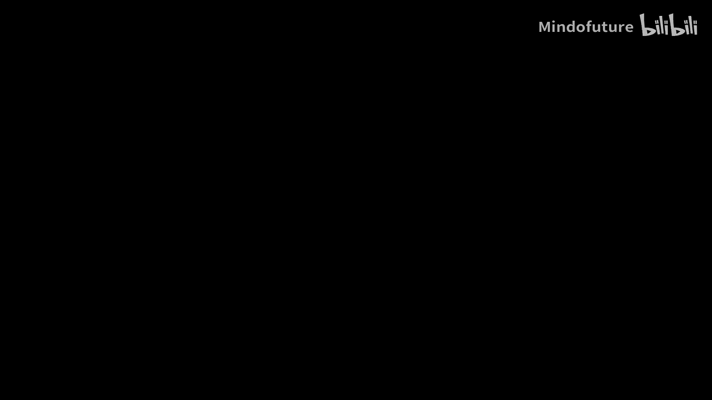
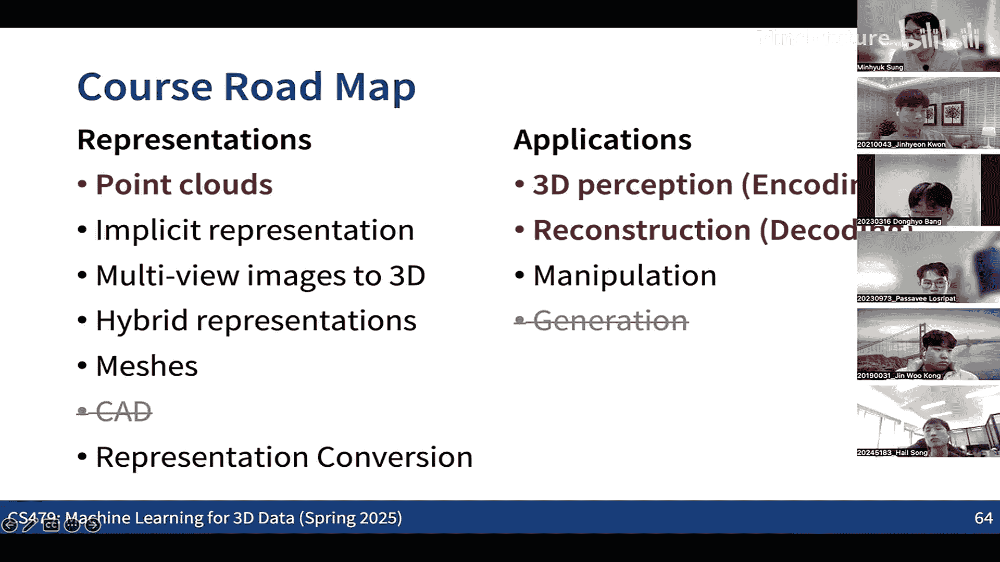

# 【韩国科学院】机器学习3D数据处理 ｜ KAIST ｜ CS479： Machine Learning for 3D Data p01 P01_Lecture_2_-_3D_Representations_(KAIST_CS479__Spring_2025) -BV1YmuBzTEmx_p1-

Okay， so let's get started with the second lecture for the emotional first3 detailtator。

So last time in our introduction we briefly discussed some of the applications of the 3D data。

 so we could basically class all the applications into three or the four kind of categories while there are also many other applications as well So some of the applications or basically like one thing was basically the big construction。

 which is basically replicating the real world the objects or the scenes from some kind of the sense data。

 the sense data can be some kind of 3D scans or some kind of the multi view images and making this kind of some 3D constructions。

The other application can be some 3D generation， which is not re constructing something from the real world information。

 but basically making some 3D objects or the scenes from scratch。

 So these are some of the examples that we are basically making some kind of 3D models without basically having any kind of the real world information。

And the other the application can be 3D perception。

 which is not obviously making the 3D as the output。

 but taking the 3D information as input in terms of like extracting some kind of the some perceptual information like detecting the objects and also tracking some of the objects there and basically understanding all the things in terms of the some 3D environment and these kind of techniques can be typically use useful in so many contra and the robotics。

 the applications。So speaking to these kind of the applications。

 so what we are going to discuss in this course is basically how we can make some kind of the techniques that can be basically applied for those kind of some the downstream the applications。

 and for that， we are going to discuss some kind of the ideas in terms of like how we can make some kind of the deep learning the techniques。

 especially some kind of the neural networks。And when you see some kind of the many different types of the neural networks。

 those kind of neural networks can be largely basically you know。

 classified into the two types of the networks。 like one can be encoder。

 which is basically taking the 3D data as the input and making some kind of the different outputs。

And the other my is basically the decoder， which is now producing the 3D data is basically the output。

Then for those kinds of the applications for this video perception， reconstructioncon。

 and de generation， what types of the networks would be needed。So no。

 please post your the answer in the Juneoo chat。So when you think about some kind of the applications like generation。

 where the perception， where the reconstruction， do we need like either decoder or the encoder？

So you can answer those things for each of the application for the consumption and the generation and the perception。

 do you need the incoding network or the decoding networks， so please send the message to me。我你不认。

So basically， depending the application， we would need some kind of the different some kind of the architectures。

 right， for some kind of the applications like no reconstruction or degeneration。

 we definitely need some kind of networks that can produce DVD data as the output。

 So those are some kind of cases that we need some kind of the decoding network， right。

But for this weighty perception the task， we would need some kind of networks that can take this ratey data as the input。

 So those are the cases that we are we need some some kind of incoing the networks。

So the things that so in this course， we are going to discuss like some different kind of neural networks that can either include or decode some kind of the neural network some 3D data。

 and we can also combine some think about some kind combination of the includinging and the decoding the architectures that will be auto to encode。

 and we are also going to discuss that。 but those are basically some kind of some kind of the big classifications of the neural networks about the 3D data。

So as I mentioned last time， so we are going to discuss some kind of the different representations。

 like a point cloud， like input representation， the multi view， many things。

 and for each of the representations， we are going to see like how we can design some kind of the encoding networks or the decoding the networks and based on those kind of architectures。

 we are also going to see how we can apply those kind of the neural networks for those kind of the different applications。

So that's the main think that we are going to discuss in this class。

 and let's get started with some kind of discussion about the3D representation。

So the reason like why we discuss this really representation is that basically if we think about like making any kind of these softwares or especially some kind of the neural networks that can process some kind of the data。

 the thing is that we need to somehow represent the information that we have into some kind of the numbers。

 some nu some representations， right。So let's think about that like we are making that basically not having some kind of3 data。

 but something like one dimension things， for example， like the， you know natural language。

 So let's think about making some kind of NM。Then we can basically treat some kind of detect text information as kind of the one dimension of the information。

 right， basically having some kind of the words。But given this kind of the text。

 how can you basically represent the texting into the numbers。

 have you learned about like some kind of the de weighted and how we feed the text information into the neural network。

Any thoughts on this？So I'm just like。Testing， like whether you have some kind of debate basic knowledge about some kind of the deep learning。

If you took any kind of the deep learning course before。

 then you might have some kind of the idea in terms like how we typically represent the text into some other some nu representations。

So yeah， as you would know， I guess， the typical idea to represent the text is basically。

 you know dividing the text into some kind of the words that we also call the token。

 So that's the process that we call like the tokenization， right。

So once we basically know split the entire detect text into the a set of the sequence of the tokens。

 we also basically map each of the token into the a low dimension detector vector。

 which is through some kind of the embedding the process， right。

So that's basically the weight that we are basically having some kind of the some nu representations for the text in terms of like splitting the text into the a sequence of the tokens and mapping each of the token into the some low dimension vectors。

 So all the text will be represented as kind of the set of the vectors that basically become some kind of the2 d the matrix rate。

So this basically information is fed into the neural network and then doing some kind of the processing and also for some kind of the test like the generation。

 we can consider generating this kind of sequence of the low dimension some kind of the vector and basically mapping these into the tokens。

 So that's kind of be some typical representation presentation of the text to feed this information into the neural networks。

So this is the one case。 So what also do we do for the2D images。

It's also very common to see some kind of the neural networks that process the two images， right。

 So how do you also， you know， represent a photo into some kind of some representations within numbers。

Yeah， so， I mean，2 images are basically the same。 So this is basically some kind of the2 d some great information。

 So we treat basically all the images as some kind of the you know， a kind of the set of the pixels。

 right， So pixel basically means the the picture element。

 which is basically some kind of the one point in the2 image of space。

 and we basically see a photo as kind of the2 degree of the pixels。😊。

And every pixel basically has the color information。

 which is typically represented as basically RGB3 channel information。

 which means that we have the three numbers for each of the pixel。So which means that every image。

 it will be represented as kind of the 2D matrix， but actually it's kind of the 3D tensor in terms of that we are adding one more dimension for the RGB color channel。

 right， So we are having the width and the height。 And for each of the pixel。

 we also have the another the dimension for the RGB the color channels。😊。

So all the images will be represented as some kind of 3D tensor。

 which will be also fed into the our neural network。

 And these kind of some great the representations for the2 the images might be kind of the ideal representation to apply some kind of the existing。

 some kind of the you know， neural network layers， like some kind of convolution operation or the transformers。

So given this kind of the 2D great representation， we can easily apply some kind of the convolutions in terms of doing some kind of locality operations。

And also， know， we can also apply some kind of ideas like the transformers。

 The idea of the transformer was also basically dividing the2 degree grid into some of the local depatches and applying some kind of the attention mechanism。

It is clear。It is like too fast to answer the questions where。So basically， yeah。

 this will be how we're going to have those kind of lectures。

So I'm going to ask some kind of the questions and you will need to basically answer those questions in the Jim chat。

可以。Yeah， so those are some kind of the basic idea in terms of basically how we know handle some kind of the one D and the two dimension data some kind of the text and the images and also kind of audios and many other things can be basically processed into this way。

 basically some kind of the one degree or the two degree kind of things。

So given this kind of some the techniques to process some kind of the oneデ and the two dimension data what to be kind of the best way to handle some kind of the three dimensionリ data。

So what we kind of be some， you know， most straightforward kind of extension from the 1 D to D to the 3D。

Obviously， it's some kind of a straightforward way to extend those kinds of things into the 3D grid。

 3D data will be basically having some kind of the3D grid right。

 So as we have some kind of the2 d grid4 the images having the picture element。

 basically having the element in the matrix， we can also consider having some kind of the volume element which means that we are having the 3D grid of the box So in the cases that we are having the 3D grid each element of the 3D tensor will will be called as the box。

 the volume element。😊，Then once they have this three grid。

 then we can basically apply all the information the we have used for the one day the2 data in terms of having some kind of the you know convolution operation or some kind of transport or many other things。

And this kind of the approach can be especially useful some for some kind of the medical data。

 so actually， many kind of the medical data are also represented as some kind of 3D data。

 So if you took some take some kind of the CT scans or the MRI scans those are basically provided some kind of 3D some volume of information。

 basically know giving some kind of information about these some kind of human bodies。

 some organs right So for those kind of cases， since we really have some kind of the volume information。

 we can really consider representing all the things into the 3D grid and also applying the 3D compvolution。

But what of the issues， like when you basically apply this kind like 3D convolution for the other types of the 3D data。

 especially for the cases that when you scan things when when you have some kind of 3D models。

 What are be kind of the issues。 when you apply the 3D compvolution。 So that's the first question。

Yeah， obviously， the issue might be that it's like computationally like too expensive。

 but what kind of the things that we are going to see is that while there are some cases that we really need to have some kind of the volume the information for many of the other cases for many applications。

 especially like when you acquire some 3D information from some kind of 3D scans where when you have some kind of 3D models。

 the issue is that mostly we are basically interested in not the kind of the volume information。

 but the surface information。 So from the 3D scans。

 typical 3D scans like what we get is basically some kind of the information about the points over the surface of the kind of objects。

 but we don't know about like what we have inside of the object where we don't even care or like what we have inside of the objects。

 that's also the same for the things as well， or the scene like most of the places in the3D we will be empty there is no information that we are ind。

In this kind of the empty space。So that's kind of thing。

 So you basically know encode all the this kind of some surface information into the some kind of the volumes。

 The thing is that many of kind of de box will be kind of the empty deboxs。

So there are also kind of the bunch of the ways in terms of how we know you know encode all this kind of3 information into the boxes like one way is that we are basically ining some kind of the occupancy information。

Like which pixelels is basically inside where which pixels are locatedcating the outside， right？Well。

 the other way around in terms of basically includingcoding the surface information is that we' are also checking what are the boxess where the surface is basically passing。

 right？For those cases， we can basically encode the boxes。

 like having the kind of surface as's kind of like one where the other the boxes is kind of0。

's includingding some kind of the empty boxes。So then in this kind of the case。

 like what can we see is that， if we see this kind of the figure here。

 especially like as we have some kind of the higher resolution。

 we can see that actually very few amount of the fossils are basically， you know。

 the fossils where the surface is basically passive。😊。

Which means that this becomes really inefficient representation in terms of the many pixels becomes like empty。

So as you can see， as we for those kind of chair， as we increase the resolution from the 32 by 32 by 32 to the 1。

28 D  cubbit， we can see that the number of the boxes where the surface is passing becomes less than 3%。

😊，So here， the question is how regulation is defined for the boxes。 Well， I mean。

 it's the same as the images for the images。 we can also have like 1，28 by 1，28 the depicts， right。

So as we define the pixels， like define the resolution for the2 images。

 we can also define the resolution in the3 as like having like 1。

28 boxes along in one dimension and the another the 128 the pixel in the other dimension and also the same of for the third dimension。

So that's basically the way that we are basically dividing through this piece into the smaller debus。

 right？The one see basically dividing the this space into the small pixels。

 you please see how many pixels are located on this this surface。

 We can see that actually only like less than3% is basically having the dis surface information。

This is even the case that when the resolution is like 1，28 or the  cubic。

 which means that still this is quite no low resolution。

 not basically capturing all the fine details the given the shape here， right。

So which means that as we increase the number of the kind of resolution， the number of these spells。

 deboxoxs located on the the surface will be will become much more the spae right thepersrsal the representations。

 which means that the whole representation becomes like very inefficient。

 very redundant representation in terms of that most of the boxess becomes like empty。

So given this kind of the very ineffient representation。

 the thing is that we don not we're gonna just like increase the the amount of the memory and also the time that we are basically consuming to process this kind of data。

 while， like this kind of box representation might have some really spae de boxs。

That reality has some kind of reur information。So that's kind of the typical issue in terms like when you directly basically extend all the idea about the deep learning techniques that we apply for the 1 D 2 d data into the 3D data。

 So books so may not be very kind of the efficient way。

 to handle this kind of the 3 d data the3D information。

 especially basically including only the surface information。

But this was kind of the first attempt in terms of how we applied machine learning techniques into the deep learning techniques into some3D data。

 So the first attempt to basically to try to design some kind of the neural network for the 3D data was in the 2015 is exactly 10 years ago and the first attempt was basically making some kind of the 3D convolution the neural network as you can see here。

 with some kind of the rule resolution de boxes here。

 So that was really kind of the straightforward kind of extension from the 2 d to 3D while basically the downside was basically in the huge amount of the competition。

 the time and also the memory while all these 3D the volumes basically have some kind of the very spa information。

So to address this kind of the issue， there were some kind of the research。

 We tried to basically address those kind of things。

 The first kind of direction was having some kind of the adaptive。

 some kind of the representation in terms of that we are having some kind of the know bigger deboxoxs in the empty space。

 So in the cases like world regions that we know that there is no surface information We are basically making some kind of the bigger deboxs。

And then we are basically， you know， increasing the resolution only in some kind of the local region where we know that the sur is basically located。

And once we have this kind of some sort of the adaptive dere of the 3 degree grid。

 we are also applying some kind of the 3D completion with this kind of some adaptive de resolution。

So this was kind of the some the possibly idea in terms of basically increasing some kind of efficiency in terms of making some reallycomution the neural network。

 while the implementation becomes like much more， way more difficult because we need to somehow make some kind of thecomvolution operation。

 we see basically you know performing with some kind of the adaptive resolution。

 So that becomes extremely challenging。But it's basically it's doable。

So this was kind of the one idea in terms of how we can improve the efficiency and also the competition time with some kind of the adaptive resolution this three degree。

 While this is still basically know very challenging in terms of like doing some kind of implementation。

And the other direction is also basically applying the convolution operation only some kind of the active areas。

 So here， also the kind of engineering， the idea is that we are not performing the 3D completionvolution for the entire reason。

 but we only see some kind of the regions that we know that the surface is like located。

So only for some kind of the reasons that we know that these surface is there。

 we are applying this kind of convolution operations in terms of that we are saving our time for some kind of operations。

So this was kind of quite effective the idea in terms of that we can reduce some kind of the some lots of the waste of the deco computation time in the 3D completion。

 but still like having this kind of the 3D data is is really basically red representations。

 also taking lots of the memory and also the time。So that's kind of the issue with some kind of 3D degree of representation。

It is clear any questions on this？So that was kind of the issue when people started to see like how we can make some kind of neural networks for this 3D data about like 10 years ago。

 So that was like very simple The idea like just directly extending the2D convolution into this 3D compvolution。

 but that does not very kind of be practical for any kind of some applications。

And the other way around like note that people also started to see are in the 2015 was basically tweaking all these 3D data into a set of the images。

So that was also the attempt to basically have some kind of the multi view image representation。

So here the idea is like very simple。 Like we just like， you know。

 using some kind of the compact epic pipeline。 we render the 3D model was some3D data into the some of the images from the all different views。

So this is kind of the example that we are having some 3D model here。

 and we are basically placing the camera around the object and render some kind of the 2D images like this。

And the good thing is that we know how to handle all the two images using the neural network， right。

 so we can employ any kind of existing some you know compositionvol or some kind of transform the transformer the architecture to process those kind of2 the images。

And the only thing that we need to do is that we just need to aggregate all the information coming from some kind of like different images。

 So that's basically involving some kind of the pulling operation。And based on the deeping。

 we can do all kind of things。 So we can basically do some kind of classification or the segmentation。

 whatever that we could see of the image of the cases。

And this was also kind of the things that people are trying at the same time with 2015。

 because this was quite straightforward the idea in terms of that we don't need to make any special linear network。

 We can just like hire any the2 networks to process this really data。 It is very easy， right。

And the good thing is that actually， this representation was quite effective in terms of getting some kind of good result。

 So compared to the de boxnet， which was like using some kind of 3D compution。

 actually having some kind of the multi view images and having the2D compvolution was more effective in terms of getting some kind of the higher thepos in some kind of the many kind of tasks。

😊，So these is is collect one of the very representative the task， which is also very simple。

 relatively the simple task in terms like doing some kind of the classification that we are also going to discuss next time as well。

So this was the， the case that we are having some kind of the bunch of the 3D object that should be classified into the four key classes。

And then we are trained the neural network in terms of classing all the kind of input3D models into those kind of 40 classes。

 And you can see that compared to the the neural network， which is using the 3Dcomvolution。

 the network which is using the 2D convolution from the multi images is achieving some kind of higher the accuracy。

 as you can see here。So thats kind of thing。 Yes， it's good thing in terms of that need to kind some specializedize the network with this data。

And this idea also has been extended to the the segmentation as well。

 So in terms of the know what we can do not for the segmentation， but also for the segment。

 not for the classification， but for the segmentation is that we can also do the same thing。

 like rendering the 3 object into the multiple images and doing some kind of segmentation and then projecting the 2D segments over the 3D these and aggregating all the 2 segments over in the 3D space and the st the final results。

And if we make all this kind of the process like aggregating the 2D segments in these 3D as kind of some differenti of operation。

 then we can also basically run the back propagation from the final 3D segmentation all the way to the 2D segmentation。

 the neural network。So this was kind of the extension from the multibi based 3D classification into the multi based the2 segmentation the3D segmentation。

So what flow with the multi view so yeah we are going to see。 so yeah， that's actually my question。

 So it seems like this is kind of good in terms of the multi view images can be really good for some kind of including to process this indicator。

😊，And also kind of the good thing of the multi image representation is that especially if we have not only some kind of the shape information。

 but also some kind of the appearance information。 So if you took the computer， of course， before。

 for the 3D the shape we can have not only some kind of some geometry， some shape information。

 but we can also assign some kind of the color information。Like， you know， for the like human face。

 the shape， we're gonna assign some kind of black color for the hairs and some kind of the skin color for the face or those kind of some appearance information。

For those kind of cases， when we have some additional or some kind of the colorline information or some appearance information。

 then that can be also very effectively handled by rendering all these thing into the tool images。

 right。So doesn't that mean that thes didn't have the color。 So it depends。 I mean。

 depends on what sort of the3 d data we have。 So typically we if we just like use some kind of3D scans those3D scan will only provide the color information me the geometric information sorry。

But typically all these 3D scans come with some kind of the RGVD camera。

 which means that there will be some kind of the accompanying some kind of color information coming with some kind of geometric information。

 So it really depends on the 3D data that we have， but what I'm saying here is that if we do have some kind of the additional appearance information coming with some kind of geometric information。

 that can be also effectively handled with multivi representations。

So it sounds good right then what be some kind of the downside in terms of having some multibu presentations。

What's the flow with the multibu presentations。WellI don't know whether you have noticed from the table here。

 but also， as some of you mentioned in the answer。One kind of thing is that to precisely like represent all the information for the3 d。

 Actually， we need lots of the images。 So you can see that for actually this classification result。

 you can see that actually we have used the 80 images for one single three object。

So it becomes like compared to some kind of typical image classification。

 which is using a single image for the classification。

 This becomes a task that we have some kind of the 80 images for a single the object。

 which is also still not very， you know efficient representation。

So took some kind of the high you know good quality of the outputs。 actually。

 we need some lots of the images， which is also making the process to be very inefficient in taking lots of the memory and also time as a。

 So that's kind of issue。And also， while it might be good for some kind of encoding， actually。

 this kind of like multiple images might be some kind of some， some information of the geometry。

 especially like if we do not have some kind of the enough the of the images。

 There might be some regions that are occ from the most of the views。

Then for those kind of the acc regions， we are basically missing this some kind of the some3 information there。

 right。So to not to miss any kind of the details of the given this reading information that you need to have the images from the many。

 many other views。 These also make that the representation to be very some kind of the know infficient very know very the high cost in terms of like processing them。

I this clear。嗯。So they can be also kind of be downside in talk like using some multi view representations。

I quite to on days。So that was kind of the also the motivation in terms like。

 you know what sort of the elderly presentation we need to also explore in terms like more the efficiency in terms of the processing and also the generation today as well。

So the other types of the representation， also people started to look into for the the learning kind of techniques was to basically point cloud。

어 와 있고 했죠。Yeah， so okay so the point cloud representation， as I mentioned last time。

 iss kind of the simplest representation in terms like we are representing all these 3D as some kind of a set of the points。

So here， basically we don't really care about like how those points are basically connected to each other。

 We are just having a set of the points。 So that's why we call it the point cloud。 So basically。

 we have the collection of the X， Y Z coordinates And additionally。

 we can also have some kind of the RGBD colors or whatever kind of things。

 and typically also what we have is basically the surface normal information to what the surface normally is that basically for the it should be given the 3D shape。

We can consider define some kind of the deter tangent plane， right。

 locally fitting some kind of the local surface with the flat the plane， right。

So given this kind of be some tangent point then fitting the local region。

 we can define some kind of the outgoing direction。Make sense。So for each of the point。

 we can also define some kind of the its position and also the outgoing direction which is the perpendicular to the local surface of this leadership。

So that's the surface normal information。 And we' are also going to discuss some more details about that later。

 And this normal information is quite useful for many tasks。

 especially the conversion to the other representations。 So we are going to see。

 So we can consider having some kind of the X， Y， G coordinates pull out some kind of the additional information like the surface normal where some color information。

 but basically having some kind of data set of the points。

So this is the typical some point representation。 and this is kind of not some kind of the new。

 some kind of invented representation。 But actually， this was quite， you know， you know。

 this is the representation that has been used for the long time。

 The motivation was like coming from the 3 days scanning the devices。 So actually。

 we started to see some kind of the more the practical some3 days scanners from like。

More or less like20。 So this kind of the the huge scanner for the the statue was like developed in the1999 or the 20。

 So at this time， we start to see some kind of the some real， some practical， some3D scanners。

And these 3D scanners are basically giving these3D information as the point cloud because some kind of the mechanism for those kind of the devices is basically shooting some kind of the arrays from the projector into the 3D space and checking the intersection point along the array。

 right， basically what's the kind of the distance where the ray。

 basically you know inter with the the3D surface。And the receiver basically received this kind of information。

 So which means that for all the ray， we are basically getting some information about the intersection points。

 So that's why we are basically getting some kind of the point cloud as kind of the output of the 3DD scanning。

😊，So after we start to see some kind of the practical， some kind of these3D scanners。

 there have some kind of discussions about like how are were going basically directly process this kind of some point cloud information。

Point cloud only represent only the surfaces。 Yes， typically the point cloud also represent only the surface information because like the3D scanners typically basically should the array and check the intersection point over only the surface equally basically should a that penetraterate3 surfaces and also get the only the information inside the object there's such kind of cases。

 basically some kind of the MRI scans or the existing scans。 So those are some kind of cases。

 we also get some kind of the volume information for those kind of cases。

 the point cloud may not be kind of the right representation。Yesす。

But for many of these some threeD scanning kind of cases。

 So are we gonna get some kind of the point cloud the defined on the output。

So that's kind of the case。 So the discussion was basically how we can directly handle this kind of the point cloud information for many kind of the perception the tasks。

 So that's obviously some kind of the some kind of requirement for many kind of the robotics and the pigon the application right。

Can you also use this idea of the1 plus3 with the point cloud where put in the color as well。

 So basically， yeah， obviously for only the point cloud， we can include not only the X， Y， Z。

 the coordinates， but also some additional information， like the RGBD colors， as I said。

 or also some kind of surface normal information， which is having another the X， Y。

 Z coordinates for the surface， the normal the vector the directions。

 So we can obviously basically as some kind of the extra information for each of the point。いですく？

And for this kind of the point cloud representation。

 the application is not only in some kind of some scanning kind of things。

 but also for many types of some physics dissims for like simulating some like fluctuauring these all where some fully dissimation。

 particularly this kind of the point cloud representation is used for many applications。So。

 and we are actually going to see how we can also process this kind of the point cloud data。

 But the good thing of this is kind like the point cloud is that it's quite good in terms of like both processing the data and also generating the the data。

So next time we are going to see kind of some ideas。

 some some architectures in terms like how we can make some kind of neural network that can process the point cloud data。

 And you're gonna say that actually， the implementation is quite straightforward It's quite easy compared to making some kind of the 3D commvolution for the adaptive resolution for or kind of some sparsity kind of things just like having some kind of importr for the point cloud is's much more。

 you know， much easier in terms of the implementation。

AndThis is also quite the most popular architectures in terms。

 especially for these some kind of encoding architectures。

 So we are going to going to see how we can basically make these kind of some encoding or decoding architectures for the point cloud。

 We're gonna say that this is quite， you know convenient representation in terms of like making some neural networks for that。

So it's kind of a good thing in terms of making some kind of neural networks。But also。

 what to be some kind of the downside theses of like having the point cloud representation compared to the other representations。

Any thoughts on this？So this is the next question， what do be kind of the downside of the point cloud for many other applications？

Yeah， so as many of you mentioned， So obviously the kind of thing is that since we do not directly have any kind of surface information encoded on the point cloud there can be some kind of ambiguity。

 for example， when you have this kind of point cloud。

 How do you know whether this kind of points represent some kind of do not like surface like this where some kind of screen like this shape like this So there can be basically some ambiguity so theres kind of the issue in terms of dont have any kind of the surface information。

Actually， that's the reason like why we want to basically additionally， you know。

 in the surface normal information， because the normal information can be useful。

 especially extracting some the surface information。

 So we are also going to discuss this kind of the conversion across some kind of representations。

But basically， yeah， the downside for the point cloud is that there is no the surface information or some kind of topology information。

And also， the other down is that since we do not directly encode the surface information to capture all the fine details for the given this reader shape。

 Actually， we need to have the lots of the points。 So if we have some very points like this。

 then it's really hard to basically capture all the fine details for the given the shape。

So those are kind of some limitations for the point cloud。

 So that's why we also bring up some kind of the un representation， which is the polygon image match。

So if you took the compare graphics course before， then you should be basically formally with some kind of the measure representation。

 which is the most popular representation to represent a 3D model in the graphics the pipeline。

And this is also the most compact form representing the surface because now it's not basically having some kind of the point。

 but also having the edges and the faces。So you can see that basically a mesh is the kind of the graph like the structure。

 We see basically connecting all the dots in this3D space。

 which basically means that we are having some kind of the points and the edges。

 So until this like having the points and the edges is exactly the same with the graph structure。

 but it's actually some sort of the hyper the graph structure in terms of that we are also defining the faces as well。

 So by connecting all the edges all the processeses with the edges now we are forming some kind of the faces that basically define some kind of local surface in the3D space。

So the kind of the key component of the mesh is a set of the purchases and a set of the edges And these are basically forming some kind of faces in this various space。

And especially like when you define the faces only with the triangles。

 those are the cases that we are having a triangle mesh and the triangle de mesh is the most popular representation for these 3D models that are typically used in the the graphics pipelines so we can see that we are having the points。

 lines and the triangles that are all connected each other defined over the 3D space。

So the good thing of the the machine presentation is that there are tos of some kind of the 3D models that we can see。

 so in there are lots of the online repositories for the3D me。 We can download those kind of things。

 and we can use this information。 These kind of data set for training some kind of neural networks is kind of the good。

😊，So here the question is that why do we need the F here It all information included by the V and the E。

 Yeah， So given the but no， what we want to see is that given these kind of the processeses and the edges。

 actually， we want to define the faces。 So that can be kind of redundant representations。

 But the key is to basically explicitly define the face information in a way that they can basically represent the local surface。

 So that's the key idea for the matches。嗯嗯。Yeah， actually。

 you will see that it's not that straightforward to basically infer the faces only from the processeses and the edge。

 that's also quite quite difficult problem。Yeah， so basically。

 that's kind of the mesh representation。 And you can say that actually， there are quite many。

 especially for those like Shanet， like the 3D warehouse， like many other things。

 those are some kind of representations having the meshes as the 3D data。

And this is really the most popular representation it's before for the many graphic applications。

 and the good thing is that this is basically the most compact representation describing the surface。

 right？So since we have the surface information now。

 what we can do is that we can render these 3D object into the 2D images and making basically  the 2D images。

 which becomes the projection for this 3D object， right？

So that's kind of the applications for the meshes。 And we can also apply some kind of the appearance information as well。

 So since we know the have the surface information。

 we can have some kind of the mapping from the surface in the 3D space into the 2D flat plane。

Which means that now we can consider making a image describing some kind of some color information andoppping this and is teaching this over the surface right So in terms of that we can now define this kind of the appearance information。

 So that's basically the texture， typically using the graphic pipelines and we can even consider not making the texture of the colors and the texture of some kind of some geometric details。

 So this is a case that we are basically having some kind of the offset along the kind of the normal direction the plane So that is also typically called the disment displacement map adding some kind of geometric details and basicallypping those kind of some images over the surface in terms of like adding some geometric details。

And these old kind of things can be done with some kind of dimension presentation。

And also in terms of making some kind of the doing some kind of the manipulation or some deformation。

 When you have some kind of the surface information。

 it becomes like much easier to do some kind of de manipulations。

 We are also going to discuss this deformation the topic， probably the last week of this course。

So it's good for some kind of de manipulation and also for many other types of some kind of the simulation。

 obviously having this kind of surface information can be really good。😊。

So mention some kind of the loss of the advantages in terms of that it can be applied to the many applications。

So that's kind of the the good things。 but what we also kind of be these advantages for the measuring presentation。

So the question is that what's the what are the downsides for theme representation。

 especially like when you consider making some kind of the you know， architectures。

 neural networks for the encoding and decoding the emmeies。Yeah， so as many we also mentioned。

 So kind of the issue with machines is that while it looks good in terms of some that we are having some kind of the2 d some graph like the the structure is actually quite no not that trivial in terms of how are we gonna process the me data。

 So what we can think about is that for the images we are having the2 d grid。And for the two degree。

 we know how we can apply some kind of convolution or some other kind transformer other architectures。

 So we can maybe think about basically applying this kind of some convolution where they transformer those kind of things into the this kind of the structure。

 right。But the thing is that all the images have the same the two degrees structure。

 So basically the connectivity， the all the thees are basically exactly the same。

 while for these3 shapes， for each of the mesh， know each of the mesh might have some different the structure or the connectivity of all the things。

 So there's kind of like no simple way that we can easily define some kind of some combvol operation or some whatever kind of the neural architectures that can know you know。

 apply to the any type of the mesh structures， is basically making some kind of the difficulties in the processing the mesh data。

But actually， there are also some kind of the attempts in terms how are we gonna apply some kind of convolution or some kind of some typical architectures or the over the message。

 So one simple kind of the idea is that if we think about the2 dvolution the neural network of architectures。

 the typical some kind of the2 comb neural is basically involving some kind of the pulling operation。

 right， So this is kind of example， like how we can also extend some kind of the some typical some 2 d you know neural network architectures into the3。

Like one specific example。 And for that， if we see the the operation of really2 thecom。

 What we can see is that we are progressively basically reducing the resolution of the data。

 So doing some kind of the， you know， the down sampling in terms of emerging some kind of local regions like this through this kind of some kind of down sampling。

 we are basically pulling the information and that's the basically you know， essentially the layer。

 the component in the neural network， right。😊，So here the question is that how can you do the same thing。

 how can you apply the same idea for these 3D meshe as well。

 so which means that if you apply this kind of ping the operation for these 3D meshes。

 we also should be able to progressively reduce the resolution of these 3D meshe， right。

So for the2 degree grid， we know how we can basically do some kind of down sampling。

 how we can basically reduce the resolution。 It's very simple in terms of that we can merge some kind of the local divisions like this。

But when you have some kind of the arbitraryD mesh， arbitraryD mesh structure。

 how we can also do some kind of the progressive， the town sampling。

 progressively basically reducing the resolution of the meshes。So if we can do that。

 then we might be able to basically into some kind of pulling operation for the message as all for this。

 I'm not gonna go deep into the this idea。 So this is just kind like one interesting idea。😊。

But actually， there is some kind of the very old technique in about like almost like 30 years ago。

 which is basically about like the edge contraction。 So here。

 the idea is that we are not basically applying this kind of the the down sampling globally over the entire surface。

 but for each of the local region， we are basically reducing the number of the phases through the operation。

 which is called the edge contraction。😊，So here the basic idea is that if you see this slide here。

We are basically removing two faces every time by just speaking the two o detices emergingrg them here。

So if I C go to the next slide here。 So given these kind of the two phases。

 how we can basically remove these two is that I'm just like merging these two vertices。

This and this rep and right。And then I'm going to also merge the two edges like A and D B。

 and also C and D as well。 So these are basically attached like this， stitch it like this。

And then then we arelinging these two phases and also the H E here。

So this is the operation which we call the edge contraction like you know just removing the edge and through this kind of like the edge contraction。

 we can progressively basically reduce the number of the faces and we can also do some kind of the pulling for the information defined over the edges So for the influence defined over the A and the B。

 these two edges and the C and D， these two edges， we can apply some kind of the pulling like this。

So this is kind like one interesting idea in terms of how we can also apply some kind of the convolution and also the pulling as well in terms like you know extending all the2 d conversion during the architecture ideas to handle them into theィ data。

The on operation will beless for the on cannot be So the the the the you know on is still basically spreading out the information from the low resolution to the higher resolution。

So there is no concept of like losing some information。可 you。

So this is kind of one specific idea in terms of like how we can also apply some kind of the2Dcomvolution for these3D mehe。

 So which means that it's kind of like double in terms of like processing3D me， actually。

 there are some more the ideas in terms of how we can directly process the mesh data。

 But the thing is that these also only require some kind of some specialized the operations。

 which means that the implementation becomes like much more complicated。

 and there are also very few cases that these kind of the the architectures are really working。

 So while there are some kind of the ideas where to process theD mehes using the neural network。

 those are not very commonly used， while there are some kind of cases that still people are using some kind of the mesh processing the neural networks。

But these are some kind of the the challenges in terms of how were gonna make some kind of neural network that can process directly process the mesh data。

So that's kind of the one thing。And also， this is the aspect in terms of the encoding。

 But if we also think about the aspect of the decoding for the generation as well。

 like generating some the meshes is also very challenging task。

 because like the thing is that like if we make some random set of the purposeses and edges and the faces。

 the output， the mesh will not really represent some know some the， some kind of2 d surface。

 I mean the surface in the3D space， as you want to see So there are lots of the cases。

 the mesh may not represent a surface in3 this space。

 So if we see some kind of examples for that some some kind of the this simple example。

 might be that given any kind of the edge if we have like more than two like some connected the the faces like this。

 So this is kind of example that we are having like one edge here。

 and maybe having some kind of the some kind of and the three faces like this。

Then this means that locally， this region cannot represent some kind of the two dimension of the surface in this really this space。

 way。 So this is the case that we are making not building the mesh。

 which is not we making representing a kind of surface。

So this is also another the case that we are basically having let know joining the three differences faces at the vertex here while not teaching really edge here。

 So which is basically making the gap here。 So that means that we are just having some kind of point in this local region。

 So there those are some kind of the failure cases in terms of that we are not really you know precisely representing some kind of the surfaces。

So we typically know those kind of cases in terms of that we are having some kind of the nonmanifold the surface。

 So basically， when you talk about the manifoldinginess。

 especially like two manyfoldinginess in this case， which means that roughly speaking。

 only local regions can be mapped into some kind of2D plane。

 which means that only local is some kind of representing some kind of2D surface。

 So it make some kind of the any arbitrary3 mehe， there can be the cases that we are breaking this kind of the manifoldinginess。

 which means that we are not having the2D surface in some kind of local regions。

 then the output may not be some kind of the desired shape that we want to see properly describing some kind of surface。

And making some kind of the valid mesh using the neural network is extremely challenging problem that we are going to see。

And you could also see some kind of the more， some kind of the constraints。

 we might also want to basically make a kind of the mesh。

 which surpiece is basically you enclosing a volume。

So we basically typically might also want to see that the surface that we are making might be really representing a volume in this really space in terms of that we can see which point is inside and which point is outside to make this kind of defined the volume we also want to make some kind the water the surface in terms of that we can really split the space into the inside and the outside。

 So making this kind of dimension might be also variation in the problem and even we might also have some kind of the constraints in terms of the topology So we may want to basically make some kind of pure topology shape like this or some kind of do not like the topology of the shapes。

 So these two basically very different types of the shapes in terms of the topology and if we also start to consider this kind of some topological constraints This becomes like making the problem even more difficult in terms of adding this kind of constraint in the generation the process。

So speaking to that， I mean， so making basically some ability demomees。

 using some kind of dim learning techniques is still is very challenging problem。 Actually。

 there are some kind of the attempt There has been have been some kind of attempts to make some kind of neural network for that like some kind of AM kind of things we can consider making a kind of auto rigorous model in terms of making all this thees in the faces in kind sequential dimension manner and recently。

 this kind of the architecture， also has been basically improved a lot in terms of making this kind of very fine demehees。

So while this is really the challenging problem， these days。

 we are also seeing some kind of advances as well like this。

So you can see that this is like basically， given the point clo。

 the neural network is making the images like this， so the output looks really good。

But still it's not it's very hard to basically guarantee to make some kind of theed mesh as defined on the output。

 So that's kind of the challenges there。So those are some of some kind of downside when you consider having the measure representation。

 especially to design some kind of the deep learning the networks that can process and degenerate the 3D data。

Any questions on this？So if we go one step further that we are not going to discuss any details。

 but we can also consider having the some CAD representation。

So CAd representation is more like complex representation。

 not just basically representing all the surface as some kind of the you know simple the plane。

 but here now we can define some kind of like have some more de primitives like sphereear or cylinder and many other things and the all the surface is basically represented as some kind of some composition of some this kind of higher level some kind of de primitives。

And this kind of the care representation can be really good for many the applications。

 especially for the manufacturing or some kind of manipulation or many kind of things。

 And there are also some attempts to make some kind of the neural network that can process and degenerate those kind of the care representation。

 While these are not kind of the common ways to treat old some process the some typical the3 d。

And there are also some kind of the advances in terms of making some first complex cat generation digital networks。

 So this is like one good example in terms of making some this kind of some， you know。

 catd representations as the final the output of this3 generation While the architecture is really complex。

 So you can also check that out those kind of the work in terms of， you know。

 see how we can also do some kind of the generation for those kind of things。So we are not going。

 we may not have them enough time to discuss all the ca representations。

 So if we focus on the papers default representations。

 we can summarize the pro cons of those the representation into these ways for the boxess and the multi images and the point cloud and the matchsh if we see some kind of the pro cons each each of the cases。

The kind of the good thing for the box representation is that while it's basically very straightforward representation。

 and we can also consider making some kind of the some encoder of the boxess using some kind of parts convolution。

 So actually can be good for many applications。 But thing is that always like making some good no efficient the system for some kind of the processing this3 thebuing information might be really heard because we need to have some kind of specialized some kind of operations for that。

 And also the representation itself is really inefficient in terms of that。

 there might be many kind of the wastes of the information in terms of that。

 like many pixel might be just like empty。 So that's not good。So instead of that。

 we can continue using some kind of the multi representation。

 So it's basically good in terms of that we can just very easily process them using some typical2D neural networks。

😊，And also the implementation that be really easy to implement right we can just use higher any2 the neural networks it really good。

 The thing is that also that efficient representation in that we might need some kind of many images to capture all the details。

😊，And comparedd to that， actually the point cloud can be really good representation in terms of that we can easily make some kind of neural network both for the processing and degeneration。

😊，And the representation itself is quite efficient。

 especially compared to the boxes and the multi viewss。 If you know。

 you're gonna work on the assignments。 if you start to do some hands on work with the point cloud and the multi many other things。

 you're gonna say that actually the point cloud is really compact representation。

 and even with some kind of the much smaller the amount of the information with the points。

 we can basically make some kind of quite effective some incoding the architectures that can do all the classification segment。

 many things。And also the implementation wise， the architectures for the point cloud are much easier to implement。

But obviously， the downside is that no it also requires lots of the points to capture all the details。

 So typically， the point cloud is not used when you need to basically in code like some have some kind of the very fine detailed information of the geometry。

 So that can be also the downside。And also the mesh is actually really good representation for the many applications。

 So if we consider like using this kind of three data for the many the the down the applications。

 the mesh will be the best representation， especially for many graphics， the the submit applications。

And this is the most compact representation， especially to encode the surface information。

 But the thing is that it's extremely hard to make some kind of the neural networks that can either process or generate the deep meshes。

 So that's kind of the processing cons for each of the representation。Do you hear。

 the question is that while books and point cloud measure are the output is the multi view a input。

 Yeah， so multi view， I mean， we can also think about like making the multi view as the outputs。

 So there are really some kind of the some some pipelines of frameworks that basically put you 3 as the multi images。

 while the multi view images we need to be converted into the other representation to be used for the many applications。

 So there are still some cases that we are making the multi the outputs。

 but we might need some kind of conversion to be used for the many applications。

 So we're gonna get to that point for the conversion。Any other difficultiess？Okay。

 one more representation that we didn't discuss yet is the implicit representation。

 This is something that might be kind of like not that familiar for some of the people here。

And we're going to also discuss more details about the basically the input representations later。

But basically， the impulive representation is representing the3D shape as kind of the function。

And we're gonna to actually say that， you know， we are actually making a neural network that becomes that function。

 So instead of like， you know， explicitly have any3 information。

 what we can do with the function is that。😊，We just basically know encode all the， for example。

 like the inside and the outside information the function。

 So what you can do is that we query a point in the3 space and feeding this kind of the the query point information。

 the neural network and the neural network basically says whether the point is inside or the outside。

So that's basically very indirect way to include all the some kind of the occupancy information into the function。

 And we're gonna to get into some more details about this。But actually。

 this representation quite good for the generation。We don't also say like why is good。

 So which means that for many kind of some generation the process， for some decoding process。

 actually， we can consider making some kind of the implicit representation。

But obviously there is no way that we can take the inputory presentation as the input to the neural network。

 right， so this is more about basically de generation the process。😊。

And since also it's quite indirect way to represent some kind of the some 3D， the shape information。

 if we want to utilize the implicit like represented 3D data into some many applications。

 we need to do some kind of the conversion。 We need to convert the implicit representation into the many other representations。

So as you can see， there are some kind of the pro and coins for each of the representation。

 So depending on like what we want to do and also what type of the data that we have。

 we might need to basically do some kind of conversion from the one to the other。

 So as we also as I mentioned， if we basically have some kind of the multi view images。

 that can be good for the processing but if we do some kind of some manipulation or many kind of applications applying to both kinds of things。

 then we might need to convert the multi view into the more some kind of the explicit geometric information。

 right。And having the me can be good， but if we want to basically process or do some something with some kind of dim learning things。

 we did me， while we might also need to convert the mehe into the other representations。😊。

So basically， the conversion is really important as we gonna basically handle very different types of the representations for the 3。

 So that's kind of some very interesting some characteristics about the machine learning the techniques for the3D。

 So we are not basically using any single the the type of the representation， single representation。

 depending on like what we have what type of data that we have and what we want to do we need to basically know do some kind of conversion from the one to the other。

 So that's basically what we are going to do over the you know throughout the entire。

So the conversion is really kind of the improvement part here and here the question is that what's the difference between a point cloud and the difference the mean point cloud is really having some explicit representation in we have the points over the surface。

 So it like we know what's the point over the surface the imp representation It's just like having the function you can it kind sort of function。

 So we want to see whether the point is like inside or the outside you need to basically this point into the function and the function will give some kind of like this point is inside or the outside So point cloud is like more explicit information in having really having a set of the points or the over the surface and the implicit representation is just like having a function which is typically a neural network in the context of machine learning techniques。

Yeah， so the input representation is typically used for the generation， not for the the processing。

So that's also kind of thing。So in terms of the conversion， basically。

 what we are going to see is that so let's see we can have different only types of the representations。

 And depending on like how we acquire some 3 information。

 we can acquire this 3D information as the point cloud。

 if we 3D scan the objects where we can basically have the 3D。

 the the models that we download it from the Internet。

 then there might be some ca representation or the measure representation。

And we can basically just like capture some of the this really information of the objects by just taking the photos from the multiple views。

 right， So that's another way that we are basically sensing some real world information into the multi view images。

 right。And we can also generate the outputposts as some kind of the impulive representations as well。

So given this kind of like all different types of the representations。

 how we can do some kind of the some conversion。So how we can convert from the implicit functions into the boxes。

 Do you see the idea for this？Actually， it's quite straightforward to convert implic representation into the boxs。

Next question， how we can do the conversion？Yeah， this is like evaluation。 I mean， it's very simple。

 There's nothing complicated here。 I mean， so for every center point of the de box。

 we just like read this as kind of input to the the function and see whether the point is like inside or the outside right。

 So it's very simple。 I mean， we just need to evaluate the functions for the all center point of the box。

 very simple kind of conversionvergent。 but there's nothing to do， right。

 So converting input into the is really simple task。😊。

How about the convert from the image to the point cloud？It's also very simple， right。

 we just need to sample points over the surface since we all have the the surface information。

So this， no point cloud mentioned to point cloud is really like straightforward for the the conversion just that we just need to sample the pointable this service。

Also， the conversion from the mesh to the multi view is very simple。

 It just matter like we just like render images from the like all the different kind of views， right。

So these are like very simple and straightforward convert。

The slightly more the complex kind of the conversion my piece that like given the debs。

 how we can convert this into the matrix， right。So this is like not very discrete kind of forward way that we are doing some kind of conversion。

And if we only have this kind of the way for the conversion， then we can。

 there is kind of the some direction from the implicit to the point cloud。 So along this direction。

 we can do all the convergence。 But what if we want to do the other way around from the point cloud to the implicit functions。

 So this is kind of the know， the other way around of the conversion， right， for that。

 we might need to。😊，This wave of the conversion from the point cloud into the input function。

 which is also very the challenging kind of task。So but if we basically know how we can do like conversion from the pixels into the mesh and also the point cloud into the input function。

 then we can see that we can basically make the loop for all the cases here。

Here also like one thing basically missing is that from the multi view。

 how we can do all the convert to the other representations。

 we're going also see the examples for this in terms like converting the multi view into the input function as well。

 So it please also make the kind of loop from multi view to the input function。

 which means that we can do all the way of the kind of convert from the one to the other， right。😊。

Are there a way to incorporate the color information to mesh。

 it seems the nontri to store the color information images unlike like the point cloud Yeah that's good question。

 but if you took the compact graphics course， I mean either we can basically encode the color information for each of the birth or the faces but the better way is to as I said like we are defining some kind of the texture information which is basically basically define some mapping from the 2D the surface。

 the surface of the 3 dimension into the 2D plane and from the other inverse of the mapping。

 we are basically whopping the 2D image and stitching over the kind of surface the 3D piece in terms of adding some kind of 3D basically the color information over the surface So that's the process which is called the texture train we are now going to get into some more details for that if you are more interested in detecturing you can consider taking some graphics course。

Actually， I am also teaching the Comp graphic course in the other semesters and you can also check on some materials from the graphic course。

So this is some kind of the some brief introduction about like what sort of the representation that we gonna consider and what the ands of each of the representations。

 like why we need to consider all different types of the representations and how are we going do this kind of like the conversion from what we want to the other。

 So we didn't discuss any details about the conversion from the box to the matches and the point cloud input function。

 These are quite know select more like the complex kind of things。

 So we're gonna get into this kind of conversion later， maybe after the。

But given this kind of the AD set of the representations。

 now what we are going to do is that for each of the representation。

 we are going to see how we can basically process or generate those kinds of types of the data data。

So next time we are going to start with a discussion about the point clause and how we can make some kind of the includingding the architectures。

 basically， they can process the 3D data and they can be also used for some kind of 3D processing the tests and also how we can make some kind of the the simplest the decoding architectures that can also produce the point clause as the output。

So once we basically discuss the point cloud， we're going to move on to the input representation and also the multibu 3D reconstruction and some kind of the hybrid representations and the matches and also some kind of convergence across them。

 So this is kind of the plans for this course。아に小さ生です。So as I said。

 like we are not going have the lecture next Monday because it's the holiday。

 and we're going continue the discussion on the point class next Wednesday。

 So I will see you next Wednesday。 And if you have any questions on this lecture。

 please post the questions on this link。 So we can also follow up the questions in this lecture。

And I will see you next Wednesday。Thank you。

