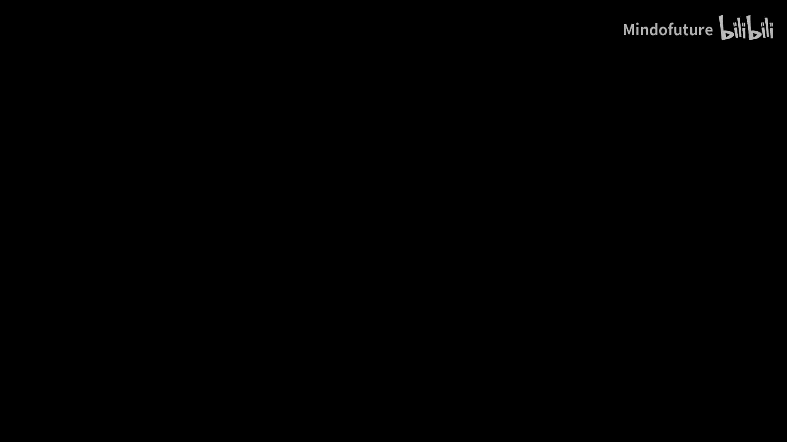
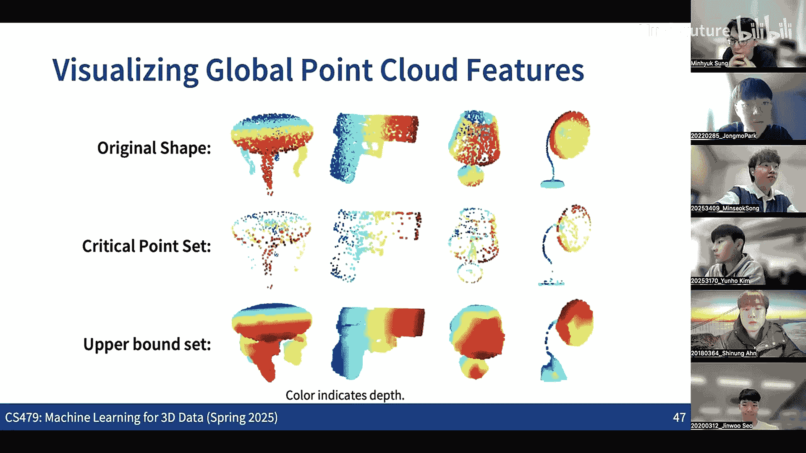
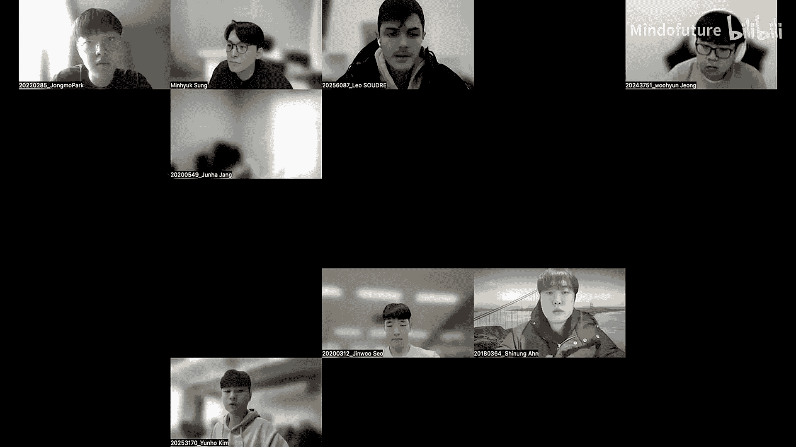

# 【韩国科学院】机器学习3D数据处理 ｜ KAIST ｜ CS479： Machine Learning for 3D Data p02 P02_Lecture_3_-_Point_Clouds_1_(KAIST_CS479__Spring_2025) -BV1YmuBzTEmx_p2-

Okay， so welcome back to the machine learning for 3 data。

 So this is our third time to discuss some some machine learning techniques for the3 data。

 So last time we discussed some kind of the bunch of the representations of the3 data and we also discuss like why we need some many representations because each of them has some kind ofs。

 So we discussed that the typical some kind of the very straightforward kind of extension from the2 some kind of the neural networks to the 3 might be using some 33。

 So they might be good in terms of we can easily extend all the ideas like the convolution many things into the3 the thing is that there are of the difficulties in terms of the huge amount of the size of the data in terms of that we gonna have some very huge amount of the boxes while most of the boxes will empty which means that we are basically having some various information the 3 space。

 So here the key that we can basically。😊，Effic handle some kind of spae data。

 define its V space with some kind of the specializedize some kind of the deco corners。

 So we can consider making some spae combvolution corners。

 whatever kind of things that might be also involving last some kind of the engineering efforts in terms of the implementations。

So the issue with the debox is that it's very hard to basically efficiently handle such kind of the representation of the3D data。

😊，And the other way around would be basically just know representing all these3 things into the multi view images。

 Then it becomes even easier to use some kind of a 2 d in neural network。

 because we can just directly process all the kind of the multi images。

 But also kind of the problem is that it's also a very inefficient kind of representation in terms of that。

 Were gonna also need some lots of images to precisely capture all the details。

 especially for some kind of the the regions as well。

 We might need some lots of images that we can capture all the details。

So efficiency is still kind of the issue with the multiple representation。

 and then we also discuss the point cloud the representation。

 which is the things that we're gonna to discuss for today。

 which is also very common representation that we can easily obtain from some kind of 3D scanning kind of the situations and they good thing of the point cloud is that it's very basically easy to process and also generate some kind of neural networks。

 So what we are going to discuss for this week and then next week is about some kind of the neural networks that we can process and also generate the point cloud data So we can also discuss about the efficiency of those kind of architectures。

 The downside is that point cloud also requires lots of some kind of the number of the points to capture all the details So this kind of the things in terms of the efficiency of representing all the details of 3D information。

 the shape information point cloud still may not be kind of the fast representation。

And speaking to this kind of the efficiency and the compactness。

 the might be kind of the best representation in terms of that we can have the explicit disserv information。

 but then if we start to have some kind of the irregular kind of the the mesh structure。

 it also becomes very difficult to process and also degenerate some kind of the ability diminish mees。

😊，And the last presentation we didn't get into the deep was basically implicit representation。

 which is basically representing the3 shape into a function was going get into the kind of the discussion about basically how we can also represent3D the shape into the implic function after the discussion for the point cloud。

And after discussing like all the different kind of representations。

 we also very very briefly discuss some kind of the conversion across those kind of representations。

 So what we could see is that the conversion from the impulse function into the box also easy in of we can just like evaluate the where many other things for each of the box and also the point cloud is also very simple in terms of we can the points over the surface multi representation is kind of simple from the mesh which like render into the images and then the kind of the missing bridges across those kind of representation is basically how we can also obtain thesh from the other representation and also how we can do some conversion from the point cloud to the other representations So those are kind of some more challenging the test compared to the other kind of the conversionvergence。

 So we are also going to get into some kind of the ideas in terms of how we can do kind of conversion from all the representations to all the other representations。

 So those are also kind of。😊，あ、でき点す。But basically， what we can see from this figure is that point cloud is really kind of the good representation in terms of that。

 you can easily obtain the point cloud from the any other representation into the point cloud So in terms of that if we want to process like the 3D data for example。

 if we want to basically extract some kind of the information from the point cloud like like some kind of class of the objects or many other things。

 that might be kind of like very efficient to first convert any kind of the 3 d data presented into the any other representation into the point cloud first and using some kind of the point cloud encoder。

 So that's what we are going to discuss for today。😊。

So the roadmap for these courses that we are going to basically discuss all different representations and also some kind of the neuralnet based on kind of the techniques that can basically either process were basically generate those kind of representations。

 So as I mentioned at the beginning， for this week and the next week we are going to discuss the point cloud representation and also the encoding and decoding architectures for the point cloud。

 So we will see。So yeah， we are going to discuss the two point cloud encoders for today。

 And as I said， the reason like why we are discussing the point cloud is that basically for many kind of some kind of applications that we are basically using some3D scanning the direct output from the3D scanners with the point cloud。

 So that is kind of the first motivation in terms of why we are basically investigating some kind of the architectures processing the point cloud data and mentioned at the beginning。

 the point cloud is kind of easy in terms of that we can convert from all the other into the point cloud representation。

 while the other way around this is basically involving lots some kind of computation and also requires the very dense point cloud and also some kind of the extra information like the the So we are also going to discuss some kind of the reverse conversion from the point cloud to the other presentations。

But that is basically giving some kind of the motivation， like why we are basically more interesting。

 basically the point cloud encoder because like for even when you have some kind of the matcheshe or the boxes where any other digital presentation。

 you can easily convert them into the point cloud and basically use the point cloud encoder so that's kind of the motivation here。

😊，So the architecture that we are going to discuss for today is the simplest architecture。

 This is the very simple the architecture， which is also kind of the very seminar work in terms of the 3D deep learning。

 which became some kind of the very basic the architecture that can be actually used also for the many other some kind of the applications。

 So we are going to start to read like you know， discussing this simplest architecture。

 and then we are getting into some kind of more complex architectures。😊，So basically。

 given this kind of architecture， if you first see what we are going to do using the neural network is that given the kind of the point cloud input。

 we are going to do this kind of the tasks。 the first task is the classification。

 So given some kind of the point cloud describing some kind of the three object we are going to see whether the given the object is a where the table or the。

 So this is basically the classification task， So and also we can consider doing some kind of the segmentation So segmentation is basically basically indicating the a subset of the points and see whether the points is some kind of the having some some kind of the part label like some kind of chair or the table or word some kind of 3 things and also like leg and the top part of the tables these are basically the parts of the objects。

😊，So we can either do some kind of the classification what the segmentation using the point that。

 So those are some kind of the tasks that we are doing。😊，And you can see that actually。

 these are the tests that we could see for the2 d deep learning。

 for the image can basically neural network for many kind of the image， the deep learning the tests。

 what we are going to do is that we are getting some kind of classification or the segmentation So the difference between these two is that classification is basically something that we are getting the information for the entire image for the image case while the segmentation is that we are getting the information per pixel So those are some kind of the difference in terms of the output what we want to see So whether we gonna get some kind of the output for the entire image or whether were gonna get some kind of output for every single pixel we're gonna do the same thing here。

 So we're going make some kind of the neural network that is getting some kind of global information for the entire point cloud or getting some kind of the local information for each of the single point So we're gonna consider making this kind of the architecture that can handle。

😊，Most of the problems。So this is the problem， right， This the problem is very simple。 So basically。

 what we are going to do is that we are going to consider that we are having some kind of the point cloud。

 which can be actually also can be seen as some kind of the 2D array representation。So let's say。

 like we are having the n number of the points and， right， and then each of the point。

 we gonna have some kind of the D number of some kind of the the numbers。 T。

 were gonna have some kind of three numbers like X， Y， Z。

 then these like the D dimension here becomes like three right。

But as I also mentioned in the last lecture， we can consider having some kind of the extra information。

 not only having the X Yz， but we can， for example。

 having some kind of the color information like the RGB and we can also have some kind of the normal information then which is adding another the X Y z basically coordinates So depending on some kind of the extra information。

 the dimension for each of the vector may not be3 it can be greater than three。

 but we are basically assuming that every point is represented as a the vector and then we are having a list of the vector which see basically becoming the point cloud right。

But here， the thing is that while we are basically having some kind of the 2D already representation for the point cloud。

 what we want to achieve is that basically this is the set data， right。

 So we need to think about some kind of the characteristics of the set data。

 So we need to say like the point cloud， which is a set of the points。

 the characteristics of the set is that we do not basically order those points。So which means that。

 however， we basically order the points， Actually， we don't treat them as some kind of different point cloud。

 So the order of the points is basically not important。 We don't care。 So let's think about that。

 we are having some kind of the the， the number one point。

 The first point and the second point and third point。

 and we're gonna make this kind of the already like this。

And let's say we shuffle the order of the points。Then should he get some kind of the different output for the classificationification？

no， right？ So whether we basically change the you know the order of the points。

 actually it does not make them any difference in terms of like when we see the data as kind of the point cloud。

 So which means that the output should not be changed based on like how we order the points， right。

So that's kind of the key characteristic in terms of that when you have some kind of the asset data。

 the output should not be affected based on based on the basically the ordering of the data。

 based on the perutation of the data。So that's basically the kind of key characteristic that we want to achieve in our design of the neural network in terms we are making the permutation imvari and thevari。

 So what we are also going to discuss in detail look like this kind of term。😊。

And the one more thing is that we also want to achieve some kind of the transformation in various。

 which means that， for example， like when you basically classifiedify objects like the airplanes here。

However， we rotate the airplane。 The airplane should should be airplane， right。

 It does not also change the meaning of the given the point cloud， right。

So means which means that when our neural network takes this kind of the point cloud as the input。

 however we rotate this kind of the point cloud， the output should not be changed， right？

So that's basically the characteristic that we want to achieve and which we call that the transformation invariance。

 which means that however we transform the given the point cloud， the output should not be changed。

So these are basically the two key things in terms of like we want to achieve in our the design of the neural network。

 like how we can make the our neural network to give some kind of the consistently the same output。

 whatever the orders that we have for the points and also having the same output。

 also for the whatever the transformation that we are applying to the given the point cloud。

So these areベディ twoキティあイディスク。So let me first get into the specific meaning of the invariance and the E varianceance。

 So when you also talk about the invariance and the equivariance。

 the difference between these two is that invariance specific means that， however。

 we change the index of the points， the order of the points， we get the same output。So for。

 for example， for the classification task given a set of the points here from the x1 to the X N。

 we gonna get the you know quest label Y， right。Where some kind of the probability for each of the class。

 So those are some kind of the some the global the output why here。

And say now I'm basically changing the index of the points， basically sharp the load of the points。

 beating them to the our neural network。 So our neural neural network is the function F here。

So given the different order of the points， we want to achieve the same output why here。

So that's the property that we call the invariance， right？Not making any country。

 the changes depending on the given the implementationation。I this clear any questions to me。

And E key variance is slightly different。 This is for the case that we are basically getting some of the outputs for each of the data point for each of the point in our case。

 So this is for the case of the segmentation。 for example。 So for the segmentation。

 we are going to get some kind of the label from the neural network， not for the entire shape。

 but for each of the point right， So we are having the end points。

 we are also going to get the end the labels。 each of them is basically corresponding to each of the point that we have。

 right。😊，So this is the setup that we are basically some kind of the same the and the majority of the output。

 each of the elements is corresponding to each of the point that we have。

The segmentation is like example for this。And what we talk about the equi variance is that it we shuffle the order of the points then now we areグ to take the output which is like having the same theling of the order。

Makes sense。 So if we change the order of the points。

 then the order of the output also should be changed based on the the short point that we do。

So this is the the property that we call the E key variance。

 the basically's some kind of changes that we are making into the input is also， you know， know。

 affected to the like making the changes for the output。Making the same order。

 So that's the equivari。So for the architectures that we are going to make， for example。

 for the classification， we are going to achieve the per invariance。😊。

Making the output to be the same， not changed whatever we do for the orders。

 for the architectures that we are achieving for the segmentation。

 we are going to achieve the properties of the equivari。

 Ma the order of the output is basically changed based on the order of the the input。

For the segmentation， should it also require transformation equivariance。 So no。

 the transformation equivariance is for the is more about the invariance， right。

 So basically whatever we apply for the transformation， the apple should not be changed， right。

 So that's why what we call that the transformation invariance。Okay。ああ、いいですク。

So when you talk about the imvariance equiance， like whatever we do apply to the input。

 imvariance means means that we are not seeing any kind of changes in the output。

 Evariance basically means that some kind of change that we apply to the input should also basically affect some kind of make some kind of same changes for the output as So we are also going basically getting to peration imvariance and the equivariance。

 and for the transformation， we are also going to achieve the imvariance。

 So whatever the transformation that you apply to the input that should affect the output as well。

So if we can basically guarantee these two properties into the our neural network that will be really effective efficient architectures in terms of that。

 So， so let's think about that。 for example， like if we do not basically achieve some kind of transformation the invariance。

 what will happen， can you guess。So let's say like we are basically making a neural network。

 which is basically classing like the no airplane or the chairs or tables or something， right？

Making some kind of neural net。 So we're gonna have some kind of the a set of the like bunch of some kind of the airplane point cloud and the chair point cloud and the table point clause。

 right， for each of them， you gonna have some kind of the labels。 So these are okay airplanes。

 These are the chairs and these are the tables， right Then we are training the neural network， right。

And if we have a neural network， which is basically not satisfying the transformation the invariance。

 then what we going to happen is that the neural network will will basically treat these two point cloud as kind of the different point cloud。

There's something new， right， So which means that if we train our neural neural network with the first airplane here here。

 this one， and if we feed the second airplane as kind of input in the test time。

 then neural network will basically see that this is something new that I didn't see I haven't seen it doing the training right So there is no way that I can classify this。

Basically， this is not the same the point is like something that we have seen because like the neural network does not understand that the second one is this is not new basically just like transformation for the first one。

 right？😊，But without the transformation， the invariance。

 basically the neural network will basically treat these two as completely different the point clause。

 So which means that we need to basically show all this kind of be some transformed versions of the point clause in the training the time so that the neural network can understand that these are all the airplanes from just like from the different。

 some kind of the the transformations， right。So this becomes like way more inefficient since the neural network is seeing these point clouds as kind all different kind of point clouds。

 we just need to show more examples。 And also the neural network should have some kind of the the inop capacity to understand that these are also some kind of the different point clouds that should be classified into the airplane。

But if the neural net basically have some kind of the capability of the basically satisfying the transformation invariance。

 then the neural net will see that actually， these are just like same the point cloud。

 So even when the neural net is basically trained with the first one。

 the neural net will be able to see it， actually， the second one is the same point cloud。

 So it is also should be classified as kind of point the airplane。😊，Make sense。

Don't we consider imurance with and perutation？嗯。Yeah， so it's the same thing。

 also for the perutation， the invariance。 Also if we do not satisfy this property。

 then if you basically change the order of the points。

 then neural net will see that this is kind of the new point cloud。

 then which means that we need to train the neural net by just like sharpling the order of the points all the time this is basically like making all the different de peration with the point as the new point cloud。

 So that's the disaster because like you're gonna provide tons of the point cloud as in the training time to teach the neural net to see that actually these are all the same But if the neural net basically have some kind of the property of the perutation。

 the invariance。 then without really basically making the per the points in the training time。

 the test time， the neural net will understand actually these are the same point cloud。

 So making the train to be way more efficient。Make sense。にこ社そです。So yeah。

 it's basically all about basically how we are making such kind of the neural network in terms of achieving the permutation imvariance and the covariance and also the transformation。

 the imvariance so we can consider actually many kind of options for that。😊，At the beginning。

 we are going to see some kind of degree simple police architecture for that。

So basically these this kind of function we see basically achieving this kind of property。

 So when you basically achieve some kind of the permutation imvariance。

 So when you change the order of the input data， if the outputs are basically the same。

 such kind of the functions are called the ssymmetric function。Okay， see。

 so let's say we have like 1000 points here。 So when you change the order be them。

 if the output are guaranteed to be the same， such kind of functions are called the symmetric function。

 So let's think about the examples of the symmetric function。

 What would be such kind of some symmetric functions。Any ideas for this？Yeah。

 as many of you posted on the Ju chat， these are all like the Max mean average like taking the norm。

 whatever mediumn， Yeah， these are all multiplication。 Yeah。

 these are all the functions that are basically becoming some kind of thissymmetric function， right。

So to achieve some kind of the permutation you know， imvariance。

 what we are going to do is that we are going to diver this kind of symmetric function into the our neural design。

 So basically what we are going to do is that given any kind of thesymmetric function G here。

 we are going to make some kind of the more complicated thesymmetric function using this kind of design。

So let's think about that when we have a asymmetric function of G here。

 we can make another asymmetric function F here by having any kind of arbitrary the H function and the the you know the gamma function here。

See， so here basically you can see that8 is the function we basically processing every single point。

 but some kind of shared function， basically which means that the same function for the older points。

 right？So we are basically for all the points， we are basically processing them using the same function H here and using the a given the function G here in terms of like getting some kind of the global information and applying some kind of the post processing the function the gamma here。

So if we make some kind of the composition the functions like this。

 given anysymmetric function G here， we can say that actually this composition the function also becomes another desymmetric function。

😊，Makes sense。 So free to the point， we will basically do some kind of processing with some kind of the you know。

 given the function H here independently， but the same function is basically being used for all the points。

And then we are basically aggregating all this information using the sesymmetrictic function G here。

 this kind of the process is typically cold that's kind of the pulling in the deep learning the literature right。

 so we are basically having kind pulling operation and then post processing this with saw another kind of processing function here。

😊，Basically then what we can say is that while be some kind of typical choice for the HG and the gamma。

 I mean it doesn't need to be some kind of equation。

 it's very obvious that we can have any kind of the function here。

 but we're gonna typically some kind of the MLLP the multi layer deposit for the function H here and also the gamma here for the post processing while we are basically some kind of the sesymmetric function G here。

So we can use any symmetric function here for the g part。

 but especially for the pointnet that we are going to discuss here。

 we're gonna use the max function as some kind of the one of the de symmetric function right。

But it doesn't need be the max function。 but were gonna also say what's some kind of the advantages of using the max function in this case。

 So we can see that the basic building block of this kind of the point cloud。

 the the neural network is basically having this phone that we are having the MP shared MP processing every single point having some kind of the max pulling all the information and processing them with anotherP So this becomes a single very simple the building block for some kind of the big the neural network。

 and we can see that this kind of the one composition of the functions becomes another function。

 So we are achievingmutation im in this case。Makes sense。Any questions on this？So actually。

 you can see that like achieving the perutation imvariance is kind of like do is basically not very difficult。

 The problem is more transformation invariance。 We want to basically see the results that we are basically getting some the same output。

 however， we transform the given the point like this。

 So these two should be the same body whatever we do in terms of the transformation。

 But achieving this kind of the transformation imvariance is very difficult problem， actually。

 there are some kind of the main kind of research how we can do this But instead of like applying some kind of the fancy idea at the beginning。

 we are going to discuss some kind of very simple the idea， which is about the spatial transformer。😊。

So basically， this spatial transformer is not the same with the typical transformer that we are talking about。

 right， So this is not the transformer architecture。

 This is about some kind of the some specific the technique or some kind of the module in the neural network。

 which is not the transformer， the spatial transformer。

Here basically the idea is that when you have some kind of the givenD point cloud。

 we are basically having some kind of the small component engineer neural network。

 which is basically automatically aligning the given point cloud into the certainty pose。

 so that's the basic idea。😊，They might be good to show the kind of the figures in the next slide first。

 so actually this idea has been imped for the image processing the first in the 2015 of 10 years ago and has been adapted into the 3D the data processing as well in the pointing of the case so here basically the idea is that let's say we want to do some kind of the classification of the traffic signs like this。

See， so we are basically having tons of some kind of images of the traffic signs。

 which might be taken from the very different views different。

 basically the skills and the orientations of the images。😊。

The E also also trained the neural network to class those kind of the traffic designs The idea is that we might need to basically have some tons of images right which is the photos which are take from the all different some kind of camera angles。

So here basically the idea is that we are first basically aligning this kind of the given images in terms of the scale and the orientation and the main things in terms of that we let the neural net to basically predict a transformation to align the image into some certain des with the certain scale and some kind of the orientations。

 and then feeding these kind of some dec corrected images。

 some rectified images as the input for the classificationification。😊。

And this becomes like more efficient in terms of that no we are not basically treating all the images as some kind of the different images。

 but we do some kind of some correction first and then basically feeding some kind of the aligned images for the classificationification。

 so in terms of like the test of de classificationification it becomes easier because we can expect that the first part of the neural net。

 the special transformomer will basically automatically align those images。

So this is basically the basic idea。 Obviously， you can see that there is no guarantee whether we will be really able to some kind of the。

 you know the perfect alignment of images， but we are basically expecting the small neural network here。

 We will be able to predict some kind of the good transformation in terms of the like aligning old images。

 So this is the basic idea for the special transformer。😊。

And the good thing of like having this architecture is that it's basically some plug architecture。

 So when you have some kind of any sort of neural network， having some the bunch of the layers。

 you can basically plug in this small component at the very beginning in terms of the given the image。

 you first predict some kind of transformation applying the transformation into the images and then feeding this to the neural network。

 So this is basically some plug and play some sort of demo。

 you can easily plug into any architectures at the beginning of the old the layers。😊。

So this is the basic idea for the spatial transformer。

 not the same with the transformer architectures。But do you have any questions on this。So yeah。

 you can see that as given the input here， based on the like given input。

 we first basically predict like some scale and orientation that becomes this part like predicting the transformation know and then applying this transformation into the images and feeding this into the rest of the part neural on that。

And the thing is that we can do the same thing for these 3D cases though。

 So that's the basic idea in terms of like achieving the transformation invariance。😊。

And now you can see that actually this is not。Really achieving transformation inurance。 No guarantee。

 Actually， we are just like predicting the transformation in terms of that we gonna get some kind of the alignment of the given the points。

 actually， we don't know what sort the transformation that we gonna get。

 but we are basically you know， expecting that the neural that will be able to get some kind of the align some kind of the point close。

😊，So what you do is that using the simple the architecture of some kind of s function。

 So we have seen like the basic building block of the you know the point cloud processing the architectures。

 right， this kind of architecture， having some small MLP， some pulling layer。

 the max pulling layer and having another D MLLP to get some kind of the final the output right。

So given this kind of the architecture， we can make some small linear neural network。

 which is now predicting three by three numbers。Decribing some kind of the 3D transformation。

3D rotations in this case。So we can basically have some kind of the dimension of defect vector and then making it as kind of3 by 3 matrix。

 right？😊，And we hope that this network will be able to predict some kind of the good transformation。

 aligning any kind of the randomly oriented point cloud into some kind of certainty the pose， right。

 applying this transformation and then reading some this kind of the transformed the point cloud as the input to the rest of the neural network。

That's the basic idea。 Are we applying the T net before the bundle point。 So yeah。

 we gonna see actually， when you talk about the point which is the architecture。

 which is involving this kind of the T net。 so you can see that actually this tin net is the small part of the the entire the point。

Question， any other questions？It is clear。 So we are basically having a neural network predicting 3 by 3D matrix。

 and this becomes a rotation matrix and rotating the given the point cloud and then doing some kind of the and then repeat this kind of rotate rotated the point cloud as the input to the rest of the neural network。

And here one question might be is that we are just like predicting three by three matrix。

 but how do we know that whether this is the rotation matrix or any random some kind of transformations？

So obviously what we want to see is that we want to see that some rotated the rabbit here as kind of the same rabbit。

😊，Or if basically like no no skill scaling should be the same。 but we basically do some kind of。

 makes a more complicated some kind of deformations that it should not be the same rait， right。

So we want to see that actually， some rotated dience are basically the same point cloud。

 Otherwise it's not making the same the point cloud， making some kind of the new point cloud。

So which means that actually， we want to basically only predict some kind of the rotation dynamics matrixs through this kind of T net。

But when we basically predict any arbitrary 3 by three matrix。

 how do we guarantee that this matrix becomes a rotation matrix？

C the T matrixて imageそアなこ discuss the translation here so that's also kind of the limitation of the point we also going to discuss the translation for the next architecture。

系。So does it only have like six degree of the freedom in such transformation。

It depends on like how we define the transformation for the rotation。

 How many degrees of freedom do you need for the3D rotation。For the 3D rotation or actually。

We need the three degrees of the freedom， right？We are actually going get into some more details about the representation of the3 d rotations in the later the lectures。

But basically for the 3D rotation， we just need the three numbers like to like the old angles to represent the the rotations。

 but now so we can do either basically not predicting 3 by3 matrix。

 but predicting like some old angle kind of things， only three numbers。

We can also consider predicting quarterions in terms of the three by three matrix。

 so if you also have some time we're going to also discuss the qua representation layer。

 so it depends like how we represent the limitation the matrix。

The simplest idea that has been applied for the point net was that having this kind of deregularization in terms of like one so basically predict three by three matrix here。

 then we are basically having this kind of irregularization loss in terms of that we are making this t matrix to be Unmal de matrixs。

So that's kind of some kind of the one simple trick in terms of making the rotation the matrix。

 Obviously also this does not guarantee to make a rotation the matrix because we are just having some regulation the loss Its not having some kind of the hard constructtrain。

 just like regular the output the matrix。There are also tons of the techniques in terms of how we can really get some kind of be guaranteed the rotation the matrix。

 We are not going discuss like all the details here。

 I gonna let's see whether we can discuss these details in the later。😊。

So the T net can only rotate that skill it also depends So we can also regular matrix allow this killing as so here we gonna basically only consider that the T net is only making some kind of matrix only care about the in here。

Any other questions？1 you also say was the kind of the problem of like having this regulargization。

 You know， not only for that， you know， it's just like not giving the heart constraint。

 but just regularizing。The problem of this regularization， I mean， many things。 obviously。

 this is not handling this killing as well， Right， So that's also the kind of thing。

 We also don't care about this translation here as well。 So translation is like one thing。

Also this is like regular this alpha matrix T to be also normal the matrix and are the only also normal the matrixes rotation matrixes。

Any cases that the autonmmal detices become nonnotational demattices？

If you took computers course before。And does。What's the condition for a 3 d rotation the matrix？そう。

Basically， the autonomer matrix can be not a rotation de matrix， but also reflection matrix。

 making some kind of reflection， some kind of having de mirror and also reflecting the things。

 So actually， the output also can be reflection de matrix as well。

So in cases like when the reflection is， you is making a new shape。

 this is not sufficient deization material material。

So basically yeah there are lots of the way in terms like basically how we can really make some kind of the some basically output some rotation the matrix with some kind of guarantees and how we can also some kind of and also other types of the im as well。

 But this is some kind of simple idea in terms of that we are plugging in the T net here the specialty transformer in terms of we hope to see some kind of automatic alignment of given the point cloud by predict some kind of the transformation here and we consider the here and we are the output the matrix to be one of matrix using this So that's the idea。

😊，Thus the T net itself also needs to be peration im。 Well， I mean， we are not predicting this。

 the transformation， not for every single day point， but also for the entire the the point clouds。

 So that's kind of thing。Yeah and obviously yeah the the T net should be perutation endance obviously。

え。So as the T net， we are using the simple the building block that we discussed before。

 having the se functions and the compositions of the M LP and the max pullinging。 obviously。

 it should be the perutation in。Any other questions？If the T net is transforming the data。

 What is the transformation doing Well， I mean， So as I said， like， you know。

 once the T net predicts the transformation， which is we hope to be a rotation D matrix in this 3D space。

 we apply this rotation to the older points into the given D points here and then getting some kind of rotated points here。

And then now also feeding these voltage points as to the next layers。in this screen。Transformation。

 this is not any kind of the neural network。 and this is just like applying the transformation to the points。

Pinnet is a printing model。 No， we also train the T net simultaneously with all the other layers。

 So that was kind of thing。So that's the kind of the interesting part of this patient transformer in terms of that。

 We do not basically train this kind of the some alignment layer separately。

 but we hope to basically we basically train all the all of the layers jointly while hoping that this T net will play the role as doing some kind of the automatic alignment。

 but obviously that said there is no guarantee whether this will really aligned all the kind of the the images and the also point glass。

So were gonna have the first assignment which is implementing the point at and you will see how of these like T that will be helpful。

 Actually， there are lots of yeah， we will see doesn't the T that needs to be peration。 Yeah。

 the T net should be peration im。 Yeah， all the layers that we are going to see here should be peration imvari。

So as I said， like we are having this this for all the layers。喂。

So lets see like layer layer given some kind of m3 point cloud it doesnt as I said it can be x Y plus like RGB many other information So lets only x Y here three kind of the two layers then we are basically having the T in some kind of some kind of point cloud here。

😊，And that were gonna keep applying the same the building block in terms of like increasing dimension for each of the points So here basically is nothing but just like having the shared MP for each of the points increasing dimension into 64。

And also what we are going to do is that even for those kind of the the points in the higher dimensionous space。

 So now we are having some kind of the some features which of the point， right。

 So 64 dimension of the features。So for those kind of the point cloud also defined in the higher dimensionary space。

 we can also do the same thing we can also apply the Tnet predicting some kind of transformation and doing some kind of the applying some sort of the rotation in the 64 dimensionary space this is basically nothing but just doing the same thing。

 not in the3 dimensional space， but also in the 64 dimension space。

 So yeah we are going to do this kind of another kind of alignment the 64 dimensional space as well also getting this kind of things and then having some kind of the multiple the mP layers in terms of the processing every single point independently using some kind of the same function。

 the same the ml function for the old points。And to make this kind of permutation the invariant。

 we are going to apply the max point here getting some kind of global default。

 And as I mentioned the previous slide we are also going to do some kind of post processing using the another set of the MLP the layers and getting some kind of the final some kind of the discourse for each of the kind of cluster labels。

😊，So this becomes the the basic the architecture for the point at， the classification， the network。

ああ、いディスク。So you can see that except for the T part here。

 the whole thing becomes that we are basically first applying the NLP for easily the point in terms of basically increasing the feature dimension into the 1024。

 applying the max point here， thissymmetric function here and applying some kind of posts processing the MLLP。

 in terms of getting in some kind of the output discourse。So here。

 the question is that when applying for transformation， how do we know current state？

How much is rotated， Well， I mean， the output will be very explicit rotationt demetrics。

As the output of the T net， we are getting the3 by 3 matrix here and 64 by 60 matrix here。

 we just directly multiply these matrix to the points。嗯。😊，Why do we need additional net。 So， I mean。

 this is not necessary。 I mean， this basically additional the you know the alignment is not necessary。

 This is basically some kind of the further alignment that may not be basically really controlled by the first part。

 So we I'm just like showing that we can do this kind of be some automatic the alignment。

 not only in this3 image space here， but also in the higher dimension space as well。

 we basically seen this kind of some architecture， which is like having the two adjustment but actually you can say that without like one of them actually works kind of okay。

Actually， even without any of these actually it's kind of okay for especially the cases that when the points are really quite well aligned so yeah so you see。

😊，We have a airplane ship rotate by 0 degrees，30 degrees。

 and does the thin predict matrixs to rotate these ships for example。

 the good question is that when you have the airplanes rotated with the0 degrees。

30 degree or the 90 degrees， does the thin predict des to rotate this ship into the ship with the 30 degree rotation。

 So the thing is that we don't know what do we kind of transformation that the T that will basically predict。

But we hope that this the T net we will basically predict some rotation。

 which is rotating like whatever some kind of the rotating the the shapes into this some kind of the you know。

 the you consistent kind of pose。So after applying the T net。

 we don't know whether all the points point cloud will be rotated 45 degrees or30 degrees or whatever。

 but we just like hope that this Tnet will basically will align this kind of the points in terms of their deposit into the certain rotation。

And the kind of the reason why we are having this kind of expectation is that when we see that all the points are aligned well。

 then the rest of the part， the classification， the task will become way easier， right。

 So there is no kind of like theoretical guarantee。

 But we hope that the neural net will be the team that will be trained in a way that it is making the training of the rest of the that becomes easy。

 So that's the basic idea。可以。Yeah， obviously， there might be some kind of here。

 But the problem here is that theres no and kind of theoreticals here。

 So you're gonna actually will be able to implement this yourself and see how much this works。

 So there are also lots of the issues with this。 But this is some kind of the very simple idea in terms of the we are trying to achieve some kind of the rotation。

 not exactly achieving rotation im variance， but we are basically removing this kind of defect of the rotations in terms of the training some kind of that works。

😊，Okay。😊，So you can see that this like whole kind of the big architecture is actually can be simplified into It can be understood into this form in terms of we are having the MLLP running for each of the point independently but shared MP。

 same MP having the max playing here and then doing some kind of post processing so we can basically make some kind of the whole the architecture is thissymmetric through this kind of architectures。

Make sense。And you can see that actually this is for the classification。 So as the output。

 we are getting some kind of some， some output discourse for the entire the point cloud。

 And as I mentioned before， for the segmentation， we might also want to get some kind of the some outputs。

 not for the entire shape， but for each of the point， right。😊，So here。

 the question is that how can you get some kind of the per point outputposts from this architecture were more specifically。

 how can you consider combining some kind of the global information here at some point some kind of global features with some kind of the local information here in terms of the at the end we are getting some kind of the per point outputposts。

Any ideas for this？Yeah， as you said， like this， the simple idea is that it's nothing but like。

 you can say that actually， this is the 64 imaginative feature for each of the point， right。

For every single the the feature for each of the point。

 we simply just like concatenate this global feature in terms of that the long feature here。

 the concateated feature has some information about the every single point。

 but also the entire shape。And the rest of the part can also be running the MLP for each of some kind of the the per point features。

 So in terms of that， we can also get some kind of the upper scores， not for the entire shape。

 but for each of the point as well。Makes sense。 So this is like simple the idea in terms of that we are extending the point at the classification of the architecture for the segmentation of the architecture。

 so。そいや、デーセージデーサグメーションです。回せ。And the previously， the question is that。There was a question。

 Can I think of the online the features as the aligning small part of the point cloud。

 So I guess the question is about this part， like online the features。

Is actually not aligning small part of the point cloud。 So now it。

 is still aligning the entire the point cloud， but not in the 3 dimension of space。

 but just in a like higher dimension space。 So this is nothing。

 but now we are representing each of the point， not with the three numbers。

 But with some kind of the know more numbers， with 64 numbers， right。So in terms of that。

 now we can see that every single point is present at the 64 dimension space and we can think about the like point cloud in the 64 dimension space in the that's basically the point cloud in the feature this space。

And what we want to do is that for the same the point cloud in the 3D space。

 basically they might have some kind of different sort of the rotations in the higher dimension space as well。

 and we also do some kind of the alignment in this kind of the 64 dimension space as well。

 but this is still some kind of the global alignment， not the partial alignment。😊。

So that's the idea here。Andに question戦 onです。So this is the same police architecture in terms of that we can basically process the given D points while basically you guaranteeing the permutation invariance for the classification and also the permutation equivariance for the segmentation here。

 as you can see if we basically permit the order de points here obviously the permit the order the points here we will be also changed that we can also achieve some kind of the permutation equivariance here。

And we are not guaranteeing， but basically somehow of enforcing some kind of the you know。

 some kind of the rotation， the alignment through the T net。

 the special the transformer here and here。So that's the basic architecture。

 And you can see that actually， this is like very simple architecture。 You'll see that actually。

 the implementation of like this whole architecture is like few normally lines。😊。

So in terms of that no it really efficient and also this is going dis the efficiency of the architectureulator。

But any questions on this？So yeah， so if I introduce some of the applications。

 especially some kind of toy some kind of the setup that we can basically easily test the performance of some 3D neural network there is basically a data called the model。

 which is also like more than like 10 years old， the benchmark which is also for some kind of classification of the task。

 So this is the case that we are having 12000 some CAd models and having the 4 classes。

 So we can train the neural with some kind of some portion of the training basically the training set here and testing with the and we can see whether the neural network can properly class all the shape into4。

 So as we have some kind ofpha10 or the image for the image of the cases。

 the model net is basically the very simple kind of the benchmark that we can test the of the classification。

Some3ディーのよ thatト。And if we see the output， the interesting thing is that So actually this second rule。

 this whole rule is basically about is basically the neural network。

 which is directly taking the voxs as the input。So these are bi architecture switches during the3ディー compositionショでネ。

And having the accuracy of the more or less like 89% here， right。

And the other basically the architecture is the here， second part， the third part actually。

 so these are the multi view based some kind of representations taking the multi view images as the input and using the 2D commul neural network right achieving the classification accuracy was like 90 here so before the dec classificationification accuracy of like 86。

And compared to that， the point in that is also chip the a of the 86 like this。

 So you might see that actually， AD a is kind of the same。

But the big difference is that this is the the the， the second row here。

 This is the case that we are representing all the shapes with the 30 by 30 by 30 the resolution of the boxes。

 which is still like very low， no the resolution。 You can see that compared to images。

30 by 30 by 30 is very low resolution， right， Still。

 it will basically have some kind of the 27000 of the numbers。😊。

So every single dish is represented with the 270000 of numbers。

So it means that it's kind of like heavy be still very sort of heavy representations for this single ship。

How about the multi view images for the multi view images。

 So this is the case that we are taking A images， A views。And every single。

 every image is basically having the resolution of the 164 by 164。

 and also each of the pixel will have the RGB， the three numbers， right。😊。

So this means that each sheet is now represented with the 164 by 164 by 3 multiply by8。

 so more than  six million numbers。It's very heavy representation for a single 3D object。

 especially even compared to the， you know，3D de boxes as well。Compared to these two cases。

 the point in N is just using 1024 points， and every point is having the X， Y， Z coordinate。

 So every the the3D object is now presented with just like 3000 the numbers。

So you can see that this is like way more like compact representation or comp too。

Why are we achieving almost the same accuracy for the classificationification and obviously segmentation？

So you can see that actually the， the compact is wise。 the point cloud is way more the compact here。

 So which means that we can keep some kind of the same accuracy with some very few number of the kind of the the numbers here。

😊，And also， the architecture becomes way lighter than the other representations。

Inspec compared to the the Em， which is taking the multi view images。

 having 60 million the for the neural network。 the point N is just having some kind of the， know，3。

5 million the kind of the， which is like way similar。

So you can see that actually the point cloud encoder is very efficient and also the effective architectures compared to the neural networks that with taking other representations。

😊，可以。The this can be especially good for some kind of the some mobile devices or some kind of cases that we cannot have some kind of the very heavy the architectures。

And also for the segmentation So for the segmentation。

 the the kind of the very the basic the benchmark is the net the data set which is also having the16 the classes with the16000 the shapes。

And each of the object is having two to5 depart labels。

 So you can see that these are some kind of depart labels for all these reader chips and the total number of depart labels for the all these 160 classes is more or less the 50。

 So were having the 50 depart labels。And for those cases。

 we can basically train the point net and get this kind of some segmentation results。

 So these are the actually the output of the pointnet this segmentation。

And another like more the complicated some kind of a setup is the scene segmentation。

 So this is also the case that we are now taking the point cloud of some kind of indoor scenes and segmenting them into the chairs and the tables and words and many other things。

 So these are also some kind of scene segmentation results。And typically。

 what we do for this kind of scene segmentation is that obviously the number points for the scene will be very huge。

 will be like more than like the a million。 So we are basically having a million of the points here。

 So since the a million of the points might be too big to directly feed into the neural network。

 what we do is that we basically drop the point cloud into some certain region and feeding them into each of the region into the neural net and then integrating the outputs the point outputs for each of the region into the entire scene。

 So this is kind of the results for that。And this is also the results that we achieved like 2017。

 like know8 years ago。 So now we have some better GPS that has a more the memory。

 So we can consider basically just strictly feeding internal de points the point the GPS。 But yeah。

 so this is some kind of ideas for this。And some results will be the segmentation for the machine net。

 for the parts in the objects， and also for the objects in the scene。

Now here the IOU basically means the intersection over union。

 So this basically means that if you have a predicted segment and the ground truth segments。

 the ground rules basically means some kind of some the kind of the correct answer for the segmentation。

 If we have some kind of the ground through the segment and the predicted segment。

 we basically measure the intersection over union， the ratio of the points that are basically intersected we did these two segments over the union of the two points and basically measuring this kind of ratio here。

That's the eye on you。嗯。How do we define portable？ Well yeah。

 so basically means that we can basically these architectures do not require that much kind of the D memory。

 So for the cases that we cannot have some kind of the big GPS but very some kind of the some small GPS with the small D memory we can still try to this kind of architectures。

 So's talking about some kind of the efficiencies of the the architectures。これ any quoす。So。

 so we can say that actually the point is good in terms of the efficiency。

 also it can basically run with some kind of a small number of the point the points with some kind of good accuracy。

But actually， there are some kind of demo analysis in terms of like why it' basically good in terms of the and also robust in terms of the data deco。

So what these data basically shows that no， let's say we are basically achieving some kind of the classification dec of the like 86 or something here。

And we are basically seeing like even when you know， remove some of the points。

 when you drop some of the points in the given the point cloud in the test time how much accuracy we can still get。

See， so let's say like we train the point net with the 10240 points every single time。

And the test time turn the point that with the ones of 24 points and in the test time。

 we are basically dropping some of the points， not using all the ones of 24 points。

 but using a subset of the points。So this is the the the ratio of the dropping the points。

 So let's say we drop the 20% of the points，40% of the points， even 60% and 80% points。

 How much the accuracy basically drops depending on the missing the points。

And the thing is that surprisingly， even when you only have the 80% of the points。

 randomly dropping the 80% of the points in the test time。

 we still just get the 20% of the accuracy drop。Itて all the same accuracy。

So this is really good in terms of that even when you have some。

 when you lose lots of the information from the given the point cloud， actually。

 we are getting some kind of the okay the accuracy。😊。

which is really different with some kind of the previous architecture using the3 d combvolution neural for the cases that we are using the3 d combvolution neural if we drop the8% of the information。

 Then we also see that the accuracy also drops into the 8 percent like this。😊。

So here the question is that， how can you， you know。

 achieve this kind of the robustness with the point then And what's the reason for that we are basically having this kind of the results that not losing the accuracy。

 even for the lots of the missing points。Can you guess like why we are having this kind of the robustness with point？

Why is pointing that good at basically a missing point？あニとすんです。

So we can think about this architectural game。Yeah。

 so if we think about this architecture that we are having some kind of the features for each of the point using the the shared NO P here and let's prove the global feature。

Then basically， we are going to feed this kind of the feature for the classificationification at the end。

 right？😊，Then what we can see here is that before the global the max pullinging here。

 we're going to have the 2 d array， which see that the4 the 1024 points with the 124 dimension。

And then the max pointing here， basically's means that for every dimension。

 every dimension for the features here， we are taking the max value， taking max value here。

 taking max value here， taking max value here for every dimension along the feature。

 so the feature dimension。And which means that we are taking the number。

 which is the maximum across the only 1240 points。So every full dimension。

 there will be only one point， which is contributing to get the final the max number。

Then what you can see is that。Let's see like we say the point。

 which is contributing to the max the number in the max pulling for every dimension as kind of be one of the critical point。

Can you see the meaning of this So for each dimension of the features here we going pick the max number If the max number comes from the like no sum no the eyes the order of the point we gonna take this as kind of the one of the critical point。

So which means that for each dimension， we will be able to basically select the critical point。

So the maximum normal the critical point will be 1024， because we are having 1024。

 but there can be one point， which is basically contributing to the multiple the axiss。

 multiple the dimensions， right。So actually if please visualize， we need the critical points。

You can see that actually， the critical points are basically properly capturing some kind of the characteristics of the shape。

So for example， like when let's do some kind of the classificationar。

 whether this is the like know you know the length or the table here。

 these kind of the points on the edges or some kind of the edges here。

 will will be some kind of the input on the points。就 basically in CDship。given the point part， right。

And， we can see that not all the points， but some points on some kind of edges are naturally given some kind of the。

 those are some kind of points that are giving some kind of the important information for the classification。

 right， and we can see that those points are selected as the critical points in the max pulling。

So which means that if we have like only this kind of the subset of the points。

 which we we only have a set of the critical points。

 even when you lose any of the points outside the critical points， we're gonna get the same result。

Makes sense。So even when you have the 1024 points， there will be very small the subset of the points that become the critical points that are basically giving the max number for every dimension of the features and if we only have this kind of the subset of the points。

 we're going to get the same results。She means that even when you lose any of these some of the points that are not included in the critical point were going basically get the same the outputs。

 So that's the basically the reason for that like why we are basically achieving some kind of the high accuracy even when you lose some of the points in the given the point cloud。

So if the points that we are losing are not one of the points in the critical set that will not affect in the final result。

Mexus。So if you also talk about some kind of the upper bound。

 So the upper bounds are basically some of the points that are basically not affecting to the final the outputs。

 So we can think about that we are calling any kind of random points in this really space and basically include these points they are basically not affecting to the final the outputs。

 which means that the number the dimension of the features not basically higher than the maximum number that we are taking in the global。

For those cases， if we take any kind of the So these are some kind of the visualization the about。

So even when you basically lose any of the points in the shape the given the point cloud that are not included in the critical de point when you basically add any kind of points that are included in the upper bound set that will not affect the final the outputs。

 which means that there are basically have some very small set of points that are really affecting the final the outputs。

 So when you basically corrupt the given the point cloud in terms of losing some of the points where adding some kind of new points that are not really affecting the final the global division the output will not be changed。

 So that's kind of some key reason for that why we cannot achieve some kind of the high robustness with the point in it。

In the graph， there is a far line。 So they dropped the points， which are not critical points。

 then if only the points are then each points are dropped。

 I couldn't really get the meaning the last equation。

 So basically if we start to lose some of the points in the critical points。

 then obviously that will affect the final results。

 but you can see that still there are lots of the points that are not really affecting the final points the final results。

 So that's kind of the the key reason for the robust。

And even when you also lose some of the critical points still just losing just a few of them will will not make some kind of the big impact。

 So thiss kind of the reason。 So you can see that like this is actually reason like why we are using the max pulling instead of the sum or the average or the many other things。

 So it basically switch thetic function from the max function to the to the average or the sum or any other things then we will not be able to achieve this kind of property So you can also check out how much the robustness is basically being changed depending on the choice of thetic function in your the the the assignment。

Ds depth basically means this kind of distance from the the camera to the the the each of the pointそ the color basically encoing some kind of the distance from the know camera to the point。

So we are now running all of time。 So I'm going to continue the other some kind of more advanced the point cloud inr next time。

 And then after that next Wednesday， were going have the T session for the assignment1 which is will will be about implementing the point and also some other the advanced architectures。

 So Im going to see you next Monday and if you some more questions those questions on s can also we will be able to discuss the questions on the s。

Okay， and I will see you next Monday day。

Thank you。

