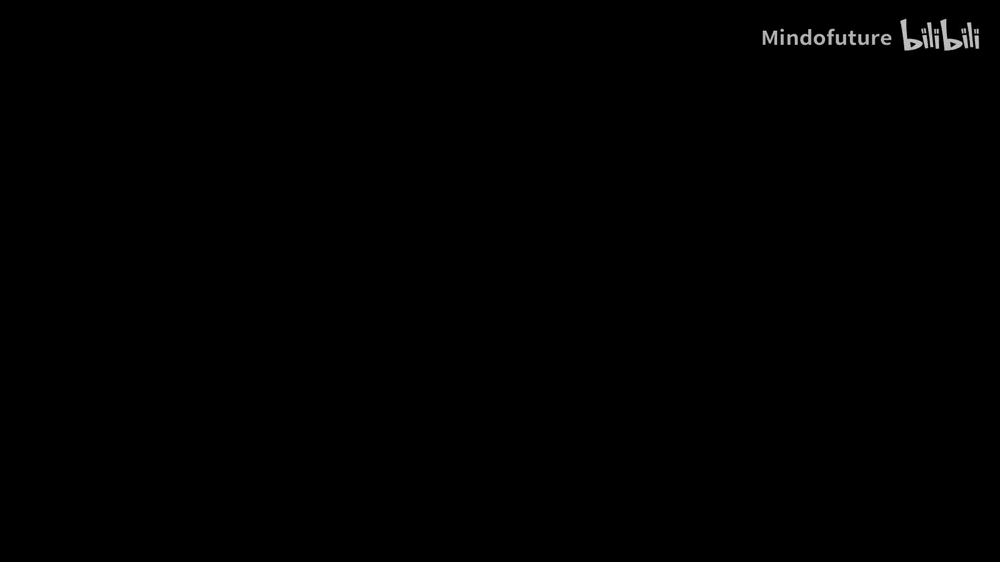
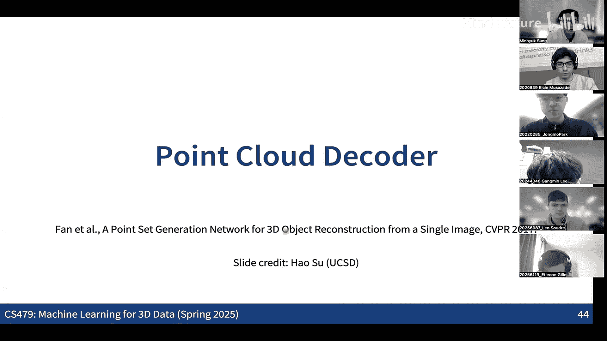

# 【韩国科学院】机器学习3D数据处理 ｜ KAIST ｜ CS479： Machine Learning for 3D Data p03 P03_Lecture_4_-_Point_Clouds_1_(KAIST_CS479__Spring_2025) -BV1YmuBzTEmx_p3-

Okay so let's get started。 So this is our first time the course first week data。

 So this time we going continue discussing the the neural network that can basically the pointン cloud and we also discuss the pointン cloudデ quarter as well。

So as the kind of the very basic architecture that can process some kind of any the 3 d data。

 the point cloud， we started to discuss the point that。

 which is kind of the simplest kind of architecture。

 and also the assignment one will be about basically implementing this architecture So we basically discuss some kind of details for this architecture which is basically taking the2 d array as the input which is representing the point cloud。

 basically having n number of the points where each of the point is having at least the X Y z coordinates and also we can have some kind of the extra information and the color information or the normal information but any kind of information So given some kind of the d dimensioner some kind of the information for each of the point we are having the end points So we are having the M D kind of the array。

So given this kind of array we are making prototype2 the versions of the point at。

 which is about extracting some kind of the global information like the class course for the entire object and the other one is about basically getting some per point information which can be used for some kind of the classification。

 the segmentation the tasks So we also discuss kind of two versions of the networks and also the some multi the applications。

And what we wanted to achieve in the design of the point there was basically achieving the first the permentation。

 the invariance in the equivariance， which basically means that know however we change the order of the points。

 we want to get the same dec score So here the question was how we can basically guarantee achieving the same outputs。

 whatever basically the peration we have for the given the points。

 So this was about the perutation the invariance， and the perutation equivariance is about basically getting the same kind of the the perations for the output depending on how we change the order of the input points。

 So this was the property。And the second property was about the transformation the in。

 So we also wanted to get the same output whatever basically some kind of rotation that we apply to the given the point cloud。

 So the main question that we had last time was that how we can basically guarantee these two properties in our the design of the neural network。

So especially for the permutation invari and the equilibriumence。

 we discuss the symmetric dysfunction function， which is basically guaranteeing these kind of things。

 So when we change the order of the inputs， we also want to get the kind of outputs。

 which is having the same order， So we discuss some kind of the bunch of the desymmetric function which could be basically the maximum minimum like sum average kind of like many things and basically we discuss using the maximum function as kind of our desymmetric function So which is basically the by definition we are keeping the permutation invaris we desymmetric dysfunction function and then basically based on given any simple desymmetric dysfunction function we could basically consider a family of thesymmetric function by having this kind of architecture。

 which is having some kind of the function processing each of the point and aggregating all those information our desymmetric function。

 which is。also called the pulling function in denial neural literature and also having another some kind of the the processing kind of function for the outputtic function。

So this simple is the idea for those kind of design was to use the NOP for both the input de processing and the output the processing while having the some simple function for this method function。

 which was using the maximum in our case。 So this was kind of the very basic demo module in the point。

And we are also going to discuss some kind of the other divergence of thesymmetric functions later。

But given this kind of debate basic dysfunction function。

 we could basically make some kind of the bunch of the layers in the pointnet and also the idea of like achieving themut the transformation。

 the imbedance was to involving the spatial the transformer the network。

 which is basically not guaranteeing achieving the transformation， the invariance。

 but we could basically use this transform network in terms of that aligning given the input point cloud into some kind of the certain kind the transformation。

 So giving we are basically not exactly define some kind of the canonical de。

 but we basically hope that spatial transformer is playing the role in terms of aligning all the kind of the point cloud with respect some kind of the transformation in a that the rest of the architecture becomes much easier to train some kind of the information。

So that is basically the basic idea for the spatial de transformer here so what we are doing is that given the input points we are basically predicting some kind of the global de transformationation and we also hope that this transformation becomes a rotation the matrix and the idea for that was basically simply using some kind of theregization。

 the loss function like this in terms of the output 3 by 3D matrix becomes a rotation the matrix and then applying this into the given the point cloud in terms of that the output becomes some kind of the aligned the point cloud in terms like applying some kind of rotation。

So in terms of that we basically have some kind of the module。

 which is align the input de point cloud and the things that the same idea also could be applied not in the3 space。

 but also in the feature space as well。 So we could also consider adding the same thepat transformer in the higher dimension of the feature space as well。

And then based on this kind of the online DPo cloud。

 we get some kind of the local de point level the features and applying the max plane and getting some kind of global features and then running the MP to get the kind of the class course as they output。

And we could also consider making the segmentation。

 the architecture by combining the local features and the global features and also running the PowerPoint data PO。

So this was kind of the page architecture that we discussed last time。

And the reason like why we are using the max pulling here。

 while there can be so many other options for the ssymmetric function was that the max pulling was giving the property that it becomes robust to the missing points。

 So this was also kind of the powerful the property of the point net that we discussed before。

So we sold some kind of the rep in terms of that even then you have some kind of the loss of the missing points and actually the accuracy of the pointnet。

 especially for the classificationification of the segmentation。

 the accuracy was not working than much So that those kind of the experiments that we are basically training the point net。

 for example， we the 1000 points and the testing the same network we like much less number of the points like the50 networks something and the discussion was basically about like how much we could not basically lose the accuracy based on the missing the number of the points。

And actually， the things that the accuracy was not working a lot because of the effect we are using the max pulling as the negative function。

 So these are some kind of the points which are basically visualizing the critical de points。

 So those are some kind of the cases that if we take the max function。

 then for each of the dimension， we could see the points that are contributing to the max values。

 right。So if we have the 1000 the dimension or defeat 1024 dimensionary features for each of the dimension。

 were gonna basically will will be able to see which point is basically giving some kind of the D max value。

 So those points are basically becoming the quite points。

And if we see the set of the critical points and this becomes typically like this kind of sparse the set。

 which is basically nicely capturing some kind of the semantic some kind of features like some kind of the edges on the tables like this and also some kind of the points that are basically giving some kind of the important information for the shape of given the point cloud like this。

 So this basically means that the set of the critical de points is basically much sparser the set compared to given the original point cloud。

 and if we have any kind of the point cloud that is basically including the set of the critical the points we will be basically some kind of the same the features So this is showing that why the point that is more robust to the of the missing points。

 So given that for any kind of the original the shape like this even any you any of the points not included in the critical the points。

 the output will become the same。So this is also giving the property of the point in that that becomes more robust to the missing points compared to the cases that we are using the other dissematictic function。

と those are some kind ofデージ ideas that weィワィポイントね。Is there some kind of issues we discussed？

Any questions on this？So yeah， let me know if you have any issues， with。

So this sounds good actually so the first assignment we do about like implementing this simple architecture。

 but actually if we compare this architecture with the typical decomvolution the neural which is typical use for the images so the good thing of the combvolution the neural net is that actually we can have some kind of some level of the so in terms of that we are basically starting from some kind of the having some very the local the we the small receptive the field and then increasing the size of the receptive field in terms of that we start to get some kind of the more the global the so that's kind of some nature of thecomvolulution the neural net so the basic idea for the combvolion the neural net is that we are gradually decreasing the resolution of the grid like this and then for each of the cell in of the down sample degree we are basically aggregating some kind of local information into the cell in the lower dimensionary the degree。

Then also applying the same the convolution， the operation for each of the layer of the extraction rate。

So which means that when you apply some kind of the local decomvolution in the down sample de like this with some kind of features that are aggregating some information in the local region。

 actually， this becomes like increasing the executiveive field because each of the cell we already have some kind of local information in the region So if we think about the same kind of the local region in the down sample the that will be actually some kind of expansion of some kind of the bigger region in the original de So that is basically giving some kind of the multiple levels of some kind of abstraction in terms of that real。

 so basically increasing the receptive field in terms of getting some kind of features from the very some kind of local region into some kind of the bigger some kind of regions。

So that's kind of the power of the combustion neural network in terms of the neural network can also basically handle both some very local information and also some kind of the more relatively global information in the basically the design of the neural network。

But actually what we are saying the point to net is that point net only has the two levels right we only get the per point information and then aggregating all the point information into the single the global division right so there is no kind of the level of the abstraction is specifically getting some kind of the information where every single point and then aggregating all the information so very local and the very global so there is no level between these two。

So here the question is that how we can also basically have some kind of the multiple the levels of kind of the abstraction in terms of that we are basically starting from the very local information and gradually increasing some kind of the receptive default field in terms of getting some kind of information for some kind of in the middle level of the abstraction。

So that's kind of the missing part in the point net。And also。

 while we also discuss like not achieving the the transformation， the invariance。

 this was basically limited into the rotation。But while we can also have some consider like。

 you know， the translation as well， So when you also de translate the point cloud。

 how can you basically guarantee to get some kind of the same in the outputs。

And this kind of the translation， the imbalance is naturally achieved in the con the neural net because we only care about some kind of the relative decoiness。

 not the absolute decoiness right， so we only basically care about some kind of the local the neighbors for each of the pixel while treating the local the patch it kind of the entire image right So in the design of the conversion the neural network the translation。

 the imbarance is like naturally achieved， but how we can also achieve this kind of the translation。

 the imbarance is kind of missing part in the discussion of the the point that。

So given these kind of the two missing components in the point net。

 we can also consider some kind of the advanced version， which is the pointnet the plus plus。

 which was also introduced in the 2017， like eight years ago。And the idea of the point net。

 the plus plus is actually quite simple， it's kind of the natural the extension from the point net based on the idea of the common neural net。

So here basically， the idea is that how we can incorporate the the concept of like the shift。

 the translation， the invariance of the the convolution of the corners in the the typical deco composition neural LED for the 2D image case。

So for that， basically what we are going to do is that we are going to do some kind of the hierarchyical feature the learning。

 which means that we are going to have some kind of the multiple levels of some kind of the town sample the point cloud in terms of like gradually basically aggregating some local information into the global level。

 while also guaranteeing some kind of the translation imvari。

So given the idea of the composition neural net， when you have some kind of the idea of the point net。

 how we can do this kind of thing， how we can basically make some kind of the some hierarchical structures of the neural network that can do some kind of the local to global some kind of graual digital learning do you have some ideas for that。

So here are the key is basically how we can do some kind of the gradual the down sampling of the point and then do some kind of the aggregation of this some vitro information。

So for that， like what because I I'm missing the components here。

So basically like what we can do is that we have the point net and that we can think that pointnet is kind of the architecture that can replace the convolutionary operation in the images and also the pulling as。

So the here the basic idea is that we are using the continent as the local information。

 the aggregator， we can use the classificationification architectures for that， right？Here。

 the key is that how we can do some kind of the gradually down sampling of the points while also kind of like taking some kind of the local information。

So for that， basically we are going to introduce like the two kind of the operations。

 one is the sampling and the other one is the grouping Basically you know we can define these two functions in many different ways。

 but the simple the ways that we can do this is basically that for the sampling we are basically you know taking some kind of the key points using the idea which is called the authorities the point samples。

The farthest point that point is basically nothing。

 but starting from any kind of the key point from basically when you have some kind of the given the n number of the key points。

 we find a point which the distance to the all given the set of the key points become the farthest。

 right。For example， like when we start from like one key point here for all the kind of remaining in points we compute the distance to this point and then find the point which distance to this one become the farest then after taking this the next one will be this one right。

Then now， given these two points， we also consider the sum of the distance from the all the other points。

 every other single point to these two points。And pick the point。

 which the sum of the distances to these two points becomes the proudest。

 and we are repeating this kind of process in terms of that we are selecting a set of the key points which are basically uniformly distributed over the given the point cloud。

So that is specific the idea and how we can do some kind of down sampling of the points。

 So starting from the end points， we are picking some kind of the smaller number of the key points from the given the the the the points。

So that becomes kind of the next level of the the abstract。 So in the next step in the next layer。

 given this kind of set of the points， now we can consider these parts。

 the set of the points as the given the point。 and we can do the same thing。

 We can apply the F P deal again in terms of the we are also taking a parer set of the points。

So that's basically the basic idea income that we are gradually decreasing the resolution of the points。

 So for example， like we can start from the like 1024 the de normallyity points and then taking。

 for example， I don't know， like 256 the key points based on the ApplePS。 And then after that。

 they are taking 64 points out of the 25060 points and then we can do this kind of some gradual some kind of the the down sampling of some given the kind of points。

And then given this kind of the of the point， now we are aggregating some kind of local information by just taking some kind of the points。

And for that， we are basically doing some kind of the ra space， some kind of the bold quality。

 So given we are taking all the points that are basically which distance to each of the key point is basically smaller than the specific the radius。

 So that's basically the idea in terms of that taking the key points and taking some kind of the some localer points for each of the key points like this。

Makes sense。 And then what we do is that now we want to basically take the feature for this kind of point by aggregating the local information。

 And for that， basically， we can use the point net。

 So the point net here is basically running for each of the local region。

 And then we are also using the shared point net for the all the local regions。Make sense。

So here basically， the process is that given the， you know， the denser， the set of the points。

 now we are taking a the set of the key point， which becomes this parsal set of the points while basically taking the features using the local point in that right。

And in the case that when you apply the local de point net now we are treating all the points based on the relative decoiness。

 not the actual decoiness so given each of the point now we treat each of the key point as the origin in the3D space and then taking some kind of the relative de for each of the neighbor points and the processing the point net so that's basic idea that we can also keep some kind of translation。

 the imvariance and that's the basically the same idea。

 same the concept coming from the convolution neural network right。So that's the big idea。

 here the question is that how can you set the number of the sample the key points So the number of the set the key points is some basically some kind of parameters that we can choose。

 So for each of the layer we can choose the number of the key points as you want。So good question。

 does it mean that if the rad is small， We have small people seems。 Yeah。

 so this is a really good question。 So if the radius is too small。

 then there might be too few number of the points。 And that's actually the kind of issue for this kind of architecture。

 So we are going to get back to this issue。 So the here。

 the question is that if the radius is too small， then there might be also too few number of the points for each of the kind of the key points。

 Sos we are going to see how to handle that issue。What does it mean for the appointed to be shared。

 so which means that we are heading a single the appointed at the architecture。

 which is basically processing all the local regions right？

So that's also the coming from the concept of the conversion the neural network。

 also for the conversion the neural network， we are using the same， the shared。

 the conversion thes for all the local limited patches right So following that。

 we are also using some kind of the same the point that。

 which is like working like the conversionvol， the corner which is processing all the local regions in terms getting some kind of the key point the information。

 the key point the features。So basically what you can see is that we can repeat this process for the next level of the point cloud。

 So given the densest the point cloud， we are getting the next level this par or the point cloud while basically getting some kind of some key of some kind of the features for of the key point and then we can repeat the same thing decreasing the resolution with another dis par set of the key points applying the next level of the point net to aggregate the local information and then getting the dis paral the point cloud so we can basically replace iterate this kind of the process until we get some various parts the point cloud just having some just few normally points。

So that's the basic idea of the set abstraction， abstracting getting some kind of the multi levels of the abstraction following the idea of the convolution delivery network。

Make sense。Iに quite for someです。So you can see that this is basically I think but you know replacing the convol the corner with the point while basically doing some kind of down sampling with the farest point sampling。

So simple idea， what does each point iner return to allow this operation to be repeated？Well。

 I mean the point that So we basically is sort like using the point net classification。

 the architecture， which is giving some kind of the some global feature for the local region， right。

Then it becomes the same thing。 So at the very beginning。

 we're going to have some kind of the end number of the points for each of the point。

 we're going to have the X， Y， Z， plus some kind of information， right。

And then now we are extracting the A K number of the key points， and for each of the key points。

 we're going to also have some kind of feature extract from the point net， right？

And then now we can treat this as kind of a new set of the point clot we decay emergency features for each of the point then we can do the same thing right we can now extract the sparsrs。

 the satellite the key points while applying the same the type of the layer。

 so that's the basic idea。The question is that are we getting what is considered global features as local features for point？

I couldnt get the meaning the question we getting what was yeah basically the thing is that what what I talking about the global feature was the point now was basically aggregating all the information that are basically fed all the information is fed into the point。

 So the architecture here So for example， like here in the number two key point going take all the points here。

As kind of the some input points into the point in them。

And by aggregating all the points information here。

 then we're going to extract like one feature that becomes the feature of these the number two key point。

 right？That's actually the local information because we are taking some local point cloud here。

So that's basically the procedure that we are getting some kind of the， you know。

 some local the this key point information by aggregating some the points。So this the bit I give。

美 it great。How does this network satisfy transformation in variance when for each different input。

 the point that may produce a different thing。 Yeah， this is really good question。

 So in this architecture， the kind of the downside is that it becomes some kind of the very tricky to achieve some kind of the apply this spatial de transformer。

So if you want to still apply this specialty transformer。

 we need to consider combining the typical point net with this kind of the set abstracting the architectures。

 So that becomes kind of the very tricky。So but you know， if we only see these kind of the layers。

 like doing some kind of multiple levels of the set abstraction。

 then applying the spatially transformer becomes very tricky。

 So while we can easily achieve the translation imvariance。

 now achieving the not imvariance becomes quite tricky。 that's a really good question。So yeah。

 so basically， we are getting the one single feature for one local region。

For those regionsピデ like thisジデ neighbor points keyポの two by taking the points only inside this ballアア a single feature that becomes the picture for the key point number two。

给。Then we can do some kind of the repetition， kind of recursion， right， So we have some。

 some feature for each of the point and then doing some abstraction。

 getting some kind sparse point cloud while getting the feature one feature per key point。

 repeat the same thing。How to find the key point from the whole point cloud。

 so that's the algorithm that I told you in here the farthest point sampling。

 so the idea of like extracting the key point is that if you start from the any single point key point here。

 then from this point。For all the other points， we measure the distance to this point。

And pick the point we the farest distance。 Then we're gonna get this， right。

 So given and this and this from the two key points now we also measure from the all the other points to these two points and then find the point which is giving this the farest the sum of the distance。

 Then we're gonna pick the other one， right。So we are we are repeat this process。

 So that's the algorithm， very simple algorithm， which is called your part point sampling。

So every time we are picking the point， which becomes the far in terms of the sum of the distance to the all the you know the previous key points and we can repeat this process itly to find the sense the specific numbers of the key points。

Make sense。Does each point that returns the classification of the local picture instead of the3 point to which we require to repeat the operation how does repeating No。

 so we are basically using the classification of the architecture here。

Soイプテ a some kind ofディ neighborデ pointsプピー key point。

And from this kind of the some de points in the some local region。

 were gonna get them some single feature。That becomes the feature for the key point。Make sense。

あ、以ジデク。So we can think about like how are they going mimic some kind of the convolution the neural net。

 So in the convolution the neural net， what we get is that for each of the local region after using some kind of pulling operation。

 we going to extract some kind of the some single the feature that becomes the feature for the。

The of the the the pixel inデ theあ theダさポで。So we are actually simulating the safety process。一定是 great。

So this is some kind of the conceptual figure in terms of that like for the each of the local region。

 were extracting single the feature that becomes the feature for each of the key points。

 and then we are repeating this kind of the process。对。

What is the main difference between the sampling and the convolution Well， I mean。

 the convolution is basically the operation in terms of like you know we are basically processing some kind of the rocur regions in the images right so that can be applied for the images because we are having some kind of the regular degree So we are not having any kind of the regular grid for the point cloud right So instead of like applying the convolution operation So it's kind of the so the hour point there is kind of some kind of some kind of the version of the convolution but not for the grid but for kind of some any kind of the neighbor the points。

So we are basically processing some kind of the de points using some kind of the local de point net。

 which can also you basically aggregate all the information using some kind of thesymmetric function which becomes the max function here。

Ex。So this is basically all about how we to mimic this kind of the architectures of the con engineering neural net for some kind of the regular structures or the points that are spread in the 3D space。

可以。아니こ茶さんです。When you try to mimic the point of doesn't this something in grouping？

オイ internet guarantee robustス to because the differenceスで。

そいやそデグポインそ question densityオデポこイトシデそに aboutデル。So yeah。

 so basically this is kind of the architecture for the encoding right。

 so we can see that we are gradually decreasing the resolution the points by basically aggregating some kind of local information and the aggregation is basically done by the point in that。

And once they basically aggregate all the information。At the end。

 basically what we need to do is that as we have done in the bundle at the point and that case。

 we can also either basically extract some kind of global information for the classificationification and we can also do some kind of the per point information for the segmentation。

😊，And the classification is basically the simple。 Like we can do the same thing After getting all the information。

 we just like get the one single the equivalent feature and you run the MLP to get the the classification score。

😊，The segmentation becomes slightly more kind of be complicated because we need to do some sort of the unping。

 right， So now we also need to propagate the information in the the lower at region。

 the the point cloud， Its partsel point cloud into the denser point cloud， right。

So we are basically having some kind of the level of some kind of the different resolutions of the point cloud。

 while basically reducing the number of the points。

 basically taking a set of the key points every layer。

 and now we need to do some kind of the propag the information from the other way around from the this purchase the point cloud into the denses the point cloud。

 right。So for that actually there are multiple ways that we can do for this。

 but some kind of the simple idea for this is that for each of the kind of point in the next level。

 the dense or the point cloud， now we also see some kind of the key points that are was close to this point in some kind of the the individuals or some kind of the based on the proximity。

So specifically in the design of the point the post is more taking the certain number of some kind of the key points in the previous level for each of the point in the next level。

 So for each of the point here， we are finding some kind of the closest a few number of the key points in the previous level。

 So typically repeat pick these three points。 And then we do some kind of the interpolation。

 basically combining those three point information。

 So we can also do some kind of pulling many things。

 but the typical idea is that we are doing some kind of taking the weighted sum those points。

By taking the distance as some kind of the inverse of the weight。

 So by just taking some interolating both the features in the key points here。

 then we also run the NP for this kind of the the the interpolate features。

 and we are repeating this kind of the process。 So this is kind of the un pullinging the procedure that we can think about to get some kind of the point features at the end。

So there can be many other ways we can do this， but this is kind of like one simple way that we can do some kind of the on。

 So we can now going the other way around like from this par point cloud and into the the denser。

 the point cloud every。😊，Make sense。So this is kind of the architecture that you can think about like mimicking the the convolution。

 the architectures into the using the pointnet。 So this is the point at， the prosperity architecture。

what is theユ pointnet？ Yeah so you pointnet is nothing but just taking a single point in the point net that it just becomes like just like simple D MLLP。

So this sounds kind of like interesting in terms of the。哦，O。Let me try。Use the pointer。听有边有思我培噶。H。

So I meant like from this point in the denser point cloud。

 we are taking three points in the previous dispersality point cloud and aggregating those information by taking some kind of the weighted sum and the weight is determined based on the distance from this point to the key point here。

I mean， it doesn't need to be some kind of the weighted。

 Some it can be many other way the way in terms of pulling the information。

 So this is kind of the the kind one way that we can design some kind of the some kind of the the the the un pulling the delay layers。

Or these segmentation the architectures。So this sounds kind of good here the question。

 all points before are used to be interpo to that certain points are not all points。

 but we are typically picking the three closest points。So， I mean。

 it might be also better if we can just take the old points。

 all the key points in the previouss level for every point in the next level。

 but it might also take some like more de computation。

So it also depends on like how many points that we pick。

So you can see that there are quite many some design choices that we can take for this kind of each of the layer。

 especially for the segmentation part， but this is like one specific way that we can design the segmentation architecture。

嗯。So this sounds kind of like good。 But the problem is that actually what we have seen as kind of the benefit of the point in net is that it's quite robust to the missing points。

 So even when you have some kind of once we trained in neural network， with the 1024 points。

 even when you basically decrease the number of the points in the test time the output was still kind of good for the point net case。

 So if we see the graph of the point， the blue one here， even when you lose some of the points。

 the accuracy was not dropping that much。 obviously if we have some various parts points then the accuracy will drop like this。

 but still like it's quite surprising that no the accuracy with the 1000 points was like 87 or something。

 but even with the 400。Like 40%， we are still getting the because 80% is' quite good， right。

Problem all this kind of the variation of like making the point。

 the plus is that while the accuracy becomes like higher when you have some use the same number of the points with the training like getting into the 90 as we basically lose some the points in the test time when you basically be some kind of the field number of the points in the test time。

 the accuracy drops faster like this。So that's kind of the problem of the point and the plus。

 So we are basically losing the robustness to the kind of the missing points in the test time。

And this will be basically quite critical for many practical cases。

 because especially the problem is that as someone also mentioned questions in the gym chat。

 the things that in the real the situation， if we really want to basically process some kind of 3D canidator scanned with some kind of some kind of scanning the devices with some kind of depth sensors。

 the depth cameras， the typical situation that we're gonna see is that the density of the points will vary a lot depending on the region。

 in the space， so especially like for the points that are closer to the depthput camera。

 the density will be way higher like this， but for some reasons that are basically the farther from the depth camera。

 that we're gonna see that actually the resolution， the density will become various spae like this。

So that basically varies typically the cases that the density of the sense。

 the point cloud basically varies a lot depending on the reasons that we are basically capturing these things。

Then the problem is that if we take some kind of the the radius of the bo in terms of like aggregating the local information。

 there might be some in some kind of specialty cases。

 there might be even some cases that there is no neighbor point。

 only some kind of dispersity key points here。So to this means that actually we need to basically adapt the size of the the radius。

 depending on the kind of the the density of of the each of the vision。

But here also the question is that how we can do this kind of the adaptation of the radius in the local information de aggregation。

 so there become some kind of the critical problem in the design of the appointed at the plus+。😊。

So the question is that what might be the intuition behind the low robustness of the point and plus Yeah so this to the region the intuition behind the low robustness of the point at D plus plus is that when you have some this kind of the varying some kind of the density of the points。

 actually the point plus plus might be worse in terms of that we may not have some kind of enough no de points in the local region。

 then there is nothing that we are in code for each of the layer in the point at the plus plus。

So that's kind of the downside the point， the plus。

 which means that we need to do some kind of some sort of the adaptation of the the radius。

 basically local regions， basically that's kind of like adapting the receptive field。 for example。

 in the comm in neural network of the case， which we didn't need to do that， for the images。

 because we are having some kind of the regular grid。

 So there is no worry about some kind of the density of the deep pixels。

 But since here we are basically having some kind of the some irregular structures that the where basically the density can vary over the regions。

 we might need to consider some kind of the adaptation。So here。

 the question is how we are going to handle this kind of issue。For the point of D plus plus。

So there can be two simple ways for this。The first way is that which is we call the multiscale the grouping。

 which is basically nothing but we are basically taking some multiple the radii。

 multiple the skills of the boards in terms of that we are basically for each of the key points。

 we are not having a single the scale of the receptive field。

 we are having some multiple the skills of the radiI， basically multiple the radiI。

 which is basically having some kind of the information from the smaller region and also information from the bigger region as well。

 So in terms of the neural net basically can take all the information in the multiple the skills for the vocal regions makes sense。

So since we there is no way that we can really basically adapt the density。

 what we do is that we're simply basically just taking multiple radiI for all the points and basically taking the information from the all like local the global for the multiple scales。

😊，So that's the basic idea for the multi scaling grouping。Then what to be downside for this idea。

Very you know obvious the downside for this idea compared to the you know the bundle of the point plusス plus is that。

Anyone any thoughts like what to be kind of downside for this？Yeah。

 obviously the problem is that it's more expensive because like we need to run the local the point net multiple times right So if we basically have some kind of the 3D levels of the skills。

 basically 3D raI of the the size of the balls， then we need to run the point at three times right。

That means that it's basically involving these three times multi computation。

 so that's kind of the problem for the multi scale the grouping。

And if we also see some kind of the effect like this。

 we really need to have some kind of the multiple， many， many kind of skills。

 we have some kind of more the skills that might also involve the more the computation。

So instead of that， like what the kind of is slightly like you know simpler the architecture is that now we are。

 I mean， this is like Tom that is kind of a multire grouping。😊，This is kind of like the same idea。

 But what we are going to do is that we are basically having some kind of the two sort of the the layers。

 It's not the state layers， but basically having some two types of the features。Basically。

 the thing is that so every step we are having basically having a set of the key points。

 which is basically extracted from the point cloud in the previous resolution， right？

So let's say like we are having the 64 key points extract from the 25060 points。

 which are also the key points from the extract from the previous layers， right？

And what we do in the point and the close is that for each of the point。

 in the 64 points that we are taking the neighbors in the 256， the resolution of the points。

And aggregating information from this point with also the features defined for this specific resolution。

 right？😊，This is the first the feature that we are extracting in this like multireency group in the case。

So this the same way the point at the plus plus and this information can be good in terms of that we are basically aggregating all the information in like hierarchical way。

 So especially when the points are dense， this might be kind of like useful information。😊。

And what we do is that not only basically taking the information from the previous layer。

But also for each of the key points in the some kind of the some the next layers Now we also take the point in the input point cloud。

 not in the previous layer。Basically， when you have the 64 points and then when you say that the previous layer is basically having the 2560 the points。

 we can consider basically taking the neighbor points in the previous layer or also taking the neighbor points in the original point cloud for example like10240 points。

😊，Then that will be basically way denser points， right？So even for the same de， like there be。

 there will be various spa points if you only consider the previous resolution。

But if we consider the highest resolution， the input points。

 then there might be some more points even in the inside bowl。

So that is basically aggregating the points not from the previous layer。

 but from the original point cloud， so this can be actually especially useful when the point cloud is quite spae because this is the highest resolution that we are having。

 right？But this is not the case that we are basically gradually basically abstracting information through some kind of the hierarchy。

 so that is kind of the key parts in the point at the plus plus basically some kind of the multi the level of the abstraction。

 but we are basically having kind of some kind of skip link。

 so sort of skipping all the kind of the multi resolution。

 but directly aggregating the information from the input point cloud in terms of the hour the architecture can also work even when the point cloud。

 this kind ofpers in some specific region。对。Makes sense。えニコエョソンです。

So can you see some kind of difference between this and this so in the previous multisecurity grouping so this is not about basically thinking about the resolution of the multiple the resolution of the point cloud so it still consider the resolution of the points in the previous layer while basically we adapt we basically have some multiple the skills of the raI in terms of we have some local information in the global information。

So in the multire de grouping， what we do is that while we fix the size of the bolts in in the 3D space。

 we either take the points in the previous the resolution。

 or they take the points in the original input point cloud。

 so in terms of that we consider the multiple the resolution of the points。

 the previous one and also the high state resolution， so the first one will will basically useful。

 especially when you have the denser， the point cloud in terms of that we are basically getting some kind of the hierarchy of the abstraction of the information。

 but the level one will be especially good in terms of when you have the sparsity the point cloud because we're gonna to have some more the points with the I state resolution。

Makes sense。Is rotation invariance for the local features guaranteed。

 No so achieving the rotation invariance is another kind of the problem here。 So as I said。

 as someone also asked before， if we want to still achieve the rotation the invariance。

 if we want to basically use the spatial transformer。

 then the rotation should be predicted from the entire point cloud right So if we basically apply the spatial transformer for each of the ro region。

 it doesn't make sense because the rotation should be applied to the entire point cloud right So that's actually the case that we also might need to consider applying another the point net to predict the rotation。

So it's basically the do basically plugging， the spatial transform for the rotation。

 using some kind of another or some kind of the pointnet kind of layers。

 but we are not discussing that specific case here。What does it mean by integrating future points。

 Does it mean it is interpreted。Noそ here basically integrating feature points means basically know what we are going to take as the input to the local point。

你 that that mean what。So we are basically having the some local point in that， right。

 So whether we're going to take the points in the previous delay。

 the previous resolution or whether we're going to take the points in the original the point cloud in the highest resolution。

 So that's the meaning here。これ。Then this architecture becomes basically more robust to dense the sparse kids。

 especially when there are some kind of sparse region in the given the point cloud based on basically having some multiple these skills or considering the multiple resolution。

So actually taking the multiple skills is slightly better so if you see the comparison between the here。

 the MSG here and the mG， the multiki grouping and multire grouping so red indicates the multi skill in the grouping which gives some kind of the best the robustness into the missing regions。

 the downside for this is just takes more time for the competition for the training and also the test。

 so it's kind of the downside for the multikiing grouping， if we also use the multire grouping。

 it also taking twice more time because we are having the two locally point of that right。

but just really having some kind of tool local point in it still we can achieve some kind of the quite good the robustness to the missing points which becomesの light blue color here。

So it's okay to understand it is taking picture from the previous layerst no， I mean here。

 basically the first case， the left key points is basically taking the the points from the previous layer and the the the other other feature is taking the points from the high standard resolution。

Notて previously。我这。Any questions on this？あM at some rules of this connection。

It's kind of be some sort of the skip connection。 but it's not yeah sort of like skip connection kind of things。

 So we also basically directly aggregate the highest resolution the information into the various parts the point cloud。

嗯国键是。So for more details since we are running off the time。

 I recommend you to check out some kind of the some details in you can basically search for the appointment plus plus paper and see some more details there。

 So there are also quite many details in the paper。

And one more kind of the interesting thing in the appointed at D plus plus is that so think about that。

No， we was basically some kind of handle this kind of the deformability shapes。

The all3 information that we are tweet is not just about some kind of some some human made objects like the the marks or the chairs or something that we can easily capture from the some3 can。

 but it can be some kind of the information about some kind of the， I don't know。

 like animals like human body， human hands， like for many kind of the some deformable the information there as well。

So we can also consider making the some kind of neural network that can classify， for example。

 like the horse cat， the like those kind of things， some kind of diploma of the shapes。

But for those kind of cases， here the question is that how we can also make the our neural network to be imbared with this kind of deformation。

So basically like when you have this kind of a horse。

 and also another the horse lets keep changing this kind of the of the horse like this。

 we want to see that actually these two should be basically the same horse， right？😊，Like。

 say we also have like human bodies with some kind of all different， some kind of poses like this。

 like moving the hands and the head， like the like older things。

 like when you have some kind of different pole of the human bodies， we still want to see whether。

 know basically taking the identity of the humans， whatever the different pose that we have， right。

Then here the more detailed question is that how we can also achieve some kind of the whose im in our neural network。

So that's also something that can be very challenging So for that basically what we can do is that know the good thing of the point and the plus plus is that it's basically aggregating some kind of the local information。

 right？So which means that even when you have some kind of different pose of the human bodies。

 if you also see some kind of the local region， the local region may not be changed that much， right？

So that's kind of the part of like having some kind of the some the you know。

 having some kind of the multiple levels of data， extraction starting from the local regions from the into the global。

The only thing is that some kind of the proximity across the points will be changed depending on some kind of different deposits of the human bodies。

So for that， basically what we can do is that to basically when you do some kind of the if I go back to here。

Yeah， so when you do some kind of dis sampling and the grouping。These areオベオンデディス right。

So based on the distance that we are defining in the3D space。Soly。

 what we can do is that we can do these two things， not based on the distance in the 3D space。

 but basically based on the distance of the other things， basically distance over the surface。

 for example， So here the basic idea is that to make the out neural network to be more like some kind of the pulse im what we can do is that instead of like taking doing this kind of the grouping and the sampling based on the eucalian distance in the 3D space。

 we can do the same thing based on the distance over the 3D surface。

 So especially in the case that when you have some kind of the mesh as the input。

 not as the point cloud as the input， so basically the original the input is the。

 but we are basically sampling the points over the image。So in this kind of the case。

 then we can define some kind of the distance over the surface like this。

So this kind of the distance over some kind of surface is called the geodesic distance。So basically。

 what you can see is that when we measure the distance between these two points。

 it put us like measured the Euckulean distance。 Then we can see that actually these two are quite close each other。

 right in this 3D space。But if we actually measure some kind of geodes distance。

 the should test path over the image like this， then this will actually， we will be able to see it。

 actually， these two are not very close to each other， right。

That's kind of the the factor that we can make the our neural network is kind of the pulse imvariant。

 So however， basically， I know move my basically hands like this。

 manipulate like all the boat like other things， Basically。

 the distance between these two points will not be changed。 Basically， you know。

 if I don't expect this ks that much， right。So depth is basically the way that we can easily make our point at the plot plus as kind of the point as the de imvariant in terms of basically using some kind of the distance metric which is not defined based on our discrete3 space。

 but based on the judicialdi distance over the de mesh。

So that's kind of the also interesting idea in terms of like how we can also adapt this architecture to handle some kind of the some。

 you know， deformable kind of shapes。And we can also consider using not only the geod distance。

 but using some kind of like some feature distance。

 So once we define some kind of the point Why the features for each of the the points over distributed surface。

 we can consider using the distance measured in that feature space that might be also kind of another way that we can make our neural network as some kind of the deformation imvariance imvari。

So there are some kind of the interesting ideas for this。But let me you going to。

Spped some more details here。 Any questions on this。

Since we are running out the time let me quickly a bit with some we are actually quite many things to discuss。

 So kind of the more kind of discussion is that so we discussed that thesymmetric function that we are considering can be basically designed with the combination of some kind of some the function for processing the input point and given thesymmetric desymmetric function here。

simplesymmetrictic function here。 and then some kind of the the function for the post processing for the outputsymmetrictic function。

 right， So this composition can always make some kind of the a new symmetrictic function。

And the idea for the point of the plus plus was not basically making new symmetrysymmetric function。

 but just like using this as kind of the basic deco component for the local information de aggregation。

 right？But here， the question is that would there be also some other ideas other way around to make some kind of the this basic the building block with some other choice of the these three functions。

So we can actually think about like making some kind of any new combination of like those three functions in terms like making another dematic function。

 So I'm going to go very quickly with some kind of some other kind of variant for this。

 So there are quite many。 So if you can also we can also check out some many other kind of cases from some other papers here。

😊，SoBut this is kind of like the one idea that， no。

 which is basically not using some kind of the max function for the aggregation。

 but doing some kind of the taking the weight to the system。Here。

 you can see that once you have some kind of the ML LP like taking processing each of the point in some like taking the max here now we are taking the sum with some kind of weight and the weight is basically compute based on the distance from each of the point So what does the So here basically this means that for the neighbor points of the eye here。

 So basically in the point at the architecture for each of the key point。

 we consider some kind of the neighbor points， right。So given the kind of like neighbor points。

 which are indexed as by the J and given the key point which is indexed by the I。

 where basically it's basically made like how we define some kind of the basic the building block for the detic function。

不う。And here also one interesting thing is that actually we can apply the same idea with the Gr structure as well。

So actually what we can do is that for the graph the kind of the dataator for each of the the point here。

 which is theertex of the graph， we can apply the same kind of kind of the neural layer。

 which is like obggregating some neighbor detes in the graph。

So actually the same idea can be applied to process the G data。

 which means that actually we can also apply the G neural network into the point cloud data as well。

So you pre the very basic di network。 actually， there are quite many tones。

 literally like lots of some kinds of the variance about like making some processing the the data。

 but it pres some kind of the earliest the version the network actually。

 it's kind of quite related to the point that in terms of that we are having this part。

Which is like aggregating some kind of neighbor points while taking the sum of those points。

 and then basically adding some kind of the information for the key point and then doing some kind of the this is function。

 So this becomes some kind of the post processing the the the function here。

So you can see that actually correct neural net， the simplest dec neural net can also be basically considered into in this kind of framework。

 basically in terms of like how do we make some kind of asymmetric function in terms of compositing the functions。

So this is the G neural network and you can see that actually the same idea can be applied to process the point cloud as well。

So this is like another burden。This is also another version which is called the edge combvolution。

 which is cans applied to the graph， which is also like aggregating some local information by just taking the neighbor points like this and actually you can see that this is the version that we are taking both the relatively coordinates here。

And also， the absolute quoing is here。So we are losing the property of the translation imurance because of this part。

But actually， you can see that if we drop these parts。And AP Eor de random apart。

 then this becomes exactly the same with the lookor the appointed that we have seen the point D++。

We are basically adding some kind of the features which is coming from the absolute coordinateiness。

 while we are basically giving up the translation the im in architecture。

So those are some kind of the old， some kind of the variance in terms like how we gonna make some kind of the setic function thats kind of the basic building block in the point in the plus plus kind of architectures right。

Actually， one kind of the interesting thing here is that so in the at the architecture point at the plus architecture。

 we defined the operation the sampling and the grouping， right？

So as I also mentioned in the previous slide， when you apply this kind of like sampling and the grouping is the middle of like how we define the distance in the metric rate。

 so we could define the use the distance defined the 3D space。

 or the distance which is defined over the surface which becomes the geod distance we using the distance in so many kind of the feature space。

And the idea of the this like dynamic CNN， the DJ CNNN is that it's even like more about basically define learning some kind of feature space where we can basically measure the distance。

TheIn terms of basically doing some sampling and the grouping。

 we you basically need to define some kind of the sort of the distance in terms of measuring the proximity across the points。

 we are learning some kind of the feature space where we can basically measure some kind of the distance。

So now also the distance of becomes kind of the adaptive in terms of the features that we are learning。

So that's kind of an interesting idea。So in terms of that。

 we are basically using this kind of the notion of the distance for doing some kind of the sampling and the grouping in terms of that we extract the features。

 right。But now we are using these features to this define the distance to the extract next level of the features。

So this is kind of the main difference with the point at the plus。

 which was the case that we are already using the distance in the3 this space or using the geod distance where some kind of in the fixed space where we measuring the distance。

 but now we can also consider every layer， we are measuring the distance in the learned feature space。

 these features that learned so far in the previous layers。

So this's kind of be some sort of the another the layers of the adaptation。 We are basically。

 you know， you know。Dynaically， basically updating the the basically notion of the distance every layer。

 So that's why this is called the dynamic graph C and in terms of the proximity is being changed over time。

 because we measure the distance in some kind of learned the space。Makes sense。

But what are we kind of downside for this idea， can you guess？So basically。

 you can think that this is kind of like having some more flexibility in our the architectures。

And kind of like interesting the idea for the like that we also do some kind of the adaptation of the like defining the distance and the proximity across the points。

By using the learned features for that。But the kind of the problem is that。

Typically the dimension of the features will be higher than three right some kind of the high dimension of the features which means that we need to be able to find some kind of the someの labor the points。

インディハイテメトのスペリス。I don't know whether you have learned about the Kd3 where some kind of oak three kind of things。

 some special data structure that can be used to find some kind of neighbor points in certain dimensionary space so I mean I'm not going to get into any details for this I hope that you already learn this in the algorithm course or something but actually there are some kind of the algorithm that we can use to boost up like searching for some kind of neighbor points in certain dimension of the space and those kind of the algorithms are typically effective only in the low dimensionary space so actually this kind of data structure can be good when the number of the points is way greater than the two to the number of dimension the two to the dimension of the space。

So for when the dimension is three， like the the two to the three will be8。

 So typically number of the points that we are dealing will be way higher than the two to the three。

 right。But if the dimension is like 20， then 2 to the 20 becomes even higher than 1000 right And for those kinds of cases。

 those kind of algorithms finding some kind of the local neighbors will not be effective。

 which means that it will take tons of time to find some kind of sub neighbor points。

So that's kind of the downside like like adapt distance。

 So you can see that there are some kind of the ideas that can we can some kind of more flexibility into the hour。

😊，The neural architecture while basically spending more time in the competition。

So those are some kind of the ideas in terms that we can do some kind of make some kind of changes in they in network。

So this is kind of the summary， so we discussed the pointer which is the simple police architecture that can handle some kind of unorored points while guarantee the permutation invariance andvariance and then we discussed like making some advanced architecture now taking the point in as the basic building block。

 which is making some kind of the hierarchical， basically the structure of the features by mimicking the ideas the comb in your network right。

And we also discussed like the idea how we can make or chip some kind of the robustness to the kind of the varying the density of the points by either having some multiple these skills or the multiple the resolution。

😊，And DJCNN also also kind of the architecture that can also you know redefine the proximity of the points by using the distance in the learned the space。

 those are some kind of debate ideas， while there are tons of the other architectures I recommend you to try to basically see some kind of the other some kind of architectures here。

 actually there are more so even these are some kind of the old kind of the ideas。

 but there can be you can find actually lots of the architectures that are making some small changes here。

And you might also add some questions like why don't you use the transformer obviously there are some kind of architectures using the transformer as well so we can also replace some of the parts of the symmetric functions that we discussed in the previous the architectures by incorporating some transformers there so there are already also some kind of the ideas for that in some of the papers here I recommend you to check out those in the papers。

So we are not going to have some time to discuss all the details about the transformability for the point cloud Actually the plan for today was to discuss the point cloud decoder which is also the part of the the assignment one since we are not having time for this I guess we need to discuss the point cloud decoder in the assignment session this coming Wednesday So in this coming Wednesday we're going to wrap up the discussion for the point cloud and discuss the we're going to introduce the assignment one and then we're going to move our the discussion into the implicit representation。

で。Iに quite on this。If you have any more questions for to this lecture please feel free to post the questions on our the select box please and'm going to see you next Wednesday。

Thank you。喂。