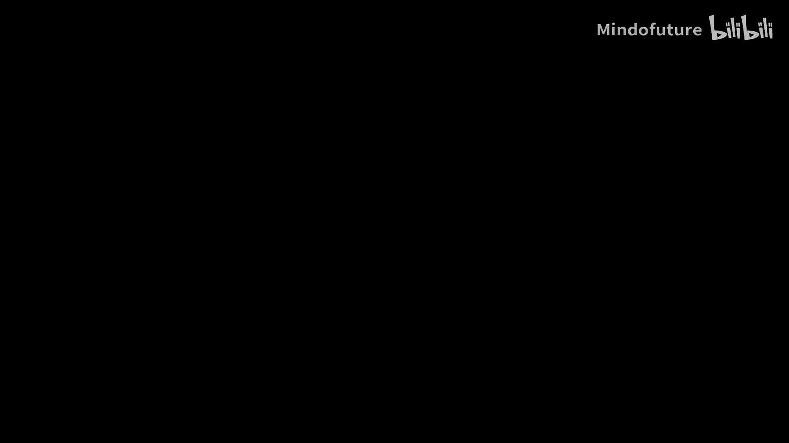
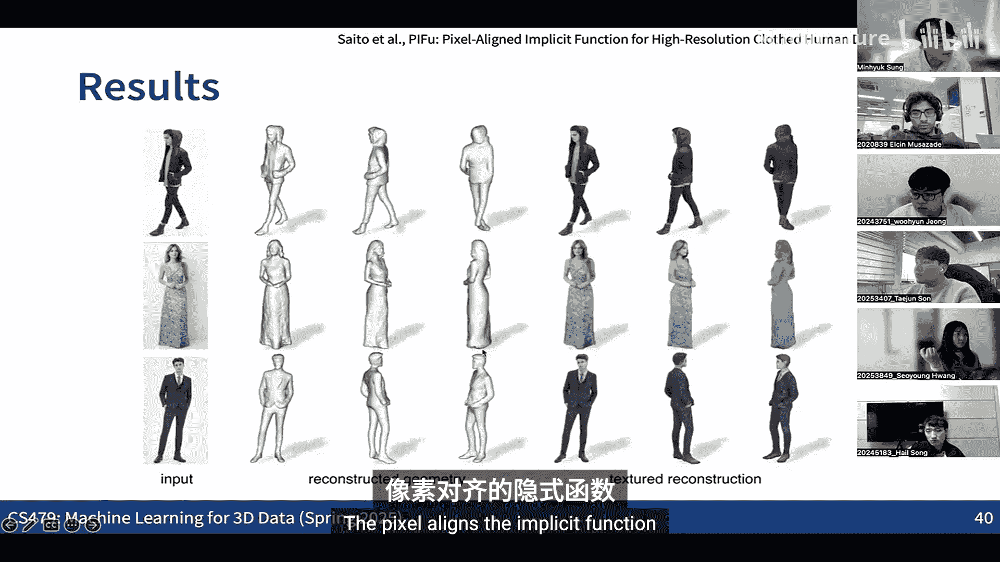
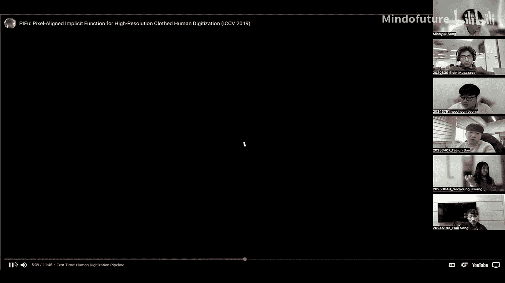
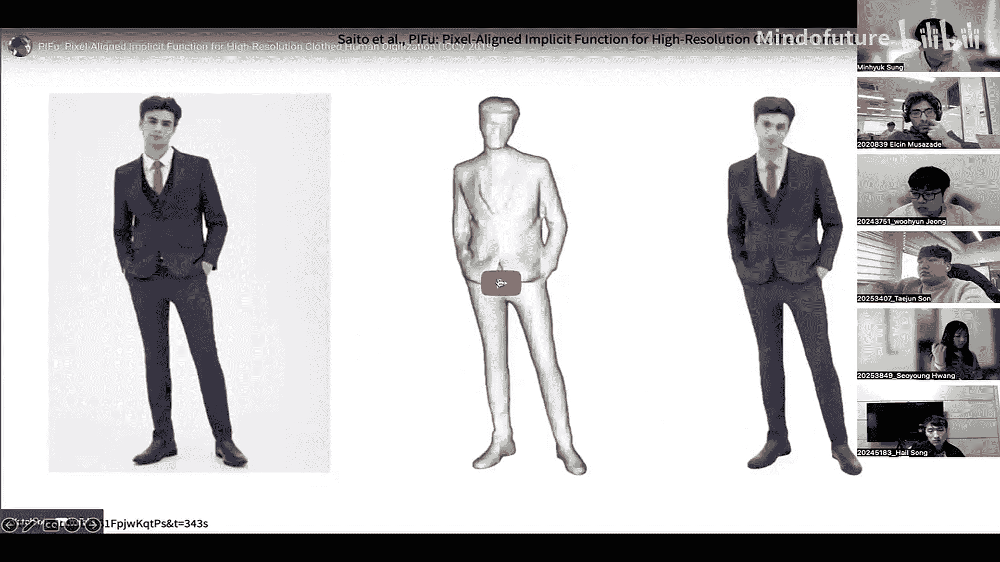
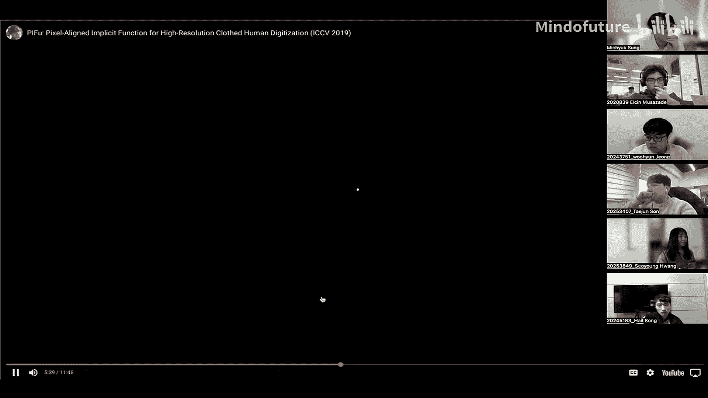
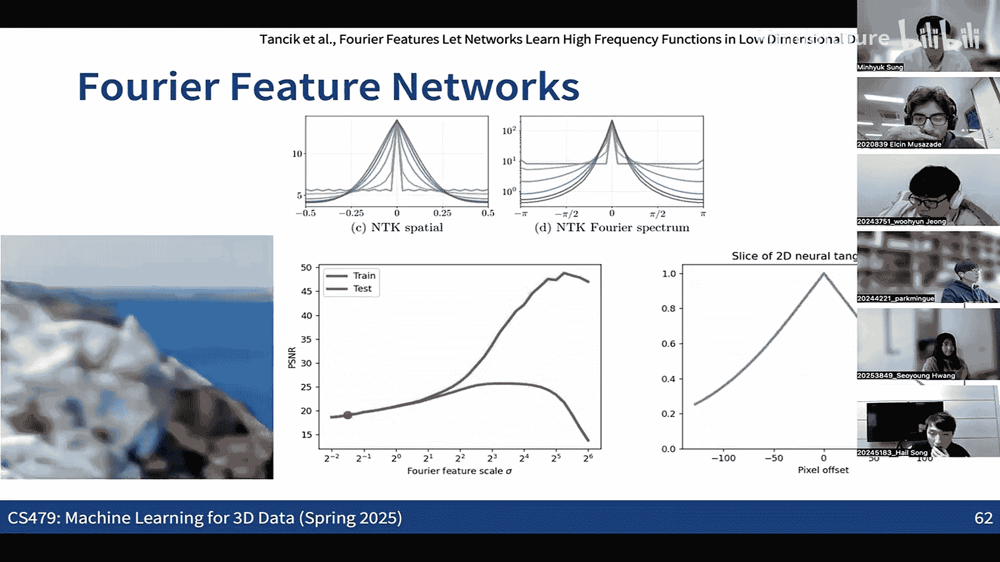
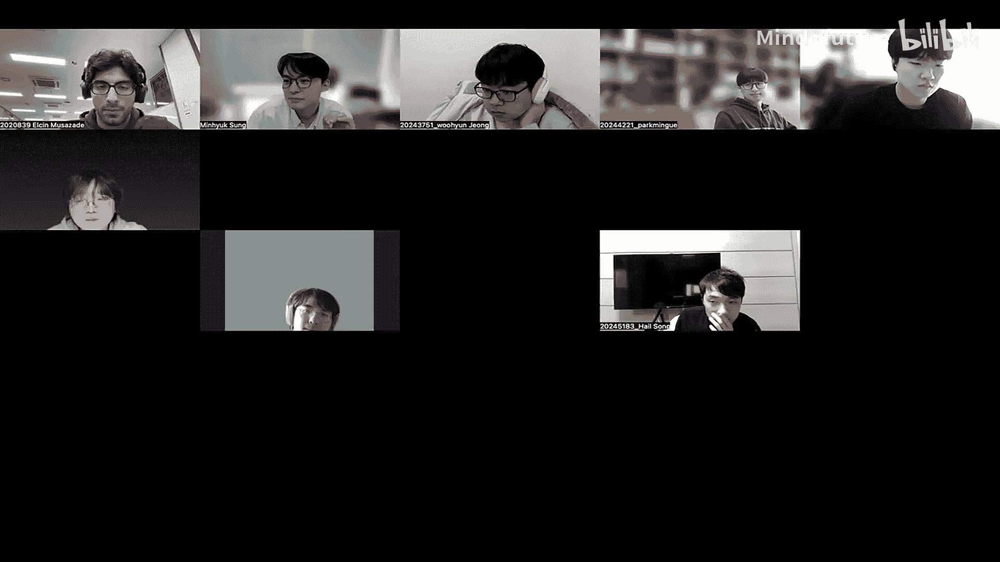

# 【韩国科学院】机器学习3D数据处理 ｜ KAIST ｜ CS479： Machine Learning for 3D Data p04 P04_Lecture_5_-_Implicit_Neural_Representations_(KAIST_CS479__Spring_2025) -BV1YmuBzTEmx_p4-

Okay， so let's get started。 So today we are going to move forward to the kind of the new topic Disc。

 So previously， what we have discussed so far was basically about how we can basically make some kind of the neural network that can basically process the point cloud the data。

 So we also discuss like the inputrs point point at the plus plus and some kind of the more advanced version or the network that can process the point cloud as the input。

 And I know that we also briefly discuss some kind of the decos that can also produce the point cloud as the output。

What did you follow the ideas about the point of the quarter that we discussed the last time in the session？

Is okay。So actually the architectural wise， it is basically nothing。

 but just having some kind of bunch of delay layers， the MLLP。

 the key idea there was basically how we can define the loss function for the set data right So we we discussed some kind of the bunch of kind of loss function。

 including the earthmost distance addition for distance and how to doors the distance So those kind of the metrics can be used not only as kind of the loss function for the point cloud order but as kind of the general some kind of the similarity metrics across the point cloud to measure some kind of the construction that accuracy as well and also conduct many other things。

So implementing the decoder with this kind of loss function is also a part of your the first assignment。

 and based on that you will be able to see these kind of results。

 which is the case that now like also combining the imaging quarterr and also the point cloud decor in a way that we can do some kind of the image to 3D。

 which is with getting some kind of outputs into the form of the point cloud。

So we discussed some kind of the advantages and disadvantages of the point cloud representations in terms of like implementing the encode in the deco and there are some kind of quite many kind of the advantages in terms of that we can make some kind of the quite simple the architecture that can that this also is to implement and it also quite efficient in terms of processing kind of the3D data。

And what do we also kind of the downside for the point cloud representation。

 especially for the in terms like making the decoder。

 So we discussed some some ideas about like making the point cloud decos。

 but we basically implement that specific architecture。

 and some bunch of layers with some kind of the loss function。

 What do we kind of the downside hoping adding that the decoders。

 which is basically generating the point cloud as the output。Any first and any。你。

downownsideて yo excuse c here。So basically， the question is that if you。

 if someone ask you to basically were if you ask someone to implement this kind of the I 3D reconstruction network。

Within basically outputting this kind of point cloud。

 what are you going to say for this kind of outputs？

Actually there will be some bunch of the limitations for this kind of the point cloud order。I mean。

 as we also discussed at the beginning， the downside of the point called representation is that we will need to basically have like lots of the points to capture all the fine details So basically the first kind of limitations。

 but also the problem of the decoder that we discussed last time is that it's impossible to increase number of the points。

 So if we set basically the number of the tone points to be like， for example， like10。

 then we cannot make some kind of the more number of the points using that the architecture。

 So that's kind of the one of the problems in terms of that we cannot basically control the resolution of the upwards。

 We are always getting some kind of the fixed number of the points。

So that's kind of like one downside and the other sort the thing is that as know。

 as I said we will need to have some lots of the points to capture all the defined details。

 but if you want to make some kind of the quarter that is producing the loss of the points as the output that that means that we will also need to have some kind of the deeper and wider architectures for basically increase the number of the points in the outputs which will also result in basically taking more the GP memory and also the competition the time as well in the training as well。

And also as we discussed at the very beginning， the downside of the point cloud representation is that we is basically not directly explicitly representing the service information。

 so in order to basically utilize that the output for many other the applications for the like rendering manipulation for many kind of things we will eventually need to basically convert these representation into the other some kind of representations。

 so those are basically some kind of the downside in terms of having the point cloud orders。

So as we also discussed at the beginning， we today we're going to see some kind of the other representation and also the decoder based on that so today the main focus will will be discussing the implicit representation and also making some kind of decoding the architectures for that this specific representation。

So basically the idea of the input representation is basically nothing。

 but we are representing a 3D shape， not using any kind of some explicit representation。

 but using a kind of the function， so we are basically making a function which can basically take any kind of the query points in the 3D space as the input and the outputting some kind of the value that is basically representing the 3D shape。

So here the two the main questions would be is that basically what sort of the values that we are going to output using the function。

 so then would be basically the first question and the second question is that how we are going to define the function。

 there should be really some kind of function， which can be have some kind of analytic form where some other kind of any kind of form that we can really basically do some kind of input output some kind of the data right。

So we are going to discuss these kind of two things in terms of how we are going to define the function for the implicit representation and what do be some real kind of the output that we are going to get from this kind of implicit representation。

So actually the Beijing idea that we are going to do here is like very simple in terms of that。

 what we are going to do is that we are going to take the neural net as kind of the function for that。

So like let's think about like the neural net， which is now taking any kind of 3D coordinates as the input and then outputting either these two types of the numbers。

 either basically the sign distance or the occupancies。

 So we are going to get into the meaning of like these do in the next slide And what we do is that given any kind of the 3D shape we are basically training in your network in a way that the neural net becomes a function representing the same shape。

 given with some kind of either the 3D mesh or the point and something。

So we can think about this kind of simple architecture is it straightforward mean terms of we are basically for any kind of the X。

 Y z coordinate， we get either some kind of the value which is either design distance or the occupancyccy。

So actually， as the output we can consider many different kind of things， but the two representative。

 the outputs that we can consider would be sine distance or the occupancy。

 so basically when we talk about the sign distance。

 which is basically the case that we are basically measuring the distance from the quality point to the coologist point over the surface。

This is some kind of giving the information about the the surface itself in this really spaceway。

 but the thing is that we are you know， additionally adding some kind of the inside。

 the outside information based on the sign。So it's also the up to us depending on how we determine design sign。

 but for example， we can do in like the points inside the shape iss basically having the minus distance。

 So it's not the typical the distance in terms of that now we allow to have some having the minus the negative distance which are basically the points inside the surface。

And then we are basically also having the points which are having the positive sign basically on the outside of the surface。

And based on this kind of the some continuous representation of the distance over the space。

 how we can basically extract the surfaces that we just need to take the points which is having the distance of the zero。

 So when you basically take all the points， which is having the zero distance。

 this becomes basically the points that are basically on the surface。

 representing the surface of the of the given this way the ship。

So when you take some kind of the points that are having the same distance。

 this is the case that we are taking the level set。

 so we can take some kind of the level set of the certainty distance。 It can it doesn't need to be0。

 It can be like the level set of the distance one level set of the minus-1 and in this specific case。

 it could basically take the distance， the points with the zero distance。

 That's the case that we are taking the zero level set。

 which should basically taking the sampling the points over the surface。

So basically like design the distance is basically like one way that we can represent some 3 d shape or any kind of shape。

 actually in any individual of the space into some kind of continuous dysfunction function。

Makes sense。So this is kind of one example and the other kind of example is also having the occupancy the so we don't care about the distance。

 we only basically de classify all the points as kind of inside and the outside。

 So it's also up to us like how we define those kind of numbers。

 but we can basically have one for all the points inside the ship and0 for all the points outside of the ship。

 So this is the case that we only record not the distance but only the occupancy information。

So which means that we can consider basically having any kind of dysfunction function that is either basically outputting the distance or the occupancy given the quality point。

 and there can be some kind of the implicit representation for the given leadership。

question how can the concepting be invariient to the translation Well， I mean， yeah。

 it's really hard to make this to be invari to translation So yeah we are not talking about any kind of the incoding here So we only talk about the decoding。

Any other的 questions。So， so basically we we want to basically make a kind neural net that is basically having becoming this kind of input function to be present some kind of given shape。

 So let's say we can think about that。 given any kind of this really shape。

 we train a neural network in a way that the network becomes a function like this。

Then there might be some kind of be some questions for that。

 The first question would be that basically， how can you define the loss function for those kind of the optionss for the each of the sign distance or the occupancy。

 What do we kind of the best way to define the loss function。Iりとうざます。So basically。

 the sign the distance is the case that we're having some kind of the continuous devalue in the space。

 right， So in this kind of the case， we will need to basically have some kind of the regulation the loss like the L to loss L error loss。

 basically means cur the types of the loss， right。So for the first case。

 we will need to have some kind of dereg divorce， but for the second case for the occupancy function。

 this is the case that we have classifying all the query points into the one of the binary deces right inside or the outside for those kind of cases we can basically use some the binary decentpy the because it's really some kind of decclassification the problem。

So in terms of like trained neural network， which one would be easier。

So we can see that the secondone would be kind of easier in terms of training the neural network。

 because it's basically solving just like simply the classification， the problem。

 which we know that it is like much easier to train the neural network， right？

So in terms of convergence， maybe it might be better to basically output the occupancy。

 not design the distance， but we can actually say that we design the distance。

 which is basically having some kind of the additional information the distance information right。

 So actually， we can say that the meaning of design distances。

 basically the combination of the distance from the point to the surface and also the。

 So the design becomes some kind of includingding some occupancy information right So for those cases。

 while it might take some more time to conge basically trained in neural network。

 it can be this kind of the additional information can be useful for many other of the applications。

 So we are going to get into the kind of the advantages like having design distance later。

So basically， we can use the regression laws for the binary constantentpy laws for those kind of cases。

And the other question is that given a3 the sheep， we would need to basically get some kind of some ground truth information for those kind of either design distance and the occupancy。

 which means that we should be able to compute design this distance or the occupancy from the given3 sheep。

So how can you do that。 So that's also kind of the big question。

 So we are not going get into any kind of the the very deep you know the the deep details about basically how we can extract all this information。

But if we briefly basically ski through like the basic idea in terms of like how we can first obtain the occupancycc information from the mesh。

So can you guess like how can basically get the extract the occupancy information from mesh so let's say like we are having some kind of the solid the mesh。

 which is not basically having some kind of surface in this really space。

 but it's kind of the closed surface like the water tight surface。

 which means that the basically surface represented as a mesh is clearly defining the inside and the outside information。

And given any kind of query point in the space， how can we basically get some insight in the outside information？

Do you have any guess for that？So it's all about some kind of the geo processing。

 but the kind of interesting idea in terms like determining the inside。

 the outside of any kind of the point given the the mesh is that we are basically shooting a ray from the point。

 the query point into any direction。And interestingly， basically。

 what you can see is that when you shoot a ray into any direction and if we count the number of the intersection with the surface。

 what you can see is that if the number of the the count of the intersection along that ray is the old number。

 then we can see that that point is basically inside of the surface， the inside volume。

And if the number of the intersection is0 or basically some kind of even number。

 that we can see that those points are basically outside of the volume。

 So the number of the intersection along the degree is basically the winding number and basically by counting the winding number。

 the number of the intersection， we can easily check the intersection and not the intersection the inside or the outside of the points。

 given the volatile mesh So that's kind of the simple way that we can extract this kind of occupancycc information。

Then based on that， how can also compute sign the distance from the me。

This is also kind of like an easy thing right so once we basically have this kind of like the occupancy information。

 what we need to do is that we just need to combine the occupancy information with the distance way。

 so what we just need to do is that from any kind of the query point we find thecologist point over this surface defined the mesh and given this kind of distance information if the point is inside that we just put the minus there and if the point is outside that we just have the plus distance so they can be kind of the way that we can extract this kind of occupancy or some signine distance information。

 which also means that the conversionver from the mesh to implicit the function is kind of the straightforward that might basically take some kind of competition time but at it's like we can say that we can easily basically extract some implicit the representation from the given the mesh。

And here basically what we want to do is that we are basically encoding this kind of the occupancy or design this distance information using the neural network and the advantage for that is that we can have some very lightweight the neural network that can encode all this kind of you know the occupancy or design distance the information So that's kind of the interesting part the point in terms of that we can use the neural network as kind of the form of like compressing the information of the given this readership。

Now from the match to the in principle point is kind of the straightforward。

 but also the question might be how we can do this kind of conversion from the point cloud into the imp representation。

 so we are going to get into this point which is basically moving slightly more some kind of some kind of math kind of things so after we discuss like all the representations we are going to discuss more the convers across the other data presentations and we're going also get into the conversion from the point cloud into the imp representation and implementing this idea will be the assignment。

So now we can see that in terms of that now from any kind of random query point。

 especially in the case that when the SwD shape is represented as a de mesh。

 then we can now train in neural network in a way that they can basically take the query point and predict either the occupancy or the sign distance with either the regulation loss or the binary decent of the loss。

 right？For that， like the you know kind of like more engineering way what we can do is that we can do something more about some kind of the important sampling What does basically mean here is that basically we the more important points in terms of trend in your network is that the points near the surface right So when the points are too far from this surface is quite obvious that basically we are getting some kind of the inside the outside the points right。

So what we can do in terms of like getting some more accurate information about this surface is that we are sampling more near the surface in a way that we are doing some kind of important sampling so the idea also basically sampling more points near the surface is that after sampling over the exact dis surface we do some kind of the perturbation along the dis surface normal direction in terms of like we are having some kind of more points near the surface that you can see in the red points here and then still we are basically having some kind of disparrse the points from some kind of the outside or basically the other places in the way space in terms of the neural network is not overpicing to some of the cases or the points near the surface。

 but this kind of the important sampling can basically provide some more accurate prediction near the surface。

So that's basically case some kind of be a more technical kind of the in terms of how we train this kind of network。

So this is kind of like the simple idea in terms of how we can input the all the the basically the3 shape information presented with some kind of image into a basically neural network。

 but this was the case only for a single shape， right？

What we want to do is that in terms of making a decoder。

 we want to basically make a neural network that can basically generate not a single shape。

 but some kind of the multipo with the ships， right。

So here the also question is that how we can make a single neural neural network that can produce not only the single shape。

 but the multiplep shapes。So basically for that， there give me some also the bunch of the ideas。

The first idea is basically nothing but we are basically having some kind of the shape encoder so we discuss some kind of the bunch of the point cloud encoder where we can also for the other cases。

 for example， we can also do some kind of the image to 3D generation as we discuss for the point cloud encoder case right for those kind of cases we can also have some kind of the encoder for those images。

And what they can do is that we are extracting some kind of the latent the feature from the inter for each of the shape and attaching this kind of information into the qua point and feeding them altogether together as kind of input to the our inputlic in neural network。

 so that's kind of the very easy idea。And what we can do in terms of basically learning this kind of the training general network that can decode the multiple shapes is that even without any kind of the encoder。

 we you basically make some kind of decoder for the bunch of the shapes。

We can define some kind of dent the variables for each of the shape。

 which are basically optimized over time in the de train。So this is the kind of idea。

 which is called the auto decoder， which is basically nothing but just like we are not having any kind of encoder。

 but just taking some kind of the some random some kind of variables defined for each of the shape。

 which are basically optimized over time in the training of is kind of the implic neural network。

 So these are some kind of ideas in terms of how we can make some kind of neural net that can decode the multiple of the shapes。

And this is one thing in terms of that we are having some kind of defining some feature vector for each of the shape。

And the other some kind of the idea is to make some kind of the network。

 of it' so called the hyper network。So this is kind of the idea。

 Now we are making on auto neural network， which outputs becomes the parameters for the implicit neural network。

So let's say like we have some kind of the small imp neural network。

 which is taking the query point as the input and then outputting either the occupancy or design distance information。

 which will be defined with some kind of the bunch of the layers。

 having some kind of the parameters for each of the layers right。

And what they do is that we are having some kind of the another neural network。

 which is taking either the image or something that3 shape has kind to input and then predicting the parameters of these implicit neural network as the output。

So we see making a neural network which outs the parameters of the other neural network。

 so that's why this network is called the Hy network。

So this is kind of the idea in terms of how we can make some kind of the neural net that can decode the multiplely shapes。

So either we have some kind of the latent vector for each of the shape were basically deive pretty congen parameters using the hyper network。

 So these are some kind of the ideas。I question answer on this。

So this is like the very simple idea and what the kind of the advantage is like having this kind of the implicit decoder sorry here the question is that so we are just letting the network reference actually sheet。

So yeah， we trained the neural network with some kind of the actual shape in a way that they can basically represent the same shape in the form of the function。

 that's the basic idea。可以。So， I mean， basically this architecture replace our the point cloud decoder。

 right， where some kind of the boxel decoder kind of things。

And the advantage for that would be is that first of all。

 like this kind of architecture can be very simple。

 it can be very lightweight the architecture because it's not strictly generating all the kind of the multi points or some kind of the values for the multi de pixels at the same time right it basically takes like a single query point and the outputs the value for that single query point。

 so with some very light some kind of architectures。

 we can still train this kind of architecture to this kind of occupancy or design distance value。

 which means that we can make some kind of the very small the architecture like this。

 we can say that the model size of the implic neural network is much smaller than the other the architectures。

 which is basically outputting some values for each deboxs or some kind of other presentations。

So it's kind of good in terms of that we can make some kind of very lightweight the neural network。

 Obviously， the downside is that it will take way more time to produce a single shape。😊。

Can you see why？Because the difference with some kind of the point cloud quota was some kind of the box of the quota is that they output all the things at the same time。

 right so we just need to run default press， the path of the neural network only once but in the case that when you have to implicit the representation we need to query the points multiple we need to have some multiple points。

 lots of the query points in the space to get this kind of information which means that we need to run the fourth neural network last of the times。

 So which means that in the inference time we need to basically run the neural network way more and it's taking more time of the inference compared to the the architectures。

 so you can see some kind of the trade between some kind of the model size and the inference time。

 we have some kind of in person representation that can be good in terms of reducing the neural network size but taking while basically compensating basically taking the course of the the computation。

So that's kind of the prosynics。Yeah， so especially memory patient basically waste load。

But also the kind of the good thing of having this kind of implicit representation is that it's basically resolution agnostic。

 which means that we can vary the resolution of the outputs at the inference time as much as we want。

 so as we also discuss for the case of the point cloud quarter once we train the deco quarter to basically generate like 1000 points。

 for example， there is no way that we can basically change the normally points at the inference time。

But for this kind of case that we need basically train some kind of imp the neural network。

 we can basically control the resolution as much as we want at the inference time。

 we can basically sample more points and get the values for those kind of quality points so that's kind of the good thing of the implicit representation in terms of that we can vary the resolution as much as we want while we compare the output with some kind of the box based the decoder which can is the case that we cannot control the resolution we can basically have some kind of more defined details like this。

So this is kind of also the advantage like having the implicive presentation in terms of that we can vary the resolutions。

Here， the question is that I don't get why fire networks without referenceships would have some pretty inclusive function。

Well， I couldn't really get the meaning the question here。

 the question was that I don't get why the prior networks without Refs would have trouble predict well I mean the so basically all the deco that we are training are basically trained are based on some kind of the given some Swy ships。

Whatever representative diminish message， whatever kind of thing。So in any case。

 we're going basically need some kind of the reference shape for the training previously we have seen the case that we are basically predicting the point cloud as the output and now we are seeing that we are basically having some implicit neural network。

 which is taking the quality points as the extra the input and then predicting the some sign these over the occupancy as the output。

Make sense。こです。So also the advantage of like having the impulsive representation is that compared to some kind of the authority architectures like directly predicting some kind of surface or the measure representation。

 also free for any kind of top of the shapes so for those kind of cases that we are having some kind of the bunch of the holes the inside of these kind of the back part of the chair。

 so you can see that topology wise is quite complicated that we are basically having some kind of some bunch of the holes here so if we want to basically represent those kind of things with some kind of a set of some kind of patches or the surface it would be very challenging to precisely these kind of kind of things。

So as kind of the comparison if I quickly introduce some kind of the otherD idea。

 so also kind there is this kind of architecture which is now representing a 3D shape as kind of a set of the 2D patches here the idea is that now we are basically whopping this kind of the 2D small planes in the 3D space like this in a way that we can basically represent the 3D surface as kind of the combination of the all set of the 2D points。

For those kind of the cases， the limitation is that it becomes like much harder to precisely describe all those kind of some kind of the columns in the back part of the chairs with some kind of the holes there。

 because then we need to very precisely wrap these kind of surfaces along these kind of the ss or the back part here。

 which becomes quite challenging the problem。But in our case。

 we don't have this kind of restriction in terms of the top logic so we can we just need to query the points and just get the values。

 so in terms of like reconstructing very the topologically complex shapes。

 also this kind of impliced representation can be kind of a good choice。

Qu instance so all the input neural networks have these really shape as the input well I mean to train this kind of the decoder we just need to have any kind of the reference shape that's also the same not only for the input neural network but also for the point cloud decoder as well and also for the box whatever kind of the decoders。

哦。But one， yeah， that's kind of betray training the perspective。Does this answer the question？

So this is kind of the opportunitieses。And also one interesting kind of the empirical the advantage of the having this kind of the implicit representation is that we can typically see some kind of interesting phenomenon in terms of like seeing some getting some kind of results of the shape interpolation by interpolating the latent space。

So here basically what we can see is that there is no theoretical kind of guarantees here。

 but what we can observe from any kind of the inputlicity neural network is that once we basically train some kind of theing decoding architectures which encoding the shape into some latent vectors and decoding some input function like this。

 if we basically interpo some kind of shape latent vector like this。

 then we can see these kind of the results like smoothly interpoing shapes like this。

You can see that we are interoling the software and the chairs like this and we see some kind of the intermediate shapes in between between basically these two shapes right so these can be achieved by the simply interoling the later course。

So there is basically no guarantee like how much kind of smooth kind of inlation is going to be going to get。

 but typically compared to the cases that we are directly interolating some kind of the occupancy we design this the very for so the corresponding theboxs。

 were just like interolating the on the course， when it simply interolating the on the course。

 we can see some more basically more intuitive the apples like interolating these two shapes like this。

So these is can be also kind of one of the advantages having the implicit representations。

And as also， you can see， actually， this idea of like having the imp neural network can be used not only for this3D。

 but actually for all the data the modalities。 we can also see some kind of the the techniques like using these kind of representations。

 not for these3D， but also for the audio or like for the images like many other things。😊。

But one kind of the interesting examples might be that actually we can use this kind of like idea for the super resolution。

So this is kind of like one example that we are basically zooming in into the image in a way that we can see some kind of demo details here。

So to do this kind of the support resolution what we can do is that we are basically we can also consider including all this kind of the。

 you know， high resolution the information， not into the form of the images。

 but as some kind of the input function。So what we can do is that given the role resolution。

 the image and also given the reference the high resolution the image in the training time。

 what we can do is that given this kind of the four of on the pixels given any kind of query point in the any point in the continuous space。

 we take the the nearest kind of the pixels given the role resolution the image taking the pictures of like those four pixels and basically predicting some kind of color information here。

So this can be also another kind of example that we are basically encoding some kind of the high resolution information for the for the given the image into the form of the function using the neural network。

 and the advantage for that is that we can also make some very compact representation of the neural network that is compressing all the information from the high resolution the image。

And also， this kind of idea can be also generalized to the code not only a single image。

 but into the multiple image that we have seen for the kinds of generalizations examples。

So these are some kind of the ideas for the implicity neural representation。

 So which basically advantages can be summarized like this。

 So basically it can be basically very compact architectures while still capturing all the kind of defined details。

 and we can also change the resolution as we want。 And also it can be very flexible in terms of the shape topology。

So one kind of the big downside is that ideal at the inference time。

 ideal takes place a very long time because we need to query the points in the over the entire space and getting the outputs for the all query points。

 It will be basically running basically the fourth parts the neural net for the loss of the query points this downside。

Any questions on this？Great。诶 questions。So specifically。

 we discuss some kind of the ideas in terms of how we can make some implicit the decoder for these3D shapes and for some kind of the some auto encoding。

 we can basically consider basically adding some kind of the encoding part as well。

 So for the point cloud to the implicit representation。

 the encodeder can become can be the pointnet while the output the decoder becomes the implicit neural network we can also do some kind of like having some kind of hyper network for the encoding as well。

 So they are basically two types of the examples for the encoding decoding architectures that can basically encode and decod basically3D shapes。

And now we would like to specifically see the examples about the image to 3D decoding。

 So let's think about that， as we also discuss for the point cloud decodder case。

 What should you do if you want to make some kind of architecture that takes a single image as the input and outputing the 3D shape as the output。

So this would be basically the case that we need to have some kind of the imaging quor， right。

 So we can also think about some examples that now we are taking a single or the multiple images as the input and then outputing some inputs function representinging in3ish shape。

So here the question is that how can you make this kind of architecture？Well， I mean。

 it might be just like basically a matter of like how we incorporate some kind of imaging code。

 right， So once we can basically have some any kind of imaging quoter， we can use the same idea。

 We are either basically predicting some kind of the latent code for shape We predicting the parameters of the input person neural net。

 We can do the same thing。But here， the question is that can you do something better in terms of incorporating the imaging quarter and the Swish shape decoder。

So that's kind of the question。So in terms of better combining the imaging quarter and the video shape deco quarterder。

 what we can do is that we can consider labeling some kind of the spatial the alignment between the the pixels of images and the points in the video space。

That'sically what we are going to see is that when you see each of the point in the 3D space。

That point is basically corresponding to the specific pixel， right。

So E play basically that's kind of the rendering process in the graphics given any kind of this3D shape。

 E play basically project that's really shape into the specific the viewpoint in the plane。

 then we see that actually every point in the3D space is corresponding to the2D pixel， right。

By the way， we are going to get into some more details about this kind of some projection kind of the operations while the other way around。

 which is like all of some kind of defining some kind of the camera model。

 So that's kind of the topic that we are also going to discuss in the next lecture。

 But without like knowing any kind of details about this kind of the exact procedure for the projection。

 we can see that like every point in the3D space will will be mapped to the a point in the image。

Which means that when you determine either the o or the design distance for each of the point in this space。

 the most important the information from the given image is that that corresponding pixel， right。

So actually we can basically focus more on that that specific pixel to determine the the occupancy or design distance for the a point that might be basically leveraging the case。

 leveraging some kind of merge spatial alignment between the3 d point and the two the。So basically。

 that's what we are going to do how we can basically better utilize the information about the 3 d to to the2 d mapping in terms of getting some kind of the 3 d the reconstruction the outputs。

So what we are going to do in terms of like modifying the architecture is that the simplest architecture would be basically just like having some imaging coder。

 tracking some kind of late on code， which can be basically added as kind of the additional input to the input person on that。

 So that's kind of the simplest architecture。But that's the case that we only use some global image picture。

 right， but what we are going to do is that now we are going to basically take some kind of the per pixel the features in a way that we leverage that information specifically to determine the the information for that question sweet point。

But so this is simple are basically given any kind of the conversionvol in neural net。

 or it doesn't need to be conversion neural net， or it can be like transform or whatever kind of the information that can or basically express some kind of the PowerPo features while seeing the entire image。

 right。So let's think about that。 we have some unit or something that is eventually getting some kind of the per pixel picture like this。

 but basically having some seeing some kind of entire image。

And given this kind of the per pixel information for the so basically for any kind of the quality point in this space。

 we are basically projecting this point into that image and seeing some kind of corresponding pixel here。

 And then we are taking that specific pixels， the feature the detector vector。

 not the global the vector， some kind of the additional image information。 And based on that。

 we determine some kind of the inside outside information where you can determine the color information as well。

So you can see that this is kind of some sort of the simple extension in terms of that we further basically deliver some kind of the the correspondence information between the pixel and the 3D point in the 2 D3D relationship。

Which can basically provide some kind of the better the in terms of like making this three output。

 which is more basically precisely aligned with the given to the image。Oh。

 makes sense like some simple idea。But here， basically one quick question is that So if we only do this kind of the some3 d prediction based on the 2 d to3 dence。

 then what do we kind of the difference with the depth prediction。

 So but here basically the depth prediction basically means that we can also do some kind of some 3D prediction in a way that for each of the pixel we measure the distance to the closest point that will give us some kind of the depth image。

 right。So that's the typical some kind of depth depth prediction in neural network。

 given any kind of the image for each of the pixel。

 we basically measure the distance to the code point， right。

But compared to this kind of depth in neural network。

 what do we kind of the advantage of like having this kind of the pixel aligned some kind of implicit neural networks。

Can you see the difference between the depth prediction and the implicit the representation one here。

So yeah， depth prediction， as many of you mentioned。

 depth prediction is just like getting the information for the first intersection point。

So we don't know about some kind of the the shape behind that the first introduction point， right？

But with this kind of be implicit representation， what we can do is that we can get the either the occupancy or the scientists information for the along the all the points along the array。

Which means that we are not only getting the first intersection point。

 but also the the information for the a region for the backside and also many other points basically after the first intersection point。

 So in terms of that， we can get some the complete this read information while the depth will be some partial read information。

So that's basically the main difference。So but you can see some kind of the some you know similarity and also difference between depth prediction and the pixel aligned the implicit representations。

And obviously this idea can be basically extended to handle the multiple images as well。

 so this is also the case that we are not taking the per pixel feature for the single image but basically also project the pointing to the images from the other view as well and then basically aggregating all this kind the per pixel the features to predict the occupancy at the certain pointing between this space。

So like simple extension to the multi beautyau cases。So as I said。

 the difference with the depth prediction is that now we can get the back side of the object information like this as well。

 So she is also quite accurate。 So this kind level of some kind of the the precision of the opposite can be achieved when you basically better utilize the image information We this per pixel of the features。

 So this is like kind of results of the pixel line， the input function。

And let me also show some videos for them。

O。

SoLet me replay。

Although our approach is trained on a synthetic data set。It generalizes well to real image of humans。

In a wide variety of clothing， including dresses， which templated based approaches have a difficult time recon selecting。

Our approach can faithfully reconslect complex geometry such as hats， fruities， hairtys。

 and even the unwo jacket this top left subject is holding。

So these are some kind of the techniques that has been introduced like about six years ago。

 and there will have been lots of some kind of the some improvement over this kind of technique。

 So you can also check out not only the P4 but P4 plus plus or something。

 if you are quite many kind of the more advanced techniques based on this。え？Soに quite on thisす。

So these are like all the kind of simple。That were some architectural level and kind of ideas。

And here something that we are going to get into slightly more is about how we can also improve the accuracy。

Of this kind of imp you on that。So for that， basically。

 what we are always going to see is that so first of all， as I mentioned before。

 this kind of the implicive representation is really a general idea that can be applied to the any other things。

 it can be applied for the images like the3D shapes， more the audio， like many kind of things。

But the thing is that if we basically make some kind of typical neural network with some kind of MP kind of things and train this kind of the imp neural net。

 then actually in many cases， it's really hard to get some kind of the like good accuracy in terms of capturing all the fine details。

SoAs you can see in this case， given this kind of some sort of the reference。

 the ground through the image shape and the audio， it between some kind of the relevant MLLP like this。

 and these are some kind of the outputs， which is giving some kind of the information about rough of the images and this swing shape here。

While missing many of the details here。So basically here。

 the question is that why it is really hard to capture to all the defined details using the neural network and how can you basically change the neural network in terms of that we can get some this kind of the multiity outputs with some kind of more defined details。

So this is kind of the question here。And also for this kind of example is showing some kind of the case that we are typically using the neural net。

 we are basically only reconstructing some kind of the low frequency results。

 like some kind of the rough shape and also some kind of the structures of the images while're missing lots of the details here。

So here the question is to how we can basically make the neural to capture all the details like this。

And actually， what we could see is that many of the the high frequency details that we want to capture would be some kind of the functions which the high order derivative tips are not close to zero。

 So basically high frequency details means that it's basically fluctuating some kind of functions over the time over some kind of space for those kind of the the functions it'd be hard to expect that the high order the derivative tips would be close to zero。

But what we typically do in terms like designing neural network is that we are basically having some kind of activation function at the end of the each of the layer。

 right。And if we see the activation function， the typical the activation function we use is the red function。

 right？But if we take the second or the third or the higher order derivative。

 we can see that actually the second derivative become zero， right？

And also the higher the derivative at the zero， which means that and then we are basically you know encapulating all the layers with the red function。

 which means that the whole function， basically we are the learning using the neural network。

 becomes a function， which second or the higher the derivatives becomes0。

So that's kind of a problem for those kind of the family of the functions。

 we cannot properly capture all the fine details because those fine details。

 the higher the derivatives will not be close to zero。So thats the thing。

And this is also true for the most of the other， some kind of the wellknow activation function。

 like the hyper the tangent function or the sub close for the other kind of things。

 if we see the shapes of the higher they are not exactly0。

 but they are basically close to0 for the most of the places。

 So those are some kind of the challenges in terms So basically not when you want to capture some kind of the high frequency details using the implic in your network。

Makes sense。So that means that we need to change the activation function and also the hour the activation function should be some kind of the functions which the higher derivatives becomes not close to zero。

The multiple kind of choice is for such kind of functions。Any ideas？

So the functions that we know this any order of the data tips will never become zero is the sin soil all functions that you either design or the cosine the function。

So here， the basic idea is that we are simply just using either design signine function or the cosine function as the activation function for each of layer。

 So actually this was kind of the first time to use the sign or the cosine function as the activation function So for the classification for many of the tasks。

 we didn't need to consider using the sign or the cosine function as the activation function but for those kind of cases that when you want to make the implicit representation using the neural net actually people found that it's better to change the activation function into something that which higher datas become never zero right So we are using the sign function in this case。

Then what we can see is that it can see that it converges way faster than the other cases like using other data image the functions。

 So these are some kind of results like overtrain in terms of how fast the output is basically the network is basically converging in terms of reconing the input the image here。

 you can see that from the very beginning， when you use the sign function。

 you can see that the output already becomes quite close the input the image here， right。

And also the interesting thing in terms of having the sine function where the cosine function is the activation。

 the function is that even the first and the second derivative of the reconstructed image also becomes quite similar to the first and the second derivative of the input function as well。

So that's kind of those are the advantage advantages while compared to the other cases for the other cases。

 like where the regular activation for the other cases。

 you can see that the first and the second derivative are far from the ground tools like this。

So you can see actually that changing the activation is really making some big impact in terms like training the implicit digital neural network。

And also kind of the interesting some phenomena we can see is that when you basically use this kind of the designoidal the function as activation。

 the function， even you can consider basically reconstructing the function。

 only with the derivative information。So this is kind of also interesting the case that now we train the neural net in a way that the output。

 the derivative the output of the neural net becomes the same with the derivative given the ground function。

So this basically means that we are not directly trained in neural net with the the function values。

 but we are trained in neural net with the gradient of the function values。

 So the the data is the only this provision that we are providing。For such kind of cases。

 when you switchs the our activation function into this inal function。

 we can see that we properly basically reconstruct the function like this by also matchinging the first and second derivative like this。

So thiss was kind of like quite interesting case。So we can see these kind of results for many kind of diseases。

And actually， basically this is the case of like solving the Po equation。

 So Po equation is basically nothing but basically basically reconstructing the function based on given the derivative information So this is basically we are solving the equation to using the neural network。

 So what happens between the neural when you only provide the derivative information。

So what can we do for using these kind of things for this 3D construction。

 So we can also consider doing the same thing for this 3D representation as well。

 So we briefly discuss the the sign distance function and the occup function。

 and actually what we can see is that one of the advantages like having the signed distance function is that actually it basically has some like more information that just like the surface。

 So if we actually take the the gradient of the signed distance function。 actually。

 the that gradient becomes the the surface normal information。SeeSo as you can see here。

 if we basically have some kind of some signed distance function over this space。 basically。

 when you take some kind of the gradient of that function。

 that becomes like is aligned with the sub normalmal information。

 which is giving some kind of extra information for the surface。

 So it's basically a good thing of having some kind of the signed distance compared to the having some kind of binary occupancy information。

And also， when you have the correct design distance function for the given the shape。

 the normal the gradient becomes one everywhere in the space。

That's basically the case that satisfying this the iconal the equation。

 basically the gradient to the norm is the one， this is the iconal equation and the sign that this trans function should satisfy this equation for any point in the3D space。

So as we have done in terms of reconstructing images using the derivative information of the images here。

 actually we can do the same thing for the 3D as well。

 in terms of like having these kind of the two termss satisfying the iconal the equation and also making the gradient to be aligned with the observation information。

 if we train the implic neural network using the sinusoid of the function as activation。

 then we can get this kind of the results， which is like way basically clean， cleaner。

 some kind of the 3D shapes， very precise some kind of compared to the case that we are using the relevant function。

So this is also kind of the the advantages， like having some kind of the sensor of the function activation。

Let me show some examples here， right。A single fully connected siren with five layers and 1024 hidden units may also faithfully represent a full scale room。

 while a raylu network fails to faithfully reconstruct the room。

 as illustrated by the inability to fit the curtains， the bowl on the table。

 or the feet of the sofas。Yeah， so you can see the difference between the caseging the red function and the sin suite of function and statipation。

Any questions on this？So we are basically discussing some kind of the sort of the recipe in terms of like how we can make a neural net that can include some kind of the function。

 some information， basically it can be 3D shape it doesnt need to be 3D shape it can be images or the audio but basically we are including kind of some given the data into some kind of the form of the function by compressing all the things as kind of function in the neural network and for that the basic idea is that there are several things in terms of the practical implementation。

 we just need to do some kind of important sampling over the surface so that we can capture the surface information for the 3D consumption especially and we also need to use the sort of function as the activation is to be very low to capture some kind of all defined details。

Some kind of the practical reality no any kind of complicated theory here。嗯。Qus。Actually。

 some kind of a similar idea that has been also introduced almost at the same time is that so the case of the sir end was the case that we are using the senior suite of function or the activation right。

 So it's basically encapsulating the output of the each layer we design and the co the function。

And similarly， we can do the same thing not for the output of each of the layer。

 but actually to the input of the each of the layer。

 So here basically the idea of the38 feature network is basically nothing but doing the same thing。

 but we are basically before we face up all the input to each of the layer。

 we are basically adding this kind of like in the information into the either sign or the cosine d functions。

And then basically adding this kind of the some encapsulated input into the neural network。

 So basically， what you can see is that even the x here。

 we can consider bunch of some kind of design sign and the cosine functions while basically vary this kind of the frequency here。

 So we are also basically having some bunch the multiple signine and cosine functions。

 we different some kind of the the frequency here。 and basically also we can increase the dimension of these kind of the input here。

So whatever dimension we have， for example， like this is the case that we are having the X Y coordinate and mapping this like X Y coordinate with the multiple sine cosine functions in terms of increasing the dimension。

 and we can feed these information into the neural。 So that's kind of doing some similar things。

 but just like we are not having this kind of sine cosine function at the end of layers。

 but just like at the input part of the layers， So that's kind of the only difference。

Here the question is what is the cause of the island。

 why other models do the use side so the silent can be useful for the implicit theory presentation in terms of doing some kind of the reconstruction of the some signal or the functions but these are some kind of the cases that we want to capture some kind of the function。

 which are basically including some kind of the high frequency details which higher derivatives will not become zero for those kind of cases we know that the island be more effective。

But for other kind of the tasks especially for the classification。

 its very well known that for the classification， relevant like some kind of the activation function。

 making like you know zero for some person， making some linear for the other parts is way more defect so basically that shows that depending on the tasks basically some applications of the neural network we need to choose the right de activation function。

😊，And the lesson here is that for the input neural network。

 it's way better to use the sign and the activation， design cosine function as the activation。

 but not for all other the cases。And this is now the example that we are using design cosine function for the output of neural but for the input of the neural。

And I guess if you took the deep learning course before。

 then you might hear something similar with this idea， any thoughts on this。

 then should see any some kind of similar ideas like this in the other the courses of a Dman。Yeah。

 actually， this is exactly the same idea with the position encoding。

 So if you learned about the transformer and if you have seen that the paper。

 the like attention is all you need， it can see that actually the same idea it' been introduced in the multiple kind of works at the same time。

 Also the same idea was called the position encoding。So the same thing。

 so we are also getting getting into some kind of more details about the question including there。

So basically， it's all about the position encoding and the good thing for the like the kind of the key things about the position encoding is that we can actually control the smoothness of the output function based on the frequencies that we are using for the sign and the cos function here。

😊，So that's kind of the meaning of like why we want to use some kind of the multiple and signine and the cosine function and how are going set the frequencies here。

 So depending on like know how we set the frequencies for the signine and cosine functions。

 actually we're going see some kind of different the results over the training of the neural network yeah here also yeah so the same the portion including a year will be also used in the nerve。

 So we are also getting into the the nerve next week。There's two so basically。

 what we can see is that depending on which frequencies that we use here。

 were gonna get some kind of like different results of like either it's some kind of the underfitting or the overfitting。

 So these are some kind of the examples that we are basically hitting some kind of the bunch of the data point here。

 the yellow points。And we might want to learn this screen function as the hour the final the output using the neural network。

 right。But depending on how we set the frequency， we might get some kind of results that we are basically underfitting the function like this。

 basically having some too smooth the outputs like this。

This is the case that when you set some kind of the low frequency for design and the cosine functions here。

And this is also the case that we are overpicing。Geting some to know high frequency is some kind of the functions as the output。

And typically， we get these kind of results when you also set some kind of the high frequency design and the cosine functions here。

So depending on basically， whether we if we have some kind of prior knowledge about the output function。

 for example， like the output function should be some kind of the high frequency function where we know the output frequency should be some kind of the low frequency smooth function depending on our deploy knowledge for the output functions。

 actually， we can consider controlling this kind of the frequency of design and thes functions in terms of that we that the results like underfitting were overfitting like this。

So this is basically what we can do in terms of like controlling this kind of the sosness of the active functions。

Anyに quite선 this。So like here， like if I just add something more into this。

 some kind of theoretical background in terms like why we can get some kind of results or the controlling the some kind of the frequency of the upper based on the frequency of the design sine and the coscent function。

Some theoretical explanation for that is that we first need to get the ideas about the kernel the regression。

 which is basically not about the neural net。 So but basically。

 let's think about the case that in some kind of some data points or some kind of the input and the outputs like the neural net。

 So we are basically having some kind of training data for the input and the outputs we want to basically estimate a function like in this form。

 we can see that basically this is kind of the kernel de function。

 which is kind of like defining some kind of the proximity across the basically the two points。

And this output is kind of big。So basically getting some kind of the best。

 the approximation of the app basically means that we are getting some kind of the optimal the alpha here in terms of minimizing this kind like risk here the kind of the objective function。

 So basically by solving this kind of risk the problems。

 we can optimize some kind of the weight alpha here。

 So that's kind of the case that we are getting some kind of solution of the corner regression given some kind of the definition of the corner function here。

So depending on the corner functions like the here that we have。

 we also get some kind of different results of like either some kind of the underfitting and the overfitting。

For example， like when you have this kind of wider some sort of function defined some kind proximity two points get some kind of results So even with some kind of set of we gonna get some kind of smooth functions like this basically some kind of given data points but basically some kind of narrow points kind results know overfi the data points。

So it also depends on the corner function that we have。

And why we are talking about this kind of the corner regression is that theoretically what people basically have the problem is that actually trained the neural network can be considered as kind of like you know finding some kind of the results of like the solution of the corner regression for under some kind of some assumption here for some kind of the non practical case。

 actually but under some kind of the assumption actually the trained the neural network can be seen as kind of like finding the solution of the corner regression basically finding the solution which means that we are finding the best。

 the optimal here with some kind of the given the corner function。

And this is also become the case that the corner function is defined in this form。

 It's taking some kind of the dark product of the input points。It can see a meaning like this。

So when you train any kind of some deep neural network。

 this network will converge to a basically solution of the corner function。

 where the corner function is defined with some kind of the some that product of the two data points。

So based on this， basically what we can see is that with some kind of the calculation if we basically map the given the data points into the cosine and design function like this。

 with some kind of the calculation with the trigonome some kind of the functions。

 we can actually see that the corner function here becomes after this kind the mapping with the pushing including kind of things mapping to the design and the cosine function actually you can see that the color function for the neural network will become the color function for the difference between two points。

So now we can see that after this mapping， the corner becomes a function of the difference between these three two points。

 and also basically the width of the corner is now determined by the frequency that we set for the cosine function here。

So that's basically some more sort theoretical explanation about like why basically the frequencies in the cosine designine function will basically determine some kind of the overfitting and the underfitting in the final the opposite。

But obviously put under some kind of some conditions the neural network。

 but actually we can see this kind of phenomena for many kind of neural network。

 So this is also the example that we are basically includinging the full image information using the input in neural net while basically bearing some kind of the kernel size So bearing the corner size basically means that we are adjusting the frequency of the cosine and design functions So as we use some kind of the mapping which we map the input to the low frequency sign and the cosine functions。

 we're gonna see some results like underfitting like this。

 you can see now this and as we basically increase the frequency of the sign and cosine function narrowing down to narrowing the the width we're gonna see these kind of results like the overfitting to the image which might be the case that in the worst the overfitting case。

 we're gonna see this kind of some very noisy outputs like this。

So which basically means that it's not only the middle of like just using some kind of design sign in the cosine function as either the activation function or some kind of the function for the input。

 but it's also very important to choose the right the frequency to get some kind of the output that we want to see。

So these are some kind of the ideas in terms of how are we going make some kind of the implicit the neural network that can basically encode some kind of the three information or some any other kind of data modities as well。

Any questions， could？So this was kind of the introduction about like how were gonna basically train the in neural network。

 and based on this idea， we are going to move on to some of the ideas about the neural render。

 something like the nerve kind of things。 and before that next time of the Wednesday we're gonna get into more the some basics about basically how we can do some kind of 3 d to the 2D mapping about some kind of camera model。

 These are some kind of the basic things that are typically discussing the practice or the visual courses。

 So after we touch some kind of the basics about the camera models。

 we're going also discuss some kind of the basic ideas about the multibu to 3D reconstruction。

 and then we're gonna move on to the neural rendering。

 So that would be kind of things that we're gonna discuss for this week and the next week。でこれ。

So if you have any questions on those kind of things please post your questions on slack and I'm going to see you again next Wednesday。

瞓叫。喂。

