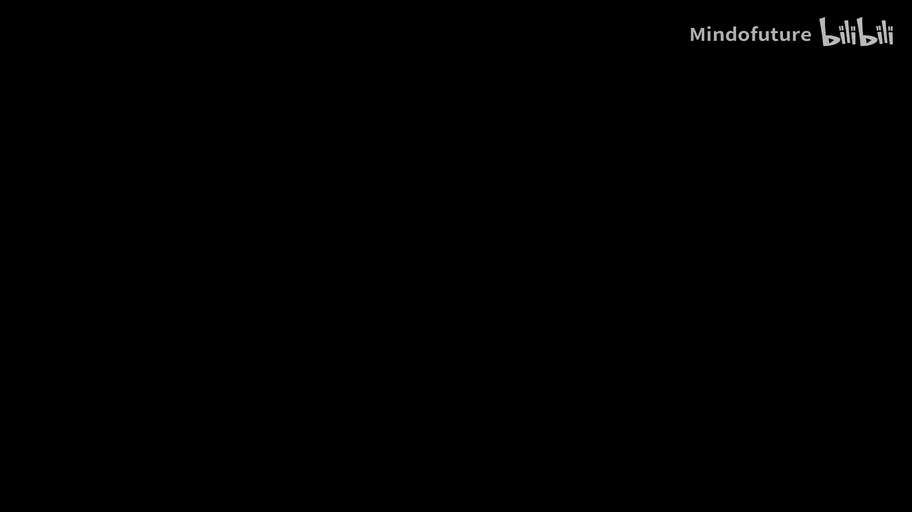
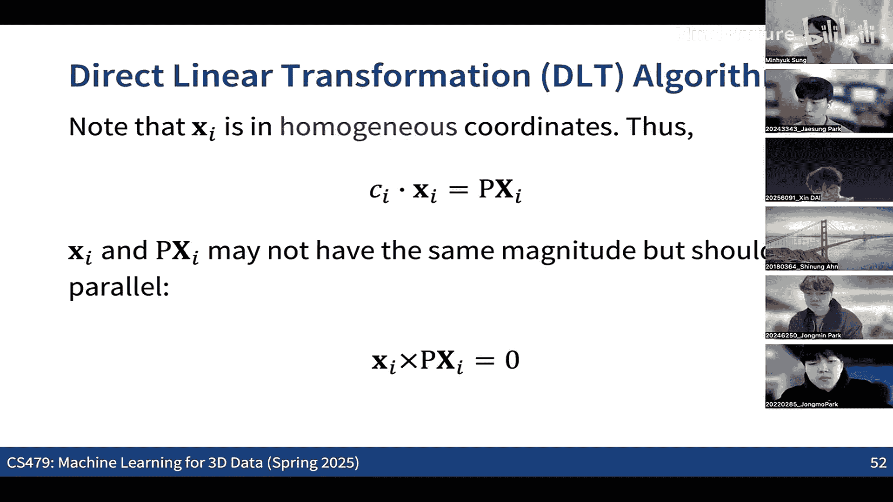

# 【韩国科学院】机器学习3D数据处理 ｜ KAIST ｜ CS479： Machine Learning for 3D Data p05 P05_Lecture_6_-_Camera_Model_(KAIST_CS479__Spring_2025) -BV1YmuBzTEmx_p5-

Okay， so welcome back to the。So last time we are discussing some kind of the new representations for these readerships。

 which is basically having some kind of the imp function。

 the function itself becomes some kind of representations for these readerDships and we basically discussed some kind of ideas in terms of like making a neural net that becomes of the imp representations for these readerships and we basically mainly discussed some kind of the two ideas in terms of like what we kind of the output values of the function and one idea was basically outputting the side distance and the other one was basically simply basically outputting the occupancy information。

And there are some kind of the several kind of advantages。

 having the newer representations in terms of that is basically very compact representation。

 And while it can also recall some kind of the fine details as basically organ the resolution of the kind of the output。

 So it doesn't need to specify the number of the points or the number of the boxes some kind of representation。

 So it can vary the output the resolution and also the top wise very flexible the representation。

The only kind of downside for the input new representation was that it is basically taking long time to produce like one single shape because we need to basically query all the points in the three space in terms of the getting either the at distance or the occupancy the information。

And in terms of designing the neural networks for that。

 we also discussed the idea of the sign end and the free the feature networks。

 which is basically either mapping either input or the output of the delay of the neural network the senior solid functions in terms of that we can better capture all definingy the details high frequency details So by simply replacing the activation from the sign or the cos function。

 we could get much preciseing the outputs like this and this idea also could be applied to the images and also audios many other data modalities as well。

And even with this kind of the new activation function。

 we could also consider basically re constructing the input the signal the images for the audio or the3D even only we did gradient information。

 So this was quite interesting step。And they also could do the same thing by just mapping the input into the the sin of the functions and by just controlling the frequency of the either design and the cosine functions。

 we could also control over the underfitting or the the overfitting of the outputs。

 as we can see in this kind of example。So as we basically increase the frequency of design sign and the decosine function。

 we can better capture all the fine details while there is kind of be risk that we can basically some kind of be overfitting results like this。

But if we also decrease the frequency of the s cosine function。

 we can get some kind of the smoother the outputs， which might basically also lose some kind of details in the the given functions。

So depending on the task and also the input data that we have。

 we can control the frequency of the design and cosine functions in terms of like controlling this kind of the underpintting and the overpitting。

These are some kind of the technical ideas in terms of like how we're going to make some kind of the implicit neural representations。

And based on that， what we also discussed last time was basically how we can also do some kind of the 2 d to 3D reconstruction。

 So this was kind of simple the idea in terms of that we are having some kind of encoder for the2 images having the decoder for the3D which is basically decoding some kind of input the function as the output。

 and we also discussed the idea in terms of how we can make some kind of better the integration between the input image encoder and the3 d decoder in terms of like not taking the global for the3 output de generation but just taking the per pixel the features to basically predict either the sign distance or the information for the corresponding the3D point。

So this was also the basic idea for this the pyth for the architecture。

And do you have any questions for the things that we discussed last time？

So what we are going to discuss for today is also about basically how we are going to do some kind of the better reconstruction of the 3D from the images。

 especially for the not single image， but from the multi view images and the things that if you took the computer vision course。

 you might actually hear about actually there are some kind of the more kind of the traditional techniques that can do some kind of the 3D construction using without not using any kind of neural network So that's the kind of the idea which is called either the s simultaneous local and the mapping mapping or the talk promotion which is basically the technique that we can do some kind of 3D construction from the multi view images。

Actually， the idea， the underlying the idea， the basic idea is quite simple in terms of that its basically sort like simulating kind of the way that the humans basically sense the depths with the two eyes。

 So when we kind of two eyes， we can basically kind of like feel some kind of some kind of distance from from the eyes to basically the object in the same right and the basic idea。

 that in terms of we can do the same thing with some kind of the calculation is that once we basically have some kind of information about some kind of corresponding the points across the different views。

 What we can do is that actually we can backtrack some kind of the points in terms of the like where this point came from in the3D space in terms of like shooting the ray from the camera through this point。

In the two dimension in the three dimension space。 So let me switch this to the point。 So now we can。

 so we are basically back tracking this kind of the the trace of the points over the 3D space in terms of like finding the 3 d point。

 which has been projected over these2 d point。 And since we know the corresponding the point in in the other like this。

 we can basically also try to find some kind of intersection between these two race。

So this is kind of an example that we are having this point in this like the first image and having the corresponding the pixel in the other image。

 right， So based on this corresponding information if we should be dese from these two cameras and finding the intersection the point。

 then basically we can you know track back track some kind of the the point。

 the 3D point which has been basically projected into these two points。

This is some kind of very simple idea。 Obviously， this is like involving lots of some kind of the steps in terms like how are were gonna find some kind of the corresponding the pixels across the images and how we' gonna also get some kind of these camera pose information。

 basically the information about like where the camera is basically dis in this space and what's thebuing direction for those kind of the cameras。

 So those information also should be obtained from the multi view images。 And based on that。

 basically， we can do some kind of some two little3 construction based on that the correspondence information。

So this is like actually a very old idea。 I guess some of you might hear about this kind of detect。

 motion and even like about like 16 years ago， we could see some kind of very amazing kind of results which is actually reconing some kind of building like this。

 So this is kind of the results that we are collecting some images So let me。😊，哦。オ析。

Let me replay this。😔，哦，的。Yeah yeah， I don't this。 but basically what we can see is that these are some kind of results that we are collecting the images of the city of the room from the internet after collecting all the images based on the kind of the techniques that I just。

 basically finding some kind of corresponding the pixels and the shooting the ray into the space。

 we can see some kind of results like getting some kind of the reconstruction of the like building or even the entire the city like this So you can see that those kind of the。

 some kind of the cons are some the cameras of the images and from those kind of images which are basically taken from those kind of cameras we are reconstructing the whole things like this。

So this is kind of be really interesting the technique in terms of that we can do some kind of the 2 D to3D consumption without any kind of the learning。

 So this is really kind of be some， you know， some deco consulting the task that can be done without any kind of some supervis learning the process。

And there is also the library， which is called the call map。

 which you can just like download and see， just you can just take the multi the the images from the object or these scenes and see how much this kind of library can also be constructed through3 the outputs。

So this is kind of some very traditional techniques that we are going to see。

So what we are going to discuss for today and also the next lecture is basically about some very basic techniques that are basically required to make this kind of some the framework for the image to 3D construction and after that actually we are also going to see some kind of the limitations of such kind of techniques that you can see like one big limitation for such technique is that why we can see some kind of rid is some kind of structure the 3D so we can see some kind of like how the buildings are basically arranged in the city with some kind of some disrupt the shapes for the all kind of the things here right but as you can see the output are kind of some sparseity point cloud so it's not really giving some kind of clear the picture for the 3D from any kind of random view so it's more about just like giving some kind of the sparse point cloud in terms of giving some structure information but not some kind of some fine details。

 some kind of clean images that we can get from the any random build。です。

So here the question is that how we can also utilize some kind of the power of the neural network in terms of that we can also get some kind of more defined details and also the cooling images from the render build。

 So that's kind of like what we are going to discuss with the newer rendering and we're gonna discuss that probably next Wednesday and before that to discuss some kind of the more details about the neural rendering we will need to basically discuss more the basic kind of things。

 So that's basically things that we are going to discuss for today and also the next lecture。

So before getting into some details for those kind of things what we are going to discuss is the camera model which is basically some kind of the sort of the mathematical representations about the mapping between the2 d to3 d and3 d to3 d。

And I， some of you who already have taken the computer graphics or the visionon the courses might be quite familiar with these things。

 So I'd like to ask you， like， how many you have taken the computer graphics or the computer visionon courses before。

You answer like， yes， we。So yeah， many of you have already taken the computer graphics or the computer vision course。

 So for some of you who already have some background in the graphic pixel division the things that we are going to discuss might be some kind of the very basic kind of things。

 It could be just like reviewing some kind of the background of the graphics and the region and the other the people who haven't taken the vision or the graphics course。

This will be some kind of the some very basic things， some essential things that you need to know。

 not only to basically follow up basically the things that we are going to discuss in the later the lectures。

 but also to do the assignment as well So for the assignment two and the3。

 you need to basically have some good understanding for the camera model to implement some kind of details there。

 And this also kind of idea would be very important for the course project as well。

 So if you have any questions on this So let us know So let's quickly go through into some kind of some basic things here。

And as I mentioned here， we are not going get into any very deep kind of things for those things。

 because we are we going to just cover those things in just like the one lecture。

 So we won't have time to discuss like every single detail for the camera model。

 So if you are more interesting the camera model， I recommend you to take some kind of the more the advanced the graphics or the courses。

 which we can do best kind of place to discuss some more details。Okay。

 so what we are going to discuss for today is about some kind of the pinal the camera model。

 which is the simplest the camera model， not assuming any having any kind of some sophisticated lens in the camera。

 but just like assuming that everything is like projected into the image plane through basically very tiny kind of hole in the camera box like this。

 So when you basically see some kind of this kind of the box。

 which is having some like very tiny hole here， and when you basically assume that all the kind of delay are projected over this plane through this kind of the single point here。

 then after the projection， the output that we are going to see is this kind of the upside down images this kind of the pinal is also called the camera。

 the Ob which is getting some kind of some projected image through this single point that you can see the point the top of the tree is basically mapped to some kind of point at the bottom。

And also， the point at the bottom of the three is basically map to the the top of the the image plane like this。

So this is kind of the very simple the model of the camera in terms like getting some kind of the 2D image of the 3D space by mapping everything in the 3D space through the single D point。

 So that's kind of the simplest model。😊，So basically， we are going to discuss。

 discuss the simplest model while some of the you know。

 real the camera might have some more complicated kind of things。

 So we are not going get into those kind of things。 But let's see。 So for this simple the model。

 what we can see is that we can easily calculate the coordinates of the point where the the point is de projected。

So let's think about like this simple kind of the the setup that we are having some kind of the。

 even we are seeing some kind of the 2D slice of the Y Z D axis， the Y Z plane。

 So what we can see is that here we are defined the G axis as kind of the direction where the point is basically de projected。

 So the ray is like coming from the 3D piece projected over the image plane along the G axis， right。

And you can see that this the point the origin is the pinhole where basically everything is basically projected。

Through this point yeah， and then we are having the image plane。

 which is located at when when the disease one right so we are having the image plane here and this is the basically p here and all the points are basically projected through this point。

So in this very simple setup， when you have the point which coordinates is DYz here。

 and what we kind of the coordinate where this point is projected over the plane？So basically。

 what we can see is that obviously these z coordinates will be one because the plane is defined as as kind of the place where the G is one。

 right？The thing is that we just need to calculate this like wire prime， right？

What's the Y prime here？Very easy， right， So the ratio between D Y and G should be the same with the ratio between the y prime and D y。

 right， Then we can see that actually the y prime should be basically simply y over Z， right。

Very simple。 But the thing is that， you know， it please just that project all the things into the image plane like this。

 As I mentioned at the beginning， know what we are going to get is that we are going to get this kind of the upside down the image。

 right。So what we are going to do is that after projecting over the plane on the D Z cos one plane。

 and then we're going to fully damage basically Philipine the sign of the y the X axis。

Then actually what they can get， what can see is that actually projecting over the G equals the one plane here and then fliping the images is actually equivalent to projecting onto to the G becomes like minus1。

 the plane。So as I said， when we basically project the points over the Z is the one the plane here and the flipping the image is the same as basically not projecting this plane。

 but actually projecting over this plane。So actually what we are going to see is that so this is not basically exactly the things that we are going to do with the penal the camera。

 But mathematically， this is just like the equivalent things。

 The projecting over this plane is the same as basically projecting over this plane and fliping the image。

 So what we are going to see is that we are going to assume that the projecting the process of the penal camera is actually projecting over this plane。

😊，So basically， so if we project the points here into this imagech plane where the G is basically the -1。

 Then what's the the Y the double plan here。Yeah， obviously， like minus like y over0， right？

So that's basically what we are getting。 So what you can see is that so this is kind of the the case that we are only seeing the2 the the slice。

We the y Z plane but if we only also see this the same thing in the3D space。

 what we can see is that actually the projection of the panel the camera is basically the same as basically mapping all the X。

 Y， Z， the coordinateiness into this new point， which is having the coordinate of the minus x over Z minus y over Z and the minus1。

So we basically basically having a function mapping all the X， Y。

 Z coordinates into these kind of new coordinates。可以。Very simple。 But here。

 the thing is that how can you also represent this function into the matrix form。

So we are going to see how we can basically represent all the things into the matrix form in a way that we can do the calculation much easier and we can also represent all the things in like more compact way。

So for that， basically， we are going to discuss the homogeneistic coordinate system。

So what do we talk about when you talk about the homo system is basically nothing but given any kind of the。

 for example， like 3D coordinates where2 coordinates， whatever kind of the dimension decos。

 we are basically introducing a additional deco here。W basically know having this kind of condition。

So basically， you can see that while we are having the additional dimension here。

 we are having some kind of the know making some kind of spatial relationship across the all the coordinates in terms of that when you basically divide or multiply any kind of killer into the vector that becomes another kind of identical coordinates。

 So while we basically have some kind of different coordinates for those kind of two vectors。

 we assume that these two are basically representing the same point。

 the point to which basically have these coordinates like x over the w Y over the W and the over over W。

So this is kind of thing。 So we are just going to have some another dimension while basically having this kind of be some。

 you know， equi balance， some kind of the relationship across the coordinates。So basically。

 if we visualize basically what we are doing with the almost the coordinates。

 let's basically see some kind of a visualization for the 2 d plane the case。

So in this like the 2D space， what we can see is that while we only have some kind of the X and D y coordinates。

 now we are introducing the new coordinate， which is W here， right。And then basically。

 what we can see is that if we head like any point here。

Basically like multiplying any skill to this point is basically identical。

 basically having some kind of the different coordinates for the same point。

Which means that when he basically drew a line from this point from the origin。

 like basically a line joining this the origin and this point here， all the points along this line。

All the points along this line， except for the origin here。

 are basically representing the same point。So that's basically the idea。

 It's kind like augmenting the the space the the coordinate the system。

 we did the additional dimension while having this kind of some sort of the e relationship。呃。

So in the homo coordinates is there no constraint of X， Y such as the union no constraint。

 yeah so we we don have any constraint in terms of the the norm of the the defect vector。

 We just like have some kind of the relationship in terms of that you know those kind of the coordinates become represent the same point。

So that's the only need thing。So which means that for the same the 2 d point or the 3 d point。

 there can be multiple ways to represent the same point。

 You can either divide or basically multiply any kind of scr to the vector that is not basically changing the meaning of the coordinates。

I this스크？So this is kind of some kind of visual light in terms of that in the 2D case。

 like if we have some additional dimension here， like any kind of the lines passing through the origin here are basically representing the same point。

In the2 this piece， except for the point the origin here。

So these are some kind of the some the ideas about like having the additional dimension in the home they coordinates。

So based on that， basically the the reason why we are talking about the whole coordinate is that we want to have some kind of the matrix form to represent this kind of the mapping。

 the projection of the the penal， the camera。So what actually we can see is that when you have the X。

 O， Y， Z coordinates with the the additional the dimension one here is the this point basically keep having these coordinates multiplying some kind of the some this here。

 right。So based on that， basically what we can see is that so the the mapping。

 the projection that we have seen the pen camera model was basically mapping the X， Y。

 Z coordinates into these coordinates， right。And the identical， some。

 some other kind of the deconess representing the same point is basically this。

とにオあ multilyマイナスジとオデデコディ hereあイ alsoリて sameポ。So the projected point now also can be represented as the X。

 Y， Z minus Z。So in the homo decoding system， now， we can see that the projection can be seen as basically mapping the X。

 Y， Z1， this four dimension detector into the X， Y， Z minus-2。So that's kind of thing。

 So when you see this kind of be some augmentation into the full dimensional deors。

 now it becomes much easier to represent this into the matrix form。

So based on the this kind of the relationship this the mapping with the home coordinates can you nowその represent this mapping with the four by four matrix。

啊，明。Now please post your answer44 by4 matrix。So again。

 my question is not about it like whether we can do that or not or just like。

Please put your answer for4 by four matrix。So basically。

 what we can see here is that when you have this kind of like dividing by Z Z here。

 it was not possible to basically presenting these into the matrix form。

But after using the whole margin coordinate， now we can see that there is no basically dividing by0 here。

 I mean， we can basically just like multiply like minus3 for the all the coordinates。

 Then we are getting this way。😊，And after basically having this complete conversion。

 now we can see that the mapping from this the boldy coldness。

 the homoless coordinateness into this bo coldness become some kind of linear mapping。😊。

Then now we can easily describe this into the matrix form。And actually。

 there can be also multiple ways to have that the4 by four matrix。

 But this will be basically the case， right， So when you have the 1，1，1 and the minus-1。

 then we're gonna see the results that we are mapping the X， Y， Z1 into the X， Y， Z and the minus Z。

And by dividing all those like word coordinates by the the by the minus。

 we can see some kind of final the the the projection the coordinateiness。

So you can see that the whole coordinates are quite useful kind of ideas in terms of reing this kind of the projective the transformation into the matrix form。

So that's kind of the basic idea in terms of how are were going to represent all these kind of camera models using the matrices。

可以。Any questions？So speaking to the homoous coordinates and also the project the geometry。

 the project space。 Also the interesting that we can do with the especially the homogene coordinate is that so let's see here what we can get。

 So this is kind of also the case that we are basically， you know， you know。

 moving towards some specific direction over the2 d plane。

 So we are basically multiplying some W here to the X and D Y here。

 That means that starting from the origin over this kind of the 2 d plane。

 we are moving towards some specific direction。We are going into this like this。

And then what we can see is that actually the identical coordinates for the same point is the X。

 Y and the one over the W。So basically， what you can see is that when you go over on the along this direction。

 like let's say like we are here， right？So on this point。

 actually if we also draw the line from the origin to this point。As I said。

 all the points along this line， except for the origin here。

 are basically all the coordinates representing the same point。

 basically identical some kind of coordinates， right？

So this point here is the same point represented with this point。So actually。

 what you can see is that as we go further along this direction。From here to here to there。

What you can see is that the corresponding point， having fixing the X and the Y here becomes like going down。

 down and the down， right。So when here is basically you know， having the X， Y in one。

 as we go further into the W， X and W Y and1， we are going down to the X， Y and the one over D W。

 And as we go further and further and further， we can see that actually。

 the corresponding point along this line is going down to the X， Y plane。Makes sense。

So what we can see is that if we go to the point at infinity。

So that's the case that we are basically having the infin infinite finite number for the x and the y coordinates。

 But actually， we can represent the point infinity with the finite the numbers。

 because the corresponding point or the point infinity will be also happy some kind of the identical some coordinates。

 which becomes like X， Y 0。喂。So from what we can see。

 like this relationship is that as we increase W and just like basically increasing the w to the infinity。

 the corresponding the coldness that were gonna get is with be X， Y 0。

 So which means that now we can represent the point at infinity， we define 9 numbers。

So in the projected space， the interesting thing is that we can also define some kind of defining decos for the point at infinity。

 So now we can basically define the point at infinity。

So that's kind of the interesting kind of things and also interesting the difference with the E callide and the space。

Makes sense。Then how many points and impfinity do we have for it to direction？

So also the thing is that when you go to the one specific direction。

 you're gonna say like one pointed infinity， But if you go back to the the other direction。

 the opposite direction， the thing is that you're gonna actually meet the same pointed infinity。

 right， Because when you have this kind of relationship as you basically increase the W to the plus infinity or decrease W minus infinity at the end what you're gonna get is basically the same kind of the coldness。

 which is the X， Y 0。So which means that interestingly， the two extremes meet at the same point。

 whether you go to the know one direction or you go to the other opposite direction。

 if you go to the infinity， we are basically going to the same point。

 which is having the coordinates of the X， Y 0。So what you can see is that for every direction。

 there is only one single point， one single point at infinity。So this is kind of some interesting。

 some kind of structure of the project of geo。Makes sense。

And then here the question is that what is this like no， this like coordinates0，0。

0 presenting in this case。So the thing is that in the the homogene systemゼ zero zero isナ representing origin the origin should be zero zero one or0 zero something that isな non zero value。

Butイプラゼ zero zeroあデナそディインコーデネそシナユディゼ zeroゼ likeリティ nothing。

So that's kind of things that you should not be confused。

 So if we want origin there should be001 or00 something non0の value but you have like zero zero0 there no way that we can define point infinity without having income kind direction。

So the pointed infinity defined with any kind of but ifゼ0 which isな defined then this becomes presenting nothing Soゼ0 is basically invalid some kind of coordinate the project geometry also the homo coordinate。

Could you。So there are some kind of the interesting。

 some kind of the characteristics of the project of display。

And to see some kind of more interesting kind of things。

 let's first see how we also represent the lines in the space。

 So we can basically in the two dimensional space， we can consider this kind of design line equation。

 right。😊，So A X， B Y plus C is like representing a language。

So we're gonna basically take these like three numbers as kind of the parameters of the line。

 So now let's say this ABC is a single line。And so let's do that like the basic things first。

 So given this kind of the ABC， the prime transport line。

 how can you check whether a point is on the line or not。I mean， so this is kind of very easy， right。

 So we can just like take the do product between these two to check whether the do product is 0 or not。

 right， So by definition of the line， you question here， if the point is on the line。

 then the the do product of like these two， the three the two vectors。

 the three dimension the vectors should be 0， right。This is just like the pie definition。

And based on this， the question is that now let's think about like finding a line which is basically passing through the two points。

Then how can you find such kind of line？You just know that the the the the the point if the pointイ isオド line。

 then the that product of between these two should be0 right。So based on theform。

 can you also find a line which is basically passing through the two points。Well。

 this is because something that we are finding a sweet dimension detector。

Which that product with this x and the x prime both of them become0， right。

 What is such kind of vector vectors， We dimension vector， which that product with these two。

 both of them becomes0。So the answer for that is obviously the cross product。

 If we take the cross product like these two that basically output the the three dimension vector which the that product each of them become 0。

 right。So based on this kind of representation， we can easily find a line which is basically joining the given the two points。

And the interesting thing over like this kind of representation is that we can do some kind of similar things like this。

 So now let's think about that。 we are having two lines， having those kind of like the。

 the two different parameters。 And how can you find the intersection point。😊，Of those two points。

Actually， it's the same thing。 So we are also finding a 3 dimension detectoror。

 which is that product with these two becomes 0， right。

 And we can also find the intersection point by taking the cross product of these two。

So which means that no the line joining the two points and the point。

 like know where basically the two lines are intersecting。

 both of them can be compute using the cross product。

 So this is something this is called the point and the line the duality in terms of that we can know find these kind of two things by just using the same cross product。

So this is some kind of the basic things about with our the presentations。

And also in terms of decalculating the cross product here。

 also the way that we can also represent this into the matrix boom is to use the Qsymmetric D matrix。

So they is， basically I think but what we can see is that when you compute the cross product like these two。

 we can do the same calculation by defining this kind of the matrix and taking the matrix spec。

 the multiplication。So this is nothing but you know we are basically defining this kind of the matrix that is basically ssymmetric。

 which means that this is kind of the symmetric， except for that we are having the different design here。

 you can see the w and the minus w minus y and y and the x and the minus x so given the coordinates of the first de vector here instead of like calculating the cross product now we can define this kind of the D matrix here and take the matrix and the vector the multiplicationplication then that this gives the identical the outputs。

But this is nothing but the way that we and how we calculate some kind of cross product with some kind of B2 vector。

Clear any， anything that is not。佢啲。So based on this kind of some the basics here。

 the one thing that Id like to ask is that。 So now in the projective space， this space。

 let's consider like finding some intersectioncession the point。So now we have the two lines。

 One is the2 x minus-3 y equals 5， and the other one is the 4 x minus-6 y equals the two。

 But given these kind of two lines。 What's the intersection point。

We have discussed like all the ideas in terms of how we can characterize the intersection point。

 we did two lines it。So let me give you like two or three minutes to think about this。So actually。

 what we can see is that。 So， we have seen like how to calculate the intersection the point with the two lines here。

 right， So it's the middle of like calculating the cross product of the two the line parameters。

 right。So let's just like calculate the the cross product of the two line deers then what we can see is that actually we can get the point of the inter point as the point at infinity。

And what we can see with some kind of the the visualization of the the two lines is that we will select like these two are basically parallel lines。

And when you basically go to the infinity over like along these two directions。

 actually we can see that actually these two lines also meet at the same one point at the infinity。

So basicallyically having the same slope for those kind of two lines and after going into the infinity。

 we can see that actually these lines meet at the same point， which is the point that defeat right？

So this is kind of interesting in terms of that when we extend the Euclidean space into the projective space。

 where basically we are augmenting the points at infinity， we can see that actually all the lines。

 even the two parallel lines meet at the one unique point。So whether the lines are parallel or not。

 we can see some kind of results that all the distinct lines are basically intersecting at like one point and that point can be pointed infinly。

So we can basically have some kind of be very general rule for the projected space in terms of that all the point。

 all two distinct lines are basically intersecting at the one unique the point。

So that's kind of the interesting， some kind of the characteristics of the projected space。

 which is basically happening based on our the definition of the points at infinity。可以。

So what whatever basically the lines you have with some kind of different offset here。

 if the slope if the line is basically the same， then we're going see some kind of results that these two lines basically meet at the one single point。

By calculation here， right， I mean， and also by definitions of the older things， right。

So this is like the one interesting characteristics of the project is space。

Then the also the question might be is that so we have seen that the two pair lines lines meet at the point of infinity。

 So now what if we have the two distinct points at infinity。What do we decline。

 They are basically connecting these two。Can you also calculate the line parametersers like joining this kind of two points at infinity。

So as we have done in the paper slide， we can also do the same thing terms calculating the cross product。

 And since we define assume that these two points are distinct points at infinity。

 which means that these two are not the same。Then we're gonna get these kind of line parameters。

 which is basically the same， basically dividing by this term。

 So now we can represent the line between these two points as the 0，01。

So which means that now we can also define the line joining two points of infinity。

And the question is that would this line joining these two points will also be pass through the other points in infin。

The answer is yes。 So by just connecting the there is basically one straight line which is connecting all the points infinity。

In the project in this space。So this kind of some very interesting。

 some kind of structure of the project this space， which is defined by extending the Euc space with the definitions of the the points at infinity。

So based on this， also what we can see is that in the project of geometry。

 all the two distinct lines are basically intersecting at a one unique point。And also。

 every distinctive points， every two distinctive points are basically having one unique line joining these two points。

For any two lines， there is like one interesting point for any two distinct points。

 we were one the the line joining these two。 So we can have to have this kind of very general rules for the the project this space。

 So that's also kind of the difference with the you call it in this space。あ、いいですク。

So can you basically visualize the projects facing in your mind。

 so how it looks like in some kind of visualization？

So we can consider we can imagine some kind of the the the the kind of some visualization for the project space in different ways。

 So basically this will be the case that for some kind of the2 d kind of case in the simple kind of2 d case that's kind of a case that we are expanding the2 d plane like this while at the end at point at of know if you go to here。

There is kind of like one line， which is connecting all the points at infinity， right。

So if you go into the direction of the B D here， there will be like one point here。

 which is identical point that you can see when you go to the opposite direction， right。

 So these two points becomes the the basically the same point。And then there is like one line。

 which is connecting all the points at infinity。So that's kind of some sort sort of the geometry of the the project space。

 right。And probably some kind of the easier way to think about this kind of the some the the visualization of the protected space might be through the mapping to the to the plane over the this。

So actually， what we can see is that for all the point over the projected the plane。

 we can basically define a one to two mapping from the point over the project the plane to the points over the sphere in the3 manual space。

So actually what we can do is that so this is kind of the projected plane where we're going also have the points at infinitefin the line infinity and the top of this peer like this and for any point over this plane。

 if you draw a line passing through the original this。

 there will be two points intersecting with that line， right。And you can see that for any point。

 even for the point infinity， if you go go through there。

 then the point infinity will also map to the point here， right？Over the degrees ofこ。

So this basically means that for any point over the project they plan。

 we can define the one to two mapping。So that's kind of like showing some kind of interesting some geometry of the port plane in terms of that actually。

 the whole space can be mapped to the two points。 Every single point is mapped to the two points over this period。

this clear？Then how the is a line is mapped to this peer。

 the pair also have a line over the projected plane that will be also mapped to the one degree circle over the sp like this。

So that's kind of be some the interesting things in terms of that while we started from the 2D Eucllean plane。

 if we extend that with the points at the infinity or also the line of infinity。

 now we can see some kind of the mapping from the protein plane over the through the one to two points the mapping。

So yeah， this is kind of the interesting structure of the pro plane。Any questions on this？嗯。

SoThis was kind of the very brief introduction about the homogene coordinate system1 and also the projective space。

 And based on that， actually， we can basically define the camera model。

 So when it come back to the the camera model， basically what we can do is that so we have seen some kind of example that where we are putting the camera。

 the image plane over the when the Z is one right and then flipping the image and it was identical to putting the image plane at the where the point that when the Z is becomes like -1。

But obviously， we can control the distance from the origin to the image plane。

 so we can set the the distance from the origin to the the camera plane， the image plane。

 not as the one， but any R between number。 And we're going call this the distance from the03。

 the image plane as the vocalcal length。So if we put the image plane with the distance of the F here and then flipping the image would be also identical to putting the image plane with the when the G is becomes like minus F。

 right？So we can set the full， which is becomes it distance from the origin to the image plane here。

And then we have seen like how we can define the four by four matrixs defining the mapping from the projection from the 3D to the 2D。

 right when the focal length is one。But if the focal length is not one but F。

 then how would the four by4 matrix being changed？嗯。嗯。So yeah。

 you can calculate this yourself and see that， you know。

 when the image plane is located when the Z is basically minus F。

 then it becomes like now the y prime the the map， the point the y coordinates of the map point becomes like minus y over Z times the F here。

 Then we basically are having this kind of the mapping， right。Then now we can represent the。

 you know， projective the mapping， the the matrix for the projected transformation as these kind of the matrix。

 like having F F app and the minus1 here。呃。Try yourself and see how we can get these kind of the matrix。

So this is the case that when you set the fo， which is the distance from the origin to the image plane。

And the other way around that we can also set this kind with some camera parameter is not to set the distance from the origin to the plane。

 but actually you know， setting this kind of the field of view， which is define this kind of angle。

 So we can consider basically having some kind of the fixed size of the image plane like this having some kind of certain the kind of the range from the minus-1 to the plus one。

 while basically setting this kind of the view， the angle of the view。

How basically wide this angle in terms like， you know projecting other things。

Then you can see that when you actually define the range of the image plane of， for example。

 from the minus one to the plus one by in also basically setting some kind of the angle here。

 based on that actually we can calculate the focal length and basically do some kind of the all calculation for the projection the matrix。

So let me skip this。 but you can try this yourself and see what you get。 Basically。

 given this kind of angle for this， the field of view and from the range to the minus1 to the plus one And what we can get is that from this information。

 we can calculate the focal length becomes the inverseent the help of the angle here and just putting this into the focal length making some kind of the projection the matrix like this。

And also the thing is that when you define the field of view。

 actually we can set different field of view for each of the axis for the focal length。

 it doesn't make sense that we set the the focal lengths here。

 but depending on the range of each of the axiss， actually we can set the different field of view。

 which is also changing some kind of size of the image along each of the axis。

So this is also the kind of the things。 So and also what we can do more is that we can do some more complicated kind of things。

So this is kind of the example that we are now setting the focal length instead of the build a。

And what they do is that we are doing some kind of the shifting of the image plane in terms of that this the center of the image plane is not along this the G axis。

 but over above the G axis， for example， here， right。While basically having some kind of range。

 which is asymmetric from the L to R to the B to T。

And after projecting all the things into the image plane。

 we're going to also normalize the image space in terms of the the L to R。

 this range is map to the  minus-1 to the plus1 and also the bottom to the top here is also map to the minus-1 to the plus1。

So we are basically not only doing the projection， but also normalization of the image space。

Then also can we represent like both this kind of combination of the projection and the normalization with like one single the four by four matrix？

So I'm going to skip some details here， but I'd like to strongly recommend you to try this yourself and see what again。

 But this is basically nothing but some kind of the calculation in terms of that we first basically map the each of the the point over the image plane and applying some kind of the normalization to basically do this kind of the mapping right from the range from the L to r is map to the minus-1 to the plus one and do the same thing for the X axis and the y axis。

And based on that， now the mapping becomes like mapping this X， Y。

 Z1 the coordinates into this kind of the complicated deco coordinates。

 and now we can see that this kind of the combination of the projection and also the normalization also can be represented with this kind of rule by format matrixs。

So you can see that we are basically having some kind of is killing term here and some kind of translation term here with the F and the minus1 here。

 right？So this is kind of the typical form that we can see for this kind of the projection the matrix。

So check out some more the details about how we can exactly get this kind of matrix。

So let me go quickly for the rest of the slide so these are some kind of background that you can actually learn from the Comp graphics course and you can learn the same thing in the Comp vision course so。

 but the terminology that we are using in the Comp vision might be slightly different So what we typically see for the comp region the literature is that in the graphics literature typically the G axis is defined in this way。

 the way that the points are the projected。But in the contribution， the literature。

 typically the G axis is flipped。 So the the G axis is defined as kind of the viewing direction from the 2 d to 3D。

 So you can see that the rendering is basically the graphic is like all about the rendering。

 So it's all about the mapping from the 3D to 2D。 So the G axis is defined from the 3D to 2D direction While the the is more about the 2 d to 3D。

 So the G axis is like split from the image plane to the3D space。So in this kind of the polypg axis。

 like setting the a columns to be F， basically the meaning that we are placing the image plane when the z equals it F here。

 right？So it's nothing but justs like looping the D access in this way。

So without this kind of like shifting the image plane， in this case。

 the projection the matrix will be defined into this way app app app 1。

 and we can see that this like 3D coordinates is map to the another of the 3D coordinates。

But typically for this kind of mapping， we don't need the Z information anymore。

 So after this mapping， actually， this G represents some kind of still depth information。

 which might be useful for many applications。 But if we don't care about the depths。

 we only care about the image， then we can basically drop this part。

 So in the computer division literature， we typically also drop this like third rule。

 which is representing the depth information。 we only get the basically the X and the y information here。

And we can also see that typically the last column is also just like the zero vector， like 0，0，0。

So what we can do is that for like to make some kind of the more like the simpler the representation。

 we can consider basically dropping the last column here。

 so dropping this last column basically means that we are not using the homogene coordinates for the input the 3D coordinates。

 so the input 3D coordinates or basically non homogeneous coordinates。

 not having the extra dimension while still having the homogene coordinates for the output the 2D here。

So to get the basically the final the upper here， we will basically need to divide this F X in the F Y by Z here。

So by so this is kind of weight and now we can represent this kind of projection。

 not with the four by four matrix， but with the three by three matrix。

I knowing the basically the Z the axis， the the G coordinates for the projection and also not using the homogene coordinates for the input。

 but only for the output here。Okay， so the same the project in the matrix now can be represented is represented with the three by three matrix。

 And typically， these three by three matrix is also called the camera intrinsictri the matrix。

 So basically this means that this like the matrix is basically includingcoing some some the camera。

 some kind of the camera the parameters in terms of how we gonna project the things。

 So it's not the related like where we place the camera is's more about some kind of the camera。

 some kind of the inherent some kind of the information defined based on basically some how we exactly make the camera。

 right。Some vocal length or some kind of the ship to kind of being playing kind of things。

So as we also have seen in the previous slide if we have some kind of the shift of the image plane。

 we're going to also have some kind of tos here。So typically the camera the intrinsic matrix is defined with some kind of the go length here and also kind of some shifting information the image plane while some of those kind of the zero values can be also the non0value So if we have some kind of the non0ro values here that is also representing some kind of the distort or some kind of sharing in the projection with the process。

 but in the simple model， we are going to have some kind of focal length information here and also the camera image plane the center information here and these three by three matrix becomes the camera intrinsic matrix and also sometimes it' also called the camera de matrix。

Any questions on this？So this was like all about basically how we exactly represent some kind of the some projection the process of the camera with some kind of the matrix form。

 right So after doing all this kind of some simple， some kind of calculation。

 we can see that this kind of the projection can be represented with the either the four by four matrix where some kind of more the compact form into the three by three matrix。

But this only basically describes basically how we're going to project all the3 things into the image plane。

But when you also talk about some kind of the multi view images。

 So this will be also the case that we will basically define some kind of the local coordinate system in the 3D space we basically different kind of the camera the。

 right， So depending on where we basically put our the camera and also depending on the view direction of the camera。

 we are defined some kind of the local deco coordinate system in the 3D space。

 So that is called the camera deco coordinates while we're going also define some kind of the absolute deco coordinate system。

 which is also called the world coordinates。So basically。

 we are typically deploy the three coordinateor system。One is the wall coding system。

 which is some kind of the absolutely coordinate system for the interdisciplinary things。

 And depending on where we put our the camera and also the debut direction kind of things。

 we're going to also define some kind of a local coordinate system。

 which is the camera coordinate system。And all the kind of 3D things will be projected over the the 2D plane。

 right， Then we are also having the 2D image coordinate system。

 So we basically have this kind of the three coordinate system。And basically。

 what we have seen is that we have seen some kind of mapping from the camera coding system to the EM coordinate system。

 but before that， actually we can consider the mapping from the world coding system to the camera coding system。

And this conversion from the world coordinates the camera coordinates is typically called the matrix representing this is typically called the camera extriic de matrix。

 So it's not about some kind of the the camera， some kind of the some inherent some kind of the parameters there。

 basically based on where we put the camera， right。

 where where we place the camera and how we set the view direction。

And this kind of conversion from the world coordinates to the k coordinates is represented as the reason by transformation。

 which means that it's basically involving some rotation world translation。

So which means that now we can also represent these kind of conversion with the three by four metrics。

 the first part becomes the rotation and the second part becomes the translation。

 so this is about the conversion from the word coordinates to the camera coordinates。

And once we basically converting everything into the camera coordinates。

 were gonna also do the projection into the image coordinates。

 So that's the the camera entry the matrix。Which now can be representative with three by three images。

With some kind of vocalcal length would be the image to pulling the center information。

So we can see that when you actually talk about the camera model。

 we are setting some kind of the two kind of the matrices。

 like one is about the mapping from the word coordinates to the camera coordinates and the other one is about the camera coordinates to the image coordinates。

 So the first one is for the 3D to 3D and the second one is for the 3D to 2D。

So all the biscuit camera model can be defined as kind of a combination of like these two。

 So we are having like one，3 by four matrix for the exchange X and the three by three matrix for the intriing。

And when you talk about the camera matrix， actually we are basically mean meant by this kind of combination of like these two。

So when you multiply these two， these three by four matrix like multi which become the combination like these two becomes our decl matrix。

And for this kind of the representation， we basically mean by that we are having some kind of the non homogenous coordinates for the 3D input here and having the homoous coordinates for the output the 2 d here。

Make sense。So this is the basic idea for the camera model that we are having the two types of the matrix like one is the extriic the matrix representing the rotation of the translation and the other one is basically camera the intrinsictriic matrix。

 which is the robot projection。佢。Questions。So basically。

 when when you talk about some kind of the 3D to 2D mapping or the 2 d to 3D mapping。

 this kind of the mapping is represented with this kind of the3 by four matrix。

And also basically obtaining this kind of the matrix for the mapping is the process that we call as the chemical operation。

So here the question is， how is the origin of the world corn is defined， So it's up to us。

 We can define the world corn system as we want。So for example。

 like for the cases that we are reconing3 from the multi view images。

 which means that we are having the multi cameras in the space， right？

So a very typical way that we don't need to， but the typical way that we can define the world cool system is to set the camera cool system of the first camera as the word cool system。

So we define the word coding system as we want。 And based on that the absolute the coordinate system。

 now， we are define some kind of local coding system based on the center of the the camera and also some kind of view directions。

So that becomes like involvingvo some rotation and the translationlation。

And once you basically see all these really things from that local coordinated system。

 we can apply some kind of the projection， which is defined with the intrinsic genetics here。

Basically。😊，So for the second and the third assignment。

 we will basically need to see basically how to deal with this kind of some exchanging matrix or the intging metrics and how to calculate those kind of things。

 So there might be some kind of parts that you need to work on。

So one last thing I'm not sure whether time for that would be basically about like So how can we compute this kind of the three by four matrix given some kind of the some the information about the3 d to2 d mapping。

So for example， let's assume that we somehow have some kind of information about the point correspondence So。

 for example， like given this kind of the scene， we know we define some kind of the apps some kind of the some the coordinate system in the 3D and we know the coordinates for those kind of some key point here。

 and we also can see some kind of the2D coordinates in the image space for those kind in the key point So let's say we have some kind of the information about the correspondence for the3D to 2D。

And based on that， how can you compute the camera matrix。

 which is describing this kind of the mapping？So density process if you call the camera dec calibration and also call the camera reing。

 so this is kind of the not simple kind of task as you kind of expected。

 but the thing is that we are basically having the nonhomogeneous coordinates for the 3D points。

 but also using the homogene coordinates for the 2D coordinates， right？

Which means that when you basically find some kind of the camera matrixP here。Actually。

 the P multiplied by the 3D coordinates may not be the same with the 2 d coordinates。

 but we did some kind of some skilled derg of the same de vectoror。

Because this vector is the homo deco coordinates。basicallyicallySo when you basically find any kind of the camera dematics here。

 when you basically map these 3 d coordinates into the homo coordinates of the 2D point here。

 the output of this kind of multiping de matrixs here can be some kind of the same vector。

 but read kind of different scale。So basically， we don't know about this kill information。

 We just know that actually the the multiplication like these two， we will be the vector。

 which is kind of the some skilled version of like this vector。So these two are not exactly the same。

 but there might be some kind of skill term that we don't know what kind of exact skill for that。

So what we are going to do is that instead of like just like making these two bit the same。

 We just gonna see that actually， these two should be same the vector the same direction。

 but probably with some kind of different kind of magnitude。

So which means that the these two should be basically be kind of the the vector which are the per in the kind of space。

 So which means that when you take the cross product like these two， the cross product should be 0。

 right。Does this make sense？So we basically use this information to calculate a P here。

So what we can do is that lets say now the P is like having the three rules。

 So p was the three by four matrix， right， So now we are saying that P one P to P three D are representing each the role here。

And we want to compute the crossb product here， and we have seen that how we can compute the cross product with this smatic the matrix like this one。

 right？So now we want to compute this。 you can check the details layer。

 but actually computing this is identical to now computing this。

 So the change that what we are seeing here is that now we are representing the three by4 matrix P as some kind of be some vectorized form。

 So now this is not the three by4 matrix anymore， but actually concateating each of the row in terms of that we are now having the。

 you know， three by it should actually the three by the 12 kind of image， right。

So it should be12 here。 So we are basically having some kind of vectorized the form of the the P matrix here。

So it becomes actually we are solving this kind of the some know the the the homogene linear system in terms of that we are having some kind ofized the formal dynamics matrix having the three equations here。

But the things that actually only two of them are linearly independent。

 so which means that we can only take the two equations these two basically homogeneous linear system for the the vectorized form of dynamics matrix here。

So what you can see is that actually three if should be nine， actually it the three by three matrix。

So to what we can see is that。Yeah。We we for every kind of these， the two pairs of the points。

 we are having the two equations。So as we have some basically n normal the point pairs。

 we can accumulate all the kind of the homoous linear systems and by accumulating all the things now we can apply some kind of the solve this equation finding the nonze solution for this。

So this is something about the linear algebra and since we are running out of time。

 I'm going to get back to this point and see how exactly we can calculate this next time。

So basically here， the idea is that based on the fact that the cross protocol these two should be the same。

 we can basically given the set of the 3 d2 and the 2 d points。

 we can calculate these matrix to P by solving the homogeneous linear system which can be done by using the S or some different kind of things。

 So this is kind of the simplest idea in terms of that we can also find some kind of the camera d matrix from some kind of given the correspondence between the 3D and the 2D points。

So this is some kind of the basic things about the the camera model。 and based on this。

 what we are going to discuss next time is to how we can do some kind of the3D reconstruction from the multi view images。

So we're going to see the ideas for the multi to  three degree reconstruction。 and based on that。

 we're going to also see some limitations of that， and then we're going to move on to the new ranking。

And if you have any questions on this， please feel free to post questions on this slide and I'm going to see you next Monday。

thank you bye。

