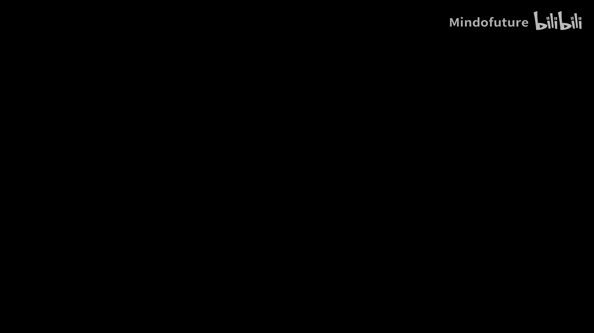
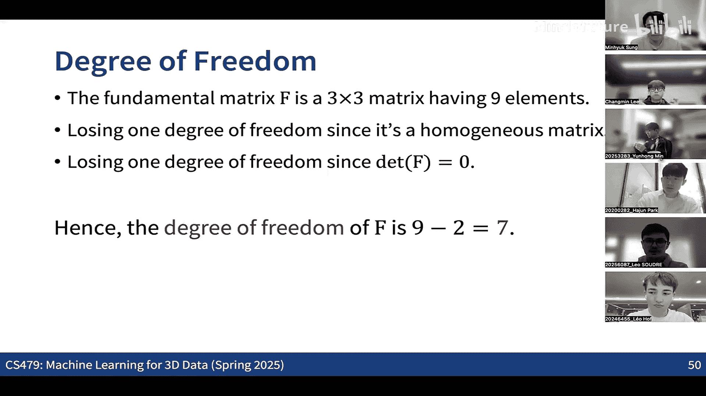

# 【韩国科学院】机器学习3D数据处理 ｜ KAIST ｜ CS479： Machine Learning for 3D Data p06 P06_Lecture_7_-_Epipolar_Geometry_(KAIST_CS479__Spring_2025) -BV1YmuBzTEmx_p6-

So yeah welcome back to the much money for 3D data so from the last lecture we started to discuss the in terms of like how we can calculate some kind of the relationship between the 2D images and the 3D and based on that what we are going to do is that basically we are doing some kind of the 3D construction from the multi view images and we are going to see some kind of the more some kind of the direct techniques that we can do that for the 3D construction from the images and for that we discuss some kind of the basics about the camera model last time and we are going to move on to slightly more kind of the in- depth kind of the things in terms of like how we can do some kind of 3D construction from the images and then next time we are also going to move on to the neural rendering which is also the kind of technique that we are leveraging the neural network for a more precise from images。

So just give me a second set of some j issues here。哦。认是这。

So last time we basically discussed some kind of a bunch of the coordinate system。

 so basically we are defining some kind of the word coordinate in the3D space and depending on where basically the camera is replaced。

 know so the viewing direction of the camera， we are also defining some kind of the another the camera coordinates。

 which converge them from the word coordinates the camera coordinates can be done with some kind of the rotation and the translation。

And then we also define the image coordinates， which is basically some kind of the output of the projecting things in this Sw space into the 2D imaging plane。

 So the conversion from the camera coordinates to the image coordinates is done by some kind of projection。

 right。So based on that， we are basically discussing two types of the camera de。

 The first one is the intrinsic the， which is basically defining some kind of the rotation and the translation from the word coordinate system to the camera coordinate system。

 So which is not some kind of some intrinsic kind of things about the camera。

 depends on like where we put the camera in this really space。 And also the viewing the direction。

The other one is more about the camera， the intrinsicing the parameters。

 which is real some kind of some literally kind of intrinsic de parameters。

 which involve some kind of the focal length or some kind of the shifting， the image。

 the plane So it basically also involves some kind of the projection， the process。

 converting the camera coordinates into the image coordinates。So when you combine these two。

 this combination like these two is typically called the camera matrix。

 which is now defined typically defined with these3 by a four matrix that also maps the world coordinates into the image coordins So this was kind of these three the coordinates that we discussed last time and also the two types of the the cameraa parameters like one is the extrinic parameters and there are one is the intrinsic thepros。

And to basically represent all this kind of the conversion。

 we also discussed like using the homogene coordinate system。

 as you can see the camera matrix is now basically represented with the 3 by4 matrix which means that the 3D point is now represented with the four dimensionary coordinates and the coordinates over the image plane is now represented with the 3D coordinate coordinates。

 which is because of the fact that we are using the homogene coordinate system right。

We can see some this kind of some relationships across the coordinate system and especially for the K incr matrix in the graphics literature。

 typically we set the G direction as kind of the viewing direction。

 the direction of the projection right so basically we are basically having the Z in a way that the image plane。

 the plane where we are projecting things is basically placed on the plus the region in the 3D space right？

But the thing is that in the pen the camera system。

 while we put the image plane in the region where basically G becomes de positive。

 we also need to flip the image right because like the projection will becomes the upside down the image。

 which means that we need to have the flip thing at the end。

 then it becomes like identical to put the image plane， that the positive reasons。

 but indeed the negative reasons。So that like things that we have seen last time。

 but in the computer region the convention what we can do is that we can basically define the G direction as kind of the viewing direction。

 not the projection direction then it also becomes like identical to put the image plane in the region where the Z becomes the positive right so typically what we can see is that some kind of the default camera might be that we are putting the image plane where the Z becomes one then basically we are having the image plane like this but we can also control this kind of distance from the origin to the image plane with some kind of arbitrary between the number and this number becomes the focal length that we also discussed last time。

So based on this kind of convention， so it all depends on like how we define the coordinate system and also how we define the image plane in this3D space。

 but when you follow this kind of convention， the first kind of the question is that what to be kind of our the camera the in matrix the3 by three matrix when the four length is the F and also the shift in the image space is the CX and C Y。

嗯。Can you answer this question？Last time we have seen that in this case the our in matrix has this form of that we having vocal length in the dialogue having in the shift Thomas the translation like this。

By the， the question in the June chat was that was the R and T here。 So basically， the camera。

 the intrinsic the matrix involves the two types of the transformation。 One is the rotation。

 and the other one is the translation。So we are having the rotation part here which is this 3 by 3 matrix。

 so our is representing the rotation in the3D space and t is the translation also in the3D space。

So this is like  three by3 and 3 by one。 So so the intrinsic matrix becomes this three by four matrix。

 and we are stepping a lot on three by three matrix， which is the intrinsic the matrix。So， yeah。

 so this is the kind of the some typical the intrinsicing dynamics matrix that we would see for many kind of the some simpleistic camera set up。

 So when we do not assume any kind of distortion or many other kind of things。

 typically we gonna have these kind of the simple some intrinsicing the matrix。

 I some vocal length and the shifting the image plane。So then whatip。

 we have some kind of the very special kind of the camera the model like this。

 which is basically it's kind of the default the camera model where basically the vocalcal length is the one and there is a zero shift the image space in this case。

 we can say that actually it becomes like having the identity matrix as kind of the our the intrinsic matrix。

 right。So what can you see is that we can actually consider define some kind of like normalized the 2 d coordinates。

 which is basically the image coordinates when you have the default camera。

 when you have that the focal length is basically the one and also there's no shift in the image space。

And you can see that actually this is kind of the some special case when our the camera is kind of the default camera。

 which is also equivalent to projecting all these 3D coordinates to the z equals one plane。

So we are basically when you see that these like the capital X and also the X head here。

 these are basically the homogene coordinates， just like having only the extriic the of the camera here and multiplying this without the intrinsic matrix and basically consider these as kind of the homogene coordinates is basically the same ass like we are projecting all the points in the3 space into the Z plus one plane。

OkaySo these three are basically all the identical so whether we say that know whether we have some kind of image coordinates。

 we did some kind of default camera， the fourcal is one and there is no shift。

 is's basically same that we only have the camera in matrixs here。

 while basically having the2D coordinates as kind of the homos coordinates。

 which is also the same that we are projecting the3D coordinates into the G equals one point。

So we're gonna say that this is kind of the normalizedized the2 the coordinates so you can say that this is kind of a special case where the camera is kind of some sort of the default camera and also it's the same that we are just protecting all the things it's really space into the G equals one plane and in terms of the mathe deform it's the same that we are multiplying the only the ex matrix without the intergene matrixs because it's the same that intergene matrix it's basically identity matrix while treating the output as kind of homogene coordinates。

可以。So we're going to use these10 normalized2 equation this in the rest of the2 days lecture。

And quite。And then we also speaking to the home coordinates based on that。

 we also could discuss the not the Euclidean the Cartesian the space， but the projected the space。

 This is kind of especially the case that we are now we can now define some kind of the point at infinity。

 So the pointed infinity could be defined into the finite boom in terms of that we are having the last element in the home coordinates to be 0。

 right， So that was the case。And also by definition of of the point infinity。

 we could see that there is like only one point at infin D along each of the direction。

 which means that whether you go to the like one direction or to the other the opposite direction。

 you're going to see to the see the same the point at infinity。

 So two extremes basically meet at the same point right。

And this also means that all the power lines also met mid at the same point infinity。

 So regardless of some kind of offset in the space。

 like if you are basically heading to the same direction。

 then you are basically heading to the same point at infinity。

So by the definition of the point infin that we defined last time。 and also。

 we could see that there is like also only one line at the infinity。

 which is basically connecting all the points of the infin。

So these are like all the things that we also have seen last time。

And based on the hour depict of the point and infinity and also the line and infinity。

 what we could see is that we can basically have some kind of the very some kind of general or some kind of statement like this in terms of that all the two the lines are basically intersecting at the one unique point。

 So including all the line and infinity there should be some kind of only one intersection point。

 So even the two parallel lines are basically meeting at the one point。

 which will become the point and infinity， right。And also for the the the point as well。

 when if we have some kind of two distinct points， whether the points are the infinity or not。

 we can also determine like one unique line。 So this was also kind of a statement that we could see with the definition of the point infinity and the linefinity。

滚。And we also could see some kind ofideity， some relationship the point and the lines。

 so when you also represent the line with some kind of the like this。

 when it basically ABC stands for the parameters for the equation like this。

 then we could now define the line during the two points by taking the cross product of the homogene coordinate here。

So especially the things that we are sort of like having the homework coordinates both for the points and the lines。

 Then what we can do is that the good thing is that the line joining the two points can be obtained by the taking the cross product and also the point。

 the intersection point of the two lines also could be calculated by the same cross product。

 So this was kind of the point and the line infinity we last time。

And also what we have seen last time is that taking the cross product away the vector here。

 especially for the3 dimensional detector here is that we can basically do the same calculation by defining the ksymmetric de matrixs in this way。

 so for the 2D the point which is represented with the3 dimensional detector with the homogene to coordinate if we define the ssymmetric de matrixs like in this way。

 then now this cross product can be represented as kind of the matrix vector the multiplication。

So this is also what we have seen so this is called the kssymmetric d matrix because you can see that the elements in the matrix are kind of like symmetric。

 except for that the signs are basically different for the symmetric the elements like eism。

And also speaking to the these schismatic matrix for the three by three the major vector。

 one quick question is that what is the determinant of these three by33 the ssmatic de matrix。

 So when you see this kind of like specific matrix here， whats the three the determinant of this。

Can you see this？Okay。So you can see that actually if you calculate the determinant of yourself。

 then you can see that the determinant of excuse D3 by3 the schimatic matrix becomes zero。

So the effect that we are going to use in the rest of the lecture is that actually the the three by the threesymmetric matrix is not a full lengthy matrix。

 And so this basically means that the rank of these like three by three matrix becomes not three。

 but 2。So this is kind of the defect we are going to use in the the the the next part of the lecture。

Andに quiteそです。So please keep this in mind because we are going to get back to this later。

Also what we discussed last time is about the camera reseing。

 So now we can say like how we can define the camera the matrix。 Then here。

 the question is that how we can calculate the camera matrix from some kind of given information。

 So the first thing that we are going to see is that basically given some kind of the 2 d to 3Dence。

 So when you know some kind of some points in the 3D space and there are some kind of the coordinate 3 coordinate in the 3D space And when you also know that where these 3 d points are projected over our the empty plane。

 then how can you basically calculate the camera matrix P here based on the bunch of the 2 d to 3D correspondence here。

So this is also what we have briefly seen last time。

 but if you get into some kind of the deeper into some of the details there。

 what you can see is that actually there is some kind of skilled the ambiguity for the KmaticP here。

Because like what we know is that whatever the killer and nonze killer we multiply into the matrix P。

 it does not basically change the correspondence， because like everything is now represented with the homogenes the coordinate。

 So whatever the nonze kilo that we multiply to the2 d coordinates。

 the2 the homo coordinates and the3 homo coordinate， it does not change the meaning of the position。

 right， So which means that we can also multiply any killer to this like the the matrix。

 So which means that there are some kind of the skill， the amgu。

 So which we cannot determine the skill of the matrix。

So which means that when you basically find the camera matrix P here and multiply this into the 3 d coordinate is here。

 the homogene coordinates of the 3D point here， it may not be exactly the same with the2 the homo coordinate of the 2D point that we have。

 there might be some kind of a scale difference， right。

And these skill difference can be also different depending on the correspondence that we have。

 So which means that either we need to basically also jointly calculate the scaling factor for each of the correspondence or without basically having that the scaling factor。

 we should be able to calculate the matrix P here。So that's kind of thing。

 So which means that we cannot basically solve this problem， like finding this P here。

 basically making some kind of linear system， which is making the p times the capital x these become the same with disim as here because there will some kind of killing some kind of the difference。

So instead of like solving that linear system， what we are basically seeing is that while there might be some kind of a skill difference between these two。

 what we know is that these two vectors should have the same the direction， right。

 may not have the same the magnitude but should be basically the per。 So based on that。

 what we are going to do is that we are going to use the fact that the cross product of like these two should be0。

 right， So we are now solving this equation。Baically， given the X and the small X and the capture X。

 we are basically finding the P here。 So that's the problem that we are going to find right。

Then how we can basically solve this for that， basically， what we are going to see is that yeah。

 so basically， we are going to represent a matrix P here。

With the three rules what we know is that this like matrix P is the three by4 matrix。

 right and the small x and the kept x， these two are basically the given information。

 So let's say these like P1， P2 P3 basically represent each of the row。

 So it's basically the transpose of the rule of of of the camera matrix here。

 So having the P1 and P2 and the P3。 So these are basically the variables that we are going to the optimize right。

And based on that， like if we calculate the cross protocol like these two。

 that as we have seen in the previous slide， it becomes like identical to multiply these ssymmetric matrix right here。

So basicallyically， you can say that this is the equation for the only one the single correspondence。

 for the one single correspondence with。 So for the single correspondence like we are basically now having this kind of the equation。

And based on that， like we want to calculate this like P1。

 P2 and P3 that satisfies like this multiplication to be0。可い。

It's kind of like tricky in terms of that like this P1 and P2 P3。 these are basically， you know。

 basically they combined with the X here， multiplied with the X here。

 So that basically makes like tricky to basically find the P1 and P2 and P3。

 So basically what we are going to do is that we are going to rewrite the same equation in different way。

So what we can see in this equation is that we are taking some kind of the do product of the P1 and the X and the P2 the XI and P2 and the X。

 so taking the do product here first and taking the multiplication between these two metrics， right？

And now we can say that so this is kind of the multiplication of the three by3 matrix and three by one vector。

 we're going to rewr because basically what we want to do is that we are going to make the multiplication to be zero vector right。

 making all this like multiplication to be0。And we are going to rewrite this into this form。

 Now we are not taking the do product on the right hand side on here。

 but basically multiplying this killing factor first to the X I here。

 and then taking the matrix of like these two the matrix and the better in a way that that becomes the same with taking the do product here。

 So let me switch to the。So instead of like taking the top product here。

 now we are multiplying this scaling factor to the X first。And then like multiplying these matrix。

 whole matrix and this vector become the same as basically taking the do plot here and also taking the sub。

So you can see that actually， while we are having some different dimension of the matrix here。

 the output should be the same。 The output should be basically the same as the three dimension or detector vector。

 and it should be also the same as the zero vector。this clip。So。

 but the difference is that instead of like having the three by3 matrix and the3 by the1 vector here。

 now we are having the3 by 12 D matrix and the 12 by1 the vector。

It'sically kind of expanding the demand of the D matrix， while the output should be identical。

It is clear。Any questions on this？Then what's the kind of the benefit of like having this kind of like different sort of the you know。

 the， the forms of the the， the， the matrix the multiplication。

The good thing of like this is that now we can decompose like all the things in a way that we are having like one matrix。

 which can be compute based on all the information that we have。

 we basically the X is the3D points and here all the small X Y and the W。

 These are basically the homo coordinates of the2D point。 So these are only given information。

 So we can calculate the matrix on the left hand side while the vector on the right hand side becomes of the variable that we want to calculate So we can basically decomposing this kind of matrix multiplication in a way that we are basically having like one matrix that can be calculate from the given information and having the vector。

 which is representing our the variable。So， but so now what we can see is that now we are obtaining the homogeneous like linear system。

 which has the form of the m times the p equals0， right， So we are having the like one matrix。

 and this becomes available。 So it becomes the form of the like a times x equals0 right。

 So this is the homogene the linear system with our the 12 dimension or de vector12 dimension developer that we have right。

But so it sounds like we're having the three equation for the 12 the parameters。

 but the thing is that one of those equation is actually linearly dependent on the others。

 so you can see that the third equation here， so you go back to the previous slide。

 the third equation， third rule here， actually can be represented as the linear combination of the other the two rows。

And also， the other rule is the same， which means that one of those。

 like three equations is basically useless。 We just need to take the two equations。

So now we can see that actually from like one pair of the 2 d and the 3 d the d points。

 we can obtain like two equations， to homogenes like linear the equation。

 while we are having the 12 the。大。So what just we need to do is that so we are having like given from the one point correspondence。

 we are having like two homogengenes like linear equation and then given from the end number of the point pairs。

 we can accumulate this kind of like linear equations in terms of that we are making like the homogeneous linear system with the two n number of the equations。

Just like no， basically accumulating all the rules of the represent side in terms of like making it like one big linear system。

And given this kind of like linear system， what we want to do is basically finding a basically the non zero disution。

So this is like what we need to do so then the problem becomes like simple basically how we can solveフン a non zeroデデ solution given theホ like linear system。

So based on that， what we are going to see is that there can be basically multiple ways that we can obtain the non0 d solution。

 we can use the either the gatro and the eumination where we can use the Sibility。But here。

 the question is that actually， the degree of the freedom of the the matrix P is not 12 but 11。

So can you guess like why is the degree the freedom of the P is not twelve but eleven。

So we are losing one degree of the freedom。Yeah， because of this skill ambiguity。

 So when you basically have some kind of the non zero elements in the matrix， Basically。

 what we can do is that we can basically like， for example。

 like fixed one of the non zero elements in the matrix to be one。

While basically determining basically scaling the matrix and determining the other the elements based on the number of the one of the elements。

 the number of the elements， which means that while we are basically having the 12 the number of the parameters there。

 there are only 11 things to be determined， so that means that actually deal with the freedom is 11 not 12。

So which means that if we have the linearly independent1 D equations。

 then based on that we will be able to make determine this kind of the the unique solution。

But also here the question is that in the overdetermin case。

 like we only basically have some more than some kind of the 110 equations。

 what is the condition for the matrix theM here in the matrix here yeah here this to be have some kind of the non zero solutionution。

Yeah， so there should be some rank deficiency， right。

 So the rank should not be 12 or greater than 12。 So that's kind of thing。

 So when we basically know that when there exists a nonze solution。

 given this kind of the homogene linear system， basically what we can do is that we can simply use the S。

 as you may learn from the linear geo course So basically once we decompose the matrix M into the two autonmal detices and the diagonal matrix here。

 then how can you find a vector P that satisfies like this homogene linear system。

 basically this vector P becomes the vector in the here， the rule here。

Which is corresponding to the smallest the singular barrier。

So what we can see is that if we take the vector degree here。

 which is corresponding the smallest the singular barrier here。

 which is now zero so if the matrix is not the full empty matrix that we're going say that actually the last the singular barrier will be0 right then basically what we can see is that when you take last the column of the debris here and so which becomes like we are taking the product like this whole decomposition with B and here right？

And since the B is the also normal D matrix， like the first M minus1 D element will become 0 because like when you take the product with D and with the all the other the basically defect vectors here。

 we by the of the alsond matrix， like all the basically the product will become 0 and only the last one becomes one。

 right。And since like the first m-1， the elements become 0。

 whatever kind of the numbers that we have for the diagonal part here。

 which also become 0 because of the right hand side is0。 So only the last one becomes the non0 value。

 But the thing is that now the singular corresponding to that is also zero， right。

 So we can say that when you take the B as some kind of the vector here when the corresponding。

 the singular value， the B is basically0 that we can say that this vector becomes the solution that we are finding the nonze the solution basically satisfying of that basically the homogenes the linear system。

So this is kind of like simple way that we can basically solve the homogene linear system。

 So decomposing the the given the matrix m using the SD and taking the the the singular vector the corresponding to the zero singular value in the right hand side in the matrix here。

It isす great。And this is the case， like when when there exists the nonze solution for the given D matrix。

 but this is kind of some kind of the special case that there is basically no kind of any kind of the noise in the given the point correspondence。

 So if we have some kind of the perfect set of the 2 d to 3D correspondence we will be able to find some kind of the solution。

 the non zeroro solution satisfying that but if we start at some kind of the noise in the given the2 d and the3D coordinates then we might and we also some kind of the bunch of the pair of the points making some kind of the overdetermined case。

 we're going to see some kind of the cases that the end becomes the full length and there is basically no non zero solutioning satisfying this linear system。

So in this case， we can consider basically finding the best solution。

 which is basically minimize some kind of the errors in the point correspond and for that actually there are kind of the bunch of the ideas for that。

 the simplest way to find the best solution is to find the vector P。

 which is like minimizing this norm。So this is， this is normally is called the R break the error。

 which is not exactly the same with the some geometric error。

 some kind of the distance in either in the 2D or the 3D space。

 but this is kind of the some kind of the simple way that we can find some kind of the define some kind of a good solution。

And the good thing of like define this like the R the error is that the way that we are finding this kind of the vector P miniim this error is the same as we find some kind of the the nonze solution。

 in the case that when the non zero solution exists。

 which is basically the case that we are finding right most the vector degree here。

 which is corresponding to the smallest the singular value。

So either when you have some kind of the either when there exists a non solution or not。

 if we take the rightmost de vector， in the B matrix here， which is corresponding to the small。

 the singular value here， then if there exists a non0 solution。

 then that the smallest singular value will become0。 and then the B in here。

 the rightmost de vector will become that the non zero solution。

AndIn the case that when it does the nonze solution does not exist。

 if we still take the rightmost vector in the B end here。

 which is corresponding to the single list the value that will be basically the case that we are finding the camera model。

 which is minimizing the RG brick data。So that's basically the things that we can do with SVD。

But obviously， there are some kind of more sophisticated way that we can really minimize some kind of distance in the 2D where the3 is place based on kind of the correspond。

 But I just like to tell you that this is kind of the simplest the way that we can find some kind of good solution。

 even in the case， when there are some kind of noise in the 2D and the 2D coordinates。Okay。

 any questions on this？But this was basically the case that we are finding our the camera model in case like when you know the 2D2 3D the correspondence。

So originally， like in the world coordinate system， we know the3D point and they recordings， right。

 And we also know they the projection in the image plane and they the decos in the to the image of this space。

 So in such kind of case， we can use this idea to calculate the camera model。

But for many of the cases， it would be really challenging to really measure the 3D coordinates in the 3D space and also there the projection and finding there be some kind of corresponding the pointing to to the image and getting some kind of the 2D coordinates。

So it may not be that practical way to really calculate the camera model。

 While we can do is that actually finding the 2D to 2D correspondence is much easierly task。

 like when you have the multi view images。So， so basically what you can do is that when you really know the 2D to 3D the correspondence。

 we can use this idea to calculate the camera model。

 but typically it's not that practical So for many of the cases。

 it becomes much easier to find the 2D to 2D correspondence for the different view images。

And what we are also what we are going to discuss in the rest of the party is that given this kind of the two little to the correspondence。

 how we can also calculate the the the camera pose。

So this also kind of the things that we are going to the the next step。

But before we move on to the next step， any questions on this？

So you can see that basically what we are doing here is that given some kind of the a pointwise correspondence information。

 how we are going to obtain the camera model and once we have the camera model that we can calculate the projection from the 3D to 2D and we can also see some kind of the relationship between these two。

So basically especially in the case that when you have some a set of the multi view images。

 how we can do some kind of the like get all the3D the camera the camera post information then do some kind of the3 d construction based on that is kind of the some kind of the the the technique。

 which is called the structure promotion motion， which is really kind of the very no。

Complicated framework， which is involving many of the parts in the whole framework。

 And this is really kind of the big topic that we can actually discuss over the entire semester。

 So we are not going get into the too much details for all the things。

 And we're gonna ski through some kind of basic ideas in terms of how we can really get some kind of the some do some get some kind of camera post information and also do some kind of the consumption。

And if you are interested more into some kind of more details。

 I'd like to you know recommend you to check out this like the core map library。

 which is some kind of the de factor some standard kind of library for the structure promotion and you can also check out many details in terms of how we can really implement these kind of full framework basically getting from the2D the multi images and how we can get some kind of 3D the concept of the outputs。

But if we basically very briefly see some kind of the basic idea。

 Basically what we are doing for each of the component in the framework is that first。

 like given the a set of the 2D multi images， what do you do is that we。

 as I mentioned in the previous slide， we find some kind of the 2 d to2 the point correspond first。

 So that's kind of our the basic building log in terms of culating all things。

 So finding some kind of the the 2D pixelize like correspond across images。😊，And for that， actually。

 we can discuss lots of some kind of techniques in terms of how we can really find some kind of2 the correspondence。

 There also lots of the techniques。 This is really the subject that has been studied more than two decades its really kind of like the big topic and there has been very classical ideas in terms like how we can extract some kind of the key points in the2 the images like this。

 and also how we can define some kind of the feature feature vector for each of the key point in a way that we can basically find the correspondence based by comparing the feature。

 So I don't know how many of you know the name of the ship these are some kind of the very famous technique in terms like finding those kind of correspondence。

 which has been like introduce like more than as like 20 years ago。 obviously like these days。

 people don't use this kind of some classical ideas。

 people also use the neural to basically define some features for each of the points。

 So there are some kind of the many learned。Features in terms of like， you know。

 you know finding some kind of correspondence across the the the images。デモーティビビです。And based on that。

 basically what we are going to do is that so basically we are going to first assume that the camera intrinsicic matrix is given。

 So there is also kind of another line of the technique that we can actually also calculate the camera intrinsic matrix or the camera intrinsic matrix is basically some intrinsicic department。

 which can be actually provided by the manufacturer from the camera the manufacturers for each of the camera。

 actually， there's some kind of the known the intrinsic parameters。 For example。

 if we are using the iPhone for the iPhone camera for each of the model。

 there is some kind of the known the intrinsic department while it can be slightly different depending on the exactly hardware the device。

 the phone that you have。So let me basically assume that the camera the intrinsic parameters are kind of be given what we need to basically calculate interestingly is the camera exchangeic parameters。

 right， the rotation and the translation。And this rotation and the translation would be also dependent based on how we define the word coordinate system。

 right， so we can define the word consistent as we want。

 and the typical idea for that also would be basically we set the camera coordinateiness of the first image as the word coordinate system。

And all the relative and kind of the camera pose from the other。

 the the images are basically defined based on the the the camera coordinateiness of the first image。

So this is kind of like the typical simple way that you know the camera coordinates of the first image becomes our the world coordinates and then all the relative the coordinates for the other images becomes the camera coordinates for each of the images。

Then the question is basically， how are we going to calculate the camera。

 the extrinically parameters for the other images？And so we're going to get into that as how we can calculate the camera。

 the ex parameters to produce some other images。And based on that。

 what you do is that fully given the2 d， the corresponding points for each of the images。

 Now that what you can do is that we can shoot the ray for each of the camera and see the intersection point in the3D space。

So if everything is like perfect， if the correspondence is perfect and also the camera pose。

 the extriic intrinsictriic deters are very accurate。

 then these two ray should meet at the one intersection point。While。

 as we have some kind of the noise for all the correspondence and the dec the thes。

 there might be some cases that the delays are not really intersfecting in the Swedish space。

But basically， if everything is basically perfect， then we will be able to see some kind of the corresponding 3D point from the 2D correspondence。

But since there might be some kind of the noise and the errors in our the calculationculation。

 we might also want to run some kind of the another some kind of the optimization。

 basically optimizing everything， all the correspondence and the camera parameters with some kind of the sophisticated some kind of optimization scheme。

So these are some kind of the components in this structure promotion for every step should there are quite many things that we can discuss why we are going to discuss like any kind of details there and also there are many kind of some kind of the tweaks that we can use in terms of improving some kind of the the accuracy very many things for example。

 we can consider using the rankap to find the in layer set of the corresponding points how many of you are familiar with the。

Rnket， my dear。 I if you take。If you took the computer vision course。Something so， yeah。

 so I'm not also gonna get into any details for the website。

 but this is also kind of the technique in terms like finding some kind of the the in layer set of the correspondinging points。

 So basically， when you have this kind of the point wise the pairs across the the different images。

 there might be some kind of the noisy correspond like this。

Then what we can do is that we going to actually see how we can represent this kind of the pointwise correspondence of across the2 images into the matrix boom Secretary we're going say this kind of the matrix boom and if we find some kind of the correspondence。

 which is not really fitted with some kind of the model that we have here that we can basically take out them as kind of the outliers by doing this kind of data。

 we can also improve some kind of quality of the camera models that we are calculating。

And also in terms of like doing some kind of the global optimization for everything before we do run the optimization for the like correspondence and camera models as well。

 only for the rotation parts， for example， across the relative camera pole we can also do some kind of some like the optimization So especially the case that we are doing some kind of the optimization。

 only for the3D rotation it's called the rotation synchronization or rotation the averaging here the basic idea is that if we have the relative。

 the rotation from the image 1 to2 and2 to3 and3 to one。

 So let's say we have some kind of the relative， some kind of rotation from the image1 to2 to3 and3 to1 right So if you multiply the three that when you get back to the first image。

 the rotation should be identity the matrix。So these are some kind of the constraints that we have for the camera pose that we are going to calculate。

 So using these kind of some kind of constraints， we can do some kind of the more sophisticated kind of the optimization to further improve the old accuracy for everything while we are not going to get into any details here。

 But what I'm just telling you is that there are actually lots of some kind of details that we can basically em in the framework in terms of improving the accuracy。

So as I said， like this is really kind of the big topic， every component we can discuss many things。

 the things that we are going to discuss for today is basically like one small part。

 like given the 2 d correspondence across the multi view。

 the different images and also when you assume that the camera intrinsic metrics is kind of given how we can calculate the extrinic parameters。

 the relative camera pose across the images， so this is kind of like the basic building block in the pipeline of the structure motion。

So for that， we are going to talk briefly， very， very briefly talk about the A geometry。

 but before I move on to this， any questions on this？And by the way。

 if you are interesting more about some kind of the details here。

 I'd like to recommend you to check out this textbook， the multibu geometrymetric incomp region。

 which is basically summarizing all the ideas about this structural promotion with some kind of very deep kind of theories as well。

And we're going basically ski to some kind of basic ideas here。

So to talk about basically how we can calculate the relative camera pose from the 2D correspondence。

 I'm going to introduce some kind of the new terms。 So please follow me in the next business slide。

 So some of there are some some of the terms here。So let's think about that。

 We know the some kind of the 2D point correspondence。 So we are having the first image here。

And the second image here。So let's say like the x is the point over the image plane of the first image。

And depending on so which means that there will be a 3D point， which is projected into this point。

 right， So given the 2 d point X here， there will be a 3D point on this line on this ray。

 which is projected into this point。So given the2D point， actually。

 we don't know exactly the position of the 3D the point because it can be any of the point over this rate。

 right， So when you should array from the original the camera here to the image， the point here。

 then any point over this line。Can be the correspondingly3 the point。Make sense。

And when you also project these ray onto the second image。

Which means that this line will be project onto the line as well in the second image like this。

 right？And which means that any point over this line can be the corresponding point with this point。

 right？So even in the case that we don't know what the kind of the corresponding point of the x in the first image。

 in the point in the second image。It doesn't need to be is's not the case that any arbitrary point in the second image can be a corresponding point of the x here。

Only the point over D line can be a corresponding point of the x here， right？So this line。

 where the correspondinging point of the x can be present， will be called the apolar line of the x。

So given any point x here in the first image， when you talk about the epipoural line in the second image。

 we see spec line where the corresponding point of the x can be replaced。Makes sense。

So when you have the x here， no we're going to define the L let's say x prime is basically correspondinging the point and the L prime is basically the epipo line。

 which means that this x prime should be on this like L prime right。

 so which means that the that productivity between these two should be zero right？Makes sense。

Then let's think about the people line for the RB3 point， not only having the x here。

 for the other point here and here for the first image。

 let's say like we should array into the 3D space and protecting them into the second image， right？

Then we're gonna to see some bunch of the epi lines in the second image， right。

The thing is that actually all the epilo lines in the second image will have the one intersection point。

Whats the intersection point， can you guess？For any arbitrary point in the first image。

 it we basically should array in the Swedish piece and project them into the second image。

There will be for all the people lines， there will be one single the the intersection point for all the people lines。

Actually， the intersection point may not be inside the image， but outside of the image。

 but in the infinite the plane， right？Actually， what it can see is that all the rays that we are shooting in the Sw space is starting from the origin here。

Which means that all the 3D lines that we are drawing in the 3D space will also have the intersection point at the origin。

So which means that like all the a lines will be also intersecting at the one point。

 which becomes the in the projection of the origin of the first the camera。

 the camera of the first image。So if we basically project the origin here， the first the camera。

 the origin， the first the camera to the second image here。

 that becomes the point where all the intersection all the epi lines basically passes through。

Does it make sense？So in terms of that， we are we can define the epi polele。

 which is now basically the intersection of the basically the camera center of the first image to the image plane the the second image。

And this is basically the point where all the people align basically path is through。

So in this way now we are defining the epi lines， which is defined for the one of the point in the other image and the epi pole which becomes the intersection point for all the epi lines。

Is this clear？This is kind of the concept that we are going to use for the rest of these lines。Okay。

Any questions on this？Conditions for the planes are not inive。

I couldn't get the conditions for the planes， What do you mean by the conditions for the plane？So。

 yeah， let me first move on。 So based on。Well， I mean the planes are basically the image plane so as I said。

 like as we discussed in the previous slide we can basically set the image plane based on the focal length that we define right so if we have some kind of the default camera。

 the plane will be basically the plane where the Z becomes one in the camera coordinate system。

So based on this kind of the definition of the epi lines and the people the point。

 what we are going to define is is the fundamental matrix。

 So what we are going to do is that the relationship between the corresponding points in the first image and the second image will will be represented with the three by three rank two matrix。

 So let's forget about the rank for now。 So we are basically having a sort of the three by three matrix。

 which is basically defined in this way for to the corresponding points representative with the homogeneous coordinates we're gonna basically find a matrix F here。

 which is satisfies this。So let's say， like x is the2 d points in the first image。

 the x prime is the the points in the second image。 Then we're gonna basically see that actually。

 the correspondence is represented， can be represented。 We give three by three matrix app here。

So this is the difference of the depend multi matrix。Actually。

 what we can see is that this fundamental de matrix is mapping is basically also representing the correspondence of like these two points。

 actually what we can see is that by definition of the fundamental de matrix。

 this matrix is actually mapping the point in the first image into the epipolar line。

In the second image。Because of the effect the product is2 zero， right。

So when you combine this the definition like this and or the presentation here。

 we can see that actually this matrix F is now mapping the one point in the first image into the corresponding epi line in the second image。

So you can see that app is the mapping function from the point to the a line in the other limit。

Make sense。Now here the question is that， so this is the matrix like mapping the point in the first image to the epic line in the second image。

How about the opposite， So given that the F is the fundamental matrix from the image like one to the other。

 what's the fundamental the matrix from the the second one to the first one。

 So the fundamental matrix for the the other way around should be best mapping the point in the second image to be people online in the first image。

 right。What did these such kind of the images？Yeah， actually， it becomes the transpose。

 So if you transpose the matrix F， you can see that actually。

 that isping the point in the second image to the people lying in the first image。So why do we also。

 is this clear any questions on this？So now we are basically seeing that， by definition of the Epole。

 Epolar lines and the also the fundamental dynamicss。

 we can see how they are basically related to each other， right。

And also the thing is that what's the relationship between the Epool and also the fundamental Ds？

So what you have seen is that the for any kind of the let's say the x is the point in the first image and the L plane is the corresponding the Epolar line in the second image。

 right？And we know that， basically the epipole line。

 any epipolar line in the second image should pass through the epipo。

So which means that the that product of the epipo and also the line the parameters for the any epipo line。

 these two should be0， right。So whatever x we have， whatever point in the first image that we have。

 if we find its corresponding the equi line， the product between these two could be0。

Which means that whatever the x we have here， this should be0， which means that now the product。

 the multiplication like the first two should be0 regardless of the choice of the x here。Make sense。

So what you can see is that when the E prime here， this is the epi pole in the second image。

 the the the product of the you E prime the epi polele and the fundamental thetics， D should be0。

So what we just need to do are in terms of finding the epipolis that given the fundamental matrix。

If we find a vector with the left side multiplication to the app F matrix here becomes0 thats the a pull in the in the second image。

Which we call the left nerve vector of the F。AndSimilarly， by definition。

 we can also see that right the nerveect of the F also becomes the epipo in this first image。

So now we can see some kind of the relationship across the Epolar line。

 Epole and the fundamental genetic， right？Any questions on this？

So I recommend you to check this out in terms of like how these are basically defined and based on those definitions。

 how we can also derive like this。So yeah， moving on。

 so this is all about like Epo lines and Eol and fundamental matrix。

And one thing that we are also going to define is the essential de matrix。

 So essential matrix is basically nothing， but we are basically discussing everything here。

 not with the the arbitrary image coordinates， but with the the default camera with the normalized2 the coordinates。

 So this is basically the kind of the things that we are taking out the factor of the in the matrix。

The learning basket multiply the the inverse of the intrinsic matrix to the image coordinates。

 Then we are getting the normalized to the coordinates， right。

 So this now becomes that we are talking about the same thing about while taking out the effect of the image intrinsic coordinate intrinsic the parameters of the camera。

Then the essential matrix is basically the same with the fundamental de matrix。

 but the only difference is that now we are defining the same thing for the not the image coordinates for with some kind of arbitrary the camera the in parameters。

 but for the normalized the2 coordinates。The thinking thing。

So we are just changing the term and also basically typically what we assume is that actually depending on the situation。

 the camera into parametersors from different images can be also different， right。

 so it can be the case that we are taking the photos from different position also with the different camera。

 but to simplify the discussion here， because we don't assume that we are using the same camera to take all the photos。

 which means that we are sharing the same the camera into the parameters， of course all the images。

So in any case， like when you talk about the normalized to the coordinates。

 similar with the fundamental matrix， we can also see that these are basically representing also the normal people lines of the the normalized coordinates。

 right。And then by definition of that， you know， now we are replacing you know， the， the， the X。

 the image coordinate here with some kind of the by multiplying the。

TheThe inverse of the intrinsic de matrix here， we can see this kind of relationship between the essential matrix and the fundamental de matrix。

So which means that if we know the essential matrix and also the in the parameter based on that。

 we can calculate the fundamental matrix。Or the other way around。

 like given the fundamentally matrix， if we know the camera。

 the intrinsic matrix based on that we can also calculate the intrinsic matrix。

So there are basically bunch of things we are discussing like epi lines， like E pole。

 like fundamental matrix and the essential matrix。 And we're gonna see like why we are basically interesting like those things。

 So the thing is that given some kind of the 2D coordinates。

 So we are assuming that the 2D the 2D correspondences is basically given and also the camera into departments are given。

😊，So based on that， what we are going to see is that we can see how we can calculate the fundamental de matrix。

So once we basically calculate the fundamental de matrix based on that。

 now we can calculate the essential D matrix。And the essential matrix。

 we going to say that actually the essential matrix is basically having some relationship with the exttriic de that we are always going to calculate。

So that's basically the reason why we are basically discussing these kind of points of the， the。

 the kind of the the concepts。And questions on this？So here。

 the thing is that how is the essential matrix related to the exttriic biomarkers？So let's see this。

 So like this is kind of dis seted， as I said， like we are setting the the camera coordinateiness of the first image as kind of the world coordinates。

😊，So in terms of that now the rotation and the translation with respect to the word coordinateiness becomes like identity and the zero translation。

 which means that the camera coordinates of the first image and the word coordinates are basically the same。

 It depends on like how we define the word coordinate system。

 but let's simplify in this way like we are define the camera coordinates of the first image as the word coordinates。

And then based on taking the camera coordinates of the person the world coordinates。

 we will define also the extrinic parameters for the second image with the notation here and the translation。

So this is basically the exttriic parameters for the second image。

And then this like E hat and the E hat de prime these are basically presenting the epi poleles in the normalized codinging system。

 we are not into this same kind of the camera intrinsic parts here。可以。So based on that。

 basically what we can see is that we have seen that the epicpo in the second image。

What's the projection of the origin of the first the camera， right。Now， the， the， the。

 the color coordinates of the first image is the same with the world coordinates。

So what you can see is that actually， epi becomes the projection of the origin of the world coordinate system into the second image。

 right？So this is the thing like the origin of the world coordinateor system projecting this into the normalized life coordinateor system in the second image。

 multiplying the exchange parameters， this should be the same with the epi here。Makes sense。

So from this， what we can see is that the translation parts of the second image should be the same with the epi people of the second image。

Mixes。So now we can calculate the epi pole of this echo image， we not calculate。

 but this is basically the same with the translation here。So this is like the one print。

And the second thing is that。E we see the line from one of the points in the first image to the second image。

So what we can see is that basically the point that we are basically projecting can be calculated in this way。

 right？Given any point here， it will basically calculate the projection into the second image that will become multiplying the ex partners here。

And also， the epicpo line in the second image should basically pass through the both of the the projection point of like this。

And also the epi here， right？So which means that so actually there are two ways to representing the epipolar lines for any the point in the first image。

 so basically the epipolar line of the one the point here can be represented by just multiplying the essential des。

We're basically taking the cross product of the E polele and also the projecting the point。

So these two should be the same， right？So either we have the essential d matrixs here。

 we basically having some kind of taking the cross product of betweenating these two。

 these two should be the same。So by basically deiving all the kind of details， actually。

 what we can see is that actually the essential matrix is having this kind of form。

 taking the cross product， no， that cross taking the actuallysymmetric matrix here。

 multiplying this by the rotation matrix here。So these basically show some kind of the relationship between the rotation translation that we are going to calculate and the essential d。

So what we are actually going to see is that once we can calculate the essential d matrix here。

 based on this， actually we will be able to derive the translation and the rotation。

So this spec the relationship between the essential matrix and the camera post that we are going to calculate。

It is clear。So again， like we are basically having two ways to representing the Epo lines here for the anRVity point here。

 which can be just like multiplying the essential matrix the point we're taking the projection of the point。

 which is multiplying the exchange parameters and taking the crossproduct of the Epole here。

Which is like my definition should be the connecting these two points。

And we know basically the people here is the same with the translation De here。And based on that。

 no we can derive that actually the essential matrix can be represented with the multiplication of the exc me matrix here。

 defined with translation and the rotation。As's you showing the relationship between the essential matrix and the camera matrix that we are going to accomplish。

いで great？So I recommend you to check this out yourself and see how we exactly calculate this。

And also， one thing that we can see is that So basically。

 this matrix E also should have some skill ambiguity， right。

Because like these are multiplied with the homos we coordinate。 So know， basically。

 know whatever kind of the non zero the value that we multiply to essential de matrixs。

 it does not change the meaning。SoThere should be some kind of securityity ambiity。

So that's basically the one thing and the second thing is that now we can see that the matrix E is now represented as kind of the multiplication of the A3 by threeq matrix and the rotation D matrix。

So this is kind of like important thing because like when you talk about this these three by three thesematic matrix。

 as we have seen in the previous slide， is the rank two matrix。 It's not the full lengthy matrix。😊。

And actually， the essential de matrix is represented the multiplication with this ssymmetric de matrix。

 which means that the essential matrix is also not a full length de matrix。

 It's also the rank to matrix。And also it's the same for the fundamental matrix as well。

 So fundamental de matrix is also multi representative with the multiplication with the essential the matrix。

 which means that the fundamental matrix also should be rank2 matrix。😊。

So all the fundamental metrics and the essential matrix。

 those two matrices are basically having the non full length the magic rank two matrix。And also。

 as I said， they are also having this kill the ambiguity。

 so whatever kind the nonze that we can multiply those kind of matrices。

So this means that while we are basically having the two three by three matrix。

 which are basically having the nine elements， actually。

 the degree of the freedom for each of the matrix will be 7 because we are having the two constraints。

 Like one is that there is like scale the ambiguity。

 And second thing is that also the rank should not be full length。

 it should be the rank should be two。So this means that actually we need to have the seven equations to determine each of the fundamental matrix and the essential the matrix。

いいです clear。Any questions on this？So actually， there are more details。

 So what I'm going to talk about based on this is that how we can really compute the camera the extrinic de matrix。

 And the way for that is that we are now assuming that there are some kind of the2D correspondence across images and also the intrinsic d matrix is given。

So kind of the procedure that we are calculating the camera D matrix is that given the2D correspondence。

 as we have seen in the camera resection in the case。

 we are first going to calculate the fundamental D matrix， given the2D correspondence。

And as we have seen， once we can compute the camera， the fundamental D matrixs。

 if the intrinsic parameters be known， then based on that。

 now we can easily calculate the essential d matrixs， right。

And we have seen that the essential de matrix is represented with multiplication of the translation to location。

😊，And we're going to see how we can decompose the essential matrix into the translation part and the rotation part。

Then now we are getting some kind of the the the relative the camera the exchan the promptters。

 the camera de pose given the for the second image， given the the first image。The procedure is that。

 as I said， like we are having the pixelized correspondponous first based on that we calculate the fundamental de matrix and multiplying the intrinsic deproters in terms of getting the essential d matrix and given the essential matrix we decompose this into the translation and the rotation in the way that we finally get the camera exstric deproters。

So this is kind of the procedure that we are going to try。

So next time I'm going to get into slightly more kind of the details in terms of how we can exactly do this kind of calculation。

 And as you can guess， actually， these kind of computation will involve some kind of the bunch of things about the linear algebra。

 while we are not have some we are not going have some time to discuss all the details。

 So the slides are lady on the website and also in the link and I'd like to you to check out some details there。

 And then after discussing finish like discussing all the things。

 we're gonna move on to the neural rendering and see how these kind of the estimated camera parameters can be also used for more like find some 3D construction。

😊，ok。に小長 さん です。So let's continue discussing the epiioome next time。

 and we're going to move on to the neural。呼叫 by。

