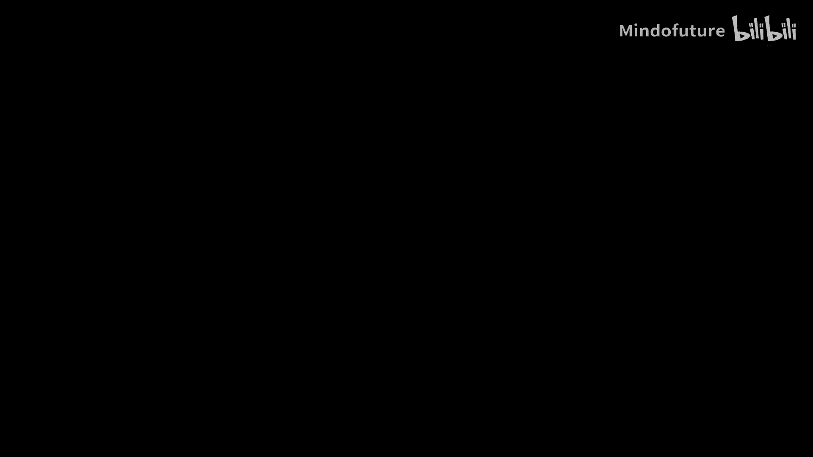
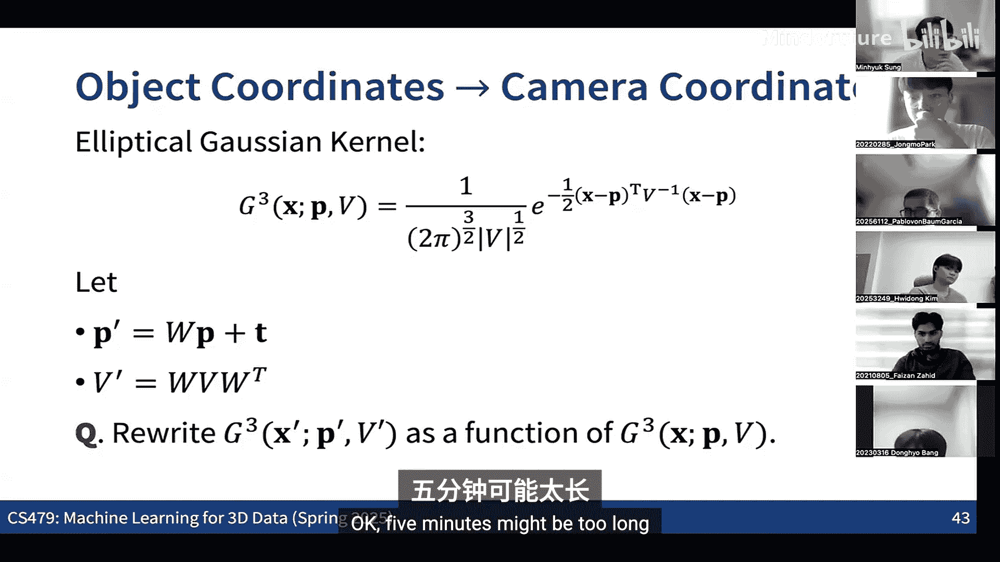
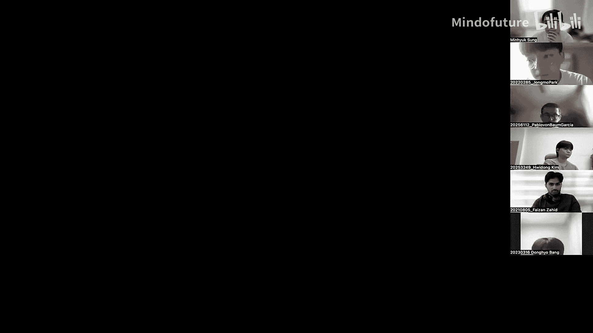
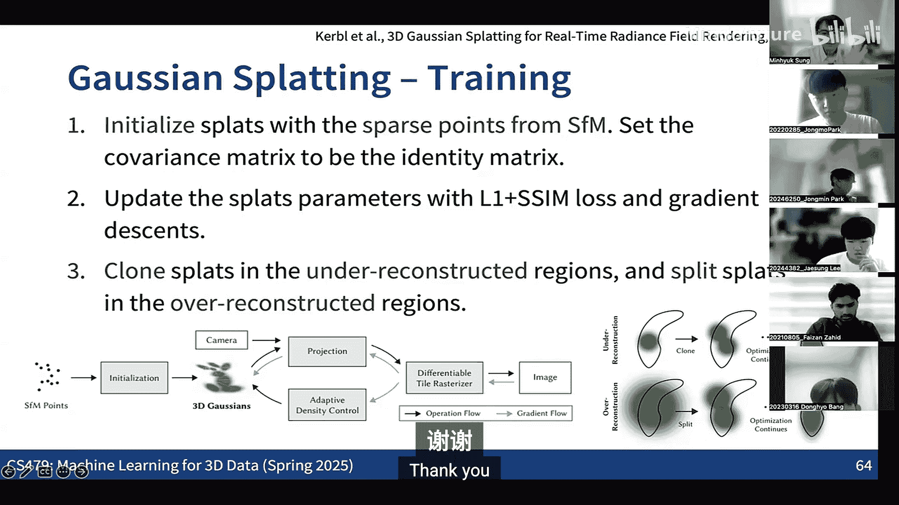

# 【韩国科学院】机器学习3D数据处理 ｜ KAIST ｜ CS479： Machine Learning for 3D Data p07 P09_Lecture_10_-_Gaussian_Splatting_(KAIST_CS479__Spring_2025) -BV1YmuBzTEmx_p7-

Okay， so today we are going to move our the discussion for to the Gaus and Sping which is kind of the more。

 kind of the next kind of technique about the new rendering。

So if we briefly review what we have discussed software in this course。

 we basically discussed some kind of the multiple representations about 3D incoting and the decoding we started to discuss the how to basically encode and the decoded point cloud and then we move boom on to basically in representation and how effective it is in terms of like decoding some kind of 3D the shapes。

3 d geometry and then after that we started to discuss the ideas about basically reconing some 3D things from the multi view images so we discussed some kind of basic things about the structure for we can basically estimate the camera po from the multi view images and based on how we can do some kind of the 3D construction So the basic idea was basically reconing into some kind of first point cloud based on kind of key points that we found of course the multiple images and then we extended the idea by using some kind of neural net that can also basically。

ForSome kind of the opacity and the color information in a way that we can not just just getting some kind of point cloud but directly enabling basically rendering into some kind of images from the RBT So that was the basic idea the new rendering。

So the kind of key technique that we discussed last time was basically the nerve。

 the neural render rendering the field， which was basically the technique。

 which is based on the bo rendering the equation。And the basic kind of the idea for this kind of technique was basically using the the kind of gravity pipeline。

 basically using some kind of rendering the framework。

 which is based on kind of shifting the ratess from the image planes into the3 scenes。

So here the question is that when you shoot array from the camera through one of the pixel in the image brain。

 basically how we can determine the color of the pixel by incorporating all the information about some kind of the geometry and the color defined in these3D things So basically what we defined in the 3D the space for those kind of the random kind of thing was basically the opacity and the ir radiance information So that also the original like why it is basically called the new radiance field。

We could see that basically the color could be determined by just taking the integral of the radiance and the opacity along the array and also basically this combined with the transparency。

 which is also defined with some kind of the opacity information。

So from the definition of the transparency here， what we could see is is that the transparency was kind of like non-increasing function over the basically the trareal of the rate。

 So it's basically starting from the one and basically over time that when you basically fly over some kind of the。

 we could see that the transparency is basically decreasing basically based on the definition of the transparency。

 as you can see here in the slide like this one。Based on deformulation defined in the form of the exponential comes like this。

So that was basically the problem render the equation。

 and we could see that this was quite effective compared to some kind of the the modeling everything is kind of solid object in terms of that we can update every single the point along the array So it is also making the update through the back propagation to be more the effective and also it is basically more the flexible representation to represent all the things defined the city specimen。

So this was kind of the basic idea for the neural de renderndering and also the nerve and the things that I wanted to briefly mention is that while this looks like some kind of very the new technique as I also mentioned last time。

 actually the core idea that has been used in the nerve or it basically very kind of the old technique that has been actually introduced like some decades ago。

 not only for the bo rendering， but also for this kind of the idea about basically rendering things into the images without like defined some kind of the explicitly geometry has been it has been actually quite the old ideas that especially have been explored in the 1990s so you can see some kind of the history of this kind of the November synthesisesis which has been basically explored in terms of how we can do some kind of some rendering without having some kind of explicit geometry but by defining some kind of the other。

Some explicit some information pull some kind of implicフ function。

As you can see there are some kind of lots of the variances in terms of that there are some kind of different ways that in terms of how we can parameterize the information in this3D scene。

 so what we have done in the nerve was basically having some kind of the radiance information and the opacity information especially the radiance information has been parameterized with the five the parameters the X Yz for the position and also for the two other the parameters for thebuject so that's kind of some related with the idea about the plane of the function here but there are also some kind of the other the ideas in terms of like we can also parameterized everything in the3 things in terms of the four parameters like this in the mimic graph in terms of that we are having the two parameters for the image pixel in the image plane where basically everything is projected and also from some kind of using some sort of the multi planee representation in a way that everything in the3D space is also defined with some kind of the multi planes and for each of the plane we are having a lot of the two。

In a way that we can see some kind of sort of some relationship between the pixel in the multiplay representation for each of the plane to the pixel in the image plane。

And there are also some kind of the other ways in terms of using some kind of the panoramic images and also doing some kind of projections from the panoram images into the image plane。

 So there is actually it's a very long history in terms of that we can do some kind of the rendering without explicitly define some kind of the geometry in this space So you can see that actually the nerve was one of the the idea in terms of that we also define some kind of the implicit representation in terms of like representing everything with some kind of the kind of neural deep function。

And we also started to discuss some kind of the hybrid representation as well in terms of like how we can also incorporate some kind of the explicit representations as well in terms of that we can achieve some kind of some parallel efficiency。

 both for the training and also for the rendering as well。

One of the ideas that we discussed last time was basically instant NGP。

 which is basically incorporating the box those as well in terms of that we also store some kind of some features for each of the boxel in a way that the features are basically decoded through the rendering the pipeline。

So this was kind of the basic idea in terms of that we are kind of like reallocating some kind of the neural de。

 the neural functions in terms of that those kind of the parameters are basically now allocated explicitly into the SwD space in a way that we can more basically see like basically which basically the parameters defined in the Sw the scenes are basically associated which each of the rate that we are shifting into the3D space right？

So the thing is that when you use the nerve pipeline it we shoot array and when you determine the color array。

 all the parameters of neural your network should be basically updated based on the load function that we are defining right but for those kind of cases that when you basically distribute all the features into each of the pixel in the 3D space only the features that are basically stored in the pixels where are basically the is basically passing through those features are only updated so we can basically say some kind of the more spatial some kind of association of the features with some kind of array that we are she right so that can be basically more effective in terms of the training and also the rendering as well。

 but that this was basically compromising some kind of the memory efficiency this will basically involve some kind of the case that we are taking more the memory to store all the information。

So we also discussed some kind of the ideas about how we can compress those kind of the information that we are defining in the 3D space using the multire representation and also using the hash table the ideas for the instant energyP。

And also the more the algebra break way to compress everything was basically using some kind of the tensor composition。

 This was also the idea that was introduced by the tensor RF。

 which was basically doing some kind of the decomposition of the 3D and the 4D tensors into the 1D and the 2D tensors in terms of that we are basically compressing the 3D 4D formation into the low dimension or the raw rank kind of the the tensors。

So those are some kind of the ideas in terms of how we can basically combine some explicit information and also the implicit information in terms of that having some kind of the features defined in some kind of the pixel and then having some kind of decoder for those kind of features。

And not only for the bucks， but also for the points we can do the similar thing。

 as I also briefly mentioned last time， what we can also do is that given some kind of some sort of the some rough d point cloud describing the geometry we can also consider basically defining some kind of the features for of the point in a way that when you also do some kind of rendering when you should a array into the 3D space we can only we can also see some kind of some points that are close to those kind of way and basically apply the same rendering the equation。

 So this was basically another example in terms of that we can also combine the point cloud information representation with some implicit the functions in terms of that we are making some hybrid representation and another example which is also now using some kind of the mesh plus some kind of features defined on the triangles so within meshes。

And the idea that we are going to discuss today is the Gaussian spting so this is also the kind of technique。

 which is on the line of the work in terms of making some hybrid representation。

 which is kind of dissimilar with using the point cloud plus implicistic function。

 but now we consider basically not just defining some kind of thes point。

 but the point with some kind of the volume information。

 basically defining some kind of the 3D Gaussian bs that are basically defining some kind of the 3 things。

And the good thing of using this kind of some pointbased representation is that as I was briefly mentioned in the case the promotion from the promotion motion pipeline。

 what we can achieve is not only some kind of the relative coming。

 but actually we can also achieve some kind ofe point cloud。

 but that's also what we have seen the lecture， So when you basically find some kind of key points over the images from the correspondences if we should de and find the when you find the inter point we can basically have some kind of some 3D points for those kind of key points。

 which is giving some kind of the point cloud。So the good thing about having this kind of the point based representation is that we can utilize this kind of some sparse point clouds as some kind of some in some kind of points in terms of that we can now utilize some kind of those points by augmenting those points with some kind of the extra some kind of the information for this rating。

So we are going to see some kind of basic ideas for the Ga for today。So for the Gausian sting。

 let me first play the video。 Okay， I think this is the video that you have seen before。

So the problem of the nerve that we have seen last time is that this basically taking quite long time。

 not only for the training， but also for the rendering as well。

 because every time we need to basically shoot array ray and basically sample the points and basically evaluate the opacity and the radance the function or the points and then doing some kind of the calculation based on that。

 So this will basically involve lots of the information the loss of the computation time also for the rendering as well but one of the biggest the advantages of the the gaus and splitting is that this basically super fast I'm not sure whether you can see。

 but actually this is the rendering the outputs of the gaus and splitting which is now rendered with the speed of the 60 frame per second So it's super fastest actually this is kind of the things that we are basically exploring the reconstructed the cs So this is not kind of the video that。

Cture directly from the real d scene， but it's actually just like navigating the space。

 So you can see that here， the the top of the d or here。

 you can see some kind of some parts that are basically remain as de black non reconstructed kind of areas。

 So yeah， it's basically like changing the kind force into black random kind of things。

And so you can see that actually the quality is really good。

 it really looks like some likeing the video while the rendering the speed is also super fastsed。

 so this is kind of some kind of this was some kind of the breakthrough that people have seen with this technique。

 the Gaussian splitting which was introduced about like two years ago in 2023。

So while we are actually seeing some kind of some very clear images for those kind of the in this video。

 actually， the thing is that the scene is represented with this kind of the Gaussian develops。

 So this is kind of some sort of the rule rendering the outputs without using the volume in the equation but just directly rendering some kind of the explicit the representation that have been used for the rendering。

 So those you can see that there are lots of some kind of some Gaussian and the illipits in the scenes。

And these are some kind of some sort of some primitives that we are using to represent these three things and based on those kind of primitives。

 those are basically defining the opacity and the ir ragance information that we discuss in the nerve and based on that。

 we can also use the same the bo renderandering the equation to get some kind of the final render images。

So when you talk about the the opposite， let me just quickly play this for you。So yeah。

 you can see that actually， there are some kind of gaussian bs。 and interestingly。

 most of the bbs are basically located on the surface of the objects。

 So you can roughly see some kind of the what would be kind of the shape of the geometry of some kind of object in the scene while there are also some sort of the floating some bs in the scene though。

 So those are basically representing some kind of the some。

 you know the opacity and the color information。So when you basically develop some of the neural rendering techniques。

 those might be some kind of the important some kind of factors that we want to basically achieve。

 So in terms of how we can get some kind of the accurate the rendering the results So that might be the first thing and also the speed is quite important So how we can also achieve some kind of the very fast the rendering speed and also the fast computation time for the the training as well。

 So these are the kind of important thing and also the memory efficiency So while we have seen some kind of some technique that is quite fast for the rendering and also the accurate which are like instantp and the tensor the RF。

 those are some kind of examples for fast rendering kind of techniques but we also have seen that those are not that the memory efficient kind of the techniques。

And also how much those can be easily integrated into some existing big graphics framework might be some kind of important factors that people might want to consider to develop some kind of new lending techniques。

And the good thing of the golf and play thing is that these basically achieving some kind of the results for all those kind of poor defectors。

 So especially very accurate in terms of giving some kind of good some realistic and very clear images for the RT abuse。

😊，And more importantly， the Ga playing exploiting is really depressed post for rendering like basically you know at needs like 60 frame per second and it can be like even faster than that and also taking that that much time for the training as well。

And also very basically very the memory efficient So especially compared to the the instant and G and some of the other techniques。

 those techniques may basically take some kind of the more than like tens of the gigyte or the hundreds of the gigyte to just represent a single object or the same compared to that talking be the much more efficient the techniques that only in terms of the competition time。

 but also in terms of the memory as well。And this is also very good technique in terms of it can be very easily integrated into some kind of graphic framework actually the reason for this is that while we have seen some kind of techniques that are basically based on the ray testing the framework。

 which is the depicting the array for each of the pixel。

 actually the Ga splitting is a technique which is based on the restorationization。

So which means that we are not just like just shooting the array for all the pixels and checking the interesting point。

 but it's more about basically projecting all the the primitives defined in the scenes into the image plane in a way that we can basically make the computation dive so we're going to basically get into the ideas about basically how we can utilize the restorationization pipeline in ouring the Gaussian splitting based de rendering framework。

So this is the page right。And actually， if we see some kind of the basic idea for the Gaus and splitting。

 you can see that this is also kind of technique that is also based on some kind of the some core idea。

 which was introduced more than 20 years ago。 So actually about like 1990s。

 delete the 1990s and in the 2000 There were some kind of the loss of the attempts to utilize the point cloud representation for many kind of the graphics the applications that you can see here。

 even there are some kind of the computer games that were attempting to basically use some kind of the point cloud based representation for the many some graphics the pipelines like this。

And so more importantly， what we also could see in the 2000 was that there were some kind of the we started to see some kind of some the 3D scanners that can actually capture many some 3D object in the scenes in a very large scale and also very fine kind of some accuracy so this was the first the 3D scanner that was introduced in the 1999 were the 2000 as far as remember。

 and this was the first case of like capturing that it was able to capture this kind of the big statueature which size would be like the the tens of the。

 I guess。With some kind of very the high accuracy which can or and also be very fast speed as you can see。

 this was the case that we could basically capture and things while basically having more than 100 the millions of the points per second so you can see some there are some kind this is not for the scanning this is for the rendering what for the scanners we also could see that there are yeah so this is the case taking like 4 million of the points for the entire statue。

So this was very very large scale the point cloud that people could see or acquire from these3 scenes using this scanner。

 so that was happening in the 20000 and also it like very accurate as you can see in the quality like this all the fine details are captured like this。

So at this time what people started to like think was basically how we can utilize this kind of some scanned point cloud directly for many kind of applications without doing any kind of conversion into the mehe or something so why we are also going to discuss basically about this kind of conversion of the representations actually there are some kind of attempts in terms of the how we can directly use the point cloud for many things。

 especially for the rendering， so this was kind of the basic idea that people have started to discuss at this time。

So actually there are lots of some kind of techniques in terms of how we can use the point cloud directly for the rendering。

 but you could start to think about how we can use the point cloud for the other D applications for so many equation or the many things。

 then we will need to convert these thing into the other representations。

 So we're going to get back to this point after the met。

But this was kind of the interesting idea in terms of how we can directly render the point cloud into the images and actually if you find some kind of the old materials like this。

 actually more than 20 years ago， there are some kind of even some kind of the conference for the old research about how we can do some kind of pointbased rendering and how pointbased some kind of graphic pipelines so you can check out lots of some kind of materials at this time。

So even there was some kind of the whole community research community about how we can directly use the point cloud for demand Mandaring。

 but after trying all the things like people realize that actually for the efficiency it's better to convert into the meshes and then there are some kind of some of the convert networks works。

But anyway， so this was kind of the basic motivation at this time in terms of how we're going to directly use the points for the rendering pipeline and then the Gaussian sting is actually nothing。

 buts directly utilizing the idea that has been introduced at this time based on the points that we could achieve with this toxic promotion。

So at this time， like some kind of the basic idea was basically using the introducing some notion of the software which is kind of the short name of the surface the element。

 So here the basic thing is that now we are seeing each of the point at some kind of the not just kind of the single point in the thing。

 but at some kind of the surface the element which is incoting some kind of the basic information about the3 geometry。

 So now what we can see is that each of the software is not only defined the position and also the color。

 but if we really just see the point that just kind of point in the3 scene that we need to somehow know interpolate those information to define the surface。

 right。So we are not justing the point as some kind of the point。

 but like associating some kind of the area information So in terms of that basically one kind of the idea was basically signature of the point as kind of the disk。

 very small disk， which now have some kind of area information and also the surface normal information as well。

So basically when you see each of the point as kind of the disk。

 So the question is that how we can effectively do some kind of render rendering with the tones of the disk that we have in the SwD space。

 So this was basically the idea that has been discussed with the name of the sub and then after that。

 people also started to extend this idea not just having some kind of the disk in the SwD space。

 but also basically define some kind of some kind of volume in the space。

 So which is basically just treating each of the point assigning some kind of the volume information for each of the point in terms of them now we can treat each of the point as some kind of the Gaussian b。

So then this is kind of the case that now we can also consider using some kind of the volume render equation for the rendering that is basically the equation that we have seen that the North case。

And especially for the good thing like having this kind of representation is that for the multi view to 3D to consult in the case now we can consider using some kind of this parts point cloud that we are achieving with the multi view images some kind of the initial this kind of some volume display split。

 so we are starting from this kind of the volume split and doing some kind of refinement in terms of that defining all the 3D geometry with some kind of the Gaussian bs and also using the volume render equation for the render so this was the basic idea that actually has been introduced in the 2000 2000 not 212001 and we basically revis the central or the name of the Gaussian split。

What split so split are basically this kind of some Gaussian develops or some kind of disk in the Swedish space。

 some kind of the basic primitives that we are saying in this context。

So actually either we can consider the points as some kind of the disk or they consider the points as some kind of the Gaussian blo and what we are going to discuss today is about basically when you have some kind of the volumes split when you treat each of the point that kind of be some Gaussian bs and while this idea also can be extended to the case of that when you treat points as kind of the disk etc。

So how to define the size of this plate， So it depends so actually in the context of this kind of old work。

 we could basically consider the define some size of this plate based on the density of the points that we have。

 but in the nearer the rendering the context， actually we can consider basically optimizing this kind of the size of this plate over time through the border rendering the equation。

 the loss function and the back propagation。But basically what we are defining as some kind of debate the attributes for the surface plate and the volume plate is that for the surface plate the case。

 we will need to basically define the position and the surface tumor information and also the radiance information and also the color information as well。

But for the volume renderandering the case， now we are basically defining the position。

 but not the normal， but basically the deco covariance the matrix。

 which is defined some kind of the size and the orientation that the volume。

And we also need to have the color information as well。So。

 so you can say that this is kind of the more explicit some representations of the opacity and the color。

 the kind of things， not just using the neural net。

 so this is the case of we some more like explicit representation for the volumearyander ring。

Any questions on this？So what we are going to briefly see for today is not about exactly about you know how we can do some kind of training or the things we did splitting the pipeline。

 but actually we are going to talk about some kind of the old technique in terms of how we can do really some kind of volume renderanderaring with the set of the volume display and what we kind of basic machinery that we can use for those kind of the balloon render we this place。

And for more details here， I strongly recommend you to check out this paper。

 which was published in 2002。 So it's kind of you can see that this very old work and interestingly。

 this old work has been revisited very recently with context of the rendering and which now is becoming more standard technique for many kind of the image to video construction。

Okay。So basically what we are going to do is that going to see is that we are going to assume that the old C scene is now presented as some kind of a set of the subpo spread。

 which is basically having this kind of two properties opacity and the radiance。

 So these are really some kind of two properties that we discuss for the nerve right。

 So exactly the same。 So to simplify the discussion to this lecture。

 we are going to assume that the spread is now having the color information instead of the radiance information。

 So this is like not the view the dependence of the color of every view。

 but all the things that we are discussing for today can be directly extended to the radiance as well。

 So no big difference here。But the thing is that we are also additionally defining some kind of the some Gaussian corner。

 the ellipsoid or the Gaussian corner in the3D space。

 which is also now defined with the center point P here and also the covariance the matrix。

 which should be desymmetric is3 by3 matrix。So given this kind of the center and the covariance。

 this nothing， but we are defining some kind of Gaussian the function in the3D space and the the the Gaussian function in the3D space will will be defined in this form。

So based on the Gausian corner and the opacity and the color information。

 we're going be to determine the opacity and the color for any arbitrary point in this red scene。

 and then we're going to do some kind of the compute in the equation。

 But we're gonna see how we can very know efficiently compute the the equation with some kind of the approximation and the assumptions。

And before we get into exactly how we can exactly compute the border under the equation。

 we are going to get into slightly more details about the graphics the pipeline in terms of the coordinate system。

So we have discussed the coordinate system a bit last time， but actually in the graphics pipeline。

 we can also consider some bunch of some kind of the coordinate system。

 which is including like object coordinate system and camera coordinates and those of the coordinates。

Actually， there are something more actually we can also consider some kind of the world coordinate system in between between object and the camera here and also instead with ray coordinates。

 we can consider some kind of screen coordinate system based on the image plane with some kind of scaling and the hip so but let me skip some details here。

If we only consider those kind of very coordinate system。

 the meaning of like each of the coordinate system is that for example， for the object coordinate。

 this is basically nothing about some kind of local coordinate system for each of the object and the object that we are defining here is the split。

 the volume split， right。So we can basically assume that each of the volume plate has its own the local coordinate system。

 Obviously then the origin of the coordinateor system will be the center of the Gaussian split。

 and also the axis of the coordinateor system are also aligned with some kind of the principal directions of the eipoid。

 So this is kind of the way that we are defining some kind of opening coordinateor system。

So once we basically define the object deco coordinate system for each of the the Gaussian spread。

 now we can also define some kind of some sort of within the coordinate system。

 which is defined based on the camera de So once we basically define the exchange de of the camera based on that。

 we can define the camera coordinate system。 and then the transformation from the object coordinates to the camera coordinates can be defined with some kind of the rotation and the transformation。

 right。Then we're going to call the transformation from the object to the camera coordinate is as thebuing transformation。

 which will be defined based ver and the translation。So by the way。

 some of the termss that we are using here may not be some kind of some typical termss that are used in the many graphic pipelines。

 but those might be some of the termss might be some special termss that are only used in that the old paper in 2002002 so there might be some confusion in terms of which basically the coordinate system is like corresponding to the coordinate system the typical the graphic pipelines。

 but we're going to follow that the termss using the paper otherwise so that you can also basically check out some more details in the paper you want to see。

So basically we're going to use that the terms of deing the transformation。

 which is converting from the object coordinates into the camera coordinates and this way will some kind of some reach by transformation rotation。

 the translation。And as we have seen in the camera the model kind of the lecture。

 we can also consider some kind of the projection right。

 so we're gonna see some kind of the array coordinateor system which is basically defined based on the intrinsic the parameters of the camera。

 but without considering any kind of some the camera the parameters like what call all the things。

 we're gonna say that the array coordinates is basically nothing but strictly projecting all the three things into the image plane which is kind of the some the projection the projected the transformation。

So here the projected transformation is basically nothing but just like directly dividing each of the X。

 Y the coordinates by the V the G axis here。And so this basically projection from the 3D to the 2D。

 but we are introducing the third coordinate here， which is basically D depth information。

Along the depths。 So this is some kind of specific way。

 like in terms of how we define the the rate coordinates。

 as's kind of like making simple the projection from the 3D to2 D。

 which is the case that the becomes one， right， So it's simply dividing each of the X Y coordinates by the G coordinates And just like here。

 the only thing is that we are taking the distance。 the rate， the depth information。

 that's kind of the third coordinates here。So then here what we can see is that when you show some kind of the multiplayase from the center of the camera here into the 3D space。

 while basically we are shooting the rays in this form with some kind of the lines you can see。

 when you convert all the arrays into the ray coordinate system。

 what we can see is that all those kind of rays become some kind of the parallel lines in the space。

 while we are still having some kind of the third coordinates which is you describing the distance over the rate。

So this the first two is basically the projection into the 2 dD space and the last term basically defined becomes the distance here。

So we are basically defining this kind of the three coordinate system。

 you' want to use this kind of notation， the x indicates the object coordinates points and the x prime is indicating the camera coordinates and the X the double prime is indicating the ray coordinates and for each of the coordinate system we are having thebu the transformation and also the projected transformation。

Makes sense。And the viewing transformation will be also will be denoted as the function F here。

 and the project transformation will be denoted as the function G here。

So we are basically having bunch of some kind of transformation。

 and then we're going to basically compute the polymer equation in the recording coding system after doing all the conversion。

So this is kind of the basic idea about the coordinate system we are going to use。

And the thing is that we are basically assuming that for all the illoidal the Gaussian decos。

 all these kind of the center and the covariance the matrix those information are basically defined in the object coordinate system。

 So we are first defining the eipoidal decocon in the object deco coordinateor system。

 and we're going to see how those kind of the corners are also transformed through the building transformation and also the project the transformation。

So basically define the Gaussian corner with the object deco system。

 basically means that by definition of the object coordinates。

 basically the origin of the center of the de Gaussian corner will be defined at the origin of the object coordinate system。

 and you're going to also assume that the all corners are basically defined with the axis aligned the co the matrixs in the object coordinate system。

Which means that in the objective coordinate system。

 the three by three matrixs for the cos matrix will be the diagon of the matrix when having some kind of the scaling scale term for each of the principal directions well。

So this is kind of the case。 So once we have those kind of setup up。

 what we are going to see is that how is the each of the the Gaussian the the kernel will be basically transformed through the building transformation and the project of transformation。

So here the question is that will the Gaussian kernel defined the object coordinate system remain as still as the Gaussian kernel after applying the viewing transformation？

Or what's the answer for this？ Yes， we not。So yeah， let's say step by step。

 So what we can see is that so the viewing transformation will be some kind of linear transformation。

 basically， it's a risk about transformation， which is involving rotation and the translation mode。

So for the cases that we have thebuing transformation like this。

 which is basically involving some linear part here。

 which will be typically rotation and also the translation part here。Basically。

 each of the object coordinate we will be basically converted into camera coordinates with this kind of function。

 right？And we can also consider having some inverse function like this。

So you can see that this sping transformation is basically a linear data transformation。So from this。

 I would like to， I ask you do some kind of the some hands on work for the some kind of some math。

 some calculation。 So given that when you define the eipoid of the Gaussian corner in this way。

So let me just like define these two termss。 So let me define this like P prime and the v prime basically having this kind of the thes。

 So obviously you can see that this will be some kind of transformed the point and the variance in the camera coordinates So I'm giving you some kind of the information for this actually in the camera coordinates the center of the ocean the corner will be this P defined like this and also the variance will be defined as kind of the form the B prime。

So given that can you rewrite the Gaussian corner in the chi coordinates as the function of the the Gaussian corner defining the object coordinates。

So what actually I can I recommend you to， is to basically to do the opposite first。

 So whether we can represent the Gaussian corner in the defined in the object coordinates as kind of the function of the the Gaussian corner defined the big camera coordinates。

So right to basically， we write the Gaussian corner defined the objective coordinates as kind of a Gaussian corner in the camera coordinateator this。

 based on the definitions of the P prime and the P prime and the Gaussian corner here。

I'm gonna give you。5ive minutes for this okay， five minutes might be2， okay， three minutes。

So if you need more time， I recommend you to check this after the lecture。

But since we are running a little bit all of time。 So if we see some kind of details in terms like how we can see the relationship between these two。

 let me first do the opposite in terms like rewriting the Gaussian the corner defined the object coordinates with the Gausian the corner defined the camera coordinates。

 then this is the definition of the Gausian corner。

And we can simply rewrite some of the terms here in terms of the that no we are replacing X and P here like this。

And then those the the translation part will be canceled out。 then we're going to have this equation。

And we also be writing this equation by just taking out the the linear part here in terms of having this part。

So from this equation， what you can see is that now this become some kind of the new。

 the variance term in the the can recording like this。 Alright， so by defining the brief plan。

 as we have seen the bigger slide here， by taking this big line here。

We can now rewrite the whole equation in this way。Then we can see that when you take the pre prime the here。

 then we can take we are seeing that this become the same that we are taking the Gaosian corner in the K coordinates multiplied by the determinant of the linear parts debuing the transformation。

From this kind of the de， what we can see is that actually the Gaussian corner defined in the object coordinates。

 like when it converts that， when you see that the corner from the camera coordinates。

 still the corner remains as the Gaussian corner while it looks like we are applying some kind of the rotation and is killing right。

So the scale income can be seen here。 So how can you see the the the how can you see that the calcium color looks like they located in the camera recordings。

So the rotation is kind of involved in the new dimension of the cops here， right。

 So we are multiplying the linear parts before after the the equis， the matrix right。

That is basically showing that actually the Gausian corner。

 which has been seen in from the camera coordinates。

 looks like we are basically rotating and the scaling that the Gaian corner。

But still it remains some kind of the the Gaussian corner in this3 space。Makes sense。

Any questions on this？So yeah， this is kind of good thing so the Gaussian corner in the object coordinateiness is also another de Gaussian corner in the camera coordinateiness。

 but how about the case that when you apply some kind of the projective terms to the transformation。

So will the Gaussian corner defined in the object coordinates will remain in the Gaussian corner in the red coordinates the answer is no because this is the projected transformation。

 So we will be able to easily find some kind of example that the Gaussian corner does not remain as the Gaussian corner in the actually applying some project。

But what we are going to do is that we basically making the computation simpler after in the volume entering the equation。

 we are going to see how we can basically approximate the projected transformation as kind of some linear de transformation in a way that we can still treat the Gaussian corner in the rate coordinateing system as the Gaussian corner as well。

 so there's kind of the basic idea for the Gaussian splitting。

And how we can do some kind of the approximation of the project transformation as the linear function。

 what's the kind of the eclog some linear transformation that best approximates the project transformation。

So what we are going to do is that we are going to use the first order detail expansion。

 which is the approximating the transformation， especially at the center of the Gaussian split the P prime here。

And how we can apply the first order detailed of the expenditure。

So Im not sure how many of you are familiar with tail expansion。

 but the expansion is basically defined in this way。

 right by defining some kind of the Jacobian term here。

We can now approximate the project function here， which is defined as the G function here as some kind of the first linear function like this。

So we have seen the this like what what the projection function the projection function was basically nothing but just like dividing X Y coordinates by the G coordinates。

 let me just go back to here So this was the our the G function， the projection function。

 that dividing X Y with the G coordinates here and just taking the distance along the the norm of the explain the coordinate here as the third coordinate right。

So since this function is not a linear function， we are going to take the Jacobian for this function in a way that we can do some kind of bilineal approximation。

 so given the definition of the projection here， how we can compute the Jacobian here。

 what do we get once we get the compute Jacobian here。听完。

You could do some kind of calculation with this。So you can check out this method。

 but you will see that actually this is not nothing but we have seen how we define this G function as the projection。

 nothing but just dividing x by D z， dividing y by z， and just taking the distance long degree。

 de taking the normal degree， just taking the gradient for each of the X， Y。

 z coordinates of the output of the G function with respect to the X， Y。

 z coordinates of the input the bacteria。And then just taking these three by three matrix we did。

And you can say that actually， this is nothing but we are having this phone， right。

Nothing but just like taking the gradient of the x1 by x 3 with respect to the the X1， right。

 Then we get this。same thing啊 taking the gradientオ the x oneば by x three。The x1 over x3 by the x2。

 the we we see you， just like taking this。So you can say that actually Jacobion can be easily calculated from our definition for the project the function in this way。

So by just having this kind of some tail expansion。

 what we can see is that now by calculating this the Jacob and the images。

 we can basically approximate the given the project the project function is kind of some linear function so now we are simplying the notation for the Jacoban as the J simply here and then the translation part can be calculated in this way。

So which means that when we approximate the projected transmission into the linear function。

 then with this kind of the approximation， the Gaussian the corner defined in the camera coordinates will be also seen as kind of another de Gaussian corner in the array coordinates。

 right？So exactly the Gaus the Gausian corner in the chemical coordinates will not be Gaussian in the array coordinateord system。

 but if we do some kind of the linear approximation for the projected de projection。

 then we can treat the Gaussian we will also remain the Gaussian， right after the transformation。

So what it can see is that so given that the the double point。

 the center in the rate the center of the Gaussian in the array coordinate system is defined this way and also the variance of the Gausian corner in the late coordinates is defined this way。

 we can also see that the Gaussian corner in the rate coordinates can be also written with respect to the Gausian corner in the counter coordinates as we have done in the pillar slide。

 it's basically the same thing because everything is the same the linear transformation right。

So given this kind of the two sequential the linear transformation。Now。

 what we can do is that we can rewrite the Gaussian corner in the red coordinates as the Gaussian corner。

 which is originally defined in the object coordinates， right。

So once we basically define the Gaussian corner at the center of the each of the object coordinates and also some excess outlined the variance based on the two transformation。

And also with the the linear the approximation pretty projective the transformation。

 now we can simply deri the Gausian corner， the same de Gausian corner。

 but which is now defined in the red coordinate system。

And the Gaussian corner defined in the right coordinate system will be basically nothing but basically applying some。

 you look like some kind of applying some kind of the rotation and also the scaling term in the original the Gaussian corner。

 the object the coordinate system。This killing term is defined in this way with some kind of determinant of the linear term in the debuary transformation。

And also what we can see is that typically obviously the linear term in deity transformation with the rotation。

 right？And the determinant of the rotation matrix will be one。 Actually， this。

 the determinant W will be one for most of the cases。

 and we will just need to compute the the determinant of the J here。

And this is kind of some approximation。 we will say the Gaussian corner will not be Gaussian in the ray coordinateing system。

 but this can be one way that we can simply basically approximate the Gaussian corner is the Gausian in the rate coordinateing system。

 which can be calculated this way， So we know how we can calculate the P double prime and D B double plane。

 which will be defined in this way， right。So once you basically so given the P and the B are defined in the object coordinate system。

 you calculate the P plane， the P plane the B the top prime here。

 which is now defining the rate coordinate system and then basically also calculating the Jacobian tu terms we determine the scaling to。

 So then it becomes that we are seeing some kind of the conversion the the coordinate system。

 So seeing the same the Gaussian corners but now defining in the rate coordinate system。可。

So this is like rural about how we do some kind of the conversion of the coordinate system for the Gaussian corners that we define the object the coordinates。

 then based on that， how we can do some kind of the calculation of the bo render the equation。

So if we see the polymer in the equation again， it was quickly defined in this way。

 basically taking the integral of the multiplplicationplication of the color here it can be re if we have these some parameters for the beject as well and also the opacity which is also called the extingent equi and also the transparency。

 which is defined based on the opacity here。But what we are going to do is that we are going to calculate this equation not through the rate testing way。

 but through the restization wave， which means that we are going to first basically project all the splits into the image plane and do some calculation。

So basically what we are doing is that it's kind of the same in terms of for each of the pixel and also when you consider some kind of rate that we are shooting from the camera center to the each of the pixel in the image plane。

 basically we're going to collect only theoid of the gaugeus and this place that are basically where the rays are basically passing through。

And then we are going to sort them， sort all the Gaus splits along that array。

From the closest to the furthest。And let's consider that we are having some kind of index the old the Gaussian splits that are basically where the array are basicallying to with the index of the eye here。

😊，And then we're going to basically calculate the Gausian corner in the ray coordinate system。

 which means that we are calculating the P double plane and the B double plane and also the Jacobian d matrix in terms of the we calculate the scaling top here。

Actually there should be some kind of the yeah yeah so this is the the Gaian defined in the red recording system which is basically also theianian the in the object recording is and it kind of be rotated and this version。

 right。And then once we collect all the Gaussian corners are defined for each of the Gaussian displays。

 we are going to basically now compute the volume render the equation。

And also in our the balloon of the equation， now we're gonna to consider that the opacity。

 the term is defined like this。 So the opacity term is basically defined as some kind of the opacity for each of this split。

 and which is like weighted by the Gaussian corner here。

 So based on the query point that we are having over the rate we are basically determining the weight for each of the split。

 and then the final the opacity is now calculated as the weighted sum of the opacity for each of the the Gaussian split。

And also， the multiplication of the color and the opacity is also defined in this way。

 So we are simply basically multiplying the color here and taking the weight is。

 which weight is now defined based on the Gausian color。喂。😊。

And based on then so now we are going to see how we can calculate the volume the equation。

 And before getting into that， but we are going to use some kind of the one strongly assumption。

 which is about the nondeveloping the local supports。

 basically which means that basically we are basically determining the weight for of the split as kind of the Gaussian the corner。

 which will never become0， but which can get closer to0。

 depending on the position of the query point in the3D space。

 So what we are going to assume is that those kind of the Gaussian splits are distributed in the3D space in a way that there is no some kind of some big overlap of course the splits which means that when the weight defined the Gaussian corner in the one split is basically having some kind of the nonze the weight。

 we're going to assume that weight coming from the other split is very close to0。

Obviously it's very strong the assumption it really depends on like how those kinds of splits are basically distributed in sweet space。

 but we are going to use this kind of the assumption to simplify the computation。Makes sense。

Andに questionさんです。So based on that， basically， how we can compute the volume under the equation is basically nothing。

 but this was basically the equation that we have seen， right， the volume under the equation。

And the transparency was defined in this way。Then now what we can do is that we are basically simply replacing this term with the definition of the opacity and the multiplication which these two defined with this place as we have seen the previous slide right。

 replacing this part and this part。The only change that we are making in the transparent term here is that based on the non overlapping thiss the assumption。

 what we are going to do is that when you basically consider applying calculating this kind of opacian。

 the color with the each of the Gaussians per here， the sorted the Gaussians per here。

 So for example， like if they compute termss with the each of the I the Gaussian display term。

We are going to consider only these split that are basically in front of that that specific the Gaussian split。

 because like the splits that are in front of each of these split will be only some kind of the Gaussian develops that will affect in terms of computing the transparency。

 right。So from here to here， what we are doing is that while we are taking the integral over the transparent system here for the entire range of the array。

 we only consider some of the corners that are basically in front of each of the Gaussian corner in terms of that those are basically the corners that will determine the transparency。

Then after this kind of conversion， what we can see is that we are also taking out this sum here out of the exc term here。

So the summation here becomes the product out of the exponential de here。

 and we can also take out the whole thumbs out of the summation like this。

So we are basically having these kinds of deformation。So yeah。

 you can check out some more details like how we are making some changes of the deformation based on the assumption here。

And you can see， like， what's the kind of the good thing of like this formulation。

 So after we are making this kind of change， Can you simplify this equation with this kind of like two things。

😊，So let's say like we can now compute some kind of integral of the Gaussian corner。

Alllong some kind of the direction here。 So let's basically replace this term as's kind of the Qi here。

 So just into this kind of new notation。 And then to simplify the computation。

 we are also going to use some kind of the linear the approximation for the exponential term here as well。

 So we are going to replace the exponential term here as kind of the one minus x which is also using the the expansion So based on this kind of the two the things here。

 can you also simplify this equation。So I basically recommend you to do your own handsone work for this and then we will see that actually after using those kind of the two kind of things like approximation the new terms。

 what we can see is that actually those like whole equation can be simplified in this way。

 just like replacing the integral term here into the QI here。

And those replacing the exponential is kind of be 1 minus x here。

So you can see that actually the whole equation can be simplified in this way。

So after like converting everything into in this weight that you can see that actually this looks like quite simple in terms of that for each of the eye。

 So this whole the tongue becomes our the transparency right。

 So this tongue becomes the transparency。 And then we are not doing nothing but multiplying some kind of the the color and the opacity and some kind of the weight that are defined with the gaussian the corners。

So here the remaining the question is that how we can take the compute integral here。

So this integral was basically doing some taking the integral in the recording system， right。

So what we can see is that this is actually the Gaussian corner。

 which is now defined in the ray coordinateing system and taking the integral here basically means that we are also taking the integral along the along the array。

喂。And in the array coordinate system， the distance along the array was represented as the third coordinates。

 right， So we are having the x the projected x coordinates and the y coordinates。

 those are determining the position of the array in the image plane and the third coordinates is basically representing the distance along the array。

 And what we are basically calculating here is basically taking the integral along the distance along the the array。

 So actually， this sort nothing， but we are taking the integral along the third coordinates of the ray coordinates。

对。You can see the menu of the so when I just like use the T here。

 actually the T was basically the third coordinates of the rate coordinateing system。

So can here what we can see is that when you have some kind of the Gaussian corner defined in this really space。

 what to be kind of the output when you take the integral of that Gaussian the corner along like one of the specific the axis in the coordinate system。

 So here specifically we are taking integral along the third the coordinates。

 the axis in that coordinate system。So the good thing of that is that when you take the integral of the gaussian the one of the axis in the g basically in this case。

 then if you what we can see is that that become the same that we are just simply calculating the2 d Gaussian。

So you can see that actually， this is nothing but we are taking the projection of the some 3D Gaussian with some kind of one of the axis in this space and the taking integral on that。

 So that is basically become that becomes identical with calculating the2D Gaussion。

So now we can see like why we want to basically approximate the3D the Gaussian the corner reason kind of like representing the Gaussian in the red coordinate system actually the reason for that is that we want you to basically compute the integral of the Gausian corner to be simple as possible as possible but just it becomes the 2 d Gaussian the the computation。

So thats basic thing what we do is that we represent like all the Gaussian corners in the array coordinate system and calculate the volume the equation and the main part in the volume in the equation will be basically taking the integral of the Gaussian corner。

 which actually becomes the computing the 2 d Gaussian the space。

So that was kind of the basic idea in terms of how we can do some kind of the the rendering with the3 des split and also with the permanent equation。

So there are some kind of some complicated things in terms formulations I recommend you to check out those kind of some formulations after the lecture and on Wednesday I'm going to briefly mention about basically how we can also do some kind of the training with the Gaussian split and how we can basically expand the Gaussian split in terms like reconstructing these3D things and then we can see that actually the reconstruct these3D things weD split can be rendered in this way。

So we're gonna wrap up the garian split next Wednesday and then were gonna have the summary for the meeting。

Any questions on this？So as I mentioned at the very beginning are we going to make the Wednesday session as the offline session the in person session which will be happening in the N1 room to01 I'm going to see you next Wednesday。

Thank you if you have any other questions， please post the questions on slide。调摆。

Thank you。