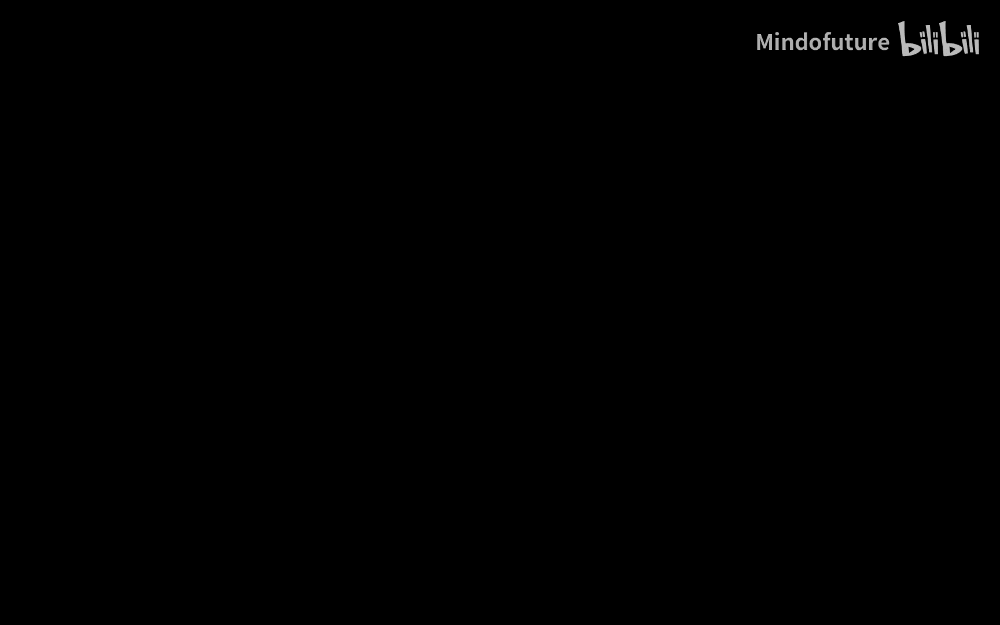
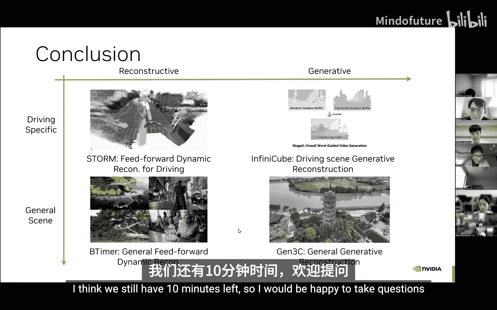

# 【韩国科学院】机器学习3D数据处理 ｜ KAIST ｜ CS479： Machine Learning for 3D Data p08 P10_Guest_Lecture_1_-_Jiahui_Huang_(Senior_Research_Scientist_at_NVIDIA) -BV1YmuBzTEmx_p8-

Okay， so then let's get started this。 So it's my great pleasure to be able to invitei who is senior scientist atD also receive PhDinga University in2223i is author about3 and today will give lecture about of in the and for any questions about feel to questions go questions after the talk take over the。

Yeah great thank you thank you so much Mihi for for the introduction so yeah， as I said。

 it's a great pleasure to have this talk to all of you guys and today my topic will be covering generative reconstruction of dynamic 3D scenes in the wild。

So。I'm from the VDS La， spatial intelligencetelence Lab。

 so we recently changed our name from Toronto AIAP to spatial intelligencetelligence Lab to just reflect the fact that we have all of the research about 3D reconstruction。

 generative AI and all of the stuff related。Cool， so yeah， without further ado， let's get started。

What is 3D reconstruction so here this is just my own personal definition of how you want to achieve via 3D reconstruction basically the goal is to convert all of the sensory measurements including images that are captured via cameras points captured by lighters into a digitalized format for various downstream tests for for example like visualization and analysis This is an example of structure from motion basically you take images and reconstruct the camera poses as well as the structure of the scene solely from the sensor measurements。

Yeah， and。You know， the very basic SFM techniques are from， I don't know。

 like 10 years ago or so and more than approaches has really advanced a lot during the past several years and。

Definitely in this talk we'll be covering several very。

 very advanced or not very advanced but very like new techniques and these techniques basically try to take in either images as input or Liar points as input and also sensory calibrations and poses and convert them into digitalized format of the 3D world so these for example are results coming from on the left this is instant NGP and on the right this is the Ne kernelnal surface reconstruction that's reconstructed geometry。

So if we compare the two basic two tasks or two subtasks within 3D reconstruction。

 like instant NGP or N， I guess you accept that you guys already are very familiar with this technique。

 they focus on appearance reconstruction， which means that the main use case for this will be know youth synthesis。

You want to simulate how your camera image will look like as if the camera is positioned at a different location than your input locations。

Secondly， we could also do geometry construction and this would be very useful for physics simulation if you want to put a car on this road。

 you wanted to drive smoothly， you don't want it to feel bumpy and you want to measure like how smooth or how obstacles your waypoint would exist。

嗯。So for appearance reconstruction， apparently there are way more downstream tasks， for example。

 for robotics or for AV for autonomous vehicles， there could be policy training or evaluation and with this reconstruction technique we could enable either closed loop or end loop or open loop evaluations and also definitely for visualizations so you could have this pretty cool visualizations for analysis。

And。In this talk， given the。Just the limit of time and everything。

 I would actually mainly focus on appearance reconstruction。

 which means that we want to synthesize novel views， but not on geometry reconstruction。

 which is also a great topic， but we probably don't cover it today。Yeah。

 so I will probably cover like fall four topics， so this is I place this axis on the slide。

 so we actually on the vertical axis we go from this driving specific scenarios because there are a bunch of inductive bias or prior that we could leverage all the way to gene scenes just whatever kind of scenes that you have and on the horizontal axis。

 we go from reconstructive approaches to generative approaches。

 so basically reconstructive approaches only focus on reconstructing existing pixels or existing measurements but basically means you want to generate new content of the scene that is originally not observed in your capture。

So the papers I'll be covering are from。Me and a bunch of great collaborators that we have here at NVDdia mostly。

 and I would like to thank all of them， all of the great authors for all of these papers for doing this work so I could。

Be able to present them today。Cool， let's first go to the very first project's called Storm spatial temporal reconstructioncon model for large scale outdoor scenes。

嗯。Yeah， so。I guess that you guys are pretty familiar with techniques like neuro raddiance views or 3D Gaussian spting。

 and these approaches are usually performing the reconstruction via precinct optimization。

 which means that you set up your scene representation and you want to optimize so that the rendering of the scene representation looks as close as possible to your actual measurements。

However， these approaches usually take minutes and hours to finish so admittedly it's not it's not very fast just recently I guess from from the end of 2023 like one and a half year ago there comes this feet forward approaches with a representative work being large reconstruction model by Hong et all so what they leverage is a single feet forward network which involves bunch of network operations convolution。

You know transformformers and then they end up with a trip representation that you could directly regress from the output of the network and then you can directly render the desired scene representation from this output representation and the entire network only takes milliseconds or。

hundredundreds of milliseconds to finish， which is definitely under one second and you get a decent reconstruction and this significantly speed up this optimization based approaches。

嗯。You know， with the same analogy to 3D Gausous spleting。Because it's pretty flexible。

 it represents the entire 3D scene using 3D Gaussians and this would actually facilitate a representation called a Pixel All 3D representation with a pretty good example being GSRM by Jhang etta published published them being being put archive public on March last year。

 so the core idea of GSRM is they take a bunch of input images and they pass all of these images through a several transformer block essentially resembling a vision transformer and then after the vision transformers。

 they unpatify all of the tokens and then regress a 3D Gausians on each of the pixels of the input image which means that for each of the pixels in the input you should array from this pixel and along the race。

Form E Gaussian。And you assemble all of the Gausians across all of the input views。

 then you get the merge Gausians， which is a a model。

 complete representation of the scene that you want to reconstruct。

A question that the current paper that I'm going to talk about storm answers is how would you extend this to dynamic scenes and for outdoor scenes？

That is actually more challenging than objects by settings。

So what Storm does is that it's taking these several images。

 I only have six images as an example here， you have images captured from an uncar lock with front view。

 left to view and right view and you have four time steps here I only show examples of two time steps and then you convert these images directly into a dynamic Gaussian representation that you could render at arbitrary viewpoint and also you could obtain the depths and also the motions of the scene。

So here。On the bottom， on the top row， this is the re renderndering。on the middle row。

 this is a visualized depth map with red being pretty close the camera and blue being far away from the camera and the lowest row is the color coding of the scene flow which represents the motion of the scene。

 so you could see that all of the Gausians belongs to the same car or from the same motion body belongs to the same motion cluster。

So how does storm work？Storm works by still using this pixel aligned dynamic representation。

So taking images as input， it's pass all of the tokens from the images into a vision transformer。

Apart from the image tokens， it also takes some queryable motion tokens as input。

And after the transformer， the motion tokens will be utilized to cross attend to the image token。

So it assigns each of the image tokens a motion basis。

And this motion basis could be further decoded into the scene flow of each Gausians on each time step。

To visualize this， we have this example， so we have four model cycles here and each of this model cycle。

 so this is moving a moving motorcycle cycle and each of this model cycle here are actually reproed from each of the timestamp because the timestamps or because the images are captured at a different time step。

 the positions of this model cycles are actually different。However。

 by utilizing the regress vector motion vector or like the velocity basis。

 you could actually try to move all of these Gausians to a desired time step by multiplying the velocity by the gap of the time step。

So essentially， you move all of these motorcycles to one specific time step by using the very basic physics function。

 which is velocity times time step。And after that， you gather all of the Gaussians from all of the timestamp and from all of the images together to form a canonical scene representation。

Here are some of the examples that this method could reconstruct。 as you can see on the top row。

 these are。Example of one time step of input and。All of the three rows below these context images are actually the reconstruction。

 so you can see we basically wiggle the camera a little bit so that you can see it's a real 3D reconstruction where you could visualize at arbitrary camera angle and with the depths and all of the motion flows being correctly reconstructed。

So one other thing that I want to highlight here is that the network training only utilizes the RGB laws。

 which means that in order to train such a network， we take like thousands of waymo scenes。

 for example， and then try to reconstruct them and render them into images and try to compare the images with the ground truth images from the data。

We don't use any of the motion supervision here， which means that here the motion decomposition of each of the vehicle is directly learned in a self supervised way。

And with that we have a bunch of benefits， for example。

 we don't need to have the supervision and we could basically automatically decompose even the shadow of the cars or some of the seeing elements that is pretty hard to describe by。

Semantics， so。These are two of examples。And。Furthermore。

 what we could do is that we can try to summarize the RGB Gausians into latent Gausians。

 which means that for each of the 3D Gausians， we don't necessarily use them to represent a color blob in the 3D scene。

 we could assign a high dimensional tokens or sorry a high dimensional latent vector to each of the Gaussian。

 and then render the latent vectors and then feed the latent image into aD decoder with this。

 we don't necessarily represent the scene appearance。

 but more or less the scene semantics by the latent vectors and you could get the additional benefits of being able to represent these like complicated human motion as you can see the legs over here and also the moving cars which can be definitely represented and non- rigidgid sea movement。

Compared to perne optimization methods， one of it being 3DGS， of course， and the Em nerve。

 which is a new raddiance field based method that we could you know directly。

 it's like extension of nerve by being able to represent dynamic scene。We not only reaches。

Higher PSNR， so PSNR is a metric to represent the crispness and the quality of the image that we reconstruct。

Apart from having a better rendering quality， we could also have a like。

A much shorter inference time so for precinc optimization it probably takes 30 minutes for 15 minutes to finish reconstruction。

 but here because it only involves a feet forward path of a newer network so the reconstruction time is actually pretty low apart from that if you want to directly take the reconstructed scene representation and render it no matter in a simulator or in a visualizer it could be fully visualized via a Gaussian visualizer with。

More than 200 Fps rendering speed， while traditional nerve might be a bit hard do real time rendering。

And as I said， this method has the additional benefits of being able to reconstruct dynamic scenes in a fully self-supervised way。

 which means that we don't need any annotations on the ground truth velocity vector of each of the objects。

So this method could actually be used to reconstruct the scene flow。

Of the entire scene so here from the visualization you can see each column is actually a scene and the top row is the reconstructed appearance and the bottom row shows the scene flow or actually you know the flow vector of each of the Gaussians so as you can see these could be basically properly recovered and if you compare to some of the other state of the art S flow estimation methods we are pretty fast and we could。

You know， obtain the same flow vector in a very accurate manner。嗯。

Yeah also we have fully unsupervised motion masks， so you could use that as a very weak signal for semantic segmentation。

 but these segmentations are actually not grouped by semantics or instance。

 but grouped by their motion。This is like a difference between this motion segmentation and an instant segmentation。

So with this working in mind， we want to further advance into how we can represent gene scenes because storm has the assumption that each of the Gaussians must move with a linear motion。

So the movement of each of the Gausians within the context lens can only be linear。

 it can only move in a straight line， while this is true for autonomous vehicle scenes where a car usually drive front and backward。

 this is no longer true for gene scenes。Then it comes speed timer。

 it's yet another feed forward approach， but it takes a different scene representation for dynamic stins than storm and this representation is called bull time reconstruction and it also takes monocular video as input and is generalizes beyond stormor。

Sorry， this is not unclear clear 2025， I just misput it。

So bullet timer we make it short for B timer because you know our company doesn't allow bullet to appear in any of our papers due to some just security reasons。

 so we make it short for B timer so it's one of the first feed forward reconstruction model for D 3D scenes。

It actually works on these generous scenes， for example， given this video from Da's data set。

 it could do this reconstruction of the dynamic scene so you can see we first fix the camera and play the video and then freeze the time。

 move the camera and then let the video continue played。So this is a 12 frame video example。

Like a 12 frame input example and the full reconstruction takes around like 150 milliseconds。

Just comparably to all of the previous methods， we have all of the benefits from per optimization approach of being accurate and being able to leverage the same priors while at the same time our reconstruction time is also pretty low。

So。For reconstructing dynamic scenes actually yeah， as I said still also already in the storm paper。

 although there are some pretty nice pressing optimization of methods for dynamic scenes it really takes hours to finish this optimization and there are also a bunch of great papers on stized like approach like monster or recently like this joint joint reconstruction tracking paper but what they do is that they only reconstruct point maps。

 so they are not able to render to novel views， so Btimer is approach that is feet forward it could reconstruct the scenes within seconds and it also outputs Gaussians that supports real-time novel view render。

So what is bullet time reconstruction so I guess it's nearly every one of you has seen the you know the matrix film so we have this bullet time we call it bullet time effect so you could see that when the bullet are actually going through the air it seems as if the character is having some pretty nice gestures and as if the time is frozen and the bullet just fly very。

 very slowly so this we take the same metaphor from that basically given this same input video what we do is that the model itself only reconstructs the entire scene as if it's frozen at one specific time frame so here。

We basically， even though the input video is fully dynamic。

 our model basically takes in this full video plus a time step that you want to perform bullet time over。

And reconstruct the bullet time。Seeing reconstruction like this。Yeah。

 sorry I should have a line better， but it should be around this frame。So by doing this。

 what we could do is that during inference， we reconstruct each of the frame or each of the time step iteratively。

So you take all of the input images from the input video plus a desired time step。

 which we call bullet time step， and then the model is going to give you this bullet time reconstruction without any C motion。

And if you want to really make it animating， you could。Basically。

 apply this model to different time step。I mean， at first glance， this seems pretty straightforward。

 pretty easy， but it really solves us a lot of problem because you no longer have to consider what kind of scene dynamic scene representation you want to use because you're just doing this very。

 very simple per frame reconstruction and this also enables great parallelization because you could essentially if you have it a machine that is capable enough you could do the reconstruction frame by frame or。

All of the frames seem parallel。The model architecture could also be made pretty simple。

 so it benefits from all of the recent advances in transformer architecture acceleration。So yeah。

 as I said， the output will be treated as 3DGS as a target time step。

 so here the target time step is the bulletet time step that we want to freeze our seeing at。

And for each of the input images， we use the context time embedding。

 which is the actual time step that this image is captured at plus the bullet time。

 which is the time that we want to freeze our scene at。

 we just prompt this model with two of this time time embeddings。

And the model can be directly supervised by IGB reconstructioncon loss。Additionally。

 we present this novel time enhancer， which is called NTE module because we find out that for videos with very rapid motion。

Like time like frame one and frame two。The objects placed different are placed at very different places。

 to reconstruct the scenes in between these context frames。

 it could be pretty challenging for the original model so that's why we present this NTE module so it takes in two nearby frames。

And then a target time step is still like a bullet time in between this context frames。

And then we pass it through this novel timing enhancer to give us a predicted image at the interpolated times。

 so different from Btimer like the main model that output 3D Gausians。

 this model output directly RGB values， so it is essentially an image synthesis。

 it's an image synthes synthesizing model， it's not like a 3D Gaussian。嗯。

And I guess that everything is pretty clear from these visualizations。

 not sure this is clear enough via Zoom， but you can see without this novel time enhancer the。

I' to play this， sorry without this， the reconstructive scene is， you know。

 pretty jumpy and you could clearly see the。You know， this staggering effect across the frames。

And with the novel timing enhancer， which is the full model， the very last column。

 you could see the transition of the motion more is much smoother than the one in the middle column。

Yeah， so and go back to training， we also takes the best practices from training large scale video models or LOM models。

 we want to use as much data as possible to train our models so that it could really be applied to various different scenarios so we gather several data sets across dynamic subjects。

 domain number of views number of frames across all of these different factors and we also design a curriculum training schedule that we first do a 3D static pretraining with a bunch of data sets and then we fine tune it on synthetic multi view datas and realw single view video datasets so this real world datas is directly taken from panda 70M we randomly filter a subset of around several hundred k videos from this panda 70m。

Utilize a method that is pretty similar to megas or to Jo slab to annotate her frame Can poses as well as stepsmap from all of these videos so that they could really be used to supervise our model。

Yeah， just speaking of me one more word about this。

This engine that we use to annotate in the wild videos， this is actually pretty handy。

 it directly takes internet videos input， including these SA videos。

 and it could give you the camera poses and depthm in real time。

Co let's check out the results that Btimer is able to give us so here I guess you guys are pretty familiar with this SA videos taking by directly taking these videos as input we could reconstruct the scenes and freeze the scene at a specific time step and rotate the camera a little bit and continue play。

And because the reconstructed scene is fully at represented Gaussian representation。

 you could literally view each fully time step。With different camera angles and visualizing in real time。

Similarly， you can see this is our sorry these are like。Davies。Davis data sets videos。

These these are really like in the raw videos， the original data set only provide image sequences and yeah。

 you can see we are able to move the camera， reconstruct。And visualize something in real time。

These are the die check data sets， we can visualize the scene that we reconstruct at different time stepss and via different camera angles。

Like this。So render one is close a close up angle and render two is the zoom out angle。

And one other thing that I want to mention is that Btimer is fully backward compatible with static scenes because it still uses this fully time just network structure wise。

 it's pretty similar to the VIT model initially proposed by GSRIM。

 which means that it's just a vision transformer it doesn't has any real dynamic representation so you could literally feeding all of the time step as the same time step you fix every time step to the same one and it immediately could reconstruct the static scenes as if all of the images are captured at the same time。

Oh yeah， sorry， there's a video here。Yeah， and within Nvidia， we have this。

This this method called New which is a productized effort to facilitate building simulation environment for AV applications。

 so all of the reconstructed scene that you can hear you can see here is based on our internal data sets and。

New Re basically is a collection of different new reconstruction technique， including instant NGP。

 Gaussian sing and the most recent 3D GR UT method and。

And this focus specifically on reconstructing for AV applications so。

Currently a combination of speed timer and storm are being actively integrated into this。

 and we are just actively providing enterprise level solutions for AV simulations。Yeah。

 just to demonstrate that this method is highly generalizable and it can work on this data set that we actually captured in house at NVDdia。

Yeah cool so we just covered two papers， but I guess that you guys may have realized that all of the previous two papers are about reconstruction。

 which means that even though we try to move our camera to some novel views we don't really complete missing regions and our reconstruction don't necessarily hallucinate new portions of the scene so all of the reconstructed scenes are from the sensor measurements aka they're like real however in some of the applications we probably want to leverage the very powerful generative power of state of the art methods either for AV scenes or for gene scenes so next I'm going towards a little bit about the generative aspects like how could we leverage the power of the most recent generative diffusion model to。

p with either reconstruction or generation beyond the sensor measurements。

So one of the paper that I want to cover is Infinite cube。

 it's unbounded and controllable dynamic3D driving scene generation with world guided video models。

First of all， with some of the background I would like to introduce one 3D scene representation yeah probably you guys already learned it from the course。

 it is called sparse voxel hierarchy conceptually it's very。

 very simple it's just several levels of these sparse voxels stack together I'll just play it again so you can see we divide the entire scenes into several hierarchies of voxels with different resolutions with the cosair level of voxels covering finer level of voxels。

And additionally， FVDB is a framework that NVDdia also presents to specifically tackle this Sprse voxel hierarchy data structure is built on top of PiPch and provides a bunch of differentiable AI operators that enables a bunch of 3D applications。

 it's open source and if you have any specific tasks that you want to do with Sprse voxel grids or Sprse voxel hierarchies just feel free to use it。

So in order to build generative models on this sparse voxel hierarchy。

 a little bit of background is how we design a structured variational autoencoder because for a latent diffusion model。

 the two key things that you will be needing is one。

 a VAE that compresses the actual modality into a latent space。

 and second a diffusion model that basically try to model the distribution of this latent space。

So in order to effectively compress the sparse voxel grids by a variational auto encodecoder。

 we have to design is proper encoder and decoder for encoder。

 we could just leverage regular spa you know 3D sparse convolution and for the decoder。

We had a paper named X cube which is published in 2024 CPR that basically tried to build the decoder by having this iterative subdivide and pruning scheme so you start with the coarse level of the sparse voxel hierarchy。

 you try to subdivide each of the voxels into four subvaoxels and remove the voxels that are not needed。

 so iteratively apply this and essentially you could obtain a very high resolution sparse voxel grid from the latent space。

And we could in order to generate these sparse voxs。

 we could do that level by level mathematically is just basically we taking thent latent variables and try to generate the grids and the corresponding attributes on the grid and use these directly as the latent variables for the next level so you could iteratively refine and generate the next levels of your sparse voxel hierarchy。

Yeah， as an illustration， given your condition， you sample a like like a diffusion model。

 just a 3D diffusion model， obtain the diffused latent vector and use a V decoder to decocode into the hierarchy that you want and then you directly take this generated hierarchy and feed it to the next level of diffusion models and you iteratively apply it and you can actually get a finer and finer resolution v ofgris。

Additionally， you could request you could obtain mash and textures from these vox grids， for example。

 by using whatever surface reconstruction technique。And text your techniques。

These methods could be able to generate a very high detailed shape like ship net ships and also driving scenes。

 which actually covers a very large region up to 100 meters times 100 meters。Okay。

 so this is actually a bit about background。 So build upon this。This method， we have infinitefin Q。

So Infinite cube is able to directly go from this level of this scale of scenes。

 which is around like 100 meters by 100 meters in width and depth you can actually go from this to even larger scene。

 so currently this is a demonstration of 300 meters times 400 meters。

 but in theory there is no strict limitations in the size of the scenes。

So infinitefinite cube takes in HDM as input， which is usually available by either， yeah。

 you can see this is the HD map that we take as input。

 it's just the lanes and also the road boundaries。And we first of all generate a 3D sorry playing a bit fast。

 so we first generate ael voxelize world and then on top of this voxelized world we generate a long driving videos so we syntheize appearance on top of the driving videos and then we lift all of the driving videos as well as the 3D sparse voxels all the way to a。

A 3D Gaussian sense that one can visualize in real time。Okay。

 and then let's dive into each of the steps in detail。Oh yeah。

 this is a figure that represents the three stages of the same so taking HD map and also the object bonding boxes optionally as input。

 we directly utilize the X cube technique that I mentioned earlier and try to extend the generated these beyond the。

Beyond a fixed boundary， we do that by use the diffusion out painting technique。

 so we generate chunk by chunk and then we just directly extrapolate existing chunk by out painting。

And then on top of this very large sparse voxel grid。

 we generate a video that is guided by the sparse vox structure， and then we lift the。

The images along with the sparse voxs onto a 3D Gausian flating scene using a dual branch。

 3D reconstruction technique。So stage one involves this。

Ht map conditioned 3D voxel generation we carefully design how we actually condition on the 3D voxel diffusion because HD map are in vectorized format we have to restize our HD map onto the 3D voxels so that we could really condition our diffusion model on this 3D voxels to generate。

Like to generate the semantic vel world， each of the generated vel chunk。

 we shrunk it a little bit to 51。2 times 51。2 meters。

 but essentially this allows us to iteratively apply this technique。

So you can see here from left to right， like chunk by chunk。

So by extending this all the way to cover all of the regions from the HD map。

 we are able to have a pretty large sparse voxel world being generated。Here are two examples。

 this is a one without any cars you could。Otain something like this and this is a one with a bunch of cars and you could actually get a pretty large and fine grain box overase。

Next step is to synthesize appearance on top of this voxs。

What we do is that we utilize the city of the art video models。

So I'm not sure if you guys are familiar with these video models。

 but they are pretty powerful in synthesize real world looking appearance and like real world physics。

Especially like recent years we have SA， we have open source models like Cosmos and W and cllings。

 you know so many video foundation models and they are pretty good at generating real world videos so now the second step here is we actually want to utilize these video models to help us synthesize appearance。

But how do we ensure that the generated videos are。

are actually adhere to what we have in the sparse voxel grid。

 what we do is that we synthesize a camera trajectories。Within this sparse voxel world。

 as if you know your car is driving itself synthetically within this driving scene。

 and then we render two buffers， one the coordinate buffer， which is so for each of the pixels。

 the color represents the actual world coordinates of the voxels within the entire voxel world。

Second is a semantic buffer。And we train a video foundation model that takes in these two buffers as input。

And output the images that。Directly corresponds to these bufferers。

So as you can see we're basically in this paper we're utilizing a stable video diffusion model。

 which is a pretty well utilizedilized model that is published last year。

 or being made public last year but we have better models like called video X and stuff。

 this is just one example of the video models that we choose so we could actually apply autoregressive generation by conditioning on all of these buffers and we just itererately generate all of the frames one by chunk by chunk。

So here are some of the results that are generated by the oops。Yeah。Ire generated by the video model。

Yes there are some of the glitches in the in the video player， No worries。

 but you can see on the left column， this is the。The rendered semantic buffer。

 this is the rendered cords buffer this is the HD map being projected onto the image space as a reference and on the right this is an actual generated video so as you can see we could actually synthesize different appearance given a text prompt like this is a sunny day prompt this is a cloudy day and this is a night scene。

Similarly， these are。Some other examples。都不是。Sorry， there are some glitches in the in the video play。

 but yeah， I'll assure you that these are real like 20 seconds videos that are that should be that should played smoothly just try to try to exit the presentation mode and see if。

ThisAgain。Okay， this somehow fixes。嗯。Yeah， and you can just see that all of the generated videos are pretty smooth and they basically adheres to all of the conditions that we hear。

 including the semantics and also the HD map。So we also support other operations like inserting objects into the scene so as you can see these two examples are exactly the same scene and with the only difference being。

The top row doesn't have any objects and the bottom row has objects。

 let me try if I can play them at the same time。哦。It be hard。Yeah。

 but you can see that we could actually directly add objects by placing these objects into this walk of world as condition。

This is another example。You can see on the bottom row， there are cars。

 but on the top row there isn't。All of this could be freely manipulated。

And we could also control the weather given the same set of HD map and voxel world conditions。

 so as you can see the road structure of all of the 3D videos are exactly the same even the movement of the cars are the same it just the appearance that are different so this is cloud the first row is cloudy。

 second row is sunny and the last row night nighttime。Yeah。

 so all of these are like the 20 seconds video， which we。

Which is definitely the most lengthy videos already exist in existing data sets。

 but this method is not limited to the。To 20 seconds。

 it could be extended to longer videos if time allows。

And as last step what we do is that we want to lift the videos as well as the 3D voxels into the 3D Gausian representation。

 so to do that we split our reconstruction into two branch one is the voxel branch and the other is a pixel branch so this step is pretty simple the pixelel branch is basically very similar to B timer or to to storm approach where we generate this pixel aligned 3D Gausians and for voxel branch we just basically unproject the features from the images to the 3D voxs to the 3D voxels and apply 3D convolution on those voxels through grass the 3D Gaussian attributes。

By combining these two branch， we could actually obtain a 3D Gaustian scene that is fully。

Visualizable in different camera angles and。You could actually zoom in。

In order to get a very detailed view of the scene， including the dynamic objects。Yeah， and yeah。

 just just again， all of these end results are fully generated with only H map and the object bonding box as input。

So you can see that we are basically utilizing the stable video diffusion at the time of submission。

 but within NVDA we have been training better and better models。

 so one example is the cosmos world foundation model。

 so Cosmos world foundation model is basically a video model that tries to generate videos from text prompts and recently we've extended this cosmos model to cosmos transfer model which is essentially a model that allows you to condition on a bunch of different buffers and with this new and more powerful model we could generate these driving videos in very。

 very high resolution while still maintaining the controllability from the input HD map。

And the video is right now like 10 seconds。But it's totally possible to generate like 2 second video。

You can even synthesize this raindrops。Yeah， I just I guess the last one is basically what we have most recently。

 we just put in an archive and it's already accepted by CBPR 2025 so it goes actually beyond beyond static scenes。

 fully beyond just reconstruction and beyond driving scenes。

 it is a more general approach that allows us to。Synthesize are like to generate fully novel views for gene sense。

It's called Gen 3 C， 3D informed world consistent video generation with precise camera control。

The capability of Gen3C is very very diverse， it allows take single view as input it's just this image。

 it could synthesize like the camera motions at different angle。

 it also allows you to take sparse view as input to perform a 3D reconstruction。

It also allows you to take dynamic video as input and synthesize new camera trajectory on top of this original dynamic video。

As some video demonstration， this is the result of single image input so for this results。

 this frame the very。This， the very first frame is the input view。And by applying Gen 3C on top。

 we could actually do this camera movement freely。嗯Just。Yeah， rotate it， zoom it。

 zoom in or zoom out。But by the way this is actually not real time this is still everything is generated by a video diffusion model。

 so currently it takes like minutes it could take tens of minutes if you go to Cosmos to generate this long video but you can see the quality is there and we are actively working on accelerating this technique so that it could be use exactly the same behavior as 3D Gaussians。

It could be rendered in real time， but this is not rendered in real time this is process offline。

Second ability is sparse view input。All of these reconstructions。

 I think they only take four images is input， yet they are able to generate very smooth transitions and interpolations for unseen camera angles。

This是DLCDB data set by。And still similarly， given this video as input， this is sorry generated video。

 we could actually synthesize the Do Zoom effect you can if you want to compare the left video and the right video。

 you could view the slide camera angle changes or sorry that the camera view to view changes。

In comparison to the original video。Oh yeah。Sorry， is Marle's voice。So yeah。

 this is a video demonstration we can actually build a G to for the user to build。New trajectories。

 so given that image， we first apply a depth prediction model that lifts the image into a 3D point cloud and then the user could just use the GuI to set up a new camera trajectory and hit the generate button after several minutes it will be able to generate these videos just from the top left image as input。

So this is the input video and again。What we do is， you know， one can。

Directly manipulate the camera trajectory， this one it's lifted very top up so you can simulate the view of a drone like as if the car is basically flying in the sky。

So the core idea of Gen3C is to generate consistent and controllable videos and the basic idea or the basic technical stuff that we take we want to use projected point clouds as a guidance which is a 3D cache to the video model。

 so this is a comparison of Gen3C with previous approach that only use the pcker embedding as condition to the video model。

 if you move your camera if you try to move your camera forward and backward。

 this model tends to corrupt a lot because it's essentially based on the last frame as input is causal but with this 3D cache because you explicitly remember what is in the space by using the colored point cloud。

 you could actually synthesize the forward and backward video in a very。

 very consistent manner by not losing a lot。Of quality。From moving forward and backward。

 so it's fully consistent。So more specifically， given no matter single view or multi view or dynamic videos。

 what we do is that we use a depthPS estimationation method to lift the image into the 3D point cloud。

And then we render the lifted 3D point cloud onto the camera view that we actually want to do rendering and use these rendered point clouds to condition on a video generatedrative model。

 which is a video diffusion model to generate the scenes that actually corresponds to the projected point cloud。

There are many artifacts in the point cloud for example。

 the depthasation might not be accurate and also there might be black holes in the projected point cloud because is not a complete one。

 but by training the video diffusion model， it is able to actually learn the distribution of real world videos and try to condition itself on the projected point cloud so that it longer it's not only adhere to the point cloud projection condition。

 but also generate a very natural video。Because Gen3C also supports a multi view image as input。

 it has to find an effective way of fusing images from different time step so you can actually hold a 3D cache that that incorporates multiple frames so we've tried multiple different methods for example we could directly aggregate the point cloud in the 3D space which is concatenate the depth point cloud un projectjected from several use this is called explicit fusion and another way is to we keep the original latent vectors but just concate them in the latent space Gen3C takes a method of doing maxally over the caches so that it's actually order invariant because the cache doesn't itself doesn't have to care about which image come first and which image doesn't it just has to maintain the 3D representation。

Of the world that you want to reconstruct。And after some experimentation we find out that actually both work。

 either we can do explicit fusion or we can do some latent concatednation。

 it's just like the latter approach is given us a more accurate and more crisp reconstruction and we actually take the latter approach that incorporates implicit fusion。

Yeah， so lastly just to enjoy some of the results that Gen3C is able to provide us given this original video generated I forgot it movie Jen or So but you can just move the camera for this one you could just zoom in the camera so it's very close to the。

To the little monster。Like this。Our move very close to the dogck。嗯。

Also for AV scenes by training on cosmos， you know we can just have more and more powerful video models being devised。

 we could just synthesize this drone view that as if the car is moving up by four meters。

And you can also move left。To change the lane just by the way。

 this is actually a pretty pretty difficult task for for 3D Gaussian fightinging or for for nerve because usually you don't have those observations and。

In the US usually the length of a lane is around like three meters。

 so if you could move like four meters or 10 meters that's across several lanes， so this is really。

 really very no you since this results and it's really hard to realize why a nerve or typical 3D Gaussian sps。

Yeah， just in summary， I think I've covered four fallworks that basically go from driving specific scenarios to gene scenes from reconstructive approaches to generative approaches these methods are really with a mixture of vision transformer video diffusion models 3D Gaussian selecting and a bunch of mixture of techniques so yeah I mean the techniques are always being advanced and I really hope that in the future we could have a fully generative reconstruction approach that allows you to do novel synthesiss in real time and allows you to manipulate and change the camera trajectories freely from easy to use user user interface so this is our this is a very nice goal to have but I believe that yeah we still need to put more efforts onto it and try。

To build really like a world simulator in the near future。Yeah， that's the。

That's basically the presentation think we still have。10 minutes left。

I would be happy to take questions。

。Yeah， it's very novel you was cisus， yeah。So it maybe you can go over with some kind of questions so for the audience。

 if you have any questions， please post your questions in the June chat。

So there is like one question in the chat now。 So the question is about like the generated models are learned about the trip laws。

 such as the green signalized when the camera moves or break lights or the other curve。

sorry can you can you repeat the question so can also checkッ the check the question about whetherに。

geneenerate models Sir呃。Learning about detropic laws， about these detractctic signals。So like。

 you know， when the。When you have the green the lights。

 the cars can move right really red lights I did did not move so whether the muscles can learn those kinds of visual。

没。Yeah， this is a very， very good and I would say pretty deep questions that we also have a bunch of debate within the company。

 so the question basic is whether the video diffusion model or like the video foundation model has the capability of reasoning。

So。By learning from。You know just real world videos can it really learn that you know green light means you should go forward red light you should stop stop sign you should stop and if this is really the case。

We could actually， you know， just by learning from real world videos， if this is really the case。

 we could actually somehow distill the knowledge from a video diffusion model to a policy model right you could just directly use a video diffusion model to drive your car。

I mean。If if possible， but right now from our。Limited observations， this is still pretty hard。

If you compare the power of video diffusion model to a real traffic model that's basically taking buning boxes of cars and lanes as input and try to synthesize how cars move。

 I would say the video diffusion model has a capability of modeling very。

 very simple scenarios just like green light should go red light you should stop but it could not synthesize pretty good you know this very weird distribution like even lane changing or even merging。

Just all of these more complicated traffic loss is pretty hard。

 so we definitely need some of the reasoning capabilities from， for example， M VRM。

If you combine videogenrative model with an VRM， you probably should be able to have this cycle that you know your VRM gives you proper traffic signals or traffic loss。

 as you said， and then your video diffusion model will be able to synthesize novel traffic scenarios given that so they could benefit from each other。

Yeah， I guess inforcing some kind of the constraints in the generation the link speaking today one question that also had is that example reconstruct the rules some things like like by block and de generation but how also in some kind of consistency So if you have some kind of some kind of degree then when you go back to original deposit you should basically match something that you already generated So yeah exactly。

Yes， that's also a good point。 So right now， at least for some of the work like Infinite cube it's pretty hard to it's actually not that easy to。

😊，Maintain your， your appearance if you revisit a point。But one straightforward approach is to take。

 for example what Gen3C has so Gen3C has this buffer under the hood right so when your car moves or when your camera go past one specific point you generate the appearance。

 lift the appearance into 3D point cloud and just keep this point cloud into your computer memory so you move all the way back to this point when you're trying to render your 3D cache into your condition。

That point cloud still exists because it's cap your memory explicitly。

And I think that for infiniteite cube or for this you knowo sparse voxo grid type of approaches。

 we could do something similar yeah I'm reviewing some paper that does exactly this you know they have three as also as condition so yeah I think that should be doable。

没事。And the other question about the 3D road same generation。

 the question in the Jim chat is that would there be also any difficulty when the objects are moving very fast？

Yeah， so。Actually these different methods， so I've talked about like two works regarding this 3D 3D scene generation。

 for example， for infinitefinite cube， this typically is not a problem because we know the 3D bonding box。

 we know the exact positions of the 3D bonding box because we take them directly as condition。

However， it is indeed a little bit hard for the storm work which tries to you know directly reconstruct the image via the input images and we don't have any explicit correspondences of the objects between the frames so the network basically has to figure out and if the car is moving fast the relative speed is high then it's really hard for the network to figure out the correspondence is between the vehicles so yeah we are seeing some of the failure cases in storm like work but for infinitefin cube because the condition on bonding boxes this is usually not a problem。

嗯。The one more question about the some tros in generation is that。

いでmousデ limited amount ofturb makeデ。哦。Yeah， I think it's actually not only the。Yeah。

 I think that definitely we will be able to see benefits by generating this novel use via Gen3C so we can use this model to train policy models that because we generate more diverse and adversarial scenarios that it is typically hard to acquire via real world data。

 so we could use that to augment our data for training downstream models。

 and I want to mention that not only for novel camera trajectories。

 but also for novel novel scenarios like we've tested to use the Cosmos world Foundation model to generate cars driving in a fire like driving in a flat scene or stuff or driving in India where an elephant is standing in the middle of a street。

 some crazy prompts like that because the video generation model is trained via very large cor training data。

tains the knowledge of generate this very adversear and you know long tail distribution scenarios。

 so I believe that this will be a pretty nice synthetic data generation engine for a bunch of downstream tasks。

But regarding theデ actually another question about likeそ how you could this kind the pairs of depth images the color images and also how muchジ will be generalable to some kind of new things question check。

Yeah so just back to generalization， I think it's pretty good because you know the video foundation model already has the knowledge of the world due to its very large training copper and collecting these data actually just within the company we have we have a like a video post engine that we could apply to all of the videos very fast and the technique is pretty similar to megaS and the Mon if you know about these papers so we do have a bunch of pretty nice models that could。

You know， give us the depths and also the paired camera and images directly from internet videos。

And also question about the computation time how much the competing power would be needed for pretty role in reconstruction。

Yeah， for the reconstruction， if you want generation involving video models that's pretty long。

 it's around like 10 minutes on a very high end GPUs like H100 or A100 with all of the acceleration technique。

 Bflow 16 and tensor parallel， but feed forward for the Gaussian reconstruction。

 it could be pretty fast like less than one second。

Optimize the model small enough to fit in the mini computer yeah it depends I think that it depends on whether or not we want to。

Yeah and how we want to use it， I think， yeah， there will be people who are expert in optimizing these models or dissillation into smaller enough models to operate on computer。

And there are some questions about some details about the evening cube。嗯。Yeah。

 what' a coordinate buffer in the infin cube model yeah it's like a scene coordinates if you're familiar with that it's basically the X Y and z locations of the voxels in the world space。

诶。The4 training pipeline works with the four factorsors。嗯。

Whi was obtained from video generation model， which one was collected from the data set yeah the。

The only attributes that we collect from the data set is the HD map。

 so the HD map are the only input to the model and the sparse vox of grids， cornnet buffer。

 first image， all of them are generated。In the model。And for real time generation。Well。

 I guess the image model right now is becoming more and more viable， but for。

For video models is still， yeah， we need dissillation， we need acceleration to make it possible。

 but I believe。It's doable。嗯。Yeah， I don't know how long it will take。

 but I think it should be doable。好。Yeah， so since we are running out of time。

 I guess we can wrap up the session with the last question。

 actually the last question that I wanted to ask is like what are the kind of some remaining challenges in terms of the dynamics in the construction de generationeration and also ultimately at the end of like all the advances of those techniques how would these techniques would make some kind of the real impact in so many applications I would like to also learn about some of your future plans for those things。

Yeah that' that's a very good good and and deep question so regarding the challenges I think right now the dynamic reconstruction approaches still doesn't work really well in some of the very complicated motions so as you can see those video models would fail very drastically in terms of this physics phenomena and also for example if you want to synthesize multiple humans interacting with each other you know one human pick up a chair throwing it the other so just this various physics very hard physics problems and interaction problems that's still very hard to synthesize and also with these non like I would say。

Yeah like this fluid or transparent objects that is really hard to represent using either 3D Gausians or new radance fields this would still need some research efforts to be investigated into yeah so I think that。

There's a bunch of still like a bunch of scenarios that we cannot handle well。

 most of the cases are pretty simple at the moment and we also want them to work well also in terms of geometry construction。

So real yeah for applications right now we in our group we mostly focus on autonomous vehicle applications。

 so you know many of our experiments as you can see are about the driving scenarios。

 so this is indeed one of our goal， we want to enable closed loop training， open loop training。

 closed loop evaluation for not only AV scene but also robotics。So apart from policy model。

 which I believe is the biggest part， I think being able to visualize them and analyze them in some of the。

But for example， doing some of the traffic analysis given the given the reconstructions that would also be pretty pretty important and also for just general visualization purposes。

 but right now we really want to focus。As an application aspect on AV and robotics。

 which I think are the two main pillars。For these approaches。Yeah， thank you very much。

 Zohui I it was very impressed to learn about your recent work about the dynamics in the construction of the generation。

 Yeah， thank you very much I catch up with later。😊，Thank you， Thank you so much。

 Mi too Thank you the here thank you all bye thank you。😊。

