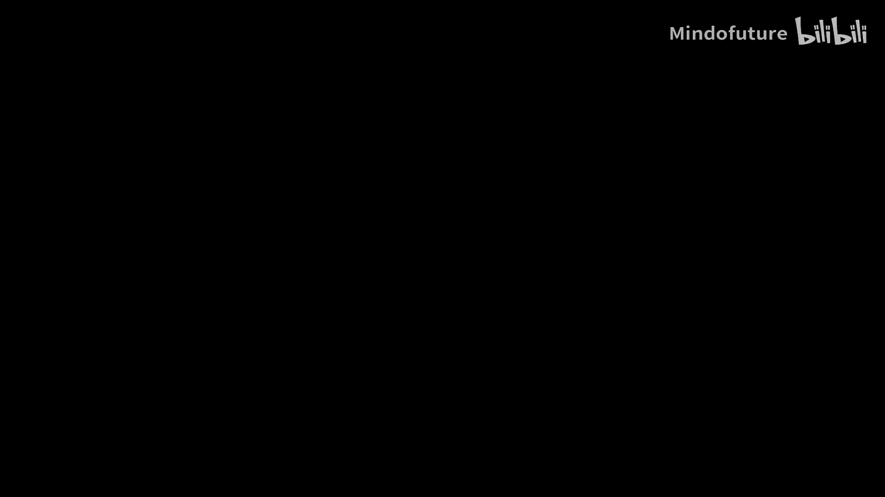
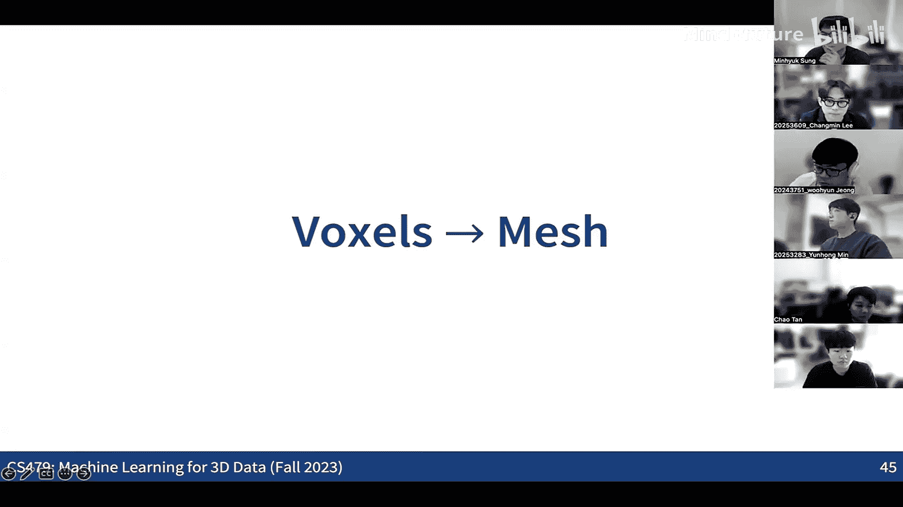

# 【韩国科学院】机器学习3D数据处理 ｜ KAIST ｜ CS479： Machine Learning for 3D Data p10 P12_Lecture_11_-_Representation_Conversion_(1_2)_(KAIST_CS479__Spring_2025) -BV1YmuBzTEmx_p10-

Okay so then let's get started so yeah in this course we are discussing lots of some kind of the representations for this 3D data and until now we discussed like bunch of some kind of the representations and some kind of the ideas in terms of how we can encode and de those kind of things and recently we are discussing basically some ideas about the neural rendering with some kind of the two different kind of representations。

 the first one was basically the nerve which is the most representative the idea for the neural rendering which is purely implicit the representation。

 basically implicitly like representing the 3D scene with the radiance and the opacity in terms that we are using the volume then during the equation to render these things into the images from each of the view。

And some other kind of the more to the more explicit representation of Gaoian split which is basically reading some kind of the 3D ellipsoid in the scene while we are still using the same the balloon rendering equation for the rendering。

 so these are some kind of the ideas in terms like leveraging the balloon render equation while reconstructing the 3D from the multibu images。

But not only these kind of thing also for the 3D Gauss splittings so we are also seeing lots of the interesting applications in our the gas structures well so how we can also do this kind of reconstruction pretty very largescale scenes and also for some kind of the dynamic scenes as well and how we can also use the the networks for those kind of reconstruction those are some kind of the some the ideas which also been introduced very recently some kind of research papers and these are kind of interesting topics that we could see in the two the gas structures。

But not only this kind of thing， actually in this course。

 we are discussing both of the other representations as well。

 like the boxess and the multi view images， point cloud and mesh and those kind of the representations basically have some kind of the pro and the coins for some of the applications。

 it might be better to use the point cloud for the other applications it might be use the the mesh and depending on the kind of the applications。

 right。So one quick question might be is that how we can do also some kind of conversionver from the nerve for the Gaussian splitting the representation into the other representations。

 So I guess you might already have some kind of the ideas for this but basically there are some kind of sort at kind of approaches in terms of like how we can also get some kind of the depth information from the nerve So if we basically revisit the render the equation。

 basically what we can can see is that basically this the multiplication of the transparency and the opacity here was basically some kind of the weight for to the point representing how likely the array will stop for it to the point So based on this kind of the probability in terms of measuring the likelihood of the determination of the at the point if we basically find the point which is giving some kind of the highest the probability of the determination that we can choose the point that kind of some kind of depth from that point so that can。

some kind of the simples way in terms of that we can convert the nerve representation into the depths and this information can also be used for some kind of some implicit representations for these。

 while obviously the quality may not be very good because the nerve was specifically trained not to obtain the geometry。

 but also support some kind of the rendering So actually we are not going to get into any details for those kind of things。

 but they are actually very lots of some kind of the recent the research。

 which is about focusing on like using doing something like the neural rendering but not to basically get some kind of the clean images from the the multiple。

 but more focusing on specifically getting some kind of assigned distance function。

 still using some kind of same the scheme in terms of using the and the equation and doing some kind of the multibubased construction。

So if you are interested in these kind of things， I also recommend you to check out those kind of these papers in terms of how we can also obtain the precise sign distance function from the multigri。

And also speaking to3 the Gaussian split super the Gaussian splitting we can do the same thing in terms of calculating the transparency and also the opacity we can also try to estimate predict the depths from the given the reconstruction but there are also some kind of very recent work in terms of like how we can not the 3D ellipsoid。

 but actually the 2D ellipses， basically we are switching from the 3D Gausian spliting into the 2D Gaussian splitting not using the ellipsoid but the ellipse in terms of that we see more precise alignment of the ellipse the surface in a way that we can also get some kind of the precise depth information from the Gaussian splitting。

 So these are some kind of the basic ideas in terms of how we can also convert some kind of the neural rendering the outputs。

 the nerve and the Gaussian splits into some kind of impulse function like the depths in a way that we can do some kind of the conversion into the other representations。

So actually in the beginning of like this course like we are discussing about some kind of bunch of the representations and how we can do some kind of conversion of course those kind of representations and if we see these kind of the representations but we can basically see that conversion from the input function into the boxes is very straightforward we just need to evaluate the function for each of de box this is the simply the case and also the conversion from the mesh to the point cloud then to the multi view images it was quite straightforward in terms of that we can just like sample the points over the surface and just render the mesh into the multi view images。

But the thing is that the missing kind of the bridges across those kind of representation is that how we can do some kind of conversion from the point cloud into the basically the boxes into the image。

 that we can do the all like way of the conversion all the way from the input function into the point cloud and if you want to make a loop from the point cloud into the input function that we need to have another kind of the wave to convert from the point cloud into the input function。

So for this week and the next week we are going to see basically how we can you know fill in these kind of bridgees across the all the representations in terms of that we can basically change the representation like from one to the other。

 so that's the basic idea。Question here is that for the 2D gaugeusian alignment is it necessary to have the surface normal super or is that also input from the RGB loss so the typical recent work is also estimating the number as well so that's really good question so even without having any kind of the given the normal information the recent work is basically introducing some kind of ideas in terms of how we can fit the basically the 2D ellipse over the the surface so that is actually giving some kind of the surface information。

SoBut obviously since we are not really having some kind of any geometric information。

 but just using having the color images， actually the ellipse。

 the normal information given from the ellipse may not be that precise。

 so there is no guarantee that basically the elllipse will be precise or a line over the surface。

But the interesting thing is that imp typically when if you use the2D Gaussian spreading。

 you can see that the illness in most of the cases， is like precise aligned over the surface。Yeah。

 that's a good question。So yeah， basically we are seeing some kind of the older ways like we are doing some kind of conversion from the like you know some Gaussians plaing into the input function and also the input function into the boxes and the mesh and the point cloud and here the basically the two missing thing is that how we are do some kind of conversion from the point cloud into the input function and also basically the boxs into the mesh So we are going to discuss those kind of the two ideas in the couple Ds。

Okay so if we just like wecap that the road method we are seeing in this course。

 basically now we are going into the kind of the the here。

 basically we know how we can do some kind of conversion from the like one presentation to the other。

Okay，So， so basically， let's see basically how we can do some kind of the convert from the point cloud input function and the boxes interface。

 So the first the first thing is that how are we going basically get some kind of assign this distance function from the point cloud。

So here the basic idea is that let's say we have some kind of the end of the points which is the sampled over the surface and based on that we are going to get some kind of the sign distance function which you't offset is basically approximating the surface。

 which means that if we basically find some kind of the points， which the function。

 the value gives some kind of the zero value that becomes the points over the surface。

And we know that given the points in the point cloud is basically the points over the surface。

 which means that if we evaluate the output function app for all the points that we have。

 the evaluation of the function should be0 for those kind of the points。

Then if we find such kind of function app here， what do we kind of build this solution for the F？

So we are basically having some the condition for the the function that we are going to find here。

 right， So we are basically finding a sign the distance function app。

 which should satisfy this condition for all the points， the output of the function should be0。

 right。AndThen if you only have this condition， the problem is that the triba solution becomes a function which outputs zero for every。

 everywhere in the space， right？That give be basically thetri solution and obviously we want to basically avoid such kind of the detri solution。

 right？Which means that we need to have some kind of be more。

 some kind of the constraints or some kind of the assumption。

So we are going to see some kind of the ideas， Basically how we are going to into some kind of some。

 you know， some mold the conditions or some kind of the assumption。

So here basically one thing is that one simple the idea is that we are going to assume that the the the function app is kind of be a the polynomial the function like this。

Which is basically we are assuming that the surface is locally represented as kind of some kind of polynomial dysfunction。

So here basically what we can see is that we are now approxiating the function into this form as some kind of some some kind of order of the poly the functions。

And now we are also going to basically rewrite this function into this way。

 so you can now see that the vector A is representing the coefficients for each of the terms here。

 and B is basically the function which basically the outputs the polynomial the terms in the function。

So if you have basically the point with the X， Y， Z coordinate。

 the B is basically returning the basically a de vector with some kind of all the polynomial de terms here。

And then we are basically creating heading the a here。Wwhichch is the coefficients here。

 So here the coefficient is that we are going to find a polyno function here。

 which the coefficients becomes not zero， So if we find like all the function。

 which all the coefficients are basically digital that becomes the the tri distribution solution and we are going to find the function which the coefficients like know none any of the data there are some kind of the nonzede coefficients in the given the function。

So how we can find such kind of some nonde is kind of the problem that we have。

So basically here the question is that how to find some kind of the non0 the parametersters a detector here。

So for that， we what we can do is that we couldt basically simply use the least security approximation。

 So basically， what we know is that the function， the value for each of the point that we have should be zero。

 right。So we are basically minimizing the the the care of this kind of the function the outputs for all the points while finding some kind of non the deployment say here。

So that basically that what we are going to do。Based， the thing is that obviously。

 the function that we are the the surface that we are going to recon would not be for most of the cases。

 it will not be basically presented as like single the polynomial function。

 the function the the surfacep that we are going to becon might be basically more the complexity shape。

 right。So here the idea is that we are not basically fitting the pole multi function over the entire surface。

 but we are going to do this kind of fitting only for the local reason。

So listen like we have some kind of the end number the points and then given any kind of the query point that we are picking in the3D space。

 the simple idea for this is that we are basically simply picking some kind of some local neighbors。

For the given the query point and we are only using these kind of the local neighbor points to face some this kind ofpoliium dysfunction function while basically be assuming that the local the neighbors can be approximated as kind ofpoium denoial dysfunction function。

So that's the basic idea。So that's the basic idea for the moving list skillss。

 but typically what we do for the moving the list skillss is that in terms of like depicting the polynomial the function in the local region。

 instead of like taking some kind of the local neighbors， actually。

 we are going to define some kind of the weight function。

The weight function in terms of that as the point is close to the query point。

 the weight becomes the higher and as the point becomes like the farther from the query point。

 the weight becomes the lower so it's not basically explicitly basically taking some kind of the local neighbors but defining some kind of the weight function based on the distance from the query point to the all the points that we have。

So that's the kind of debate I hear。So this is the same form of the risk curve。

 the only thing is that now now we are basically introducing the weight function like this。

And you can see that now the width function is defined based on the distance。

 So I'm basically introducing basically this notation。 So this is basically the the a function。

 which is taking the distance as the input here。 This kind of the function is basically called the rad the function delayed the kernel。

 right。And then we are basically rewriting basically this term by basically having this So instead of taking the P here。

 we are basically using this notation and this is the rate function not to explicitly define they take the locally neighbors but basically see。

 basically know which points should be giving some kind of the more impact in terms of the thinking some kind of the poly lead function。

So that's the basic kind of the idea and obviously for the weight function we can use any kind of the function that we want so there are also kind of a bunch of the options for this we can whether is some kind of de Gaus might be some kind of the most the common choice for the weight function。

 but instead of that we can consider using some kind of the other types of the function also this kind of the inverse quadratic and the inversely multi quadtic those are also the widely used as kind of weight function for the least curves。

So let's say we are basically define this kind of the weight function and then here the question is that so we are basically solving this kind of the optimization the proper。

 right？So for each of the the so we are basically having any kind of qua point x here for the all the points。

 the PI that we have， given the weight function now we can compute the weight here， right？

And also this like B this is the vector of the the terms which can be also compute based on the X Y Z coordinates for the P I here with all the points that we have。

So given this kind of the information for the weight here and the polynomial de here， here。

 the question is that how we can find the best parameter a。

 which is the coefficients defining the polynomial dysfunction function while basically minimizing basically these weighted scales。

So thisべティベージがいてる。So now we can see that the weights are basically determined based on the query point and all the points that we have and for each of the point。

 the input point now we can obviously dealculate thenoal de here and here the question is that we are finding the best the for the coefficients the deium the function in terms of minimizing this kind of the weighted the least here so this is basically the problem that we have。

So how we can find this kind of the the best parameters in here。

 So we are basically going to define this kind of the two matrices and the B and the W here。

If it's nothing but basically we are basically stacking this kind of the polynomial it here。

 the B vector here and making a diagramagonal the matrix with the weight that we have for given the query point。

 we are calculating the weight with respect spectral the percentage of the point and making a diagonal of the matrix like this。

And based on the definition of like these two matrices， the same the awakeed the curve。

 the function is now can be rewritten into this way into the matrix form。

You can see that now the cur term here can be we the weight here can be rewritten into the mat boom like this。

 and then this can be rewritten like in3。So like all these like the retail scales now it can be written as some kind of simple de form like this。

And here the question is that actually we wanted to basically find some kind of the departments。

 some non departments here， otherwise we are escaping some kind of distributedtriive solution， right？

So now the the our the optimization， the problem becomes that we are actually minimizing this function with our the dimension of the M here。

 while basically having some kind of the constraint， the non zero constraint will be a here。

 So as the non zero constraint， actually， we are going to assume that the the norm of the A should be one。

So this kind of the optimization actually it turns out that actually we are solving this problem and actually this problem can be basically solved this kind of the iigen vector problem。

Can you see why like actually why this optimizationim becomes a iiggen mental problem？Andそすんです。

If you took any kind of the optimization the course。

 then you be able to quickly say that actually these can be seen as kind of some ideaigic problem。

Otherwise is still， if you do not have any kind of knowledge about the linear algebrabra or some no optimization。

 actually if you see the same problem for the other applications as well。

 then you be able to basically utilize the effect that actually this can be basically solve this kind of the argument to the problem。

Yeah， so this is kind of a very typical kind of form that we can see in many applications we are basically minimizing this kind of quara。

 which is basically complex problem with some kind of norm comes the constraint are pretty better that we have。

So in this kind of the case， actually， we are not getting into any details about this kind of the optimization kind of researcher。

 but what we can see if you took the optimization the course before is that actually this kind of the the complex problem with some kind of the constraint can be solved by this kind of the log long like this。

So the basic idea is that now we are basically solving another kind of optimization the problem by just taking these two as some kind of linear combination。

 So this is kind of the original the bombing optimization。

 and we are basically introducing some kind of some weight which is called the lag long。

 the multiplier， for the condition that we have。So the basic idea is that we first solve this problem of basically minimizing this laganggen over the original the variable a here。

 so taking the gradient of the lagang here in terms of like basically seeing like what should be basically the multiplay of the lambda here。

So by basically solving the minimization over the La long with the developed a here。

 what we can see is that the the lambda basically this is basically new the variable。

 which is the Laang the multiplier， and this multiplier basically should satisfy this kind of condition。

The M H equal to the to the lambda a。 and we can see that this is exactly the eigvalue and the eigen vector form。

 right， So from this， what we can see is that this a and the Ramda basically should be the iigen vector and the iigenvalue of the matrix M。

And here the question is that what's basically one of the the idea the value which is basically minimizing this right so if we go back to our the original optimization this here。

 then now we can rewrite this by replacing this MA here into the Lada a here because there's the condition that we have seen。

 then we can see that actually our the original this problem becomes like minimizing the Lada here。

And we have seen that the Ramda should be one of the eigenvalue。

So which means that this original the optimization becomes so this term is basically minimized when you choose the smallest eigenvalue the lambda here。

 so when you choose the smallest the eigenvalue the lambda here。

 actually we can see that the a also should be the corresponding the eigenvector。So basically。

 while this， the optimization basically looks kind of complicated。

 what we can see is that once we basically compute this like the M matrix。

 this basically A de vector， which is minimizing this。

 can be basically computed by finding the eigen vector of the M。

 which is corresponding to the smallest the eigen barrier。

So this is actually the very simple kind of problem in terms of the we can easily find the coefficients of the the polynomial the function based on byso the itemen vector the problem。

Clearlyly， any questions on this？The only thingあ is that actually depending on like how we choose the the the weight functionあ we gonna get some kind of the different results。

Even when you choose the Gausian corner is kind of the our the weighting function。

 depending on some parameters that we are choosing here， for example。

 like what sort of the age that we choose choose here。

 we gonna to get some kind of different results So based on some kind of the density of the points and many kind of like noise like many other things based on that we can carefully choose some kind of the right the weighting function in terms of that we are some kind of getting some kind of the better of the outputs of the final the shape given the point cloud。

And the question is that if when you see this kind of be two outputs。

 which only to be the kind of results with the smaller D H。Do you have need三首で。Yeah。

 so as many of you say， like the answer is the left， right。

 So if we see the meaning of like this weight function。

 as we basically have the smaller the H the color function will be basically the peak here the function。

 right， which means that we considers like more or some kind of smaller kind of range of the points near the quality points。

As we increase the h here， which will become basically the wider the corner function。

 which means that we consider like the more like wider range the points in the wider range。

 right which we will basically result in basically making the smoother the output function like this。

 but while we increase the function， the very h here。

 we're going to basically make some kind of more like some kind of the rough shapes in terms of the。

 we only consider some kind of the very local points in terms of choosing determining this kind of the design design value。

So depending on like how we choose the deco function or the weighting function here。

 we going to get some kind of slightly different output。Great， any questions on this？

So this is kind of the basic idea in terms of how were going to basically get some kind of some some approximation of the assigned distance function from the given the point cloud。

And also here the thing instead， if we only consider any kind of the non the high or the kind of things。

 but if we only consider some kind of the first order the approximation。

 basically making the function to be like function like this like linear function。

 then we can see is that actually this becomes like doing some kind of the plane fitting for the qua point right especially the query point is a point over the surface。

 then we can see that this kind of fitting becomes like fitting a plane over the surface。

And actually E P could basically do some kind of depicting the plane over this surface。

 that is basically giving some kind of some important some geometric information。

 which is the surface normally the information。So basically。

 the surface norm is defined as kind of the vector， which is the perpendicular to the tangent plane。

 which is basically the best approximating the R region over the surface。And actually。

 you can see that this surface normal information is actually used in the wide range of the applications。

 Actually， what we also have seen in the discussion of the the Gaussian splitting is that we discuss the sub I don't know whether you remember like we discussed these sub。

 So the idea of the software is that now we are treating each the point as kind of the disk to render the point cloud into the images for those kind of the cases that we use render the points into the images by seeing each of the point as kind of the disk we obviously need some kind of the the surface the normal information。

the is also used in the point cloud entering and also like when we encode the point cloud the point cloud into something like the point network and kind of the other architecture。

 we can consider not only feeding the X Y Z coordinates but also the normal information as well。

 So the also can be used as some kind of the the additional geo information when you encode this kind of some some3 d the data。

And we going to also see that actually the surface normal also can be used to improve this weight consumption as well。

 when you do some kind of conversion from the point cloud into some input function。

 actually if we have this surface normal information。

 that can be quite useful in terms of improving the the consumption quality。

So the surface number is actually used widely used in the many application and actually what you can see is that if we do this kind of the the riskier sense of kind of fitting in terms of fitting the plane over the surface。

 that is giving us some kind of the surface to the normal information。So basically。

 what we can see is that actually， what we have seen in the previous slide was that we are doing some kind of defeating for any arbitrary point。

But now we want to do this kind of fitting for the point sampled over the surface。

So let's say like the x point here is the on the point over the surface。

 and we want to estimate the surface normal at this point。

 point x here by fitting a detergenent plane at this specific point。

And based on that basically what we can do is thatそ do the same thing doing some kind of the least in of that now lets say the p is having some kind of the three coordinate X I Y and X I and Y I and Z I。

Then what you can see is that the same the risk herere depicting the problem becomes like。

 let me rewritten in this way， nothing but just like rewriting this kind the first order the question here。

And then what we can easily do is that we can simply like we parameterize the the Ae vector here。

 So we are basically having the full coefficients in this kind of the linear function here。

And now we do like to basically read parameters this a vector in terms of the the these three A1 a sorry A1 A2 A 3 these three value should be basically representing the normal vector。

And then rewriting the a0 is basically minus x percent。

 then we can see that this becomes the typical basically the deploying the equation。即。

So this is nothing but the degree I rewriting this kind of the linear function here in terms of not using these kind of four parameters for the plane equation。

 but just using the plane normal the parametersers here in terms of using the plane equation like this。

So this is the same， basically the risk here depicting the problem with the weights here。

 but rewriting this equation in a way that now we are not finding the best parameters end here。

 but finding the surface， the normal， the parameters end here。We can slightly change the equation。

That'sing makes sense。Then now we know how we can best find the best and here right So here also the same the end can be basically the best and like miniizing this also can be found by solving the eigen battery problem right。

So can you basically see， like， you know， given this kind of the。

The least here defeating the problem， how we're going to basically define the matrix M and also solve this kind of the problem by just taking the id and vector of this kind of the matrix M。

 How should we define the matrix M in this case。So。

We basically recall what we have seen in the previous slide the matrix M was defined with the B matrix and the weight matrix right。

 so you can see that it's just the middle like how we define the B matrix right。

So this is like almost the same form with the optimization that we have seen in the previous slide。

 So what we just need to do is that now we just need to define the B matrix like this way。

We this kind of de vector connecting it like these two and if you use the same the weight d matrix here based on that now we can calculate this m matrix and then we can if we take the eigen vectorctor corresponding to the symbolest the eigenvalue that becomes the hour surface the end here。

So that also becomes some kind of these the like the simplest way and also kind of like thiss very the common way that we can basically estimate the surface normalomer from the given the point cloud。

So it's also developed how we define the basically the the weight function the set here。

 But you can see that the same ideas with basically can be used to basically estimate the service domain。

And you can also say that actually， this the basic idea is also the same exactly the same with the principle。

 the component analysis。 If you took any of the muscle learning or the AI course you know the basic idea of the PC right So the only different thing is that we are the center of the point cloud in taking the center of the point cloud now we are doing the same thing for the given the query point to X here。

So basically， when you take the excess kind of the center of the point cloud。

 if we compute this thing， this becomes like computing some principle direction。

 given some kind of the points with some kind of the weight that we have。

 and if we choose the direction with the smallest the the eigvalue that becomes some kind of the we are treating this as kind of the our the service normal the direction。

Makes sense。So this is the very simple and rules of this common idea in terms of like how we can estimate the surface number from the community point cloud。

But what we kind of the issue like when we estimate the surface number in this way。

 what be some kind of missing piece in terms like estimating the real the surface number for many kind of applications。

Can you see like what we kind of be some more like some sort of be some missing kind of component in terms like estimating the surface to this way？

YeahSo mean say there might be some kind of issues in like noise sensitivity。

 so like how are we going to handle some kind of noise in the point cloud is kind of like another kind of issue。

But one thing that I wanted to bring up was that actually the typically the surface normal is basically defined in a way to basically define the inside and the outside of the surface as all。

 So either the surface normal should be basically heading to some kind of the outgoing direction from the surface or like you know inside the direction for all the points。

But if we estimate it certainn normal in this way， then it's basically hard to still like define some kind of like whether which one is basically the outgoing direction and also the incoming direction。

So there can be some kind of cases that the normal is basically the flipped for some of the kind of the points。

 which means that we need to somehow also like further optimize the kind of design or the flipping of the normal direction in terms like having the consistency of the orientation with all all the normal directions。

 of course all the points。So we needed this kind of some additional kind of the optimization this step in making the orientation of the surface normal to be consistent of across the older points。

So that's kind of some additional thing in terms of that we need to do in terms like estimating the surface number。

So we are not going to get into some details for this。

 but this is kind of the basic idea in terms of how we going to basically estimate this option。

So pretty given the point cloud， actually， there are some kind of cases that dis normal is also coming from the some scanning kind of devices as well。

 where if the de normal is not given that we can consider estimating them using this kind of the idea。

Then here also the question is that if we have this kind of some additional researchstorm information。

We either we are estimating that work with we're assuming that the are specific given。

 then would there be some kind of the other way around in terms like the computing the assigned distance function from the point cloud。

 but without explicitly fitting some kind of the polynomial dysfunction function for the query point。

Without basically having any kind of explicit like bi over any kind of un explicit function。

 is there kind of like any way that we can opt some kind of input function globally for all the points given the point information and also this kind of given the search normal information。

😊，So that's the another the idea in terms of how we can still do some kind of conversion them with from the point cloud into the input function。

 but using some kind of the additional disserv normal information。

So typically what we can do is that the moving list here the idea can be good in terms of estimating the normal。

 but still this doing some kind of the local fitting。

 so it may not be able to giving us some kind of the consistent the information for deing across the all the points。

So what we can do is that we are using the moving risk curves only for estimating the the surface numberomer free to be point。

 and we can consider using the de norm the information to some kind of the global the optimization of the input function over the entire the space。

So this's the one of the idea specifically the radio basis function。

So here the basic idea is that now wed like to basically represent the input function as kind of some weighting sum of the radial database basis function。

So now we see that the the output function， the input function that we want to get the this function is representing in this way。

 basically having some kind of the raly basis function here and having the the weights here。

So this is also kind of given the the corner function the here and here the question is that what sort of the weights that we are going to use here。

So here， like one small difference is that now this ra basis function is not some kind of the weighting function。

 So it does need to be high when the basically the some kind of the other point is close to the qua point we can consider using any kind of the radial decoors。

So there are actually the more options。 you could consider the other kind of the radio decoors。

 and these are also some kind of the typical， some kind of corners that we are using for the this kind of the regular the basis function。

 the approximation。And also， actually， many people are using this triharmononic function。

 which is nothing but just the  cubic of the distance。

 so we can consider using any kind of the layer decos for this kind of the some defeating the process。

And actually， this is kind of the approximation that we have seen in our the previous lecture。

Do you remember when we have seen this kind of some radio basis， the approximation。

이 나올 리 브이브 lecture。Anyone who remembers like when we discussed this。

Approrxiation using the radio basis function。Actually。

 if we recall like what we have discussed in the the feature networks。

 when we discuss some kind of some the theoretical kind of aspects of like how we can guarantee like this kind of some the impact of the parameters in the free of the feature networks。

 actually we have seen this kind of the idea of the kernel regression。

So here the basic idea is that given any kind of some data set。

 which is having some kind of the input， the point and the output the value。

 we are basically finding a function approximating like all this kind of training the data。

With this kind of some corner regression reform in terms of that we are having some kind of the predefined corner function here。

And the thing is that for each of the data point that we have in our training， the data set。

 we are basically having some kind of the promptter that we want to optimize some variable。

 So this was the basic idea for the kernel regression that we have seen in the discussion in the field division networks and we also have seen that training the neural network was basically doing something similar with some kind of this kind of the the regression。

 we have seen some kind of some connection between the the learning the training。

 the neural network of training with the regression。

And you can see that actually what we are doing is exactly the same thing right so given the query point given not the query point。

 given the all the points that we have in our the point cloud。

 we know the output barrier right what should be the output value。

We want to approximate the surface as the zero ever set of the function， right。

 which means that given all the points that we have in the input， the point cloud。

 we know that the output value should be0， right。And we want to basically approximate this kind of the given between data。

 given the set of the points。With some kind of the some function。

 which is basically me some kind of the weighted the sum of the deco function like this。

And we are basically optimizing these weight in the riskier dis， like this。So basically。

 what we are going to do here is that basically the same thing。

 The only thing is that the here the X I becomes of the P。

 basically should the point in the point cloud， we know that the Y I should be0 and we are choosing any kind of the function here here in terms of that we want to define some kind of the optimal weight here。

Make sense。But then what what would be the problem。哦。Actually。

 we are seeing some kind of same problem here， right？

So the only condition that we have is that for all the points。

 we know that the output values should be0， right。And we want to find a function here。

 which is approximating this surface while we find some kind of optimal weight here。

was the two에서 오信的。Yeah， the treatment solution is basically making all the ways for the older points to be zero。

 right？Then there is nothing we can do。哦。So this means that in this set setup。

 we also still also need to have some kind of the more condition or more constraints。

And to give some kind of the more conditional or the more constraints。

 which there are bunch of the ways， but the simplest idea in terms of avoiding the trivial solution is to use the nuer information。

In terms of that what we gonna see is that we are going to take some kind of the wolf service points。

Based on the service。So what we do is that given that we are having some kind of the end number of big points。

Sees like all the point should have the the output of the function the function should be0， right。

 we are taking some kind of the opposite piece points along the the normal direction。

So let's say that we are having the consistently normal information。

 they are the normal information through the older points。

Then we are taking like one D point outside of the the the ship and also the other point inside of ship。

Just like taking the offset of the points along the the numer direction。

And then we are just assuming that the sine distance value at this kind of thes。

 the surface the point should be basically the distance from the point that we are taking over the surface。

So let's say we take this point and this is the these two are the observed surface points， right。

 So let's say this is the one， which is the outside of these surface。

 and this is one in the inside of this surface。 it also depends on how we define the sign distance function。

 but if we want to make the positive distance to the outside。

 Then we can set that this offset the distance here becomes the the distance。

 the value at this point。And we are also taking the minus of the distance as they sign this value at this。

So given the n number of the points， we are just basically adding the two n number of the more points with some kind of non zero value for those points。

In a way that we can basically avoid some kind of trivial solution。Make sense。

So this is like very simple the idea in terms of that given the end number the points。

 basically just like adding the two n equations with some kind of non zero values here。

And based on that， we are just finding some kind of the best weights。

 which is the exactly the same idea with the the color regression。Exs。

So how can you find the best ways。Well， I'm mean to see it nothing。

 but just like solving some kind of linear system。 So like one role here becomes like one equation。

For basically， we are also going to define the weight for the oldD3 and number of big points because we are now having the ob points as well。

 right？And then we are having the C3 n number of the equation making each of the row to be one of the equation and sticking all the3 n equation。

 then we're gonna have this kind of linear system and then it just made like solving the linear。

 the very big linear system with the3M by3 and the size of the matrix here。

So this is also kind of another idea in terms of that we can now not just like doing some kind of local fitting but doing some kind of the global optimizations in terms of getting some input function over the entire space。

Make sense。えにこいちそです。So these are some kind of the outputs that we are getting the assigned distance function from the point cloud So actually now we are seeing a mesh here right so which means that we are doing the conversion from the point cloud into the input function and then evaluating those functions into the boxes and then converting the pixel into the mesh but we are also get into like how were gonna convert thebox into the mesh right and this is the final output of like convert from the all away from the point cloud into the mesh like this and you can say that we are getting some kind of the quite precise outputs with all the details here so we can get this kind of the good output image me when you have some very dense and noisefr kind of the point cloud like as the input like this。

Makes sense。And also， it is also very important to choose the right the opposite the distance。

 If the opposite distance is like too small or too big。

 we're gonna get some kind of some bad outputs like this。

 So this is kind of of like some kind of downside of the this kind of idea in terms Still we are having some kind of the parameters to get some kind of the best output in the final living construction。

可以。So if we compare the moving list curves and also the rad basis function。

 So these are some kind of the two ideas in terms like reconstructing the final output。

 the process console of the idea is that the moving list curve is basically may not be the optimal idea in terms of that we are still doing some kind of the fitting in the local region。

 So we are not basically this in some kind of the global shape。

 So there might be some kind of some slight the inconsistency the fitting across the over the points while the ra basis function is the case that we are doing some kind of the global optimization in of that we can get some kind of the complete and also the the imp function over the entire this space。

But the good thing of the MS is the movingly secure is that it does not require the surface numberomer。

 but actually this idea is being used to estimate the surface numberomer in many applications。

 but for the regular basis function， we first need to estimate where we need to assume that the surface numberomer is basically given。

So that's kind of the pros and obviously the regular basis function would be much slower because we need to solve the giant the least security problem while disso the idea and the vector problem for the moving least scales would be basically solving the problem for the much smaller the images so either the much faster。

And also typically the radio basis function is like more sensitive to the noise because we are basically solving some kind of the the global optimization。

 So which means that any some kind of small noise in the points can affect not only the local region。

 but also for the other regions as well。But typically in terms like capturing some kind of the details。

 like solving this kind of the global optimization can be better in terms of getting some kind of the high quality the output。

So there are basically some kind of theic pointss， if we want to basically spend more time to get some kind of the higher quality the output。

 especially in the case that when you know that the input point cloud is not having any kind of noise。

 then obviously like radio basis function might be kind of the best option。But in any case。

 like if you want to like perform the raial database basis function， the approximation。

 we first need to get the normal information。And for that。

 like actually we might need to first run the moving list curves in terms like estimating the subomer validity the point。

And just like performing the moving list curve may not be the ideal the option in terms of that it's not even like also giving the increased function a single increased function over the entire the shape。

 especially's locally fitting age of the function for the local region。

So in terms of that it basically not giving some kind of the global optimal the output。

 but the good thing of the moving security is that it way faster so the computational time is also very important for some of the applications like taking the moving scarce might be kind of a better option than the ra basis function。

あイデスクー。Any questions on this？So if we go one step further。

 the thing is that so here the question is that if we can assume that the surface tumor are basically given were basically estimated using the moving scarce or some kind of device waves can you also compute the distance function from the point cloud without basically performing any kind of global optimization and also without basically explicitly fitting some kind of poorly function into the local region。

So this is kind of another the idea in terms of how we going to basically get the this function from the point cloud。

 but while also assuming that the surface normal information is given。で。So here。

 basically the idea is that it's kind of like the same thing with the moving these secures。

 So we are going to say， like what's kind of the points that we are making some kind of difference with the movingly scarces。

 But now actually we are going to say that actually we are finding a function in terms of that we are approxiating the value at the P right So we know that for all the points that we have in the input point cloud。

 the s the sensitive value that we are basically estimating with some kind of the some approximation the function here should be0。

 right。So we are finding such kind of the function。

 which will be basically zero at this point for all the point we have in the point cloud。

 while basically approximating this function value with the expansion。

So this is nothing but basically the same detail expansion right。

 but given some kind of any kind of query point here。So given any query point。

 which is close to the some one of the points that we have in the point cloud。

 this is the form of detail extension。W can be a written like this。

So now the thing is that now we are going to you know。

 represent this function with this kind of the function value at the query point and also the first order the gradient and the second order de gradient and so on right So this is like another way that we are basically parameterizing the function value here in a way that approximating the function value of the at the annual of the point that we have in the input point cloud。

And we know that these should be0， right？So here the question is that how we can basically define the function which is like now parameterized in this way with the juice order and the first order and the second order the derivative。

In a way that the function value becomes zero for the all the points that we have。

Specifically nothing but just using detail of the expansion for the approximation。

But basically this kind of the first order， kind of the approximation and can be only used when the qua point is close to these kind of points。

 right？So we are going to basically so we are basically also solve this kind of problem as the。

 you know， the least least security sense， but also still using the same the weight function。

So we want to basically minimize this function。While just taking the weight here。

 so we are basically having some kind of the higher rate when the dose kind of PI。

 the point piI is called to the qua point and having the lower rate when the PI is basically the farther from the point point。

Then this becomes that now we are representing the function value function here F as kind of the geo order。

 the first order， kind of the some the kind of the terms while basically finding those kind of parameters by solving the same the curve。

 right。Now you can see that if we take the first order， the approximation。

This function can be written in this way。So S 0 is the function value at the quality point here。

 and S1 becomes the first derivative the function。Make sense。And actually。

 you can see that this is exactly the same form of the movingly scales， right？

Did you see some kind of the analog between these and the moving list to the formulation？

So in the previous slide， what we have seen for the moving the scar is that it does specific having this form。

 like for the first order， the approximation， right？But while we have some kind of the different。

 some kind of explanation for the same formulation。

 that you can see that these two are exactly the same thing。

 The only thing is that now we are re parameterizing the the vector A into the the normal vector the S one here。

And also the having S0 instead of the a0 here right。

So this is actually slightly different kind of explanation for the same the movingly secure deformation。

 especially the first of the case， but while de parameterizing D into the S1 which is basically the normal vector here。

Actually， it did not nuic， it's actually the gradient of the function at the query point。

And then we are having the S 0， which is the having the this relationship with the a0 here， right。

The same formulation with the moving risk curves。So the thing is that now we want to solve this optimization with respect to the both the S0 and the S1。

Makes sense。And here， the thing is that we are going to use some kind of some crude approximation in terms of that instead of like basically estimating best the gradient。

 the of the the function at the point X here。 So S1 is basically the gradient of the function at the point X here。

 right。And we are going to use some kind of the very crude approximation in terms of that now。

 replacing the gradient of the function at the quality point as the gradient of the function。

 not at the quality point， but the each of the point pi here。So this is really bad approximation。

 but let's see what happens when you you disconnect a bad approximation。So if we replace the S1。

 which is the greater of the function at this query point with the greater function at this like each of the P I here。

 what is this。The gradient to design this functional probability of the points is actually the surface nuer direction。

So what we want to do is that we are not using the same the S1 here for all the points。

 but we are going to change this S1 by taking this kind of really bad approximation in terms of replacing this gradient as the gradient dysfunction function at the point piI here。

 which becomes basically taking the surface normal information， right？

So based on this kind of approximation， basically what we can see is that now we are replacing this S1 here into the normalmer vector here。

 then now this optimizationimigation becomes nothing but just getting the value of the s0。

So we are basically replacing these three variables here as kind of the surface normal information for each of the point。

But based on this kind of degree， bad approximation。

 what we can see is that this becomes like very simple the optimization。

 because now we are just getting like a s value， right， only one single value。

So if we solve this problem， then actually this S0 was basically the function value that we wanted to get。

O the破 point。And you can see that actually this function value can be given into this simple form。Oh。

Make sense。Any questions on this？So this is not directly related to the radial basis function。

 but if we basically try to interpret this kind of the output deformulation in the perspective from the radial basis function。

 this is the case that we are having the weights， which is not constant for the older points but depending on which point point that we have。

 we are basically having some kind of different weights here for the point here and then basically having some kind of the weight is sum of the con function here。

And also from the perspective of the moving risk curves。

 what we can see is that this is not specificallyfi the plane at the qua point。

 but we are using the prefited deter tangent planes for all the points in the input point clo and leveraging that information to calculate the input function for the deco point here。

So this is basically not exactly the same with like what we are doing in the moving list skillss。

 but we are basically using the prefi the planes。 We are assuming that the planes are fitted for of the point in the input point。

And we are basically using this information to basically get the input function for any query point。

 And the good thing is that with this kind of some the approximation。

 we can directly calculate it function value with this kind of the simplest form。Make sense。

So if you see the assignment for， the assignment4 will be basically about implementing this implicing the moving list skillss and see what sort of the output you want to get So what we are going to do is that we are going to provide the point cloud actually in the2D space that in the3D space it points and also we are going to provide the normal information as well So based on the point and the normal information。

 what you need to do is that you need to basically compute the sign distance function into like imp the moving list skillss and then in the next lecture we are also going to discuss how do gonna convert the boxes into the mesh So which means that given this kind of the point cloud we the search number now you can calculate the sign distance function either with the input moving secures like regular the basis function。

And evaluate this the increase function for each of de box is that de box in in the the rese in the two degree。

And then you can apply this kind of the idea in terms like converting the grid into the mesh in terms of getting the final kind de mesh。

 So in the2D case， it did not be a mesh， but some kind of the controller in the2D space。

So implementing that will be the last assignment in this course。

And while the assignment4 will be about implementing the implicity moving these skills。

 what I recommend is to implement all the things， not only the IEMSS。

 but also the radio the basis function and also the moving these skills as well and see some kind of difference。

So that will be also kind of the last assignment。And also the thing is that while we discussed the idea about some kind of doing some global optimization。

 the radio basis function was doing some kind of the global the optimization in terms of are getting some kind of the for each point。

 right。ButD is still the optimization to determine the weights for it to be point。

 is's not giving some kind of the optimal some scientist function over inbox。

So this is while these kind of things some kind of the global communication。

 still is not the kind of the best way to get some kind of the input function over the des。

So what we are going to discuss next time is basically kind of even better the approach in terms of like doing some kind of the real global optimization。

 not for the input points but also for the but for the the points over the three degree in terms of giving some kind of some sign distance value or some kind of value for the given some kind of the orientationient the point cloud and then we're gonna also move on to these topic。

 how were basically know do some kind of conversion from the puzzles into the mesh。

 then based on these kind of two building blocks， we will be able to see how we can do conversion from the one representation to the other representation for the old kind of degrees from the one to the other。

So this is kind of like what we are also going to discuss next time。Okay， so any questions on this。

So I recommend you to basically check out some more details in some formulations there and see how you can implement this in your assignment。

So I'm going to stop here and then we're going to continue the discussion about like another some kind of way to doing some global optimizationim from the convert to the point cloud to the input function。

 and then based on that， we're going to also see how we can do the convert from the boxess into the mesh。

And I will see you next Monday。Thank you。

