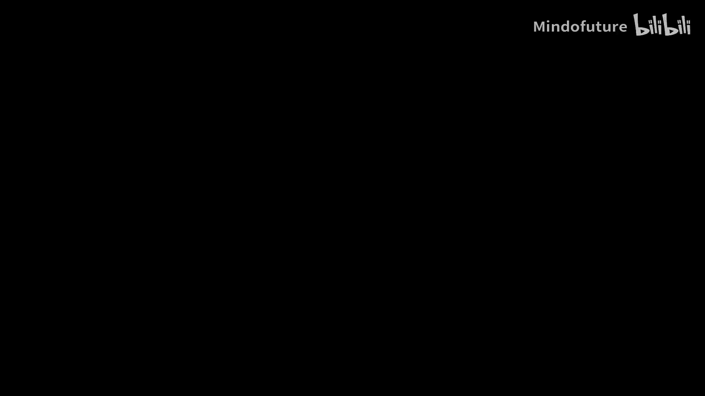
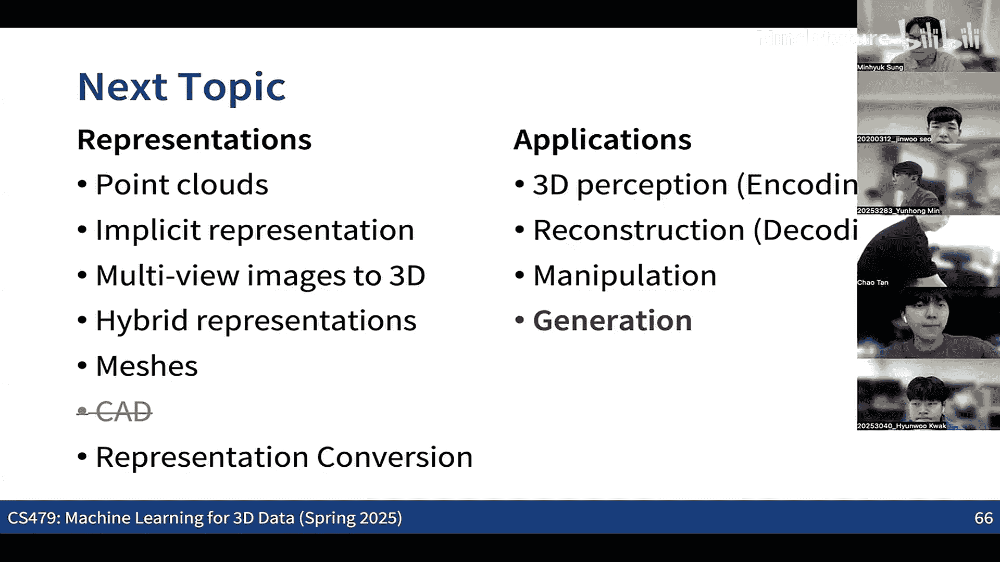

# 【韩国科学院】机器学习3D数据处理 ｜ KAIST ｜ CS479： Machine Learning for 3D Data p11 P14_Lecture_13_-_Mesh_Deformation_(KAIST_CS479__Spring_2025) -BV1YmuBzTEmx_p11-

Okay， so today we are going to discuss some kind of new topic which is about the matchsh deformation。

So so far in this course， basically what we have discussed or basically some kind of the different representations for this 3D data。

 And also last week， we discussed basically how we can do some kind of the conversion from the one to the other。

 So basically there are some kind of the missing kind of bridges from the point cloud to the input function and also from the box to the meshes。

 And we have seen like how we can do this kind like conversion from like those representations using the moving list curves and radio basis function and also the po and surface reconstruction and the emerging curves。

 So those are basically some techniques that we can do some kind of conversionvergence。

And the reasons like why we need to do this kind of conversion is that there are basically some kind of the pros andic coins for those representations。

 And also what we have seen in the previous lectures is that there are some kind of the good representations in terms like representing the 3D data to feed those kind of data it' kind of input to the neural net。

 So when you basically feed these kind of data is kind of input to in neural net。

 like having some point cloud or the multi view images where the boxes might be kind of the good choice。

But also， there are some kind of cases that we are generating those kind of 3D data as kind of the output of the neural。

 And it's kind of the output presentations。 We have seen that like having the boxes or some input function explicitly having the input function might be kind of the best choice。

 So depending on whether we want to take those kind of the 3D data is kind of the input and the output。

 we can do consider basicallys doing some kind of conversion from like one to the other。😊。

But basically， there is like one presentation we haven't discussed the most kind of the details。

 like which is the deary presentation。 That was the point that we are discussing some kind of deary presentation。

So as we discussed at the very beginning， like this course， actually。

 the measure presentation has many kind of the advantages。

 which is also the most popular representation， especially in the many choographics， the framework。

And mehe kind of the more like direct way to basically represent the surfaces with some kind of the more explicit expressions and also in a like the very compact way。

 So when you talk about the the me messagehe is basically some kind of representation that looks like the graph in terms of that we are having some kind of somees and also the edges connecting them but the difference between the typical dimension me representation and the graph representation is that we are not just having thees and the edges。

 but also forming some kind of the faces with some kind of the others and the edges as well。

 So as you can see in this figure we are basically connecting thees like this with the edges in a way that now we can also have this kind of the pole on the faces that we directly represent the part of the surfaces。

😊，So you see the difference between dimension and the correct presentation。

And also the typical way to have this kind of theme representation is to make all those like the faces。

 not as some kind of the arbitrary the polygons， but as the triangles。

 So basically having the triangangleular the masses is kind of the mostly common de choicess for many the graphics the applications。

So this is kind of like very compact way to represent the surface。

 But we can also consider representing not the surface， but the volume as well。

 So there are some kind of some volume mehe as well。

 which is not just having the the triangles but having some loss of the some connected thetetrahedra inside the volume of the3 the surface in terms of that we can now also represent the volumes with some kind of the some vertices edges and the faces as well。

😊，SoThose are some kind of very common representations。

 And as we have discussed at very beginning there are lots of some kind of the other advantage and also the applications that we can do using the me representations for example。

 like we want to basically render the 3D some the data into some kind of images。

 like having this kind of the explicit representation might be much better。

 So for the rendering the perspective having the is also very good for the texturing to define some kind of color information where some kind of the me information over the surface。

 or having this kind of the explicit the surface representation might be much better。

And also for many kind of some physics dissimation。

 also like the mesh can be basically used in many kinds of some some diss simulation。

 the applications， and also for many kind of the manipulation and the deform of these some kind of these the services。

 having this kind measure presentation can be really good。

The downside of the measure representation is that we are basically having some kind of the irregular structures of the connectivity of the purchase。

 So it is quite different with some kind of the difficult some kind of the lattice structure we have seen for the de box of the case。

 So because of those kind ofre structure， there are lots of some difficulties in terms of like both like feeding those kind of the data representation as the input and also generating those kind of the the representation as the output。

But as we have seen in the previous slide， once we basically have the other representation put to data。

 we can come consider converting that into the measure representation and basically using that for the many of the applications that we have seen in this in this slide。

So this is kind of like very typical def framework。

 some pipeline in terms of that we are having some kind of the other representation。

 but basically for example， like making some 3D data as kind of some output using some kind of implicit representation。

 Then we are converting this into the measure representation。 and using that for many applications。

 So this is like very typical the pipeline for many kind of the 3D reconstruction and the manipulation。

 the framework。And also we can see lots of some kind of the databases for the3D measures。

 So those are like the all the3D the me databases in the online including some kind of the databases for the some objects like this and also the databases for some kind of scan the scene like this and also for the human bodies were many kind of things that we can see in the outdoor sensor。

😊，And I guess quite famous the database recent the the me database might be this the。

 which is now having some quite huge size including 10 million the3 objects with the last of the diversity and also with some kind of the quite good quality of the3 chips。

 So those are also kind of the3 objects that are represented into the mees and you can use those kind of the the3 models for the many the applications。

😊，So you can see that actuallymer is quite the common the presentation for the many kind of the。

 especially for so many graphics， the applications。

So given this kind of the loss of some kind of the advantages of the measure presentation。

 what we are going to discuss for today very specifically is about basically how we can utilize this kind of the presentation for some kind of the manipulation in terms like deforming the shape So as you can see for many of the examples here。

 we are going to do some kind of the deformation in terms of the like fixing some part of the the shape while basically moving some part of the other the other part of the shape like this in a way that we can make some kind of some naturally deformation of the3D shapes。

😊，So on our the roadmap we have seen this slide now we are reaching to the measuring presentation and also some kind of the ideas about how we can do some kind of the manipulations for thoseD measuresshes。

Before we get into some more details for the mesh deformation。

 Id like to ask you to prepare pen the paper because we are going to do lots of some kind of the math work tool today。

 So prepare some depend the paper。 we to have lots of difficultiess。Okay。

 so let's get into some more details about the message de。So actually。

 there are tons of some kind of the techniques for the me deform。

 And we wont have time to discuss all the techniques for that。

 So we are going to see like very specific idea for the me deformation。

 But the very high level the idea for all the techniques for the me the deform is that basically we are define some kind of the objective the function which is making some kind of the smooth deform like this。

 that while basically basically satisfying some kind of the given condition。😊，So here basically。

 this is the example that we are having some this kind of the plane damage this is basically the flat the plane。

😊，And we would like to fix the the region， the gray region。

 the purchase in the gray region is the same position like this。

 while're basically lifting up the yellow region to the objection like this。And here。

 the question is that we want to make some kind of deformation for thees in the middle area in this like light blue the area。

 basically basically choosing some kind of the new position for thees in the light blue the area while satisfying the two conditions in terms of thees in the gray area should beed and thees in the yellow area should be basically moved to the like this。

 So here， the question is that how we can define some kind of the objective function for the to choose some kind of the natural de for the in the light blue area like this in terms of that we can see this kind of some natural sort of the deformations like this。

So this is kind of the very high level idea in terms like how we are going to do some machine information。

 And there is no some kind of the like one specific way that we can do this。

 There are like tones of the way。 It's really the matter of like how we define this kind of the objective function to determine some kind of the natural positions for the purposes in the middle area like this。

So there are actually there is like huge literature about the deformation in terms of that also the techniques can also be categorized into the many other kind of device like this。

 So the first category is about basically directly modifying some kind of the surfaces given these three image and the other basically the idea is basically about some kind of based on the cage。

 which is basically not just directly moving the surface。

 but basically having some kind of the bounding some kind of the volumes including the given these shapes and then basically making some kind of deformation with the bounding volumes in terms of that old the surface inside the bounding volume is also basically theform following the bounding the cage。

 So actually this image is showing some kind of example called the cagebased deform in of that we are making some kind of rough shape which is including the detailed inside it and then when basically make some kind of deformation with the de bounding the cage。

でで shapeイでケジソーシティポンピ the same way。And also， there is some other idea in terms of that we are defining some kind of a skeleton and doing some kind of the rig is connectinging those kind of the bone information with the surface in terms of that we can do some kind of the bone based the skeleton based kind of deformations。

So while there are some kind of the lots of the techniques and also lots of the interesting ideas here。

 we wont have time to discuss everything。 So this is actually some kind of the topic that we can discuss in the multiple the lectures。

 while we are not going to have the time for that。 So we today we are going to discuss like one specific idea。

 which is called the as rigid as possible， which is very popular the information technique。

 While if you are interesting some more details for the like all these kind of the techniques。

 there are also lots of the associates for that。 I strongly recommend you to check out those kind of the resources。

 So there is like very nice kind of textbook， which is called the polygon to the processing。

Which includes like all the information， not only for the deform for the many of some kind of mesh processing。

 And also if you want to do some kind of more the hands on the work with the mesh information。

 I also strongly recommend checking out this like the by the library。

 which is also like having all the kind of the code for the mesh the processing。

 which also have some kind of very specific the tutorial for the shape information as well。

 So check this out for more the ideas and also how we can do like implement those kind of the ideas into the code。

So while leaving those kind of resources here， we are going to discuss some very specific idea here today。

 which is the as rich as possible deformation， which is also called the Arab deformation here。

So as I said， the basic idea for the meform is like all about basically how we are going to define some kind of the objective function in a way that they can basically determine some kind of the natural deposits of the processeses while satisfying kind of given the con。

 So this is the basic idea。 And for that the high things for the erupform is that we are defined the objective function in a way that the me deformation become some kind of the more locally rigid the transformation。

So here， the point is that what's the meaning of the rigid the transformation And also what's the meaning of the locally raised the transformation。

 right。So I， I guess everyone would know the meaning of the the rigid transformation， right。

 So what's the case of like having the rigid transformation。

What's the meaning of the rigid transformation？what are these some specific types of the transformations that are included in the visual transformation。

So basically， if you move a object to the space， you are like through a object in the space。

 that is basically making some kind of the rigid transformation right。

 So it is involving only the rotation and the translation。

 So if you have any kind of like stretching or scaling or skeing。

 those are not the cases that you are having the rigid transformation。

 if you just like rotate or the translated object， that's the case that we are making the rigid transformation right。

So basically， when you talk about some kind of like locally rigid the deformation。

 as much as the possible， which basically means that we don't want to basically make any kind of some stretching or some kind of scaling of the the ships we want to just like make like all the every part of the3 the ship to make some kind of the rigid transformation。

 which means that we only have some kind of the rotation for the translation for each part， right。

So that's basically the meaning of the transformation。And also， the。

 the question is that what's the degree of the freedom for the 3D rich transformations。

How many the parameters do we need to express the 3D rigid transformation？Yeah。

So we basically need the three numbers for the translation， right， the X， Y， Z three numbers。

And for the rotation， we haven't。we couldn't have the time to discuss like the representations for the rotations。

 but actually there are also the points of the way to represent the three rotations。

 but typically we can represent three rotation with only the at least like the three numbers so which means that three plus3 the view of the freedom for the rigid transformation is36。

So yeah， we are， basically's， we need some kind of these six parameters to represent a rigidit transformation。

Yeah， but the thing is that what we want to do is that we want to keep some kind of the local the rigid。

 right， So what's the meaning of that way we want to keep some kind of the local rigid。So for that。

 basically， we are going to consider how each of this local region is basically deformed with some kind of given deformation。

 So for that， like， you know， there are thes of the ways doing this but we do like to just consider a kind of the warning neighbor of each of the kind of the reference the point。

 So given any kind of thet over this surface。 let's consider its kind of the immediate some kind of the neighbor thees connected directly connected with the edge。

 So we are having this some kind of reference thet and some kind of the neighbor the around right。

So when you talk about the locally rigid transformation， that basically means that for every single。

 some kind of the vertex over the some kind of the the the3D image。

This is basically the case that we can represent the information as some kind of like moving that they reference theert into the other positions and also the all the other kind of enabled the purchase。

 they kind of the transformation kind of the new position are basically represented represented with the single de rotation。

So this is kind of the the case that we are basically having kind of like the one。

 the developers products which is the P I， which is now moved to the new position which is the P I prime here。

Right，So once thing， basically the translation is kind of like moving the reference point the P to the P prime。

 Then the positions of the all the authority referencees are basically now represented with some kind of single the rotation into some new positions。

 So basically the changes of the positions for the all the enablees are basically represented with the single the rotation the matrixs。

 the R I here。 So this is the case that we are making is some kind of locally rigid the transformation。

Makes sense。So given this kind of the basic idea， let's say we didote the the vector from the P to the PJ is kind of the E I here。

 So into some kind of the new notation。 So let's say the vector for the H。

 the I J is basically the vector before the deformation and the E prime here is the vector for the F for the deformation。

So in this case， like E deform is like locally visit。

 What is some kind of the relationship between these two。

 So how can represent the relationship between these two into some kind of the。As I said， like， no。

 this is the case that we are representing the deformation the the transformation but the old。

 the neighbor thees as kind of some single the rotation de matrixs， right。So actually。

 the answer is simply basically， when you apply the rotation matrix the R to the the at the vector for the edge。

 the I J here， that should be returning the E prime here。

 right the edge for the the deform the measure。So here basically the idea is that we are now looking for some kind of DD rotation that can represent the transformation for the old the D neighbor the。

 right？So the way that we can find is kind of this optimal rotation for each of the neighborhood。

 my page is absorb this kind of the least security problem， right？

So when you basically apply the rotation to the edge vector de vector。

 the B for the information should be basically aligned with some kind of the de vector for the edge in the deform mesh right so if we minimize this and find some kind of the rotation that is we minimize this there will be some kind of the optimal de rotationation that can express some kind of the local deivity。

It is clear。So let's us quickly go into this problem in terms of how we are going to find this kind of the optimal de rotation。

 They satisfied this kind of the some relationship。

 So when you basically have this kind of like the edges before theformation and the after deformation。

 how we are going to find some kind of the the optimal de rotation。

 that is basically representing all this like deform with the single de rotation right。

So this looks like basically very simple some kind of the least curiosity problem right。

 the problem is that this R here is not any kind of the RB3D3 by 3 images actually it should be a rotation demetrics。

 right？So there is actually making some kind of some loss of difficulties here。

So when the R is not a arbitrary33 by3 matrix， but a the root I D matrix。

 should we know that there are some kind of the the conditions that the matrix should be should dissatis。

 right。The what are the conditions for the three by three， the rotation thes。

So we didn't discuss some details about this kind of transformation de matrix in this course。

 But if we briefly go over with that， actually there are two conditions for the rotation de matrixrices。

 The first condition is that the matrix should be also normal the matrix。

 like all the columns and the the row should be basically whistle on each other。

 And while the norm should be also the one for each of the row and the columns。

And the second condition is that the determinant of the matrix should be plus one if it becomes becomes like -1。

 That's the case that we arere having thele dynamics for the rotation matrix。

 we should be the determinant of the plus one， So they are basically the two conditions。

So here the the question is that how we can solve this kind of the least security problem while basically satisfying these two conditions that the root the matrix should be also normal de matrix and also the determinant of the matrix should be one。

 right。So when it comes to like solving these， this security problems with like these two conditions。

 actually the problem becomes like way more complicated than we we just we expect to see。

So we're gonna get into some more details for that。 And before we getting into that， actually。

 this is like not very common problem， not only for those case， but for many other cases。

 So we are not going to get into some too much details about the shape alignment。 But actually。

 there are some kind of many cases that we want to basically align some kind of the two same shape in terms of like finding some kind of the rotation in the translation。

So like one typical example for those kind ofD shape alignment is that when you scan some kind of the some the 3D shape using the 3D scanner。

 then we're gonna to get some kind of the loss of the point cloud that are captured from the different the view point。

 right。So which means that we are basically capturing some kind of this3D shape into the point cloud while having some all different rotation and the translation。

😊，And since we are only we can only observe some kind of the posture。

 some feasible area for the3 shapes from each of the the perspective。

 if we want to basically make some kind of complete3 shape。

 we need to basically align all those kind of some posture scans into the same de rotation and the translation。

For those cases， we also need to solve this kind of the the problem。

 like finding the the optimal registered transformation in terms of that we can align some kind of the two different some kind of the3D shape for these three。

 the same object but we did different some kind of rotation in this translation。

So given the cases that we are having some kind of the some we know some kind of corresponding points in the two different shapes。

 let's say like those corresponding the points are basically X I and the Yi here and somehow we have some kind of the weight for some kind of the corresponding the point pair。

 the problem becomes basically finding some kind of the opt rotation and the translation in a way that we are basically minimizing the distance between the corresponding points。

So this is the problem which is called the shape alignment。

 you can see it actually this is because solving exactly the same problem， right？And actually。

 this is even more the general problem that only we can see in the geometric processing。

 but also in the many other fields as well。😊，And this problem is actually called the ogonal the pro test pre problem。

 which is named after the pro test， which is the some kind of the person which is shown in the great myth。

 Have you heard about the pro test in the Great myth before。Anyone who have heard about the pro？No。嗯。

So Prochs is the person showing the great myth and who was the son of the poseon but actually the proch test is kind of like the crazy person is like serial。

 the killer what he used to do is that he was like he invited every some kind of some passing the traveler to his house to spend a night in his house and after that like in the night like no he is basically tying the guest body on the bed like this。

 you can see in the light and if the body is basically the taller than the bed and then cutting up the body like this and then if the body is like shorter than the bed and basically stretching the body to fit the body to the size of the bed So he is known as some kind of the crazy the serial the killer Some like fitting some the guest body into the bed so named after this kind of the things like some people。

In 1960s some of started to call this problem kind of pro test the problem in terms of we are finding some kind of the rotation d matrix while fitting the matrix to be also normal matrix and also making the determinant to the plus one。

So actually this problem has shown in the literature not only in the geo processing。

 but many other fields even from the 1960s and people started looking into basically how we can solve this problem for many the applications so you can actually can see that this problem is shown in the many other fields。

 especially including the robotics and some medical imaging the analysis and also doing many other fields as well。

So this is like very fundamental the idea。 and we are going to get into slightly more details about how youre exactly going to solve this。

And for more details， if you are interested， I also strongly recommend you to check out this document here。

 which is called the leastcur reached motion using the SBD。

 and we are also going to get into some more details here。So actually。

 let's go with some kind of in thing first。 Okay， So now we are basically optimizing this function with respect to the rotation in the translation。

 right。So let's think about that。 No Now we assume that the rotation is given。

 So we only basically find the optimal translation here team for the given the function here。

So how can you find the optimal translation for the given T here。

 while we assume that the the rotation is scale given。

So when the rotation is given and you only find the translation， this problem becomes quite easy。

 So you can try this。 Okay， so let's quickly just try this for the like three minutes。

Did everyone get the same answer with this？SoThis is like kind of easy practice in terms of that。

 you just need to take the gradient of the function with respect to the translation here。

And then you can basically rewrite all the formulation that you can see that actually the optimal translation can be computed based on the weighted the center of the X and also the weighted center of the Y here and then taking like y minus the Rx like this one。

So yeah， becomes a very simple deform like this。So this is a kind of easy task， right。

 you just need to like compute the gradient and to find the translation that makes the gradient to be zero right。

So， so this is the case that when the rotation is basically given， right。

 So now let's like plugging this optimal translation into the our the original deformation and say that now theformation becomes like。

 like this。 So now we only have theformation with respect to the rotation here。

And you can see that these X head and the Y hat are basically decentralized the points。

 which means that we are translating all the x points and the vice points in a way that they the weighted the center becomes the region。

 right？So after basically taking the the some kind of the decentralized points like this。

 now the problem is that how we are going to find the rotation here。

 which is exactly the same problem that we have seen in terms of defining the local the rigid in the paper slide。

And for that， let's do the same thing。 just like me taking the gradient again。

 So in terms of that now we are going to be writing the formulation like this。

 then we can say that actually we we don't need to care about like those two termss。

 which is not involving the rotation， right， So we want to take the de minimize this term。

 And a flipping design here in terms of now we are maximizing this term like this。😊。

So the whole problem becomes like how we are going to find the rotation R here。

 which is basically the maxim here。And for convenience。I's clear。Yeah。So just for the convenience。

 what we are going to do is that we are going to write this equation into the matrix form。

So let me define this like the big W and y and the x the matrices and basically the x and the y matrices are basically sticking the the point the coordinates as kind of a column like this。

So we are taking all the the coordinates of the end points here as the column like this that becomes the X matrix and the y matrix。

 And then we are also defining a diagonal matrix where we are having some kind of all the waste here。

😊，Then what we can see is that when you basically compute the multipl like all those four d matrixs like this and taking the sum of the diagonal here。

 that becomes like identical with like computing this part of it。

So you can see that this is basically nothing， but we are rewriting the same deformation into the matrix boom while just taking the sum of the diagonal at the end。

 right。So taking this sum of the diagonal is basically the same asデイスピ by theデ traceティティ matrix So basically trace basically the sum ofデ diagonal right like like this。

So this app is going of thing， but we are really writing all the things into the matrix bomb and using the tracer here。

😊，And it looks like some kind of a very redundant computation。

 because we only need to take some kind of the the diagonal part here。

 We are not going to use any of the the of diagonal part here。

 Then why do you need to have this kind of the matrix multiplication。

So the reason that why we are going to have this kind of the matrix D representation is that there is actually quite interesting the property where the matrix de trace。

😊，So when you compute the trace of the multiplication， the A and B and also the trace of the B and A。

 actually， these two output are the same。So while the matrix multiplication is not commut。

 So if you switch the order like these two， then the output should be to change， right。

 But if you just compute the trace of the matrix D multiplication。

 whether you take the the multiplication of the A and B and or the DNA。

 after taking the trace the output becomes the same。So we are going to use this fact in terms degree。

 writing this deform in like multiple more times。So let's say now we are taking this like X， Y。

 R W Y transport here and the R X， these two， these two are some kind of the two matrixes。

 So like W Y transport， this is like the one matrix and the R X， this is the another the matrix。

And we are going to switch the autooid P2 in terms of that now we are making R times like x times like W times D Y transpose。

So you can see that this is nothing， but we are switching the order like these two， right？

Then what we can see is that now we are having the rotation here。

 which is like what we want to get here， right， while basically having the another some kind of the three D mates。

 which multiplication can be compute using the information that we have。😊。

So we're gonna get into that。 like why we are switching the order like these two。 So let。

 let's say like the S， basically den the， the multiplication of the X and W and the y transport here。

 Then what's the dimension of the S here。can you see like what's the dimension like this？

You first need to check all the dimension for the dimensions for the x and the y and the W， right？

So what you can basically see is that x was the basically here， x was the3 by n matrix y。

 y is also the3 by n matrix， and the w is the n by n matrix way。So if we when we compute this。

 this whole matrix becomes like end by end matrix， right， It's basically very big matrix。

After we switch the order of those X matrixes， what we can see is that X was the three by N W was the n by n。

 and the y transpose is basically n by3， right， So the S matrix becomes like3 by three matrix。😊。

So you can see that some of the only matrix in the multiplication becomes a much simpler in terms like having1。

3 by3 matrix。 and then another having another three by3 matrix， right。😊，Basically。

 the computation becomes very much simple in this case。

So now we can see that it's pretty more like just computing the trace between the multiplication of the R and the S here。

Then still， the problem is that how we are going to find some kind of optimal R。

 which is basically maximizing the trace。 So for that。

 one more thing is that as we have done in the previous lecture。

 we are going to use the singular value decomposition again in terms of like basically decomposing these3 by3 matrix S into the U sigma Btrans and the by definition of the S D。

 this U and the V will be autonmal de matrix， right， while this sigma will be the diagonal de matrix。

And we can apply the same treat in terms like switching the order of the matrices in the inside the trace。

 So now we are taking this R times U and the sigma times B transported like two the mates and switching the order like these。

 like the two the the matrices。 Now， we are getting this another form of the trace。😊，Makes sense。

So now we can say that the same de transform becomes like sigma times B transpose times r times u。

And here the the， the reason why we are also doing this kind we What doing is that what we can see is that we transpose times r times u。

 These are basically all the autonmal images， right。

 So we are having the sequence of these diagonal matrix and the three autonmal images。😊，可以。

And then what you can see is that for the B transse r time times r times U since each of these are the autonmal D matrixs。

 the multiplication like all those three matrix also should be autonmal D matrixs as well。

So we are basically now having some kind of the one di ds and one auto normalmal des here。

 which is making the computation even further like simpler， right。So again。

 what's the dimension of the matrix M obviously dimension of the matrix m should be another three by three matrix right because like each of like all those three matrixtic systems three by three matrix。

So what we have seen is that we are basically computing this to find a rotation de matrixs。

 which is basically the maximizing system， right and then we are basically simplifying this computation into the trace of like these two multi dematrices。

 One is the diagonal de matrixs or not only basically also normal de matrixs， right。

So this become the problem that we are basically maximizing this term。

 because the sigma is the orthonmal den matrix。So here the question is that how can you choose the the the rotation the matrix R here in terms like maximizing this。

 right。So before that， let's think about like， we are choosing some kind of the matrix DM here in terms like maximizing this。

😊，Then when would the this the term would be de maximize。 So basically。

 we want to maximize each of the the diagonal time here。

 right in terms of the the weight is sum of like those becomes of the maximize， right。

 So what is the maximum value of the those the diagonal the elements here for the matrix and here and when it tap。

So here the thing is that we know that this matrix M should be also normal to matrix， right？

So based on that， what we can see is that any of the element here should be in the range from the -1 to the plus one。

 right， because the number becomes greater than the plus one。

 while the smaller than the -1 than the normal B of the column and the rule will not be one。

 right So any of the the value here cannot exceed the range from the -1 to the plus one， right。

So which means that the maximum value for the diagonal de time here becomes one。So。

 so let's say like we set one for all the diagonoms here。 then what should be the other the termss。

 The other term should be 0， because like otherwise， it cannot be the autonmal de matrix， right。

 So the， the norms of each of the the rows in the column should be one。

 So you please set the diagon termss to be one。 Then all the other times should be the 0。

So basically， this means that these the trace， over like these two the matrix multiplication becomes maximized when the M becomes the identity matrix。

 right。So we can see that the condition to basically maximize the whole the expression is the case that we are making the M to be basically the identity matrix。

And based on that， now we can consider the best rotation， right？What's the best rotation？

So we are basically finding some kind of the rotation R。

 which is basically satisfying this condition。And we know that the P and D U are the also normal detices。

 right？And based on that， what you can see is that actually the optimal rotation R should be B times u transposeory。

Exus。Given that the M should be identity matrix。So yeah。

 it sounds like the optimal the rotation should be B times to you trans， right？

The problem is that these is don need a case that like when when we only want to when we know that the M is the autonmal damage。

 But actually， there are some cases。 the times you transpose may not be a rotation matrix when it such kind of the case because we know that the time you transpose always becomes a autonmal damage。

 but the determinant of these matrix may not be plus one。

 There can be a case that it becomes actually the -1 as well。

So that's kind of the problem So as like one thing we can do for handle this kind of the case that if I just go quickly with this part is that actually we are finding this kind of dm and which is basically de maximizing this way。

So we we want to find any kind of the matrix M， which is maximizing this。

 But the thing is that if the determinant of the B times you transpose it is specific -1。

If there is this kind of case thatデ the determinant of the times you is basically minus one we know that the determinant the of the rotation the matrix should beデ plus one。

 right。So given these two condition， what we can see is that the determinant of the matrix M also should be the-1 as well。

 So we need to also consider this condition as well。

 So M can be M is basically also normal matrix and the determinant of the times of the upo is the minus-1 and also the determinant of the M also should be -1 as well。

And if we also consider this kind of extra condition。

 then some kind the matrix we see basically maximizing the whole here is a case that we are having the plus one and the plus one。

 but not the plus one here， but the minus-1 here。So this is kind of the optimal some kind of the matrix。

 which is maximizing this system while making the determinant to be not the plus1。

 but the minus-1 here。But this is kind of some extra decay that we need to handle。

So given all those kind of thing， what you can see is that actually the optimal de rotation the R here can be completed by taking the S and the the the the B and the U matrix here。

 And then basically competing the final the rotation matrix like this。

 So we are basically deciding the sign of the last element of here based on the determinant of like the the multiplication like this two。

😊，So this becomes the final the optimal de rotation。

So it was kind of like quite complicated in terms of how we find the rotation D matrix。

 But actually in terms of the implementation it's actually quite simple。

 So the all you need to do is basically the competing some kind of the co matrix the S here and then competing the S D for this like three by3 matrix and then basically completing the final the optimal the rotation in this way basically competing the multiplication of the B and the U trans with some kind of the matrix here。

 which last element is determined by the determinant of the B time the U trans。😊。

Just's like few lines of the quote。But also you can see that there some kind of the complicated least here is the problem with the condition that the matrix should be the rotation the matrixs。

 It can be solved without any kind of defensive tools， but just using the SVD， right。

So now we are seeing that how we can find some kind of optimal de rotation in terms onlineing some kind of data local de。

Andにこです。So I'd like to recommend you to check out some more details in the slides。

 because this is not just the problem for the deformation。

 but this is really the generally problem that you can see in many of applications also。

So coming back to the local the rigid， which means that if we know some kind of the deformation for the mesh。

 then for each of these some kind of the local de neighborhood。

 we can find some kind of the optimal the rotation to represent everything is some kind of the single kind of the rigid transformation。

But as we also have seen in the previous slide， typically we also have some kind of the wait time here fully took the edges。

Connecting with the two purchase。 There are also lots of the kind of the options in terms like which kind of the weight that we we gonna use。

But some kind of the typical kind of the choice for the weight breach of the edge is this kind of the the quantity。

 which is basically the compute based on the So when you consider the weight for this edge。

 we see the angles opposite to this angle， basically this and this and taking the tangent like those two angles and computing this quantity。

So it looks like some kind of very random number， right。

 why we are taking some kind of angles in the opposite the kind of the the opposite angles from the edges and taking the quo for those kind of things。

So this is kind of some very typical choice for the waste。 It doesn't need to be this weight。

 But let me briefly get into like why we consider those kind of the numbers here。

 So the basic ideas here is that we discuss some kind of the Po zone the ideas in the previous lecture the Po surface reconstruction and the Po image I。

 which is like all based on basically doing some kind of the editing with some kind of the construction of the 3D shapes or the2D images based on the some gradient operation and also the and the operator。

 right。So we have seen some kind of the page idea in terms of the how we can also represent this kind of the first order derivative and also the second of。

 those kind of the operator at some kind of the matrix form in the discrete space。

So the basic idea for the one dimension case is that we are dividing the space into the uniform the interval。

 then we are to give some kind of the end norm of the points in the space and also a function over the space was represented as kind of de vector right by evaluating the function for each of some kind of the point in the interval right So what we have seen in the previous lecture is that a function is represented as a defect vector and the operator like the first derivative operator and the second derivative of the operator are basically represented as a D matrix right。

So based on that， we can do many kind of things like surface construction and image editing kind of like many things。

Here the basic idea is that we can do the same thing not only for the function defined in the 1， D，2。

 D，3D Euclide on this piece， but also function defined over some kind of the arbitraryD surface。

So here the basic idea is that now we are going to treat each of these3 surfaces。

 not as just kind of the data， but actually some kind of the domain。

 we can define some kind of the function over it。So as you can see in this figure。

 we can define some kind of sum function。 This is taking the surfaces。

 some arbitraryr3 this surfaces as kind of the do the function。

So as we have done in the Euclidean space， which we also sampled bunch of the kind of the points over the space and evaluate the function over those kind of points。

 Then we are basically representing the now function as some kind of discrete de vector， right。

Actually， we can do the same thing for the function defined over the 3D the surface log。

So this 3D mesh can be considered as some kind of the some discretization of the 3D surface， right。

 with the n normal dees。😊，And if you evaluate any function for each of the projects over the surface。

 then we also have the battery presentation for the function defined over the surface。

So as we have done some kind of the Laplian based， some kind of the editing reconstructioncon kind of things。

 we can do the same thing for the functions defined over the re surface。

 which means that as we also represent the function as defect vector in this space。

 we can also consider define some kind of the matrix。

 which is basically becoming some kind of lapplian the operator over the reur。😊。

So this kind of degeneization of the lappl and the operator， defining the the lappl and the operator。

 not for the function in the Euclidean space， but the function over some kind of any arbitrary manifold is called the Lapl the be operator。

Yeah， basically same kind of the lap the operator， but all the functions define the body surface。

And while skipping all the details about exactly how we can really calculate this kind of the lappl and operator over the3D mesh。

 if we see just kind of the results like how exactly this kind of operator basically defined。

 then the La plus the belt and operator over the3D mesh is defined as this kind of the matrix the multiplication。

😊，Here， basically the M is basically the dial matrixs。

 which is defined with some kind of the area for the vertex。 So basically。

 the area for the vertex is defined like this。 You can simply compute approximate the area for the vertex as kind of the sum of the area of the the neighbor thes and taking the one third of some of the the areas。

 It's kind of very simple kind of the approximation basically the M is basically defined based on some kind of the the vertex area as kind of dial matrixs。

And the another the L matrix here is defined as kind of this par， the contangent， the weight matrix。

 which is defined like this。So you can see that actually the quantity that we have seen in the previous slide。

 which is defined with the contangent with the angles here。

 is actually the weight matrix that is being used to define the lapla and the operator for the functions defined over the surface。

😊，So dis some kind of definition for the location of the operator for the functions over surface。

And actually， this kind of the luck the operator for the3D mesh has some loss of the applications。

 So we also don't have time to discuss all of things。 Actually。

 we can discuss many other things for those in terms of the applications for the like this the operator。

 Like one interesting aspect for this is that we can do some kind of spectral analysis。

 for the functions defined over the3。😊，Does everyone know about the flare transform or have some does everyone is everyone familiar with the flare transform and some of the basic ideas there？

Yes， very。嗯。So what I'm talking about some kind of spectral analysis here is that as we do some kind of the the free transform for the signal defined in the Eucalent space。

 we can do the same thing。 The free transform for the functions defined over the shape。😊。

And the basic idea is that basically the flat transform is basically representing all the function as the linear combination of the basis functions。

 right。😊，And what are the basis functions， the basis function of basically designine and the cosine and actually the sign and the cosine。

 these are basically some eigen functions of the second derivative the operator。

 which means that if you take the second derivative or like those functions。

 you can see that it becomes the same function multiplied by some skill。

 So that is basically definition of the eigen the vector the eigenfunction So actually design and the cosines of basically some kind of the eigenfunction of the second derivative operator。

 which means that for any kind of the domain， any kind of space。

 if we can define some kind of second derivative operator， the plus on the operator。

 and if we can find some kind of the eigen functions for those kind of the plus the operator。

 we can use that as kind of the basis functions for the flat transport。😊，デスィ ページ が 入い て いる。

So here basically we are representing the Laos Belcon operator as kind of the made kicks， right？

So the eigenfunction also become some kind of the eigen vectorctors in this discrete the representations。

 So just by taking the eigen vectorctors for the the La the be operator， the images。

 we can basically compute these kinds of the eigen functions like this。

And based on these collected eigen functions， we can do all the things about the spectral analysis as we have done for the like123 d。

 For example， like the most kind of the popular example for the might be some image compression So once we do some kind of the conversion from the image into some kind of the spectral domain in the transform it only take some kind of the coefficients for the kind of the low frequency basis function。

 and we cover this back into the original image into the image space like this that you can see that it contains almost the same information。

 while losing some very small details that people cannot tell exactly some of the difference So these3 very basic idea in terms of doing some kind of the image compression that we are basically sending all the2D information into the spectral domain and taking only the kind of coefficient for the low frequency basis function and just going back into the spatial domain again。

So this is to the basic idea for the low as filtering。

 and we can do the same thing in the surface in the function over the surface as well。

So these are some examples that we are taking the X， Y。

 Z coordinates for each of the the the as kind of the function defined over the shape。

 And then we are taking some kind of the low press filtering for those kind of X， Y。

 Z coordinates in terms of that we are basically getting some like similar shapes like this。

 when you only take some kind of the low the information for the shape。

So this is kind of the the side note in terms of the this like La+ belt will probably some kind of the lots of the applications for the spectral analysis and it can be also used to find some kind of some correspondinging points across the shapes and also to compute the distance for the two points over the surface so so there are tons of the applications where we are not going to have time to discuss all the things。

So the basic idea is that the weight， the typical the weight that we are using to compute the optimal the rotation in the deform is basically coming from this kind of the idea for the lapplian temperature。

そで、スピィペー が 入てる。So based on like all those kind of the basic idea。

 if we coming back to the Arab of the deformation， basically our goal was to basically find as locally rigidd as possible the deformation while basically satisfy some kind of the given constraints right so we want to basically fix all the purchases in the gray area here while moving the yellow the the purchases into the upward while basically making some kind of locally rigid deformation for the all the middle area here in terms of choosing the purchase positions for the light blue area here。

So that becomes like this kind of be some complicated the optimism the problem in terms of that we are basically like minimizing this with respect to the both the positions of the all purposes and also the the rotation defined for each of the des。

So we want to basically minimize some kind of some kind of stretching。

 some other kind of fact in terms of that all the local deform。

 the deformation is represented as like the single de rotation， while also choosing all the。

 the positions of thees like this， while satisfying some kind of the given the condition。

So here the question is that how we are going to solve this kind of built imagination。

And as we have done in the the alson normalmal， the pro test the case。

 what we are going to do is that we are going to take some kind of the altermating kind of scheme in terms of that we fix the rotation first and then optimizing the positions。

 And then we also fix the positions and then also the optimize the rotations。

So otherwise its basically two complicated kind of optimizations already。

So here the question is that when you do this kind of the automation。

 like know fixing the rotations and optimizing the positions and also fixing the positions and optimizing the rotation。

 actually in the previous light， what we have seen is the second part。😊，喂。

Once we basically fix the positions of the all the purposes。

 now we know how we can find the optimal rotation， right？

So this is to be done by solving the the auton the procur， the problem for each neighborhood， right。

So we know how we can do this way。So the question is that how we I solve the first part？

So actually solving the first part is kind of like not very difficult。

 It's the same thing that we have done in the previous slide。

 just need to we just need to take this some kind of the gradient of the old formulation。

 which respect to each of the position of the deepertex。😊，And after like， know， you know。

 rewriting all the formulation and they cleaning up what we get is that we end up getting like this formulation。

😊，Like this。And also， this formulation can be rewritten into a simple the matrix form。

 The matrix form becomes basically this。So since we defined the WIZ the weight as some kind of the de quatangent value that we have seen in the previous slide。

 we can see that when you represent all this formulation into the matrix form。

 we can see that actually the weight come here becomes some kind of the L matrix。

 which is the quatangent the weight matrix that we have seen in the La de beium operator。

So we just need to compute the vector P here， which is defined in this way。

So which means that one3 basically L is some kind of the given the mesh information。

 So it does not depend on the some kind of the given the condition。 So for the given the mesh。

 we can compute the L， and then we can also compute the B based on the given the current the rotations for the all the。

 and we just need to this kind of linear system here， right。But also。

 the thing is that we are not only having this linear system。

 We have some kind of the given the linear conditions as well。 So， let's say。

 like essay some kind of some selection the matrix。

 which basically the selecting some of the the given the purchase in a way that we can give some kind of condition that those purchase should have like this position。

So here the question is that how we are going to solve this kind of linear system which is kind of given the linear condition。

And if you took the optimization the course at the end of the day。

 like what we are seeing is that it becomes like this kind of the some extended linear system with some kind of the the L is the matrix。

 which is the quaangent the weight matrix。 and S is the selection the the matrix。

 and then we are basically having some kind of the other some kind of parts here。

So it's kind of complicated， but you can see is that the basic idea is that we are starting for some kind of initial depositions and the rotations。

 and then we are repeating these two。 So while fixing the rotations。

 we solve the linear system to find the optimal deposits of the purposess。 And based on that。

 we also find the optimal de rotations like this and we are iterating these two in terms of like basically getting converged into some kind of the more naturally deformations。

So these are some kind of the examples that we are basically fixing the red point here and then moving the yellow point here。

 So as we basically iterate more solving those kind of two systems。

 you can say that we are seeing some kind of the more natural， some kind ofform like this。

So this is kind of the starting function kind the initial deformation， as we iterate more and more。

 we are seeing some kind of the more natural deformations like this。

And the good thingme like this kind of the idea is that this is kind of some it dimension method。

 which means that if we start from some kind of the good deformation， then we can converge faster。

 So this can be especially good for some kind of the interactive some deformation because like we can start from some kind of deformation from the previous frame and then making some kind of default of the refinement some kind of the some kind of the more de manipulations by the user as well。

 So we can see some more interactive some deformation the demo as well。

 So let me So this is the demo， which is created by some kind of which is the who is the students in the use San Diego。

 So he make some kind of really nice demo here。And actually。

 you can play this yourself so I just open up the same things。

 So in this web page one you need today is that you just like fix some part like this and fixing this part and also fixing this and the part let me。

Pick this part and if I just move point like this， then you can see some deformation like this。

 you can see that the yellow the partes are basically fixed and then when when I move the red part like this then all that the points are basically moving like this。

So the reason like why we can achieve this kind of be some interactive information is that the competition is actually quite fast。

 as you can say like the ortho the test the problem is basically solving the SVD for the three by three images for all the purposess。

 but that can be parallellyzed because everything's that independent right？

And also for the optimal positions， we can basically precondition the big matrix in terms of that we can solve the linear system much faster。

So you can see that this kind of deform can be computed in real time。これ何 quiteです。そう。

YeahThis was like very specific idea in terms of like how we can utilize the measure presentation for the manipulation and as I mentioned at the beginning of the lecture。

 there are lots of techniques about how we can do some kind of the information。

 I just wanted to introduce like one specific idea。

 which is actually the most popular technique that has been used for the many the applications。Okay。

So that's it。 So this was about the Me deform and the last lecture on this like coming Wednesday。

 we are wrapping up the all the discussions in this course and as some kind of the some last topic I'm going to briefly talk about some 3D generation and some other topics that we haven't discussed in this course yet。

 So we are going to wrap up the course and then we are going to move on to the project presentations。

Andこ者さんです。And as I said， we are going to have the Wednesday lecture offline。

 so please come to the class so that we can also discuss the future plans for the product presentations。

So I will see you on next Wednesday。Thank you。喂。

