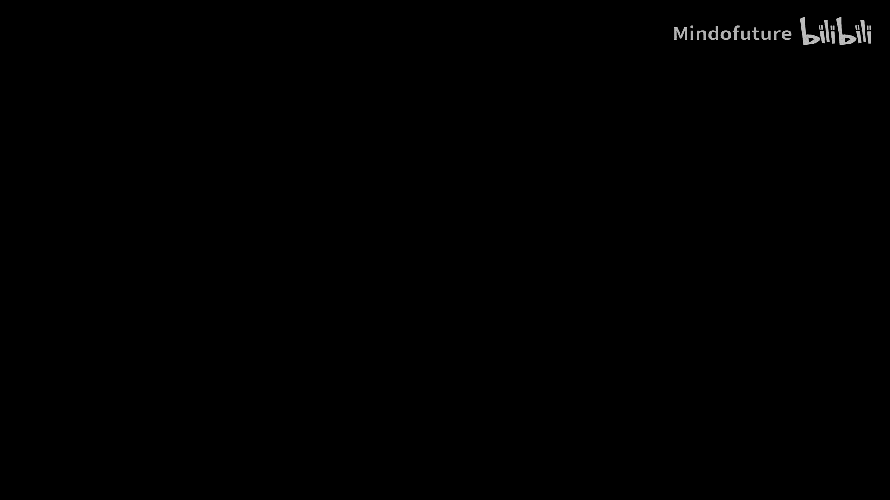
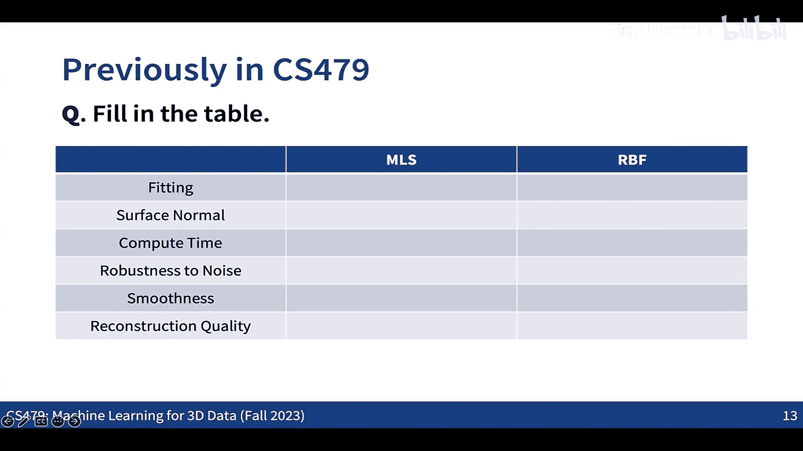
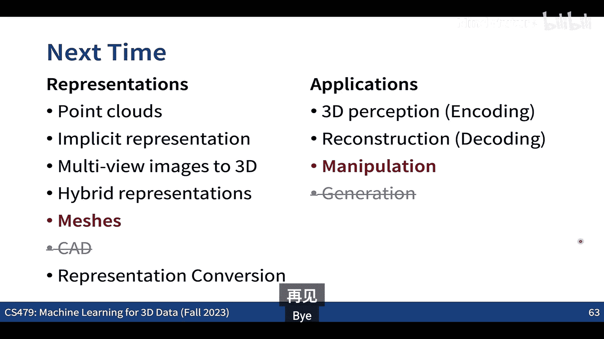

# 【韩国科学院】机器学习3D数据处理 ｜ KAIST ｜ CS479： Machine Learning for 3D Data p12 P15_Lecture_12_-_Representation_Conversion_(2_2)_(KAIST_CS479__Spring_2025) -BV1YmuBzTEmx_p12-

Okay， so let's come back to the discussion about the conversion。

 So last time we are discussing some kind of techniques in terms like how we can do some kind of the conversion of across course some3D representations。

 So what we have seen last time is that basically for some of the representations here。

 you can see like for the conversion from the input function to the boxs to the mesh to the point cloud or the mesh to the multi view images。

 actually， those conversions kind of like very straightforward。

 like basically we know how we can do this kind of conversion。

 The question was that how we can basically make some kind of the missing the bridges of course representations。

 like for the conversion from the point cloud into the input function and also from the boxs to the mesh。

So we are discussing some kind of techniques in terms of how we can build some kind of bridges。

 missing bridges here。So what we started discuss last time was basically about the conversion from the point cloud into the input function。

 so we discussed the point of the ideas for that， the simplest kind of idea was basically fitting some kind of the polynomial dysfunction function。

 but the problem is that the whole shape cannot be represented with the polynomial dysfunction function。

 a single the polynomial dysfunction function， So the basic idea was that we are basically locally approximating the surface。

 basically the local surface reaching some kind of the wasted the sum of least curious the equations。

So that's basically the idea about the moving these curves。 Basically。

 we are basically fitting the pollution the function into the local the circuitcus。

 basically finding some kind of the best parameters here。

And the problem like finding these best parameters with respect to basically minimizing the weighted risk here was basically the equation that is formulated has been solving the eigen vector the problem。

 what we have seen last time is that after basically all the dele。

 which we could see that the risk here the problem turns out to basically just finding the eigen vector。

 which is corresponding to the smallest the eigenvalue for some kind of the matrix that we are calculating we given the information。

So this sort kind of like the simple idea in terms of betweenating the polymer function and this idea also could be used to basically estimate the surface number as well so the surface number is basically the information that is basically being used in the many applications and also kind of some extra information geo information for the encoding some kind of the the tasks and also for rendering of the point cloud and also for the more accurate 3D consumption as well so actually also this moving the secure technique could be used to basically estimate the surface norm and also the surface number also can be achieved obtained from the kind of the other the kind of cases from the scanning for the many other kind of the aspects。

And the other technique that we also discussed last time is that when this kind of dispenomer information is given either like by estimated using the movingly scale or some kind of the other kind of things。

 then using this information， the extra information。

 we could consider basically approximating the entirely shape by using some kind of input function。

 which is obtained by solving some kind of the global optimization。

 so this was the another idea which was called the radio the basis function。

 which is basically representing the input function as the weighted of the raly basis function with our choice of the raial the basis function。

So here the question is that how we can find the optimal the weights for each basically the radial decocon defined for each of the the point。

 so basically as we have some like abnormal normal de points。

 we are basically having some the weight for each point so how we can best define the optimal the was basically the problem here。

So the thing is that if we only solve this problem with given the points sampled over the surface。

 the tree build solution basically becomes zero， basically assigning zero to the old weight is becoming theolution which is basically satisfying the condition that the sign that distance function should be zero at the point sampled over the surface so to avoid this kind of the three buildolution。

 what we can do is that we are basically adding some kind of the additional constraints in terms of basically taking some kind of the ob surface the points by moving the point over the surface along the normal direction。

So when you basically move the points over the surface to the outgoing direction to the object。

 the surface， then we are basically assign some kind of the positive the plus design distance。

 and if we move the points to the inside of the shape。

 then we are also assign some kind of the negative design distance。

 So by having this kind of the non zero distance kind of the constraints。

 we are we can basically calculate also the non0 devices for the radio decoors。

So this sort the basic idea in terms of that we are doing some kind of the more the global fitting of the input function。

 design this function with some kind of the all the kind of the points as kind of the constraints in terms of solving this problem。

And this problem was basically solved by just like making some kind of linear system。

 So when you basically define this kind of linear system。

 we can basically calculate the weights for all the points that we have。

 and that basically defines the final the initive function。

So this was the idea and also the other thing was that when also we have the subnmal information。

 we could consider basically using this information to also approximate the first order。

 the movingly secure the equation into slightly different way in terms of that we are not solving the least security the problems in this case。

 not the ig and vector problems in this case， but simply basically replacing the variable of the subnoromer for the quality point into the subnomer into the other points using some kind of the prefited the ten plane information using the precomp the subnomer for the all points。

 so by replacing this kind of the normal information what we could achieve was that now we don't need to solve the idN the vector problem but we can simply calculate all function values by calculating this function。

 which becomes like even much faster to calculate。So all this kind ofデ% values。

So these are basically all the the ideas in terms of that。

 how we can do some kind of the some conversion from the point cloud into the input function。

 basically design the distance function。So we also this custom kind of comparison in terms of like know when the moving risk gear would be better and also in in which other the cases。

 the rate the basis function would be better。 So let's quickly try to basically fill in this table and see like what's the kind of the pros and cons of each of the cases。

え so if we see。你铁不 here。Then obviously the fitting of the moving list curves is about like the genes of like local fitting right based on some kind of the waste which is defined with some kind of the weighted function that we are defining right so the moving risk curve was more about the local fitting while the radial basis function is more about sort of the global fitting basically's finding the optimal set of the weight for the older points by solving the least security problem for the internal points right so the fitting for the moving risk curve like local and the global right。

And the moving list skillss is not typically not requiring the supernmal information。

 but actually the movingly skills is typically being used for the submal estimation。

But for the radio basis function to avoid the triability resolution。

 the typical the approach is to basically use the seroromer to basically have some kind of the old surfaceistic points so the submal information is typically required for the radio basis function。

And the computation time of the movingless scales would be basically way faster because it's the local deing and the radio basis function be slower because it's like solving the big linear system and the moving risk skillss would be the more robust to the noise because it's not basically being affected for the all de points given the point cloud but while the radio basis function can be more the sensitive with some small noise because it's solving the global de。

And also typically the radioial function the output is is smoother is also because of the representation。

 while the curves may not be that smooth， but it also depends on like how much basically the menu of the orders of the polyum normallyial terms that we are going to use in deing the process。

And since we are also using the global the optimization。

 typically the radio basis function can capture better capture some kind of defined details while the moving these skills may not be able to capture some of the defined details。

 but this is not kind of the absolute kind of things it all depends on how we define all the the promptors and make some kind of details in the implementation。

 but these are some kind of the higher level the ideas So what what going be the good and bad things for each of the kind of techniques。

So typically when you want to basically achieve some kind of the good quality of the impulse function。

 when you also assume that the input point cloud is basically very dense and also basically the noisefr。

 the best way here would be basically using the ra basis function because it's more about doing some kind of the global optimization。

But still the global optimization of the rad， the basis function is still limited to only basically optimizing the weights for each of the rad of the corner for each of the point。

 so it's basically not exactly directly optimizing the function， the output the values。

 but more about basically optimizing some kind of the parameters for the input function which is the weights for each of the point。

So the kind of the technique that we are going to discuss mainly discuss for today is about some kind of the even better way doing some kind of the also the global optimization。

 but not for some kind of the parameters to represent the final the increase function。

 but directly optimizing the function values defined for each of the center of the boxes in this really grid。

So this is basically the basic painting that we are going to discuss so the technique that we are going to briefly talk about today is this technique which thezong surface reconstruction So here the thing is that given some kind of the oriented point cloud which means that we have the point cloud with the surface normal information So when the surface normal information is given or can be estimated using the moving list scarce or something。

 how can it directly get the increase the function。

 not some kind of the function with some kind of the representation but directly getting some kind of the function values at the center of the deboxs。

So this is basically the technique that we are going to discuss for today and the pause surface of reconstruction is quality technique which is like widely used for many kind of the cases that we are convert the point cloud into the increased function。

 especially in the case that we you want to get the best quality of the increased function。

 because it's kind of the nature of like doing some kind of the global optimization directly into some kind of the values that we want to get for of the box of the centers。

So we are going to discuss this technique for today。

And the basic idea for the Poong surface reconstruction consumption is that the key observation here is that we are seeing that the the gradient of design the distance function that we are going to get at the end should be the same。

 basically aligned with the surface normal information。

And we have seen that basically how we can basically get the certain normal information， right？

So then the problem basically becomes that no what we basically want to do is that we want to find a function。

 which data tip becomes the same with the sub normalomer。 So this is basically the problem。

 like so given the kind of certain normal information， we need to like the a function。

 which the data becomes the same with the sub normalmal information。

So here the question is that how we can find such kind of dysfunction， right？

So the kind of the simplest idea that we can think of in terms of finding such kind of function is that given the vector field。

 So here the vector field is basically the sub normalmal information defined which of the points。

 right given the gradient the information， we can just consider like taking the integral of the kind of the vector field。

 then the output， basically the function should be basically the function that we want to get right。

Then is it okay， like， do you see any kind of problem with this。So given this kind of the field。

 the problem is that so whether the vector field or like analytically integralte。

So that's kind of the problem。 So we are going to briefly talk about some kind of something that you already learned in the vector practices the first year with some kind of kind of things here。

The the thing is that when you talk about some kind of the vector field is some kind of the 3D space。

 the vector field may not be analytically integralteable。

 So there is actually condition that the vector field is like integralte。 Do you remember。

 what's the kind of the condition that the vector field is like analytically integralteable。

If you remember that you learned from the vector calcu stickers。内。Yes so。

This might be kind of like good motivation that you know review that you learn from the vector calculus So basically the thing is that not all the kind of vector field is like integral。

 integral the kind of vector field is kind of the carfree the vector field which means that when you calculate the core from the given vector field。

 is basically the zero for all the points in that space。

 then that's the vector field which is integral which means that's kind of the vector field that we can calculate some kind of integral that。

And this is kind of the case that we also call that is the conservative the better field。

So which means that not all the effective field cannot best be used for some kind of taking the integral。

So that's kind of issue。 But the thing is that since what we are basically getting is that we are getting some kind of the input function of the rate shape。

 which basically the ser normalmal information that we are basically getting should be the gradient of some kind of the target。

 the input function that we are getting right So ideally in the ideal case。

 the input the ser normalmal information should be basically a conative defect field because actually it's coming as some kind of the gradient of the input function that we want to get。

So in the ideal case， there should be no problem in taking the interval。

 The problem is that we we are basically also estimating the ser information。

 So it means that there might be some kind of the noise This may not be the perfect the gradient information of the the function we want to get。

So when you have some kind of this small noise in the the surface normalmal information。

 this might basically affect in terms of the defect field becomes like nonconjuative defect field。

 which means that we cannot actually calculate the integral that So that actually happens in the most of the cases。

So here， the question is that the case that where we cannot directly take the integral of the vector field。

 So what should they do， So that's kind of the problem here， right。

So in the cases that like when we have some kind of the RV3 defect field。

 we don't know whether we don't know the de field is the con to or not。

 what we can do is that we can consider basically solving a least security problem。 Okay。

 but in the continuous this space。 So let's think about this kind of case。

 know what we are basically doing now here is that we are basically solving this kind of the mini problem。

In terms like when you find the function F here， which the the difference between the the derivative tip。

 the function that we are getting and also the inputed vector field these difference the scales of these difference becomes like minimized。

So that's basically the core here。So in the 1D case is basically the identical。

 but the things that we this is the case that we're having some kind of gradient information and we are finding function F here。

 which the first derivative becomes the same with the input gradient。😊。

So this becomes our kind of the objective function。에이스크。

So then now here the question is that how we are going to solve this kind of the least curiosity problem in the continuously setup。

So how can you solve this？So there can be like multiple ways in terms like， you know。

 interpreting the kind of solution for this and also how we can approach it kind of the optimism the problem。

 one kind of the way that we can basically consider in terms of like how we can solve this problem is that we are going to quickly see the the O the log de population。

So this is like very general kind of deform that can be applied into the many。

 many the tones of the application， especially many things in the the physics。

 but here the basic idea is that for any kind of integral deform like this。

 which is defined with the function L， which is also the function of some kind of variable X here。

 and also the function F and is the derivative here， given any kind of the function L here。

 the solution， the function F here can be basically obtained by solving this PE formulation。

So basically the kind of be some stationary point of like this integral either some kind of the minimum or the maximum of this kind of the integral here here and also basically the function either minimizing or the maximizing this integral function here can be obtained by solving this PD D formulation。

 So that's the basic idea for the oil de la equation。

So given this kind of the idea that we have some kind of very general form of the formulation that can apply to the many kind of cases here。

 what we are going to do is that we are going to apply this idea into this minimization the problem。

So let's not think about some kind of the high dimension case for now。

 Let's only think about the oney case。 So we are going to basically find function app here。

 which is like minimizing this。And we want to basically interpret this function into this form of the old equation in a way that we can find the solution function app here。

 butim this as kind of solution of like this PD D formulation。Make sense。

So here the question is that given this miniizing the problem。

 I recommend you to take exception of like this。 So given this kind of de miniizing the problem。

 how we can define this like function L here。And then based on this the definition of the L here。

 how we can also get some kind of the the solution the function the F here based by solving thisピ D formulation。

So let's people try to do this。So try to know， define the function L here。

 which is basically minimizing this。Formulation the risk formulation。And based on that。

 let's plug in this L into this P D formulation and see what's kind of the the the equation the so the the the function app here obtained that kind of the the the solution of this P D。

So yeah， let's see step by step。 So basically， given the least curiosity problem。

 we can define the function L into this way， right to the function L become the least curiosity solve way。

So given the L function， if we take the derivative like this function L。

 or with respect to the function F and the F prime here。

 then we're going to get these two times right， we can also take the another the derivative with respect to the x here。

 then we basically getting this。So when you just plug in all the things are into the PD D E that we have。

 then what we can see is that like the the the solution， the function app。

Should basically have this kind of the relationship with given the field the G here。

So basically what we can get is that know when you So this is basically the the relationship that we are getting。

 So the second derivative tip or the the output the function。

 the F we are going to get here should be the same with the first derivative tip of the given the gradient function。

So if we find such kind of the function， which is second derivative become the same with the the the the first derivative。

 the gradient function。 did you hear， That's the basically the the function that we want to get。

 We see this minimizing the the， the the L difference here。Makes sense。

So this is basically some kind of the the the explanation for the one0 case。

 Basically how we gonna solve the least curiosity problem， which is basically you know。

 based on the this kind of deform。The thing is that we are not basically reconing the this in the one D case。

 right， typically in these these3 D case So in the3 D case the corresponding the formulation is basically this。

So when have some any kind of high dimension space， the function app。

 which is basically minimizing the L to the security the difference is basically the function which is satisfying this So when you take So instead of taking the second。

 So now we are taking the of the function here So when you take the of the function here。

 that should be basically the same with the divergence of the gradient the vector field in this case here。

 So thats basically the output function that we want to get。makes sense。

So if we can best solve this kind of the deform that becomes some kind of the the optimal the assigned distance function。

 given the the surface normal information。So here the thing is that so what this kind of the function。

 So if see that actually the divergence of here is some kind of some the of the function then function that having this kind of So this is are finding function which become some kind of given skill of the function in。

And solving this kind of the problem is actually the this kind of formulation is typically called the Po zones the equation。

 and we're going to also briefly see in the next the rest of the director that there quite many applications of these like the Po zone the equation。

So you can see that actually the problem it turns out that given the surface normalmal information。

 we are taking the divergence of this kind of the the normalmal information and then if we are solving this like Po equation it expected that getting design this function from the surface normalmal information。

 this is basically why we are calling this equation。

 this kind of technique as kind of the Po surface reconstruction because we are doing some kind of the surface reconstruction by solving this po equation。

Makes sense， any questions on this？So， so now we can see basically how we do some kind of the global optimization of the function given the kind of the the normal information。

 given as the vector field here。 and the here the question is that how exactly we are going to solve this。

 how we are going to basically implement kind of the for this like the puzzle equation。

So more specifically， we want to basically solve this kind of puzzle equation in a discrete setup right。

 So once the basically discrete ties the 3D space into the deboxoxs in the space。

 how we are going to calculate this kind of disber for the puzzle of the equation。So actually。

 like the implementing this order in this3D space is not that easy task is like quite complicated。

 So you're gonna say first the one case。 So in the one0 case。

 what we are basically doing is that we are dividing the kind of the one kind of the domain into some kind of the the examples in the space。

 So let's say we are basically having some kind of the consecutive points over the one0 space we the same uniform the interval across the kind of older points。

So let's say that we are having the X I， which obviously basically the points over the kind of the the one space。

Then what we can do is that now the function in the space can also be represented as a vector。

 basically when you evaluate the function for the all the sample points over this space。

 now we can represent the function as those kind of the function value at the sample points that becomes a vector in the space。

So what we now do is that we basically represent the space as kind of a set of the points。

 a sequence of the points， and then the function also becomes the de vectoror。

 which is the values are basically that are basically obtained by evaluatingrating the function for all of points。

 right。So in the some visually it becomes like this when you have some kind of the function over some kind of the one space。

 we are taking some kind of the discretereetized some kind of the some a set of the points with some kind of the uniform double in this case and then erating this function and the the basically the function becomes a vector here。

 right。So given this kind of the vector representation of the the function and also in the discrete space。

 what we want to do is that we want to compute the first derivative and the second derivative right So how we can calculate the first derivative of the function for each of the points is that we can basically simply approximate the derivative like this So actually there can be some slightly different kind of ways to approximate gradient but the simplest way might be is that we are taking the two the function values at the consecutive the points。

 So given for some kind of the point X here。 we are taking the function value of the X and also the X plus one and taking the difference between these two and dividing this by the interval between these two right So that's kind of the one very simple way to approximate the first derivative。

And what we can see is that actually this like function。

 the the gradient of the computation can also be can represented into the kind of the vector。

 the matrix de multiplication deform by having this kind of the deformation。

 we can give some kind of the vector， the form of the function。

 Now we can calculate the derivative like in this way。So actually。

 what you can see is that not only for the gradient at one specific de point here。

 if you want to compute the gradient value for the older points that we have in the oneD sequence。

 actually the older derivative in in the older d points can be computed by like one large de matrix multiplation。

So let's think about that we are having the given the function defect here。

 basically defect form of the function here and defining this kind of the large the A matrix。

Which is basically they playing the role especially computing the gradient of the function。

 so basically by multiplying this like big matrix and the function value here。

 what we are getting is that some kind of the approximation of the first derivative。

 the gradient in the one case way。So we can see that the F and the G here is the discrete the approximation of the function。

 the F and the G here basically becoming some kind of the the first delivery cable。

 the function F here， right， and the matrix a plays the role。

 the computing some kind of the the gradient of the given the function。

ButThis is kind of some kind of the discrete form of the all the the continuous some kind of the functions and the operations。

makes sense。So from the continuous to the discrete some kind of representations。

 we are seeing this kind of the correspondence。 So the function in the continuous space is like all represented as kind of the vector in the discrete space。

 right。And for the operator， now we are seeing that taking the derivative is basically kind of the operator in the continuous space。

 which is now represented as kind of the matrix form in the discrete space like this。And also。

 like when you apply this like operator into the one specific function。

 the output also becomes another function， which is the gradient in this case， right。

 that also should be represented with the another defect in the disk case setup as well。

So we are seeing some kind of the correspondence between the the function to the vector and also the operator to the matrix。

 And when you apply the operator to the function， the apple also should be another the function。

 right that also should be represented as kind of de vector。

 So we are making this kind of conversion from the continuous to the discrete setup。Makes sense。

 any questions on this？And obviously， we can do the same thing not only for the first derivative。

 but also for the second derivative as So when you basically want to calculate the second derivative like this。

 then is this we are doing the same thing。 like we are taking the difference between the the gradient the values probably two consecutive the points dividing this by the uniform the interval the length here。

Then this can be represented into this kind of the some vector the multiplication form。

 which means that now the second derivative I also can be represented into the the matrix form like this。

Actually this was can presented some kind of matrix multiplication of the the the the first order kind of So basically this is the same thing now the second of the operator is represented into the matrix form。

And then also， the output also is represent on the detector form here。

So we are basically doing this kind of some discrete in terms of that the function is represented vector and the operator is representative matrix。

 so this can be done for the all kind of the operator the function that we have which means that given the pause of the equation that we are finding the function app here。

 in a way that the second of the function becomes the same with the first able to be given the gradient function here in the one case we can basically discreteize this kind of setup by defining the second the matrix here and the first ability de matrix here。

Then this become complex is solving some kind of de linear system。Vexus。

So we have some kind of the given the the gradient function， the input gradient function。

 which will be converted into the the vector form here。

And the first derivative the matrix A and also the second derivative matrix L。

 These are some kind of the you know given information。 we can precomp these two operator。

 So these are basically not dependent to the input information。

 These are basically defined based on our some kind of the discreteretation of the space。

 not for the function， right。So given this kind of the two operator。

 which is not dependent to the input function， input the gradient function。

 this G is only the the information， which is like given some kind of given information the input information for some specific function。

 we are finding this like the vector F， which is the function values at each of the the sample the point。

 right。So this becomes a typical linear system， right？어 인스크립。But here。

 the question is that so would the the solution be unique in this case。

What do you think would there be some kind of solution that it the solution be unique in this case？

Yeah， so I recommend you to check how exactly we define the L function in the previous slide。

 which is to be like this way。 But the thing is that for the of the。

 cannot basically calculate this kind of game， right。

 So because we need some kind of the two basically the points near that is point which means that actually the La cannot be a the full length matrix because we are not having the information at the end。

 right。So the thing is that given the L matrix becomes some the non full length matrix。

 which means that there there is basically no unique solution。

 there will be the infinite the number of these solutions。

So basically what we can see is that given the any function the F here if pure basically you know add some kind of the constant number for the older points。

In the space。 So when you have some kind of the function the app here in the want the space。

 whether you basically add some kind of the constant number or the subjecttract some kind of constant number moving the kind of the graph of the function to the upward or the downward it is not basically changing the second derivative。

 right。So the derivative， the first word， the second derivative of the de function is basically not being changed when you basically move。

 basically upward voltage downward of the D function， right。

So which means that when you basically know add any kind of the constant number into the gi function that will also satisfy this equation。

 So that basically shows that there is no unique solution for the output function app here。

So which means that we need some kind of the extra constraints to basically specify like one unique function。

 right？So what we kind of be some more information that we can use。えにど thisす。So so far。

 what we are discussing was to basically utilize some kind of given the ser normal information in a way that we are finding some the S distance function。

 which first tip becomes close to the ser normal information， right？

But there is information that we didn't use yet。Any useless。Any idea。

So the only information that we are using was the ser normalmal information。

In a way that the derivative tip is aligned with that the normal direction。

 but the other information that we also know is that the sine is function。

 the output function that we want to get， the function， the。

 the output value should be0 at the position of the each of the sample point because like those are the points sampled over the surface。

 right。So we are actually not only having the information about the derivativeivity function。

 but the function delivery itself for some of the sample points。

That should be actually some kind of the that's typically the additional information that we can use and some kind of the additional additional constraints for this kind of the。

 you know， the linear system。So given this kind of the linear system， actually。

 we can consider adding some kind of the additional。

 some kind of the constraints in terms of that the function value becomes close to0 for the points that we have over the surface。

So that's kind of the problem that we are going to solve。Make sense。

So we are basically having the two terms here， the first term is about the list curves。

 about the sub normalmal information， which basically is turning into the linear system in the discrete setup。

 but we also have some kind of the constraint that the output function value to be close to0 for disse the points that we have。

So we are basically minimizing these like two termss in terms of the de default function here and we when you also have this kind of the additional det for the function value。

 the output itself up for some the dis sample points。

 this equation is called the now the screened deposit equation。

So thats why you you also see that system some kind of extension of the horizontal simplicity consumption into the screen the poly sophisticated consumption。

Mix sense。you can see that this is basically nothing but we are basically utilizing these like two information like one is that the function value should be0 the points that we have these samples here over this surface and also is derivative also should be aligned with the search normal information。

 which is turning into the linear system in the this case setup。And so in the one0 case。

 this is really kind of like global in terms of like we can easily implement the matrix for the first derivative and the second derivative here。

But if it goes into the higher dimension space， it becomes a little bit like complicated。

 so we are not going to get into the older details in terms of how we're going implement this in the high dimension space。

 but the higher idea is that for each of the gradient and the divergence and the Laian。

 we can basically consider defining some kind of the big matrix in a way that basically making some kind of the the matrix form corresponding to each of the the operator in a way that we are basically turning the puzzle equation into the solving the least security problems into the the matrix form。

So that's basically the higher bit idea in terms of like the context function becomes the discrete vector。

 the operator becomes the matrix and the function composition becomes like the matrix the multiplication and the solving the all the lagang the equation becomes like solving the riskers into the matrix form。

So in the real the implementation， basically what we do is that we given some kind of the set of the the points we did the surface of the normal information in the 3D space。

 we first define some kind of the 3D grid。And for the center of each of the deboxle。

 we are basically getting some kind of the vector field information。

 gradient of the output the gradient of the output， the function。

 the information by aggregating some kind of the points inside the deboxle So given some kind of the oriented point line information。

 we basically calculate the de vector field footage of the center of the deboxs。

 and then we are basically computing the diversers with some kind of the operator that we are defined and based on that now we can solve the problem equation by solving the least security problems。

And once you basically get all the kind of the function values at the center of the D pixels or some kind of the corner of the D pixels based on that we can now extract the the is surface。

 the dual levels at the points in the space。So this is some kind of the higher level the idea in terms of like how we exactly do some kind of global optimization。

 And then I also recommend to try to think about basically how we can really extend this kind of the idea into from the1 d to2 d and the3D。

 So what should it some kind of the divergence the matrix or the and the matrix exactly in the2 d and the3D space。

 that is like way more complicated the matrix that we are defining in the one case but it's kind of like some durable kind of the task。

えにこちさんです。So as I said， actually this po equation has some lots of the applications in not only for this 3D。

 but in many kind of the field， actually one of the interesting some kind of the applications that I'd like to briefly dimension here is that it can also be used for some many kind of 2D image applications。

Like one kind of the application is basically image。从。

So here the question is that what kind of numerical methods are used in the calculation the equation well。

 I mean in the calculation of the matrix， it does not require any kind of the numerical the method it's just like middle like how are we going to make some kind of the matrix for each of the operator for the divergence the Laplian as we have done in the oneD case we can basically define this kind of the matrix and the rest of the part is simply just solving the list curves in the same kind of thing。

But it will be basically very giant the linear system with lots of kind of debus there。

 So there are some kind of the some kind of numerically techniques in terms of like how are were going to make it more efficient in terms of like solving the linear system。

So if you are more interesting， you can also check out the original paper the technique。

 which is introducing some kind of the multi resolution degrees kind of server in terms of solving this kind of linear system。

We are not not get into that here。So coming back to the some applications actually there are lots of the applications for the pause equation。

 like one simple kind of one interesting idea that has been introduced like more than 20 years ago is basically about this kind of like image editing so here the idea is that we are comp some kind of the fulleground reason here。

 the doc and some keys here in this image into the other the background image here。

This is also taking some kind of foreground region here。

 like eye nose and the ellipse here into the other image like this。

So here the question is how we can seamlessly basically composite this kind of like foreground region from the other image into the background region into this image for those kind of the task now we can just like use some kind of the like some AI model for this。

 but like more than 20 years ago， there is no like even no neural net nothing we can do in terms of doing some like deep learning。

 but still we could get this kind of results with some kind of the simple like calculation of the like linear systems and the basic idea here is that actually we are not taking the pixel the values itself themselves in the foreground region。

 but taking the gradient information。We are only taking the gradient information。

 the vector field here in terms of that we are basically reconstructing the function of the output image here。

 in terms of that the gradient of the foreground reason becomes the same we the dog and the key images while the function value themselves should be the same in the background region。

SoWe are taking the gradient information from the foreground region。

 but taking the function building， the boundary condition of the the function itself from the background region in a way that we can do some kind of the seamlessistic composition between the foreground and the background。

Can you see the manual like this？So as you can see here。

 like we are fixing the color values and some kind of some the boundary of the foreground region。

 while basically filling the values inside of this region。

 in a way that its gradient is aligned with some kind of gradient that we have from the other image。

So you can see that the tone of the output image is kind of like is the same with the background region while some kind of de gradient information is coming from the program here。

Make sense。So yeah， this is kind of one of the some kind of application of the the equation not in the threeD。

 but also the the two the case。So like the positive equation is very widely used and the positive surface reconstruction is also kind of the sort of this standard technique in terms of the point cloud into the input function conversion。

The only downside is that basically it obviously takes like more competition the time because it's sorting the big linear system。

And also you realize more on the de normalmal information。

 which means that the ser normalmal information should be very accurate without some kind of the noise there and also the point cloud should be basically the dense enough to compute those kind of things so in case that when you have some like very dense point cloud with quite accurate de normalmal information and if you don't care about the computation time。

 then you can consider using the po surface consumption。But otherwise。

 you can also consider using the removing list curves or the radio the basis function。

That's第一 bit video。Andに quote on this。And one quick remark is that actually there is also like bunch of ways to how we can solve like this kind of the pause equation in a like more efficient way。

 So we are not going to get into some more details。

 but actually the so new pang who also gave the de structure over the course was into some kind of interesting idea in terms of that we can solve this kind of pause equation using some kind of spectral。

 So after like converting everything bit into the spectral domain now we can solve the pause equation in like much faster way and this is also kind of the things that we can easily utilize some kind of the GPS in the calculation of the pause equation。

So this can also apply to many other applications like fitting some kind of this readership into some kind of the some kind of the giving information。

 which is also not only input function but giving some kind of the oriented point cloud as。

So there are some kind of the interesting ideas in terms of like how we going solve the Po equation。

And also， there are some newer methods as well， not just like doing this kind of like linear like solving linear system。

 especially in the case that when you have some kind of the noise in the given the point cloud and also noise in the sub normal information。

 we can also there are some kind of techniques in terms to utilize some kind of the neural network to get some kind of the much more like the precise the outputs like this。

So you can check this out if you are more interesting。Okay。Any questions on this？Yeah。

 so these are some kind of the techniques in terms like how are we going convert the point cloud into the sign the distance function and the another mission bridge across the representation was the conversion from the boxes into the mesh。

 So we're going to briefly get into the the simplest idea in terms like boxel to me the conversion。

 which is also very widely used。So here the basic idea is that given some kind of the so implicit representation。

 including some kind of the occupancy information， we are going to get some kind of be a time the mesh that approximate the surface like this。

So while we are talking about the design distance function in the previous slide can we know that we can easily convert design this function into the occupancy field。

 right， So here we gonna basically assume that the input information is now the occupancy the information for the corner of the of deposits。

So before we get into the 3D case， now we are going to briefly see the 2 d case。

 So when we see the 2 d case， this kind of technique is now called the marching squares but marching basically like moving forward in these curves in the 2D space and this technique is now called the marching cubes in the 3D space。

 because now we are doing some kind of the marching with the cubes with the boxes in the 3D space So you briefly see the idea of the margin curves。

The basic idea is that we are having some kind of English function。

 which is indicating whether it' of the corner points。

 especially inside or the outside of the leadership in the2D leadership shape here， right。

So basically， what we are going to do is that we are going to discreettize the two display like this with the corner points like this。

And then evaluatingval this function here in terms of like we are classing whether each of the corner points is the inside or the outside of the2 d。

And based on that， what we are going to do is that we are also going to classify like which edge of the grid here should be basically having some kind of the boundary of the shape。

 so like for on which the edge of the two degree， we are having the boundary of the shape in a way that we should have some kind of intersection point like this。

So you can see that the if we see the two end points like this gradient edge。

 like one is inside and the other one is basically the outside， right？

Which means that there should be some kind of the intersection point between the the border of this this service and this degree gradient edge here。

 right？We are basically finding all the gradient this。

 which like one of the end point is the the inside and the other the endpoint is basically the outside。

And for those that this， we are basically finding the intersection point here。

So once you basically or like all the intersection the point the the last basically the the the task is basically connecting those kind of the intersection the points in a way that we are making the control in the2 d case。

Makes sense。So this is basically what we are going to do so simply what we can do is that given this kind of some like the function value。

 especially some sine distance variable of the two points。

 we can easily find the intersection point with some kind of the linear the interpolation。

 given the function the two function values taking the linear interpolation and finding some kind of the point while the sign the distance function become zero right。

So findingァイど kind ofデ interデ points andデ question is that how weアグント connectあど kind ofデ toあデ interディ points right。

So here the simplicity the idea in terms of connecting those kind of the intersection point is that we are not going to see the all the the2 d。

 the cells like all together。 We are going to treat each of the cells separately。

So let's think about that。 we can consider like all the possibly cases。

That we are having the either the inside or the outside are the corner points for each of the four corners of the each of the two are right。

So if we consider like all possible combinations of the inside and the outside for the old the corner case。

 how many cases do we have。Yeah， we we should have the 16 cases， right， because it's two to the4。

 right， for each of the corner points， there are the two cases。 like we have four corner points。

 then we have the two to the4， like 16 cases。 So these are like all the 16 cases， actually， right。

 So given these four，16 cases， for example， here， there is no， there should be no inter point。

 the the bound of the shape and also the the the edgepher， right。

So there is nothing to do in terms of growing the edges here。And this is also sort the thing。

 There is like nothing to throw because like all the points of basically the， the outside here。

So there are some cases that we might have some kind of interesting point here and here。

 So let me just switch into the region here。Yeah。So you're going to have the interesting point here and here。

 then we need to do some kind of the edges here， right？デし theせ。

And here we're going to have the inter point here and here， then we're going to do the edge。

So the basic idea is that we won't just see like all the 16 cases。

 like individually and try to basically through some kind of the the the connection。

 the the lines for the intersection the points。But the the thing is that basically。

 even we don't need to consider like all the 16 cases because there are quite many some symmetric cases as all。

 right。So basically by doing some kind of rotation like all these cells。

 we can see some kind of some groups， for example， like this is the case that we are having these three kind of the points which are basically like having like one basically for example like the negative sign and the other point is basically the positive sign right here。

 right？And if it rotate this。Then by rotating this kind of the the the cell here。

 we can also get the third one here as well。 And also this one and the this one， right。So if we see。

 like how we can basically connect the intersection points in this case。

 then the the we can basically see how we can also make some kind of the connection that is for the other the rotated cases as all right。

So we can see that these are some kind of the the same cases with some kind of rotations。

Where there are some cases that we are flipping as well。

 Like so this is also the rotation decay case。And this。And the other yeah， so these。

 these two are basically the same case， but we are just like flipping all the signs， right。

 but like flipping signs should not change the the connection。

 the edges still basically having the two intersection point here and making the edges here as well is the same as in this case。

So basically， as you can see， like based on this kind of like some symmetric the relationship or some kind of Philipping relationship。

 we can group like all these like the 16 cases into the all the equivalentence kind of the cases。

 Then at the end of like all the grouping。 we are seeing like all these kind of the un rules like the four cases。

Makes sense。So after the grouping we're gonna see the all the those like the four the cases。

And for the first case， we can see that there is nothing to draw， right， There no inter point。

 So there is no edge here。 This is the case that we having a two interesting point here。

 Then we're gonna draw the edges like this one。And this is on a case that we're having the two interesting points and drawing the like single ads like this。

 right。😊，And this is kind of be some problematic some case because that we are going to have the four intersection the points on the old the edges here。

And here， the question is that how should we basically connect those the the interesting points。

あしリ对で。So which means that there are some kind of ambiguity。 We can make something ideas like this。😊。

い緒？We the other way， right， like this and this。So there is some kind of some ambiguity in these kind of kids。

So for such kind of cases， like some simple solution is that we can try to basically divide the cell into the even the like the smaller the basically the2 cells like this in a way that So we have know increasing the resolution of the grid until we do not see any kind of this kind of the ambiguous cases。

Or the other simple solution is that we just pick randomly， like one of those and two cases。

So these are some kind of the simple solutions。Excccess。

So this is like very simple the idea in terms of how we're going to basically like make some kind of the final some kind of the the 2D conours read some kind of the connection of the the lines。

And the things is that we can do the same thing for the3D case as well。

Soイディスデ caseース how many kind of cases we gonna seeあ in terms having the inside the outsideこコ pointsあ how many combinations to receive。

嗯 quite。The 2D case， like we have seen like 16 combinations， right， And after grouping。

 we could see like four like I and some kind of the groups， right。In this3D case。

 now we are having the256 cases because we are having the eight corner points。

 Each corner point has some kind of inside outside。 so it should be2 to the8256 cases。

And once you also group like all the equivalent kind of the cases。

 So these are actually some kind of the some representative examples for each of the groups。

And you can see that after some grouping all thesesymmetric cases。

 now we are seeing some5 groups like this。So which means that for any kind of the some one of the 256 cases。

 we first need to see that in which group these specific combinations like falls into that right。

 then based on like for each of the groups we can first predeefine how we need to create some kind of the triangles based on the intersection point that we have then we can basically construct the triangles in this way。

So yeah， and those are some also there are some kind of the cases that we are having some kind of ambiguity and if we have the ambiguity。

 then we can consider like， you know， increasing the resolution。

 basically dividing these 3 boxes into the similar cells where we can basically choose one of some kind of the random choose like one of some the ambiguity cases。

So this is kind of the simplest idea in terms of how a converted box into the mesh the good thing or like this idea is that this is like basically very simple to implement iss all predefining some kind of the ways to like make some kind of triangles from the given the intersection the points and just like doing some kind of classification right so it's basically it to implement relatively compared to some kind of other the complexity the cases and the most important thing is that it's basically treating all the cells like individually right so everything can be run in parallel so it means that we can basically know accelerate this kind of computation using the GPS so that's really kind of the good thing。

And also this is like the parameter free waves。 So there's no nothing to make tune in terms of the some between some kind of parameters。

 so basically lots of some kind of the advantages。Obviously。

 there are some kind of thement as well in terms of that there is no guarantee in terms of the top right。

 So we don't know how those triangles will be basically connected across the older cells， right。

 So there can be some kind of the some weird some kind of connections across the all triangles over the inter the shape。

The the space actually right。And also， there are there can be some kind of failure cases like this。

 For example， like for this， what we want to get is that we want to get the sharp D edges across the along this line。

 right， So that's the ideal of the output here， right， for the cases like we。

 we have the cube like this， we want to have some kind of the street， the edge along this line。

But depending on how we define some kind of the three degree， these three D cells。

 we may not be able to basically the matchsh edges。

 which are really aligned with this kind of the sharp edges。

So there are some kind of the many the downside for design here as well。 but actually。

 this is kind of the most widely used， some kind of the technique into the converting the box into the mesh。

And one funny thing is that actually this idea was first introduced in the 1990 course around the dead time。

 which means that it's like more than 30 years ago。And it has been patent for the decades。

 which means that we could not use this kind of technique for many commercial disruptor。

 So to avoid the patent， the some kind of the technique was that we are doing the same thing。

 not for the kind of the cube like the cell in the 3D space。

 but we are dividing the 3D space into the tetrahron like this。

 and then doing the same thing for those kind of the tetrahron not for the cubes。

 then we also need to define this kind of some all the possible combinations of design distance。

 the values for all decon points。So these techniques can be applied into the not the cues。

 but also to the tetra heater， So this is the technique which is called the margin tetrara。嗯。So。

 so that's it。 So this is basically some kind of technique。

 And also the assignment4 will be basically about implementing both of those things。

 So we need to implement the implic， the moving skillss and also the emerging curves as well in a way that you can basically convert given the oriented point cloud in the2D space into the final some kind of the contours in the2D space So you will get into the best and see how we can do this kind of conversion in the core。

And this is basically concluding our discussion on basically how we do all the convergence across the representations Now we can see that the point cloud can be converted into the interest function using either the moving lists or the regular basis function。

 or we can directly point a convert point cloud into the boxess using quantum surface consumption。

And once you basically have the increased function of muscles。

 then these can be converted into the messaging the emerging cubes， right？

So these are not only techniques for the convergence。

 but these are some kind of the representative techniques that are widely used for those kind of converence and if you have any representation of the 3D data now we can see that we can convert that into the all other the representation using those kinds of techniques and these might be quite useful or overview the project as well when you have some kind of some random some 3D the data。

 you might need to do some kind of the conver into the other representations。Okay。

 so this is like conncluding our discussion for the representation devergent。

 the last topic that we are going to discuss in this class we will be about the meshes。

 so actually as we discuss in the first lecture， the mehe is also the widely used representation for many applications。

 but especially the mehe is really good representation for the manipulation。

So after doing this kind of conversion， we're going to see how the output the mesh can be utilized in the many kind of dis manipulation the applications。

 so after we have the gas lecture and the assignment session next week we're going to discuss the measurement manipulation in the week after next week and we're going briefly also discuss the 3D generation as well。

 so this will be basically the end of the over the kind of the lectures。ok。😊，Any questions on this。

So as I said， there will be no class this Wednesday and we gonna help the guest lecture next Tuesday。

 So I will see you next Tuesday。Yeah thank you。

はい。