# 【韩国科学院】机器学习3D数据处理 ｜ KAIST ｜ CS479： Machine Learning for 3D Data p13 P16_Lecture_14_-_3D_Generation_(KAIST_CS479__Spring_2025) -BV1YmuBzTEmx_p13-

So today is the last lecture for the hour course for the emotional first three detailator。

 and we are going to wrap up the all the topics we are going to briefly talk about this new topic。

 which is about this3 generation。

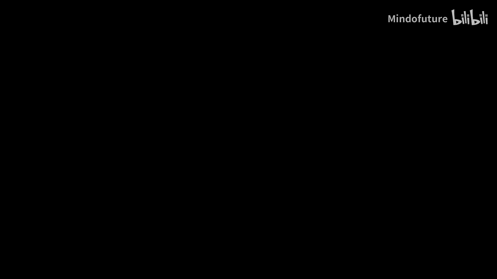

So if we go briefly about some kind of the topics that we have discussed for。

 we discussed the loss of the representations for the 3D data and also there the applications and also some kind of neural step to same of and how are were going to basically provide those 3 data is the input and also how we are going to generate these 3D data as the output as well。

And we also discussed discuss some lots of kind of the pro ands for each of the representations。

Actually， while we are focusing on like the different representation particularly there。

 see there are some of the topics that we didn't have time to cover in this class。

 as I mentioned at the very beginning， there are also not just the but more some kind of the structural representations that can also more explicitly represent some kind of the structures like the sharp edge and also kind of platforms and many kind of services。

 but those are some kind of the representations that are typically use in the some kind of CA committee concrete design。

 which are some kind of the representations that we didn't discuss in this class。

And also speaking to some more like the contra related to some kind of topics there are many some kind of the 3D based the perception the tests。

 which is about like basically detecting and equipment and the object and the parts in the city re when have these kind of some like the scans the indoor the outdoor scenes there will be some kind of lot of the applications that we might want to basically we detect like where be like the chairs are where the tables are and how the shape looks like So those are some kind of the tests which is called the detection and the segmentation we didn't get into any ideas about how they are going to include these things are in the So those are some kind of missing topics。

And also many of those kind of3 are widely used in the many robotics application in terms of how they are going to teach the some autonomous agents in terms of how it can they。

 how they can navigate in the space and also in practice some kind of some theory so there are lot of applications that we didn't see。

And also at the very beginning of like this course。

 we discussed the idea of the point that which are basically involving in some the modelss of like how they are going to make the neural network to be rotation invariant or rotation the equilibriumant。

 but we are basically not guaranteed with the special transform architecture。

 and there' are some kind of the more specialized the neural network architectures that can really be fully guaranteed the rotation the invariious and the equilibriumence。

 which are some kind of the advanced topics that we didn discuss in this class。

And also last time we also discussed the deform and there are also many kind of other some kind of geometric processing tests like finding some shape corresponds and many other things。

 so those are some kind of topics we didn't have time to cover in this quest。So yeah。

 that's a skill kind of like many other things。And one more topic that we didn't have time to discuss yet was about fiscal generation So now we are talking about the generated AI and we are also seeing some many kind of some generated AI techniques for the3D data so today we' are going to briefly talk about some kind of very recent the techniques about the generating some3D data into the very hi so you see。

So before we get into some of like the three de generation。

 I'd like to ask you some questions about like how many you have played with like making some G images。

How面 you能公开 with基分で。Which genetic models did you use to make those deeper images？Any。

Which the model of G for or something else， whatever。Yeah。

 so I guess now make you prefer to working playing making these key images and posting them in the Instagram and many other things。

 And we are actually seeing lots of some kind of the new generate models for the images and the videos like one of the famous models might be the fluxs this is kind of the open model So which means that you can not just like make some kind of the images using this model and you can really download these A model in the machine and make your own the applications based on that So and can see that the quality of quite。

😊，ButWe are seeing some kind of the very you know。On present level of the kind of quality of the generation of the images and the videos。

 so before we get into some more details about 3D generation。

 let's quickly play with like making some kind of two unique images first so if you haven't tried to make some kind of some images using some general models let's quickly type here So if you go to these also go there using the pure code here then you can just easily type some kind of text there and try to make some kind of images and you don't need to type this。

 but let's quickly type something images there are of two here like the first one with some kind of the better model which can produce some kind of the higher quality images or we some more composition the next one is kind of another model from the same companies but which is faster but making slightly lower quality of images。

So why don't you try to go to those websites and。

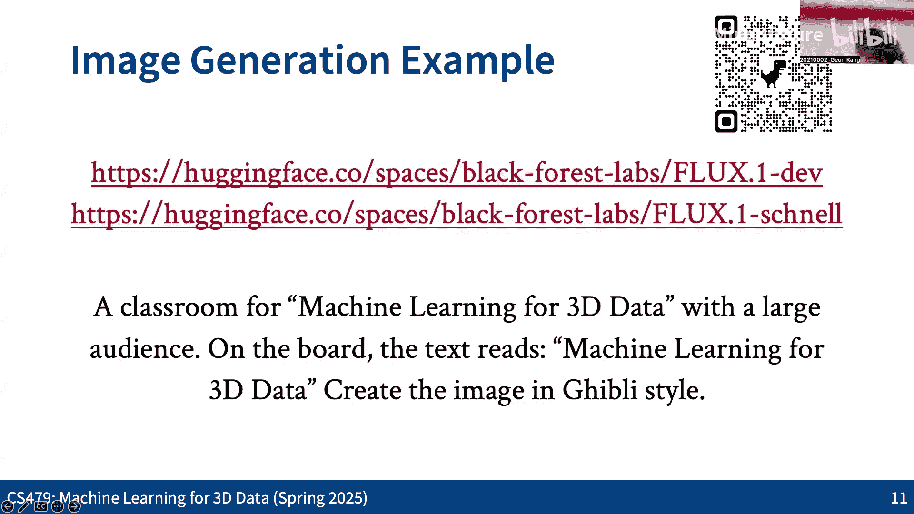

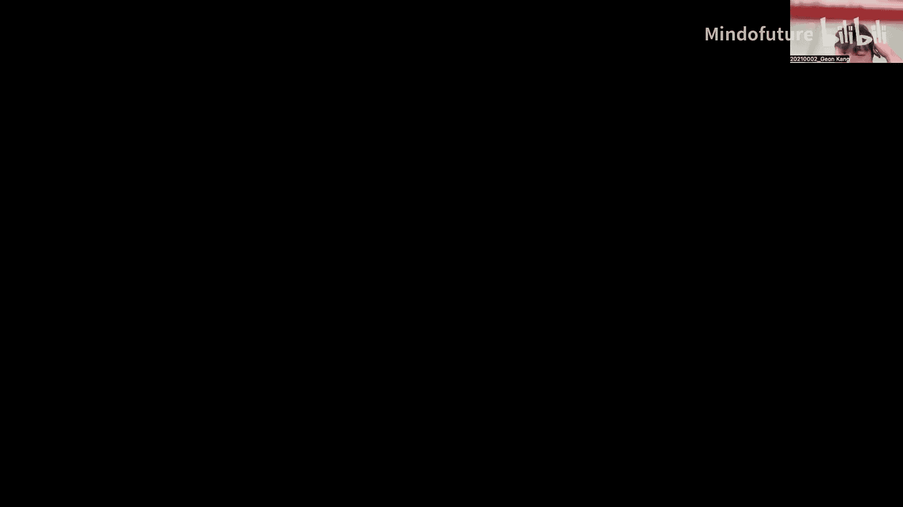

So I myself3 learning3 data output data got three。So yeah。

 let's we large this and it on I don't know whether this is really but some kind of animations so yeah。

 mean this is really kind of the output that we started to see some I guess。Like last year。

 especially for the cases like making some kind of test on the board it quite like it was challenging the test and now you can see some kind of good output in of the output is not just like real but also quite well aligned with some kind of big given text。

So these are some kinds of the quality of image generation that we can see these days。

 but not only for the images， I guess many people here like also try to make some kind of the videos as。

 So we are also seeing lots of the advances in the video generation as well also a data or like last week something also the Google in mind the video3 right which was showing some very nice quality of the videos So we also tried to make some kind of video like this this front。

Today we'll be looking at machine learning applications for 3D data。

So we are having some kind of on the board and also and even we some kind of quite long test we some last details。

 these are trying to make some kind of like some offers with some kind of 30 point cloud or something board yeah。

 any kind of。And some more examples about the future generation。

Welcome to Machine Learning for 3D data。So we are not now at this kind of level of like seeing some kind this level kind of data models that can make some kind of very realistic images and videos today what we are going to talk about is that So how can you do this kind of generation for the3D data as well。

And must the kind of be state of the art of the3 generation that we are seeing at this moment。

 And we also having some kind of the3 models as well。

 Actually these are some kind of some3 data that generated using the output that we also get look and also Jo Hui in his the first structure into this those kind of making lots of some kind of3 data using some kind of models。

So this is quite interestingly re terms of that it can produce like some of the 3 d objects as well。

 but also some very diverse 3 d syns， So those are also all the outputs using some kind of the 3 d models。

But one kind of the question that I wanted to bring on today is that what's the kind of the diversity of some kind of general。

Because like when you talk about some kind of the image and the video models。

 actually one of the reasons for the success for the recent image and the video models is the scale of the data so actually we are using lots of images to train a single behavior network that can produce some kind of loss images so typically for the image generation this data that has been used widely it introduced not into you can see that the scale is 1。

 85 billion is not so almost kind of like similar the scale the population of the entire the Earth it's really big scale。

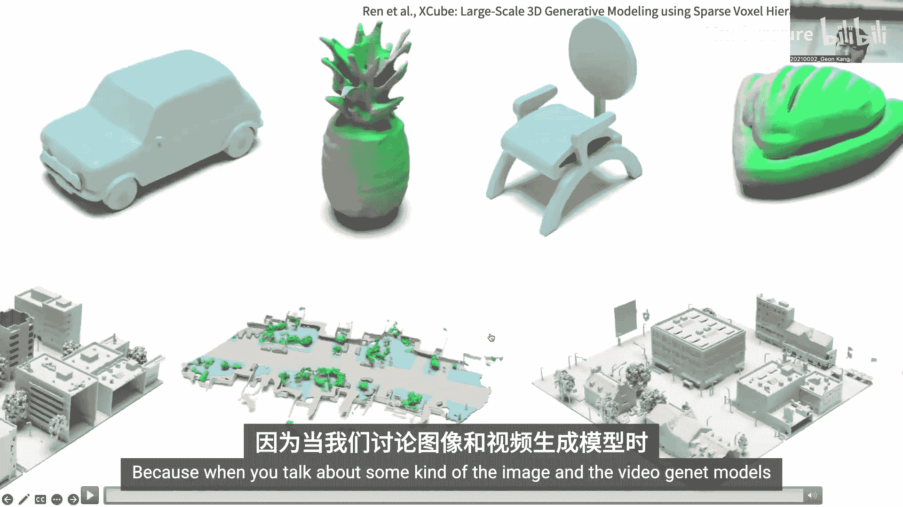

So compared to this kind of very huge scale of theイデさ what's the kind ofス scale of theデ set that we have for this data。

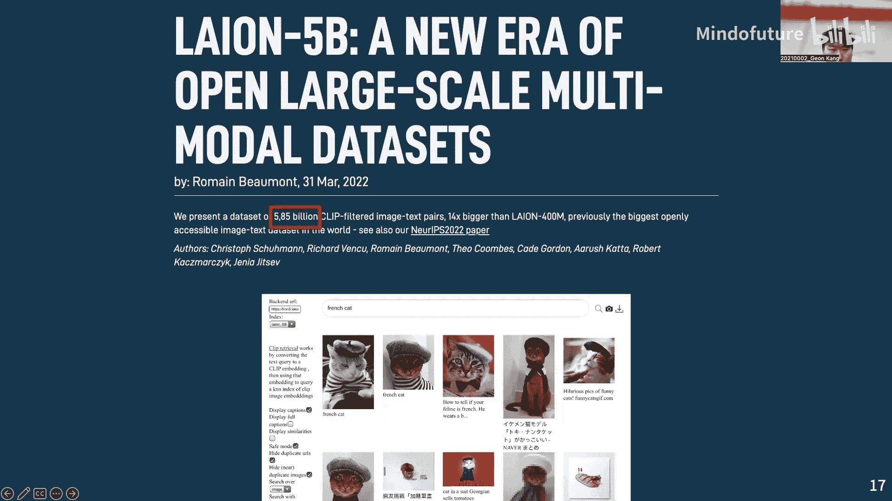

So compared to the image data set， actually the scale of the 3D data is very small。

 So when you talk about the which is the 2D data， which is like 5。

8 billion the typical kind of the3D data set that people using for the training the models is the 10 million。

 you can say that the scale is like much smooth。So the question is that can you make some kind of the 3D3 models that can really kind of like open up all some kind of creativity for the humans in terms of making some very random 3D chips？

It like many of the neural are just like memorizing some kind of the data that they have seen。

 which means that if we have some kind of like very small security data。

 then models might be able to see some very small discount scope of this3D data as well。

So basically what we want to do is that we want to have some kind of the 3D genetic models that can produce this kind of some sort of the you know imageable some3 shapes there's something that we can imagine right like something like before wearing the sweater and also the ghost eating in hamburger those are something that we can imagine but it's really hurt to basically imaging that we are having those kind of the 3D models in any kind of some online degree posts right。

So here the question is that how we can make some kind of these3D giant models that can have this level of the creativityivity。

 making some very random kind of3 chips。So for that。

 basically the idea that we are going to discuss for today is about how we are going to deliver some kind of the image data for the three de generations。

So the thing is that for the 3D data set， we are having a very small relatively small state of the 3D data set。

 but for the we are having the infinite scale of the D data set。

And what we know is that actually these are not two different types of the data。

 actually they are kind of the real in terms of the actually the images or the projection of the。

So know the question is that we need have some not lots of the 3D data。

 but only there are kind of projections based on the information of the the projections。

 how we can make the 3D data itself so that's kind of some interesting question here。

So this is kind of topic that we're going to discuss here。

 so can you say some kind of 3D objects given some kind of prior information about the two images？

And this is also kind of like philosophically aligned with this kind of the will be the proscape where the the pop is describing some people as kind of like only seeing some kind of projections with some kind of real things。

So when you have some kind of some real substance or some kind of the ideas that are basically being projected on the wall。

 we are only seeing this way， we are the people only seeing some kind of projections。

 but here the kind of question is that by only seeing this kind of projections。

 how as we imagine some kind of the real some kind of the ideas and the substance and also basically generating this kind of the data which is like corresponding into the substance。

So that's kind of the very fundamental question in terms of how we are going to there is some kind of the idea so some kind of different based on only on some kind of information for leak project。

So for that， actually what we are going to do is that we are going to playfully go over go back to the discussion for the nerve。

 so we discussed this idea for the new round。So and the basic idea for the new rendering was that especially having only the three of the parts the algorithm。

 so basically in between open nerve as you was implemented in the assessment。

 we see basically like rendering some nerve representation into some kind of arbitrary viewpoint right and we check whether the rendered output is a same we given the image from that view so we just check the kind of the difference between the rendered image and the given image and the minimize some kind of L to loss。

And we just run the basically of taking the need not three parameters based on somehow else to the be be specific。

So this was kind of a very basic idea for the North pipeline。

And we also have seen lots of some kind of the limitations of the nerve right best some kind of the issue with some kind of the slow de landing speed which has been resolved or really ga especially ideas and also is notcable and also can handle some di scenes and also lighting many other things。

And the issue that we are going to focus here is that the also requires the many images to make some kind of some follow be。

I guess many of you are also using this kind of notebook toolss for the rendering contest as or it might be having some kind of issues that when you don't have some kind of enough mobility theequ quality may not be difficult good。

So this is kind of the one of the limitations for the nerve in terms of that we need some lots of images to make some kind of the full3D output。

So the question is that how can you do some kind of the nerve reconstructioncon without having like 100 images。

 What we only have some like 10 images。We are about five images。

 where three images were even sort that。So if we basically want to do some kind ofcon we give very few number of images。

 we would need some kind of be more information right。

 some more kind of be let's get some extra information。

So the one idea in terms of basically doing some kind of in consumption with the few images is basically using some kind of depth in Boish。

So here the basic idea is that we are not only capturing the RGV recall language from each of the view。

 but we'll obviously get some kind of depth information as well。From each of the bill。

 we are basically having host the depth image and also the RGV image and we are basically some kind of the3D consumption based on the depth image first。

 and then that's including some kind of the color information based on the RGB。

 So this is kind of like more like you know direct away some of some more like the 3D information directly from the the input source。

But without like having these some types information。

 how can also provide kind of the extra information would be some kind of morecomp this the outputs？

So for that， like what we can do is that actually， this is kind of interesting idea in that we are going to incorporate some kind of text and image and similarity。

So here the point is there are some kind of the some some printing model， which is too weekly。

 How many of you heard about the model。すity400 pairs。

And the basic idea of the clip is that we are basically embedding all the texts and the image into some kind of height the deme this sphere。

 some kind of the embedding space in terms of the similarity between the image and the text and also the image and the image can be measured by the animal between the two over the time of the type sphere。

So basically this is kind of the pre model， which is giving some kind of information about some proximity or the similarity between the images and the text。

So based on that， what we can do。Is the the let thing about that we only have some kind of the like。

 for example， like three images for these like those are image， right？

Then what we can do is basically all if the images for this object should this object should be。

So what we do is that while we only have like three images for this object。

 we still like render this object from any random RV view。

And check whether the redberg image is a full due trade。How can it check difference？But see。

 what we can do is that we are render this of them from any view and making this image into the click in space and check the similarity with the distance in that in space。

And the basic idea is that from one review that we render this objects。

 we should university in the same way in the text。So that's just what can do。

 So the additional information that we are using here is about some kind of tax solicit for decision。

So we only have so images but still there's some kind of text jurisdiction。

 and using the text jurisdiction， we are not measuring the Lverse for now。

 but basically minimizing some kind of similarity with these test in some kind of depiction in the space。

So you can see that this is not changing any part of the nerve pipeline， everything is the same。

 right？The only thing we are changing is the lowest function。So for given the three this。

 we can still measure the error tools for some kind of the other perspective that we can have some kind of wrong tools images this。

 we still basically measure some kind of similar we text and minimize them。

But so by simply changing the loss function in the earth。

 we can do this kind of the text facing in kind of the 3D reconstruction reconstruction。Makes sense。

So this is kind of what the greatest idea until like 2021 in terms of the how we can do some kind of inertly reconstruction with a dear number of benefits。

And then how many limits to do we need for those kind of the？

So people tested with like five images and the three images and then like single image。

And then in the extreme case， actually what we can do is that even without any images。

 we can do some kind of in consort。Make sense So here the idea here is that now we just don't use any limits。

 just have some kind of text fiction， and then minimize some kind of the the base some kind of in rules from the older perspective。

Then and see like whether we can get some kind of sweet albums。

And these are some kind of examples that we can create by just select mini im click they to。

So we there are some kind of the loss of some engineering some techniques in terms of getting some kind of community offers。

 but still it's kind of making something like， even without like many images。

 it's just community constructing some kind of the offers。

So actually this was kind of the first example in terms of that we are now not reconstructing 3E but actually generating from sketch from the text without having any images。

You can see that there are some kind of being some very random outputpost like okay。

this is a arm arm in the ship would be our tongue。the shape of the pumpkin or some this this doesn't look really or was still like making some sort of imable some kind of video this is actually quite one interesting the example in terms of that now we can do not to just the three reconstruction。

 but actually three generation。By only having some kind of de2 image information？

So without any input damage。So this would kind of be one of the first attempts in terms that how we can do some kind of3D generation without taking some3ing for 2D products。

So the question is that then can you also use a image model instead of be quick？

So we are also seeing lots of the advance of the image thegenic models that we have seen in the computer slide。

 and can we use those models to replace the clip to measure some kind of the quality of the output。

But the basically the major the difference between the generator and the discimminator is that so what we need is basically not a generator。

 but actually discimminator。The difference between these two is that generator basically takes the kind of the text as the input and make it easy as the final of the output。

 So this is the very the scope。But actually what we want based on the nerve based on kind of a generation is that we need this kind of the architecture。

 painting host the text and the image to input and checking whether the these are aligned or not。

 that specific will be clear in the because the degeneration。

So here the question is that how we can convert a pretrained degenator into the dis。

In terms of them now we can take the all details and images people and see how much data display display was outlined and also how much the images that listed。

So this would be what we can do。So I'm not going to get into some details don't how we can really do this kind convert them from the generator to the disator for understanding that we need to have some more kind of background for the design models。

 but still what we can see is that especially basically using this same the kind of nerve pipeline but only changing this part。

So we are not basically checking some kind of the alignment with the render image with some kind of a given image。

 but checking this kind of alignment between the render image will be some kind of given text using the image of the models。

And based on that， now we can generate those kind of offers。

Actually these are not just kind of the easiest on kind of the3 apple。

 which others be generated using this kind of the pipelineyth。

So which means that using yourer code for the assignment two verse three。

 for the nerve for the Galusian split， if you slightly just like switch those function in a way that you can take some kind of realism。

 you can make those kind of offers。So the highlight of the idea here is while we are not having some kind of that much kind of information for this 3D。

 what we do is that we just like render each of these 3D objects the two images。

 which is very meaning that we are having some kind of mapping from the 3D words into 2D words then using our de generator we are using that as kind of a disator。

 checking whether the output is really one or two things， the real these inches or。

And giving and then we are sending some kind of feedback into the3D object。

 using some kind of berambling equation and also kind of back package。

And also the point is that we can apply this kind of the idea， not only only for 3D。

 but many other things that can be rendered on the including。

And some of the examples that we can also create using this kind of the idea is that for example。

 like those kind of the back is。And those kind of some kind of some kind of base kind of images for those of some defect graphics。

 those are not some kind of the having some kind of per pixel colors having some kind of the more software informations with these closer and many other things and also it's multi be possible that we can program some kind of the5 billion those kind of defect in right and what we can do is that we can apply some kind of same technique in terms of that we do some kind of the render with those effectiveness into typical kind of de and we can apply the same idea terms of of kind of activities for。

And those be sketches as well。And if you want to try this kind of idea。

 actually you can find out this website， which is you can see that this really combines some kind of existing some kind of the nerve based and light。

 it some kind of the imaging models in terms of the we can do some kind of three integration not really。

And question on this。Then what we kind of the downside if we do some kind of Swish generation in this way。

온 뉴스2기 인포ネ션 권리 수익션。Loly some kind of the typical kind of the problems or issues。Youconence， youcon。

 we are， can we learn one things。It's good point。Other issues。Tpan Japanese from the geometric yeah。

 that's also really hard to learn from the putie price。Any other kind of issues？F bus。I nice but。

你咩十系你个 그거做 거。Some parts can fully by together。But can some result by just taking lots of reviews from we all around the by just checking some kind of theism。

One of the kind of problem that we can typically see for this re generation in this way is this problem。

Let me， please。Do you see the proper？Let me play this手机。So every individual view， it looks okay。

 right， But if you start to rotate that， you can see that。ItDoesn't make sense， right。

 actually having。t two or three phases or basiss， so this is the problem which is called thean problem because like the anti you see like I guess a multily fixed0 basis for the characterss。

 but also for the other the。So there are lot of techniques to resolve this kind of issue。

 but still we are having some kind of problems like hitting some holding inside we having some kind of tool part keep us So yeah there are lots of kind of issues So still this means means that like using the only the 2D information for the 3 consumption may not be sufficient in terms of the still face this kind of challenges So still there are kind of the long way to go in terms of that how we are going to make some very realistic some3 offers using this kind of limited amount of3D data。

So there are also lots of the attempts are in terms of like how know that people are directly training a models are。

Every grand creation begins with a spark， but it's the relentless hustle that turns that idea into reality。

Introducing clayy， a controllable large scale generative model。

 narrows the gap between imagination and 3D creation。Trained on an extensive 3D data set。

 Clay features a 1。5b geometry model and a 1B material model within a minute clayy can generate detailed 3D assets with PBR materials adaptable to various conditions from text。

 image to 3D。

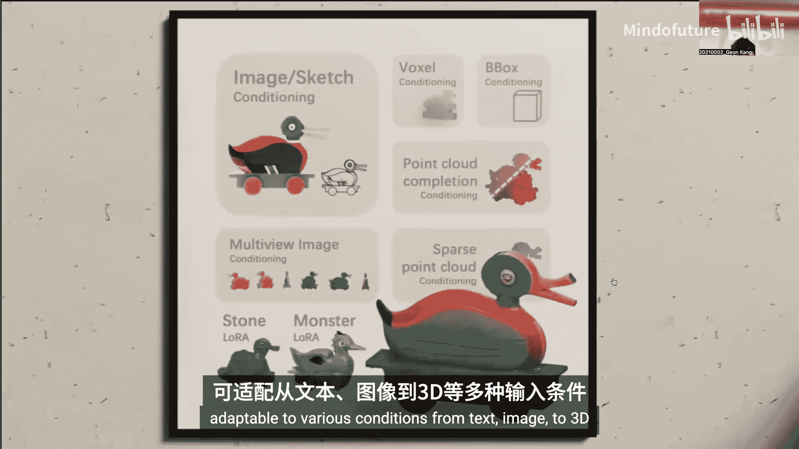

Yeah， so this is the model which was developed by the tech university and you can that so they also use the side of the data to make some kind of thing3 and typically may kind of be some game companies are very much interesting doing this kind of content generation using some kind of general models one of the company who is really fast making this general。

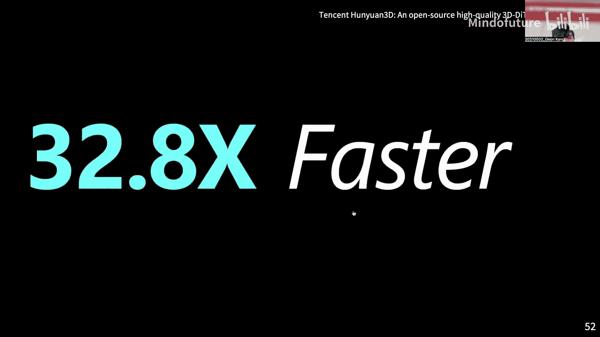

嗯。你。你没说。

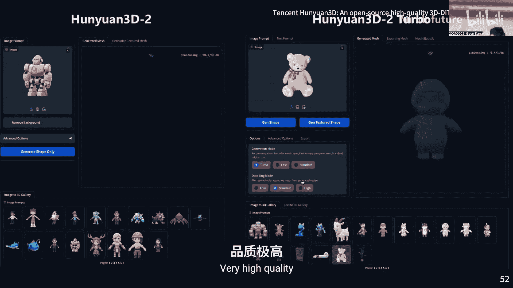

。は。いたい。

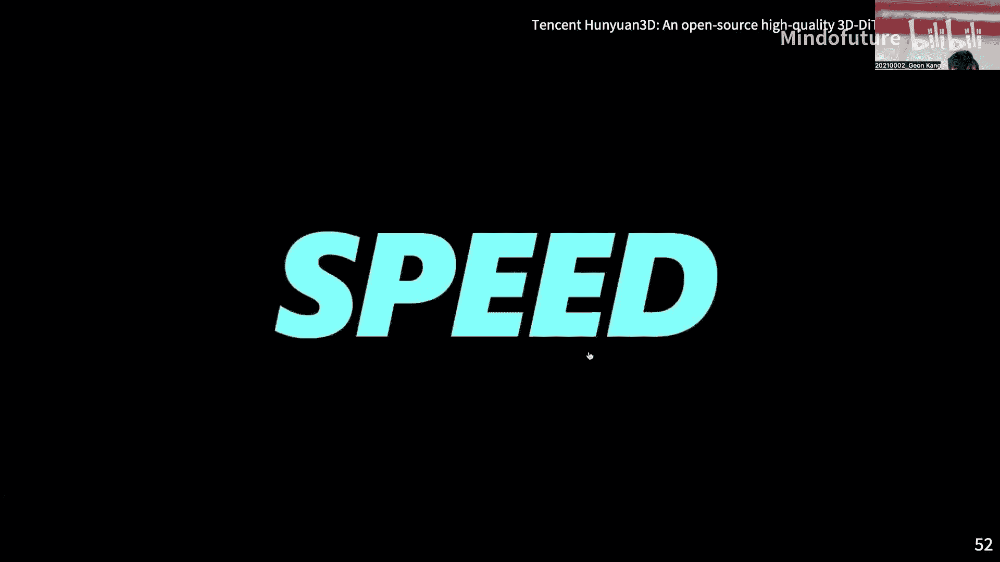

思います你は。

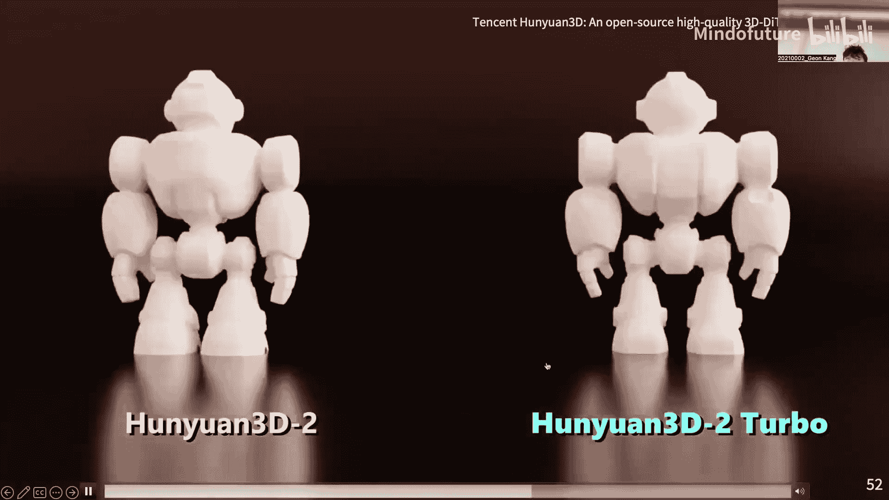

So yeah， you can really just like Google put you on 3D and see some kind of model and see the quality like this So we are seeing some kind of those kind of advance of the 3D generation techniques in terms of making some3 models directly from the large scale of the 3 data or doing some kind of the knowledge distort from some kind of imageide models in terms of so making some more diverse output。

So I guess we are going to see some more kind of some combinations of like just strictly using some3 data set and also utilizing some kind of knowledge from the 2D image and the video and models in terms of like making some high quality and also diverse other levels。

Speaking to some kind of the ideas about like knowledge distort。

 actually there are some kind of the moral techniques terms not only making some kind of3 models and doing something more in terms of the editing for example。

 so using some kind of some models we can do not only generation or doing some kind of the editing this construction and basically using some kind of points we are making some kind of the changes like this。

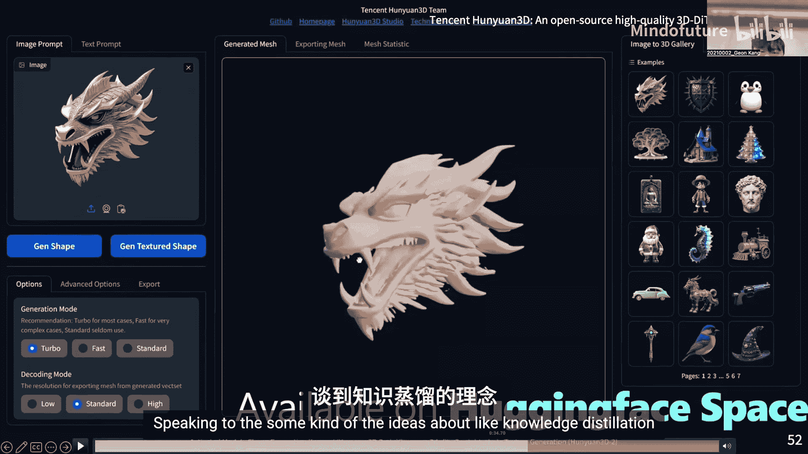

And some more examples。Yeah， this is example converting our the r。嗯。Yeah。

 these are also not reconstruction consumption example that we are adding some kind of projects inside the see without doing any kind of the direct manipulations。

And we also briefly discussed the idea of domesticmetricform and the idea that we discussed last time was mostly about some deformation based on some kind of geometric So which means that when we try to basically make all deform as as possible were going see both kind of might be kind of in terms of the geometric perspective。

 but more kind of semantic perspective， we know that this is kind of wrong the should be fixed this is more about some that the geometric information。

 some kind of some kind of priors that we so we can consider doing some kind of recification some kind of pre genetic models in terms of fixing those kind of wrong formation。

So this is a so example。And this kind of some knowledge disation can also be applied not only for the3D generation。

 but also for any other types of some visual content generation。

 they can be used for some kind of the making some very wide the panoramic images as well。

So let me skip some details here。And yeah， it can be also used for making some 3600 panoric images。

And also making some kind of some co emissions and des over some kind of given these reality。

those are some kind of examples。So this is kind of some high ideas in terms of how we can make some kind of the3D models and also how we can utilize some kind of the pretrained de models for making some very different kind of things so if you are more interesting for those kind of topics。

 actually what I'm going to teach for the next person semester about though we can consider basically taking this course and discuss some kind of different models as well。

So this is the very highle ideas for the three generation。

 so actually we cannot get into any because for discussing this three generation。

 there will be more details need another so lets so you could basically also take this course and you're going see that how these ideas think you also combined with in in some kind of the more interesting some three generation。

Yeah。Okay， so that's the end of the press。 We thank you for your participation。嗯，别风微微不是。Yeah。

 so before we move on to some kind of be。

对。