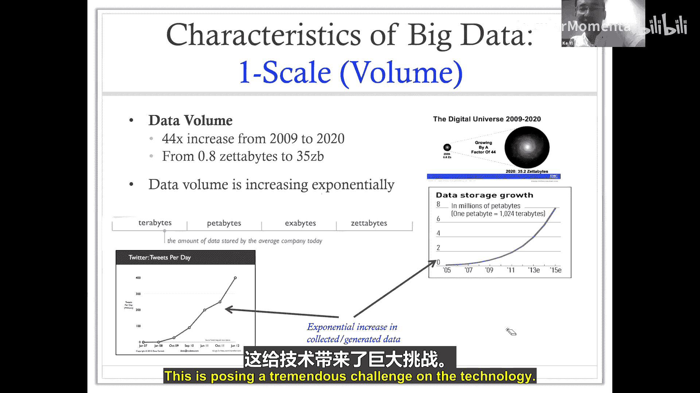
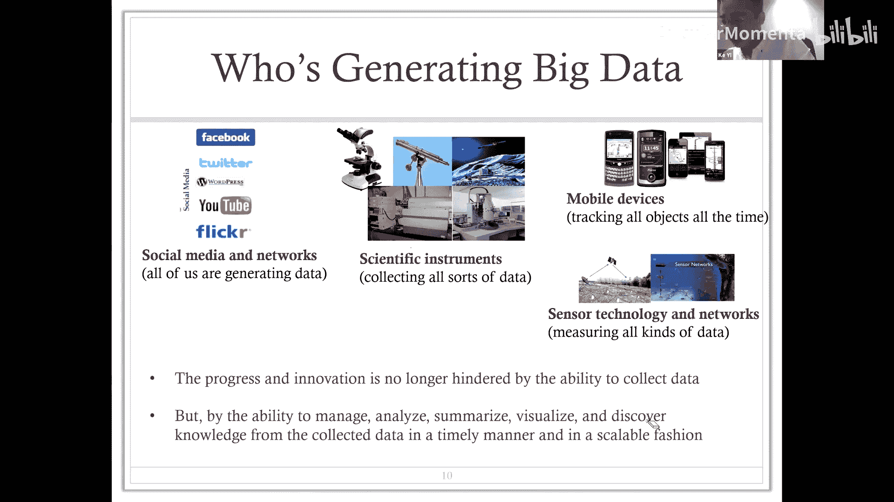
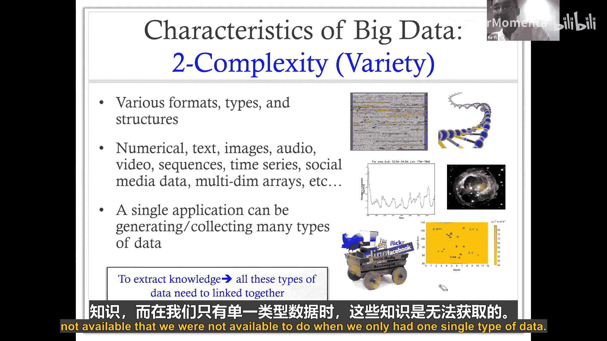
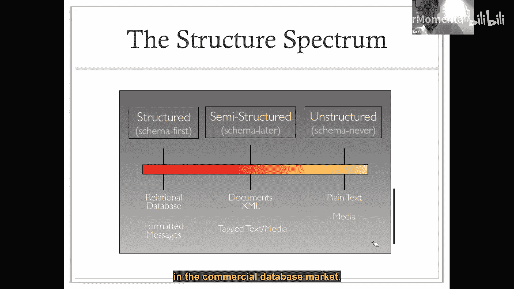
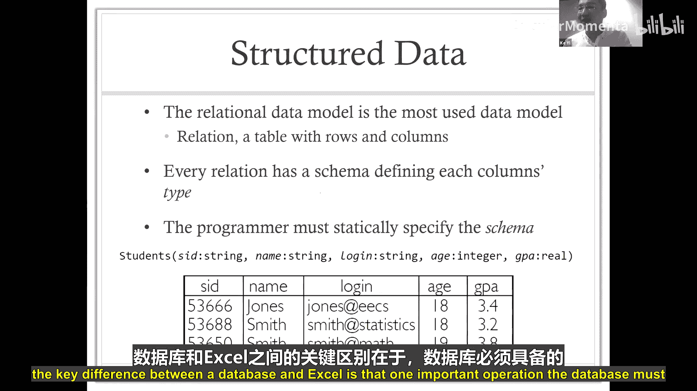
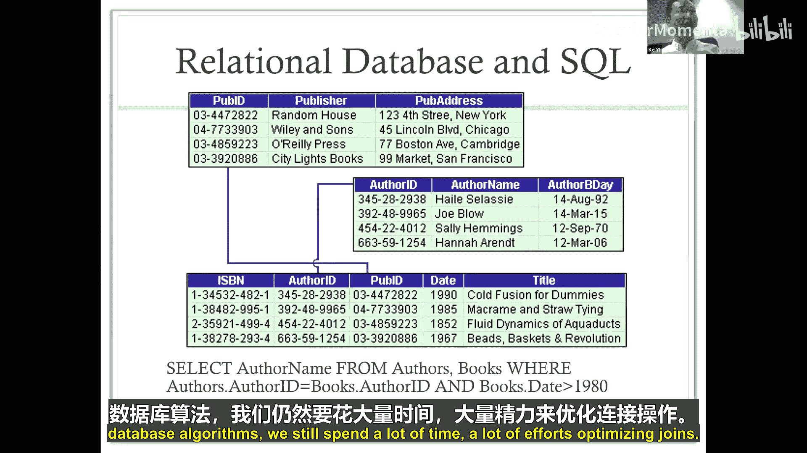
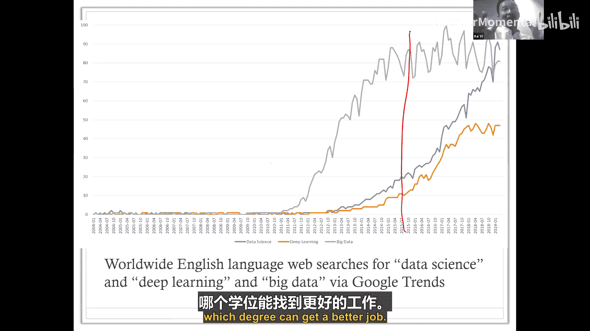

# 【香港科技大学】基于Spark的大数据计算--Big-Data-Computing-with-Spark-p01-03-01-03-大数据数据量--BV1V8FmzuEHf_p1-

So what is big data after all， I think during the first lecture I'm going to spend a few minutes discussing what is big data and what。

Properties and characteristics are。Do that big data is big data supposed to possess。Alright。

 so so in fact， you know different people can come up with different definitions of big data。

 there's really no single standard definition。 If you look up on Wikipedia they have this kind of definition which to me as someone who whose research is more theoretical。

 I don't think this is a very good definition if you look at Wikipedia it says you know big data is any data set or data whose scale complexity and speed require new architecture techniques。

 algorithms and analytics to manage it and extract value and hidden knowledge from it I'm saying this is not a good definition because know this new thing。

 this new architecture is ambiguous and and further。

 this definition essentially makes big data moving target that you can never catch because。

We have this kind of these kind of new architecture techniques and algorithms and analytics。

 Then these kind of data set will no longer become will no longer be considered big by this definition。

 So you will we will never have will never be able to manage big data Okay so this is not really a good definition per se。

 However， it does offer some perspective or some characteristic of one big data may look like。

 So indeed probably you have heard of this3 v characteristicization of big data name volume。

Variety and velocity。 Okay， so indeed， these three V are。

Outline the most important properties of big data。 Okay， the first D value。

 I think there's really nothing more to say about it。

 And everyone is is realizing that the scale of data has been increasing tremendously in the past to decades to to decades。

 you know， moving from megabytes or terabyte to gig gig by to terabytes。 Okay。

 so what is more concerning is actually the speed at which data is growing and which is exponential。

 So so not only the absolute value， but also the relative speed at which data sets are increasing this is posing a tremendous challenge on the technology。

So the fundamental reason why why we are having a lot of so much data nowadays is the model of generating consuming data has changed in the in the in the early days when we people do business or scientific research。

 the model is that a few players， a few companies or。Research labs。

 they can be they were generating data potentially at a pretty high speed。 However。

 only there were only a few of them。 Most of the other users。

 players in the field are were consumers， for example， you know。

 a few research labs that have very expensive devices that can they can generate data they can perform experiments and all the other scientists will consume the data Okay。

 the same thing happens in the business world only a few businesses were generating data and all the other were consumers。

However， now and the new law model。All of us are consumers and generators at the same time。 So。

 you know， because， you know， I've especially in the mobile Internet age， everyone has a cell phone。

 you know， this cell phone can implicitly or explicitly collecting your personal data。

 no matter whether it is time， location， you know， text， video， audio。

 all these data can keep being collected。 And at the same time， we we are also consumers。We are not。

 although we may not be consuming the data directly， However。

 all this data will be sent to these big data companies。

 which will analyze data and then then pushed the results and push extra knowledge and push the results back to all of us。

 So we are both consumers and generators at the same time。

 So that's essentially the new model that data is being generated。 So therefore。

 this has this has fundamentally changed the data， the data generation and consumption model。

 which is one of the main reasons why we are having so much data nowadays。Okay。

 so here are just some examples that are examples that are generating a lot of data， you know。

 social media networks。 this is refers to all of every one of us we are generating data in social media as well social networks research know as instruments gets more and more sophisticated and their technologies advance。

 they are collecting also the all sorts of data at a very at a much higher speed than they used to be so these mobile devices。

 as mentioned， and they are also collecting our data and tracking all the objects all the time know and sensor sensor networks like the Internet of things and I think the vision is that with IPV6 every device can have IP address and which can be interconnected they are。

They can be all measuringing all kinds of data all the time。

 So the progress and innovation is no longer hindered by the ability to collect data。

 but by the ability to， by the ability to manage， analyze， summarize。

 visualize and discover knowledge from the collect data in a timely manner and scalable fashion。

 which is essentially the main your motivation， I think for you guys to join this program to learn about these new ways that are emerging for to。

 which can help us manage， analyze， summarize， and discover knowledge from data okay。So however。

 so although you know， big data seems to be this new buzzword that has been getting more and more popular in the last 2020 years。

 However， in my personal opinion， none of the threes is really new because as mentioned we have this conference VDB。

 very large database conference that this conference was started in in the 1961970s。

 So that's 30 years，30 years before this big data word was coined。

 So therefore the ament of data getting larger and larger was there。

 the motivation was there long time ago。 the same thing happens with second B variety So here variety refers to complexity。

 namely refers to all kinds of formats， types and structures the data can then data can have So this can。

Rrench from numerical data， which is， you know。Which is there， you know。

 since since since day one and text， which is becoming more and more popular in the social media age。

 images， audio， video sequences， time series， social media data multidimensionally arrays Okay So again。

 all of this data types。 They have been already extensively studied in the literature。

Long before the war big data was invented。 Okay， numerical data， of course， no， no problem， you know。

 sequence data， time series data， you know， the biologist or the data scientists。

 they have been studying this time series data for a long time。

 right I think as as when stock market was invented。

 people were already studying various ways of analyzing and managing time series data。 Okay。

 market the dimensionia arrays， of course， in scientific research in in mathematics people spent。

 you know。Decades on it all already。 So each in each of these data types， is really nothing new。

 right， So it has been there for long before we have this word big data。 However。

 I think the new thing here is that nowadays because of technology advance improvement。

 now we are able to。Generate and collect all these different types of data in one single application。

 Okay so I think this is a new thing the synergy。 its。

 it's actually not because we have the motivation。 Its more we。

 it's because we now we have new technology。 So now we are able to you know。

 link all these different different types together serving for a single unified purpose。

 I think that's the really the new thing here。 Okay， well， you know， this is subjective。

 You may also call it new or be not new because the new is really a combination of existing techniques。

 existing ideas。 data to manage these different types of data。😊，Okay， but anyhow。

 I think the consequence is， the consequence is huge， right。

 because now we are able to link all these type of data to extract knowledge that were that was not available that that we were not able to were not available to do when we only had one single type of data。

😊。

Okay， so so at this point， I need to introduce this structure spectrum。 we talk a lot。 we talk about。

 we mentioned a lot of data types and these data types can largely partitioned into three different data types。

 according to how structure they are。From one extreme from one extreme in the spectrum。

 we had structure data。 So here we are mostly talking about relational database。

 So this is really the classical data model。 So the relational model was invented by caught in the 1960s。

 and he actually received a tooling award for his invention。 Even today， you know， structured data。

 relational database is still dominating the database world in terms of the market share。

 I'm now saying that it dominates。The market， in terms of。Amount of data。 So actually。

 if you look at if you， if you， if， if we consider the the， the size of data。Unstructured data。

 theres， there's more of them because because you know， video audios。

 they can can easily be much larger。 However， the most valuable data is still structured。

 They are still stored in relational databases。 Okay。

 Oracle is still the number one is dominating player in this in this market in the database in the commercial database market。

Okay， so just I think you should not be unfamiliar with structured data。 Okay， or relational data。

 Okay， even if you haven't used a database before， you must be familiar with some spreadsheet application like Excel。

 Okay， however， strict speaking， a spreadsheet application like Excel is not a database。 Okay。

 it lacks many of the important features。 A database should have。 But anyway， on the surface。

Epress it。Is like a database。 It's like a relation relational。 It's like a relation。 Okay。

 a relation table， a relational table in a relational database， namely， it has a predefined columns。

 Okay every column has a name， for example， here。So we have S I D， which is a string。

 and name is a string and age， in and et cetera。 So all these columns are predefin。

 which collectively are is known， which collectively are known as the schema。 Okay。

 the schema of the relation， Okay， so。This includes both the name column， as well as the type。

So a important feature of structured data is that this scheme must be predefined。 Okay， so。

 although it's by predefin， I do not mean that they cannot。 They cannot change。 They can。

Except that changing the columns will be expensive。 So a database。

 a written database does not expect the。Table to change a schema too often。 In fact。

 changing the schema， adding a column or deleting column can be very expensive。

 So that's why we say that this schema should be predefined。

 So that's why we that's the reason we call it structure。

 right structure there already before we have data。 schema first data second。 Okay。

 so once we have a schema once we have all the columns defined。

 then we can start throwing data into the database。 Okay， so the row， So each each row。

 which is also called tuple in the relational world。 these are dynamic。

 you can insert delete rows to the database very efficiently。

 so this is what relation databases are good at。 Okay。

 so the insert de of rows is very efficient but not the columns。 not。Okay啊。So。Of course， the。

 as I mentioned， the， the key difference between a database and Excel is that。

One important operation the database must have is this thing is this operation called In。

 Okay So this is actually one this is the main reason this， this model has been so successful。

 and the inventor was awarded the touring award。 Okay， the idea is， you know。

 you don't want to store oil oil data into one table。 Okay。

 you want to separate your data into several different tables or several different relations。

 And then you link them together by what we call key constraints。 Okay， or foreign key constraint。

 So here， let's look at a concrete example。 And this is actually a very typical database design。

 This is known as the star schema。 Okay， by star schema。

 I would mean that we have one table in the middle。

 the middle star and then have some arms of the star。So in this example。

 the middle relation is the is this is this one。 Okay， so this。

Suppose this database is a database about about books。 Okay， about books。 So the main， the center。

 the center table contains the information about all the books。 This database maintains。

 So we have the title of the book。 date of the publication。

 IBN is the the source of the unique I D of the book。

And then we also have the author and publisher information。However， know that it's inefficient。

 it is redundant to store all the author information in this center table because suppose if if one author very proliferate。

 he has author 100 publication100 books。 then all his information， you know including name， birthday。

 maybe phone number address， you know et ce， they will have to be duplicated 100 times which is a lot of redundancy So the key idea in relation in the relational model is that to separate these two pieces of data。

 Okay so in the center table， which is also called fact table in the fact table。

 we only have the ID of the author and the rest the other attributes。

 the other columns of the author will be stored in the author table Okay so there。あ。

The all authors will be unique in the author table， however。

 they may appear multiple times in the books table， which is fine because。

 you know even in that case， even if author has100 books。

 only his I D is duplicated100 times So this actually the key idea in relational database design。

 Okay， so not this not only removes redundancy， it actually lowers maintenance cost because suppose。

 you know， the author decides to change his birthday for example， which is not realistic。

 but let's say the author wants to change his address or phone number。

 then if we if if we if we had store all information about the author in the book table。

 then when the author updates his phone number， we would have to update 100 records so this is a lot of work。

This is very very bad because， you know especially in a multius environment。

 whenever you want to modify something， you need to have you need to lock it will be talking about parallel algorithm parallel processing in a moment。

 This can be quite expensive because locking a table or even locking a role。

 we eliminate the possibility of allowing other users to access it so you don't want to log too many too many tables too many roles。

 So however， if we separated the author' other information from the main from the center fact table。

 then updating author author's address or phone number can be very easy very easy。 Only one table。

 one row one column needs to be updated。So similarly， for the publisher information in the fact。

 in the center fact table， we only store the I D of the publisher。

 whereas all the the other information will be stored in the publisher table。 Okay and then this。

 I'm sorry， and then there is a link。 this is known as a foreign key link or foreign key constraint linking with two columns。

 So typically， you know， we use the same kind of name， referring to this foreign key linkage。

 in particular， we require this is the foreign key constraint。 This means that every I D。

 every pop I D。Every pub I D that appears in the fact table must also appear in the in the in this。

 this， this is called dimension table。The leaf table， this make sense， right， You cannot have。

A book with a publisher that doesn't exist。 So this is known as a foreign key construct。Anyway。

 we will also be talking about all these relational database jargons later on when we when we when we get to that point。

 So here by anywhere here， I'm just giving you， giving you overview of。

 of the data type spectrum and this example of a structure data。Okay。

 so the benefit of separating data into multiple tables is that， you know， as mentioned。

 lowers redundancy lowers maintenance costs。 However， when we want to query data。

 when we want to ask questions about data。 then we need to link them together。 Okay。

 so this is known as a drawing operation。 Okay， and and in SQL， we can write things like this。 Okay。

 so if you don't know about SQL， we we stand sometime maybe have a lecture doing a quick review on SQL when we when we come to when we when we are when we are when we go to that point。

 but anyhow， SQL is one of the simplest programming languages。 Okay， it's widely used。

 It's very intuitive。 It's very close to national language。So the this query says I want select。

 select means I want this attribute。 I want all the author names from these two tables。

 authors books， where the following conditions are met。

 The first condition is that the author's tables author I D column must be equal to the books tables of the I D column。

 So namely this。This color must match this column。 And second， I want all the。

 I want the date of the books table to be greater than 1980。 Okay。

 so this query essentially asks for all the author names。

All the the names of all authors who have published books。After 1980 after 1980。

 So this is what this this this is all about。 However， this is this is if you really run it， okay。

 if the if one author has published two books after 191980， it will be returned twice。

 so this is known as the the bag semantics of SQL， So if we if you want to remove the duplicate。

 which you can add a distinct keyword in front of author name。

 but anyway will get to that point any how the point here is that you know although separating data into different relations。

 lowers redundancy lower maintenance cost， it does make query processing more complicated。

 So we need to link or join data from different tables together。

So this is also why joint operation is one of the most extensive。

But important operations in relational databases。 And we will actually， as we move into course。

 we will spend a lot of time actually talking about how joins are processed。

 how to process joinquiries efficiently and even as as of today， you know， if you work in this area。

 which is， which is also my area， my area， database algorithms， We still spend a lot of time。

 a lot of efforts optimizing joints。

Okay。Right， yeah， so as mentioned only 20% data structured， however。

 and this is then this percentage is decreasing due to consumer applications。

 enterprise search media applications because this more new data types or new generate data generators。

 they tend to generate uncertain data， for example。

 social social media when you issue a post when you write a post， it has text。

 images and maybe audios， right you never write a role in the relational table right。So rigorous。

 You will never write things as rigorous as that。 Okay， so that's reason why。

 we have more unstructured data。 Okay however， you know， as I mentioned， you know。

 its this unstructured data actually contains less information。

 So is a term we use called information density。 So although this theres a lot of unstructure a lot more unstructured data。

 the information density， Okay， is much lower than structured data。

 although the structured data is small in terms of in terms of data size。

 the density information density is much higher。 Okay， that's why you know。

 relation data is still plays a very important role in this in this area。Okay。

 this is also why people want to combine， you know。Want to get the best of both worlds， Naly， can we。

 you know， have， can we， you somehow make this unstructure data a， little bit more structured。 Okay。

 however， we cannot really completely make them。We cannot completely inform structure。 for example。

 social media data， which is。Inherly unstructured。 Okay， however， we still， we want to somehow。

 you know， use our existing technology on relation data on structured data to manage this unstructured data。

 Okay， so therefore， something in the middle somehow as a compromise has been proposed and has been。

Invested a lot。 So this is known as semi structure data。 Okay， okay， again， this is really。

 this is not something new。 Okay， before Jason， which is now popular X M L L or even before X L is H and L。

 all these X M L files， they can be considered as semi structure data。 Okay and X M L L， actually。

 X M L was a very hot topic in the 1990s in the database。So here well by anyway。

 structurally X now is very similar to JOs here is one example I'm I'm not going to give you the formal definition which of course you can read yourself。

 you can read the specification of a JO bio but anyway。

 this example hopefully can give you some idea of how of what of what we mean by semi structured data Okay so it's so。

On one hand， on the one hand， it has this structure。 right， namely。

 this is one row or one typo in this one row， we have different columns。So for example， first name。

 last name is live age。 They are。 these are column names， and these are the values of the column。

 Okay， however， it is oh， it is。Also richer than a than than a rigorous relation than the file relation。

 because you can have this nested fields。 for example， address。 It has four subfields。

 straight address， city state and postcode and phone numbers。 So this is using a square bracket。

 Okay， a square bracket essentially means that these three phone numbers are ordered。 Okay。

 if we have we have a cur brackets dismissed means that they are unored。

 and here phone number they are， they are they are ordered So this is actually a list。 So namely。

 you can in bed both set and both un ordered and order list into a adjacent object。

 And this can be nested arbitrary。 so this。Is a richer。

 a more flexible model than than a rigorous relational data model。Okay， further。

 another important property of se data is that， you know， you can if this is a tupo。 Okay。

 this is a tupo。 The Tpo has both the name structures， the name the columns as well as the values。

 So it's essentially it it merges both the schema and data into into one place。 So， so， so。

 so therefore， you don't really have to define a schema in advance。 schema can。

Come together with the data。 Okay， so more importantly， which is not showing in example。 if we。

 if we have multipleson files， Okay， they don't， They can be put into the same database。Well。

 they don't have to have the same same columns。 Okay， in a relational database， you know， all rows。

 maps have the same column。Same set columns if you don't have a value。

 if if one typo doesn't have a value for one one column。

Its the column must be still there except that， you know， you have to put this thing now there。 Okay。

 so now is' a special value in in database the columns must be there for for alltypos。

 Okay if you if you don't have value， you put now there。 Okay， however。

 this is not the case for Json。 So for Json So different Json files in the same database in the same table can have very different colorss。

 Okay， so this gives a lot more flexibility。For example， you know。Another person may have。

In its address field， it may not have a state instead it may have something like province or village or whatever so different types of that have different con names Okay so that's actually very important so important property of7 structure。

However， you know， this flexibility also comes with some cost。 So it's very it's very natural to。

To see that， you know if。The J sound files had very different schema。

 Then the efficiency of of processing this very different J files will be will be affected。 Okay。

 so the processing will be more efficient if all sound files have very similar structure。 However。

 this is not required。 Okay， so essentially semi structure data。

Can give you a very flexible point on this trade off between between structure and efficiency。

So you can hear if。In one stream， the visual data is highly structured， Its very less flexibility。

 but it also has the best performance。Unstructure data， no structure， a lot of flexibility。

 but efficiency is also low。Sa data somewhere in between。

 so you can can give you a a啊 it can it can give you a smooth trade off。So which is a very important。

 a very nice feature。 Okay， so this is the reason why， you know。

 sy data are becoming more and more popular in today's big data landscape。Okay。

 so the last V is velocity so essentially refers to streaming data Okay so again。

 this is nothing new Okay， streaming algorithms was invented in the 1980s in the late 1980s so starting from 1980s people already spent a lot of efforts investigating streaming algorithms and then also build streaming systems。

呃。So however， I think in the big data era， it's， again。

 the applications that are really driving more improvement， more study。

 more investment on how to handle streaming data。 Okay although most of the algorithms we use on streaming data were invented long time ago。

 but we currently we now have better and more efficient systems that can integrate all these algorithm together。

 Okay in fact， in the towards the end of the course。

 we will be spending one on two lectures talking about streaming systems like streaming and Flink。

And Kafka， okay。So right， yeah。 Okay， These three B are the but the most important ones。 Of course。

 you know， people always get creative， you know。By essentially by trying to find more of more words that starts with the V。

AVacity is another word， essentially， it means uncertainty and inconsistent and incomple incompleness。

 Okay， so in in this course， we will be focusing on the first three V。

 which are the most fundamental properties。 The last one is also important。 However。

 this is beyond the scope of its course， because， you know。

 dealing with uncertainty incompleness and ambiguity， this is more related to date to modeling。 Okay。

 or， or。Or knowledge， knowledge discovery or or learning。

 So so this will be covered in other courses， like data mining or machine learning or or AI。 Okay。

 this course， we're gonna focus on the first three aspects， Okay， so in some sense。

 this course is a is a how is tells you how the other course tell you what name what you want to do。

 what model to use。 what algorithms is appropriate for a certain application。 And in this course。

 our job， our focus is to。Is， is， is how to make it scalable。 how to run it on， let's say。

ter base of data and how to make use of the computing resources in the cloud and。

Running your algorithm， running your chosen algorithms efficiently。

 So we will not discuss why we want to use it。 these， these are the objectives of other courses。Okay。

 essentiallyly is it's given now with。 Okay， don't ask why the algorithm is designed this way。

 We just want to make it more scalable okay。All right， so yeah， so to summarize my personal opinion。

 none of the these is really new， so each had been studied before the To big was coined。To me。

 this is more like a marketing term， it draws attention。

 popularity draws funding and draws students like you guys the application number for this program has been growing steadily for the past four years。

啊。But anyhow， it's exactly due to its。Due to its。Due due to this this marketing， you know。

 phenomenon that we are able to that that we are able to invent new technologies， you know。

 motivate this drive。 Okay， we are able to syntheize all these technologies in support for all the all the needs we are able to integrate all the techniques you know。

 into one single application to。😊，Be able to accomplish something that we were not able to。

 we were not that we were not able to in the past。Okay， so having talk about this， you know。People。

 so in the recent two years。 Okay， the other another word data science seems to getting more and more popular。

 Okay， so this program was， was was created。4 years ago，2016。 So if you look at 2016。 Okay。

 so at that at that time， big data was clearly the。Winner， okay， there was a large gap。

 So if we were to create this program this year， probably we're gonna use data science。 Okay， so。

 in fact， Hong Kong you has created a similar program， and their program was is called data science。

 Master of science。 Master of science， LC in the data science。 Okay。

 and that was created after our program。 Okay， however。You know， don't worry too much。 So know this。

 this really。Little difference between these two terms in terms of the technology content。

 it all depends on which background you have， which community you are coming from。 Okay。

 so big data was。Was used more by camera scientists。 Okay， this is also a reason why this program。

 B D T is hosted by C S。 Okay so camera science like the were big data。 Okay， because it focuses on。

on the C S side， the data science people。 the data science。

 this word was driven essentially by staisticians。 Okay， so this people they。Don't like big data。

 They don't like its word。 So they want to have their own words。

 And this is also why Hong Kong use program MS program is hosted by the statistics department。 Okay。

 all depends on whom you are talking to。 However， in terms of technology content really。

 this little difference。 Indeed， if you look at the curriculum of the two programs。

 they be big data and data science， you can hardly tell difference。

 So I think the the more than 80% of the courses are the same。

Maybe they have slightly more courses on statistics。

 We have slightly more courses from on computer science。 Okay， however。

 the majority will be the same。 right so， so， so don't get。

Too concerned about you know which one is more popular， which one which degree can get a better job。

 really really no difference。

