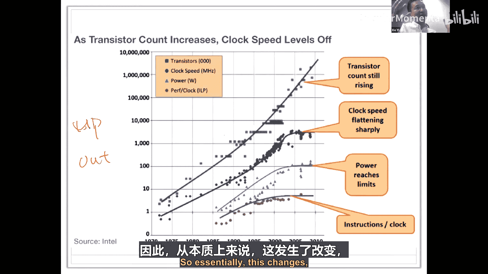
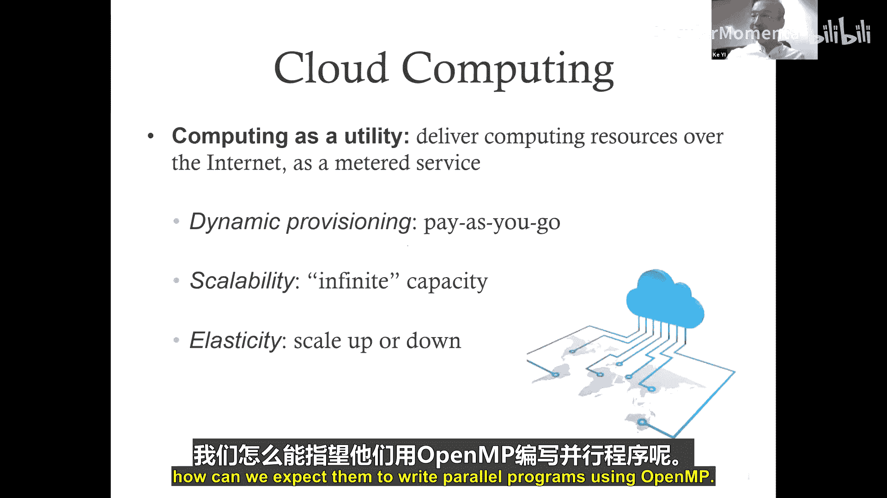
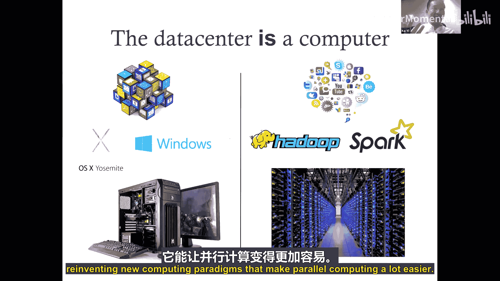

# 【香港科技大学】基于Spark的大数据计算--Big-Data-Computing-with-Spark-p02-03-02-02-并行编程的困境--BV1V8FmzuEHf_p2-

Alright， so how do， how do we handle big data So in terms of the technology， So one important。

One important。Technology barrier that we have been facing in this， in this， in this field is that。

 you know， if you look at the raw speed of processor， CPU process， we are hitting the physical limit。

 Okay， so this start to happen。Around 2005。So if you look at the， the blue curve。 Okay。

 the the dark blue curve， this is that， that's the clock speed。

It started to flat to flatten around 2005， although the transistor can't。

Is what has still has been rising。 Okay， so essentially。

 we are hitting the physical limit of of pushing speed so it's。Actually。

 not because it's not because people cannot do it。It's， it's all about economy because， you know。

 as you push。Proces is speed higher。The。Power consumption is just not proportional you can save consume a lot more power。

 and more importantly， it generates a lot more heat。 Okay， so actually。

 the heat problem becomes a major problem right for high performance high performance performance computing。

 So people are spend more more energy including a system that that the energy spent on doing the actual computing。

 which is not which is ironic。 so therefore， economical speaking is not good。

 is not beneficial to you know， to reach speed higher than3 than let's say， let's say 3 gig。

 Okay so that's why for most CPU process speeds you know， it's below33 gig。 However。

 on the other hand， we have。Mle cores， like you can easily your cell phone may easily have four core or 8 cores。

 A desktop may can easily have 16 core or more。 and GPs a single GPU may have thousands of core。

 Okay， and then eventually we can move to a cluster of computers。

 cluster of 1 hundred computers where every computer can have multiple CPUus with multiple cores and GP is with0 core。

 So the amount of parallelism is just tremendous。 Okay， so。😊，So， so， so essentially。

 that's the more economical way of scaling computation。 So， in fact， this。

 there's a slightly difference between two words scaling up。 Okay， scaling up and scaling out， okay。

 so scaling up refers to， you know。Increasing CPU speed。

 single CPU speed and scaling out means you know， keep the safe， keep the safe speed， but。

Scaling out by by using more core， Okay， more more core， right， as someone mentioned， Moore's law。

 indeed， I think I still remember one issue in communication AM。

 which is a flagship magazine in our community， the front page。 I think around 2010。

 there's a front page cover story， says Moore's law is dead， which is。

 unfortunately more more or less true。 So Moore's law refers to the phenomenon that， you know。

 CPU speed doubles every 18 months。 So this has been more or less correct。Until 2005， Okay。

 after 2005， this exponential growth of CPU speed is no longer sustainable。

 again so people declare the death of Moores law。Okay。

 so essentially this changes so this fundamentally changes people how people should think about computation。

 because when Moore's law， okay， when more Moore's law was valid。

 you can easily scale up your computation by simply waiting for another 18 months and then this process and the speed will double you don't have to do anything。

 you just wait until Intel announces a new CPU and then that's it and then you can you can make your program grand faster。

However， this is no longer the case， right if you even if you wait 10 more years。

 if you don't change your program， don't update your code if you don't update your algorithm。

You will not get any， you will not get any speed up。 So therefore， you know。

 going parallel or dispute it is the only way is only way to scale。 So that means fundamentally。

 we need to really change the way we think about designing algorithms and systems。Okay。

 so how unfortunately， you know， parallel computing or parallel program is is fundamentally frustrated。

 Okay， so so let me illustrate where or where where things can potentially break down if care is not taken properly。

 Okay so let's consider a very simple case with only two threads running in parallel。

 So by the way in the parallel world， there is a there is a term called embarrassingly parallel Okay embarrassingly parallel。

 which means that it's so easy to parallelize that it is embarrassing if you don't know how。Okay。

 so so if a program is embarrasing embarrassingly parallel， if it consists of independent tasks。

That has no data sharing。 Okay， this is easy， right， if if if if there's no data sharing。

 if there's no communication between the， if there's no coordination between between the threads。

 no parallel programming is easy。It's embarrassingly easy okay。However。

 when things so so so therefore the how how so so the so the most so the more important or the more important task is how to。

Orchestte different threads so that they can work towards this to work on the same task。 Okay。

 so in this case， data sharing is。Inevitably， so here is example with the simplest data sharing example。

 Okay， namely， we have the， these two threads have a shared variable called V。

 which supposedly remembers is supposedly is a counter is a global counter and count some events。

And both threads are trying to add one to this counter being。Okay， you know。

 if you use Python or Java， you can simply say， you know， when you do do let's say you。

 if you use C plus plus， you can say B plus plus， that's it。

You can just write it in one live C code and that's it。However。

 this is not what is really happening under the hood because。For a high level programming language。

 which likes see， this single one life code is actually compiled into multiple instructions。 Okay。

 because this V is stored somewhere in memory not in the register。

 So the CPU will have to first fetch the variable from somewhere in memory。 So therefore。

 it it this one one life code。😊，Will be compiled into at least three instructions。 So actually。

 in the real world， there， there are even more。 Okay， at least three instructions。

 The first one is to re variableable B from memory to register to its local register。 Okay。

 and then we add V to the local register register。 and then right back to variable B。 Okay。

 so this is。At least three instructions， this one lamp code can it。So the intended result， of course。

 is a will add one to V， thread， B will add one to V， so when both threads complete terms。

 we should have added two to B。However。Because the threats are independently executed by two different CPU cores。

 so they may。Be executed at different speeds。 So there's actually no guarantee whatsoever in how fast or how these instructions may interleave。

So what if 1A is executed between 1 B and 3B？In that case， let's see what happens。So one。

 this gets executed first。 So namely， suppose these initial value is 0。 Okay。

 so the initial value of 0 will be loaded into Bs local register。 Okay， and then we executeute 1 a。

 So the same value of 0 will be loaded into as local register as well。And then， you know。

 they both locally added one。To the register。 and then finally， they write the back。

 It doesn't really matter which one is actually first。

 but because both will write V that back to memory。And when the two threats terminate。

 we have only added one to be not the intended to。Okay， so this is known as a race condition。

 Okay is， it's like the two threats are racing。 right， so are are are racing to completion。

 So this is where the problem， where problem may happen。 So what is more frustrating is that this。

99% of time， it doesn't happen。InBecause， you know。

 the CPUs are fast as long as so this happens only when you know  one is actually between 1 B and 3 B or the all the Android round。

 So， so most of the time it doesn't happen。 The program runs fun。 however， when you。

Deploy it will deliver your program to the client。诶。😊，Sometime in the middle of a night。

 they call you say， hey， your code is breaking。 And then when you reach the current side and trying to reproduce it。

 it runs fine again。 So this is， this is what we are talking。

 This is the frustration we are talking about。 it， it's very easy， this kind of mistakes。

 It's really easy to make。At least， but， but very hard to detect and debug。 So that is， this is why。

 you know， parallel programming is very difficult。 So indeed， we don't。So yeah， I as far as I know。

 know parallel programming is not a required cause in any science program。 Okay。

 in this B D T program， we do have a parallel computing course。 But， of course， that's elective。

 So if you are interested， of course of course， you are welcome to take that course to learn more about how to deal with these cases。

 But anyway， to put story short。The usual way or a standard way of preventing of preventing this from happening is to add how to have a locks these locks must be supported by the operating system together with hardware it cannot just do it still pure by software it has to have software hardware support Okay。

 so the lock essentially is you know， something to put on a shared resource Okay you add lock to be。

Before you start to modify it。 Okay So， so， so by having this luck。

 then this risk condition can be prevented。O。啊。So， however。Suppose。

There are two share resources Okay， resource  one resource2， again， there are two T0 and T1。

 and they are trying to do something that involves both resources。 for example。

 it is a transaction between two between between between a customer and and a seller you want to you want to deduct you know$10000 from the from the client from the customer's account and then credit the same amount to the seller's account。

 So this is one transaction involving two resources to share resource two variables So you need to lock both before you can start to modify it。

 So however， what if the the following things happens namely T0 acquired the lock on resources2 first and then T1。

Acquire lock on resource one first， and then T2 is T0 is trying to acquire a lock on resource one。

And while T1 is trying to acquire a lock on results， too。Okay， and then， you know。

 what's happening that you enter a dialogue。 So nobody。

 no threats can proceed because it either threat is waiting for the lock to be released by the other threat。

 Okay， so this is known as a dialogue。 and making things worse， there's really no good solution。

 So surprisingly， although people。People are aware of this problem for many years。

 There is just no good solution。 Okay， and just hope that， you know。

 these things don't happen very often。 And indeed， they don't happen very often。

 They happen very rarely because。In order for dialogues to happen。

 these threats must acquire locks in a particular order。 So， so， so people just essentially， okay。

 the best way to to do this is called dialogue is to is that when this happens when you realize that nothing。

 no pros can be made， you restart all the threats。 Okay。

 so that's actually that's essentially the best solution people have there's other solutions。

 for example， they may require that put the order。 they require all the threats to lock resource one first。

 and then they lock resource2 next you know they enforce a order in which locks must be obtained。

 and then of course， this way you can prevent dialogues from happening。However。

 this is very expensive because， you know， this example only has two shared resources if we are talking about。

 you know doing transactions involving a million accounts。

 there are a million resources right and maintaining a linear order over a million or even billion accounts iss very expensive It's just not scalable so so therefore you know。

 this is essentially very difficult and actually frustrating problem。Okay。Yeah， so to summarize。

 you know this risk condition， the dialogues are very hard to debug because essentially they happen non detertriistically and。

🤧Therefore， writing correct parallel programs is very difficult。 Okay， It's very difficult。

And what's more。And and further， what is preventing parallel programming from getting popularity。

 getting more popular is that there are simply so many different parallel architectures and programs written for one architecture do not easily carry over to the other。

 for example， if you have a program written for multi core。 You cannot really use the same code to。

 you can run， not run the same code over a cluster。If you have a program written for a cluster。

You can now write use the same code to run on the G。 Different architectures require different code。

 different libraries。 So essentially， you have to write a program for each different parallel architecture。

 which is really。发水。So essentially， you know you know it it's how do you program this thing。

And still as of today， So parallel propeller programming remains a very difficult task that only the best programmers can master。

 So， so even so so in fact， the the whole thing， the whole thing， which is not reduce。

 which we will talk about in a minute was invented by Google。

 Google is already the company with the most number of。Good programmers。

 Even they were facing this problem， right， Only a very small percentage of their best programmers are able to write correct and efficient parallel programs。

 And this is simply not gonna， this simply， this is simply not scalable。

 right They have a lot of data。 They have a lot of tasks。 They have。 they have a lot of。呃。

Clients to serve， they really need something much easier than writing this low level。Program。

But however， I have to admit at the same time that if you really want efficiency。

 efficiency is the number one criteria。Things like open open MP or if you do GPU， then coulda。

 they are still the best tools。 if you really， if efficiency is number one goal。 Okay。

 so that this is why， you know， if you have a particular task and it very very specialized and you and and you have good programs or programmers working on it。

 then still， you know， the best way to drive to aim for efficiency is this low level parallel programming tools and you should take the parallel programming course。

 Okay， however， you know， for most。Not only programmers， but also data analysts。

We really need a way to make things easier。Okay， the other main driving force in Cloud computing。

SoAlthough you may not we we will， yeah， we will be talking about cloud computing more formal。

 but anyhow， but you， I'm sure you have heard of you have heard and you probably have also used a cloud computing。

 Essentially， the idea of cloud cloud computing is， you know， essential to sell。

Computing resources as a utility。So， so therefore， you know。

 having access to a lot of high performance equipment is not is not just the privilege of。

 of the select field。 everybody， Okay， no matter how。

 no matter whether you have the money for you have， you have the money or not。

 you can easily acquire a lot of computing resources at ease。 Okay。

 so so this also means that ordinary users may may feel the need to scale out their programs。

 Of course， ordinary users they don't even know see right how can we expect them to write parallel programs using open I。

啊。So essentially， this is the motivation of， you know。

 reinventing new computing paradigms that make parallel computing a lot easier。

