# 【香港科技大学】基于Spark的大数据计算--Big-Data-Computing-with-Spark-p03-03-03-02-MapReduce编程模型--BV1V8FmzuEHf_p3-

So， essentially， we。Soaw the problem right， we saw the problem of parallel computing。

 which is risk conditions。 so the fundamental reason why risk conditions can happen is that you know different threats are running at different speed There's no coordination There's no coordination between this among these threats。

Of course， natural idea is， let's add some coordination。 Let's， let's。Let's。

 let's synchronize everything so， so that the behavior of the threat。Is well defined。 Okay。

 that's natural idea。 However， the reason people did not do it because it's too expensive。

 right the if you require that every core will run one instruction in one CPU cycle this。

 this nice synchronization turns out to be very difficult to achieve。 Okay。

 from from a technology point of view， is's almost impossible， right So， so therefore， fundamentally。

 there has for efficiency reasons。There has to be some variations。

Inherent in the running speed of different ways。However， we also saw that， you know。

 if you have different through different speed， many different speed。

 then risk conditions will happen。 Okay， I think the。

 the the fundamental idea that Google contributed to this area。

With its framework called mapreuce is really a nice idea of， you know。

 essentially getting around this problem。 They， in some sense。

 introduce some synchronization coordination。 However。

 not at a not at such a fine grade a fine grain。 So it can be considered as a core grain synchron synchronization step。

 Okay， so let's see how it map produce this framework。

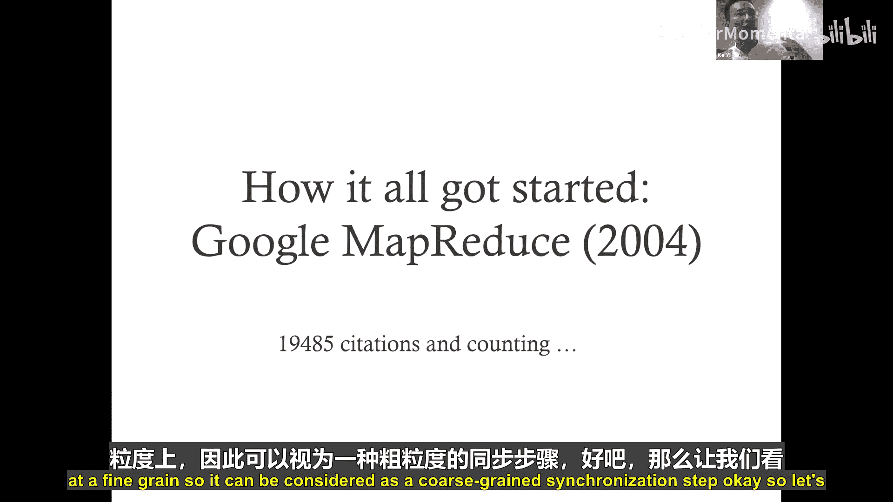

This model can be used to solve a problem。So essentially。

 any map reduced program is divided it into multiple runs。 Okay multiple runs。

 Every runs has two or three stages， depending on how you look at it。

 The first stage is the map stage。 Okay， this map stage can convert any input record into a intermediate key value pair。

Okay， and all this can be done in parallel。 Okay， parallel and independent， Okay。

 parallel and independent。 So this step parallelization is is。

 is easy and there's no need to coordinate。 independent tasks。 because every task is independent。

 Every map task is applied on every individual record independently。 Okay。

 there's no coordination needed。And then all these intermediate key value pairs will enter a shuffle stage or source stage。

 Okay， so that all the in key value pairs with the same key will be forwarded to the same reduce task or reduce function。

 Okay， so every reduced function will accept。All the cable pairs with the same key and then produce output。

 The output can be 0，1 or any number of records。 So， and this can place one round of map reduce。

 And then it will go into the next round。 So so this is， I say。

 a course coursear grain synchronization， because you know this， if you look at every so every round。

s there's only two synchronization point， namely the shuffling stage。 Okay。

 and the the next output stage。 so in fact， because the next round of map reduce can start immediately after the reduced function。

So this is really no need to synchronize here。 Okay， because in the next round。

 math each math function is also independently applied on each record。 Okay。

 that is the result of of the first round。 So the only synchronization point is the shutle stage。

Byynchronization， I mean， the shuffle stage cannot start or shuffle stage。

Will shuffle all the key pairs emitted during the map task。 Okay in some sense。

 it will it will wait for all the map for all the map tasks to complete before starting the reduced stage so this is the synchronation point。

 this is coursear grain because only one synchronization is needed for every round。 indeed。

 this synchronization is very expensive。 shuffle stage if you look at either papers or discussion on the very forums know minimizing the data that has to be shuffled is the number one criteria for measuring how good a map reduced program is two people don't really care about how complicated your map or reduce task is are and people care more about the。

Suffing cost Okay， so because so because synchronization is very is indeed very expensive。 However。

 Mac produce only has a very few shuffle synchronization point。 So， so only one for every round。

 And typically， you know， a map produce program should not have too many round。 Okay。

 so within a round。No synchronization is needed。 So that's why we are。

 that's where they get the efficiency improvement by parallel by parallelization。

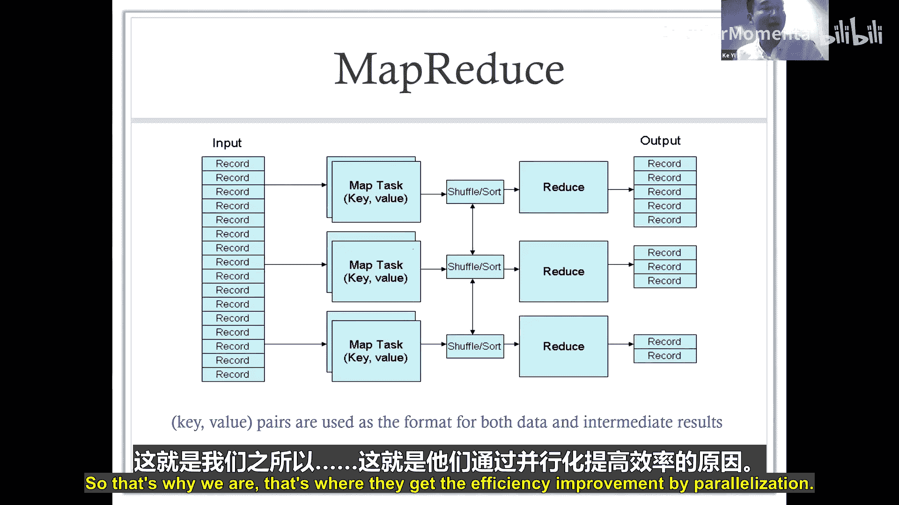

Okay。So。The both the map tasks and reduce tasks are user code。听哋。The user gets to define what， how。

 how what to do in the maps and in reduces。 Okay for the for the map function。

 the input is a key pairs and also it produce key pairs。 So it's essentially a one to one。

Or actually， it it can also be one too many。 okay， one too many。

It's one too many transformation and the reduces。 The input will be as mentioned is all the key value pairs showing the same key。

 So essentially， you can write it as the following。

 So the all the same key followed by a list of values this correspond to all the key pairs with the same key。

 and they can produce any number of key pairs。 either as output or as input for the next round。

 so the the programmer has no control over the stage because theuffle the behavior of the substance stage is is fixed is is cannot change So namely it will always group out of key pairs with the same key from all map and pass them to to a certain reducer in this form。

In thisSo let's。

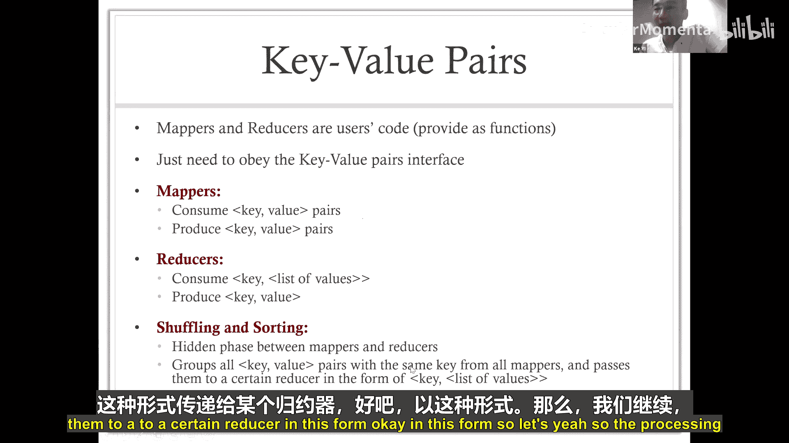

Yeah， so the processing granularity is the following。

 So the map will be run on a record by record basis。诶。And then it may produce 0。

1 or many or any number of intermediate results。 The reduces run on a group of records have the same key。

 and it can produce 0，1 or many outputs。

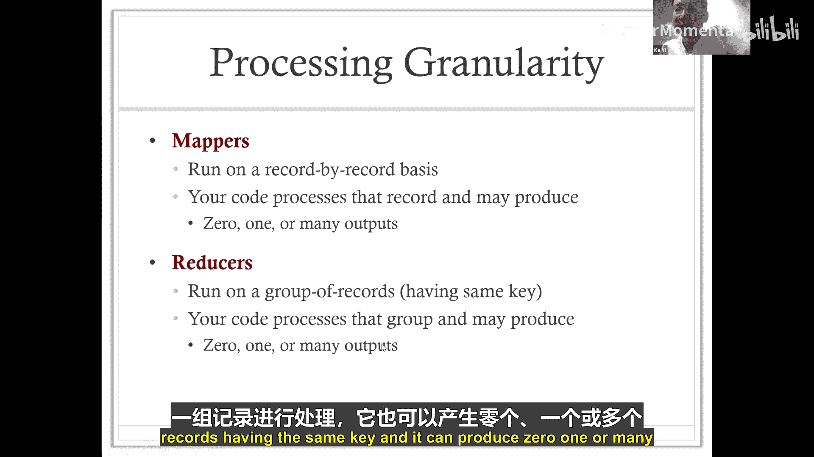

So now let's see a concrete example to see how one can write a one can use mapreuce to accomplish a task。

 So this is actually one example in the original paper published by Google on mappreuce and indeed。

 this is a task that Google cares about a lot， namely word count once we count the frequency of all the keywords in all the document in all the H files。

 it has crawl from Internet。 So the word frequency is a very important statistic in search engines。

 because it reflects the importance of the word so the intuition is that if the word has high frequency has high count then the importance of the word the word has actually has less importance because if。

The word appears a lot of times that that means it is a popular word like know like of or the which has which is not unique on other hand。

 if the frequencies low， that means if it appear in a document that means it is a potentially a good characterization of this document。

 So word frequencies are very important statistics and they are interested in know computing in counting these words efficiently and they show this can be done by my produce very easily。

🤧So the input files are all the HTML files they have crawled on from the internet and then and then it can you know first split every file into lines So every line will be an input record each line the string Okay and the map function will take one line of keywords and produce a number of key metal pairs。

 So for this problem the key is simply the keywords， for example。

 here is Apple orange and Mongo and the value is the number of times this word appears in this line Okay so here Apple ones orange ones Mongo one and similar and so on and so forth yeah so here I think this is not a very good example they should produce Apple2 here which is more efficient anyway。

Producing two Apple ones is also correct。Okay， so that's the map task， which is very easy。

 right If you use Python， you should be able to write it in one in one in one line in one live Python。

 Okay， and then all okay， a few lines。 Okay， and then all these key pairs enter the shuffle stage。

 Okay， as mentioned that the shuffle stage will group all the key pairs share the same key together。

 So all the Apple ones will be grouped together。 and then these four values in this case。

 they are all one， but。You know， in the optimized version， they should be 2，1，1。 Okay。

 and then these values will be sent together with the common key will be sent to the reduce function。

 Okay， and the reduce function simply just as the values up as of the values。

 which will be the correct count。 Okay， so and then that's the output。

 So the word count problem can be solved by simply one by simply by simply using one round of mapping。

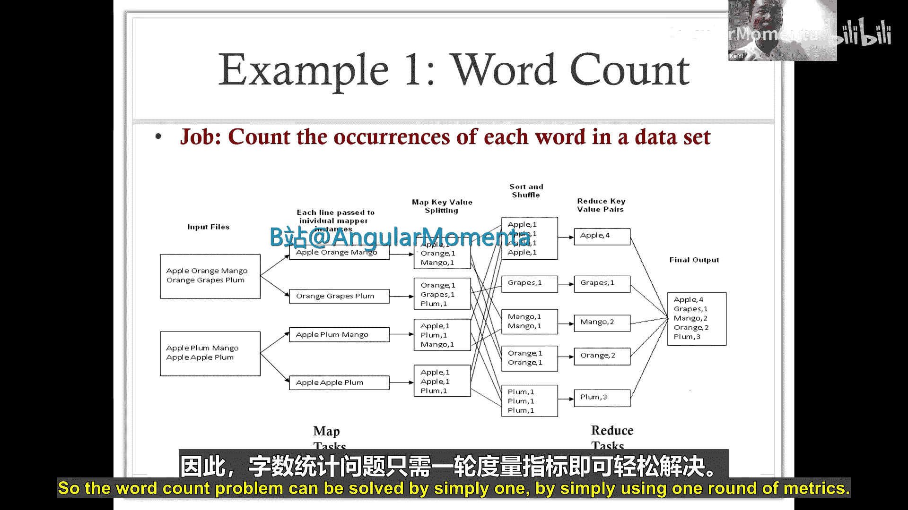

可啊。😊，And this is a snapshot of the actual code written in Java。 Of course。

 Google has never published their implementation of map reduce Mac reduce is not open source and it is claim that Google used C。

 they use Cpl to implement Mac reduce。 However， we outside as we we outsiders do not we dot already know how Google implementation。

 So this snapshot is written in Java is actually taken from Hadoop。

 So Hadoop is actually the open source implementation of map Red that people build following Google's paper。

 So we don't we we never have Google's implementation source code we rebuildbu it using Java。

We will not go into details。 but yeah， because as we。

Going to see moment Mac reduce and Ta do is actually a bit outdated。 But anyway。

 this is how things really started in the first place。Okay， so the key point is that， you know。

 as a programmer， you only have to define the math function and reduce function and the rest is taken care of by the system。

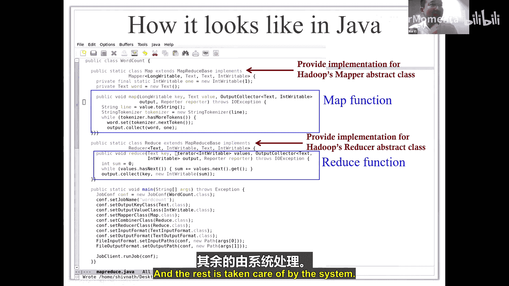

As the second example， inverted list inverted index。 This is， yeah。

 this is another important task that a search engine。Does on the on on a daily basis。 So， you know。

 social engines， the job of social engine is to for a given search keyword returns all the returns all the。

嗯。Websites containing the keyword。 Of course， a second。

 actually more important job for a social engine is to rank them because given any keyword。

 there can be millions of pages containing the keyword and user cannot browse more than a few pages of results。

 right， So ranking is actually more important。 but you know ranking is beyond the scope of this course。

 So here we only talk about the first easier task， which is to first find all these pages containing the keyword。

 And this requires a structure known as an inverted index。 So whats inverted index。

 So it's actually is nothing but a a index that translate or index that translates that maps any keyword to a list of URLs。

 This is called inverted because when you crawl raw。From the raw web pages from the Internet。

 you have a forward index， namely for a URL， you have the HTML document。

 right so the input for this problem will be a huge collection of URL document pairs。

 where document can be considered as a string Okay so this is the forward direction。

 now to build a search engine we need to invert it， namely we need to have this is our output。

 namely for every keyword we have to we have the list of URLs。

How do we do this using map reduce again， Qui easy， You know， the map task。

Take this URL document pair as input and emit a keyword URL for each keyword in this document。

And then all these keyword URL pairs will be shuffled， run。

 so that all the URLs with the same keywords contain the same keyword。

Will be given to the same reduced task。And the reduce function simply， you know。

 concatenate all the URLs into one list and then output that。 Okay， so this is， again。

 a very simple task for map reduceuce。 Okay， so these two examples are both taken from the original Macduce paper published by Google。

 which makes a lot of sense， right， Google invented this for exactly their own purpose。 Okay。

 however， because this idea for Macduce is so you know， groundbreaking。 And after the paper。

 you know， people started to。

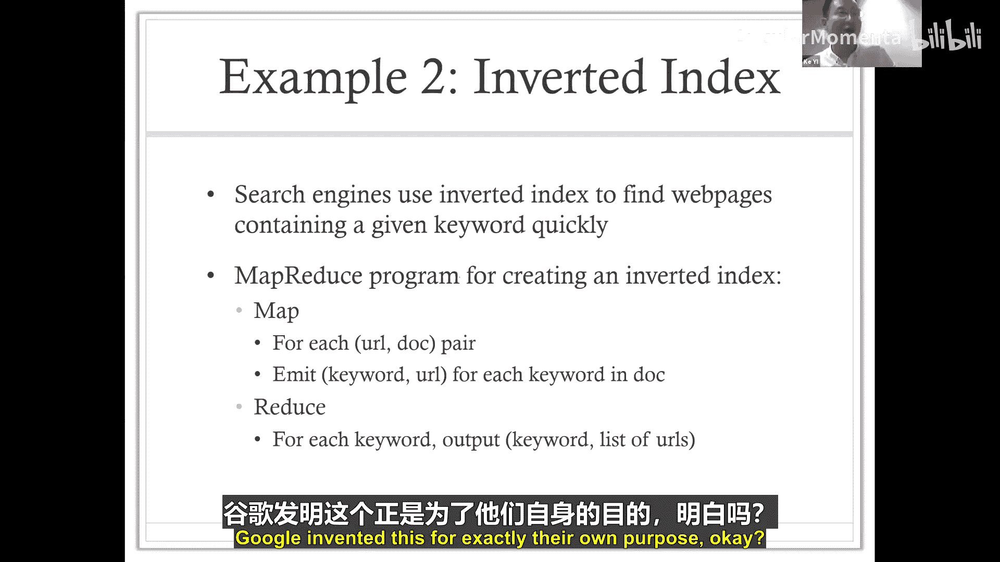

Trying started to try to do everything using mat。 Okay。

 so one of the first test people considered our side， the umbrella of social engine is of course。

 SQ queries on the relation database。 namely So now if suppose you want to use snap reduce to run queries on a huge collection of records。

 collection of taps。 How do we do it。 Okay， so people knew how to do it。

In a centralized database server， however， now suppose you know data is stored in mapreuce data store in in a distributed file system。

 and you want to process that by mapreuce， how do we do it。Okay， again。

 let's look at this example we saw earlier。 this， you know。

 drawing query between author table and the books table。 We want to find all the author names。

Who have published books after 1980。 So how do we process this query using mapuce。No。

 this is this is not that hard， okay。

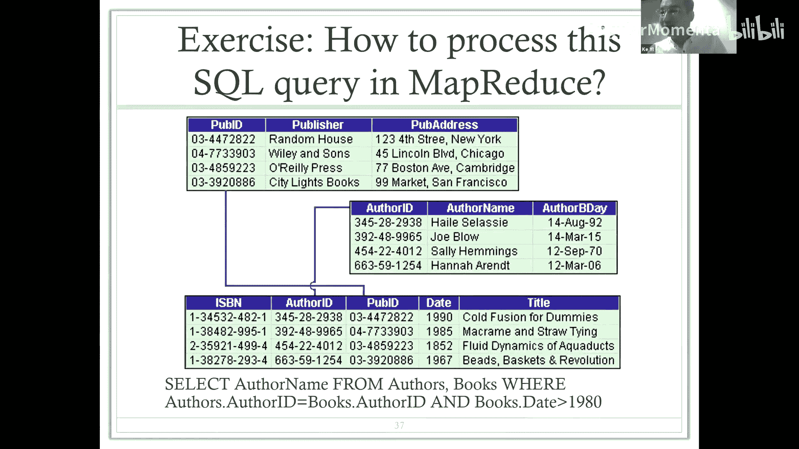

Of course， we need to write two mathfunction， One for the author table and one for the books table。

 Okay， Well， logically it' two mathfunction， but we can actually write them into one by just checking whether the input is from author table or books table for any type from the author table This mathfunction will emit author I D as the key and author name as a value。

 for any ty in the books table， this mathfunction will emit author I D as the key and date as the value。

 So importantly， in both cases， we output we use author I D as the key。

 The reason is that you know we have a drawing condition here。

 We have a drawing condition between the author I D column in the authors table and the books table。

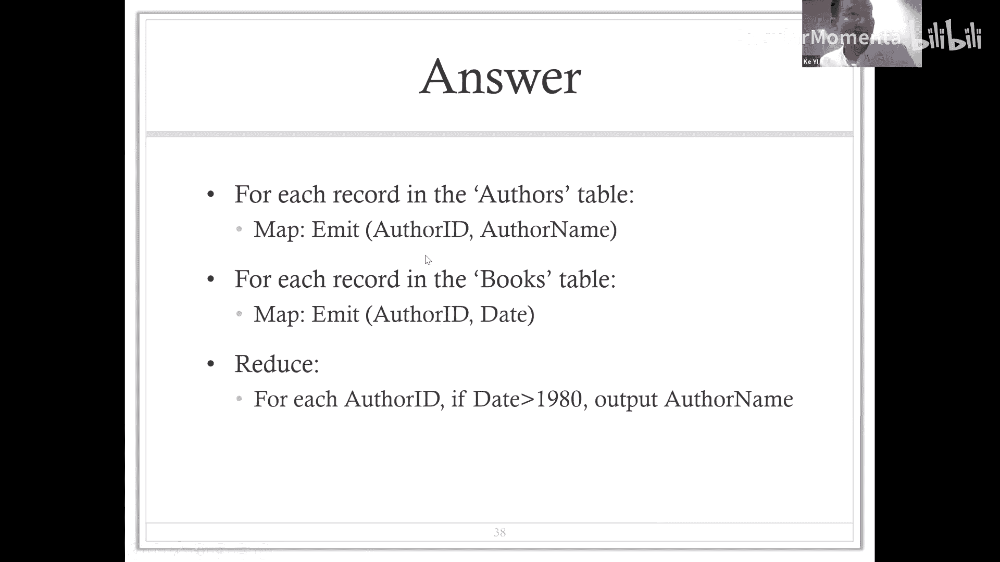

Because remember， in the shuffle stage， the shuffle stage， the shuffler will， you know。Find all the。

K pairs share the same key and we'll， we we'll put them together。

 So that's that's exactly what we need to achieve in this drawing query。

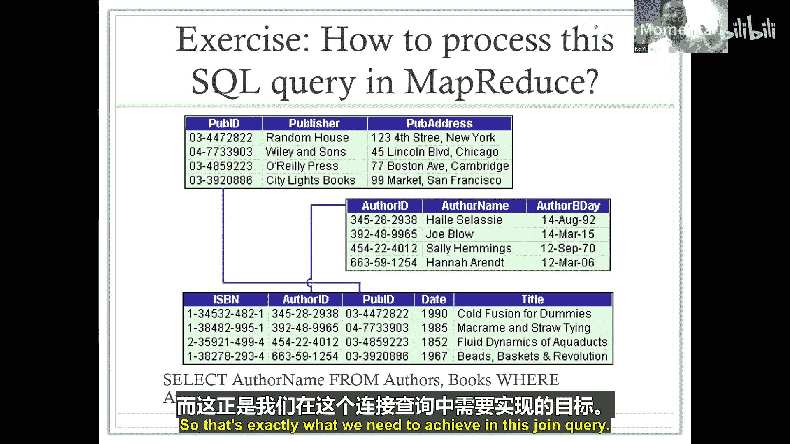

Okay。😊，So therefore， if suppose， if an author has published， let's say， three books。

 then well have three。Cementto Paris like at this。I no。

 three key pairs from the book table and one key pair from the author table。 So we have。

 so if author has three books， has written three books， we will have four intermediate cable pairs。

 one from the author table itself and three from the books table。 Okay， and all these four。

 importantly， all these four tys。Cable pairs will be given to the same reduce function。

 right So the reduce functions job is just to check， right， check any of this date。

 Any of the three dates is greater than 1980。 If one if at least one of them is greater than 1980。

 then the reduce function will output the。Okay，Again， depending on semantics。 So suppose we want。

 we want to remove the duplicates。 Each author name should be only only once。 Then。

The rate function only needs to output one， the also name once。

 as long as if at least one of the dates， one of the three dates or whatever four dates is greater than 19 days。

 Okay， so this is how you can easily process a joint query using metric。Okay。But anyhow。

 this is actually not the best way， not the most efficient way of writing the query in map。

So the idea is， okay。 So well， of course， this is a， this is a correct way。 however， in this。

Implementation啊。All the typos。 So every typo will produce an intermediate cable pair。

 and there's the shuffle stage has to shuffle a lot。 Suffle a lot。

 So a easy organization is a following。 So namely， we move this condition。😊。

From the reduced stage to the map stage。 And because， you know。

 all we care about is the books published after 1980。 There's really no point in shuffling。

These books， those books published before 1980。 So this can。Potentially significantly， you know。

 significantly reduce the amount of intermediate kilo pairs。 As mentioned， you know。

 the amount of data that has been shuffled is the number one important measure of how of the efficiency of the beverage program。

 So therefore， it， it is important to minimize such to minimize。

It's important to catch opportunities like this to reduce the size of the shuffle。Alright。

 so this the mapuce。Actually， only deals with the computation part。 Okay。

 we still have to deal with storage， namely， where do we store the input files。

 Where do we store the output， Where do we store the intermediate results between two map reduce rounds。

 Remember that， you know， after round reduce function has to write the results somewhere So that the next round of map reduceuce can start processing can read data from。

 And also the input has to be stored somewhere and output also has has to be stored somewhere。 Okay。

 so that hasn't been dealt with by map Mac reduce is only the computation engine。So this， again。

 Google has its own solution。 It's called G F S or Google file system。 Okay。

 this is published in another in the in the in another paper。 Okay， around the same time，2003，2004。

 okay。OkaySo the idea is to use a to implement a distributed file system Okay well， the question is。

 can we have a big disk of course， technologyly this is not possible even it is is not very good solution because IO is a big bioneck fundamentally because the disk hard disk its a mechanical device So its although it rotates in space physically So no matter how fast it can rotate its no match to electronic devices So that's also a reason why know hard are starts start to disappear from high performance supercomputers and they are being replaced by solid state drives by SSD SSD are much faster than high drives but of course。

Of for durable storage， still， we need hard drive。Also， hard drives are cheaper。

 Okay in terms of in terms of the cost。Per unit of storage。bandwidthand is slow。 So therefore。

 if you want to sustain， you want to sustain the high speed computer， you have to use a lot of disks。

 Okay， so that you can read data or write data in parallel。

 So increasing the bandwidth significantly。Okay yeah。

 this figure shows the the gap between the capacity and rate。 So although hard disk。

 the capacity has been improving significantly， the， the transfer rate is basically flat。

 So essentially， we are hitting the physical limit。There is a certain upper bound。

 there are certain speed upper bound that you can rotate the hard drive。

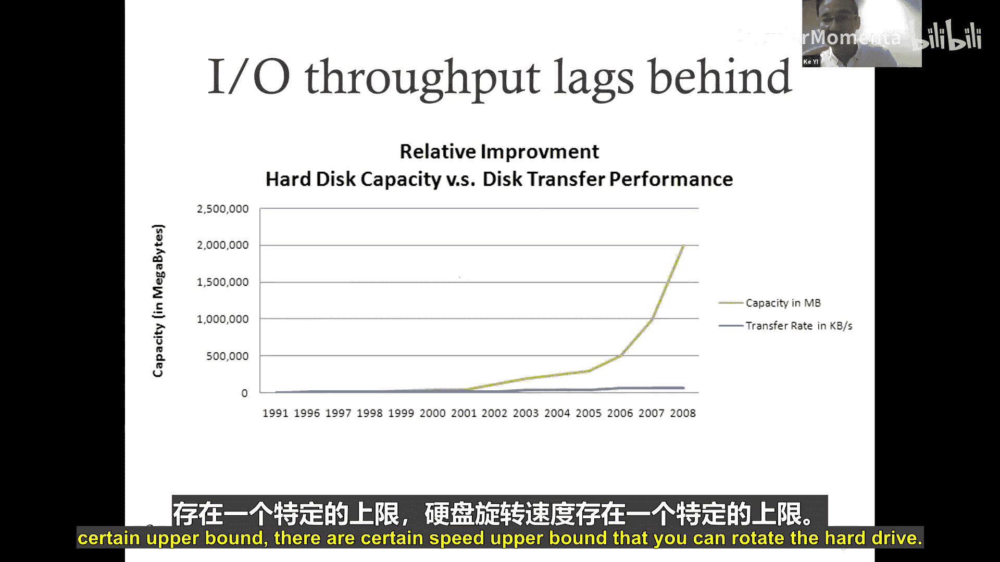

嗯。The， yeah， the gap between the speed of CPU and hard and hard drive are also is also increasing。

 So that's why the I O is becoming a major bottleneck in high performance computing。

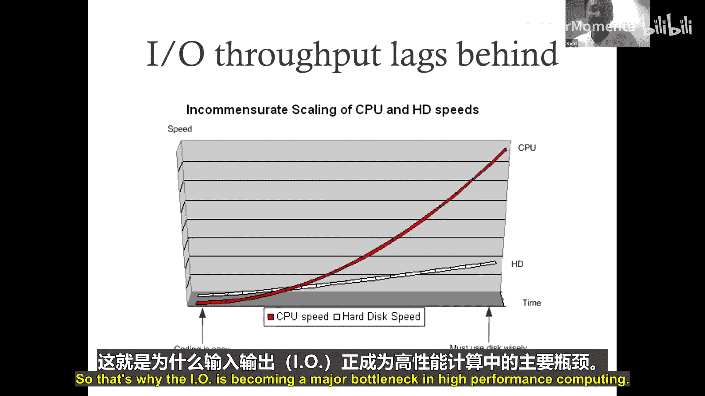

Okay， so。Yeah， there are other issues as well。 You know。

 building a high end super computer is very costly。

 And actually in the early days of Google's early days， you know。

 their philosophy is to not use expensive but super fast computers。 Instead。

 their philosophies to is put together many you know。

 cheap commodity devices Okay and make them scalable Okay。

So this is the initial initial design of Google data center。 right， so they。

 they consist of a lot of cheap commodity pieces。 Each one has its own decent CPU。 Okay。

 in the early days， they have， they have hundreds to thousand00 pieces in the class in the early days。

 They have a a very high aggregate storage capacity。 and also high aggregate。Band ways。

 so you can read data and write data in parallel at the same time。Okay。

 the and the reading and reading and write are spread across many， many machines。

 which results in high I O bandwidth， which is proportional to the number of machines。

 So this can be easily scaled up okay。Okay， so this is a very nice idea。 But then， you know。

 stuff breaks。 And this especially happens with hardware and with hard drive。 In fact， hard disks。

 So if you are have an experience is the component is a component in the in the in the computer that is the easiest to break。

 and when you have just one server， of course， it may not break so frequently。

 it takes every  three years for one disk to fail。 However， when you have 10000 servers。

10000 hard drives working together， you expect to lose 10 a day。

 So it's just replacing this hard drives， it can can be very labor intensive。

 And this also means that this also means that， you know。😊。

You cannot really complete any large scale condition task before your program terminates some driver。

 some hard drive has died。 So you cannot really do anything。 So if you do not invent another way of。

Of of doing things。 So So that's essentially the motivation of behind G GFS。 namely。

 they want to build a highly， highly reliable story system on on on top of highly unreliable hardware。

 Okay， so essentially another very cool idea， originally from Google。Okay。

So the target environment is of how Google's GA is the following。 They have。

 they have thousands of computers。 Okay they are。Distributed， the computers have their own disks。

 and they want to have， they want to build a single file system so that， you know。

 for any map reduce programmer， he can have access to the entire file system the entire file system as if this file system。

 this file system is a local one。 So although it is physically backed up by thousands computers。

 However， it still can be used as if it were a。Single one local file system。So， of course。

 the challenge， technical， the technical challenge is to deal with failures。 Okay， namely。

 failures are the norm。 And this involves not only disk， but also networks， processors。

 power supplies。Also， the application layer， the operating， the O S or even human errors。

 So the errors will happen a lot。 you have to your system that is for tolerant。 You can suppose so。

 so if a。So if a computer task runs for several hours or even a day。

 you need to make sure that at least logically in the eye of the in the eyes of the program。

 as far as it is concerned， there's no failures。 Failure should be handled in a transparent manner。

Okay。So on the other hand， there's also some。Property that they can， they can leverage。 right， So。

 so all the files are huge， but the number is small。 not。So it is， so on that hand。

 if you have a lot of small files， then that can be a， that can be troublesome。 Okay， so that's。

 that's fortunately not the case。 they have。The files are at least 100 me by long。 Okay。

 and usually gigabyte。 but there are not so many files。 Okay。

 so that means this overhead of organization is not that large。 Okay， instead。

 they can focus their attention on dealing with these huge files。Meanwhile。

 the rate characteristics is the following。 Okay， so most of the files are right one read many times。

 Okay， so like this， like the H T M L files， they have crawl from from Internet， you know。

 after they may crawl the whole Internet once every month。 Okay。

 but then after this files have been crawl， you know。

Every user query or the all the data analytical tags will be reading these files many times。

So whats written， the files are typically only red。 So this means that you have。

You have a you have a lot of large large streaming reads and a small number of random reads。

 but very few rights。 So this is a good， this is good news。

 This is the the the nice properties that that they can exploit。😊，对。诶。

And also also for their task because metric reduce is designed for batch processing。

 mainly for analytical task for offline processing。 So the bandwidth is more important than latency。

 Okay， of course， later on we will talk about how to deal with latency issues。 For now。

 let's focus on batch processing jobs。 So for batch processing jobs， bandwidth is more important。

 Okay， latencies is is not okay， so here I don't know if you understand the difference between bandwidth and latency。

 Okay， I think the best example is is this one in in any networking textbook。 I suppose you know。

 you have a a truck full of hard disks and driving across the bridge。

 so this is this has a very large bandwidth。 Okay， but very high latency， very bad latency。

 you have to wait for the truck to drive across the river across the bridge。For the data to arrive。

 However， once data arrives， then that's a lot of disks and that's a lot of data。 Okay， so， so。

 so that's difference between bandwidth and latency。

 Latency essentially is the time you need to wait before your first result is available and bandwidth is total amount data that can be processed in。

 let's say in one unit one time。 let's say one hour。So for batch processing。

 bandwidth is more important。So here are some GFS design sessionsions。

 The files will be stored and divide into chunks。 each chunk has says 64 meby by default and they achieve reliability through replication so actually this is the first version later on they make some improvement and each chunk is replicated across three or more chunk servers Okay so that even if you lose two of them。

 you still have one you still have the data。And the probability of the probability of losing all three chunks。

3， all three copies of the chunk is very low。Of course。

 this is still non guaranteed right in the in the case of disaster。 You know。

 the whole data center is is struck by lightning。 For example， then you still lose their data。

 right So they also provide higher level redundancy， for example。

 if you go to some some of the cloud servers， you can specify the redundancy levels。

 you can you can you can say that I want to I want all three of my copies to reside on three different servers but within same day data center。

 You can also say that I want my three copies to reside in different data centers。

1 in Hong Kong and one in Beijing and one in the US。

 So this further lower the probability of losing data。 of course。

 they also charge a higher rate for such red for such a replication level。 So namely， you know。

 in terms of reliability， there's never there theres there there can never be 100% guarantee。

There's always a trade off between reliability and cost。🤧Yeah。

And the metadata here refers to know where。Can we find these three chunks， the three garbage chunk。

 And this information is stored in the master node。 And this is called metadata。

 metta essentially information telling you how to find the real data。

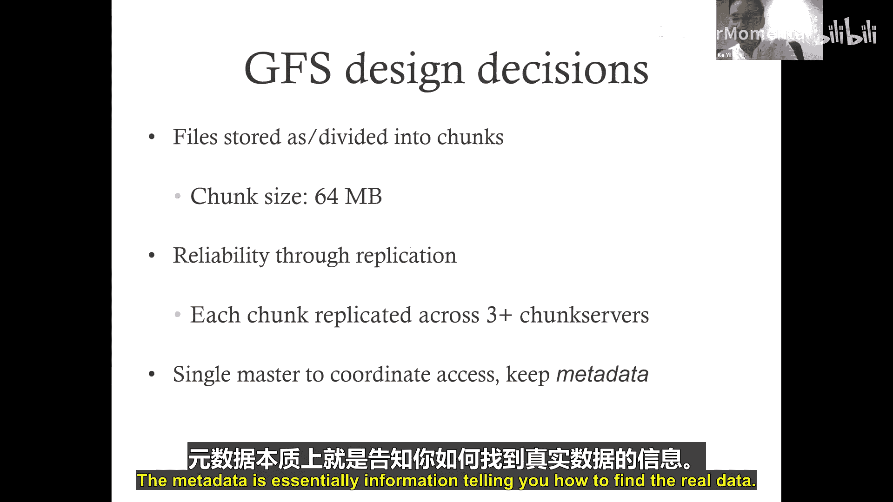