# 【香港科技大学】基于Spark的大数据计算--Big-Data-Computing-with-Spark-p04-03-04-02-什么是Hadoop--BV1V8FmzuEHf_p4-

So as mentioned， Google never published their Mac。 Google never published their G F S either。

 So how Google really did it remains a mystery as of today。 So in the open source community。

 we have hadoop。 Okay， you probably have also heard this name a lot。

 So how doop is the open source implementation of Google's Mac and G F S。 Okay。

So it provides a clean and simple programming abstraction。 Okay。

 so user users only provide two functions map and reduce。

 it also provides automatic polarization and distribution， So more importantly， more importantly。

 this is all this you know， polarization and and fault tolerance is hidden from any user Okay from the end from the end user point of view。

 he only sees one file， one logical copy， although underlying this one one logical copy。

 there are actually three physical copies。The nodes and tasks will fail and will recover automatically。

 Okay， so I think this also answers one question in the chat。

 So if two of the three copiess are lost， will the chunk be further replicate twice again and the answers yes。

 because whenever some note or fails， all the chunks store in that note will be lost， right。

 But this note。The the system will will first first try to recover this node。

 So if this node fails permanently， it will start a new note taking over。 Okay。

 remember that the met data information is stored at the master node。

 So we know exactly which chunk were stored in that lost node。 so we can， you know。

 get the copy from other copies and then resurrect that failed node。Yeah。

 what would happen if the master node is lost。 And that's a good question and then the answer is it better not。

 Okay， of course， there are also ways to to do that。

 the simple solution is to have a secondary master node Okay But then the question the real is more complicated because you have when you have two master node。

 which one is which one is in control。 so this then then there。

 there should also be coordination between the master node and handle the case where when one when when when when one master dies you need to you know。

 elect the secondary master to take over the job and this coordination is dealt with which this thing called zookeeper and we also mention that。

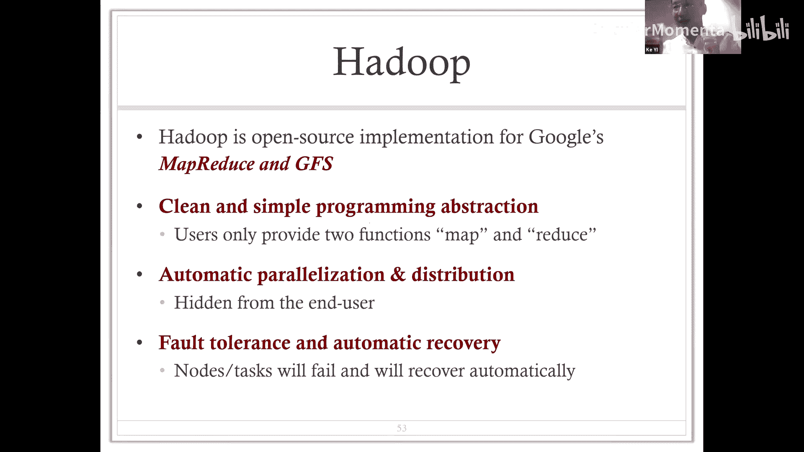

Okay， anyway so。Right， yes， so be。The origin of the name Hadoop。 This is a completely made up word。

 It's， it's short， easy to spell。And pronounce and meaningless， and more importantly。

 is not used at It's not used else before。 So that's really no reason why it's called heroop。 Okay。

 it's。I think it's given it's。Coined by his kid。The kid of the order。

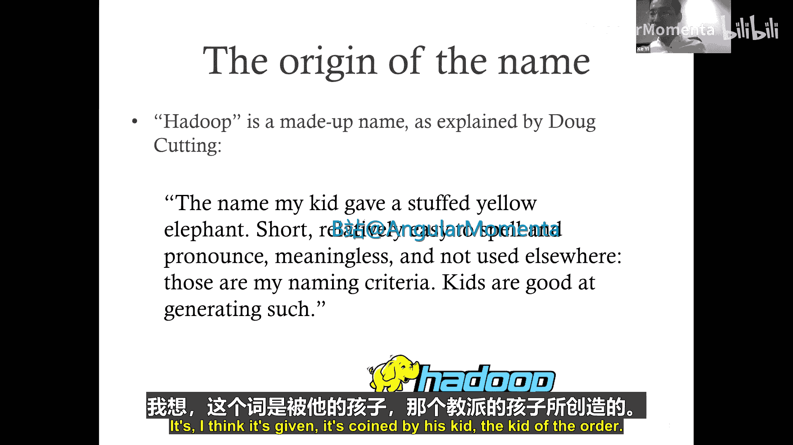

Any help so how it works。So， in， in fact， her top is。A combination of two things， right。

 So Google didn't really build one thing。 Google had had Google had Google had two layers。

 The map produced with is execution engine and the the G F S， that's the file system。

 So they are actually two different products。 However， in Hadoop。

 they build Hadoop to do both things。 Okay to do both things。 So however。

 in the actual implementation， So every worker also has two roles。 Okay， so one。Xs as a node。

For the file system。 So this is called a name node or data node。 Okay。

 depending on whether you are a master or a slave node。 So， so on the file system layer。

These are called data node because they store data and the name node。

Because they have the names of the files， Okay， in terms with speaking， of course。

 in addition to the name of the files， they also store met metadata。

 namely where this data is located， where to find its chunks and its copies and etctera of this metadata information。

At same time at the same time， each worker also is has a role to play in a map reduce layer。 so。

 for slaves is called a task tracker。 Okay， for the master now， iss called a job tracker。 Okay。

 so essentially， a map reduce program is called a job。 Okay， a map reduce job。 namely， for example。

 word count is a map reduce job。 building inver index is a map reduce job。

 and every job can be every job consists of many tasks。 Okay， A map is a task。 reduce is a task。

 and there can be many map tasks。 There can be many reduce tasks so。Every job consists of many tasks。

 So the tasks are carried out by the workers by the slave nodes。 Okay。

 and they they are called task trackers。 So they track to track the tasks and the master node is responsible for tracking the whole job。

 right So also， of course， So so， So therefore， in a the the master node similar to the HDFS layer。

 it keeps some met data meta information and how these tasks are allocated to different。

Task trackers and make sure that they make progress。 If someone dies， Someone didn't。

 someone doesn't finish this task。 Someone else should take over， okay。

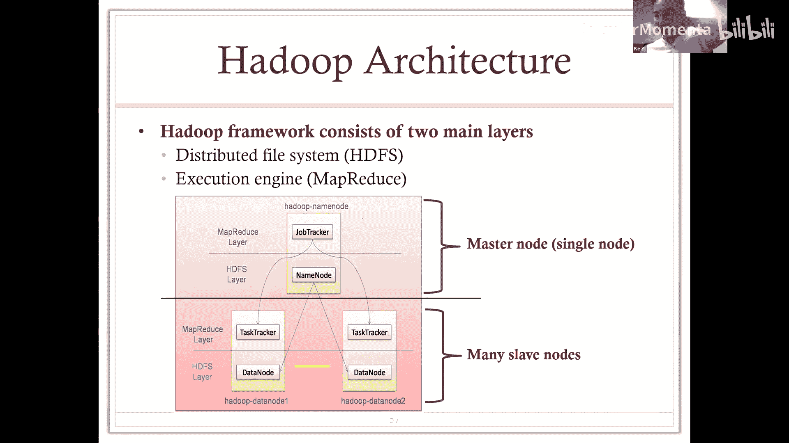

Okay， so let's now look at a little bit more in detail how each of these two layers is built in Hadoop。

 starting from the from the file system。 So this is called HDFS or Hadoop distributed file system。

 So the name node， remember that I mentioned the name node stores all the metadata。 Okay。

 so so this is one example。 Okay， so of course， in the real real implementation source more information。

 But basically the most important two pieces of information is the following。 Okay。So， in this case。

🤧呃，是。Suppose the the file name is is， you know， the the past names， user sample。 Okay， this name。

 the user name and data and part 0。 this is so this is。In this， okay， in this example。

 this file has five chunks， five different chunks。 However here， I'm only showing the first two。

 Okay， the first two。 Okay， so part one， who actually， this part 0 actually correspond to chunk 1。

So chunk one， this R column two is that it has two replica。

Probably maybe one the third one has died hasn't been resurrected yet。

 it has two and it is stored in data note number one and then number three so that this this copy here and this copy here and then it says part one corresponding to China number two it has three。

 it has three replica stored in server  two， four and five Okay。Anyway， they may not be consistent。

 but anyway， it it this， this refers to the locations。 Okay。

 of the data node having the three copies of this chunk。 So namely， the name node stores a directory。

Re telling you where to find the different copies of， of these chunks。The name node， the data knows。

 there are hundred of them。 They stored actual data。 Okay fileses are divided into chunks or blocks。

 Each block is replicated three times by default。 you can increase or decrease that。

 depending on your requirement， the higher it is， the more reliable， right， However。

 it also pushes up the cost。嗯。The name node， okay， then the data node will communicate with name node through periodic hardbeats。

 Okay by default once every three seconds。 So every three seconds。

 it tells the master the master node。 So I am alive。I am alive。 I am alive。 I am alive。

 So if the name knows。Doesn't hear this ha message for a certain amount of time。 So this again。

 is a private that can be controlled。 let's say 10 seconds。

10 seconds haven't heard a message a ha message。 It will assume that this data node has died and then suppose suppose this data node dies and the name knows exactly know what chunks。

 what blocks are stored in that node So it can resurrect that data node by for example。

 by getting by getting a copy from getting a copy of block2 from here by getting a copy of block 5 from there and then you can they can rebuild data node because you always maintain。

 know， a pool of a pool of free of unused machines and this will be this can be used in case someone fails。

Some machine fails。 Okay， and then， of course， they have to have a worker。

 They have have engineers running around， you know， fixing those fail node。 Okay， however。

 if the pool free of of backup servers， there， there are certain of them then， you know。

 it it may allow some delay in fixing things so that， you know。

 the engineers doesn't have to fix the machines， you know， immediately， know。

 they can just we can walk around and fixing things as they see as long as the pool is large enough。

 give some buffer time for the engineers to fix things while ensuring the entire system is running is running nonstop。

啊。呃。Okay， there's a question in the chat。 How are ways synchronized crowd applicant knows variable A is on node 1。

2，3。 variableable A was update on node A， but not。Okay， so I think this question refers to again。

 updates or rights。 Unfortunately， as I read， as I just mentioned， as I mentioned previously。

Ma produce， I'm sorry。 H， F S or G F S is designed for the scenario where every file is only written once or maybe once a month。

 written very rarely。 So so this scenario doesn't really happen。 Okay。

 you are essentially you can you are not even you are not even allowed to change change one file。

 You can either rebuild a file。 Okay review entire file。 So this is this is not really issue。

 They target environment is the case is is， is， is where you know， the files are written only once。

 but then read many times。Of course， the question is， what if suppose I want to handle transactions。

 I want to handle transactions。 I want to build a。E business website like Alibaba or Tabao。

 I want to。Deal with updates。 In that case， actually， map H F S or GS are not a solution。

 Okay They are alternative。 So these are now designed for frequent updates。 Okay Mongo D B。

 as I mentioned， is the one product that that is designed to handle this frequent updates。

 which relies on completely we rely on very different techniques。 Okay， so。So in the database world。

 these two kinds of workloads have different names。 Okay。

 so all so so so so these kind of written ones right many times。

 This kind of workload are typically called A or analytical processing。 So namely we do analysis。

 We collect data ones。 Then we do analysis。Many times。 Okay， this is called AP P。

 The other type of beta the other type of workload is called T P or transaction processing。 Okay T P。

 so so this is where you have a lot of updates。 You have a lot of small reason， small rights， Okay。

 but you don't do analysis。On the entire data。 Okay， so these are。

 these two kinds of workloads are very different。 Okay， so traditionally， by traditionally， I mean。

 like Oracle or IB I B B2， right So these traditional relation database。

 they handle both A P and TP within one system。 Okay， for them， Oracle database， very expensive。

 by the way， still very expensive。 They can they can， it can handle A P and TP within one system。

However， you know， it's very expensive。 First of all， second is not really scalable。

 right So if that's why Alibaba， they， they don't use， they don't use Oracle its in early days。

 they in early days， they did。 They used Oracle， but。But very soon。

 we realize that oracle is just not scalable enough for， let's say， double 11。

So they want to build their own system and all the modern。Large scale database systems。

 They separate this two Okay A， by the A P stands for analytical processing， analytical。嗯。嗯呢。L， okay。

 the other one is transaction processing。 So， so in the modern designs。

 A P and TP are completely separated。For example， in in Alibaba。

 which I'm more familiar because I have a lot of connection collaboration with them。

 So their TP product is' called ocean base。 you may have heard it and their A product is called analytical D B。

 A。 It's not verys very its not very fancy names called A okay and these two are separate。

 They are they are built by different teams。 And so what they do is at the end of business day。

 They will load data。 They move data from the T TP system into their A system for analysis So their T is working real time online。

 know， you don't they don't want their customer to wait they can process transactions very fast with low latency and high bandwidth at same time。

 However， you cannot do analysis。 You cannot do let's say I want to see。

How many customers has bought this kind of products and what their and what their profiles profiles look like。

 So this kind of analysis will have to wait until data exploded into their A system， okay。However。

 you know the very recent trend is also moving this two together。

 So it's really like you know three kingdoms so when the world was united for for a certain period of time。

 and then they start to split but then eventually they may come back together。

 so the reason why they they are able to put them back is again because of technology in improvement。

 they have new designs， new technologies， new hardware so that know the TV system can also do certain kinds of analytical processing。

 and meanwhile， their A system， their ADP can also start to support updates。 However。

 both ADP and ocean base I think they are not really open source can it not available to outsiders in the open source community。

 they are still largely。Separate for A P， in fact， the popular choice is still spark。

 which will will be actually the major topic of this course for the TP part is Mongo So we will be talking about examples in both cases。

But there's no good unified system supporting both because they are really very different。

 very different。

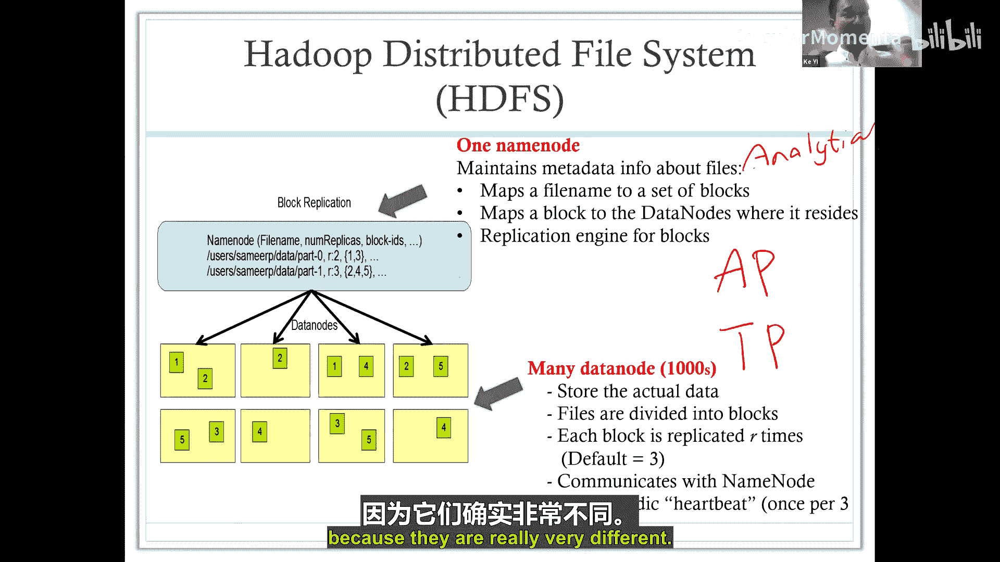

啊。Okay， so yeah。Alright， okay， so now let's look at the data flow overview overview。

 namely how a read operation is。How a read request from the client from the user program is processed Okay。

 so the the client， first of all， will tell the name node will go to the name node telling him telling him which file I want access and the master node will return you know。

 the block ID namely how many blocks this file is divided into and together where their location。

And then client the client will go directly to these data notes and get the data。So yeah。

 as mentioned that if the master in case the so the master node is actually a single point of failure。

 if you lose the master node， you lose everything。 So it's actually important to have a secondary name node just in case that the master node。

 the master node fails。Okay， so more so yeah。 so here it's not emphasized。

 but it is important to point out to point out that when the client raise data。

 it can also do it in parallel。 Okay in fact， things are more complicated than it appears because remember that every data has three copies。

 Okay， in this example， this file has five chunks。 Okay， every chunk has three copies。 Okay， so the。

 the algorithm， the coordination algorithm is actually pretty smart。 It can。

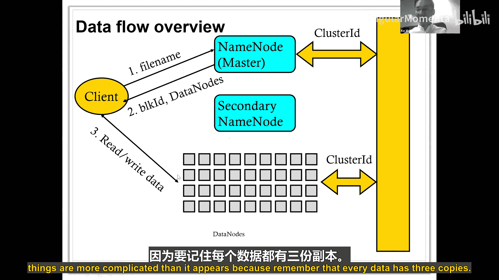

Ptition the race in a balanced way。 For example， it may tell the client that you should get block 1 from this node。

 You should get block 2 in this node， not the first one。 because， you know。

 if you read both one and two from the first note， it will not be。As balanced。

 so you read one from here， two from here and possibly three from this node。

4 from this node and5 from this node so that everything will be balanced out。 Okay。

 when you have multiple users requesting multiple files at same time， you know。

 this allocation process is more complicated。 but we will not get into the details。 But anyway。

 there are some complicated algorithms that deal with this balancing issues。啊。Right， yeah，1。

3 replicate two times。Yeah， too。 Yes， yes。Well， this figure may not be very exact。

 but you get idea okay。

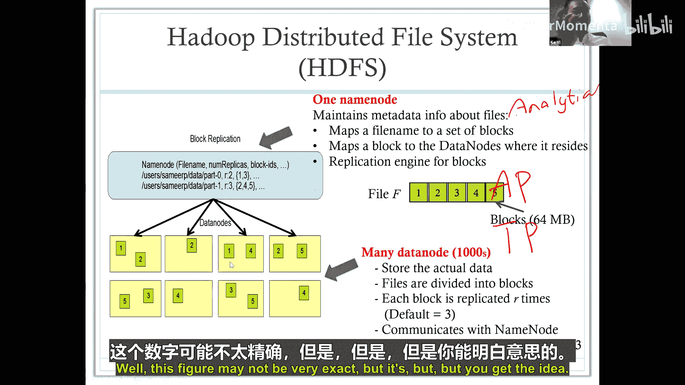

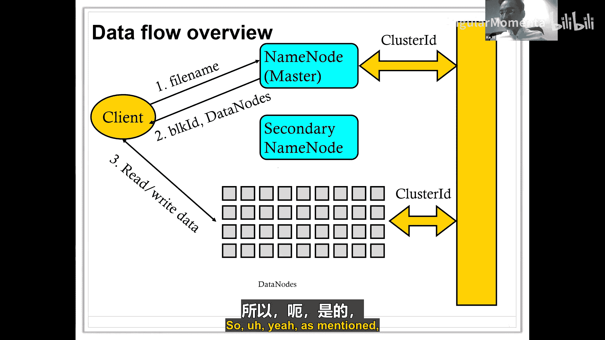

Yeah， as mentioned， the data node will send heartbeat messages to the name node once every 3 seconds。

 and the name note uses hardbes to detect data node failures。 Okay， so so I was run。

 So no response intent is considered a failure by default。 Okay this， of course。

 this is a parameter that can be controlled。嗯。Right， yes， as mentioned that the， the balance。

 the balancing。The algorithmrithm should is quite complicated。

 It to takes both balancing and communication and directing traffic。

 These all kind of issues into consideration。Right， so yeah， so。第一。

3 replica thing was done in Hadoop 2。0。 Okay， starting from Hadoop 3。0， they。

 they introduce something that is smarter。 Okay， and the motivation is that the the storage overhead。

Of having three replica is really large。 It's 200200%。 namely。

 only one third of the storage is really useful。 Okay。

 the other two thirds are just there for redundancy issues。 This， this can be quite wasteful。 Okay。

 quite wasteful。Okay， so here is one example， I suppose a， this file has has these six chunks。

6 blocks。 And then every block has three copies， which consumes a lot of space，18 blocks in total。

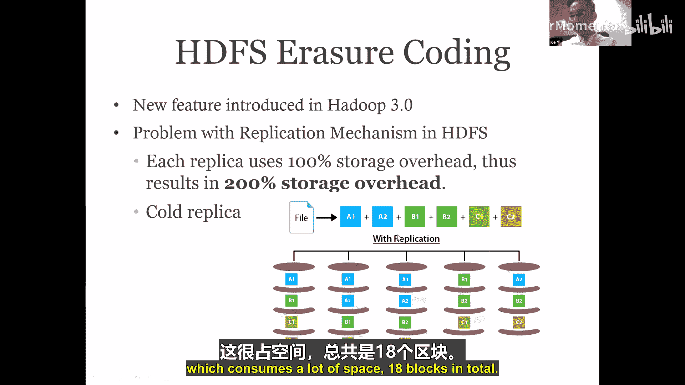

Okay， so starting from to 3。0， they introduced this thing called eraser coding。 Okay， era coding。

 So so as a simple example， actually， the parity coding is a special case of eraser coding。 Okay。

 so what is a parity。 So the parity code is is okay， is just， okay， is's just doing exclusive or。

 Okay， for example， let me give an example。 suppose block。Block a 1 yes， you know 1，1，0，1。

 and block a 2 is 1，0，0，0， And then block A P， the parity block is。

 is is the exclusive or of these two blocks is the bitwise exclusive or， Okay， so namely  one 1 is 0。

1。0，1。 Okay， so that's the hi parity block。 Okay， so remember， exclusive exclusive or is if， if。

 if the two pieces are the same， then the output is 0， if they are different， then output is  one。

Okay， so the eraser， the parity block is 0，1，0，1。So importantly。😊，If one of those。

3 servers is broken， fails， for example， is if， if this dies， if this one dies。Then， of course。

 block A1 and A2， you still have them for block B1。 Okay。

 so B1 can be recovered from B2 and the parity block。OkaySo why， why。

 Because suppose you know suppose the last bit of parity F B P is 0 and the last bit of block B2 is one。

 Then you know that the last bit in B1 must be1 right because one exclusive or0 is  one。So。

 so maybe you can recover the lost block。Similarly。

 you can I also recover this parity blood by just redoing the exclusive one。 Okay， so so。Any。デス？

Failure can be。C can be recovered， you won you won't lose any dataO啊。

It requires only a 50% storage overhead， Okay， namely yeah。

 so it's much lower than the 220% of replica。However。

 someone can immediately point out that its tolerance level is is worse。

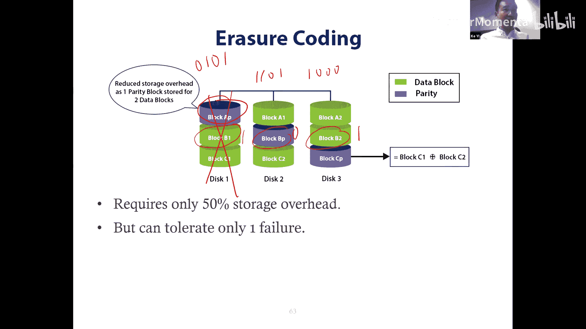

The the the earlier。The three copy thing， right， The three copy three copy policy can tolerate two server failures。

 even you lose two servers， nothing is lost。

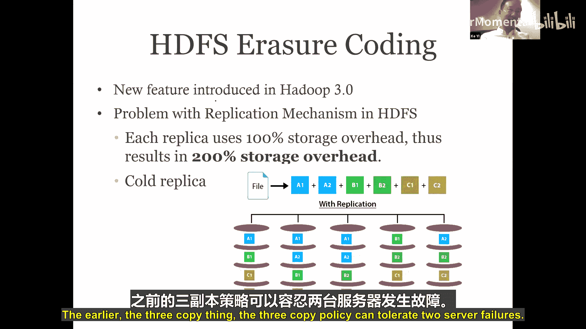

However， this parity bit， it only supports it can only tolerate one failure。 if you lose two disks。

 then you lose data。 Okay so eraser coding， therefore， is a generalization。 Okay。

 it uses this algorithm called red Solomon algorithm。 So it essentially it has。

 it performs some linear transformation。 so I'm not gonna give you the details。 but anyway。

 what it does is it computes it computes the input is N data cells or n blocks or n bits。

 and then it produce n parity cells。 Okay， so the parity bit。

 the X or R is actually a special case where N is just one you can you can also use a more。

Complicate a formula to compute more than one per bit。

 and thelomon code Solomon algorithm be designed in a way such as that data can be recovered as long as M out of n plus n cells are available。

 so let me give you some example。 Okay， so if you have a single replicate case。 name here。

 this correspond to okay， this column is actually n is is the value of n。 Okay you have。

 then you have 100 percent storage efficiency， but no failure can be tolerated。 Okay。

 so X O R with six data cells。 So this correspond to n equals to1 and M equals to 6。 M equal to 6。

 So the storage storage efficiency is one over 7。No， it's 6 over 7 because M is the data blocks。

 One is the number of parity block。 Okay， so this storage reference is 68%。

 data durability is one because n is one。 but then you can increase your data durability without a without a sacrificing too much efficiency by using。

 for example。M is 6。 M is 6， and。N is3。 Okay， In that case， the storage efficiency is still。

 you know，2， third， Okay， which storage efficiency is always M over M plus N。

And the fall tolerance is same as N。 Okay， so it can， if you use M of。You can。

 if you use an equal to 3， then you can tolerate。Up to three failures。 Okay， you can even further if。

Increase N to increase dur ability。 You can increase M to increase storage efficiency。 Okay。

 but it doesn't mean that you should use a， you should use a very large M and N because that if you the large M and N increases the computational cost。

 because every to compute to apply this rate Solomon algorithm you have to use。

You have to involve M cells and produce N parity cells。 So。

 so the cost computational cost will be higher if you use large M and N。Yeah。

 so indeed someone mentioned that it the same idea is used in rate I could read zero correspond to the replicate card case and then one and and I don't really remember the exact specification。

 but different rate levels correspond to different。To different啊。

Schemes in the in in the in eraser coding。 Okay， however。

 the difference is that is that the rate is on hardware level is to implemented on hard on on hard drives。

 Okay， you can configure that in the operating system。 However， this is implemented in hardoop。

 So that's the software level。But idea is the same。Okay。So finally。

 let's mention the name node I think is a single point of failure and so the idea is to add a secondary name node。

Second name note。 Okay， so in case the first one fails。Okay， so。

 so now let's put everything together。 Okay， so now we have the HD HDFS。

 which is the file system layer。 And on top of that， we have Hadoop map reduce。

 which is the open source implementation of map reduce。

 Okay and these two layers will work that work together。 Okay。

 we together to complete a map reduce job。 So here is one example， we're gonna use the word count。

 as example。 So here you know， we use color to represent。Different words。So啊。So。

The map stage is really like reading a file Okay so so therefore we can apply the maps map stage on the input input blocks。

 So hope so similarly， the HDF balancing the balancer will kick in So namely it will cleverly route the different map text to the right places because every blocks has actually three copies。

 let's suppose we are still using do 2。0 we will use the replica。

 it will direct the map function to the appropriate worker notes name data note so that the data can be read in a balanced manner but then after that。

 after data is fetched from HDFS， then the remaining process is completely done within the the execution。

Engine map reduce the mapfunction will produce all these intermediate results。 Okay。

 and then the shuffle stage will shuffle all the intermediate stage。 Okay， we actually will。

 we will talk more about this in detail how the sh is implemented。

 although we will be talking about this under spark。 Okay， we will not be using hard look。

 but ideas are the same。Okay， and the reducers will。Again。

 the user implement reduce function takes in all these intermediate key metal pairs and then write the results back。

 Okay， when they write， when they write the results back， they are also written back to HD F S。

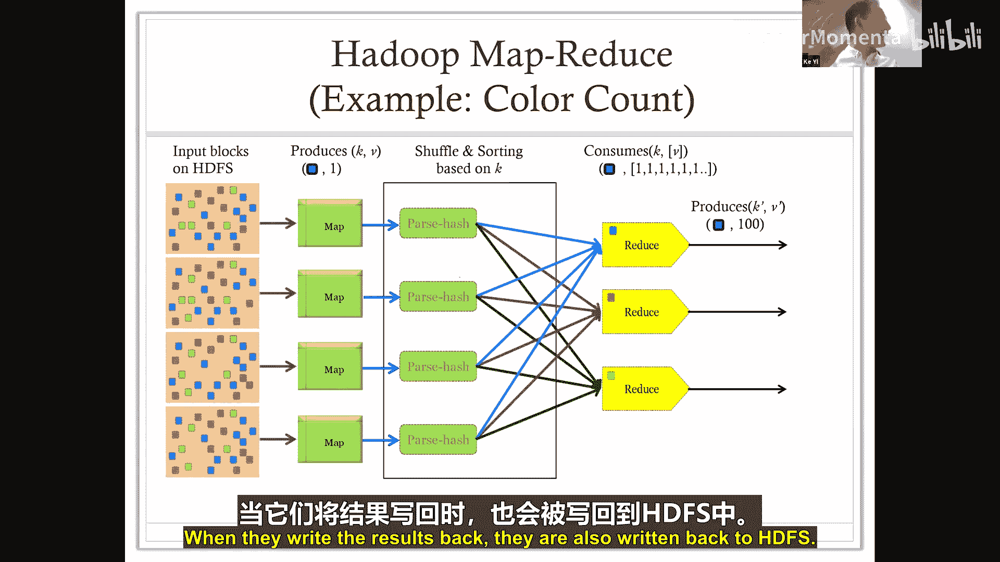

啊。Okay， so yeah， on the map produced layer。 Similarlyly， you know。

 the job tracker is the master node。 It runs together。

 It runs physically runs on the same node as the name node on the HDF S layer So it received user job decides how many task it will run。

 namely how many map。 Okay， so this actually depends also on how many chunks。 The input data has。

 the input data。 If the input data has five chunks， then it will spa 5，5 map。

It also decides how many reduce reduces to run and here locality matters。

 Okay because also intelligently， we want to reduce the shuffle size。

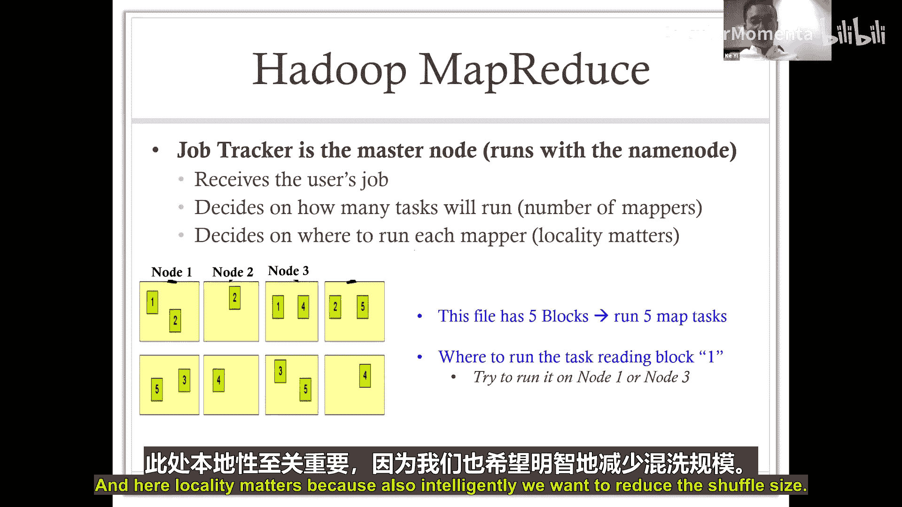

Okay。诶。Yeah， so in this particular example， we have we have this one map produced job has five map tasks and three reduced tasks。

 So again， this can be configured， but there's also an automatic process in deciding the allocation。

So similar to the heartbeat messages uses it by the name by the data note。

 when a map reduced job is being executed。 Similarly。

 these workers also sent periodic updates to the job tracker reporting the progress。

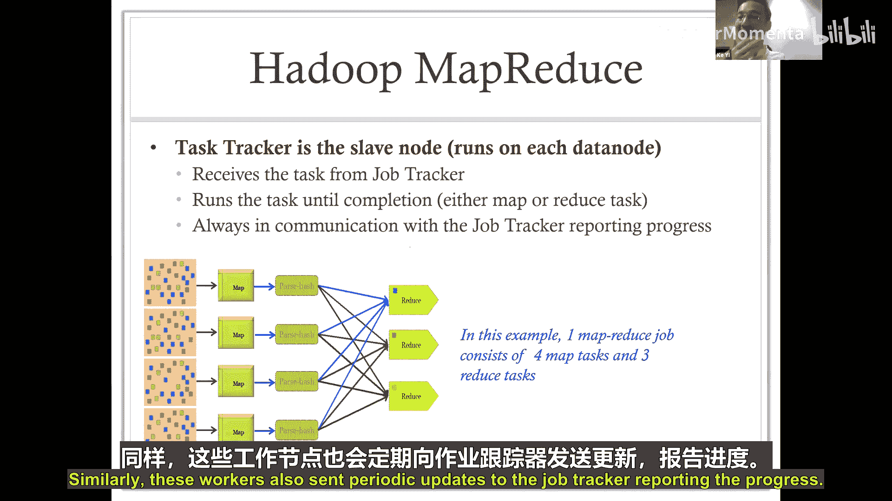

Because， you know， a map reduced job can take a long time to finish because。y。

 we may have a lot of data to process， and。Failures can happen during processing。 Okay。

 so in this case。If a map task fails。During in the during， during during the process。

 it will re execute on the map task。 Similarlyly， if a reduce task fails， it will re execute。

The rigorous task， if the worker fails。嗯。However， the thing slightly more complicated than that because。

 you know， the shuffle stop， the shuffle data is not stored in HDFS。 So， so。

 so that means if a reduce。Worker fails。 Okay， we also need to re execute some of the completed tasks。

 Alright， although these map tasks have finished successfully。

But because the reduce tasks that receives these map tasks data has failed。

 then the output has the intermediate results have been lost。

 So we sometimes the system also have to re execute some of the completed map tasks to regenerate the intermediate results and then send them to the failed to reduce task to write again。

Okay。And all these progress and completion are committed through the master node。

 master the master node tracks all the tasks， which one has completed。

 which one is in progress and which one has no response for after a certain amount of time。Yeah。

 finally， as mentioned that， you know， the master failure will be handled by a system like zookeeper。

 Okay， and I will not go into details of that。So， well， so typically。

 unless you are running on a class of hundreds of machines。 Okay。

 and then then or running a task that is long enough。 typicallyy。

 you don't really have to worry about the master node it fails because the master node is just one node you know。

 it's the likelihood that it fails is small。 Okay， unless you run it for a long time。

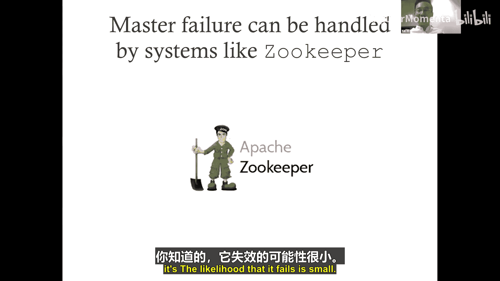

Okay， just， you know， just look at what we have discussed discussed so far。

 So essentially the open source community。Have been following Google's footsteps。Pretty closely。

 right， So Google has GF S。 And then we have HFS and Google have map reduce。

 We have a map map reduce。 And later on， Google also released big table。 Okay， so essentially。

 they want to run SQL queries Okay over HFs。 And then we have H base and hive。 Okay， hive。

 And then and Dr is this aggregation is this engine that can compute as more efficiently and we have drill。

 and fairly P is the graph processing engine processing large graphs。

 then then the open source community has gira。 Okay。

 so essentially every step has been followed by open source community。 So essentially。

 Google is like the God in this in this area。😊，So things stayed this way。 Okay， until around 2008。

2009。 Okay， so so big shots in the database community。 this is David Dewit。

 and this guy is Michael Stonebreaker。 Okay the second one is more famous because he received a twin award。

 just a few years back。 Okay， but anyway， David Deit is also a big shot in the。

 in the in the community。 So I still remembering this， they have this， they had this this。

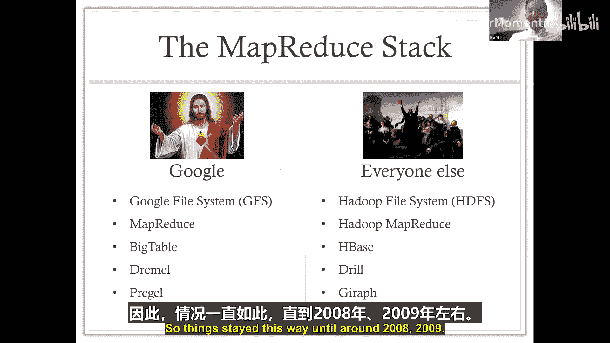

Forum at at the Sigma conference， by the way， Sigma is one of the exactly is the premier conference for databases。

 Okay， at that conference， they had this discussion panel。 Okay。

 discussing whether following Google steps is the real is the right way to go。 Okay。

 and they post a rather。呃，controver啊。They threw out a rather controversial claim。

 which is not reduce， is really a step backwards。 It's not a progress。

 instead it is a step backward and it's a major step backward。

 referring to the phenomenon that everybody is trying to follow what Google is doing and is trying to do everything。

 including SQL processing， including database queries。We want to。

People wanted to do everything in Massachusetts。 And is that really the right direction。Okay。

 so here is the following points they raised。 Of course， at the time， they were quite controversial。

 Okay， the first one， of course， they still acknowledge that mapuce is a good idea for writing certain types of computations。

😊，So essentially， they were referring to Google's own interest， namely word count。

 building inverted index， things like that。 So these tag are really good for map produce to handle。

But okay。It is a giant step backward in the programming paradigm for large scale data。

 intensive applications。Okay， so why。 So here's why。

 So first it has a subopmal implementation in that it uses force in set indexes。

 So in database community has actually spent a huge amount of efforts on building indexes。

 name beat trees and hash tables and both are missing in that。

 So what these indexes support is much more efficient lookup queries。😊。

So the examples like word count and building inverted index， they do not involve lookups。 However。

 for many database queries， let's say I want this person's record in the last month。 Okay。

 so this is known as a lookup query。 So we are only interested in a particular user' data。This。

 if you want to do it that map produce。 Still， you have to write a knife function that is applied on all the records Okay。

 because there is no indexing。 There's no map， There's no hash table。 There's no B tree。

 So this is missing。 So therefore。This is a subopmal implementation。Second。

It misses most of the features that are routinely included in current DBMS。

 Okay this refers to transaction processing actually。

 so essentially mapduce is is the AP system only is only good for batch processing。

 It can now support updates， which is very important。 Okay。

 so so this and the other features includes relations you know joins and all these are missing in Macuce。

And finally， and most critically， they are saying that mapuce is not novel at all。 Okay。

 so this is the most critical because， you know， in the in， in the academic circle， right。

 even if something is slow， it may not be that bad， however。

 saying that something is not novel is really killing this is really killing this paper or this idea。

Okay， they were saying that they is， it's not normal because， you know， back in 1990。

 So Wes Lesley Valaliant， who， by the way， is also a Turing war winner。 Okay。

 he published a paper in a not very well known journal。 Okay。

 on this thing called bulk synchronous parallel。 So in his model。

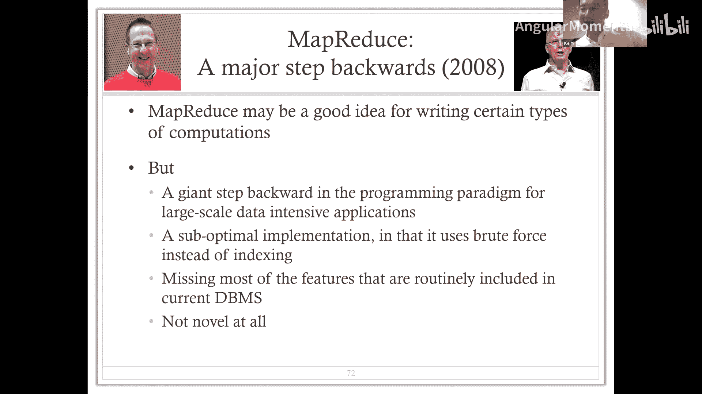

In hindsight its exactly mapreduce， although he didn't use the word mapreduce of course， however。

 it's really the same thing。When Google published their map paper， they did not。

They were not aware of valid paper。 Okay， only two years later when Google published their。

 I think they their paper on Dr of。 Okay， the follow after work。

 they cited valid paper acknowledging that the mapuce idea is really the same as B SP Okay。

 as valid B SP。However， the one reason that Val paper was not was was was not well known is that。

 you know， Val major areas is in machine learning。 right， so he， he， he sort of wrote this casual。

Article and published in a not so well known journal in his later time。 And so for for。

 for quite some years， his paper on BP was not really was was not really noticed by most of the academia。

 Okay so only after Google realized。 Okay， good years really， really the same as B SP。

 Now people started to give。More credits to Val work。So therefore。

 conceptually Mac reduce is not really something new。 Okay， but anyhow， I think this debate， Okay。

 that between Mac reduce and you know， these two big shots in database。

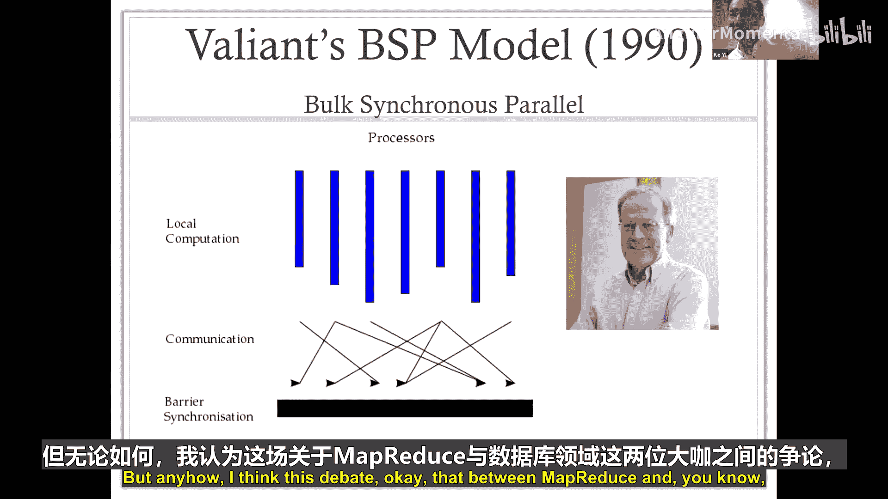

In our community start really started the revolution okay so I would not say personally that macro is the starting point it's actually this conversation。

 this debate。

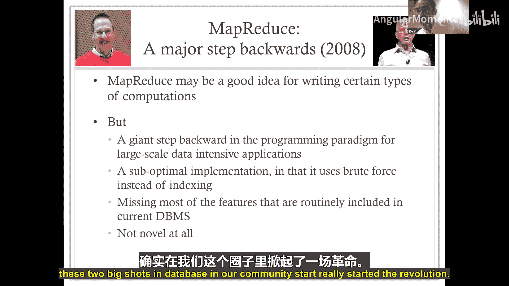

Of course， ne is the seed is starting is really the origin。 However， this area。

 this area exploded really after this debate。 Okay， so people realize that， okay。Probably。

 so maybe map reduceuce is not the only way。 And actually。

 there was a similar at one at about the same time， you know， this thing called no sqel， right。

People often equate that with match reduce， because Mac reduce is very different from SQL。

 But later on， people realize that this is may not be the right way to go。

 but they reinterpre if they reinterpreted no SQL as not only SQL。 Okay， not only。Soly。

 they want to still， they want， they want to combine。 They want to leverage。You know。

40 years of research and efforts on relation databases。 And they combine the benefits of both。

 So so over the past few years， so， so over the year， over the few years after this 2008 debate。

 you know， this big data landscape has really exploded。 start， you know。

 many new products and new ideas， you know， exploiting different benefits from different ideas and systems。

 you know， we have really a rich set， a rich set of tools now available at our at our proposal。

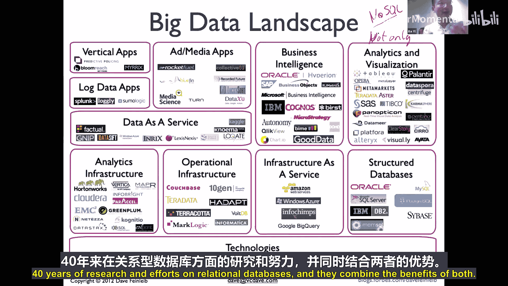