# 【香港科技大学】基于Spark的大数据计算--Big-Data-Computing-with-Spark-p05-04-01-03-Hadoop与Spark对比--BV1V8FmzuEHf_p5-

Ch。

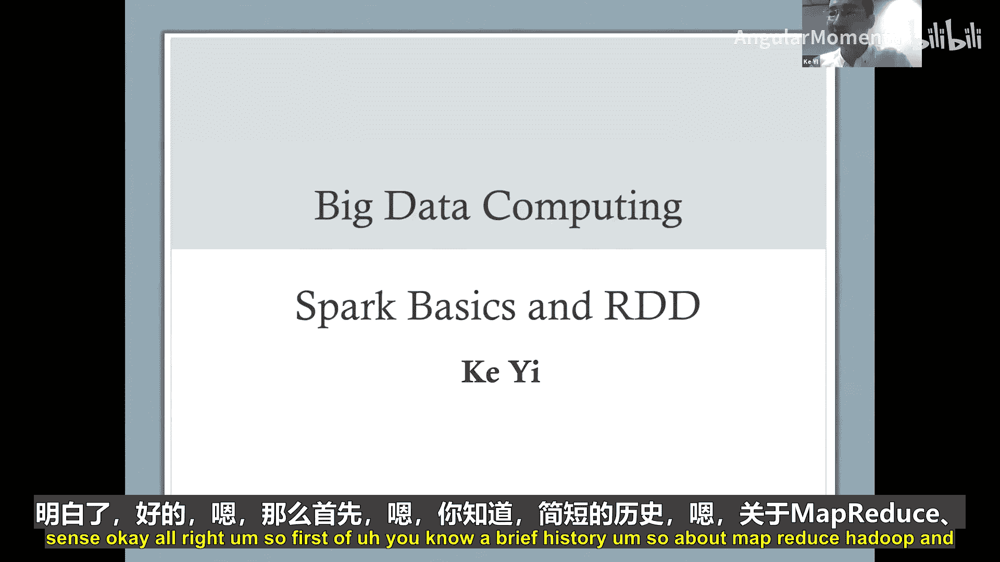

Okay， all right， so first of a you know， a brief history so about mapreuce Hadoop and Spark Okay so it looks like every even number year something big is happening in 20 the year 2020。

Is no surprise。 We have many big things happening this year。 So anyhow， the why is not produced bad。

 Okay， so we mentioned some some reasons last time。 Okay， essentially two men but two， two men。

 you know。

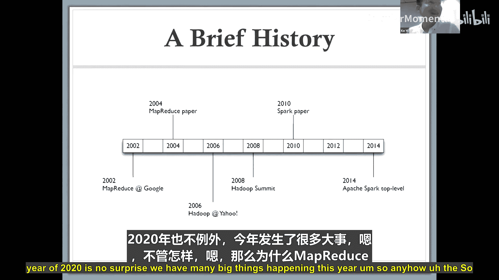

Shortcoming of map reduce is first that the program model is too restrictive restricted， okay。

At the very beginning， this was considered a good thing because programmers only need to specify two functions。

This was considered a good thing you know in the early days where mappreduce was only used for a few specific data hungry tasks。

 like word count， like building in work index， these tasks that that search engine cared about however。

 you know when when the when huge huge crowd was starting to follow this trend。

 trying to essentially do everything in mapduce， people soon realize that know the fact that the programmer could only specify two functions was really restrictive there are many complicated tasks that are either difficult or or almost impossible to implement in mappreduce so this is from the programming side namely the expressibility expressibility second。

And its from， from from the performance point of view， namely。Its name namely mappreuce is just slow。

 It's just penly slow。 Okay， especially when you run a task that involves multiple runs of mappre。

 Okay， so if you recall。The two examples we saw last time， you know。

 work on and building inver index， they only require one round of map produce。

 So for these kind of tasks， map produce was okay。 Okay， because， you know。

 eventually so it so so data has to be read from some。For tolerance file system like HFS or GFS。

 And then it has to be written back to the final result has to be written back to the file as well。

 So if the task only requires one round map。 that's actually okay。 However， however。

 when people started to do other things。 particularly in particular machine learning。

 many machine learning tasks are iterative in nature， they involve multiple iterations。 know。

 for example， you know gradient decent， this is the most widely used way to to do machine learning to do training。

 So these are involve multiple rounds。 Okay， multiple iterations until things converge So when when you when one tries to use map reduce for these iterative tasks。

Matreuce became， you know， increasingly slow， increasingly slow to the point that it was almost unbearable。

 Okay， the fundamental reason is that it has to write。

 So map reduce was designed as a essentially as a single round mechanism in the first place。

 If you want to use map reduce to do multiple rounds。 multiple iterative jobs。

 All these intermediate results has to be written back to disk Here is not disk is the you know。

 G F S or H F S， which has its own redundancy。 Okay so you know， in do 2。0。

 They use three copies right， So essentially every。Every piece of inter every intermediate result。

 Okay has to be written。Three times to disk， and they have to be fetched back for the next it。

 So disk I O are disk I O is fundamentally， you know， is is order magnitude is slower than memory。

 So， so this creates a huge bottleneck for map produced jobs， okay。

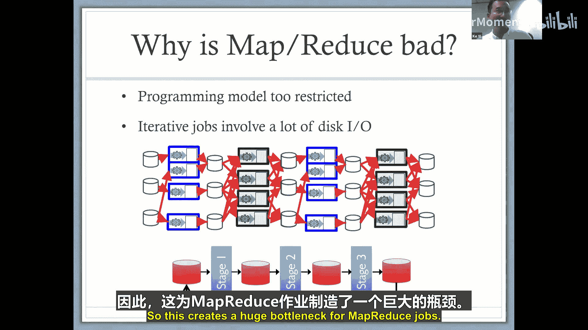

This phenomenon became increasingly unbearable when many specialized systems built had been built on tough So this these systems were built essentially to address the first shortcoming right So the first issue。

 programming model is to restrictive to restricted So when people build pre。

 which is a system for graph graph okay is actually the Google system and giraffe is the open source version Okay similarly I think Dr is Google version drill is open source version anyway。

 so also all these systems were designed to address the first issue。

 make the programming model more relaxed， more richer so that people can more easily right more complicated programs。

 However， these specialized。

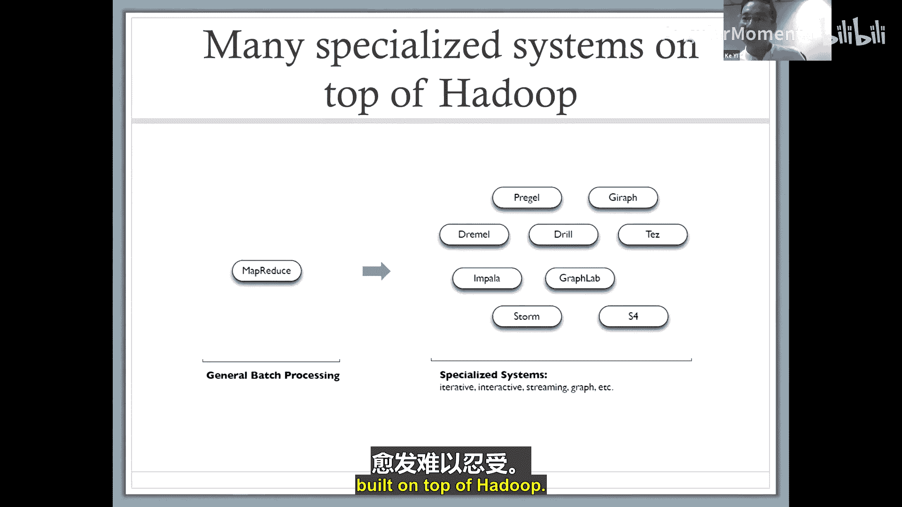

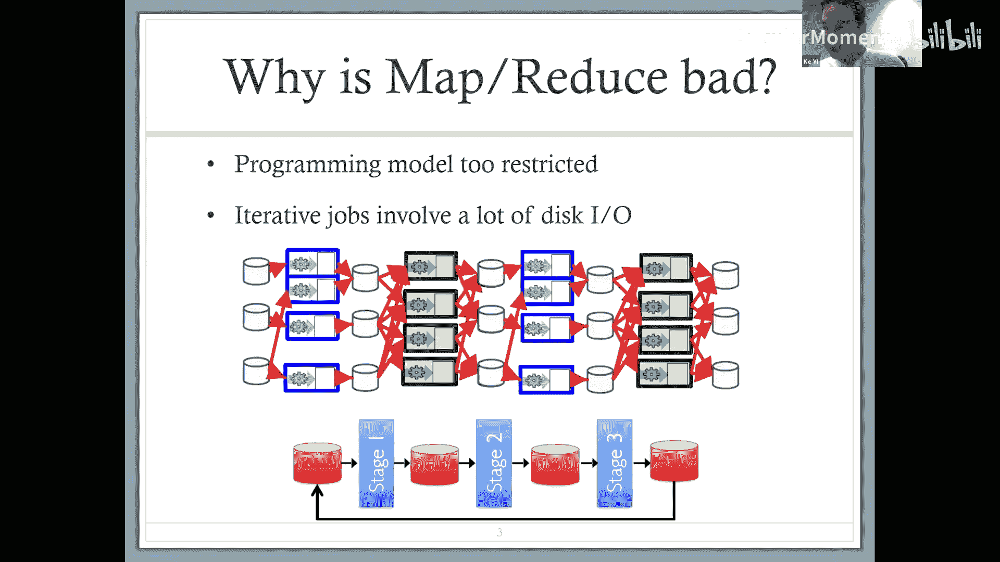

actually make the second issue even worse。 okay， because all this。Systems， eventually， they will。

 okay， so they will， so they are design way so that users don't have to write map reduce programs。

 Okay so they will can write even higher。 they can use even higher language to write to specific task。

 However， you know， all these things will still translate these are substantially lot like compiler。

 Okay， they can compile a user program into map reduce jobs。 Okay。

 so eventually all the computational tasks are still executed by the map reduce engine。

 Okay and and inevitably they require multiple runs。

 And so this makes things make the second issue even worse。Okay， so finally。

 spark entered the picture。 Okay， so they are spark was designed to address these two issues precisely。

 Okay， in terms of the programability or usability and efficiency or performance， so in terms of。

 you know efficiency it avoids using disks as much as much as possible。 Okay。

 so it focuses a lot on in memorym computation。 Okay， as long as your memory is sufficient。

 spark will try at all cost to avoid disks。 However。

 some usage disk is unavoidable because because of for tolerance。 in particular。

 still the input and output has to be has to reside on the for tolerant file system like HFs。 Okay。

And in order to facilitate in memory computation， this thing called linear graph or execution graph has been introduced。

 This is this works very well together with in memory computation。 So in terms of programmability。

 Okay， Spark is also much。😊，Easier to use recall that reduce Google's reduce was written in C plus was written in Java and can you only use Java to implement to write reduce jobs although spark is written in single languagea Java but then on the user interface。

 they support a rich set of API including Javaa as well as Python and R So these higher language user more user friendly language are being supported on the other mean。

 spark also supports interactive shell interactive computation if you use Python Pythona or R so so so for reduce they don't support you can only can only submit your job for batch processing。

So this， although this is okay， this is okay。 this is all right if your program is already is already you know written debug improved and then you submitted to run a large data set。

 However， this was very this is very difficult when during during development when you want to you know fix bugs and try different tricks and also may also may only run your program on a smaller data set first to get some idea。

 you know， for interactive data analysis， people don't usually okay run the program on a very large data set in the in the during the first version start with some smaller data set and then。

move on出发拉着个。Because， you know， maybe the data analyst may have some the idea。

 the first idea may not be even right。 Okay， so maybe after getting some samples。

 running running a program on some smaller data set on on the sample。

 then they can can already get some rough idea。 And then they can go back and fix things So interaction is actually very important in terms of usability。

 Okay， so and spark makes that makes that makes that possible。 Okay。

 and a particular nice thing about spark is that for example， if you use Python， which is a case for。

 for now， for this course。 so spark is is really can be just consider as a。

Extra library that you load into Python。 So you can still use whatever Python has。 Okay。

 and spark is just comes in as a， you know， and as an actual library。

 which supports all these functionality that scales your programs into a large data sets。Okay。

 so essentially as a result， experiments show that spark is is can be up to 100 times faster than mapreduce or how doop when memory is sufficient。

 even if memory is not sufficient， Sp still can be 10 times faster than mapduce okay in terms of coding programmability program written。

 the same program written in Sp can have two to five times less code compared with mapreduce。

And it is also another reason why is for the reduced code is you know。

 Spk provides a much richer set of API。 Okay， not only Mac reduce。

 Mac reduce will be included actually Mac reduce or just two functions to transformations that we will see transformations available Spk in addition to map reduce Spark supports a lot。

 a lot more， okay。

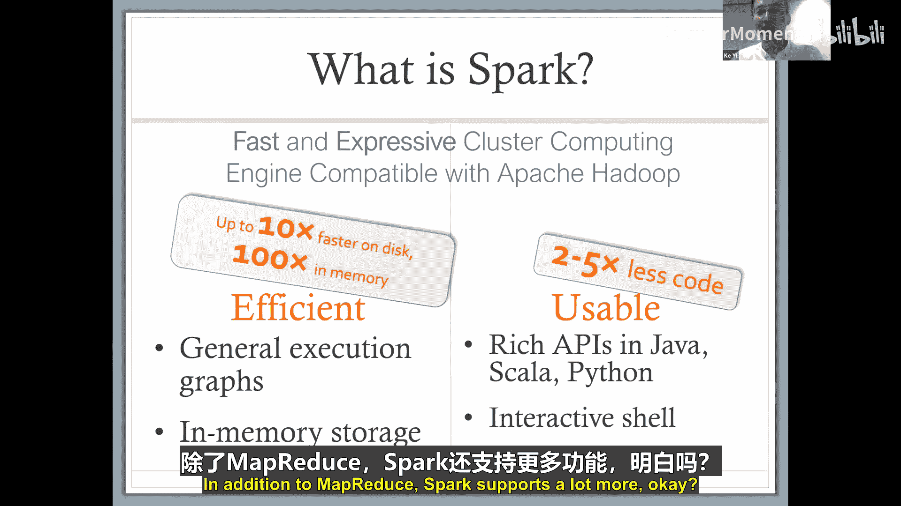

Alright， so this is sparkarks short history initially developed at UC Berkeley and in 12009 and became open source project in 2010。

And then became the most active project in the Apache Sub Foundation。

Among all the big data open source projects。 Okay， many companies are switching from how to Sp。

 including all these big names。 So， in fact， so for these big companies， Okay。

 they are actually building their own system。 Okay， they are not necessarily using spark。 However。

 their own systems are typically not not open source。 Okay yeah。

 so that's that's how they get their advantage。 however for most medium， small size and enterprises。

 they they just use Sp。 Okay， or make some small adjustment。

 modification to spark to suit their own needs better better。

And so I'm trying to contact some people from Alibaba and Tencent to see if they can come and give a short guest lecture and talking about their own in house development。

 essentially their replacement of Spark。Yeah， I will， I will try to confirm that as soon as possible。

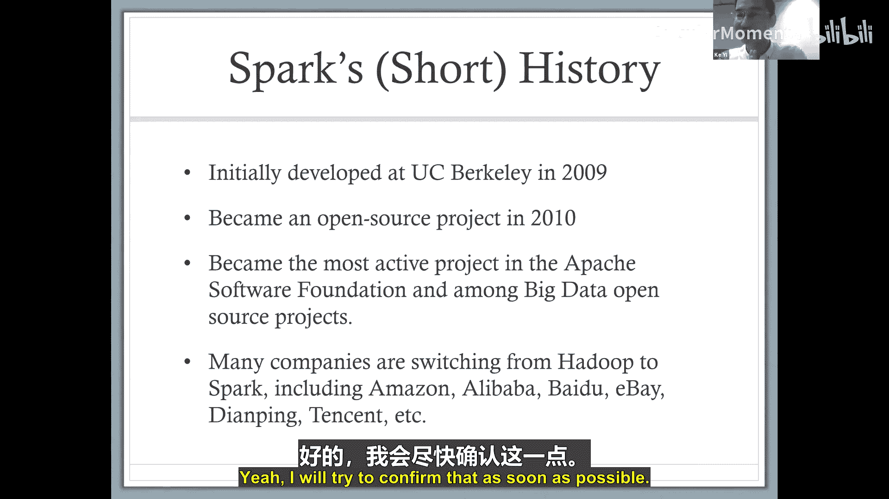

Alright， okay， so interpret popularity， you know， this the green curve is Had doop and red curve spark in in。

 and you know， no surprise， you know， after 2014， spark overtook Hadop significantly。

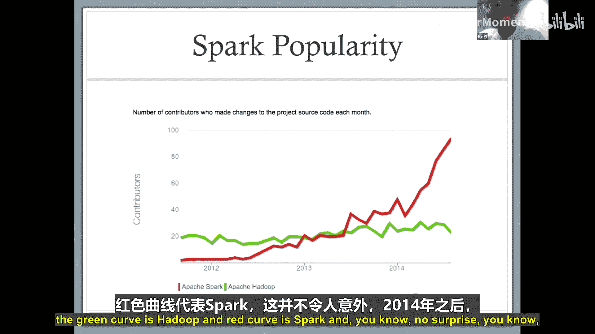

Al right， so in terms of from the very high level technical technical idea in Spk is that they want to avoid writing。

 avoid using disk as much as possible。So the reason and， of course。

 this requires a higher this has put this has a higher record on memory。 However， the size of memory。

 Okay， the size of the memory size has been steadily increasing。 Okay。

 so so far we mentioned that Moore's law was that around 202006。 However， in terms of capacity。

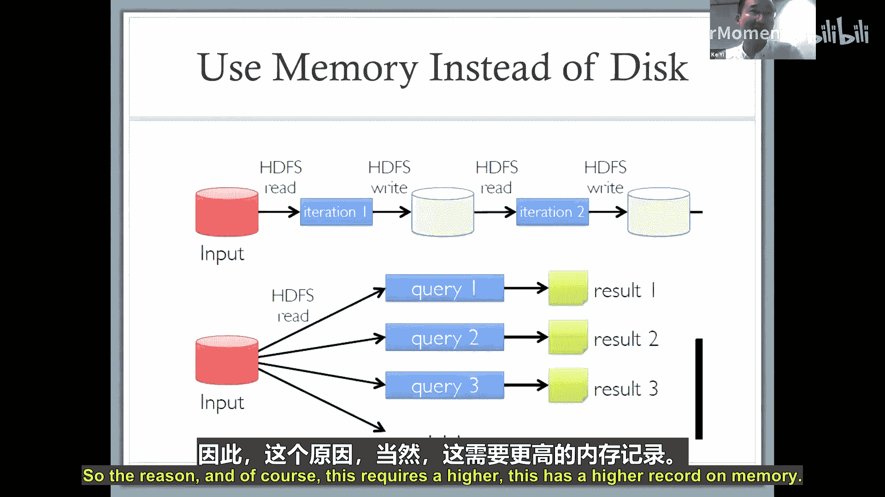

Both memory and disk， Moore's law continue， seems to continue to hold。 You know， now， now。

 it's very easy to to buy a laptop with oneter  TB of memory。 Okay， and， and also in between。

 memory and disk， we have SDs S SDs are also getting cheaper and cheaper and larger。 Okay， and so so。

 so， so this， So someone so many people are saying are predicting that， you know， disk。

 eventually will。Will disappear。 Okay， so there's one thing I am need to mention is non non volatile memory N BM。

 Okay， so this is， this is actually a new invention。

 This is supposed to be even to be even faster than SSD Okay and and and， and， and we， we。

 we will see how things。TheDevelop anyway， I think the message here is that you know as technologies。

Move forward。 Okay， so disk is becoming more of a permanent storage。 Okay。

 disk will disappear from computation。 Okay， so essentially， whenever you want to computation。

 you low it into memory and do everything in memory and only at the end of day。 Okay。

 when when when your business closes Father day， do you write disk。

 write data back to disk for archival storage。 Okay， so disk so in the in the in early days。

 you know， people try to。optimizeim I O cause now in the in the years to come。 So probably， you know。

 disk will will。will move off stage， only becoming a medium storage for archival purposes。

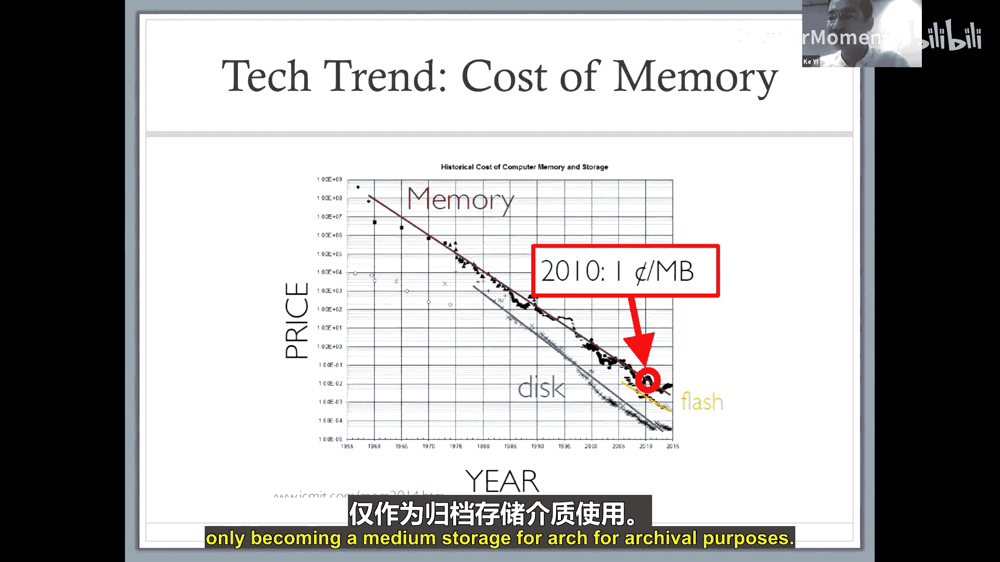

Okay。So yeah， so it just this is a picture of of general execution process of spark。 You know， still。

 we read data only once from H FS。 And then we can perform you know。

 multiple iterations all in memory， intermediate results， still only store in memory。 And also。

 if we perform this different tasks。On the same data set， you also only need to read it once。 Okay。

 you read it once and put it in memory。 the memory can also be。D。

 So even if one single machine doesn't have enough memory when you pull memory together from hundred hundred of nodes。

 which is known also known as a memory cloud。 Okay memory cloud。

 then know the size capacity should not be an issue。

 Okay and once and and you and you can you can perform， you can ask multiple queries。

 you can run multiple computation jobs on the same data set once it is load loaded into memory。

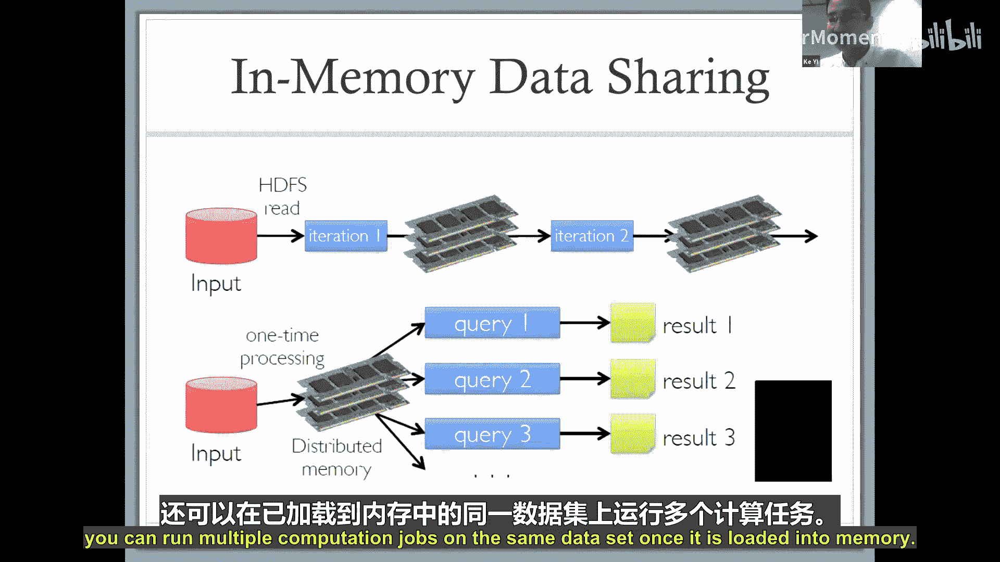

Okay， so this is a summary of comparing the key differences okay in terms of storage。

 how doops is this only namely the intermediate results between mapuce runs Sp is mean memory and or on disk so it will use memory as much as possible。

 but then when memory is not enough then things will be flushed to disk。In terms of operations。

 namely programability， mapre only has map produce。 Okay， a spark has many transformations。

 including map produce as special cases okay。啊。And in terms of execution model。

 Hadoop has only supports a batch mode and Spark has batch interactive and streaming and well actually talk about all of them in this course。

 language is only Java and Spark has Java scholara。

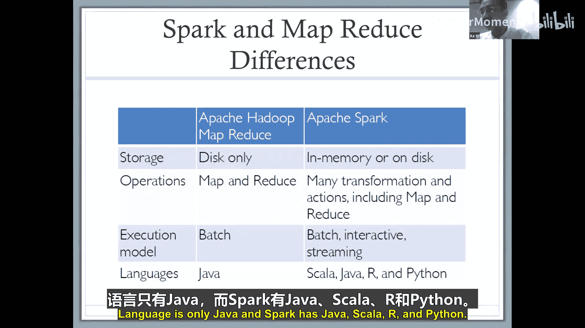

安排的。All right。