# 【香港科技大学】基于Spark的大数据计算--Big-Data-Computing-with-Spark-p06-04-02-02-弹性分布式数据集与分区--BV1V8FmzuEHf_p6-

Al right， okay， Sp programming， now we finally enter， finally get to the the technical part。

 the hardcore。All right， so a the most。Importantported most central data structure。 Okay。

 used in a spark is this thing called resilient distributed data sets or RDD for short。 In fact。

 the first paper published in ODI describing spark The title of that paper was RDD was resilient dispute data set。

 So this is really the key， really the the centerpiece。 Okay of Sp。

 Okay so recall that the idea of spark is to avoid using file system， right。

 so but they have to have some data structure to store data。

 And that data structure is the RDD Okay is R。So what is already， Okay is。

 it's actually from the user's point of view， is' really。Nothing。Fcier than a list。 Okay。

 so if you know Python list from the usual point view is nothing but a list。 Okay， okay， of course。

 it， its it much more than a list under the hood。 Its implemented very differently。

 from a Python list， so more precisely so inside spark。 So inside spark。

 Each R DD is partitioned into partitions。 Okay， into partitions。 Okay， for example。

 here I'm showing one R DD。 Okay， this is a huge list。 but it is partitioned into3，3 partitions。

 P1 P2 MP P 3。 Okay，This is another RDD。 Okay， also partition into three partitions。ok 啊。These RDDs。

 this is very important。 R DDs are created through deterministic transformations。嗯。Nely so。

 so so namely once an RDD is defined， Sp knows precisely how each RDD is derived from either either derived from source data or from other R Okay so more precisely。

 you can create RD by one of the two methods。 One is you can create RD from data by transforming data in persistent storage namely HDFS or local or local file system。

 Okay A can also created by performing transformations from other RD okay so for example here Im creating RDD2 from RD1 Okay and this transformation is a one to one transformation。

 namely every record every in RD1 creates apo。to so therefore。

 the transformations can also be done partition by partition， because this in this example。

 this transformation is a one to one transformation。And this transformation must be deterministic。

 name it well defined， doesn't use any non deterterminist factor， for example。

 it doesn't depend on random numbers。 It doesn't depend on external external factors， for example。

 how fast a machine runs， okay it's well defined。 It's always it's purely fixed once the source data is fixed。

So the next point is， again， is also very important。 The R D do not need to be materialized。 Okay。

 so what you mean by materialized， This is a jargon that you may not have seen before。 So by So it's。

 it's just， it's a fancy word for。Physical existence。 Okay， so， so let me make things more。

 Let's make things。Okay， I will， I will make it things more precise using one example。

 Okay and later on， I will also talk about persistence and partitioning。Okay。好right。So okay。

 so alreadyD is a partition so。Our programmer gets to specify the number of partitions for each artist。

 Okay， although there is always a default value if this is unspecified。In general。

 there's a trade off between the number of parts and。Performance。Okay， so if you have more petitions。

 then you will have more parallelism Okay because， you know。

All the parts can be can be handled in parallel， for example， if we do a transformation like this。

 then all three partitions can be done by three workers in parallel independently Okay but if you have five workers。

 then the other two workers will have nothing to do， right， So you want to have more partitions。

 at least at least as many as the workers will have Okay， the computing node you have。

But also you don't want to have too many partitions because the partitions will have to be managed by the master node Okay。

 so if you have too many partitions， the overhead。Of management will become larger as well。

 Okay so there's essentially tradeoff。 So as a rule of thumb。

 Okay the number of parts in order they should have should be roughly you2 to four times the number of workers don't have to you don't definitely don't want to have less but also you don't have you don't have you don't want to have more。

 Okay， very often， the question is， why don't we have the same number ofs as the number of workers。

 Well the reason is that the workers may not have same speed。 In fact。

 Spar is also designed for a heterogeneous computing system。 heterogeneous。

 we mean that you don't necessarily have the same hardware for all the computing node in your cluster some may be faster。

 some may be slower， Some may have more memory less memory。

 So some workers may be able to handle more handle more work。 Okay so if you have， in this case。

If you we have three workers， if you only have three partitions， then if one worker is faster。

 then it will finish his job earlier and sitting idle for the rest of the time waiting for others to complete right so but if you have more partitions。

 then the master note will be able to do some low balancing okay and run time if a faster worker finish his job earlier。

 then we can allocate another part。 Okay to to the worker。 Okay。

 so so that's why the the suggestion is have two to four times number of workers as your number of partitions。

Okay， so now let's look at example Okay， so this example is actually be taken from the first paper on Spark from UC Berkeley。

So hopefully I will also。Tell you what we by materialize。 Okay， so， so in this case。

 we are performing a series of transformations to the initial data set。 Okay。

 suppose the initial data set is simply a log file and then the text files during all the log information in our in our H F S。

 Okay so the first step we do is to transfer to low data into spark as an RD。

 So lines is the first RDD we are creating， lines is the first RD we are creating。 it is a RDD。

 remember from the user users point of view。 and RDD is just a list。 Okay。

 so lines from the user point of view is a list of strings。 list of strings， one string for one。

Message for one one line in the log file。 Okay， So that's the first transformation。

 So this transformation is loading。Data from HDFS to an RDD okay。

Suppose we are interested in the error messages in the log file。 Okay。

 so the second step is a filter step。 a filter step， namely， we only keep。

 we only keep those lines that starts with the word error。 Okay， so this is a transformation。

 It's a it's a one to one transformation。 Okay， what more precise is is either  one to1 or1 to 0。

 because if a line doesn't start with error， it will be filtered out。 right anyway。

 it's also called a one to one transformation。By went to why we mean that there's no interplay。

 there's no interplay between typos in different partitions， okay。

And that gives us the second RDD or errors， errors is also a RDD of strings。

 It can potentially is smaller than the first RDD， a subset。And。

 and that's the second transformation。 The third transformation is is another filter。 Okay。

 suppose we are interested in error messages that contain the word HD F S。 Okay。

 so is this contains is a function this example is written in sc up in Tython。

 we can do something similar。 we check whether a string contains a sub string。 this results。😊。

Into another into another RD。 Okay， although here we don't have a reference to this RD because we use。

 we use we use the chain。 we use we， we we use chain to to。

 to do this filter and this map and finally collect。 okay， but internally， it is still RDD。

 although we don't have a reference。 Let's call it H F S errors。So this is the third RDD。

 And finally， let's say we split that into， we split that into three fields by the table sign and then collect。

 we finally click， we give the the list of strings back to the user。 Okay。

 this collect will just return the user to the user directly。 You can also write it back to H F S。

Either either is fine。So this is a very simple spark job。 Okay that consists of1，2，3。

4 transformations， Okay， involving four RDD。 Okay， the first transformation is just the reading from file。

 reading from local from HFS。So so now let me explain what we mean bymatealized。

So if you look at this example。 Okay， so all these four transformations， they are one to one。 Okay。

 they are one to one transformations。 namely， if you look at two partitions， Okay， there's no。

Relations， theres no interplay。Between these two petitions throughout the whole。Computing task right。

They never namely taps。In different parts。They never talk to each to。 They never talk to each other。

 This is no computing job。 there are， there's no computation that involves tackles from different partitions。

So this means， although if you look at this graph， this consists of you know，1，2，3，4 steps。 you know。

 when you actually running this。Whole job。You don't have to put any synchronization by barrier because all these transformations are one to one。

 okay。There's no need to introduce any synchronization。 Okay， so this is actually good news because。

 you know， as I mentioned， the workers may have different running speed may have different speeds。

 Some may be running faster。 Some may be running slower if you enforce a synchronization barrier。

 This will， you know， this the faster workers will will have a weight that create that that that will slow that that will slow holding them。

 right， So now sparks design is。so it's designed in particular to handle things like this。

So so so now when you actually run this， every partition of actually every block in this file is handled is given to one worker and that worker will first read that file into memory and then that same worker probably will immediately start to run the second step namely filter lines that starts with error and immediately that worker same worker will start running the second。

 the third and fourth step。The worker doesn't have to wait for others。Because there's no， this。

 because there's no need。 Okay， all these text are independent。 Okay， so therefore。

 this really maximize the efficiency。 Okay， this really， this no waiting no waiting at all。Then the。

Consequence is that if you look at any of these four R Ds。For example， errors。 Okay。

 so this intermediate RDD， although it exists logically in this linear graph。 and you actually。

 you define it clearly lines So errors equals to lines the filter lines is obtained from errors。

 errors is obtained from lines after this transformation。 However， this RD errors。

May never exist at any point in time in the whole system。😡，Because remember。

 the workers have different speeds。 when worker one finishes computing errors， errors。

 These are these partition one。 Maybe part two already move to the second to the second or even the last stage where the intermediate results have already been discarded。

 Okay， so therefore at no point in time。Do we have this RD errors in its entirety。 Okay， so so。

 of course， you know， every fragment of this RD errors。 this RD， every fragment。

 every piece will exist at some worker at some point in time。 However。

 they never exist in the system physically in one in as one whole R， Okay。

 so that's what we mean by materialize。 Okay， materialize is essentially means it exist in its entirety physically it's really there。

 it doesn't only exist logically。 and by default， all the RD。Are not materialized。 Okay。

 this is for the maximum efficiency， because there is really no reason to materialize。

 So if there's no need to materialize an RD then， then spark will not materialize， Okay， so。

So for any part of this RD errors， once it is computed。

 once it's computed out by the by this future by the first stage。

 it will immediately be be be be fed into the next stage。

 And then this intermediate piece will be discarded。 Okay， so so， so， so therefore。

 it also it it not only improves money in time。 It also minimize storage requirement。

 because you don't。Because spark doesn't even store it okay。

 as long as as soon as this next stage starts for this particular for this single typo。

 this single typo will be discarded。Hopefully I made myself clear。

 of course we're going to see more examples to illustrate too so that you can get this idea better okay。

So execution yeah， to summarize， execution is pipeline and parallel。 Okay。

 no need to store intermediate results okay。So this。

 the first tool essentially means is what we mean by we do not materialize the RDDs by default。Okay。

 so lastly， this is also very important。 Okay， this name be lazy execution。 Okay。

 so what do we mean by lazy execution。Okay， so。Remember that SpR allows interaction between the user and the system？

So namely， it's possible that the， it's possible that the user enters this three lines code，1，1。

 one line after the other。 So the， So when， when the， when the this first line is submitted to Spk。

 okay， sparkk will。Actually， not do anything。 Okay， it will not actually read or read this file。

So why， why not， So， so why does so why wait， Why does spark wait。

Why doesn't Sp execute this line when you enter it？😡，Well， we just said that。

 the execution is pipeline in power land and no intermediate RDD is materialized。And。

After you enter this line， this very possibly you are and only entering the first stage。

 first first transformation of a potentially larger。八掌。

So if spark actually could this as soon as you enter it， then spark will have to materialize lines。

 Well have to store it。so， so that completely destroys the point of not material materializing any intermediate Okay。

 so instead， what spark does is is something that is。

 you can say clever or you can say lazy right clever students are always lazy So they they only do what is really needed。

 Okay， for the exam。 Okay， Similarlyly， spark is a very good student， Spk only does。

 what is needed in the final exam。 So what's final exam in this case， is is is this collect Okay。

 collect。 So because if you look at all instructions in the in this whole program。 you know。

 this read read file filter filter map， these are。Transformations that produces an RDD， right。

 RDD is the internal data structure。 Okay， RDD is never the end result。

 Okay the end result because RDD is a is the internal data structure that user。

 the user cannot access directly。So， only when a。Action return something directly to the user。

Just spark。Have to start doing things。 Okay so here， collect， as we will see in。

 this is a action that returns something。 So what collect does is return to this RD into a list。

 In this case， a scholar list， but in Python， it will turn into turn RD into a Python list。

 a Python list is something that the user can access。 So only when the user requires something。

The spark started to really start。Start doing the work， okay。Okay， so therefore。

 after the first two lines， Okay， this are entered。 sparkar doesn't really do anything。 Okay。

 it only builds this linear graph。 Okay， this， this essentially this set of instructions。

 this set of transformations， this execution graph。Only after Spark sees collect。Does。

 does it start to start this pipeline execution。Okay。So that's what we mean by lazy execution， okay。

啊。Okay， there's a question in chat。Yeah， okay I'm I think， I think what I'm。

Talking now is addressing your question about lazy execution， okay。So， so let me。呃。

Give you another example。 Okay， so in in this case， the graph is is a lie， right。

 It's just's a linear iss a sequence steps。 suppose， you know， in general。

 actually spark suppose any Dg。 So you directed acycl graph。 Okay， it is， of course。

 you cannot have cycles in your in your in your in your instructions that that will be ambiguous You have to be acyclic doesn't have any cycles。

 But other than that， it can take an arbitrary form。 for example， I mean， say so here in this case。

 the user will do a collect， okay。On on on this R， okay， suppose I have， know， suppose I。

 I change my mind。 I want to or not change my mind。 I I， I， I suppose yeah， suppose I change my mind。

 I don't want to collect this one。 I collect want， I want to collect errors that contain the word G F S Okay so I do another filter。

Filter， and this results in another RD。 Let's call it G F G F S errors。

 And then I do a collect on this one。 Okay， so now this linear graph is a tree， right。

 has a branches we I we we， if we do a collection， only on this one。 G F S error。

 if I don't do they collect a collection on this RDD， then only the minimum， only the。

 only the only the。RRT U is on the critical path， namely this one， this one。

 this one will be compute。 only this part of linear graph will be。Excuted， okay， and this two。

 HD F S errors and time fieldss。 These two will not be compute at all。 Okay， they are not。

There are they are， they are not materialized。 They are not even computed。 Okay， so。

 so this is another example of lazy execution。 Sp only does what is necessary to fulfill the user's request。

 Okay， so if you only request here， then only this part of the linear graph guess。I guess executed。

Okay。Okay， so that's lazy execution。 Now we come， we， we come to the fault tolerance mechanism。 Okay。

 we we recall that in battery reduce fault tolerance is essentially supported by H F S。

 every intermediate results。 remember is store to H F S， which is rapidly three times。

 that's good enough for good， good good enough for if that's still good， even if two workers fail。

 Okay， and but that also introduce a lot of overhead， right， So that's that's three。

 you have to write every piece of every data three times。 and this is， this is not， this is。

Bad for efficiency reasons。So in spark， the concept later graph。It not only healthless execution。

 also make for tolerance much more efficient。 Okay。

 so we call that we require we require every transformation to be determin deterministic。

 right so that means。As long as Spark knows the linear graph。And initial data。

Then it has all the information needed。To derive every R， every partition of every already。Okay。

 so so therefore it。Doesn't have to store any intermediate results to disk。

Then what if one worker fails， Okay， so if one， if， if the worker， you know。

 working on one partition， if that worker fails， if one partition of， let's say of。

 of this RDD errors is lost， then sparkk will rebuild it。

By applying a filter on only the corresponding partition of lines。 Okay， Well。

 you said that this partition of lines is not materialized。 It not stored。 that okay。

 we just go back to the file。 So namely， if one partition of， let's say this one， this one is lost。

 it will go back to this partition， if this partition is also lost， will go back to。The fs。Of course。

 the only assumption here we make it that we are making is that the initial the input file。

 the input data is stored reliably， possibly with replica。 Okay， but the intermediate results。

 theyre only stored once。 Okay， of course that can data can be lot in that case。

 because spark has all the information needed to recompute every。

 every missing piece So nothing is really lost。 Okay， nothing is really lost。 Okay。So， of course。

 the cost of for recovery is higher right because suppose you have very long in graph。

 then spark will have to go back to the very beginning and then recompute recompute all the all these loss part。

 and if in， this is cheaper because you can only go to the the last stage and that's it However。

 spark Mac pays a very high price for that by replicating every intermediate block three times Okay so essentially Mac reduceuce is is is overkill right it just it's too aggressive too aggressive in terms of in terms of in terms of preparation for for a order for for worker failing this is too much too aggressive。

 So spark and at hand is still。Has this lazy idea， right。

 So we don't really actively do anything for fault toleranceance。 But anyway。

 we have all the information。Needed。 And this information is actually very cheap。 right。

 All you have to all you have is this little graph， which is， you know。It's very small。

 It's a custom sizes。 It just a few instructions that it right So as long as this recipe is there。

 we can always， we can always make food right from from from the raw， from the from the raw。

Resources。啊。诶。Okay啊。Okay， I think the also the I think the this works well also because， you know。

For so failures happen。 We say failures happen all all all the time。 However， this is。

 we are talking about a cluster of many machines， thousands machines。 Okay， however the。

Probably okay。 O， the the the number， the absolute number workers failing is still a small number。

 Although although every hour， you may have one worker fail， but but， you know。

 average number workers fail is a still a small number。 So so this for tolerance mechanism。

Can be much more efficient。 Okay，Essential， you don't want to。Even if only one worker is failing。

 you don't want to ask all the thousand workers to do three times the work， right。

 so that's just not worth it。Okay。Okay， so this is a a list of the very commonly most。

 most commonly used transformations actions。 And you don't have to read them Now。

 we will see them when together with examples。 Okay， but anyway， you will。

 we will see all all of them。 eventually。But the。Difference， as mentioned。

 between transformation and actions， is that transformations。Transform RD， you know。

 into another R RD， Okay both input apps are Rs and actions is from RD to some data type。 Okay。

 that the user have access。 Okay， can be either a Python list or some integer or whatever python data type or a external storage system like HD F S。

 So these are actions， These are really。The， so only these actions will。Will start。

 will trigger spark to start the work to start the job。

 choice formations only build the linearage graph。诶。Okay。

 so here is a here is another example for this for the execution model。 Okay。

 remember that you spark doesnt doesn't store any intermediate results to disk。

 it also you can also perform multiple tasks and the same data by reading only once from from disk。

 So here， for example， I read I read a file from from the file system into lines。

 So lines is the RDB Okay and then comment is a RDD obtained from lines after applying filter。

 Okay So suppose I only one the lines that are comments。 It's common with some user defined function。

 Okay， and then on lines， I run count which count， which counts the number of lines and on comments。

 I I run another。 I read。I I execute another。Action， so， okay。

 so what happens if so let's like we can draw the graph this graph， right， So here is the file。 Okay。

 here is the file。From a file， I have lines， okay。And then from lines， I do from lines。

 I have comments， okay。And then the first。Execution is actually online。 Okay， here I have a account。

So when Spark sees this command， it will， you know， read file。

Into memory as and then count it and return the count the user。And then， when the。

Spar sees the second command comments on count。 No， it will read data again。 Okay， because remember。

 nothing is material materialized。 So it will actually go back to disk。 Okay。

 and then recomp lines and then perform this transformation。 No that this is this。

 all these are pipeline， namely lines is never materialized and then return account。O。Okay。

 so all right， I think someone may ask， okayy， this is not what what what So what you told me earlier。

 what you told me earlier is that spark in in spark。

 you can read data once and then perform multiple operations on it。

 perform perform multiple computational jobs。 Here you are reading this file twice。

 which is inefficient。This is the same as snap macro deals， you might even say。Well， yes。

 this is a default behavior。 Okay， because by default， part doesn't assume。

Doesn't know whether you want to do multiple jobs on the same data。 And in order to save computation。

 save memory， it doesn't store， doesn't materialize intermediate intermediatemedia results。

 So this is why， however， this is just be， this is just the default behavior。 Okay， if。

 as a programmer， if you know that you're gonna perform multiple jobs。

Spark provides a way to do that。 Okay， to make that happen， to make that efficient， namely， you can。

Explly cash or make persistent any particular RD。 Okay， so you can do that by， you know。

 by by telling Sp， hey， lines， this RD should be cached or should be materialized， okay。

 so actually we use， we often use three words inter interchangeably cache persistent materialized and they all mean the same thing。

 although they are they have small， some small technical differences。

 but essentially they mean the same thing。 Okay， so if when if spark no。

 sees that lines is is being has been， if you ask lines should be cached， then。What happens？

Is the following。 So， so let's still see use this same linear graph。 The linear graph is the same。

When when the first action count is， is， is executed， it triggers， you know， this part。 Okay。

 this part of the leader graph， namely， the file is being read into lines。

 And because lines is marked as persistent。So。This lines will actually be storyy memory。

 It will be material。 It now exists physically， even after this， the first job is done。

But the benefit is obvious to the user， but because the user execute another transformation plus a action Okay And then the second time when you run when when you write run when you when you trigger an action。

 then spark will not have to read data again。 only it will apply the transformation directly on lines。

 which is in memory now so only only this transformation， Okay。

 line from lines to comments and then from comments to count only these two steps will be will be executed。

However， known that comments is not cached， right， So after the second action is is is finished。

 the comments or or actually， comments will never be stored。 Okay， comments will not be stored。

 only the lines still exist。 lines still exist in memory， okay。So namely， although by default。

 or doesn't store anything in memory doesn't materialize anything。 However， as a programmer。

 if you expect something to be reused， you can tell Spark explicitly， I want this to store if。

After you have computed the first time， please don't discard it。So， this comes to。The second。

 the the the notion， which is persistence。 Yeah， there's a question。 Do we have a way to unc lines。

 Yes， of course， there's a way but it's not， it's not called uncash， It's called unpers， Okay， yeah。

 so if you check the check the menu online line spark menu。 They have cash。 They have persist。

But they only have unproed。 They don't have unc for whatever reason。 Okay， but anyway。

 a cash and persist， they are the same thing。 They are one is alias of another。 But they。

 I guess they get， they， they got tired of introducing all these aliases。 So， so for un。

So un persist doest does not have a alias。 So， so only you can only use un persist to uncash ARDD。

The spark material lies multiple RDD or only the last cache RDD is persistent。Yes。

 spark can materialize any number number of R。 Okay， so you can you can， you can cache any set of Rs。

 Okay， of course， this will use more memory。 Okay， and when it runs up， runs out memory。

 it will will flush things to disk。 So this may slow things down。 So if if you cash too many Rs。

 this will put a con this will put a constraint on memory。 So so that's why by default。

 spark doesn't catch anything。 Okay， so as a programmer， you should decide which R So cash， you。

Probably you want to pick the most important ones to cash if memory size is an issue。Okay， yeah。

 so you can make RDD persist by either using persist or cash。

And you can actually also specify different levels of persistence。 Okay。

 so by default is memory only， it only stores in memory。 So if。Me it is not enough。

 it will be discarded。Okay， there is also an option called memory and disk。

 So if memory is not not enough， in this case， the RD will not be will more will not be discarded。

 It will be flushed out to disk。 of course， this makes makes slow fix down。嗯。啊。So this one。

 we will talk about this more， more in more detail when we talk about when we discuss internal。

 spark internals and some， some RDs， even if you don't catch them， spark will catch them anyway。

 Okay， for some important RD how some RDs st't as important by spark itself。嗯。Yes， its， it's not。

With no hyphen just called unpersist。Okay， un， there's no unc， okay。啊。嗯。All right啊。

So how is that determine， you mean the which are D to persist。 Well， as a programmer。

 you have to decide yourself。So， well， if you cash。If you catch too many， right。

 the spark will automatically drop all data using L I U。

 least recently used So name if if if RDD is cached but not used recently。

 it will be the first to be swapped out to disk。Okay。So this is， well， if you don't know L L U its。

 you can check any operating system textbook。 sorry So basically。

 it remembers the last time when RDD is used。 Okay and then it was swap out。

 the one that is used the earliest。 Okay， the last。Barlies in in time。

 that is not the most nor recently used。

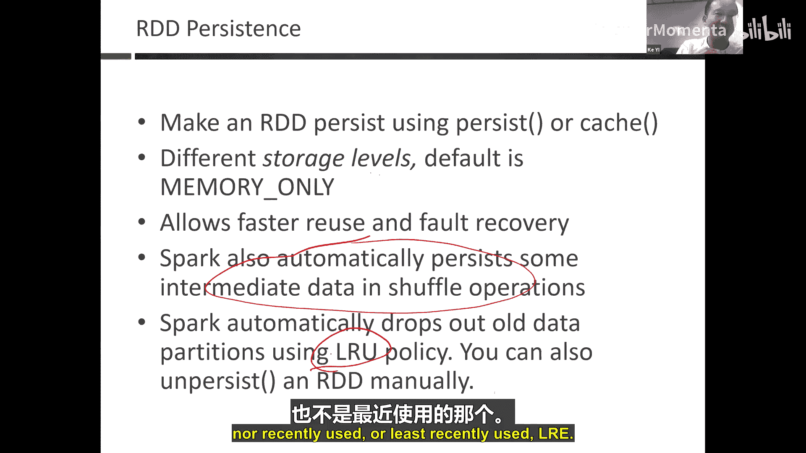

Our least recently used LV 6。 Okay， so this is a Python shell。

 This actually just an ordinary python shell。 We can do anything。S。

You can do anything as you would do in the Python shell。

 And the the only new object introduced in spark， our I 2， one is called S C， name is spark contact。

 and then later on， we will talk about spark。 Okay， so if you only need to use RDD。

 then you use S C otherwise use spark。 So for now， we only use S C。 S C is the entry point。

 Our entry point into the world of sparkk。 Okay， so now let's do our first。But but by the way。

 if you have already installed Jupiter。 Okay， and then when you type T spark， will。

 we will launch the web browser automatically。 But first。

 let me show you the the the the one without Jupiter。 And later on， we will use Jupiter。

 which is more convenient because I can mix comments code results into one into one notebook。

 anyway first， let's see the Python shell， the interactive。The interactive mode。ok。😊。

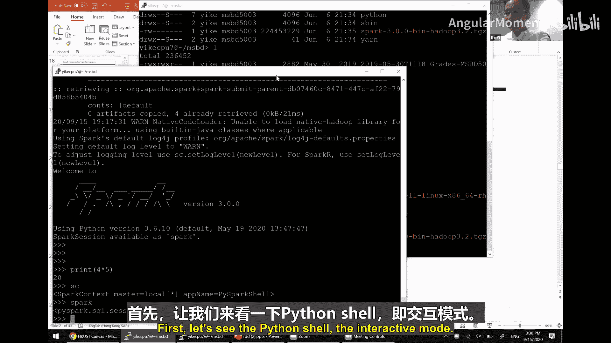

啊。So the first step， let's do what we did earlier， which is。

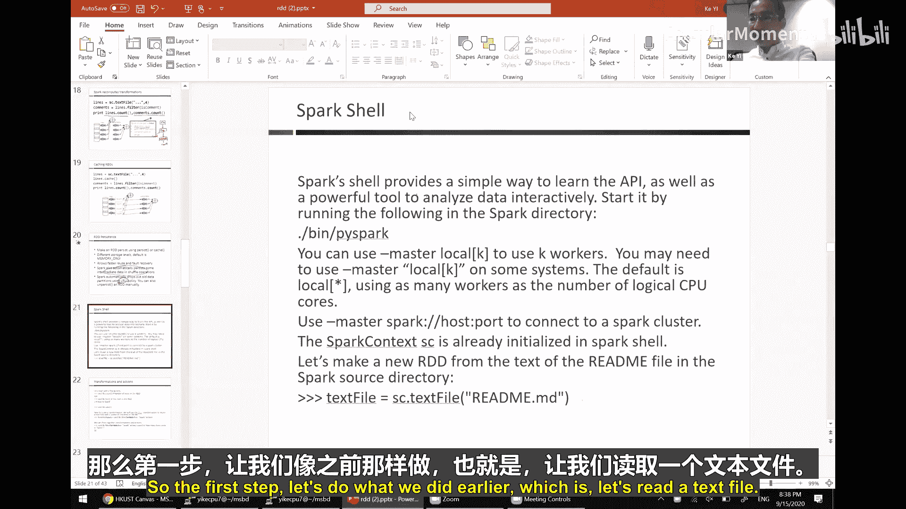

Which is， let's read， read a text file。 Okay， let's see。 I read lines equals to I see that text file。

 let's for now， let's just read one from local filesers。 Okay。

 the nice thing about Spk as I mentioned is that the same code。Which which is written on a laptop。

 can be migrated to the cloud without any modification。Of course， that is lying a little bit。

 There's one thing you， you have to modify， which is the location of your source file。

 which a local location of your data file。 So here a laptop is a local file and in a cloud。

 it will be somewhere in a file system okay。So this is only for now， let's read a local file。

 let's see read me。ok啊 we。O。Okay， did anyone notice my mistake？I made a typo。

I I I I typed read E me the M D okay， and。The correct file name is Rimi doM。

But Spark doesn't seem to report， doesn't seem to notice that。Okay， this file doesn't even exist。

 actually。Why is that？Yes， exactly。 very good。 La execution， right。

 because every transformation remember only builds the linearard graph。

 It only tells you only tells your plan your execution plan to this to the system。

 The system receives your receives your receives your command。

 but it doesn't really doesn't actually execute it until you do a action。 Okay。

 suppose let's let's do an action， which is let's say let's say do a account。 Okay， so can in action。

 maybe let do collect。😊，Collect， as we saw earlier， collect。Turns an RD into a Python list， okay。

Okay， as expected， you know， we had an error。 Okay， and the error says， you know。

 input pass does not exist。 Okay， so， so now Sp， we realize that you are telling you， your。

 your execute plan is actually wrong。So let's fix that。Okay， this time it works right。そです。

等个 outside啊。Yeah， so it's， as mentioned， it's a list of strings。 Okay， one string corresponding1。

1 string for each line in this text file this text file。 So here。

 this transformation tax file is transforms the text file into a RD Okay a spark provides many other ways to read different formats even since the CD files or based on files and we will see will and will get to them later on for now is the text file。

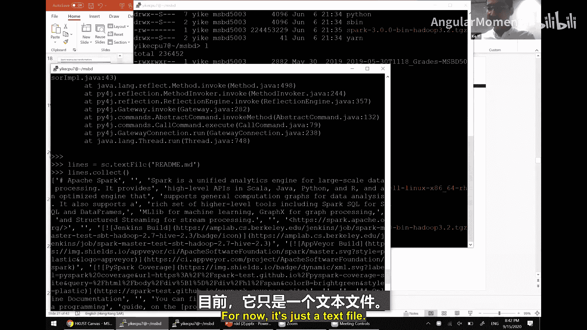

Okay。

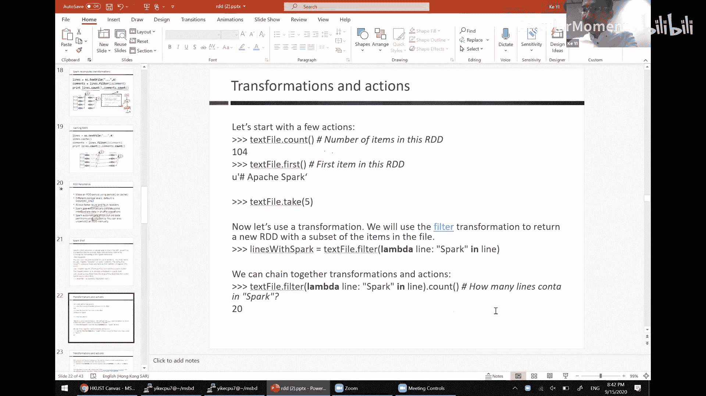

Yeah， let's just do some other actions we did。 Let's also do count。 count is another action， okay。

Allright， so101 hundred and1。 let's also do a take。

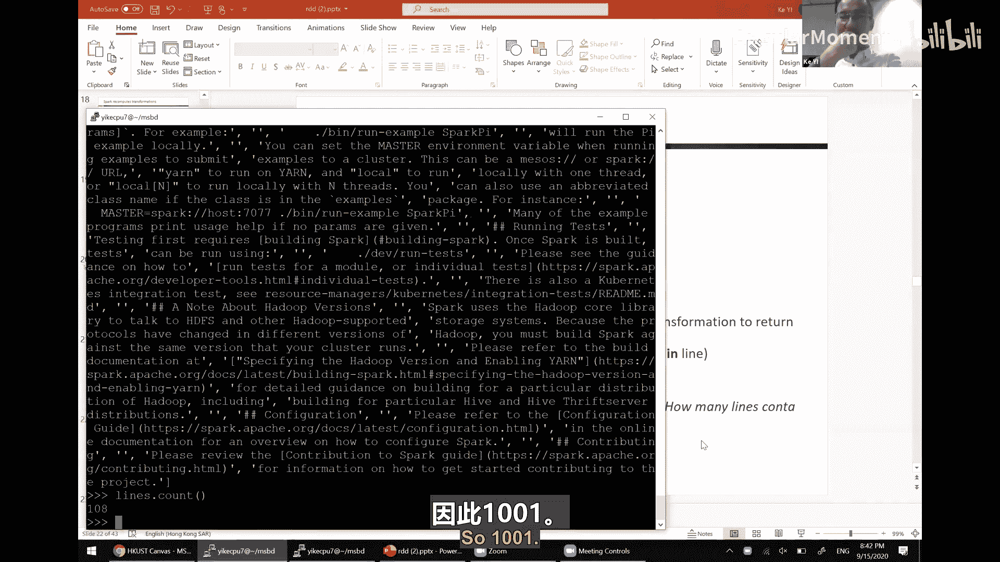

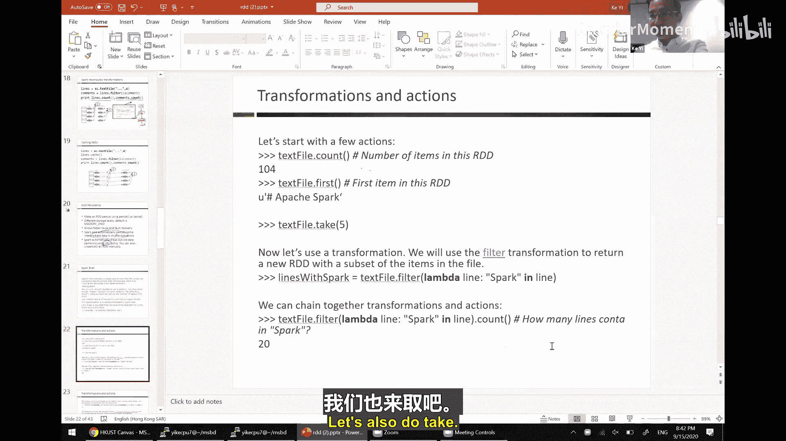

O， take one。So tag returns a specific number， a specified number， the first， okay。

 the first specified number of records in the R。O。啊。

Yeah， okay。 so let's do another one。 So lines with spark， okay。

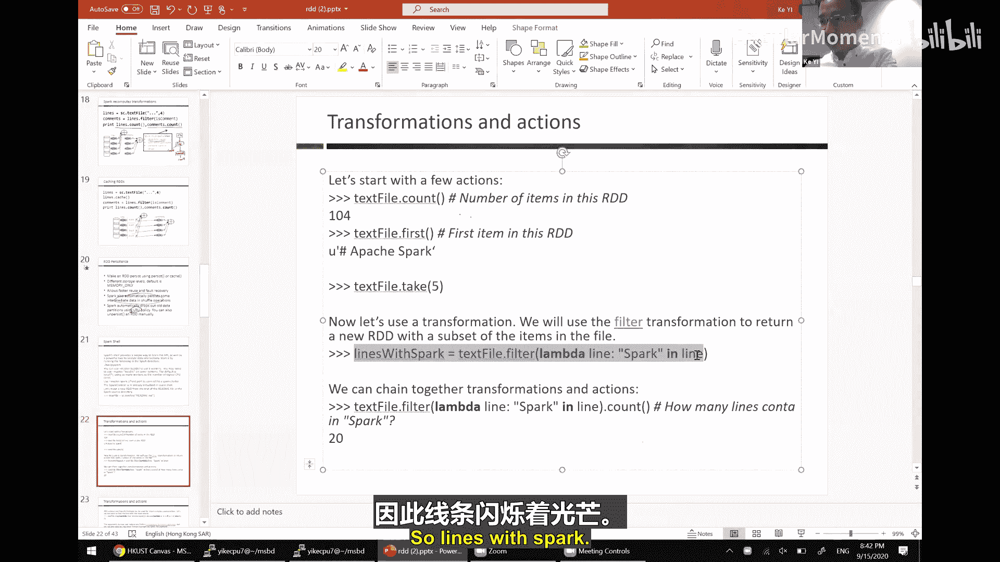

Have taste。Textile in哪地方。O啊I see thatO。Function of this future。ああm sorryor。I should be lines。 Okay。

 we are， we already read lines， right， So line。Okay， so lines with spark。 Okay， so this is a filter。

 So filter accepts any function。 Okay， because we you're using Python。

 we don't have to define function explicitly， we can use this inline version a lambda function。

 So this is a convenient way to define function。 it。Has an input parameter。 It returns at booleing。

 Okay， if it's true， then this will pass the filter。 If it's false， it will not pass the filter。

 Okay， so we can lines with。Sk， you can do collect。

So this will return all the lines that contain the words spark somewhere。 Okay， somewhere。

As expected， it only has。Lines that contain spark。

Yeah， of course you can。 we can chain them together。嗯。不是。

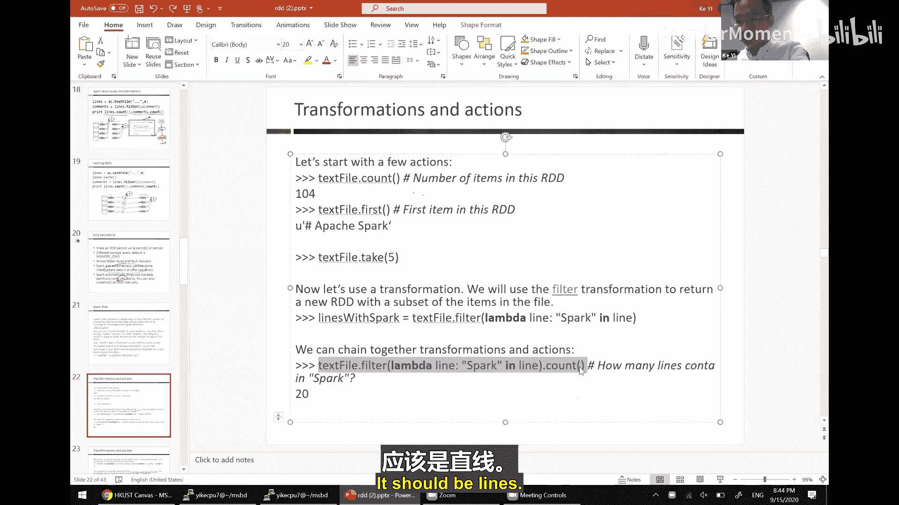

就给烂人。I okay， so you can chain them together。 It has 1819 lines containing the word spark。

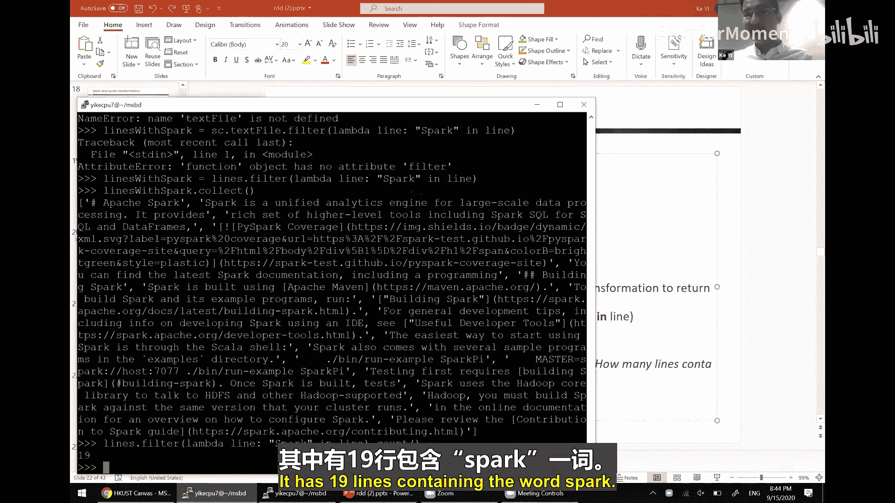

Alright。So here is the next action I want to talk about is is map。 Okay， map I reduce。 actually。

 it's called but。The map in spark is the same as the map in map in map reduce。

 Its can perform any transformation。 can perform any transformation， any one to one transformation。

 okay so。So， let's see this example。

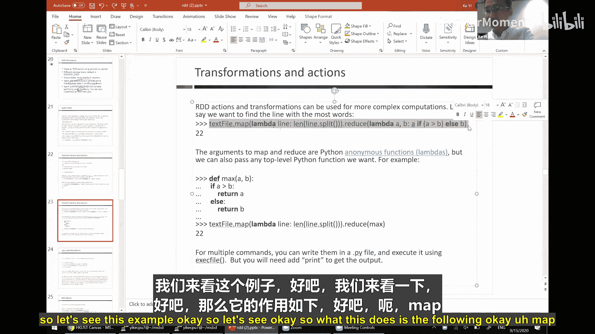

so先。Okay， so what this does is the following。 Okay map also takes a function as input as input input argument。

 input parameter here， we' are also using Lada function。 The input is refers to every tu in this RDB。

 The output is how you want to transform it。 So here I want to So so this what this does is it first。

 So lines each lines， line is each line in RDB。 This split is just the split function in Python。

 It will split a string into many pieces into a list of strings。 corresponding to different words。

 Se by space。And then I do a land L E， N。 So this is also the Python function。

 Python's land function。 So essentially， what this map does is it transforms each line in this line。

 RDD into the number of words， into the number of words it contains Okay。

 into the number of words it contains， okay。So before I do that， let's first do。Collect。Okay。

 so it turns all this into numbers into number words。 Okay， the second one is a reduce。However。

 this reduce is different from Mac reduces reduce in map reduce， the reduce is， you know。

It is applied on key yellow pairs。 So here we don't even have key yellow pairs。

 We just have RDD numbers， like RDD numbers， RD integers。 So this reduce， okay is is reduce in spark。

 iss an action。 It's not an transformation。 There is a transformation called reduce by key reduced by key in spark。

Is the one that corresponds to。The reduce inequ。 So here reduce is in action。 So this reduce。

 what risk reduce does is is， is that it combines the whole RD。

It cans everything into one into one table。 Okay， by using， again， a user defined function。

 a user defined function。 So here is a long function。

 This defined function has to have two inputs okay and produce one output。 So essentially。

 this function defines the rule of combining two element into one element。 Okay。

 two element into one element。 Okay，So here， this function here is Max。 Okay， so name it。

 it has A And B， and then it returns the bigger one of A And B。 So， you know。

 probably can guess what the result is。end results is a maximum element， the maximum。

Element in the Hawaii。So what it does， it will repeatedly combine elements， good merge elements。

2 at a time， Okay， using this user defined function。So when you do this pairwise combination merges。

 So eventually all this word， all these integers will be merged into one。 and that。

 then that corresponds to the largest the maximum element in this whole。

 Okay this ist our action because it returns a single integer， which is a python the data type so。

Just remember anything that is not an RD。 You know， that is an action。

 and that will trigger sparkark to do something。Alright， so we talked about reduce。

 We mentioned that， you know， the user should define a function。

 The function is essentially a two to one function combines two elements into one。

 And in this example， we use max。 Of course， you can also use things like， you know。Plus。

 so what this does。 Yeah， okay， yeah， then then， then I don't need if else。 I just return a plus。

Then this will return to sum， right。Importantly， this function。

All this operator that you define through this function must be commuticative and associative associative。

 Okay， so namely the order in which these operators are carried out。

This should not affect the final result。Okay， both nexts。And plus， an addition are commutulative。

asnaomic。Com must be asciative。 Okay， must beciative。 Okay， yeah， Max is also comm and assertciative。

 namely order doesn't the order by which the operators are carried out doesn't affect the result。

 Okay， this is because， you know， as a programmer， you will have no control over how things are。

 how things are combined。 Sp only guarantees that eventually， you know。

 everything will be mergerg to one。 But how they are exactly merge in what fashion you have no control over。

 Okay， so if you define something that is not。Associative or commative then you know the final results will be will not be well defined maybe different every different time you run it Okay。

 actually let me give give you an example I just made up one example during the break。

It's actually now easy to come up with operator。 That is not。Commicative and assertciative。Yeah。

 this example I have is taking average okay？😊，You return a plus B divided by2。 Okay。

 so this operator。If you think about it， it is not commutative or it' not it's not associative。 Okay。

 it's not associative okay。So， as a simple example。

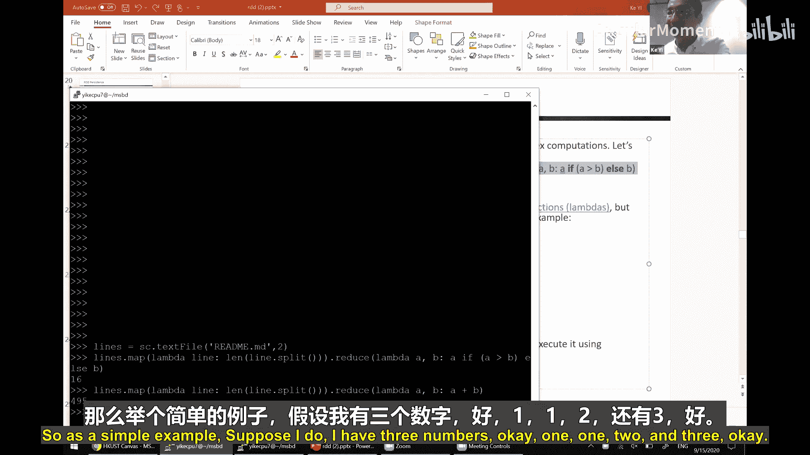

Suppose I do。 I have three numbers。 Okay，1。1，2， and 3。 Okay。

 so if I use this operator to combine the first two。And then the， the next one。

 So I will have combining the first two， I have 1。5， right，3 Oh， no。I think for this， yeah。

 let's use four。嗯。Okay， so if I combine buy。The first two and then the last two I get 1。5 and 3。

5 right and then I combine this two I get two so essentially I if I do it in in the in the one two combining 12 and combining34 and combining 1。

5。5 I get no 2。5 Okay so this is the whole average， which is probably what expected。What we wanted。

 however， if they are merge in a slightly different manner， I say I combine  one，2 first that get 1。

5 and 3 and 4 right and then。Next， let's combine 1。5 and 3。So I get。What， I get， I get two point。2，5。

 right。 and then 4。 And then combine that I get 3。125。 Okay， anyway， something different。 right。

 So this is an example where this operator is not as sosociative the order。The order does matter。😡。

Okay， now let let's see this in action。 Okay， well if I insist I want to do this for whatever reason。

 Okay， well， I this is one result。 Okay， of course， if I run against is also the same thing because。

 you know， once。

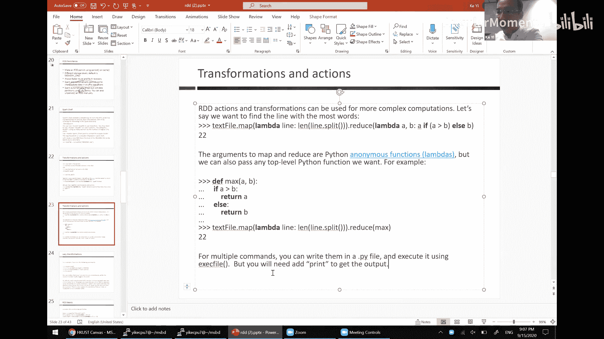

The partitions are there are are are fixed then then the， the order is also fixed。

 We can manually change order by。By specifying， by specify a different partition number。

 so so previously， I， I didn't do it。 And then by default， when you read a text file。

 I think I think the default number 2。 Okay， unless the text file is very large。

 But then I can specify can manually specify different part number。 So name here I。

Tell Spark that this RD lines will have should have three partitions， Okay， three partitions。Okay。

 so now if I do this again。Okay， you can see it's different。

 It returns the number that is different from earlier， although it's the same set of transformations。

 The only thing I'm changing is the part number。 Okay， so this is。Butad because， you know。

 you should your program should not depend on the number of parts。

 number of petitions is supposed to be a parameter that only affects the performance。

 not the correctness of your program。 Okay， so that is why I need to stress that you know。

 for this reduced function。 This operator has to be。The order has to be asative and commutative。

All right。O诶。

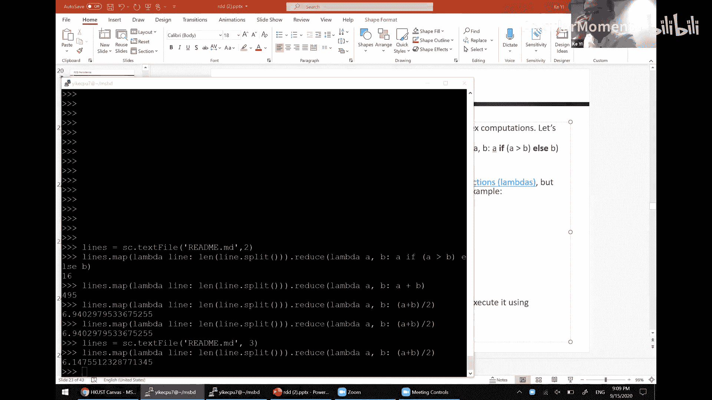

Are we all good。Okay。呃。Okay， yeah， so yeah， this is another example。 I think this is。

 is something similar。 I'm not gonna。 okay， anyway， let's's let's mass。 So I hear yeah。

 this is an opportunity to introduce another another operation。

 another its not really a it can be considered a transformation。 it。

 it transforms a python list into a RDD。 Okay， so it's。

 so here this range will create a python list and then will turn that into an RDD。 Okay， similarly。

 I do。

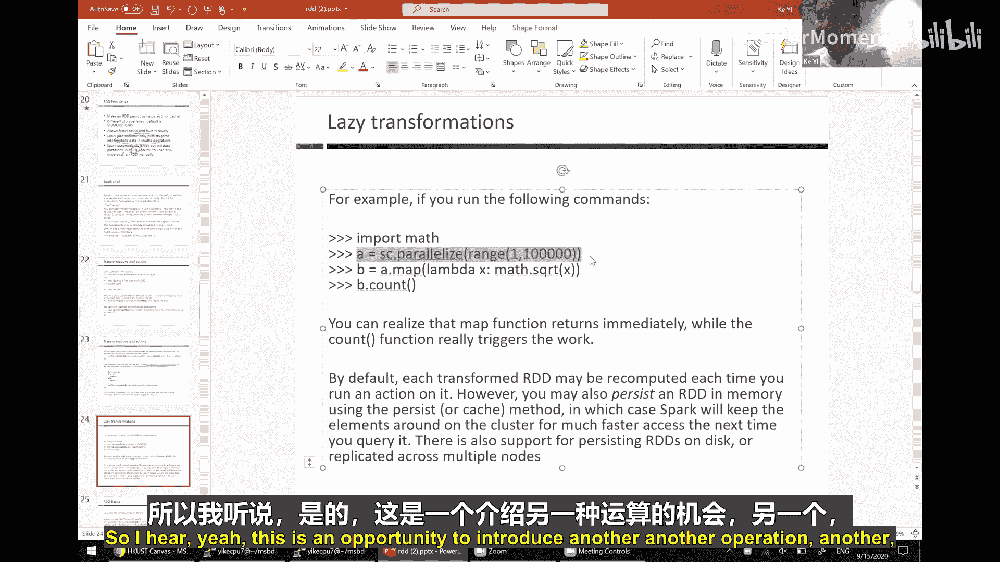

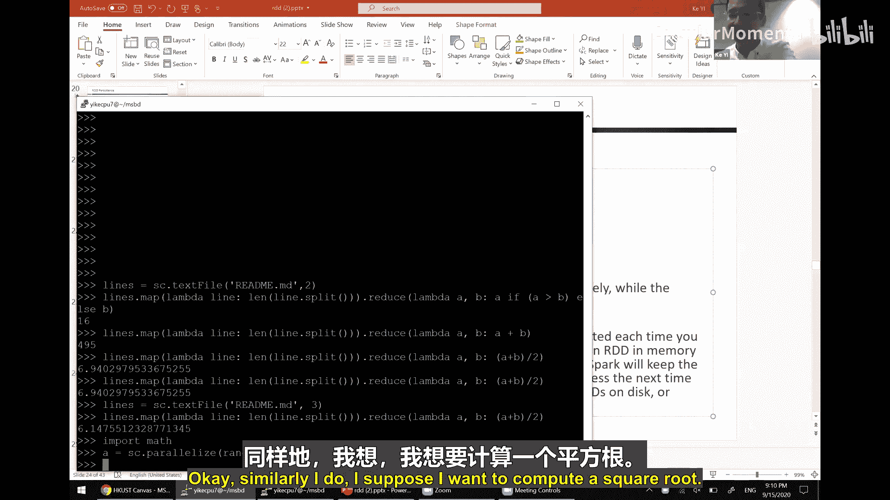

I suppose I want to compute the square root of every number It RDD。 as you can see。

 it returns immediately， because， you know， this spark uses lazy execution。 Okay， and we only。

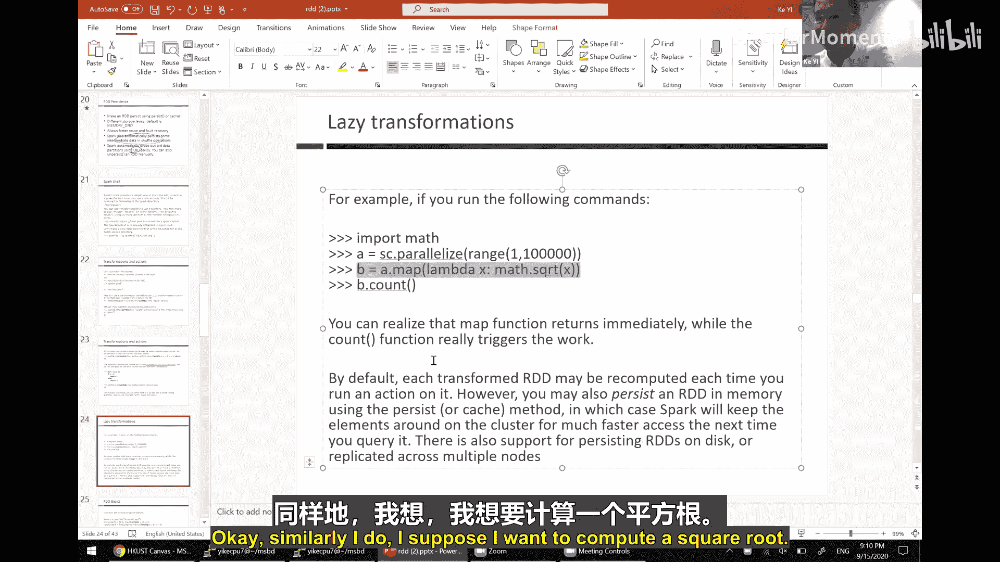

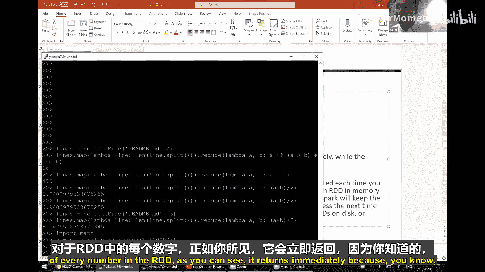

Things only start to run when we have a。

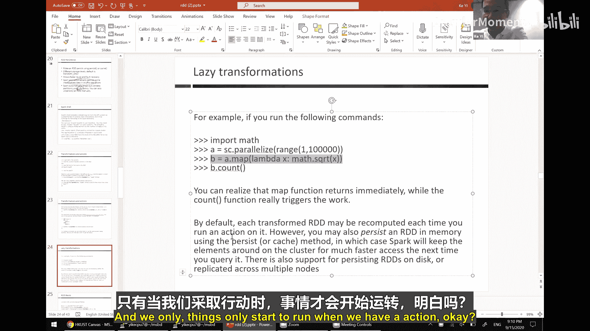

Action， okay， although， yeah， my server is pretty fast。 You don't see that anyway， okay。

So by yeah。 So yeah， by default， each transform RD will be recompd each time you run an action。

 you run an action on it。 Okay， so that means if I do B that account again， then then。

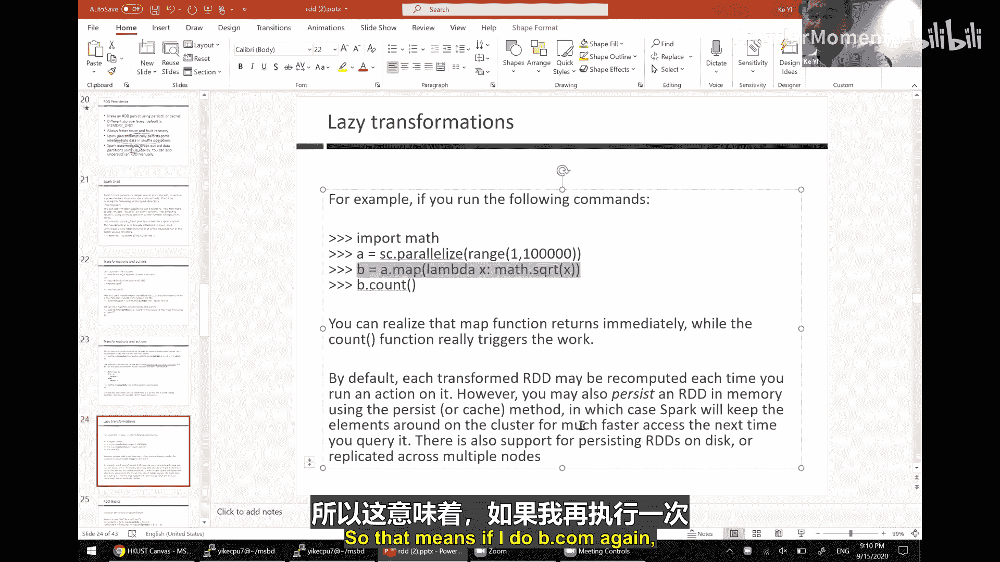

The spark will compute the square root。Again， for all these 100000 numbers， Okay。

 which may be a redundant。 So so that's why if you know that an RD will be reused， you can， you。

 you'd better persisted or cash it。

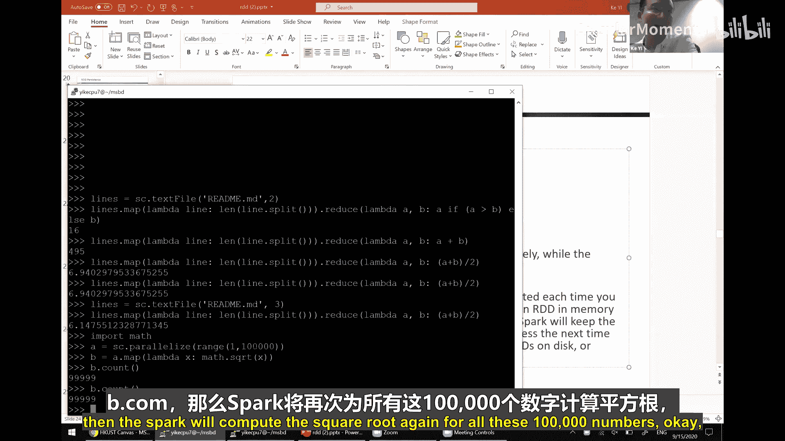

O。Okay， so here， this is an example where we used interactive shell。 Okay， namely。

 this is very good for interactive data analysis。 However， when you are done with your program。

 you want to run your program on a larger data set you better use the standalone version。 Okay。

 in particular， if you are running spark on a cluster in the classroom maybe shared by many users。

 then it's not a good practice to run the interactive shell because that will occupy resources take takes resources from the cluster。

 Okay for a right long period time period of time。 So in the classroom mode the recommendation is to submit your job as a batch job to the cluster。

 Okay， in that case， we can use。

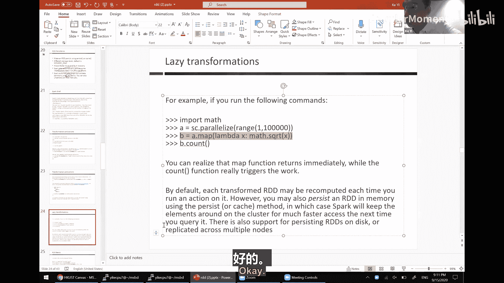

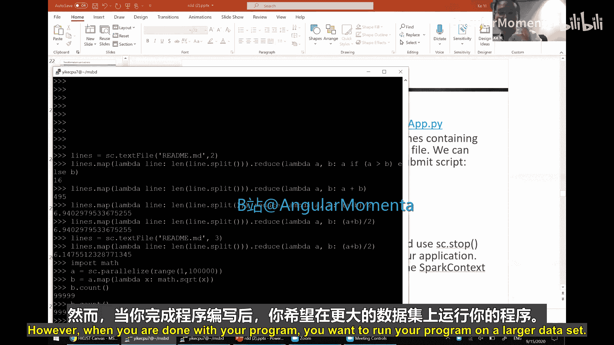

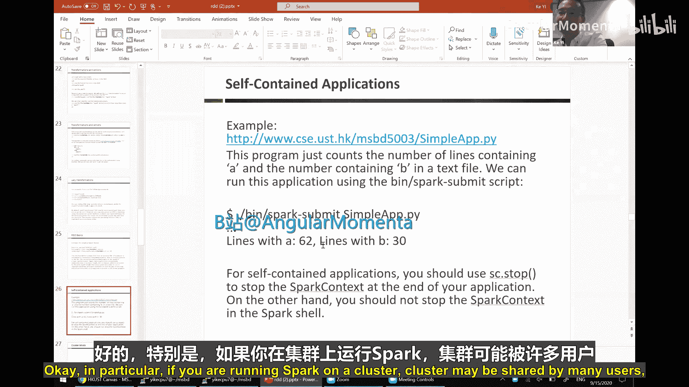

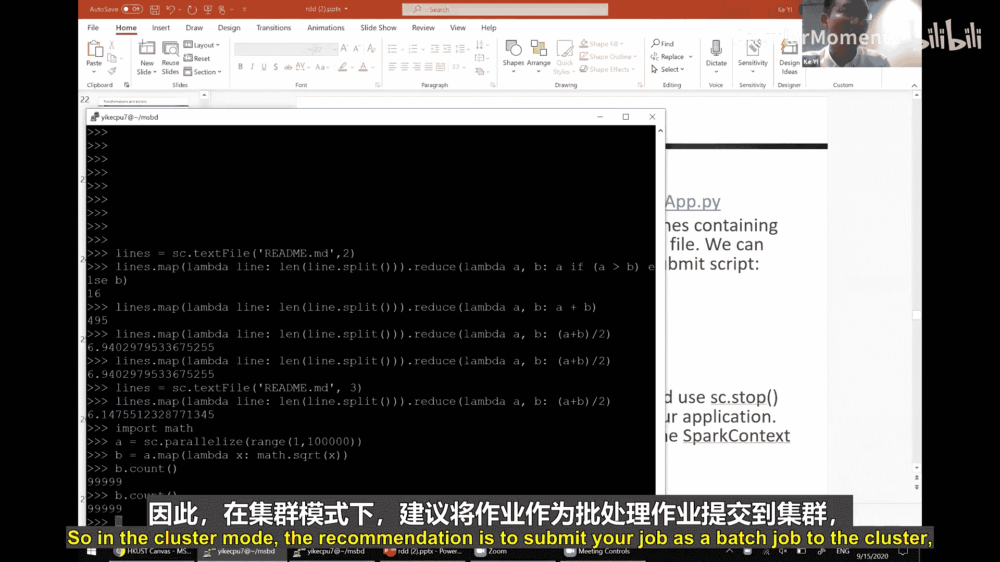

The spark submit， okay。But now， it's very important to understand。Where each line of code runs。 Okay。

 this is very important。 Otherwise， you will not be making any advantage of。

 of spark or cluster can do computation。So let's say you we have this simple task。

 which is to combine two RD。 Okay， by combining。Concatenate， right， We want to。

Concate these two RDs to form a new RD， which is con， congnation of the two RDDs。Okay。

 so remember that we can use collect to turn RD to a list in Python。

 we have this conation operator between two lists， right this plus So a now implementation would be the following right you first collect each RD into a python list。

Then you cancatenate them together， forming a new。睇翻 list。And then we convert that back toDC。

Of course， this is a correct way of contaminating to。However， it's very inefficient。 Okay， In fact。

 it does。 It doesn't make any use of the parallel power of spark。Because。

What what this does right so remember any action will return something to the user okay will return something to the user right so eventually this collect will turn this RD into a Python list which must be stored at the user program yeah anyway I think it actually at least briefly describe this the classroom mode right so in fact there are three different types of machines we are talking about in a classroom mode。

If we have worker node。 Okay， that is those， those are the computing node that actually。

Performed computation。 we also have the classroom manager， Okay， which is a master node。

 which you know is in charge of allocating job allocating tasks to the ex to the workers。 Okay。

 and and also in case of someone fails， then the classroom manager is in charge of for tolerance okay。

So so and and finally， there is a thing called the driver program or driver machine。

 So this is suppose you are running your spark on the cluster。 Then this one。

 This driver program will still be running on your laptop Okay， so， so essentially。

 when you submit your spark job， you submit it to the classroom manager and the classroom manager will display your job to the worker node。

 and they will collectively store an RDD， Each worker may have one or fewer petitions。 and。😊，However。

 everything else， you can remember that in the Python shell， you are still running Python， right so。

Except those RDs。Everything else is still store in your local laptop。 Okay。

 that also means whenever you do an action。The return。

 the results will be returned to your driver program， which is a very。

We which can be a not so powerful machine。 Okay， so， so having， having said that， you know。

 now coming back to this example， this first RDD it collect this will return RDD， namely。

 it will collect。This all the partitions in LEDD combine them into one single python list。

 Return that to your driver program。 So A is a python list。 So everything。

Except Rs is stored in your local driver program。 So both say A And B will be Python list in your driver program。

 And then you do this。Calation locally， potentially taking up a lot of memory。

 a lot of your local memory。 Okay， and then you， you send it back to your cluster forming a new order。

 So This is a very inefficient way of doing things。😊，Okay。

 so the correct way of concalculating to RDD is to use a。A provided method called a union。 This will。

Concatenate this two R。 Okay， so know that this union is really not the the the union used in set。

 This is， actually， this is， I think this is a bad naming。 Okay， we should call concatenation。

 Okay so this combines two R into one。And while preserving their original order。 Okay。

 mainly one followed by the other。 Okay， so this will run completely at the worker notes。 Okay。

 so without incurring any burden on your driver program。Okay， so， yeah。Now。

 we can go back to the Jupyter mode。 So we have demonstrated how to use shell。

 although it is convenient， is not still not， not nice， right。

 Because if you make a mistake like I did， I need to go back and I need to go back and fix it and and and。

 and also once I， once I， once I turn it off， everything will be lost。 So， So， so therefore。

 a much better way is to use the。

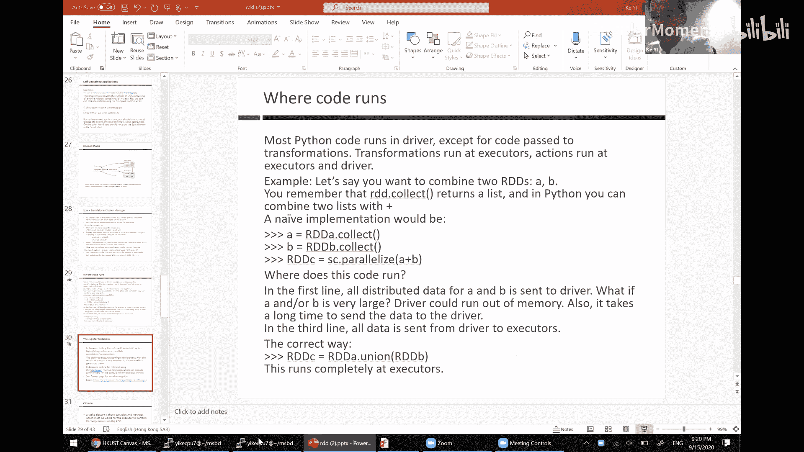

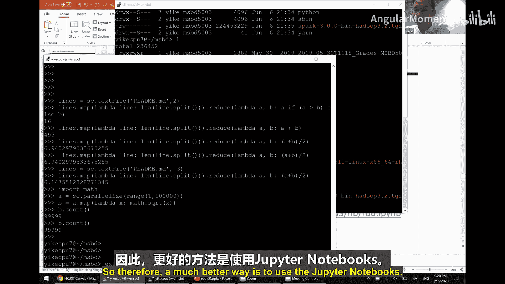

TopyterYeah， we I have prepared a number a collection of art of Jupyter notebooks。

 wish you can download， okay。URL is this one， okay。Yeah。

 when we have further other Jupyter notebooks， you just change the file name in this URL。 Okay。

 for the for the first example， notebook is RDD dot IP P， Y N B。 So I Python notebook。

 because it's just Python， okay， except that we have this spark entry point S C。

 spark context and later spark。All right， so。Okay so。

 so you can use shift enter or control enter to execute any cell。He啊。And all with example。

 data files， for example， I'm using data slash fruits， they can be downloaded at this URL。

 All you have to do is to change the file name。可以看可以开。So this is just， this is simply a text file。

Similarly， yellow things， doTXT is another text file。So here in the first simple example。

 I'm just reading a reading from local file。 It local file is actually here。

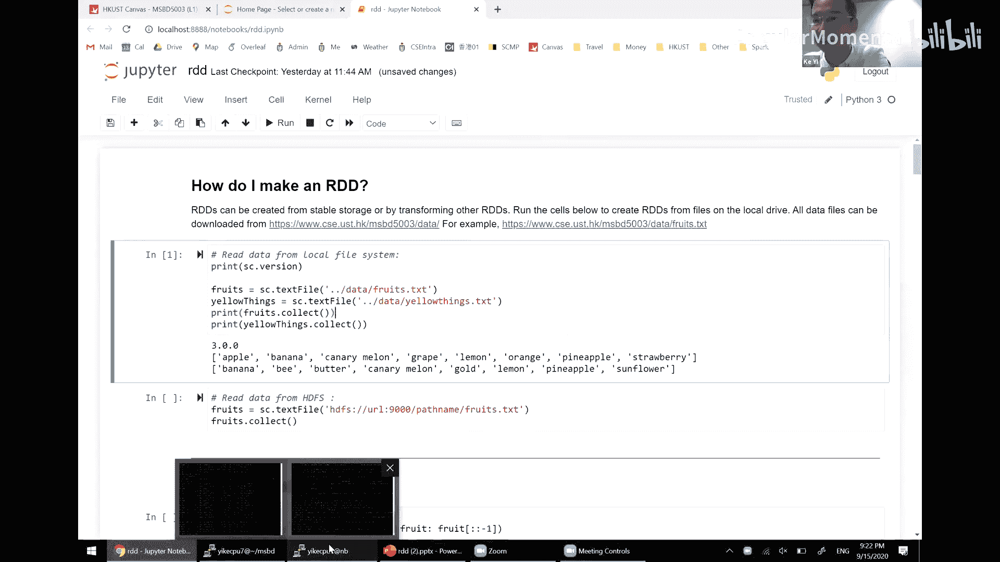

嗯。铁滴。Yes， it' all the data files are here on my server， the fruits。It's here， okay。

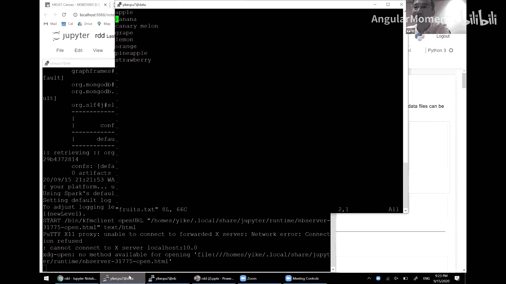

嗯。Okay， so now you can when later on， when we run this program。

 your program on the in the in the in the cloud where you have installed H F S。

 all you have to do is just this single change。 namely。

 just change the URL of your of your data file， okay。Spark already supports H F S。 Okay， so that。

 so that's why when when， when when you download Spk。

 you should also choose the appropriate version of of Hadoop so that later on， you can read。

 you can read file from your Hadoop installation。 You should choose a spark version that matches your your Hadoop。

 Okay， anyway， we will do it， we will not do it now。

 we will do it later when we have a cloud resources。Okay， just some more examples。

 This is example of a map。 Of course， when I run it。

 it doesn't really print out anything because it's just a transformation。 When we do a collect。

 it starts to run。 Okay， first time you run， it has to wait a， wait a little bit。

 So in this transformation， I'm just reversing the string。 Okay， the food names。 Okay。

 so now we have these names。So now is a good example of。Of to see how。

Cashching or persistence may affect things。 Okay， so in this case， I'm not。 So this RD， you know。

 fruits reversed is not cash。It's not cache。 Okay， so we just。

 these lines all are are all coming out。 So therefore， if I。

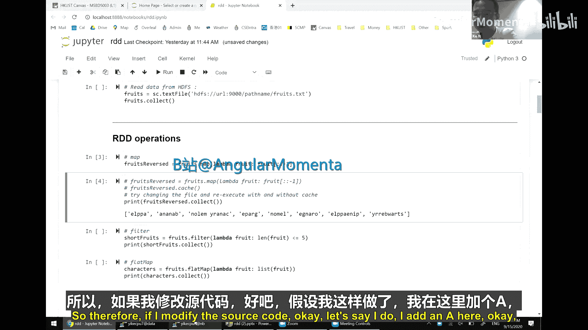

Mdify the source code。 Okay， let's say I do。L a here。Double apple。And then。

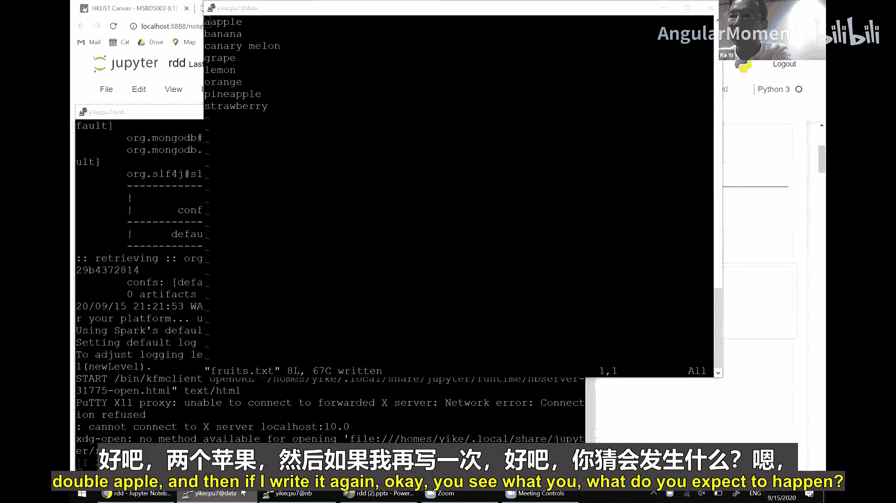

If I write it again， yeah。You see what do you expect to happen？Well， as expected， you know。

 the whole thing gets reexed because nothing is cached and this updated file is is is， is red。

 namely， the file is， is retrieveed again。ok。So， so now。Let me change it back。

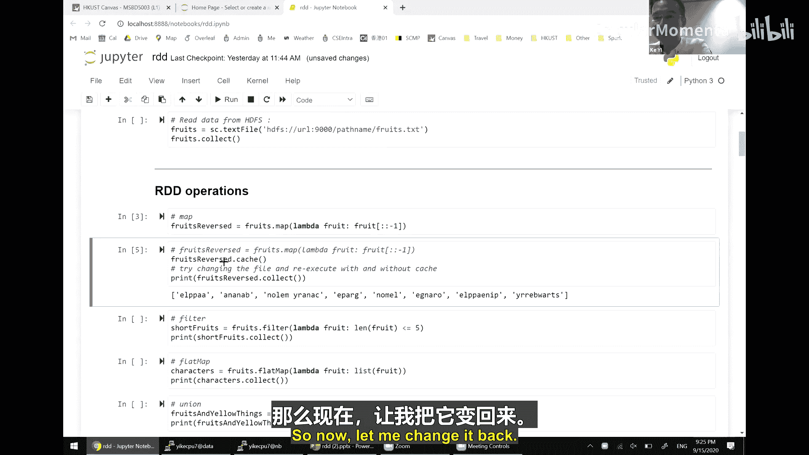

屁。

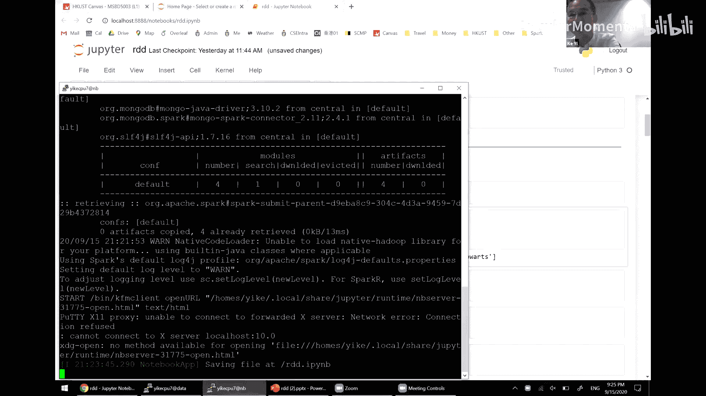

哦。

Okay， so let me change it back。Okay， so now I Ab is line cash。 Okay， okay， I， I， I run it。 I run it。

 So it still Apple。 Okay， so now because it is cached。 Okay， because cached， if I modify again。

 let's say I do B Apple okay。

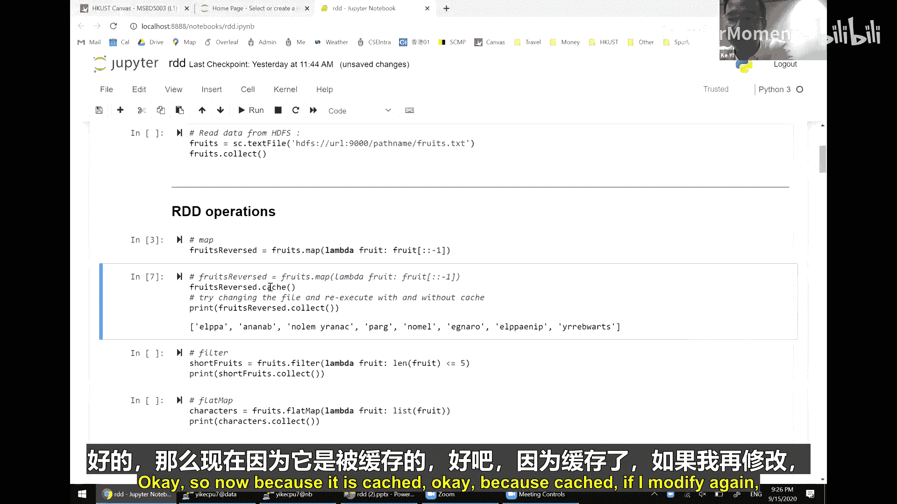

I save it。啊。对。I， I say I， I write it to。 I I change this file。 Now， if I run this again， Okay。

 if I run this again。

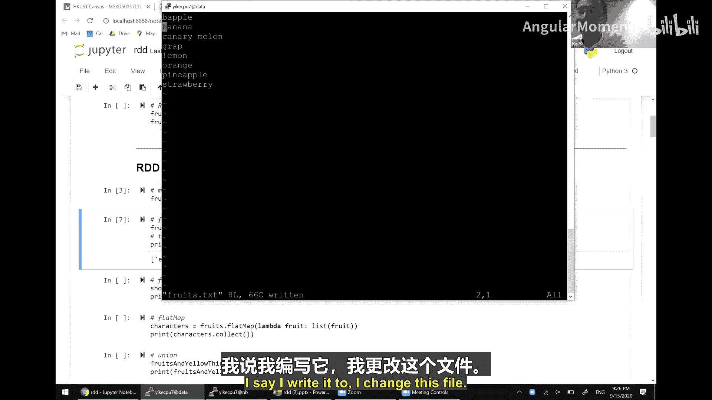

Okay， you can see that。It is still Apple reversed。 Okay， It does not。 it。

 It did not read my update file。 My update file already contains B， is already B Apple okay。

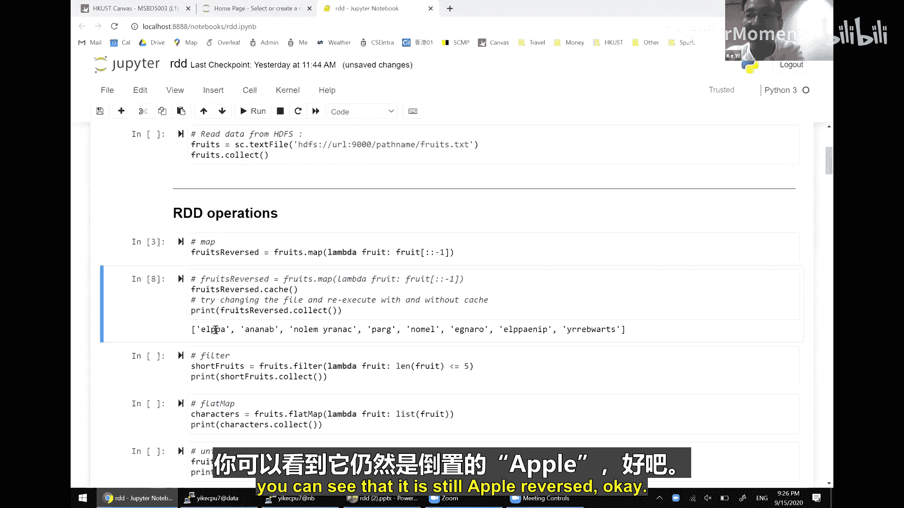

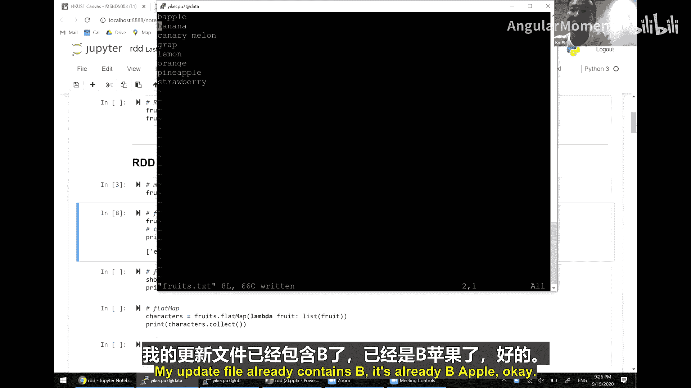

So that means this caching is really working。 you once you cache an RD and once it is computed。

 then it will not be recomped again。 Okay， recomp again， okay。So let's do some other experiments。

 Okay， experiments。 So if I。Comment it out again。 Okay， comment out。 Can comment it out。

 comment it out again。 Okay， let's run。 So of course， do Apple。

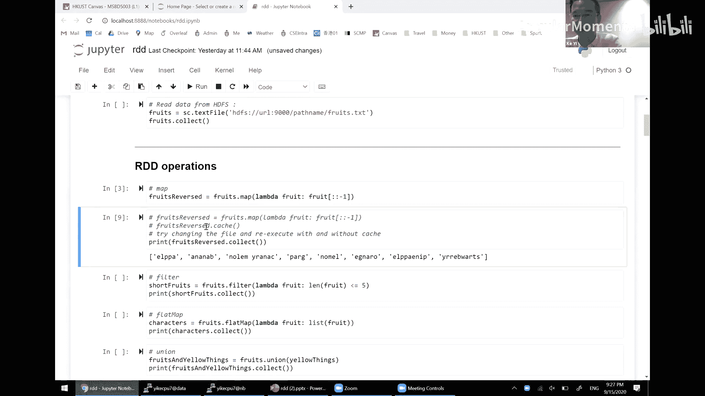

Well， it still Apple， right？

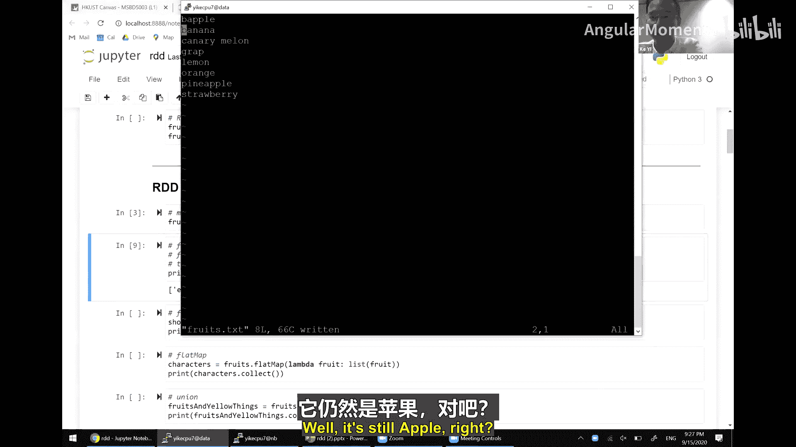

So what's going on？ I have， I have made this unpersistent。

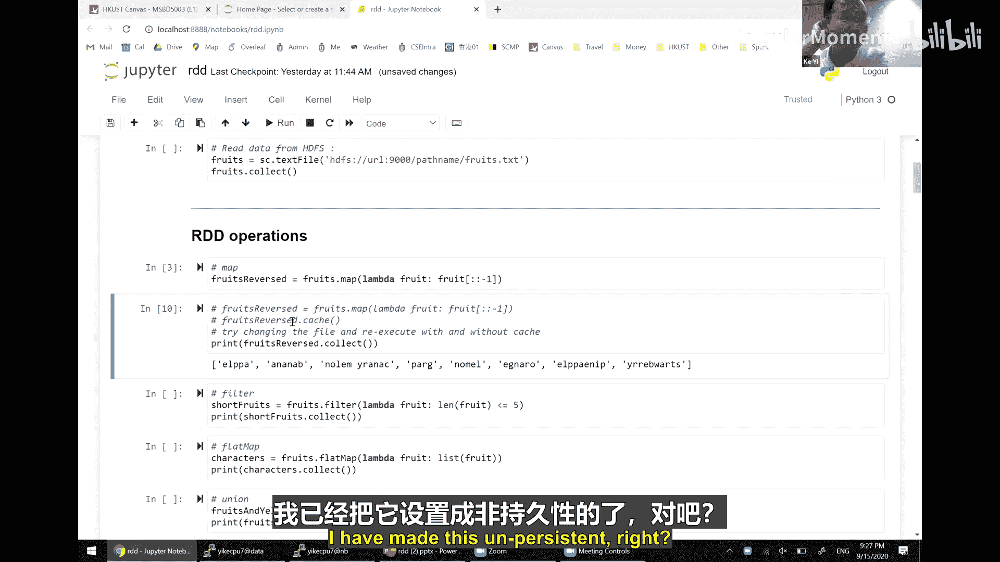

， so nothing's cashed。Okay。😊。

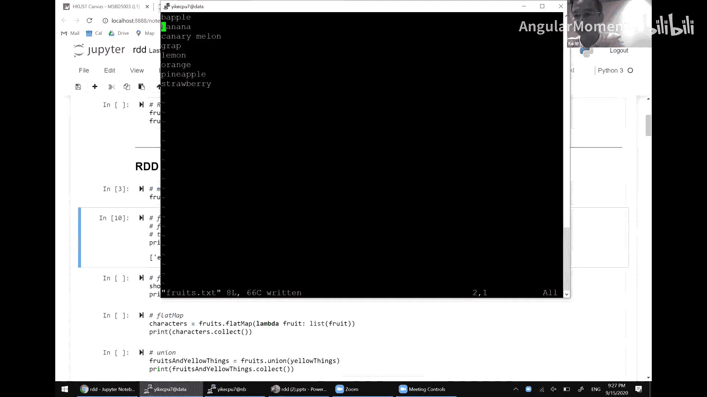

Okay， so why so why is this going on？Yes， good。 you need to。 We need to use un。 persist or cache is。

 is actually a tag。 Okay， this command。 this， this method doesn't do anything。

 doesn't have any effect doesn't have any immediate effect。

 It it as tag to RD so that the next time spark sees it it will cache it or not。 Okay。

 because previously， I already cache the this this LD， So it's already cache there。 Okay。

 so it will not be I will not be kicked out memory unless you ask it to do so。 So therefore。

 I have to manually。Im persistent。Okay， I have to do un persisted。嗯。so now I。Right again。

 now is is B Apple。 Okay， now is B Apple。Okay， so now it's， it's not cached。啊。Okay， alright。

 so that's the， this， that's the the caching caching behavior。 Let's do some other examples。

 This is an example of a filter。嗯。This is a lambda function returning true， if the lens。

Of the string。Is smaller than 5。 Okay， so it will return all the。Short fruits。 Okay Short fruits。

So the next one is flat map。 So this is something we haven't。 we haven't， we haven't seen yet。 So。

 so map is always1，1 to one。s map is always one to one。 If you want to do other transformations。

 then you can use flatm。 So flat map is 1，2， any。 Okay，1 to any， you can you you can be 1，2，1，1，2，2。

1，2 3 or even 1，2，0 Okay so so， so it it can be useful when you want to expand or contract your list。

 Okay， so here I'm doing so so this land function。Use inside flat map takes onetypo in RDD S input。

 and it， it produces a list。Of tas as output。 This list can be empty。

 and can contain any enough of elements。 So the effect is a one to many transformation。Okay， so。

 so what what I'm doing here is， you know， remember， fruit is a string， right， F is string。

 and I convert that string to a list。 So effectively。

 I'm converting one string into a list of small strings where every string is just one character。

 Okay， and that will be concatenated to form the new RDD。 So after this flat map。

 I have an a much larger R RDD with more elements。😊。

Although every element is just one single character。Next example， union。 Okay union。 So as mentioned。

 this is， this， this is the correct way of combining to， combining two RDs。 However， this is not the。

 this is not the。Set unit， because all it， all it does is to。Concatenate two Rs。

 It doesn't remove duplicates。 Banana here appears once appears second time there。

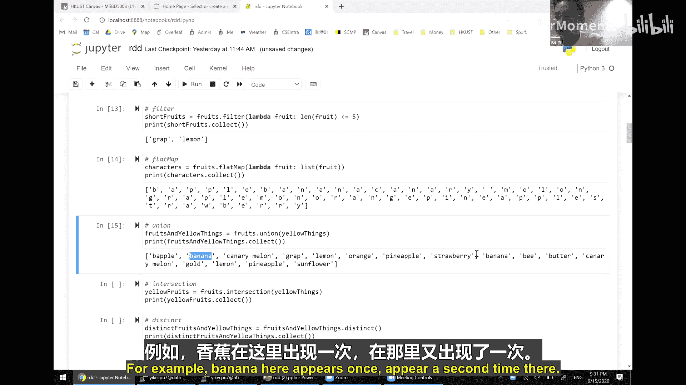

Change it back。

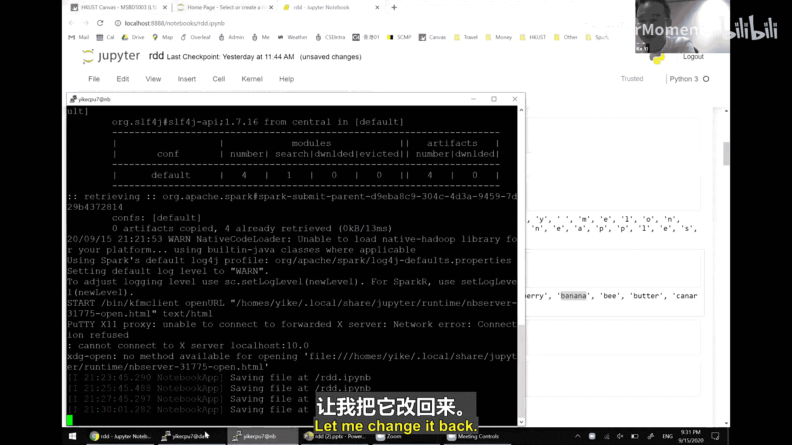

Be亚头O。On the other hand， intersection in Spk is the real set intersection。 Okay。

 it remove the duplicates after doing the each。Okay， so yes， see banana only appears once。 Okay。

 although it it appears in both parties。 So as that's why I'm saying that， you know。

 this unit should really be changed to contamination okay。This is not a good name。で啊。

For this operation。Okay， so， so what if you want to do site union， then you have to do a union first。

 and then you do a distinct。 Okay， or do distinct。 Soly after the union， I do I do a distinct。

 this will remove the duplicates Okay， and also， you might notice that after this distinct。

The order is completely messed up， right。So that's the original order and my banana is here and here。

 but in the new list， banana is here and the order is completely messed up。In the union。

 the order is preserved for both RDDs。 However， the distinct has messed up the order。Why it has to。

 Well， we will see， Okay， fundamentally because it has to。

Use a shuttle in order to remove duplicates。Here are some examples of actions。 Okay， first collect。

 we have already seen it many times Okay， and then count is another example of a action。

So take is similar to collect， but you can specify the number。 Okay。

 it always it returns the first K items in the RDD， where K is a parameter that that you can specify。

Reduce， okay， so this is also， this is something we also talk about here。

So what this program is doing is it returns。 It returns all the unique。

Characters used in all the fruit names。 Okay， so we do that through a map plus reduce。

 This is similar to the early example where we find the maximum words in RD of strings。 right。

 So here I convert fruit into fruit， which is a string。 I convert string into a set into a set。 Okay。

 so know that it know that this is a map。 This is not flat map。

 So so we are not expanding the RDD into RDD of characters。 We are。

 we are transforming each string into a set of characters。Okay， and then I do reduce here。

 This reduce uses this function。 Union function。 So here， you know。

 this is not the union we use earlier。 This is Python's own union。 Okay。

 so the Python's own set union， Okay， so Python's use of the word union is is mathematically correct。

 Okay， it is this union is really set union。 It union is two sets returns their union after removing duplicates。

 Okay， so finally， we get the set of letters。 set of distinct letters。啊。Oh，So this is one way。

 The other way of doing the same thing is， is this one。 Okay， we use the format。 Okay。

 so hopefully this illustrates the difference between magnet format。

In fly map is a one to many transformation。 we， we convert every fruit， every string。

 into a list of characters。 and all these characters will be concatenated into a big RDD。 Okay。

 so this after this fly map， we have a RDD of characters。 But with duplicates。

 so that's why we need to do a distinct。 So we need to do a distinct。 Okay， and， and and and then we。

 we， we do a collect。 Okay， so both are both are correct ways of finding all the unique characters。

 of。😊，Of all it in this RD。All right。😊，Well， the question is which way is better。

 which way is more efficient， okay。Well， later on， we'll talk about this because this thing involved the shuffle。

 So this second one is。Genral， generally speaking slower。 The first one is faster。 Okay。

 because reduce， as we talk about later， this reduce uses a divine conquer algorithm。

 So it is more efficient than a shuffle operation。 So a shuffling essentially require requires a lot of communication and reduce requires very little communication。

 Okay， So reduce the first one is a better way to perform this task。

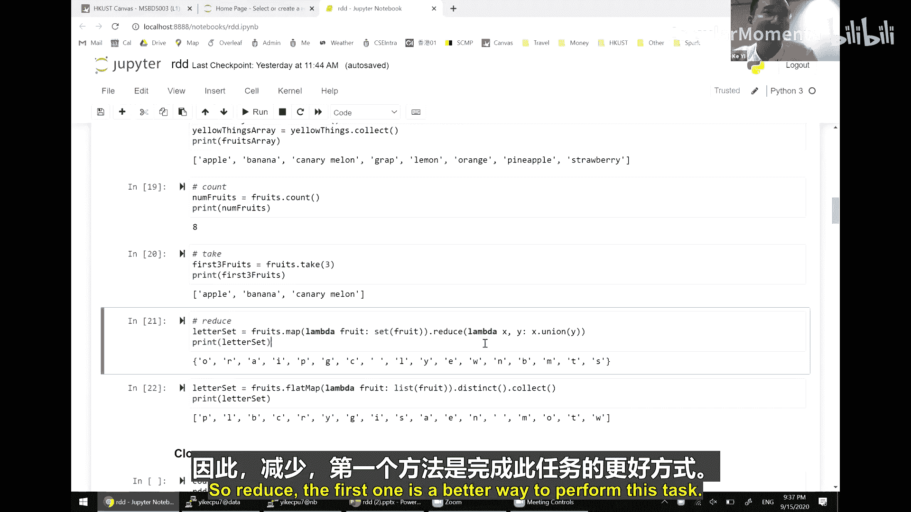