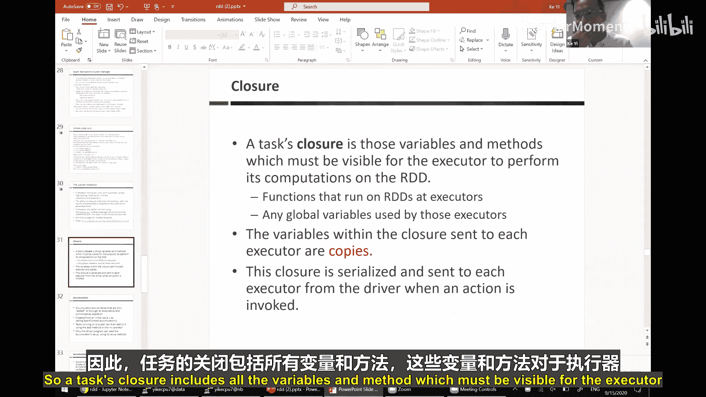
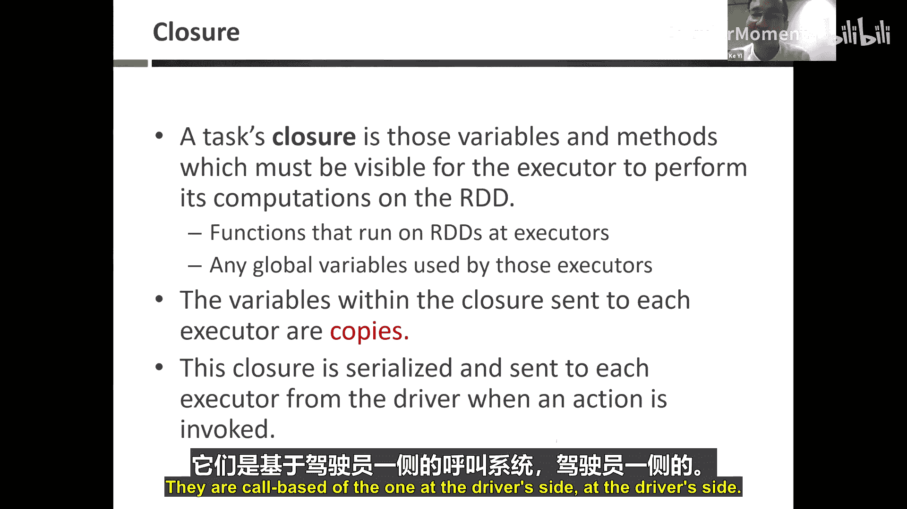
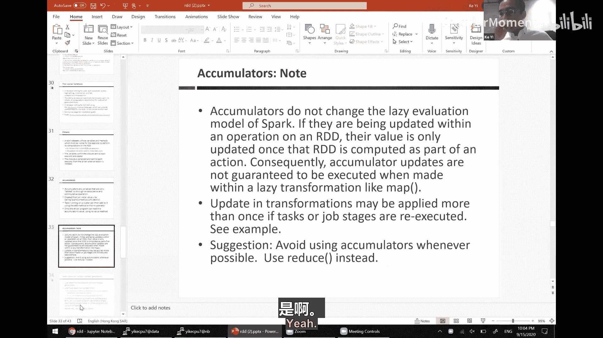
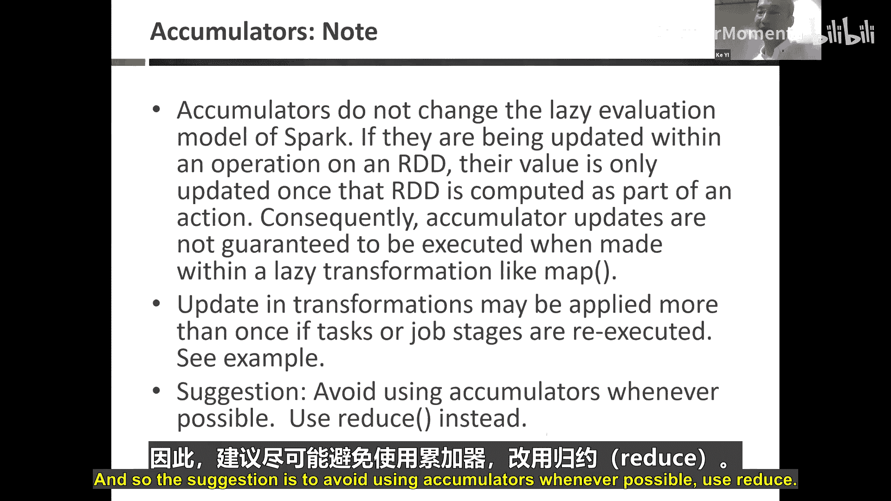
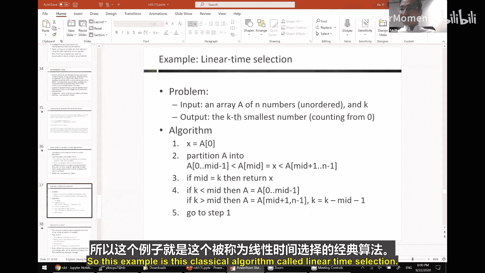
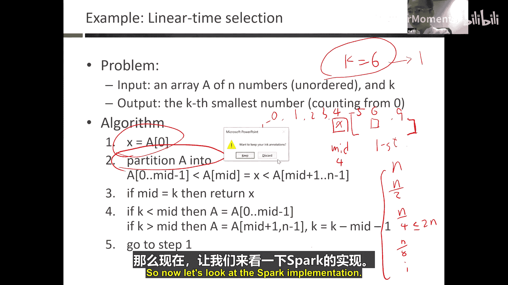
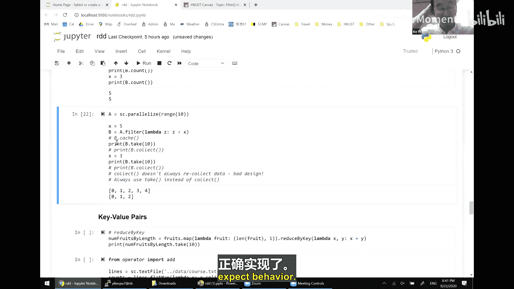

# 【香港科技大学】基于Spark的大数据计算--Big-Data-Computing-with-Spark-p07-04-03-02-闭包--BV1V8FmzuEHf_p7-

So this example illustrate a very important concept in spark programming。 actually， in general。

 any parallel programming platform， they have something similar。 They need the concept of a closure。

 So what is the closure。 So before talking about this concept， let's first see this example。 Okay。

 first see example。So first， there is a method called for each or action called called for each。

 Okay， so this will， this is the action。 So this will invoke this user defined function on every item。

 every item in this R。 Okay， it will will invoke this user defined function on every item in this R。

Alright， so now what I'm trying to do here in this example is I define this I define this user function called increment counter increment counter。

 So essentially， this is an RD of integers， you know， for just e purpose。

 I create RD to consist of integers from 0 to9。I just want to add up。Okay。

 I do that by this increment counter increment counter subluuting， which add。

X into my global variable calendar。 Okay， so know that here。

 I'm especially I'm emphasizeizing that counter is a global variable。 However， you know。

 if you know Python， this is optional because。Python will automatically interpret any variable that appears on the left hand side of assignment as a global variable。

 It will automatically interpret any variable that only appears on the right hand side as a local variable。

 So X is local and counter is global， because counter appears on the left hand side。

 So this one is actually optional。 But anyway， it doesn't hurt to specified this。

 So this counter is really the same as this one， which is global variable。 Okay So idea here is。

 I want to add this numbers from 0 to 9。 add them up or add each one of them to my global counter。So。

 now， let's say。说完了。Of course， it doesn't work。So this is why I want to use this example as to illustrate this concept。

 okay。We see that from the first result， this RDD has been constructed correctly， right。

 It consists of all integers from 0 to 9，0 to 9。 However。

 after we have executed this action for each。 the global counter is still0。 Okay， is still 0 okay。Oh。

 why is that？ So why is that？ Okay， so， so this， this is the concept of， of closure。 Okay。

 so what's the closure。So a task closure is includes all the variables and method。

 which must be visible for the executor to perform its computation on the partitions of the R Okay。

 so more precisely， this includes two types two types of information， the first one is functions。

 you want to run at the worker side。 So in this example is the increment kind of this function definition。

 So so what it does is that you know， it will。

S will will will， will will combine that into buy code and send this code this in this by code to all the worker knows。

 Well worker knows what to execute。So essentially， the first part is the code part is the the code。

 the second part is the second part is data。In particular， specifically。

 it refers to all the global variables。Used by the worker node。 Okay， so in this example is the。

 you know， global counter。 Okay， so this will be included in the closure and the closure will be serialized and sent to each executor from the driver when action is invoked。

 It evoked is invoked。 Okay， and all these variables are copies。 Okay。

 variables and as well as the functions。 There are copies of the one at the driver's side。

 at the driver's side。

Okay， recall that。Anything other than RDs， anything in RDDs are any is stored at the driver program。

 So that includes this global variable counter that includes this list Python list。Also。

 include this function that。That definition， the only thing that is handled by the worker node is this RDD。

 Everything else is driver side。However， in order for the driver， for the worker side to。

 to be able to execute this increment counter， right， the closure。

 which includes both this function definition， as well as this global variable counter。

 has to be sent to the worker side。 Otherwise， worker has nothing to run。But， as a consequence。

All these function definitions and global variables sent to the worker， sent to the workers。

 They are copies。 Okay， this has no effect for the function definition because they are read only anyway。

 However， for the global variables， remember this， they are also copies of the global variable。

 So that means。Every worker will obtain a copy of the global variable， which has value 0。 Okay。

 And then when they execute this increment counter， they will add X。 They will add their。

The data in their in in the in in their assigned petition into their local copy。

 into their local copy of this global variable。 Okay。

 so everyone will have a local counters adding up all their data in their petition， but the。

But they are， but this copy is not returned to the driver program， the driver program。

When you print it out， still refers to the driver's own driver's original copy， Okay。

 which has value 0。 Okay， so that's why yeah， it doesn't work。

But that was the correct way of doing things of doing this well there are two methods， okay。

 one method suggest by Sparks official documentation is to use accumulators to use accumulators。Okay。

 so the accumulators are variables that are only added to through an associative and cumulative operation。

 Okay here again， this is also important。 This operation has to be as soative and cumulative。

 and it is created from an initial value by calling spark context accumulator B。

 So it will tell specifically this information to spark that this variable B is accumulator。

 Its not an ordinary global variable。 So you should not send copiess of this of this thing to the worker node。

 There is only one copy。Every。😊，Additional operation has to be added to this accumulator。

And the tasks running on the cluster can then add to this accumulator using this。

 using the add method of the plus equal operator。 Okay， a particular operator， you have to use it。

And finally， the driver program and only the driver program can retrieve the accumulated value using its value。

Okay， so let's see how this works in action。Okay， so first， I create this RD as before。

 and then I tell。Spark that I need a I need I need an I need an accumulator。 and initial value is 0。

 So I I do that by calling S dot accumulator 0。 So the initial value of the accumulator is 0。

And then at each driver at each at at at inside this user different function， I can add。

Add something to this accumulator。 Okay this。In fact。

 this is not a the ordinary Python plus equal operator because it is applied。 It is。

 It is applied on a spark accumulator。 So this caused the special accumulator addition method in spark。

 It will add X to this spark then will make sure that， you know， all these additions will be。

 will be accounted for。😊，And finally， in the driver program， you can obtain。

 you can retrieve the value of the accumulator by using accumulator do value。😊，So now can run。

 So now we can see that 45 is the correct result。 reflected at the driver program。Okay， a question。

 What happens if two node do the addition at the same time。 Okay。

 so a spark will make sure that they will they will not conflict with each with each other。 Okay。

 so what happens is that， you know， each。Spark will have a local copy of each accumulator。 Okay。

 And finally， when you call will retrieve value， Spk will add this local accumulators together。

 so that all the effects will be will be combined together。 Okay。

 so that's why you cannot now use the ordinary global variable。

 You have to use the accumulator in sparkk。Can we use accumulate equals accumulate plus X。

 The answer is no。 Okay， let's just try it。Okay， era， it doesn't work。 So you have to。

 you can only use plus equal and why， because like I said， this is actually already。

 this is already overloaded by Spark。 It is the special act to operator to accumulator in Spk。

 It's not an ordinary Python addition。😊，On the deeper level， you may， you can。

 you can actually ask yourself， why doesn't， Okay， why doesn't spark allow。

 Why doesn't allow something like this。😡，Well， what if I do something like， you know， if。

 if this assignment is allowed， Okay， I will if what if someone does this。Okay。

 or are more even worse。 Let， let's do X。 Okay， this， this make things make make things even。Clearer。

 okay， so what if if you allow assignment equal Okay， not just equal plus equal equal。

 then if you allow assignment， then potentially the programmer can assign any value to it。对。

Then what would you expect from the final result？😡，You know， you know。

 problem is that this will not be well defined， essentially every worker is trying to trying to write something different to the accumulator。

Then who wins。So it it's not well。 it's not not well。 It's not it's not well defined。

 So that's the that's why Spk does not allow an arbitrary assignment。 You can only use app  to。 Okay。

 you can， you can only add things to it。 And then Sp will make sure that all the additions。

Will be combine together。 Okay， will be to be combine together。诶。

Try accumulate plus equal minus accumulate。 Okay， that's interesting。 I don't think that will work。

Okay， doesn't work， okay。So I don't know what you are trying to achieve， but anyway。

 the point that is required。Only the driver program can read the accumulation value， using its value。

Okay， so nobody， so even use， well， I don't think this work。 So even you use the value method。

It doesn't work， right， So the worker is not allowed to read the value。Okay， again。

 why and why doesn't sparkk loud。Worker will read it valuable。Well， if again， if you think about it。

 right， So the the the the。都对。When the worker tries to read it。

 when when one worker tries to read it， that means。It's not done yet， right， So the maybe the worker。

Maybe possibly other workers， They are still trying to add to it。

 They are trying to add add things to it。 So it's not done yet。

 So if a worker tries to read the value of accumulator。

The value is not well defined because things are not done yet you so in some sense。

 it doesn't really make sense for the worker to read the value of the accumulator during execution well minus SQL it doesn't work either。

Because it's just not defined， right， Because why if you， if you need minus equal to。

 you can just do plus equal minus X。 So that's so this one will work。This one works minus5 okay。Yeah。

 so yeah， for the last one， minus equal is yeah， fundamentally is is is's okay。

 but you don't need it for the other options， for the other suggestions is they don't。

 they just either don't make sense or we will make the problem not well defined so。

It actually makes good sense for a spark to enforce these constraints， only。

When a worker can only add to it， only the driver program can read it。い。嗯。😊，However。

 so I personally would not suggest using accumulators。 Okay， In fact。

 for every scenario where you can use accumulator， you can do it。 You can you can。

 you can do without accumulator。 For example， for still for the same task。For the same task。Yeah。

 you could use reduce。 if you want just want to add things add numbers up in R。

 you can just use reduce or even better， there is a function called sum Okay that which is special case case reduce that will also add things to add things together。

Okay， so why， why， why I do not recommend using accumulator。

 let me try to illustrate using this example Okay， I think examples are the best at making things clear。

Okay， essentially the reason is that it's interplay with Sparks lazy execution。Will make things。

We'll make things。We can make things go wrong。 Okay， not go wrong。

 but go we will result in unintended behaviors。 Okay， so let's see this example。 Okay， okay。

 so this is still I'm defining accumulator initialize to0。 and then I add it and and so yeah。

 so this I define function to do two things at same time。 it add this X accumulator at same time。

 I return the square of x。 Okay， so and then suppose I do a map。 Okay， so okay， so。

My intention is that I will do two things in one shot。 I will add all my access， all my integers。

 all my numbers is RD to the accumulator。 At the same time。

 I do a map transformation transforming RD into a where a consists of the squares of the numbers in my first R。

 So I do two things in one shot。 Okay， sounds clever， right， Okay， so let's check。 Okay。

 let's run it to see if I get my intended results。 Let's look at one line at a time。

 The first one accumulator。Okay，0。 No， it doesn't。 It doesn't。Do what I ask it to do。喂。

Can anyone see why。No actions。 Very good。 Okay， so can。

 I think you can you really understand the lazy the execution behavior， right。

 because map is not action。 map is not action。 no action。 So it's only transformation。

 So this function is not executed at all。 This map is not execution at all。

 So that so the the value is still0。 Okay， so this， you may say， okay。

 this is just your your code is not right。 Okay， it cannot blame spark。 Of course， yeah， but still。

 I can， I will say this is a place where you can。😊，Easily make mistakes。 But still。

 I buy your argument。 This is not really sparks fault。 It is my， it' my book。 right， in， in my code。

 So what I do， what I should do， Yes， okay， let me。Do it again。 So I if I print。After a reduce。

Let's see。Okay， now， let us。O。I think this is done，That's not the point， Okay， the point is。

 so if I do a use。So now this is the correct sign of all my numbers。All my numbers in my accumulator。

Yeah， okay， so this is a reduce of all the of all the numbers in a。

 which is square of the first number was 225。 and this 45 is this print。If it's this print。

 So now the accumulator has the correct value。 Okay， well， so far， still so far sober。Okay， so now。

Suppose later， when I know that I decide to make a persist。 Okay。

 I need I want to catch it because I later on， I know I will run multiple drop on a so I cache it so so that I can。

 I don't want to compute this squares many times。 I only want to。

 I only want to compute compute once。 Okay， so I cache it。 so I just call some action。 Okay。

 so that a is computed and cached。 Okay， so I do that I then I， I check its value again。So it's。

 it's 90， okay。嗯。So this is where I'm saying that this can so why this 90。

 this is different from the first one。O啊。Yeah， okay。

 so making things even more confusing if I now comment this out。Okay， so this time。Okay。

 so this zero is this accumulator。 and this second0 is， yeah， yeah， I don't。 I don't need this。Okay。

 the this there is the first accumulate。 this first value。 and second 45 is。Is this one。Okay。

 and then I do it again。This is still。45。O。So， so I'm what I'm trying to say here is that， you know。

 this time， okay， if you add this cash or not。It actually changes。😡，The behavior of the program。

 Okay， of course， you know， when you have a cool head， you can sit there and see what is happening。

 So let's see for for this version without caching。 Okay， without making a persistent in this case。

 we have two actions。 right， So that means this map is executed twice。And every time you run it。

 you add things， you add this， you add new， you add add numbers to the accumulator。

 So that's why this accumulator will increase when you call。Two actions on a。However， when you。

Persist a， this second action， the second action will not trigger the recomp of this map。

 So therefore， the accumulator will not be affected。 So and I hope this example is clear enough。

 the point I'm trying to make is that you know， by using accumulators。

 So this if the accumulator this is addition operation is buried inside a transformation。

 this essentially makes things a little non deter， because it all depends on whether this RD is persistent or not if it's not persistent this this transformation may be triggered more than once。

 and every time you trigger it， it will。Do something to theccumulator so。

The value of the accumulator is actually affected by whether the RDD is persistent or not。

 so so this is this is one this is the reason why I not recommending right because you know making an RDD is persistent。

 ideally should only affect the performance because when you add caches， will make persist， In fact。

 most programmers when they write program， they first the first version they write， you know。

 they don't make anything persistent and then when they try to optimize their program making faster。

 they persist， they cache certain RDDs like they pick the important ones。

 they pick those that are used more often to cache it right。

So and then this will improve this the intention is to improve improve performance， however。

 if certain things， however， in this case， it doesn't only improve performance。

 it also changes the behavior of the accumulator okay。And making things even worse， right， So， so。

 so so suppose you intentionally know that you know， adding cache。

 caching RDs will will change behavior accumulate。 if that is your intended outcome。

 you only you know that， you know， A is only this map is only a once because you A is cached。However。

 remember that， you know when memory is not sufficient。

Some cached RDs will be swapped out to disk or even be discarded depending on the caching level。

Pure internal。Decisions， so suppose an RDD memory is full and RDD is discarded。

 although it has although the programmer want to cash it。 However。

 system is not is unable to catch it。 So therefore， it may be recompd。So in that case。

 the cumulator will be affected， right， You will be。

New things some things will be added twice or even more times depending on how things are happening。

And also， remember， if some partition fails， if some worker fails。

 that part will have to be re executeded。 whenever it is reed this。Accumulator will be affected。

 right， So therefore， essentially， the value of the accumulator will no longer be determin。

 This is very bad。 Okay， this is very difficult。 This is very bad fault bug for ensuring a correct a correct behavior of the accumulators。

 Okay so so therefore。I don't personally recommend using accumulators。 Okay， In fact。

 for every scenario I can think of where you use accumulators， you can also use something else。

 some other methods provided by support。 Okay The only scenario I can think of where you have to use accumulator is suppose you just really want to count know how many times。

 something gets re。 So in that case， you you can well， you have to use accumulator。

Where in that case， you really want the accumulator to depend on the actual re execution behavior of sparkk。

 some for， some fall recoveries。 Yeah， exactly， just like actual law。

 You want to count certain runtime events。Which supposedly will be different every time you run it。

 Okay， you only you want to collect some runtime statistics。

 Do you need to use accumulator Okay for every for actual computation。

 almost every scenario can be accomplished by， by something else， like， you know。

 like reduce or sum or count or whatever。Okay。Alright， so this is accumulators。 Yeah， Okay。

 so just to summarize。

Accumulator do not change the laser evaluation model of Sp if they are being updated within operation。

 their value is only updated once update once that R is computed as a part of an action。

 so consequently accumulator updates are not guaranteed to be executed when made within a lazy transformation。

So update in transformations may be applied more than once if tasks or jobs are executed。 Okay。

 see that example。 And so the suggestion is to avoid using accumulators whenever possible use reduce。

 This is actually one of the examples from the official spark distribution。

 It's its example of conducting pie。

The method they use for computing pi is actually a very simple one。

 it's called multi carlo simulation， multi carlo simulation。ok。So the idea is actually very。

 very simple。 Suppose I have a。Uni square okay。I know the area of uni square is one， right。

 suppose the length of each side is one okay。I will next draw a quarter circle。Okay。😊，You know。

 by high school math， we know that the area of this quarter circle is。啊。Pi over 4。 Okay。

 so that's the area of the area of the quarter circle。 Okay pi is related to pi。 So good。

 So now the idea of multi car simulation is I'm gonna throw points。

 uniform and random into this Unii square。 Okay， I throw points into this uniformly randomly。 Okay。

Okay。😊，If I throw enough points， then the fraction of the points。Falling inside the circle。

Should be exactly this area。Okay。And this， I think is easy to， easy to understand。 right。

 So if I throw enough points it dense enough， know， the number。

 the fraction of points should be equal to the area of the circle because the whole Uni square has area  one。

And the throwing points in the unit scores is easy。 You know。

 you just need to generate two random numbers， X and Y， both uniformly and random between0 and1。

 Okay， so that's the idea of Monte。Of course， this is not the best way of computing pie because obviously。

 you， youre gonna need a lot of points in order to have a reasonable， accurate estimation of pie。

However， is' the easiest one。 is the one that is easiest to parallelize。 Okay。

 the other methods are not so easy。 Okay， this is is sometimes something。

 sometimes called embarrassingly parallel， right， So it's very easy parallel because all you have to do is to throw independent you know。

 random points into the unique square。 Okay and。This is program。诶。So I hear， let's first use。

 let's say。 Okay， I suppose I use 1001000 partitions。 Supp I have。1 thousand0 workers。

 but not not that many I have on my machine， I have 48 cores。

 so each core will handle a number of partitions anyway。

each partition will generate 1000 random points。 Okay。

 so I do that through this sequence of transformations and actions。

 The first transformation is transforming a Python list of。And in teachers and is 1000 times 1000。

 Okay， and having so many partitions。 the second parameter can be used to specify the number of partitions。

 Okay， if you omit， I think its partition number is 2。And then I do a transformation。

 transforming each number into a random point， Okay， now not random point。

 we don't need random point， I just need to test whether this point is inside the quiet circle or not okay。

So essentially， this transformation is F。😊，Doesn't really need this these integers。

 So these integers are more like placeholders， Okay， because we don't just need one points。

So we just ignore the input， and then I generate the random coordinates X X Y and test if they are inside the quarter circle。

 If yes， return y otherwise return0。 and then finally。

 I do a sum Okay sum is the same as reduce where use whereas we use addition as the as the merge operator Okay。

 so this count will just be， will be the total number points falling inside the quarter circle。

And finally， I return because count over n is pi over four right so multi4 is pi。Okay。

 so I can let's run it。So reasonably accurate。However， I'm going to say that this is actually not。

Its not not a correct implementation， although it's actually from the official spark。

Did spark examples。Okay， why？In fact， this is。Has to something to do with the random number。

Genenerated， okay， so to see what is really happening。Actually。

 this the behavior of S is actually is very weird， I cannot explain its behavior。

 so the effect that in spark 2。0。The behavior is more consistent。 but but in in 3。0 is， it gets。

 gets more weird。 And I don't know why if you， if you。

 if you can figure out a reason please let me know。 Okay， for that， let me restart my kernel。 Okay。

 for some reason， it starts the。一。Exhibit behavior when you start a fresh kernel of sparkk。

 So the kernel has been restarted。All right。Okay， so fundamentally。

 this multi carlo simulation or any multi carlo simulation relies on random number generation。 Okay。

 so let's look at， look into the random numbers generated for that。

 I'm gonna need a I'm gonna need a a new method called Gm。 Okay。

 and and you will see what I what what what it does。Okay， so so in this simple example。

 I first generate a RDD of 100 numbers partitioned into 10 partitions。 Okay， and then I collect。

 of course， this gives me my my RDD consisting consisting of 100 numbers from 0 to 99。 Okay， good。

Okay， so G。What glm does is it will。Conver this RDD。Into a list of lists。 Okay。

 into a into a into into a RDD list so that every list correspond to one partition。 Okay。

 this is best illustrated by this example， so。If I do Gm and then I collect。

 this becomes the list of lists。 So this is my list of lists。 It has 10 lists。

 one list for each partition okay。😊，I think this example tells you what glm does， so essentially gls。

TellGlom tells you how a RD is partitioned。 Okay It has 10 partitions。

 Every partition has 10 numbers。 So very evenly partitioned as expected。Okay。

 so now I'm going to use Gm to examine the random numbers generated。 Okay， so so I do a map。 Okay。

 the map well I could also replace this by Android score anyway it ignores X and simply return random number Okay。

 and then I do a glm and then then collect。 so now let's see my random numbers。Okay。So， this is。

The first。Partition。10 random，10 random random numbers。Okay， looks， okay， right。

 looks random enough to me。 Nothing seems to be wrong。However， if you look at the second。Pition。

 second， the 10 numbers in the second partition。Do you think do you see something weird？Okay。

 he's the same。 Yeah， it's the same。So why so what's happening right So if okay。

 if they are really the same， then something's wrong right then this Monteikalo will not work because in Monteikalo。

 the idea is if if we use more parts， if you use more workers， then you have more randomness。

 then we are then we have better accuracy right but if all the workers have the same random numbers。

 then using random numbers， using more workers will not help So as many of you have credit point out。

 this has to do with random the see Okay the see。However， you know， yeah， in Sp 3。0。

 things really gets weird because when I tried this yesterday， I was hoping that， you know。

 the same random numbers are always generated。 However， after I run this pie computation。And now。

 I run this again。Okay， yeah， let's I I think I have to generate in。Sufficiently。ok。Okay。

 now this time this is consistently wrong， Okay， so it's consider generating the same random numbers。

Yeah啊。So， so this is why I'm saying this implementation of the pi computation is exactly wrong。

 It doesn't improve as we generate more random numbers。喂。Different。Yeah， yeah。 okay， this time it。

 I finally be able to reproduce them。ReReproduce the weird behavior I'm talking about。

 So now so after running this pie example a few times。

Now it seems that the different workers have different random numbers。 Okay， in this case， this is 0。

4， right， And the second one is here。So now， things are becoming weird。Yeah。

 what is even more weird is。Some workers still have the same number。 For example， the last one。0。

902 is the same as the third worker。O。Yeah， okay， so yeah， I really don't know why what is happening。

 So if you case plan， let me know， you know， you know， after some， you know。

 you can try some you play with the exact with with this this program。

 it seems that after a certain number of random numbers have been generated。

 then the workers start to diverge。And in Sp 2。0 a 2。 X。All workers always generate the same numbers。

 Okay， but starting from 3。0， things become become erratic。 I don't know how to explain。Alright。

 okay， anyway， I think we are out of time today。 I'm gonna stop here and I will tell you how to fix this what's the right way of generating random numbers in spark or in fact in in any parallel large scale parallel system because you cannot you can cannot use the same see this is particularly easy to make mistake here。

 because you know， if you look at this program， it's very innocent right when we mentioned that you should you need to pay attention to closure。

 However， here the closure only in close partitions and partition is indeed is something that you one at the global variable global variable okay so。

It， as it turns out that the seed is a is is essentially a global parameter that is hidden。 right。

 So， so that's why this closure thing is can be quite can one can easily make me make mistakes here。

 because some global variables are actually hidden， especially when。

 when you use a third party library。 So you need to really。😊，You need to。

 really need to know what is going on in that third party library。

 In this case is this random library。 Okay， it uses it stores the seed in a global variable and which is broadcasted to all the worker node。

 So all worker knows have the same seed for random number generation。Okay， and next time we will see。

 we will see how this should be fixed All right so。Okay， if you recall。

 what we did last time was essentially the identification of a bug in the official example。

For computing pie， right， the idea is。To use Monte Carlo， however。

 we realized that you know the accuracy of the estimation does not improve as we use more petitions。

 which is which is completely defeating the purpose of parallel computation right the initial goal of using many workers is to be able to get a more and more accurate result as we increase workers so and this is apparently not serving this purpose and the underlying reason is that you know when we when we looked into the random numbers generated by in each petition。

 we see that each petition is generating the same sequence of random numbers。

 So essentially all those workers are not are repeating the same the same work。

 So we that' so that's why we are not seeing any improvement in the accuracy of the Monte Carlo simulation。

Okay so， as actually pointed out by some students last time they the reason is that when we talk about random numbers in we are。

 they are not really truly random。 So they are called Su do random。S do random numbers。

 So this is because， you know， it's very difficult to。

 it's very difficult to obtain truly random numbers。 So， in fact， if you really need random。

 truly random numbers， there is a website called a random dot org。 Okay。

 so they use atmospheric noise。 Okay， to generate random numbers。

 So if you really need truly random numbers， you can go to that website and and and then and then get some random numbers。

 actually， they charge a fee， right if you require a large number of random numbers because you know generate。

 So apparently， randomness is a valuable resource， It's not that easy to obtain。

So instead that what typically is done when you write when you use any programming language is is a pseudo random number generator。

 namely they are not really random。 They are computed。

 They are computed from a seed and the seed is controlled by you right usually you set you set that to the system time。

 Okay so that every time you run it it can be different。 But you also you can set it manually。

 Okay there are many different kinds of random number generators。

 and they differ in how difficult it is to break it。 So by breaking it。

 we mean that how hard it is for an a or for a attacker to figure out。

The seed by observing the random numbers that have been generated。 Okay， so apparently so。

 so obviously， if you are running just， you are， if you are using these random numbers just for let's say。

 multi color simulation， then you don't really need a very secure random number generator because the only purpose you want from the random numbers is actually only uniformity。

 So as long as they are uniform。Then it's fine。 So know that uniformity is only a necessary condition for randomness。

 It's not complete， right， a random random sequence may uniform， but may not be random。

 so there are actually different purposes。 In fact。

 there is a whole branch in theoretical science that is devoted to to the study of randomness。

 It turns out that there's really a strong connection between randomness and computational complexity。

 okay。Which also have applications in security。On any hand。

 if you use random numbers for purposes like games and lotteries。

 so then this random random numbers better be random。

 So uniformity is not enough so so so anyway for Monte Carlo we just use a very simple random number generator actually the default random number generator in Python is very simple it uses a linear number generator namely every time it simply compute the following linear formula namely suppose x0 is the C and the first first random number generated will be simply B will be simply x0 a times x0 plus B and the whole thing mod some large prime P where A and B and A BP。

 they are actually constant they are fixed if you look into the Python implementation library。

 the random library。You can actually find out this concept。 They are some pretty large constant。

 but they are fixed， and they are public。 So， so essentially， if you know the seed。

 you can figure out entire sequence。 And what's even worse。

 right as long as you have observed two random numbers okay。Okay， maybe three。

 three random numbers from this from the from the sequence。

 Then you can go back and figure out what a is， what B is and what C is。 So and， and and so。

 so therefore it not it's not really secure， but for the purpose of multi colorlo simulation。

 this is enough but this it also explains why we are seeing the same number。

 remember that we talk about the concept of closure。

 Okay although here this closure is really implicit。

 namely the C is actually store in the random in the global variable， Okay。

 in the global variable and when when we when we dispatch， Okay， when we dispatch this drop。

 which is in this case， is map。 Okay， when we when we run map， and then this enclosure。

 which includes both the global variables as well as the functions。

 namely this random function itself， this function plus。

The global variables will be packaged into the closure and broadcast to all the workers。

 So every worker has the same copy of the random function and the same copy of the random seed。

 And this is why we are seeing we are getting the same sequence of random numbers。All workers okay。

Alright， so that's the problem。 Okay， now we have seen where the problem is， how do we fix it。

 Of course， the idea is， is， is we need to， we need to generate different random numbers。 Okay。

 different now we， we need something that can。Do work on a partition basis。 Remember。

 the goal here is to generate a sequence of random numbers per partition。

 So say this for this purpose， we're gonna need you to use Mac partition。

 So Mac partition allows us to run something。On each partition， right， So not not on each items。

 This one runs some function on each partition。 So this allows us to do something on a higher granularity。

 So this gives actually， this gives us more control on what we can do so essentially。

 whenever you want to do something。 Okay， that is not on a per item basis。 then you can。

 you can use my partition。 Then then you can actually do anything on。All items in the same partition。

And we're going to see more applications when we talk about divine and conquer algorithms for writing programs in Spark。

Alright， so similarly， so my partition accepts a user defined function F。

 and this spark will run this function F on each partition。

 Okay recall that each partition is consists of many items。 So， so therefore， this function。

 is user defined function F。It has a argument that is must be an iterator。 Okay So。

 and then this spark will feed all the items in this partition through this iterator。 So namely。

 you can retrieve items from this partition by iterating through this iterator。With itertor。 Okay。

 so let's see one one example first。 So namely， if we first generated a R DD with 20 elements and partition that into four partition。

 So every part has five items，5 numbers。 Okay， so here， suppose I want to do compute。 actually。

 what is known as a prefix sum。 Okay， prefi sum。 So namely。

 let's look first first look at the result。So， this is the。

Output okay of this of of this map transformation。 So this is 0，1，3，610。 So namely。

 these are the perfect sums of these five numbers， namely 0 is 0，0 plus 1 is 1。1 plus 2 is 3。 Okay。

 and 3 plus 3，6 and 6 plus 4 is 10。 So this is the incremental sums。 Part sums 1 at a time。 Okay。

 suppose that's the out， that's output。 and you cannot achieve this by map。 Okay。

 because map must be a 1 to 1 transformation。But you can do this。

 You can achieve this by using my partition。So IT， this itertor IT will give you the entry point to this list of five numbers in each partition。

And then inside function F， we just do this incremental addition， incremental current computation。

Namely， in initial life。The sum S to 0。 And then for every number。

 for every number in in this list in this partition。

 I add I to S and then return S return this partial sum。 Okay Re partial sum Okay。

 so know that it is required that this。Function F must also return a list。 Okay， However， this。

 you cannot this， so the spark design in a way such that you cannot return the via a list you must return the list via the yield statement。

 Okay， yield。 Okay， so namely this， this， this this actually for your convenience。 So namely。

 don't really have to construct the whole list and return it。

 which may actually take a lot of memory local a lot of memory。 So instead。

 you're gonna yield namely return the item in the list one at a time。

 And this will be assembled by spark。In the back end。 so know that this。

 this also makes your programming easier because you can， you can write yield inside a loop。 Okay。

 so whenever Pythons says yield， it will not return。 It will continue this loop。

 until this loop terminates。 and every yield every item returned by yield will be put into the list。

 which is gonna be returned to the upper level， level。 Okay。

 so this will achieve the same this effect。 name， it runs this function F each partition F takes a list as input returns a list as output。

 and both input output list are are accessed through a iterator。

So the input iterator output is a yield。And this is the output。 Okay。

 so know that it is important to remember this yield must be embedded in the。

 in the in the in the loop for you to return multiple items。 So if you accidentally did this。

What would happen？I't know why it's so slow。 But anyway， Okay， so this is the output。

 If I mistakenly wrote this yield S outside the loop。 Okay in this case， it still returns the list。

 However， it it， however， it it， however， it only returns a list of size  one。

 because it only has one yield。 So as a result， it returns only a list of size  one namely only one item per partition。

 So so then the net effect is that we are computing the sum of all numbers inside each partition。

 So eventually we only have a list of four items。嗯。Yeah。

 thank so thanks somebody who have answered the question in the chat。Okay。

 so this is why we need to remember that to put yield inside the loop， okay。So this is my parts。

 Okay， so this allows us to do something on a per on a per partition basis。 However， this is not。

Going to help us with a random number generation， because we want to use different seed for different for every for every partition。

 right， So this map partition can only allow us to run the same code。

 including all the global variables， the same thing on each partition。 We need something different。

 Okay， we need to some perhaps something unique for each partition。

 So that's why we also we need this， we need to introduce。

 we need to introduce the second transformation the second method。Namely， map partitions with index。

 So this is almost identical to map partitions， except that for map partitions with index。

 you have to supply it with a function F that has two arguments。 Okay。

 the first one is still is still a iterator。 Okay， iterator。Oh， no， the second one is still iterator。

 Okay， and the first one is a index。 This is the， this refers to the index of the partition on which this F is applied。

 Okay， so， for example， here we have four partitions。 The partitions are number 0，1，2，3。 Okay， in。

 we always counting。 We always come starting from 0。 So partition 0，1， to 3。 And this index。

 this is index of the partition will be。Will be given to this fact F through this first。

 through the first argument。 first argument。 So this essentially give us some handle。 right。

 So now we have something that is different or different partitions。 In fact， based on this index。

 you can do completely different things on different parts right by by just checking with this index is。

 But nevertheless， let's see a simple example here。 where we do not completely different， but also。

 we do not say it but also something similar。 Okay， so here， we are doing the same， you know。

 prefi computation as previously except that the starting value of this S is different。

 starting value is now index。 so now the the effect of this。Yes， okay。

 the first one the same because for the part one， partition 0， index is 0。 right。

 So we are still computing the prediction sums。 and for the second partition。 Okay。

 these five numbers， this five partial sums。 The starting sum starting。

 the starting value for S is now one， Okay， because the index is1。 So now we have 1。

56 and 6 plus 116 plus 6 plus 6 is 12，12 plus 7 is 19 etc cetera。 So this allows us to do。 You know。

 different things in different partitions。 this is exactly what we need it to fix the random number generation problem。

😊，Alright， so so this is the correct version of the pi computation program。

 So so so we have a seed initial seatd， which is a system time。 Okay， this is a global seed。

 But then we're gonna use different seedss in different partitions。 Okay， so we're gonna do that。

 by adding this index number to seed， so that every partition will have a different seed to start with to start with。

 and then we we can do whatever whatever is needed for generating random numbers。

 So because the index is different for different partitions。

 So different partitions will have different sequences of random numbers。Okay。Alright。

 so this is actually the correct way of generating random numbers。

 So another trick that people often use is to use fix it。 right， So not this in time。

 So this is often。This is often useful when you are doing debugging， right， Because if you， if you。

Or if you're trying to find a bugs your in in your code and you want to be able to reproduce them。

 right， So if you use different， if you use system time as your seed， then you know。

 you may not be able to reproduce your bug， so。For debuging purposes。

 it is suggested use a very common trick is to use the fix it。 Okay， of course。

 when you finally deploy deploy your program。You can change that seat to a system time so that you get different。

 say you get different behavior every time you run it。Okay， al right。

 this is the the pie computation program and the problem and how to fix it。Veryhow。

 let me jump forward a little bit。 So although we are talking about RDD， which is read the basis。

 but next week we'll move on to SQL and spark SqL and which provides a higher level packaging for spark。

 And they also provide a interface for generating random numbers， actually。

 they can generate a little frame consisting random numbers。

 And there you don't have to worry about different position generating different generating generating the same sequence on the on the spark SQL level you can generate a whole table or little frame consisting of random numbers。

 that's actually even better。 So that's actually the more the recommended way So in fact。

 as we move on later to the course， you can see that although initially。

 know RDD is is essentially the common interface that people build applications upon。

But now the current trend， which is actually not finished yet。

 The current trend is to move is to build is build application upon Sp SqL。 So not RDD and Sp SqL is。

 in turn， built upon RDD， But we will talk about that next week。Okay。Okay。So this example is。

This classical algorithm called linear time selection， Okay so what is this problem？

The problem is very basic we have we have we are given an array of n numbers and ordered and a number k we want to find the K smallest number Okay again we cant start we come from zero okay namely if K zero。

 then you return the smallest if K is n over two， you return the medium Okay。

 this is sometimes also called a mediumn selection mediumn selection。Of course。

 you can solve this problem by sorting， but as as we will actually emphasize more later。

 sorting requires a shuffle okay， and shuffle is the most expensive operation spark and in general for any large scale system。

 a shuffle operation。Is very expensive。 And that's。

 and that's why we want to minimize it or avoid using shuffles as much as possible。 Okay。

 so if we don't want to sorting。Actually， a faster algorithm is this famous linear time selection algorithm。

 So the algorithm is actually very simple。 It uses this simple idea of divine conquer， Okay， so。

So we're gonna let's say we protected the first item。So namely we first guess a0 stores target。

 we put that into x。We need to check whether X is indeed the case smallest number in this array。

How do we check。 Well， this is easy。 This doesn't require sorting。

 We only need to partition a into two parts。 right those smaller than x and those bigger than x。

 Okay， and then this is called partition step and the result is stored in another array or actually you can store in store the results of the partitioning in the same array。

 Okay， suppose in after partitioning x， which is the original a0， now occupies position a mid。

 So name the index of x is mid。 So namely it is the mid smallest number。

 Okay because there are that that's its position。 and those smaller than x will be put on the left hand side of this x of this what we call a pivot or splitter and and which is。

Put to x and those greater than x are put on the right hand side。

So now if we are lucky enough right so namely， if mid is equal to k。

 then we know that this x is exactly the target we are looking for and then we can return that and term it immediately。

Although if we are not that lucky， okay， which is probably the case。

 then at least we can narrow down our search， namely if egg if K is smaller than mid。

 that means our this initial gas is too large。Okay， that the， the item we are looking。

 the number we are looking for is smaller than x。 So namely。

 we can narrow down our search to the left part of this array。 Okay， so we set a to a to this part。

 and then we can repeat。Otherwise， if K is greater than it， we can similarly narrow down the search。

 except that we need to， you know， change K a little bit。 This is because let's say， for example。

 we have a total of， let's say we have a total of， of of 10。Of 10。The index are of 10 numbers。

 index from 0 to 9。 And suppose K is 6。 We are looking for the sixth smallest element。

 suppose after the partition。And admit， I said， let's say admit。Yes， let's say 4。 Okay。

 name leave this guy。This guy， we have found it。 this is a guys X。 Okay， and it， its position is。

 is 4。 Okay， A a 4。 Okay， so now we， we we can narrow down our search to this range。 right。

 so this range to the left to the right part。 Okay。

 so namely from from5 from a 5 to a 9 from a 5 to a 9。 Okay， so mid plus 1 to N-1。

 So that's the narrow down range。However， we cannot return the fourth smallest element in this in this range。

 because the fourth smallest element would be， you know，0，1，2，3，4，5，6，7，8，9。

 which is actually the the largest element。 So this is this is clearly not what we want。 Instead。

 the fourth。Okay， no， really yeah， welcome we cannot now look for the sixth6 S actually iss。

 it's gonna be out of a range。 it doesn't make sense。 So the sixth smartest element globally okay。😊。

Actually， correspond to this guy， right。 correspond to the first。 Okay， start counting from 0。

correspondreent the first。 Okay， smallest element in this right part。好。

So namely K should be modified should be changed to into one。 Okay， so K should be changed into one。

 Okay， so namely we need the sub subtract mid and and1 from K。 sorry， in this case， mid is 4 Y。

 And then so K-4-1。6 minus-4 minus1 is1。 Okay， so that that works out right。 So anyway you need to。

you need to adjust the value of K accordingly in order to find the correct the correctly positioned item in the right half。

 Okay， other than that， you know， the the left and right branch they are the same same Okay。

 so this takes linear time， although now in the worst case， the linear time is in expectation。

 in expectation or on， on average， assuming that this， this pivot is in some sense， random。 Okay。

 so of course， in the worst case can be very bad， but on average， it takes linear time， linear time。

 because the intuition is that every time。So every iteration of this algorithm can cut can reduce our problem range by half。

 So so the bottleneck of this algorithm is this partition to do the partition we need to compare every element with the pivot X and decide whether to put it on the left hand side or the or the right hand side。

 Okay and so the total time will be proportional to the length of the list and every time the length of list can be reduced by half on average。

 So the list sizes will be an over two and over four and over a so so the total cost of this algorithm is the sum of all these least sizes。

 which form a geometric geometrically decreasing series。 So the sum will be less than2 an or big of。

 So that's why it is called a linear time linear time。Actually。Alright， so now let's。

Look at the spark implementation。 Okay， so this is my implementation。

 I my first attempt as I mentioned in the canvas discussion， this is buggy。

 is this doesn't really really return the correct result but then the point is that we need to find out why。

 Okay， Allright， so we first create some test data。 Okay。

 consisting of this list of numbers and we create a RDD of。With two partitions， okay？

Suppose we are looking for the fourth smallest element。 And then we just， just follow the algorithm。

 Okay， X， we get first。 So this correspond bound to a 0， okay。And then we created two partitions。

 the left left hand side and right hand side， left hand side consists of all elements in the RDDA that are smaller than X。

And those greater x will go to A2。 A1 is left part。 A2 is the right part okay。And what is mid。

 mid is actually exactly the size of a1。 right， So if you look at this example， yeah， I clear。

TheAnnotation， anyway， yeah。 So the index of the pivot is exactly the size of a1。 Remember。

 we always count from 0。So now we check if meat is equal to K， then we print eggs and break。

 and then we are done。Otherwise， there are two cases left hand side。 Then we just。

Continue to the left part。 So we set a to a 1。 Otherwise， we set a to。A to a2， Okay。

 so let me just emphasize that。 RDD is similar to a python list。 So namely。

 all these are just references。 So you may， you may reassign these references。

 It doesn't mean that we are， we are removing this RDD or we are removing list a。

 except that it's just that we are， we no longer need a reference to it。

 So a will point to a 1 or a to correspondingly， the original a still exist。 Okay， anyway。

 just to give you a simpler example on on on on why RD variables are references。 Okay。

 I created in fact，3 R DDs， Okay，3 R Ds。 This is the first R DD consisting of 10 numbers。

 and then RDD B will be two times a， right， So we times we we multiply every number in a by two that will give us us。

 give us RDD B。 and then we a realas assign a。Which is。The third R DD。

 which is adding one to numbers in B。 Okay， so we will have three R DD the the old A and the B and the new A。

 Okay， so it。It doesn't mean that the first a is deleted， the first a still exists。

 the first a will be computed， although not materialized okay and。

The same concept concept is used here by realassigning references。 But however。

 you know when you run it， it doesn't return the correct value because the correct result should be okay。

 we are looking for the fourth smallest element。 So 0，1，2，3，4 of the correct numbers。

 correct result should be 43， not 67。 Okay， so now let's find out why this is happening。 Okay。

 this is actually， a good example just to review what we have learned。So， let's just。Simulate， okay。

 or emulate how this code runs by sparkk。Al right， so now we let's follow this the step。

 we first create a RDD， so a， so this is this is initial A， this is the initial A。

 it consists of all these numbers okay。And then we enter this loop。 Okay， we， we。

 we run x equals to8 of first。 Okay， so now X equals to。Okay， first is a action。

 So this will trigger the computation of a， which will be created from this Python list。

 And then we realize that spark will return that the first item in the in this RDD is 43。 Okay。

 so X is 43。Allright。Now we create two new RDD， A1， A2。 So a1。 So now it's actually this is。

 this linear graphic is a tree。 This linear graph is not a line or it's a tree both a 1 and A 2 are created from a。

And a1 is create from a by applying this filter called Z。Small， smaller than x。

And this one is called Z， greater than。X。We tax， okay。Alright， so now。We go to the next step。

 so know that this only defines， only defines the RD and the linear graph。

 it doesn't really execute it due to lazy execution。Okay， next that A one dot count。

 So this is an action。 So now sparkk will。finally computer云 okay。Okay， so what is a1。

 So a1 is a obtained filtered by this condition。 like Z greater more than smaller than X。

 and X is 34。 So it will consist of all the numbers smaller than 34。 So namely it has 21。What else。

12？え。And26。Okay， so this is a1。 So a 1 has been computed and its size is。对，O。I didn't miss anything。

 right，21。12，26。 Okay， good。Okay， good。So let's not check。 is mid equal to K。 No， unfortunately。

 So we go to the next step。If K is K is 4， and K is always  for，4 is not more than min。

 So we got a second branch。 namely a now is reassigned to a2。 So namely this a。Will be removed。 Okay。

 so no only the reference is removed。 The RDD still exist。 Okay， and now A， okay。

 A A and A and A to both points to the same RDD。 the right hand side RDD， Okay。

 and K is updated to K my K 4，4 my3 is， is1，1 minus1 is1。O。Alright， so that one。No okay， no， K 0。

 Okay，0， K is 4。 yeah， Okay 0。 good， Okay， so now we go to the second X equals a the first。

 So now this is a。 Okay， now A is this guy is no longer the original A is this one。

 So we were gonna compute that。 This is action。 Were gonna compute that。Okay。

This consists of all the numbers greater than x。 Okay。

 so namely all the numbers greater than greater than greater than 34。 So namely 60，67。😊，56。And 47，89。

89 and。44，74。What is that。Didn't miss anything， right？Okay， good， so now we have compute material。

 we have computed a2， A2。Okay， so we go to next step。 again， we created two new other Rs。 Okay。

 this is the new a1， and this is new， the new A2 and A1， the old A1 and a 2 have been removed， okay。

This is okay， number1，2。And that' again， A wise is。Computed by applying this filter。

 it is computed by applying this， this。Okay， so。'm sorry， I forgot to update X， So update X。

 this is important。 So now X is 67。So， this is after。Excut an a。 first in a second iteration。Okay。

 so now we go to mid a1。 count a1。com， okay。Alright， so this is weird problem。Will arise。

 recall that。By default， the R D Ds are not materialized。 Okay， so， so namely。

 after any action is done， In fact， all these RD Ds will be throw away。Okay。

 all these RDT will be a throwaway。 Okay， don'， they don't exist physically。 Okay。

 they don't exist physically。 So when you， when we reach this step， Okay， when we reach this step。

This a1 account in a second iteration。This a one will receive an action。

 So this is will trigger the recompitation of the original RD。And this RDD。 And finally， this one。

 it will trigger the recommutation of these three RDs。 Okay，3 RDs。 Well。

 the first one is not effective。 So the first one is always created from the original Python list。

 So this actually doesn't change。 doesn't change。 However， okay， recall that。

The X is a global variable。 X is a global variable。 So whenever you call action。

 the global variable will be packaged into the closure sent to all workers and and executed。 Okay。

 so that means does this time when the action on this A1。Is being triggered。These two filters。

 the the greater than x and the than x will be trigger will be executed using the new value of x。

 which is 67。 So this means that。Well， this is nothing， right。

 because you cannot have anything that is greater than 67 and small than 67 at same time。

 So this list。Is actually empty。 Okay， So now this is where problem rise。 So because so far。

 there's no problem， every RDD has been continued as expected。 However。

 this one is not what we wanted。 Okay， it's not what we wanted。Anyway。

 let's continue to finish to finish this example。 So a1 is is empty。 So mid is。

 this mid is actually this times 0。 0。 And if mid is good okay， yes， So we print。

 So this is why we have 67 as the final result okay。😊，Yeah。

 hopefully everybody can see where the where the problem is。 Okay， and the problem is actually the。

 the the combination of laser execution plus closure because every time you run action。

 the current value for all the global variables will be used when。

Packaging the closure or patent closure。Well， you， if you fully understand this example， I。

 I think you should be able to see what the correct fix is。 namely。

 we do not want any RDD to be reconited。 Okay， so the idea is then naturally， I want to。

I want to just。Cash哎。Cash this。The cash is to our。 Okay， so every time we define new our lady。

 we cash it。However， this is still dangerous because remember， this cash or process doesn't really。

Computed。At this point， it only， you know。Put a flag， right， Only put the flag on this R。

 So notifying spark that once it is computed， you should keep it。 You should not forget it。

 You should not discard it。 Okay， it doesn't really trigger spark to actually compute it， okay。

 so it will depend so it will may it will it will wait until the first action。 okay。So if。

 unfortunately， the value of x is changed。 Okay， before the next action， then still。

We are not fix the problem。 So you want to。And excuse sub action immediately for a1。

 theres already account。 So， for example， you may also do another action on A2。 Okay。

 so this will make sure that both a 1 and A 2 the new R disease will be computed and they will be materialized and they will not be recompd。

 So therefore， so the so， so so therefore。Even if X has new values。

It will not change the content of this。So that's the spark way of fixing this。But still。

 this introduces unnecessary work， which is。Quite obvious， right， because， you know。You know。

 suppose we go suppose we go to A2。And。The first method， the first line in the next it。

 A the first No， know that A A will be the same as a2。 So， so we're essentially we are doing。

 so this， essentially this action82 doesn't count is unnecessary。 this this is。

 we are computing something that is not needed。 And and also。

 if the value of K is not for if the value of K is， let's say just。If if k the value of k is1， okay？

Then we will go left。By comparing by comparing K with mid， we will go。

 we will go left So that whenever we decide to go left。We we don't really need to compute a2。Because。

You know， we after comparing K with mid， we know that the item we are looking for must be must for inside a  one。

 There's no need at all to compute a2。 So so this action will trigger some unnecessary computation。

So， so therefore， by really。Looking at the structure program。

 you should minimize the number of the number of actions that you do。 Okay so in this case。

 this is actually not needed。But this is， but anyway。

 this is still safe because a1 will be continued right away。 A 2， the observation is that a2。

 if it is ever needed， namely， if we go to the right branch， there is an action waiting for it。

 And that this action is execute before x gets a new value。

 right So know that whenever we have assignment， we execute this first。

 and then we assign that value to x。 So this action will be completed before x changes value。

 So this is fine。 Okay， so name by carefully analyze structure for code。

 you can realize that this the action on a2 is not really needed。and then。

We run it that give us the correct result。Okay。Let's look at another two examples。

 these two examples are simpler， but it it affects some other problem with Spk。 anyway。

 so this is another simple example illustrating this behavior between between lazy execution closure。

 Okay， so here we create RDD A with 10 numbers，1 to，0，0 to 9。 And yeah， okay， so this is 5 is3。

 right because the second time when you run B count， the value of x has changed。 Okay， so similarly。

 we can do。Something。So if we cash it。And then in both cases， it returns5。

 so namely the content B will now be recomputed in the second action。Okay。嗯。看了了。Okay， the， the the。

 the next example is actually very， is actually very weird。 I actually don't know why。

 but it just happens。 Okay， so if you run it， okay。Without a cash。We would expect。You know。

 the second action be a collect。Should return。Only0，1，2。RightOnly 0，1，2， right， because now x is 3。

 right， and B is not cached。 So with the new value for x， only 0，1，2 should be in B。

But we be the count piece is still 0，1，2，3，4。 Okay， this is weird。 This is very weird。

 If we add a cache is the same。 if we don't have the cache， its starts the same。 So it's very。

 it's very weird。 I do， I don't know why I guess it's a bug。

 so I guess there's a bug in the implementation of collect。 Okay， So so that's why。

I recommend using take instead of collect。 Okay， so if we do take， then it's the expected behavior。

 Okay， but anyway， even if it is not for this issue。

 take is suggested as as an alternative to collect because in a collect we will return the entire RD。

 If RD is huge， it will kill your driver program， it will kill your kill your laptop or browser。

 So this is bad idea。 So it's not safe to use collect So always you take and take also is implemented correctly with this with the expected with the expected behavior。

