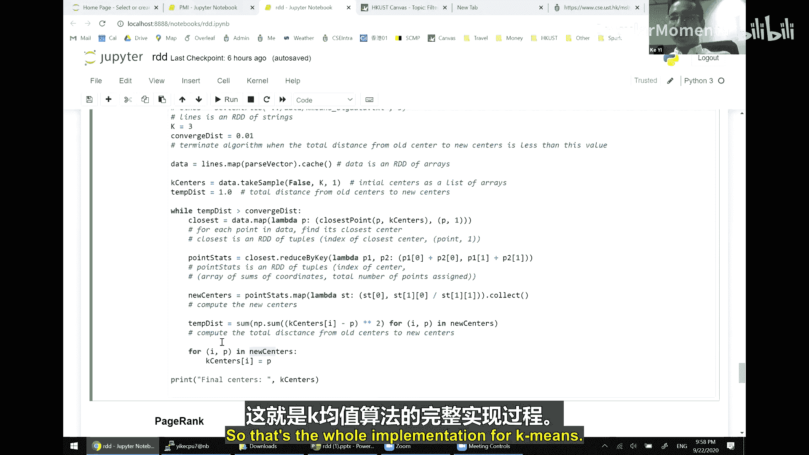
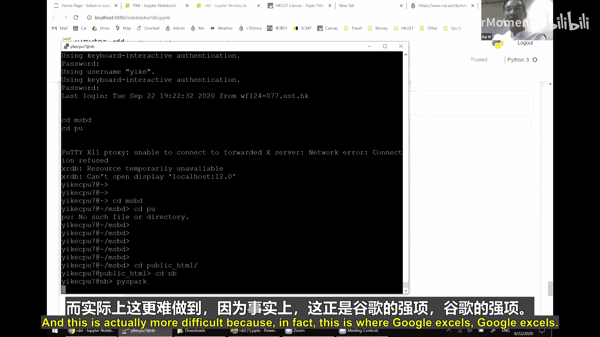
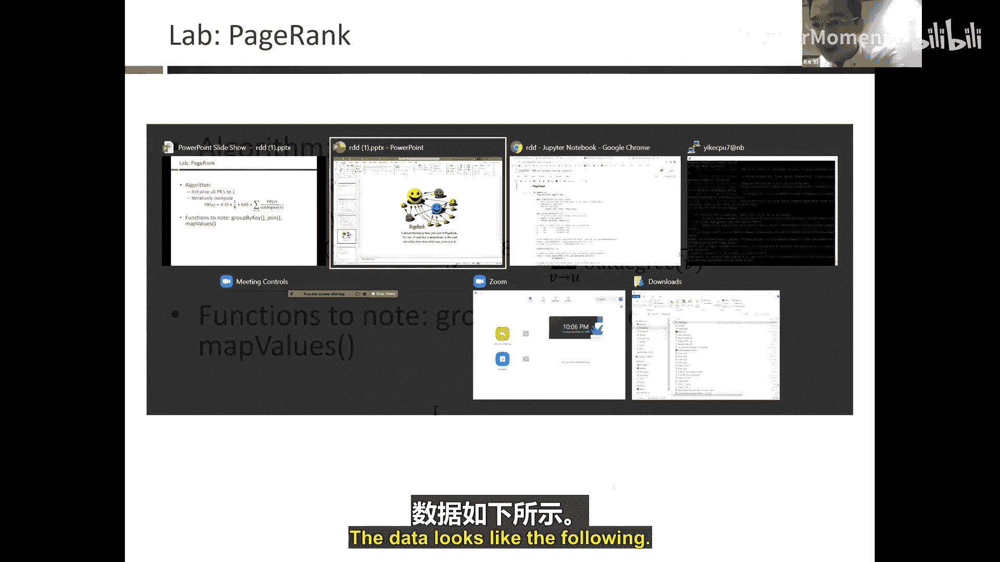
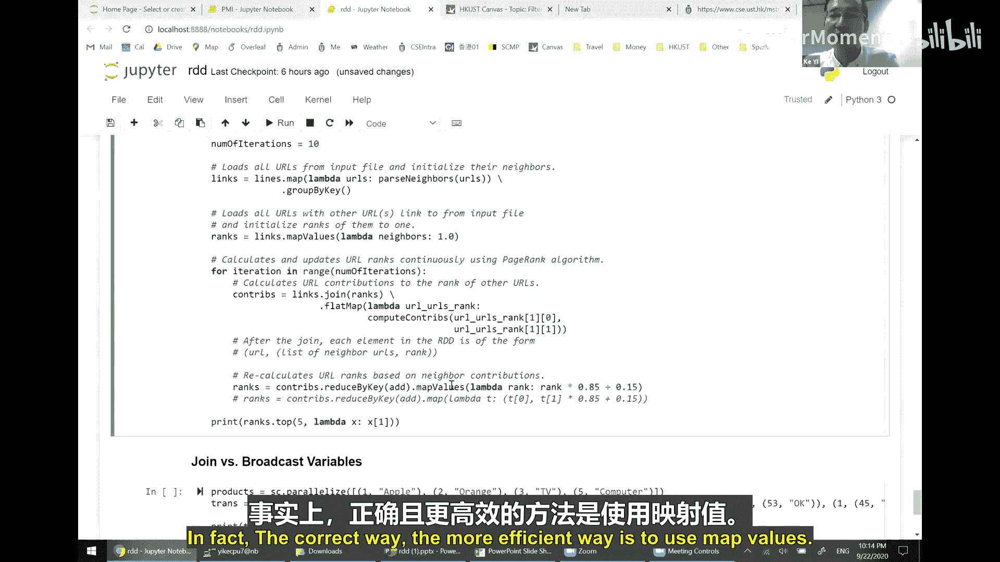
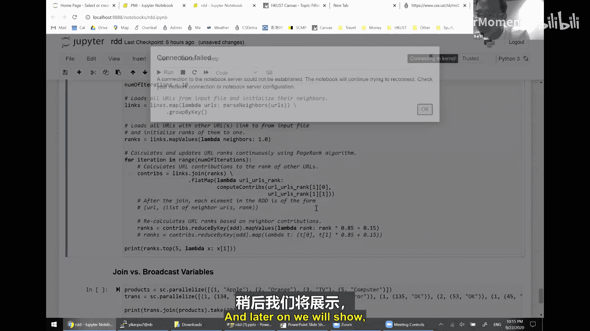
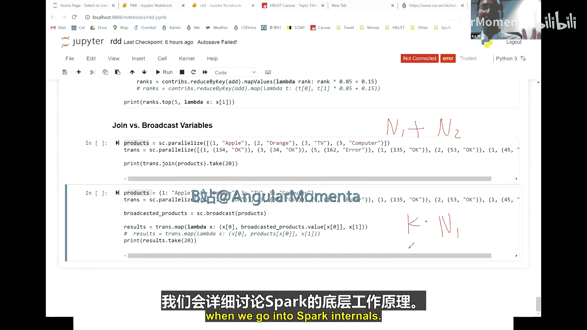

# 【香港科技大学】基于Spark的大数据计算--Big-Data-Computing-with-Spark-p08-04-04-02-键值对--BV1V8FmzuEHf_p8-

Okay， so so far in our in all our examples， RDs consists of items of of a single listen type。 Okay。

 However， we we said that Sp can also do mapreduce and mapreduce required the he value pairs。

 So therefore you have to support RDDs that consist of key pairs and this is naturally supported in Python because Python has this beauty type of type。

 So therefore。If your RDD。Consist oftys of two items。

Then this RD will will be naturally interpreted by Spk as RDD pairs。

 and then there is a collection there are a collection of methods。

 transformations that can work on key pairs。 Okay so whenever you have key value a RD of kilon pairs。

 a key value RDD of tys of size 2， then this will become a keyn pair okay。

So now let's see some examples， in fact。Yeah。So here is one simple example。

 So let's see that we want to do this word count earlier。

 we said that this is a classical example for Mac reduce。 It turns out that in spark。

 this is extremely easy Okay only two lines of code okay。

 so if you if you don't count the first one that creates the RDD。

 So first read an RDD from a text file into this is RDD of strings。And then， we map that into。

An RD pairs。 And these LED pairs consists of。Python tus， okay， every typo has two items。

 S two members， S and one。 So S is string and one is is value It is integer。 Okay。

 so this pairs is RD of tus。 And this will be interpreted as a key metal pairs。

 and then we can apply any by key operation。 So any by key method in spark。

Can be applied on the key value pair RDD。 So here， the first item will be interpreted as the key。

 and second one will be interpreted as value。 So， so recall that the reduce in in spark doesn't correspond to the reduce in reduce。

The reduce in reduce correspond to reduce by key reduce by key in parts spark is the real reduce。

 Okay corresponding to reduce。 Okay， so here reduce by key takes a another user defined function as input。

 So this user defined function is similar to the to the one that you use in reduce in reduce this function is must be associative and commulative here is the same requirement。

 you have to define a associative and commutulative function takes in two parameters two arguments producing one output。

 So what spark will do is to do the reduce for each key for each key it does does it uses this function to reduce all the values into one。

 combine all the all the values into one So namely the end result will be。

A key value pairs where the key is the unique keyword and value is the count。

 How many times it appears in these lines are okay。 So this is how we， how we do word count if spark。

There are many other by key operations supported in Sp。 for example， you can also do sort by key。

 Okay this will sort the pairs of automaticallyically and then you can collect them to the joint program as a list of objects so that you have all the key value pay What counts and ordered by ordered by ordered by the key like graphically。

 Okay you can actually， you can also sort by other fields。 for example， you can also sort by value。

 if you want to list all the key value pairs in the increasing or decreasing order of their frequency。

So now let's look at some other examples on key value pairs。Okay。So。Yeah。

 we need to execute this first to read the data。O。啊。Alright。

 so this is another example of map reduce。 So the map map we are doing is to to transform every fruit into this kilo pair。

 Okay， so what does this mean。The first one is the length of the string， length of the full name。

 And second one is one value 1， and then reduced by key。 So this is essentially。

Counting grouping all the full names by the length of their name。 Okay。

 I don't know why we are doing this。 But， you know， just， for example， we can， we can group。

 We can count fruits by lens by the lens of their name。嗯。Yeah， because， you know。

 this is a very commonly used combination function。 Actually， you can。

 this is also defined in the operator。Package， you can import that。 This is addition。

 And you don't have to define this addition yourself。 this is just for your convenience。

This is the same example， right， same example of word count， okay， counting by word。Soed by key。

 we were sort by lexographical。Order， okay。嗯。This as mentioned。

 you can also sort by other by other fields so you can actually return。 You can。

 you can actually sort by anything。 So so this is。Accomplished by sword by。 Okay， sort by。

 this is a spark transformation。 Okay， sort by。 This takes ada function， which returns the field。

by which you want the sorting to be done。 Okay， suppose we want to sort by value。 Okay。

 finding the most frequent words。 Okay， so so then you define this following la function。

 So this X refers to every item in the R in this case， an item in this R counts is a key value pair。

 right key pair。 So x is this key pair， namely a table， a Pythonpo。 And so x 0 is the first one。 X 1。

 the second one， second field。 Second member。 So we want to return。

 we want to sort by the second one。 So we we X1。 Okay， so this is。

The function returning the field by which we want a sorting to be done。

 And second one is an optional argument。 by default is true。

 So true means that we the sorting is ascending if we want to do descending sorting。

 Then we set we override this default parameter argument to false。 Okay， so this will。

Return this RDD in descending order， descending order。Okay。So this is some bi key operations。Another。

Actually， also by key operation is join。 Okay actually， we will talk a lot about we talk a lot。

 spend a lot of time on joins when we talk about spark。 But anyway。

 you can also do a join between two R。 But then this time。

 the two Rs Both have to be key battle pairs and this join will do a join by key。

 So so to this actually should be renamed to join by key。

 this is making things more this will make things clearer。 anyway。

 so in in spark the join will do a join of two R D by key。

 What does this join actually mean So it will try to pair up the tables， the key pairs in the two Rs。

That have the same key。 for example， in the first R， we have one apple and one。 So。

 so so this is a nasty typo。 right， So the first this typo， the second element。

 the second member and the typo。Is another couple。 Okay， so this is nested。

 And the reason why we want to make the nested is that this join only support joins between two Rs。

Which are both key value pairs。 so， so， so you cannot write the first one。 if you write， if we wrote。

 if we do the first one， this will be a。Oh， I'm sorry。 So yeah。 So if the the first one also works。

 but then the result will be slightly different。 Will it will interpret。啲。Second one。

 can product doing。Yeah， essentially it， it will just omit the third field。 Okay。

 so can you can see that okay is okay is lost。 So this is not what we wanted。 Okay， so essentially。

 it will still interpret this this as a key pair， name only the first one will be will be retained so if you want to return all the fields。

 you need to rewrite this really different R in this sort in this sort of weird way。 Okay。

 so that you can keep all the all the ones。 Okay， all all the fields。Alright。

 so then for every matching two tys， namely the key， the key are the keys are the same。

 then it will produce one output。 Okay， so then this is the output。Namenameamely。

 the join result of these two typos。 Okay， and the join result is also a key value pair。 Okay。

 the key is the common key。 Of course， they must have the common key and the value is anothertypo。

 anothertypo。 This typo has two members。 The first member is the value of。Thetypo in the first RD。

 which is Apple and the second。Member is the value of the key value pair in the second R DD。

 So namely， in this case， is another table。 So that's why we have this complicated looking nest table with three layer of three layers of nesting。

 one。 That's the common key。 And this is the value of the first part。

 And this is the value of the second RDD， which is another， which is another table， So hopefully。

 this is not that confusing。 Okay，So if。This one has multiple matches， matchings in the second one。

 So for example， this， what Apple also matches with one， you know，135。 Okay。

 It will produce another joint result， namely this。😊，Yeah， for example。

 this one correspond to the joint result of one apple and1，1，35。 Okay， so in case it。

 it has this one。 and there is one more yeah here。 So in general。

 it can returns the cartesition product。 Okay， yes， that's as the。Zhenhao mentioned in the chat。 Yes。

 it's， it's， it's a cartoon product， namely， if you have。

 if you have n appearances N tys with the same key in LD1 and M tys in the second RD。

 it will produce n times M results。 So so， so， so the join if all the key are the same it can it produces quadratic number of tys。

 So now with this operations。Defined， we can illustrate a more or less complete example after we will do three examples。

 PM I computation K means and page rank。 Okay so the the latter two are also included in official smart examples。

Okay。So the first one is the PMMI computation。Oh where my mouth。Okay。

So what is PI PII is just just this notion of pointwise mutual information。 Actually so as mentioned。

 this course is all about computation。 We don't care。

 We don't ask why why a formula is designed this way。 right this is。

 this is the problem of data mining or machine learning。 So our job is， given the formula。

 given the algorithm， we want to scale it up。We to implement using a big data calculation frameworks。

 Well，how， So here this PI is defined as follows。 So。

 so it is a measure of association used in information theory and statistics。

So here P P refers to the probability。 So P X is the probability that X happens。P。

 Y is a probably that Y appears。 and P， X， Y is the joint probability of X and Y。

 So how many how was the probability that X， Y appear together， right So， so， so P， X， O。

 the larger P， X， Y is the higher their association association is。 So that's why P， X。

 Y is in the numerator。But also， if P， X and P，Y are large themselves。 So that means， you know。

 X and Y。Appear together may simply because they are just very common。 They are both very common。 So。

 so that that's why we want to discount discount。When we want to do discount。

 if P X and PY are large， So we want， we put P X and PY in the denominator。 Okay。

 and then we take the ratio and take a look because it information theories we want to take a look。

Anyway， I would not explain the rationale behind formula。 our job is to just compute it efficiently。

 Okay many of the ideas， the higher it is the stronger the association is between the two terms X and Y。

Okay， so in general， and and X and Y， P， X， Y is between negative is an or is a number。

 the higher the more positive is stronger their association is。 So here is one example。These are b啊。

So if， if the nearly the the association between the two bit0。 So it turns out that 1。

0 has the strongest association Okay1，0 has strongest association。

 although they are joint probability is only 515%。 this is actually higher than 0，1。

 because simply because1 itself appears very often。 So maybe one appears with probably 75%。

 and it it。Among and out of this 75%。70% a percent of the time。0 also appears。 Okay， so。

 so this compare with 75%， This is not that significant。 So。

 so that's why we have PM I Y between 10 to be the largest。So。So this is a data set consisting of。

Additive non pairs。Okay， so just a plain text file consisting of string lines。

 every line has two words， the first word is supposed to be additive。

 the second one is supposed to be a noun and our job is to find find out the association between a particular additive and a particular noun。

 how likely it is for them to appear together。That' that's the data。 We first read it。🤧嗯。Okay。

 we count is action， right， This will trigger the actual computation and see this data data that has essentially 3 million pairs。

 okay and。It has two partitions， So of course， you can change that。 for example。

 let's say if you have eight cores， you can actually use eight partitions。

 this will make things faster Okay now we have eight partitions。

Let's first take a quick peek into the data。 So the first five。 So here， remember， always use take。

 Don't use collect。 In this case， it is a huge RDD right You don't want to collect everything back to your to your browser。

Allright， so this is actually a good example for interactive data analysis。

 right we have the data we want to play with it using a Juter notebook is very convenient also exploringing this interactivity of Spark。

😊，Okay， so now the first job is to convert the lines into word pairs。 The data is actually dirty。

 Some lines have more than two words。 So some has only one word。 So we need to filter out。

 So this can be done by a map plus a filter。 So this map L refers to every line。 every string。

 and it will will convert that into a cha。 right， Con that into a cha。 So this split is Python split。

 We convert a string。 We split a string into a list into a list of words separate by space。 Okay。

 but we can not。Just use the list。 We have to convert that into a typo in order to in order to use Pythons transformations。

 this by key transformations。 So we convert that to a typo。 Now we have alreadyD oftys。

 and then we do a filter， and the we only keeptys。Theses two members okay。嗯。Okay。

 so now we do this data preparation。 So now we have an RDD of。Ts， okay， where every typo has two。

 two element， two members。Okay。Okay， it has， yeah， still 3 million， I think still less。Yeah。

A little less。 So some dirty lines have been filtered out。Okay， so to keep the P I， we need。

 you know the probability of every additive， the probability of every noun and the probability of every joint appearance。

 So here the probability can be approximated by the frequency。

 but a relative frequency So were gonna need to compute the word frequencies。

 So this is similar to the word count example we did earlier。

 so we first compute the frequencies of the pairs， every additive non pair。

 Okay so if a pair is not very is is too infrequent。

 only appears less than10 times we ignore them because we consider them as too little support。

We can do that by using the following three transformations。 The first one is a map， mapping every。

 every。Every。Tle。Into。Another typo。 Okay， so P that one。 So， so now this is， in fact， F map。

 we have a R typos where every typo has two members。 The first one is the first one is this。

Addditive non pair and the second number is a value， which is one。 Okay， we do that。Essentially。

 we are treating this typepo as the key。 Okay， namely the combination of this key value pair。

As the key。 So this shows the power spark power of spark。 So any data type can serve as the key。

 Okay， any data type can serve as the key。And then we do reduce by key。

 So this is same as the four word count。 And then we only keep those frequencies。

 pairs whose the frequencies is at least 100。 Okay， so it this a filter。 So after this reduce。

 Okay after reduce， we also have a key metal pairs， the value is the count。 right The key is the。

Editive non pair。Okay， just take a look at the results。 Okay。

 so now we have the pair frequencies is a RDD that look like this。 Okay。

 the key is the pair and the value is a frequency。Okay， so these， these are the values for you know。

 P， X， Y， P X， Y， we also need a P X， and we also need P， Y。Okay。

 so we're going to do this very similarly by by essentially map reduce procedure。Except that here。

 the map will only extract the additive。And the second one， only extract the now。 Okay。

 the value still one。And we can compute the frequencies。 So these are the add frequencies。 Okay。

 social appearss， so many times free appears 6000 times， et cea。O。

The count of this RD is just the distinct number of nuuns and and a distinct number of additives respectively。

Okay， so now we need to compute I window to compute。This P I I， right， so compute P I。

 we need three pieces of information， right， P， X， Y， P， X and P Y。

 So know that this X must be the same as this X is Y must be the same Y。 So we can do this。

 There are two general approaches。 One is to use global variables or broadcast variables。 So namely。

 we gonna broadcast P X and P Y to all workers。 So every worker has have access to this。

 The other one is to use join。 Okay， actually this two have methods have pros and cons。

 and we will first show how to do them， and then we will talk about whether which one is better in which situation。

Okay， first， let's see the broadcast method。 Okay， we're gonna broadcast。

 we're going be broadcasting the additive and non frequencies to all workers to all workers。 Okay。

 so here essentially we can only broadcast a Python object。 So so far。

 A underscore frequency and N underscore frequency， their RDD， so they you cannot broadcast RDD。

 can only broadcast a Python object。Excuse me。 So the first step is。

First the first step is to collect them back。Of course。

 you can do collect and then convert that into a map。 But then by spark provides a even nicer。

Function， which is collect as a map。 So this will。This can only be applied on RDD of key value pairs collect can be applied on any RD this collect as map can only be applied on RDD of key value pairs。

 So this will return a Python map Okay，ython map where key is the key value is the value。 Okay， so。

So Nict and aidoscopicic， they are Python maps。 Okay， hopefully they are not not。

 they are not too big， which is the case because， you know， that's why we we。

 that's why we did a sanity check， right Yeah， we didn't do。And。Additives， okay， okay， yes， have1000。

 So not too bad。 Okay， is doesn't。Will not kill your machine。 So it's okay to collect them as map。

 Collect them to your driver program。 Yeah， just to make sure that it is indeed a Python map， right。

 So we just。Oh， no， okay。 So this is a map。 And then we're gonna broadcast this to our to all workers we by using broadcast variables。

 so。So we use sparks。 I see。 spark context broadcast。 So this will broadcast this。

The frequencies of all the nuuns and additives as two broadcast variables。

 you recall that you can only。You can access the broadcast variables by the value method。

 This value method is provided by sparkark。 It will return the actual map。

 and then you can use standard Python method to retrieve to look up any particular key。

 So here a underscore score di is the value is the map story。 All the frequencies of the additives。

 So this tells us that violent。 This word appears so many times。Yeah， after retreat。

 after using value， you can just treat it as an ordinary Python map。

So now we can compute D PMI because all the workers have access to both dictionaries。 Okay。

 so because they are having been broadcasted。🤧啊。嗯。So， so， so yeah， so now we just plug in the。

 plug in the information into the formula。 So we're gonna do that by by using map。 Okay。

 map and function PM I score。 So it will convert every key pair into its PM I score。 Okay。

 so the pair is pair frequency。 Okay， and。So we we applies on this pair frequency as this pair frequency is this already right。

 So this already。 Okay， the key is the pair。 the key is the pair non pair。 So that's why here。

 that's the pair。 So pair frequency 0 is actually the pair。 That's the key。And we。

 we would decompose this typepo。 Okay， that this is just the Python syntax。 and the F is the。F is P。

 X， Y， right F is the。Frequency of pair， okay。And then we can plug this into the formula。 Okay。

 so know that。In the PM I formula， all these are probabilities。 But so far。

 these are just frequencies。 So we can simplify fast。 So we need to convert that into probabilities。

 So name we the frequency of the frequency of X， Y。Divide by the frequency of the。

 the of the whole thing， right， if the the the data set， and then this is the frequency of。

This is the probability of x， and this is the probability of y。Okay， and yeah， this end cancels。

 And then we have one extra N on the top。 So that's why we have， we have the the。

F is the frequency of X， Y multily N and divide by the frequency of the additive and none。

 And these frequencies can be can be looked up from these two broadcast variables okay。Okay。

 and then we take lock and then we return。Thistypo， okay。

 this is exactly thetypo which I think we should write this， anyway。I guess this also works。

 only maybe is the Python。Okay， yeah， this also works。嗯。Yeah， this is atypo。

 So here we are reversing the role。 The PM I will be the key。 And W 1 W 2。

 this pair will be the value。 Okay， and the reason we are doing this is because the last step will be sorting。

 We， we want to return the top 10， top 10 most。The top 10 highest PM I I scores。

 together with the additive non pair， so。By default thought， the top or sort sort by key。

 They all they both sort by key。 So， so， so we we use PM I as the key。 And then to the sorting。

 the sorting will give us all the orders in in the in decreasing order。Of course。

 you can also do sort by if you use， still use the。Key still use activeitive non pair as the key。嗯。

Okay， so this is the。This is the broadcast。Method， actually， in the yeah， in the homework。

 which I just released on canvas。 you， one of the questions ask you to rewrite this using global variables。

 Okay， global variables。 So here we use here we use broadcast variables。 Okay。

 you can also use global variables。 that's in the homework in the programming assignment。😊，Actually。

 that thats question actually actually very， very easy because global variables are even easier to use because global variables by default will be packaged into the closure and which will be broadcast to all the all the workers。

 So it's in some sense， there's really little difference between using global variables and broadcast variables because in both cases。

 you can only the workers can only read， can only read values from broadcast variables。 Okay， so。

The only difference between the two is that broadcast variables are slightly more efficient。 Okay。

 in the case that， you know， if a machine has multiple cores， Okay。

 if we use a global variable in that。啊。Yeah， broadcast available here， yes， so。Let me clear this。

Cl my adaptation， yeah。So the global variables， let'm sorry， broadcast variables are similar to。

Global variables in the sense that they allow the programmer to grab to keep a read only variable cached on each machine not each task。

 So if you a global variable， then each task will have a copy of the copy of the variable this will make a difference if a worker has many course。

 So in this case， you have many copies of the variable on the same machine。

 which is a little bit wasteful。 this is the case for our， for this example。

 because know the two dictionaries， the two python maps， each has know over 100000 entries。

 not that small。 So that's why we use broadcast variables to save a little bit space。 However。

 in terms of usage， they are really really no difference between broadcast variables and global variables well。

 maybe。There's a little bit for global variables， the workers can still modify。

Although the effect will not be received by the master of the driver driver program。 Okay。

 so you can you can you can， you can change the value of the grow variable in the worker inside the worker。

 but it has no effect。For broadcast variables， there's， there's even no way for you to change it。

 Okay， so that's， but this is really， really a， this is really not this not。

 this is not really a difference。 Okay， in both cases。You cannot change its value anyway。Okay， so。

 yeah。 So， so to summary to， so inclusion。Whenever you it always better to use broadcast variables。

 it is slightly more efficient than sending the global variables in the closure。

 but the difference is small。 Okay different small。 Okay。

 so if you have just one single variables during a one integer， there's no reason。

 there's no need for you to use broadcast variables。

 So only when you have a large object like a dictionary or or or python list that you want to broadcast。

 then you can consider using broadcast variables。Okay。

So K means clustering is a very classical algorithm for classroom。 So in this case。

 it has cluster this these。😊，Points in two dimensions into four clusters。 Okay。

 so the algorithm is very simple。 So initially， we put the centers of the four clusters。 Okay。

 namely K centers randomly， we pick four random points as the center。

 And then in each iteration of the algorithm。 we switch back and forth between two steps。

 step one is for every data point， we need to find its closest center and assign itself to that center。

 Okay， so namely every point should be assigned to the closest center。 so that's very natural。

 And the second step is to reposition， because you know， the very initially the K centers。Initially。

 the case centers， which are readily chosen， may not be well positioned。 So in this case， the this。

 this cluster has a lot of points and the center is not really in the center of the cluster。

 So we need to reposition it。 The reposition。 The new position is simply the average。

 namely the middle points on both。In both X and Y called dimension。 Okay， after repositioning。

 repositioning the centers， you know， the for every for for data point。

 is the closest center may change。 So that's why we need to enter the next iteration。So for example。

 in the first generation at this point。Is assigned to this center。 Okay。

 but then after the centers have been repositioned，This yeah。

 you can see this point has switched to this center。 Okay。

 and this this process will continue iteratively until until the classroom is stable。 So namely。

 the positions will not will no longer change。Now let's look at the implementation。Okay。

See here we're going to use the Ny library so because it has a good support for multidiional for multi for multidimenional arrays。

 because we want to write。 well， this is official spark example。

 and they want to support K means clustering in any dimensions， any dimensions。

 Okay So the array library and has can be can make can make this more convenient。Alright。

 so now let's go to the main program。 and then we're gonna go back to these functions as we encounter them。

Okay， so we first read the file this， again， this decadess data can be downloaded。From at。This URL。

SoIt simply consists of a text file where every line corresponds to a point。 Okay。

 and the this is a three dimensional data set。 Okay， namely every point has three coordinates X， Y。

 Z， but dimensionality can be anything。The program is general enough to handle any dimensions。O。

Alright， so now we read this text file。 Okay， into Spk。 This is a RDD of strings， RDD of strings。

Okay， let's suppose K3。 We have three centers。Okay。

 so this is a common trick that people use when performing numerical。Computation。

 because so strict speaking， we're gonna we should continue the iterations until it converges right by converge。

 We mean that the centers will not will will no longer move。 However， because the centers。

 because the positions of the centers， the coordinates are floating point numbers， So you remember。

 you should never compare。 you should never perform a equality test between two floating point numbers because floating point numbers are imprecise if you do。

 you know。Square root 2 times square root 2， you will never get to。 if you don't believe you can try。

 you can try that yourself because because of rounding errors。

 So there's always some imprecision in 14 point numbers。

 So so that so you should never never compare equality between two14 point numbers。

 So that's why we set， we use a small threshold。 Okay instead in in testing equality between two14 point numbers。

 we check。If the difference between them is small enough。 Okay， when it is small enough。

 then we're gonna terminate， namely， we're gonna terminate the algorithm when the total distance from old center to the new center is less than this value。

 Okay in practice， is sufficient to set it to a some number that is small enough。Okay。Alright。

 so now we're gonna convert the strings which store the cornies into into vectors。 Okay。

 we into vectors。 So we， we use the N array as the data for format for storing the。

3 coordinates or not， not， not necessarily three the coordinates of the points。

 We do that by using this map transformation we called using this par vector function。

 This par vector takes one argument as input。 though this is。The line， every line in our input file。

 Okay， and it outputposts a nu array。 Okay， namely this converts。 So we we first do Lada split。

 split that into words。 Okay， so every coordinate coordinate is a word。

 And then we convert that word into a floating point number。Okay， and then convert that into a array。

 So after this， we have a R DD of N arrays。 Okay， and then we cash it because we're going need。

 we're gonna need。We're gonna need the。Yeah， we're going to need to perform mathematical operations on this and we also cache it because we're going to need to access this RD multiple times。

Okay， a question。 the chat。 Yes， the the result of K means will depend on the initial selection of the points。

 Actually， there is a。There is a lot of study how to choose initial point。

 Okay Cho them randomly may not be the best idea。 Okay， there is actually。

 there is an algorithm called K means plus plus okay， yeah， okay， somewhere already you know yes。

 K means plus plus in this version of K means they per they choose the initial points random。 in the。

 in a good way。 Okay， so I will not say that， but anyway。

 it chooses the random points so that they are more。

They are better spaced out than uniformly chosen chosen ones。

 And it has been proved that if you initialize your point， your centers in this way。

 then it is guarantee that this K means cutting algorithm will converge to a solution that is near optimal by near optimal。

 We mean that it is at most a log factor worse than the true optimal solution。

 the true optimal solution is actually finding the true optimal solution is actually N hard problem。

 So it is impossible to find the the global optimal。 However。

 this K means plus plus algorithm can guarantee a near optimal solution that is only a log factor worse than the optimal solution。

 Okay， and it's actually very also very practical not only theoretical only it's not only theoretically good。

But also performs very well in practice。Okay。诶。Okay， so。

 but anyway if here we're going still use the vanilla K means algorithm where we choose the Cs simply randomly。

嗯。Okay， so， and we're gonna do that by just taking a sample。

 So this take sample method is provided by Spk。 Okay， this will return a uniformly random sample。

 So here false， I think is means that is sampling is sampling without replacement。Yeah。

 so it means that the key samples are different。嗯。This 1， I remember， is just a seed。

 the seed of the random number generator。 Okay， because take sample。

 this function needs random numbers。 Okay， so it allows you to set the seed。

So if this forms our initial centers。 Okay， this is a list of ray。

 And so take sample is actually in action because a sample is typically small， right。

 The sample is small， so we。Usually don't need to store it in RDD。

 So so that's why take sample is designed as an action。

 It returns the sample to the user as a Python list， Python list。The sample size is K。Okay。

 so this is just a temporal variable that we need later。 Okay， so now we go into this loop。 Okay。

 the stopping condition is the distance is greater than the con distance。 Okay。

 so initially this is false。 So that's why we initiallyize this temp distance to be something higher than 0。

01。Okay， now we go to into the main loop。 Every iteration has two steps。 Remember。

 the first step is to fall is。For each data point， we want to find its closest center。 Okay。

 closest center。 Okay， so now this case center is a global variable。

 right it's a global variable story all the coordinates of the centers。 So， well。

 you don't really need to use the broadcast variable。 And because it's a very small list。

 So we just store it in the global variable。 And this will be available to all workers。

So to find the closest center for every data point。😡，We can do this， using map。So essentially。

 we convert every every data point to atypo that includes。Its close center。

 So more precisely includes the index。 Okay index of the center。

So that's why we design this closest point， closest point。Function， okay， so， in fact。

 this is embedded in。Another Lada function。 Okay， because for a map。

 this function can only take one argument， P， which is the item in the RD。 Okay。

 and then this La function P will pass this P into this course center together with case with with the case case centers。

 okay。Okay， so this closest point is written here。 This is just a standard python function。

 which returns the index of the closest center stored in this centers list。 Okay， the closest one。

 the one that is closest to P。So for let's just read it together quickly。 This is not that difficult。

 Itss just standard Python has nothing to do with Sp。

 The best index is 0 and closest initially is infinity。

 Then we go through all centers for every center we compute we compute is distance。

 compute its distance。We should take square root。 But anyway， we only compare。

 we only do comparisonly， right， So we don't need。 We don't have to do a square root。

 So this can say was some computation。Okay， so time0 distance is actually the distance squared。

 If this is close smaller than the closest distance we have found so far， then we updated。

 We update the best index at same time and finally return the best index。

 Okay so this is what this function does。And okay， so now。This closest point will return the index。

 Okay， we will return the index。This map will return RDD where this。Best index of the center will be。

Will serve as the key。 Okay， so why do we choose to use the index of the closest center as the key。

Well， now you need to look。You think forward， right， So this is why， you know。

 when designing this map programs or map reduce program in general， you need to think ahead which。

Which。Part should serve as the key so that the next step can be can be carried out more conveniently。

 So in the second step。Of the KS algorithm， we need to compute。 We need to reposition the center。

 right。How do we reposition the center， The new center is the average coordinate along each along each dimension。

 right， and the average is nothing but the total divide by the count the total the total of the sum of all coordinate of all points divide by the number of points in each cluster。

 So essentially in the next step， we need to do a reduced by key where the key should be the center。

 right， So namely for each cluster， we need we need to compute something。

 So that's why we we use the index of the。Cllosest center as the key。And value part is a tu。

 It's not just one， because we are not only interested in finding out the size or the count of each cluster。

 We also need to find their compute their sum， The sum of all coordinates。

So we essentially package both parts into one tu， And this together serve as a value of。

Of the key pair， which is the result of this map。 Okay， So yeah， so then， so therefore。

 after this map， we're gonna have an RDD consisting of topples in this form。 Okay。

 so the index of the close center is serving as the key。 And then the point which is a nu array。

Together with one， they are serving as the value， serving as the value。Alright。

 so now we go to the next step， which is to compute， which is to compute the。

Po of the new center new center。 for that， we need two。

 two applications to reduce one is the sum of all the coordinates。 And then the second one is count。

We can do that in one shot in one reduce by key， because the key is the same anyway。

 The key is the index of clock center and the reduce function。

 The reduce function takes 2 P1 P2 points。 Okay， namely this H P1 and P2 and。

They are both in this form， namely P1 and P2 are both topples。 The first one is the point。

 which is a nu array。 and second one is the number。 So we add them up。 So this plus。

 this plus is actually the plus the addition in the nu array。 So this is adding two arrays， namely。

entrytry wise addition。 Okay， and this one is adding the count。 This one is adding the count。

Initially they are all ones， and then they are added up together。Alright。

 so after this reduced by key after reduce by key we open the RDD of the following form the key is still the index of center and the value part is an array in this form。

 the first part in this value tuple is the array of sums of coordinates。

 the second one is the total number points in this center in this cluster。诶。Actually， this is a。

 this is， this is a fairly small RD， right， This is an RD that consists of only K。😊，Items。

 one for every center。 So this is very small。 already is。 so we can actually collect it。

 collect it back。 But anyway， we， we， before we do the collection。

 we just still use spark to compute the new position， so。We do that by by another map。

 by another map of。This S T refers to a typo like this。 Okay， the whole thing。

 So S T 0 is the index of the center。 So it returns the index center。 and the second part is S T 1，0。

 S T 1，0 is this part。 Okay， this array array。 and then S T 1。

1 is the total number points in this cluster。 Okay。

 so this division is actually a pairwise division is actually entrywise division。

 We are dividing a non pi array by a integer。 So the end result is we divide each coordinate in this non pair array by this number。

 Okay， and then we do a collection。 because this is small enough。 this is just K K new points。Okay。

Now we have the new positions points。 We need to compute the distance how far these centers have moved。

 Okay， so this is just standard Python。 This step has no spark involves。 So namely， this is。

K center is the old center。 right， P is a new center。 P is the new center。 right， Yeah。

 for I P in new centers， I the index， P is the new position of the centers and does difference square at an atom up。

 right， So again， this is this。So okay， we have two sum。

 The first one is the sum over all over all the dimensions。 Okay。

 and this is some over the over all the over all the K centers。 The total distance moved。 Okay。

 so strict speaking， we should have a square root。 Okay， we have we should have a square root。

 for this part。 we should have a square root， that's distance。

 but we didn we didn't care to do that or they didn't care to do that because at the end of the loop。

 we only we are only concerned whether the total distance is small enough。

 right So whether we take square root or not， it doesn't really matter because were gonna terminate only when the total distance is very small。

 is small enough。Okay。And then we just assign we just update the positions。

 coordinates of new centers。And then， and then that's it。 Okay。

 so that's the whole implementation for K means。

For the next example， is page rank。Page rank is another very classical algorithm for computing the importance of the web pages。

 We mentioned that， you know， the most basic， the first step for a search engine is to build inverted index。

 And we already saw how to do that using ne inverted index。 But more importantly。

 the job for search engine is to rank to rank all the pages according to some notion of importance。

And this is actually more， this is actually more difficult because in fact。

 this is where Google excels。 Google excs。 This is where where this page and algorithm was first invented and it really exploits the the the structure of the web。

 Okay， because one of the first ideas in ranking pages is just， you know。

 by how many times this page contains keywords。 But then it。

 this can be easily abused right by just including the keyword many times。

This this do not this this kind of abuse should be avoided。

 So the idea of page rank is to use the structure of the web Okay。

 to get an idea of how important the pages are the idea is okay。

 so if you have many other pages linking to your page then your your page will be very important Okay。

 so for example， this this one， this page has many incoming edges so this this page is probably probably important。

However， this。😊，Only using the in degree can also be abused because I can create create many dummy pages and and and and ask all this double ask this a million dummy pages pointing to my page。

 So only using the in is not a good idea。 So the idea is to not to define this in a recursive way。

 right， So name me the page rank of a page is。I can be can be considered as。

Being contributed by all the incoming， by all the incoming neighbors。 Okay。

 and this depends not only on the， but also on the importance or the page rank of all the incoming neighbors。

 So， so that if you have a lot of pages pointing to you， but they all have small page rank。

 then that's also not very good news。 that's also not very good sign。 However， if if you for example。

 this is red guy， it only has one incoming neighbor。 But that incoming neighbor is very important。

 that means so this red guy red page may also be important。Because this can contribute a lot。 Okay。

 this red guy only points to this guy， right， So that means this red。

 this yellow guy thinks this red guy is very important。 So this， therefore。

 this red guy is also important by the recursive definition of patriwork。

So more precisely the algorithm for computing page rank is also iterative。

 So initializes all the page ranks to one。 Okay， so all the page ranks are the same initially。

 And then in every iteration， we compute following。

 We use the following formula to update the page rank of any node you So it is updated to using the following formula。

 Okay so the idea is every iteration。 Okay， it has a it has a a fixed term。 Okay。

 so this is modeling the behavior of a random user， right， user and any step may follow a link。

 It may also start from another page from。Afresh。 So every page should have that should have that opportunity to be to be to be a。

To be to be a new starting point。 So this first term is modeling that behavior。

 And the second one is a contribution from all its incoming neighbors So more precisely for every。

Incoming neighbor V of you。P RV is the pay record V。

 and the V will equally contribute to all its ongoing neighbors。 So you is just one of them， okay。

 so。We has our degree so many ongoing neighbors， and we will equally part pay rank to its ongoinggo neighbors。

 and it will give one piece， one share to you。OfOf course。

 this is sum over all the incoming neighbors of you， namely for every B。

 So that we has a link to you。 We compute this and add them up。

 So this is a formula for computing patron。So now let's see how do we implement that in Spark， okay？

The data looks like the following。 Okay， so we just replace this by page rack data。

Okay， so this is a very very simple test test case so this。😊，Each line models a link。 Okay。

 namely from URL 1 to URL 2。 Okay， so we simply use these numbers to denote the URL。

 While in practice， this can be long strings。Anyway， this is one link， one edge per line。

 from a source to destination。Okay， however， for page rank， you know， it's。

The convergence can be slow。 So usually we just do a fixed number of iterations。

 Let's say 10 in this example。Okay， so in the first step in this pageon computation， we。

 we read the lines。 Okay， we read， we get the lines from this text file。

 and then we convert that into links。We do that by using a map converting the URLs to by this parse neighbors function。

 So parse neighbors， this will simply split this into two parts and return that we return them as a return them as apo。

 And then we do a group by key。 group by key， this is the first time we see this function。

 Okay so what this does is its similar to reduce by key。 Okay in reduce by key for every key。

 all the values will be merge into one using your user defined combination function。

 right So in group by key， we still group them by key。 However。

 we don't merge the values We simply concatenate them as a concate them concateulate them into a list into a list。

 So the links is essentially adjacency list of this graph where the key is a source and the value is the list of is ongoing neighbors。

All our going neighbors。 Okay， so that's the links RD。嗯。😊，Okay。

 and then we initialize another RD storing the rank。 the current page rank。 initially。

 they are all one。 Okay， we do that using starting from links， and we ignore the the original value。

 but replace replace okay， so neighbors replace refers to the list of algorithm neighbors。

 and we should replace that by 1。0。 Okay so map values is similar to map。

 except that we are only changing the map we are only changing the value， not the key。

 This is can be used as a shorthand for map。 Okay， this is simple simple that map because in map。

 you， if we， if we use a map， we will also have to tell it but that we are not changing the key。

 Okay if you use map values， then the map。 the key will not be changed。I default方。

So now we go into this iteration， this loop， okay， we will do so many iterations for in every iteration。

 we do the following steps。 Okay the first the first step is a join Okay the first first is a join okay so this join will join two RDDs links and ranks links and ranks for both RDDs links and ranks。

 both RDs will use the source URL as the key Okay and this source URLs are unique unique because we we did a group by right So all the。

Destinations， corresponding to the same source are already grouped together into one list， one list。

Okay， so， so therefore this join is actually a one to one join。 Okay， there's no Carian product。

 It has to be one to one。 and the result of the join。We have the R DD of the following form。

 So this is the common key， which is the source URL。 and this topple。Its。

Consist of the value from each RD。 So can so links， this is the first RD。

 So its value is the list of outgoing neighbors， the URLs of these neighbors。

 And the second RDD is ranks。 because this is links to ranks。 So the second。Member， second。

Member of thisty is the value part of ranks。 The value part is initially is just 10，1。0。

 So this is the current page rank of this URL of this source。 Okay， so this is what we have。

 This is the format format of the URL format of the RD after this join。Okay。

 so now we need to compute contributions， right contributions for each no for each node to its arguinging neighbors。

 And then next time we're gonna。I don up。We're going to do this by a flat map because， because。

 you know， for this URL， this U will equally divide its page rank。

 its current page rank to all of its al neighbors。 So we're gonna need a flat map to do that。

So the input， we just call it URL， URLs rank， you know， this refers to this type。

 this whole thing okay。And we do。 We compute contributions by using this function， Comps。 so this。

URl， URLs is record。1，0 is。1，0 is this list of neighbors， right list of URLs。And1，1 is this rank。

Okay， so we feed these two as arguments to compute con。What doess do。So it accepts two arguments。

 URLs and rank。Yeah， its it first。Gets the number of URLs in this list。 And then we simply， you know。

 divide the rank by number of URLs， and we return a list。 Okay return list。

 Can we do that by using yield yield。So this will return a list。 Okay， so record in flat map。 F map。

 F map expects a user defined function， which returns a list。 So that's why we use。

 we use the yield to return this list。Chlist。So after the format， what do we have？With the， yeah， we。

 we， we should look at the output of this function。 But output function is in this form， namely URL。

 And so this URL is a destination。 right， So namely for every destination， we have computed。

The contribution from the corresponding source。 Okay， So therefore。

 the next step is to add up all these contributions。

 So that's is that is accomplished by by reduce by key。 Okay reduce by key。

 because the key is already the now the destination URL。

 that's exactly what we want to do want to do the reduce by。Okay， reduce by key addition。

 Then we add all these contributions together。 and then finally。

 recall that we also have a damping term here。damping term here。

 which is why we need to do another map。 Okay， we can also do use math values。 In fact。

 the correct way， the more efficient way， the more efficient ways to is to use math values and later on。

 we will show will actually tell the technical difference between math values map math values turns out to be not just a shorthand for map where when you don't change the key。

 It actually more than that。 Okay， it it has some effects。

On the underlying execution of the whole spark program。 But for now。

 let's just use take map values as a shorthand for map where we don't change the value。

 don't change the key， only changing the value。 So we just added the that value rank to rank times 85% plus 0。

1，5， okay。啊。Okay， and that's it。 So that's the page right algorithm。 And this is， yeah。

 this is fairly complicated。 And then， and I think you might need a little bit more time to digest and but this is actually very important。

 And in fact， for the second assignment。 Second assignment， which will be a spark SqL。

 You will be asked to rewrite this using spark SqL。 Okay， and of course。

 you also need to understand the implementation in RD before you can attempt to rewrite this in spark SqL。

 Therefore many problems。 Okay， there are two ways to， to combine two pieces of information。

SoFor example， here， we have two R DDs。 so the idea is to join this together。

 by So namely we have this product I DD and the transaction side transaction RD and this join will match the。

The the the the items with the same key together。 Okay， so one mapped  one and one also map this one。

 Okay， of course， we can do that by we are a join。 However， we can also do this。

 using a broadcast variable because， you know， if every worker has access to this LEDD products。

 we can also achieve the same effect。 Okay， so this is illustrated in this code example。

 So here we simply write product as a Python map。 Okay， and we broadcast it。 And then。

We will no longer need to use join Instead we just need a map。 Okay， for every transaction。

 suppose we want to retrieve the corresponding information of the product。 Okay。

 namely one correspond to Apple and two correspond to orange， etc cetera。

 We just need to look up right from this broadcasted。Python map， Python dictionary。

 So so namely x 0 is the key。 And then we looked up， we looked it up from this value。 Okay。

 and then the this will return the same result as the first one。 Okay， However。

 the underlying implementation execution is actually quite different。 when we do， when we do a join。

 this will involve a shuffle。 Okay， and when you do this broadcast， this will not involve shuffle。

 but will broadcast the product to all the workers。 so there's actually a difference between the。

In terms of efficiency， right So we can compute actually。

 we can estimate the amount of data transmission needed when you do a join。

 So every the two RDD will be both shuffled。 So let's say the two RDDs have size N1 and N 2。

 So the communication cost of the first method will be roughly N1 plus N2。 Okay。

 everything will be shuffled and how we will talk about later how this exactly done。

 for the second one， okay。For transaction， this RDD， we only apply a map。

 right So a map doesn't involve any shuffling， any data communication。

 So the map is actually free in terms of communication。

 The only communication here needed is this broadcast variable。

 So suppose there are K workers So the communication cost of the second method is K times N1。

 So N1 is the first RDD So so which one is larger really depends on the value of N1 N to N K。

 So if the two RDDs are have similar size， then the first one will be better okay。However。

 if N1 is significantly smaller than N2， Then the second one will be better。 So for example。

 if you only have， let's say only these four products and transaction， this table is not a huge。

 then the second method will be better， Okay， so it all depends on， you know。

 the relative sizes of N1 and N2， as well as how many workers you have。 Okay。

 so we actually talk more about the underlying workings of spark。

 when we go into the will when we go into spark internals。 Okay。

