# 【香港科技大学】基于Spark的大数据计算--Big-Data-Computing-with-Spark-p09-05-01-03-关系模型--BV1V8FmzuEHf_p9-

So we we are done with RDD RDDs are actually the key。 The backbone of Spar。

 and everything else is built on top of RDD， including SpqL machine the machine learning library graph streaming。

 everything is built on RDD okay the first component we are gonna discuss that was actually the first component and built on RDD was SQL SprsqL。

 And however， and the current plan is actually to make this this component SQL as wide as possible。

 Okay， and this migration process is still ongoing。

 And some of the components like like machine learning library is almost done。

 but the other one graph is hasnt has not has not really started streaming is also partially in progress。

 So I think although stage。Stage you still need to know both RD and sparkqL。 But anyway。

 I think the trend is moving towards a SQL based system。 Okay， so， so。

 so so therefore it's important to that everyone knows a fair amount of SQL or SQL But anyway。

 although you know， when big data this term was first proposed and a few years later。

 this no SQL also came along。 Okay， the idea is that the idea was that SQL was was really classical was old days the good old days where every all data is relational but soon after that。

 people realized this is was not really the case。 So SQL which people have already spent that case of efforts on it。

 is just too good to be completely discarded， therefore the noqL N OQL was later。

Change into not only SQL， right， SQL was realized to be still to be playing a very important role。

 when， In fact， although if you look at the amount of data that is relational or structured。

The absolute amount is not as large as unstructured data。 however， in terms of the value they carry。

 Okay， that's still， they carry the most valuable data for any company for any small big company。

 big or small So as of so as of today， if you look at the the enterprise companies。

 they still primarily they are using relational database as they are most important component in their data infrastructure。

 Okay， and this is also generating the most the largest value okay Allright。

 so we're gonna first spend some time probably the first hour first part of to this lecture。

 know doing quick review on SQL。 I'm sure that many of you already know some。

 but I think to make sure that we are on the same page is it's good to do a。

More or less comprehensive review so that we know we all know the basics So even you even you know some the basics。

 some of the， you know， subtleties like various joints may not be that easy to completely comprehend。

 okay。Okay， so， alright， so so everyone should have some idea of a relational database looks like essentially。

 it's， it's a bunch of tables。 Okay， so some， someone even claim Excel is database。

 which is not really true。 Okay， so well， well in some in some sense， Excel。

 the table in is also similar to relation。 However， as we will see， there are many features that are。

😊，Fundamental in the in the database are not available in the spreadsheet application like Excel。

But anyway， you must all be familiar with tables or called also called relations in a relational database。

 So essentially a table has several。Key constructs。 So named first。

 the table name and the attribute names。 So the attribute are also called columns。 Okay。

 and then we have rows。 So essentially a two dimensional array。 Okay， the。

 the rows are are also called the tops。

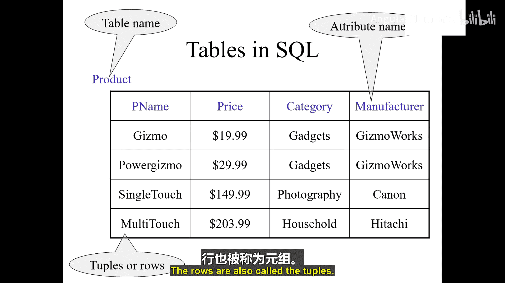

Okay。So as we also explained in the first lecture， the schema of the table has to be specified in advance。

 so that's why this kind of data is called structure the structure or the schema has to be given in advanced so in the relation database case the schema consists of the table name okay the table name。

😊，诶， okay个 table名 okay。Yeah。O。The table name and the attribute names。 Okay， the。

 in addition to name of attribute columns， the， the the types Okay has to be specified。 Okay。

 when you construct the table。One more important feature in reader database is， is a primary key。

 So this is。Optional， you don't have to specify specify primary key， but it's always recommended。

 If there is one column that can be used as a primary key and this should be specified。

 This can be very useful in terms of both the in。InIn terms of both ensuring the integrity of of the database。

 as as well as improving performance。 Okay， in terms of integrity。

 a primary key has this contrain that the values must be unique， for example。

 if we are a table where where we our table of students information。

 Then the student I D can be used as a primary key， and that is unique。

And database will make sure that they are unique。 So， so， so for， for example。

 if you try to insert a new tapo with the same value on the primary key。

 name with the same student I， then database， the database will reject this insertion。

 The database system will automatically ensure this integrity or this constraint。

In terms of in terms of in terms of performance， once a column is specified as a primary key。

 then the database will build a cluster index on it。 Okay， there are two terms。

 What is a cluster and what is the index so a index is。

If you know it's it's usually a B tree or hash table。 Okay， that's how it is implemented。

 It purpose is allow you to allow the database processing engine to find any particular tablepo。

 given the primary key or given the index key efficiently。 Okay， for example。

 if we have a index on the student I D， then given any student I D， I can retrieve thatpo。

 namely all the other attributes of the student very efficiently。 Okay。

 typically just one one I O one is I I O。 if the memory， if memory is big enough。

 then that's that's just a few memory accesses， which can be very efficient。

 So that's what index is useful。But unfortunately， Sp Spk doesn't have an index。

 So that's actually one of the major criticisms for Spk。 So in that sense。

 Spk is not good at this lookup queries。 spark is only good for batchsh processing。

 namely jobs that require at least one scan of the whole database a whole data。 And later on。

 well talk about other systems like mango D B。 The Mongo D B have support for index。

 So if you have queries that are point queries， namely。

 you only look at a few a small numbertys rows， then you should not use spark。

 should use other systems like mango D B。Okay， the other term I want to explain is what is a cluster index？

There are actually two kind of indexes， two kind of indexes。 One is called a primary or class index。

 The other one is secondary index。 So the difference is if the index is clustered。 Okay。

 that means the table is physically stored in the order of this index。 for example， again。

 if student I is the primary key， then we will the database will build a cluster index。

 then that means physically on disk， the students， the roles will be stored in the order of the index。

 So if the index， the B3， that means they are really ined order。

 Okay this can be good if we perform things like range queries。

 namely I want all students whose I D goes from a to B from from lower bound to upper bound。

 So this is very good for range queries， because you can。We just need to find the first。

 the first row and then follow this order and retrieve the， the rest of the rows in this range。 Okay。

 for red queries， this can be very efficient。Okay， so obviously， for any table。

 you we can only have one cluster index because， you know， the rows。

 there's only one way to store them。 There's only one order。 So unless the two。

 two attributes have the same order and that which is usually not the case， okay。Okay。

 so that's that's what we mean by a primary key。

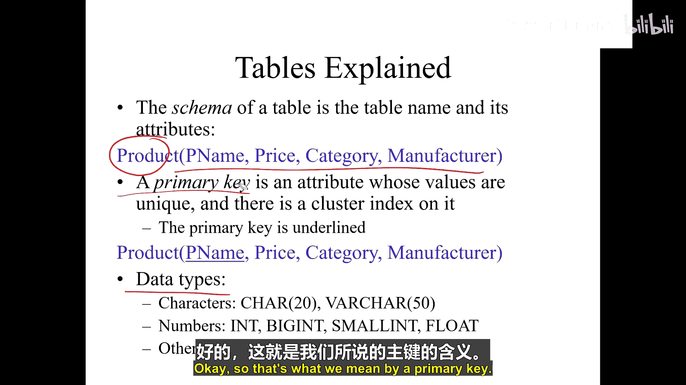

嗯。Okay， yeah， so tables， a table we have several equivalent terms， atypo， a record a row。

 they are all the same thing。 and the table is a set oftys。

 Okay so this is strictly speaking not correct， okay it is a set， only when they are the primary key。

 Okay if if a table has no primary key， it's actually possible to to have two or more identical tables。

 namely there have the same value on all attributes。

 Okay so historically when when the theory of relation algebra was first proposed by you know a ch in the in the 1950s。

 His idea。 His original model was based on set semantics。

 namely he really well he was a mathematicians， mathematic。It like sets。

 because the entire mathematics can be considered as as being built on top of set theory。 Okay。

 say we we for， for mathematical elegance， right we want everything to be a set。

 The table should also be a set。 Okay， so namely， we should not have duplicate。Tles。

 so even if there's no primary key。However， so as people start to build actual systems。

 they realize that maintaining these assessments may be very expensive because you need to remove all the duplicates all the time。

 because you it's not only the initial the raw data set， the raw tables。

 when you perform all kind of operations name the operators in relational algebra。 Okay。

 every every intermediate result has to be a set。 So duplicate。Elimination has to be done。

After each operation。 So this is very extensive。 Okay， and so when we。

 when people actually build relational systems， then they they decide to use what is known as a bag sematics。

 Okay， bag。 So the mathematical term for bag should be multi set。 but if you say multi set。

 then people will not understand。 So in practice of people use this word bag。

 So bag is really the same as a multi set in mathematics， which allow duplicates。 So actually。

 the number of。😊，The number of times it repeats is also stored。 Okay。

 so so this is technically not correct。 It should be a bag oftys。 But， but anyway。

 some other features of set are preserved like， you know， the it's its， it， its， it's not really it。

 it's an order list。 name the order doesn't matter。 Okay， this' no first， no next， no last。 Okay。

 so name， if you change this position of twotys。 it doesn't really change the relation。

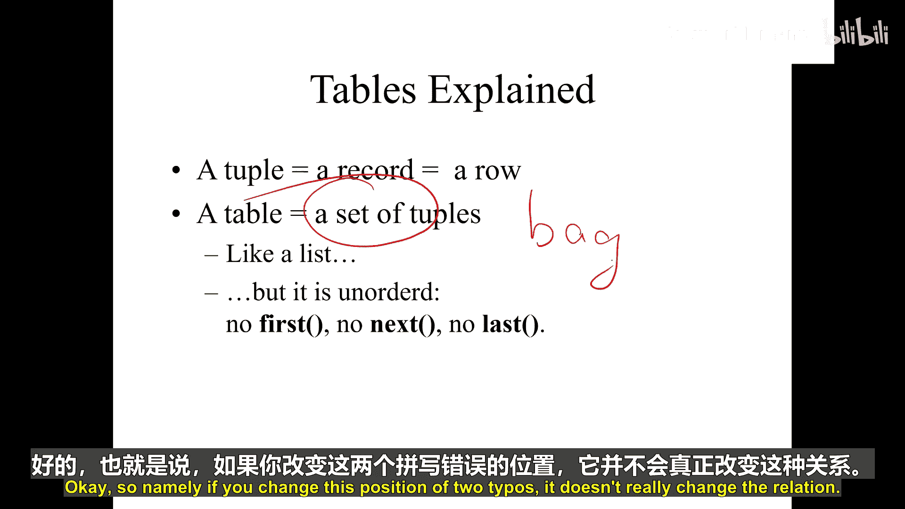

Okay， or the table。Okay。Okay， the basic form of a equalQ query， which I'm sure you have all。You， you。

 should all you， you all know this is the select from where structure。 Okay。

 but there can there can be many， many bes and whistle attached to make this a full fledged query language。

Okay， let's just start from simple ones。 This is the proper the easiest。

 Select star from product where category equals to gadgets。 Okay。

 so so one of the reason why SQL is so popular is that it's perhaps the easiest language program language to learn。

 Okay， it's very close。 It's very close to natural language， okay。And the other benefit is actually。

 it'， is's called is， is that it is a declarative language。 Okay。

 this is very different from almost all other languages， which are known as procedural or functional。

 So here a sequenceequel is called declarative in a sense that， you know。

 user only express their intention or namely what。😊，He or she wants， not how。

 So not how what algorithm or what procedure。The system should use to actually compute results。

 So namely from this query user ask database to return all the tus where the category equals to get it。

 Okay， the user doesn't。Have to。 or and， and， and also。

 the user cannot tell the system how actually to find these coupleples how to figure out figuring out the optimal way。

 what is known as a query plan is the job of the database system。 Okay。

 so this is one of the most appealing features of Sco， which is also why it is so widely used。 Okay。

 and the benefit， which we actually will see is that the user。

Doesn't have to write the the most optimize query in the system， well be able to， you know。

 rewrite and do some off the scene。Our organizations to improve the actual the actual performance。

But anyway， so let's first look at the syntax and semantics of the query in this case。

 then these two rows are returned that meet this selection condition Okay。

 so this is also known as a selection operation okay selection operation were selecting a subset of the rows okay this word selection actually comes from relational algebra okay that's the selection operator。

😊，Okay。So this is an example where we use。Okay， we are use both selection and， and projection， okay。

So， so this， where this condition in a where class is called a is still。

 is still a selection condition。Namely， it selection always select rows。A projection。

Thoosees a subset of the columns。 The previous example。Is， is selected star， right。

 So this means that we are selecting。We are not like we are projecting on all the columns。

 We are preserving all the columns。 So here we only specify three out of the out of the four columns。

 So only these columns will be preserved。 So this is known as a projection okay。

So just remember selection， select a subset of couples， select a subset rows， and projection。

 selects a subset of columns。Okay。诶。So， so， okay， so why relational algebra is called algebra。

 Because， you know， they essentially treat these tables as。

 as elements in an abstract in an abstract。嗯呃 mathematical。Field， okay。

 and then they can apply different operations。 and then this operation will return another element in the same field。

 Okay， so here the elements are the tables or relations。

 And then so every operator will result in another relation。 Okay， so， for example。

 here if we apply this， this two operation operator selection and。😊，Projection。

 and this will return another table with potentially a different schema。Okay。Yeah。

 so another operator commonly use is on strings is like。 Okay， so namely。

 this is checking whether a string。It can match a pattern where the pattern can contain some special symbols。

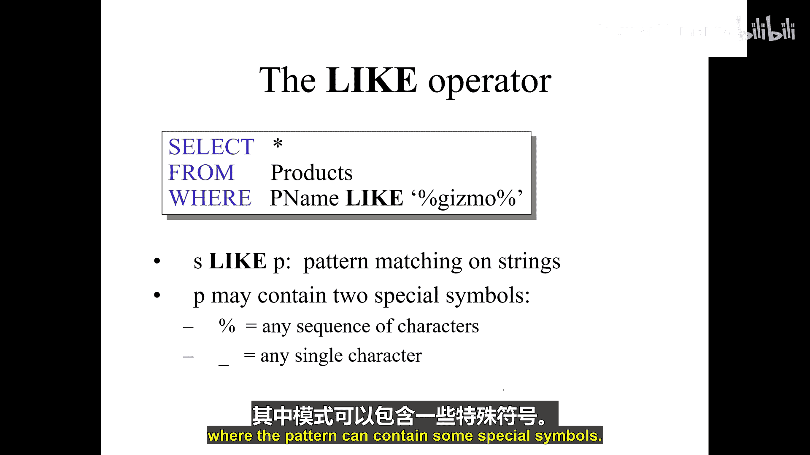

Yeah， as I mentioned that， so by default。A ra database uses the bag semantics or multi set。

 namely the duplicates are not removed。 So if you do one， the duplicates removed。

 you can add this word distinct。 Okay， distinct。 this can be this can be used to remove duplicates。

 for example， here， This is just is projection。 right， theres no selection。 only a projection。

 after projection。

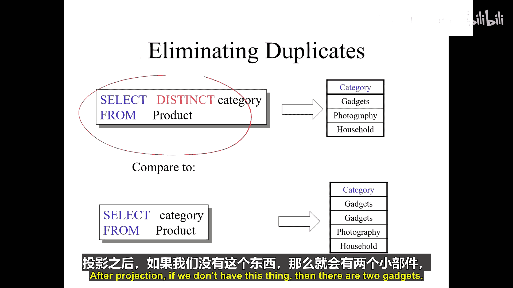

After projection， if we don't have distinct thing， then there are two gadgets。

 because in the original table。We have two， okay， two rows with gadgets in the category column。

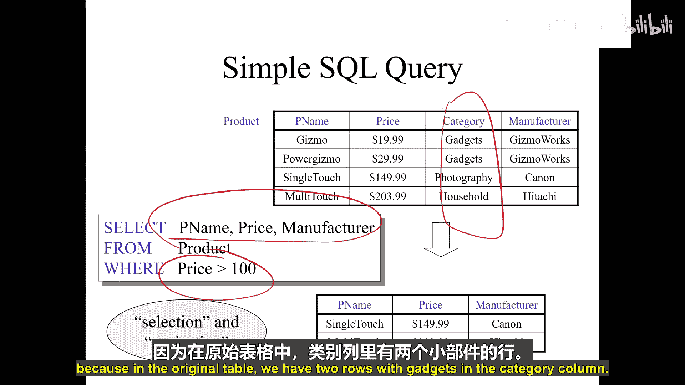

So after the projection by default， the projection will not change the number of rows。

 Every row will return will emit a result in the resulting table。 But then that。

 then this will result in duplicates。 if you want to remove duplicates。

 you can use the word distinct。 Okay， so still you can。

 you can do duplicate removal is just that by default is not there for efficiency considerations。

 because then the user can choose。

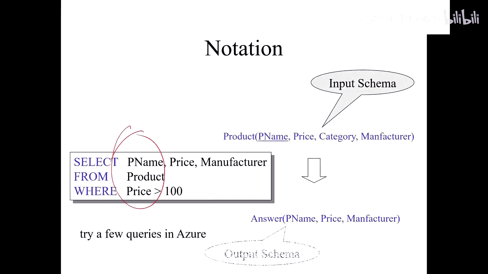

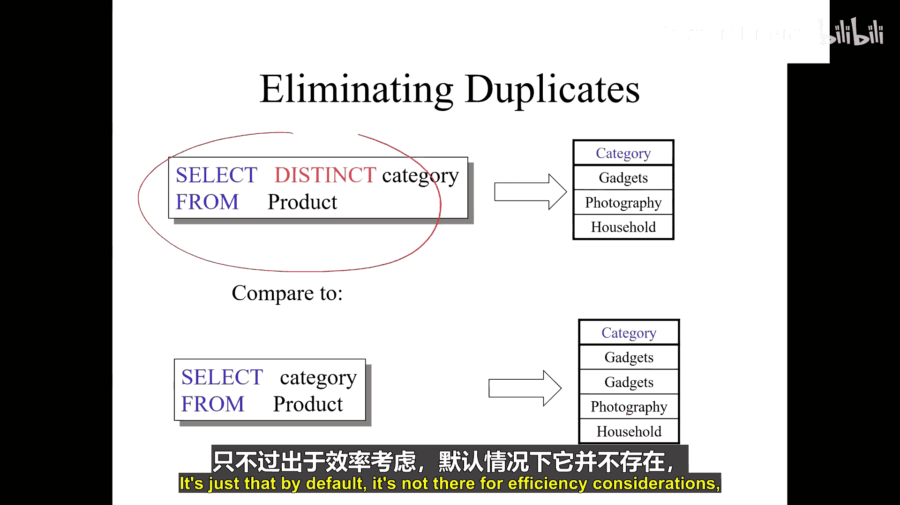

诶。So。In addition to the basics， like from where clause， there are some。

 there there are two more clause。 One of is， one of one of is order by。 Okay。

 so this will order the result。 Okay， yeah， so you can actually specify multiple columns to order by。

 and then they will sort first by the first one， if there's there， there， if there's a tie。

 and then the ties will be broken by comparing by checking the second。

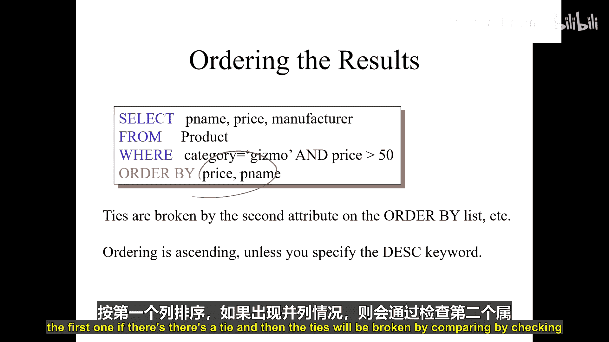

Attribute。Okay， alright， so now it's the next also the most important operation operator。

 relation operator is， is join。 Okay， so this is， in fact。

 the the key the key difference between the simple splash application with with the relation database。

 Okay， so I think we also mention this in the first lecture。 so when you the idea。

 the key idea in database is to partition your data into different relations。 So this can you know。

 lower the maintenance cost and lower the storage requirement make the database easy to use。 However。

 when you want to make do queries then you have to join this tables to be able to link information from different places back together。

 Okay。Although they are yes a。Although there is a explicit join drawing clause in in SQL。

 but you don't have to use it。 There is also implicit way， which is actually even better。 So here。

This really， we don't。 We are not really using drawing The drawing keywords。 Instead。

 we simply write the drawing condition inside wear clause。 So here， assuming we have two tables。

 Okay， two pairs of ones product。 One is company， okay。

And the query finds all the products under $200 in manufacture in Japan。

We want to return their names and prices。 Okay， so we just say select the the product name and price from these two tables。

 And then， you know， this under $200 a manufacturer in Japan。 This are two selection conditions。

 So we write them in the warehouse clause。 there is also a implicit drawing condition， which is。

 you know this， this manufacturer in the product table must match the sea name。 Okay。

 name the company name。 So this must be the same。 Okay。

 then this only this only makes sense because we are only interested because the product must be made by that company。

 So this there is implicit join condition， which is written down。 Also in this warehouse clause。

 Okay， so this is a example of a drawing query。

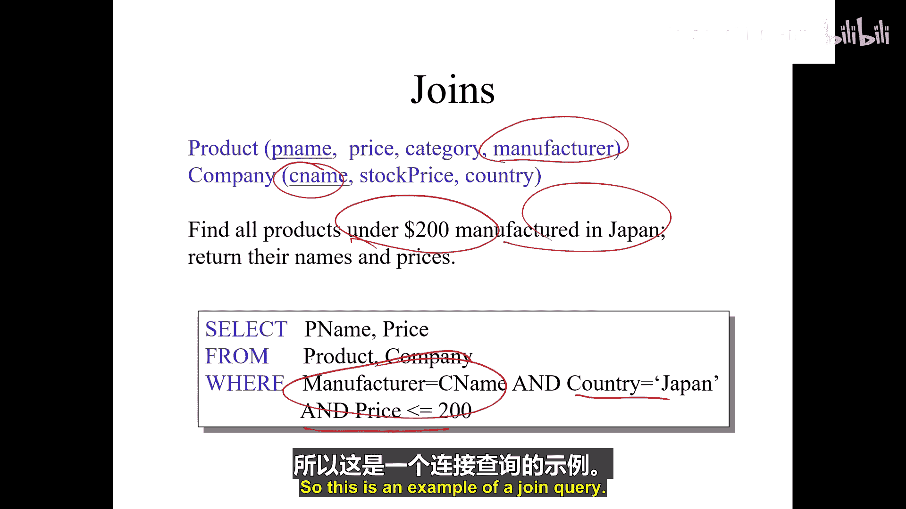

ok。So， the result of the。呃。Okay， so so the， the result of the。

The result of this of the of the draw is is is， is the following， okay。So。😊，Okay。

 namely namely the semantics of joint query is that every pair oftys from the two relations will will will will be compared。

 And if they meet all the conditions， including the selection conditions。

 as well as the joint conditions。 then this pair will be will be emitted。 Okay， so in this example。

 we have， we actually have four pairs oftys。 Okay， four pairs oftys that match that satisfied the joint condition。

 but among the four pairs， only one also pass the selection， two select condition。

 the price condition， country condition。 So the results is only this， this pair， Okay， this pair。

And then finally， because we do a projection on key name and company， only these two columns。

 only these two columns。Are preserved are。A kept in output。

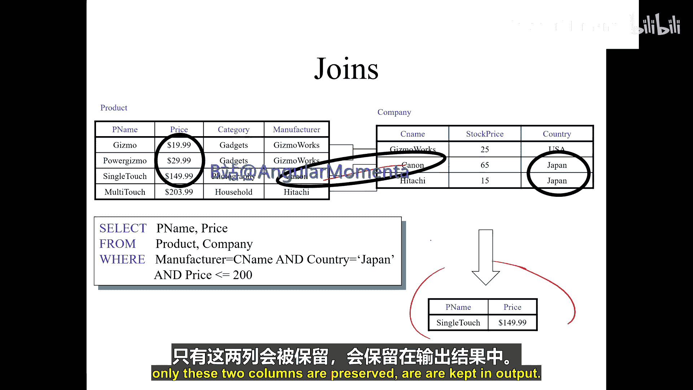

Okay。呃。So yeah， here is another example that shows a subtlety about joints。

 still the same two tables。The query here is to find all countries that manufacture some product in the gadget category。

 Okay， so the， the query， the sequel is written as follows。

We are we are doing a join between these two tables and then there is a slashing condition and then there is a join condition。

 manufacturer equals to C name。However， when you actually run it。😊，We'll actually run it。

 then remember remember that the semantics of the drawing query is simply to compare all the pairs of tas。

 one from each table and then then check then just you know then just mechanically check whether they satisfied condition。

 So as in the first as in the first example， there are four， you know， there are four matching pairs。

 matching pairs oftys。 and then here the selection condition is category equals to gadget so category equals to gadget。

 So that means these two pairs。

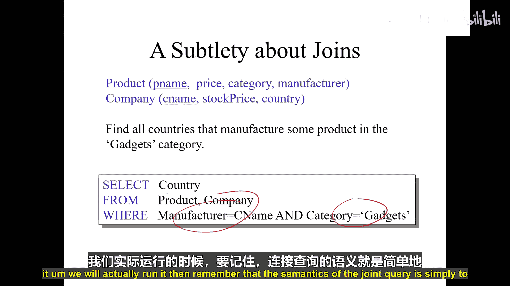

Both。Pass the condition。 Okay， the joint condition as well as selection condition。

 So bothtys will be in the output。 And then we do a。We do a projection country。 Okay。

 so the final result is。What are the final results？Yes， USA， USA， so USA will appear twice， okay。

Because by default， theres no duplicate removal。 Okay， so this so， so so this may be unexpected。

 Okay， so the。So the fix is。Is， you know， the solution is to add distinct， add distinct。 Okay。

 there is actually a better solution。 we will， which we will see later without using。

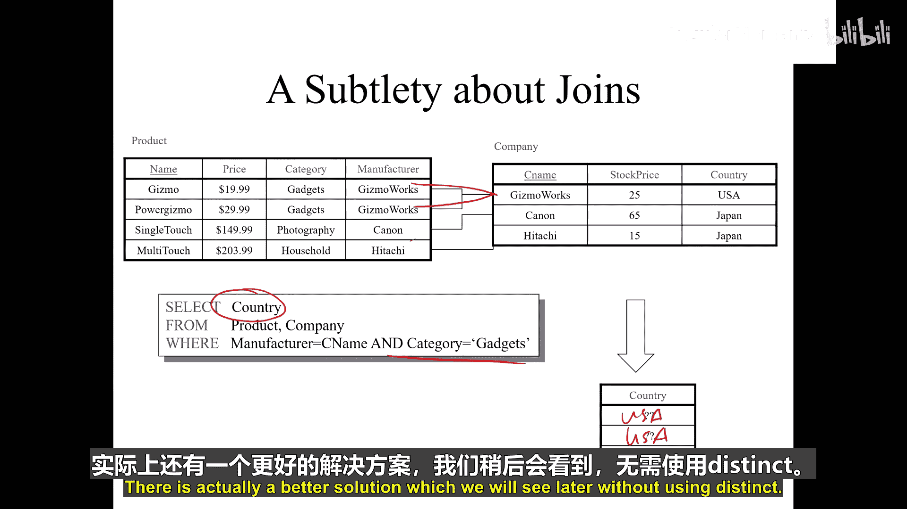

Distinct， okay， so formally， the semantics， namely the meaning or what you want。

 what the user wants is the following。 the user wants the system to do the following。

 namely if in general， there can be a lot of relations involved in relations。 then the user， Okay。

 intention is a very seemingly expensive nasty loop， for every combination， namely for So。

 so every loop go through every type of relation。 and then for each combination。

 the conditions in the where class will be checked。 including both drawing conditions and。

Andl conditions。 And if our conditions are。Our conditions are passed。

 then the answer this combination will be included。 Okay， so which also means that， you know。

 theres a quicker。

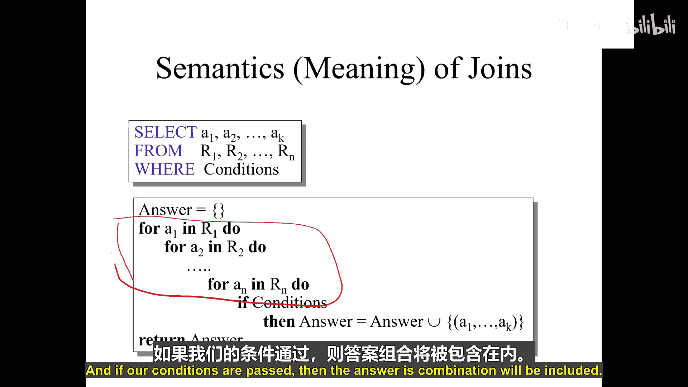

Quick check。 So suppose somehow I delete this warehouse clause。

I just run in a select country from product company。So what would happen？Yes，12 results。 So 12。

12 results will be emitted in actually， there will there will be four USAs and8 Japan。 So。

 so that's the because every pair will be checked and there's no conditions。

 So all the pairs will pass the conditions。 Okay， so， of course。

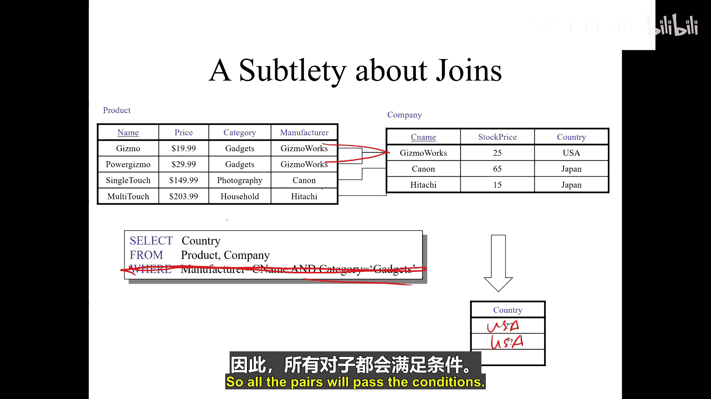

This is not necessarily how the database execute the query。 So if actually， database。

Actually uses this densityy loop， right， This will be very inefficient And and an oracle cannot possibly earn so much money。

 So this actually one of the big differences in different database systems is their optimizer is they how。

 how they can find the optimal query plan for executing different queries。

 The beauty of the beauty of SQL， exactly， know this semantics， name。

 namely the meaning has nothing to do with how it is actually。😊。

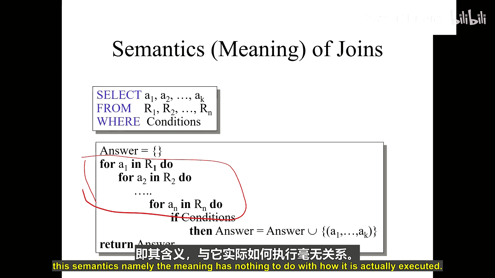

executed。 Let's see，2。2 tables， person company and both tables， both tables。

Both tables have this column called address。 So， of course。

 they have different meanings for the first table， That's the address of the person for the second table。

 that should be the address of the company。 Okay， they they start to unrelated columns。

 it happens that they use the same name。 Okay， so therefore， if you run a。

 if you write a query like this， then。Theres ambiguity。

 right The system that doesn't know which address you are talking about。 Okay。

 so so the system will actually report an error。 Okay because it doesn't know which address you want to be projecting on。

 So therefore well， there are several fixes。 The easiest one is to use a prefix。

 So you prefix the column name with a table name so that it knows exactly。

Which column you are talking about， okay？So although this is necessary for any column name with ambiguity。

 but for the other is doesn't actually it doesn't hurt to to specify， but you don't have to。

 P name is unique， right， P name P name and also work works for and see name these three columns。

 They only appear once。 Okay， so you don't have to disambi with them。 but you can also。Add prefix。

 add this table prefix to make things clearer。The other way is to use what is known as aliases。

 So this can be more concise if you are， you are。If the same column is used multiple places。

 like if this column， if this column is used in doing conditions， in select conditions。

 also in the projection。 So this can be a bit this can make the query a bit long so you can。

 you can use a， you can introduce an alias。 So here use the A S， A。

 the S keywords to introduce aliases for the table so that you can。Make things。

 make the query shorter。 You can also create aliases for column names as well okay。

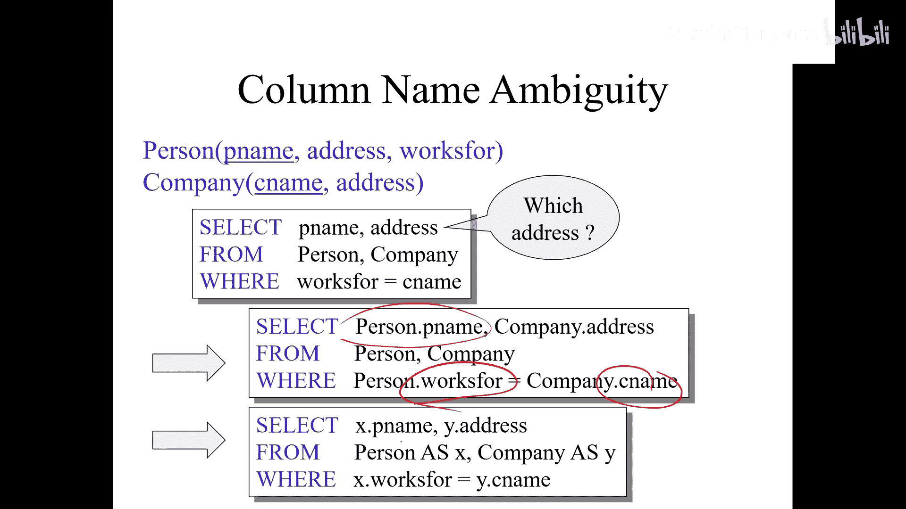

The other useful constructs in SQL is aggregation。 Okay。

 especially this is very useful for analytical queries or analytical queries。

 We don't want to retrieve any raw raw typo。We want some succinct statistics。

 so the aggregations can be very useful。 So the aggregations can be done by just using the aggregation function inside select。

 So the first example is， is average。 Okay， the second one is just count。 Okay。

 so the semantics of this aggregation query following the the the database should first find。😊。

Should first evaluate this query。 Okay， so namely， it's just a standard select from where is the selection plus projection。

 And then after that， it computes the aggregation。So again， this is the semantics。

 it doesn't mean that the data is hard to do it in this way， okay。呃。Usually。

 you have to specify the a column name inside aggregate function。 For example。

 average or sum or max mean all these require you to specify a column name。

 The only exception is count because count only counts。 The number of rows。

 it doesn't really matter which column you specify。 So for count， you can also specify。

 you can simply use star。 Okay， but you can also use any other column name。

 but it doesn't really make a difference。Okay， so except count all Is apply to a single attribute。

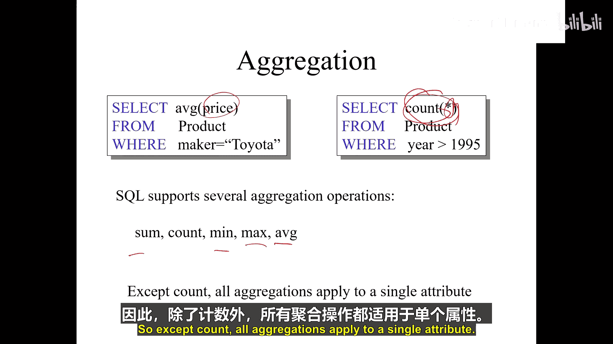

Okay。呃。The， however， if you want to remove the duplicates， right。Then。

 and then do if you can't want to count the number of distincttys in the result。

 then you have to specify a。A attribute a column name， for example， here， if we want to。

 if we want to find the number of。Distinct。Categories for。

 for over all the products that are manufactured after year 1995， Then we should add this word。

D distinct again semantics is still same as before name the the database first run this query without the aggregation。

And this will remove all the duplicatedtypos and then they will do account。Okay， yes。

 you can do some more complicated rhrithmes inside an aggregation or projection or an aggregation。

 So here in this in the first example， we are。We are trying to find a total sales sales， total sales。

 Okay， To， let's say， total revenue in this purchase table。 Okay， so these now we have two column。

 So this semantics this one is for every， for every type。 We multiply the two attributes。

 And then we add everything together， okay。So this is the same as the second one， the same as before。

 except that we are also applying a selection。 we only considering we are only considering a subset of the roles。

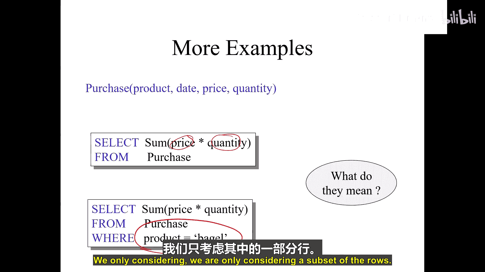

O。Okay， so yeah。 So here is a the concrete example。 We are summing up all the price times quantity。

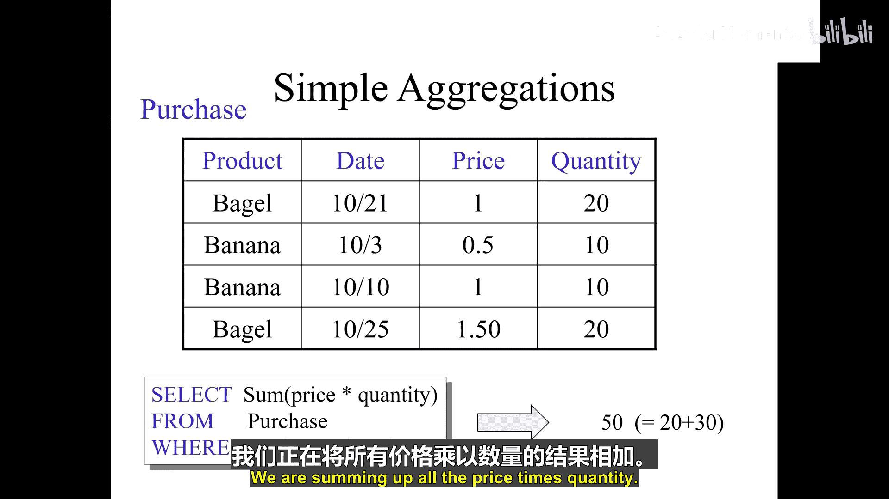

唔惊。Okay， so。In practice， another， in practice， very often， we don't just want a single aggregates。

 Okay， we want to completely navigate for each category for or for each group of tables。

 So this is called the group by。 And this is， in fact， you may， you might have imagine this is。

 this correspond to the reduce。Function in map reduceuce or reduce by T。

 So this is actually used a lot。 Okay， this is a very fundamental operation。

 This needs another clause called group group by。 Okay。

 so this is similar to a a navigationgregation， except that we have a clause。 We have a fourth。

 a fourth clause group by。And。You are allowed to， and which is of the case to put this group by attributes inside select。

 Okay， inside select。 So the semantics of this query is a following。

 right So on in in this purchase table， which has four columns。I want to compute the total sales。😡。

给 the total sales。For each product， okay。Among all the orders after， you know，2005 October 1。 Okay。

 so this will return not only a single aggregate， it will return a sum for each group。

 namely for each distinct product。 each distinct product。 Okay。

 this can be easily actually implemented as a reduce program， right。

 we we first so emit the intermediate cable of pairs where the key is the product。 Okay。

 that that the group by attribute and the value is price times quantity。 and in the reduced side。

 we aggregate all the price， all the products。 Okay。

 all the price multi quantity and add them up as the final value for each group， each group。Okay。😊。

So。诶 the the。The， the semantics of a query like this is a following。 We first， the first Okay。

 so into。So in this example， this doesn't have a join。

 but it's also possible to have you know multiple tables in the in the from clause。

 and then you have some join conditions。 Okay， so namely to the semantics， again。

 the semantic query is to first evaluate the select from where。Namely left of the front wheel。

 name it performed the drawing first。And then after computing all the drone results。We do a group by。

 according to the groupai attribute。 Okay， by the way， for the group attribute。

 it's also possible to have more than one。 Okay， in this case， if two rows。呃，In this case。

 two rows will be。2 roles will be in the same group on If and only if they have the same value on all the group I attribute。

 So， for example， you can， let's say I also want to buy a group by date。

 So then for every distinct combination of product and date。 there will be a sum。

 Okay So there this you can have multiple attribute in group by。

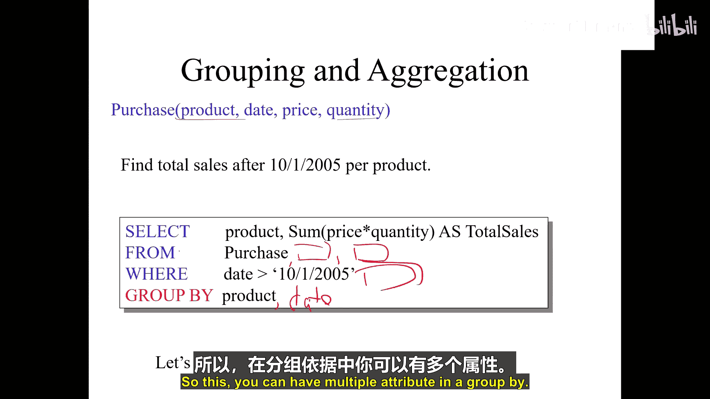

Okay， and finally， for after grouping thetys in a drawing results into different groups。

 we do we compute the aggregation。 so that's the semantics of the query。Okay， so yeah。

 so let's see an example。

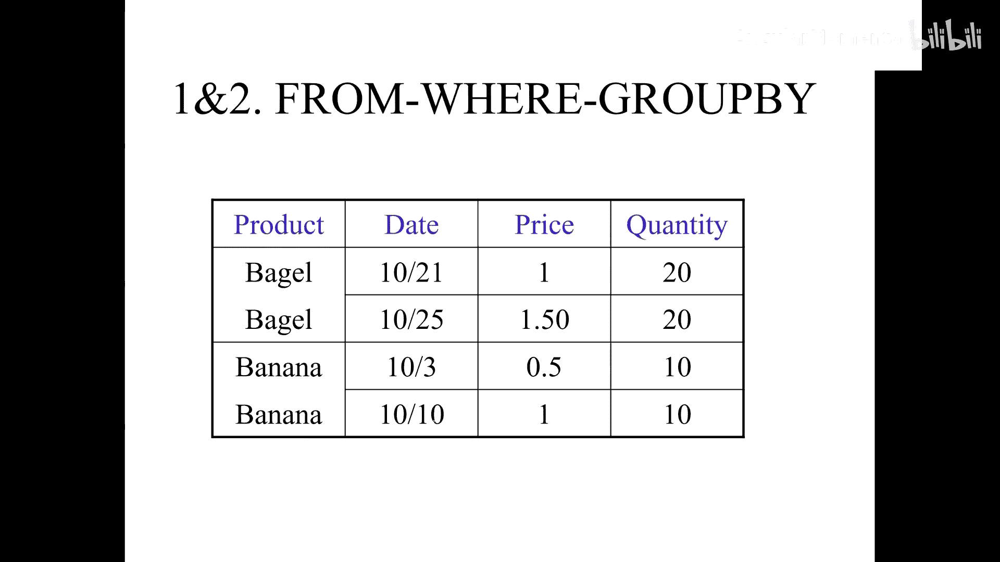

诶。Yeah， on this on this single table。If we do this select from where group by and then the group by attribute is product and there are two distinct values in product。

 bagel and banana。 and then we we will compute a total sales for each for each group。Okay。

 so here is another example， which shows。 which shows， yeah， yeah， and but but by the way， okay。

 very often， when you do a group by aation。 we have this as keywords。 this is used to， you know。

 beautify the final result， because because this is not really a projection a projection selects a subset columns。

 It preserve a subset columns in the output。 However， for a group by aation， you actually。

 you are actually creating a new column because this this column contains all the total sales。

 this did not appear in any of the original tables。 So this is creating a new column。

 so after creating a new column in the output table。

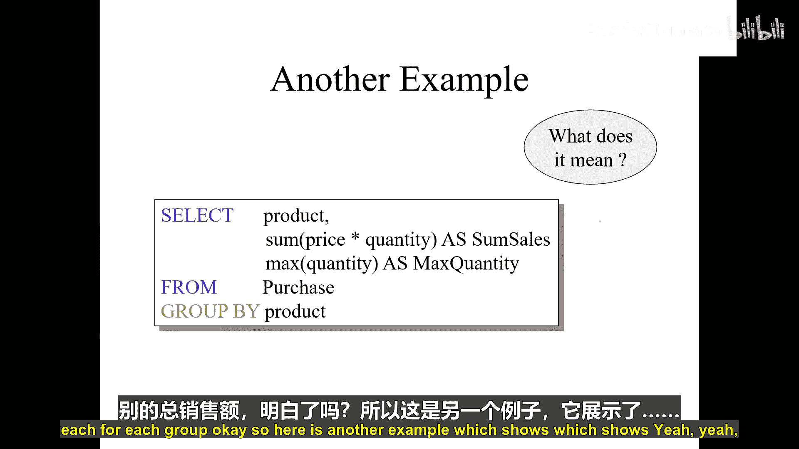

You have， it has to have a name。 So if you don't have this as if you don't have this part， then this。

Aggregating expression will be used as the as the name of the column， which doesn't really look nice。

 Okay， in fact， as we will see example later， this not is not。

 this is not only a beautification problem， it's actually useful， for example， if you want to。O。

 if you want to use this table。You want to apply food operations。 For example。

 you want to join this table with another table or you do some other selection or projection。

 Then you have to refer to this column， right， Then if you don't have a name。

 and there's no way for you to refer to it。 So this is， this as。May， may serve purposes。

 other than just。B呃呃 beautifulauification。

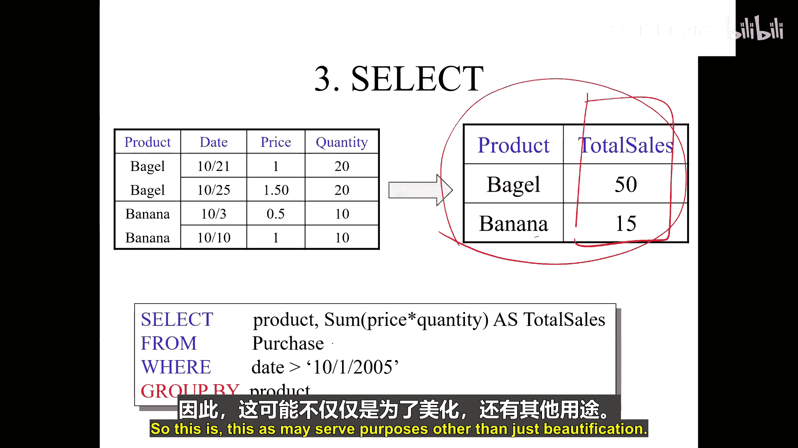

Okay。So this is another example where we have。 We are performing two applications。 Okay。

 for the same grouping， namely we with the grouping the same。 The grouping is only by product。

 but then for each group， we compute two aggregates，1 sum，1 max。Okay。

 and the last clause that I want to talk about is having。 Okay， so， so， so， so， in fact。

 having is very similar to where Okay， In fact， having is really， is not really necessary。 Okay。

 so for name， for for every having clause can be rewritten without using having。 by by using subries。

 But anyway， let's look at what having is needed for。 Okay， suppose we want to have a suppose we。

Do we first， we do， whether having can only be used when you have a group by。

 Okay you cannot use having by itself。 So let's first。Look at this。 This is same as before。 This。

 this。 remember， this will return a column that looks like this。 right， So it has two columns。

 once product， the other column is is this sum。 Now。

 suppose I want to further filter out the results。And this condition。Is on this new column。

 on this sum。Okay，In that case， we cannot use where because where have where is only applied on the original table。

 Okay So if your selection edition is on the new column that is has been created by the group application。

 then we have to use having。And this is a place where I don't like SQL。

 because in in the having class， you have to。Okay， I think I， I missed something。

 I should have price here， price。Times， okay， so namely， you have to。

 you have to copy this expression， this aation expression。Copy and paste here。

 And then you can apply any condition。 So this says that we， I only want to preserve those groups。

Where this aggregate is greater than 30。So however， you can rewrite that using a sub query。

 name your first compute group by。And then you do another selection。 You use a sub。

 You can you name select。 You can， you can， you can do the following。 You don't have this right。

 And then you in that， in that case， we can rename this as let's say total sales。

 And then you do another select。 Okay， select。This is star from。And then you apprentices。

 And then you， then there you can replace having by where， okay。Where this T S is greater than。30。

 okay， so this is not， this is another way of vet this without using having。

These two are actually equivalent， okay。Okay， nice full screen。Okay。

 so now we have introduced almost everything。 the the five clause that are mostly that that are commonly used。

 Select from where group by having。 So there are some constraints。

So the weird slack cloth may contain。Any attributes。And aggregates。But no other attributes。Okay。Okay。

 yeah。 So yeah， yeah。 So yeah， the these attributes are the group attributes。 Okay， so this。

 but they can cannot contain other attributes。 for for， for example。

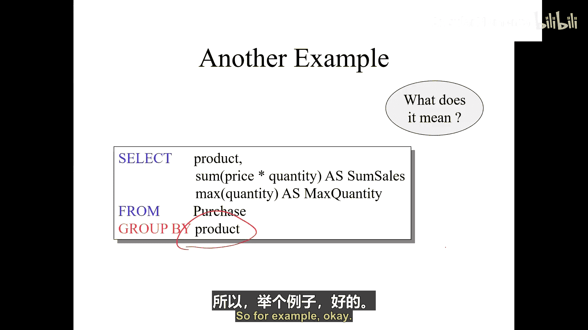

Okay， so let's see here。啊，看到了啊。Anyway。So let's keep my screen on there。Okay， so this means that。

 okay， it's because group， the product is a group attribute。You。

 you are allowed to have products in the in in select。 Actually。

 it's always desired because you want to know which group。This is。 This corresponds to However。

 you cannot have， for example， let's say， date。 You cannot put date here。This will be not allowed。

 right。This is actually quite in in intuitive because we are doing a group by。By product。

 namely all the typles in the same group， they have the same value on product。

So there's no ambiguity when we you consider output， the same group。

 they have a well defined value on product， however。

The tops in same group may not have the same date。 So then what do you want to put here as a date。

 So therefore， it's not allowed。 the system will not allow you to include any other attribute in select clause when you have a group back。

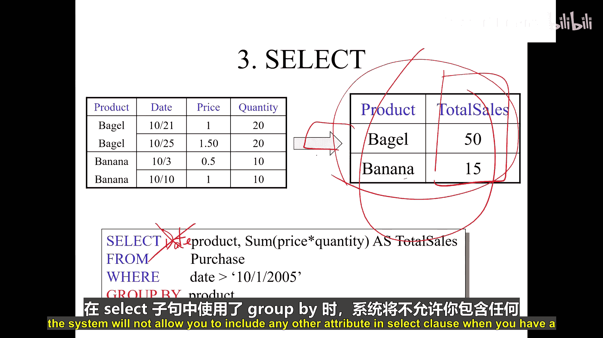

Okay。So C 1， okay， C 1 is any condition on the attributes in R 1 to R N。 Okay。

 so this in two kinds of conditions。 one is called selection condition， one is a drawing condition。

 although the system doesn't that doesn't distinguish them。 Okay but anyway。

 we usually we we call a condition is selection condition。

 if this condition only involves attributes in the same table。 Okay。

 because this is selection because they can be checked on the table by table basis。

 So if if a condition involves attributes from two tables。 then that's called a drawing condition。

 okay。

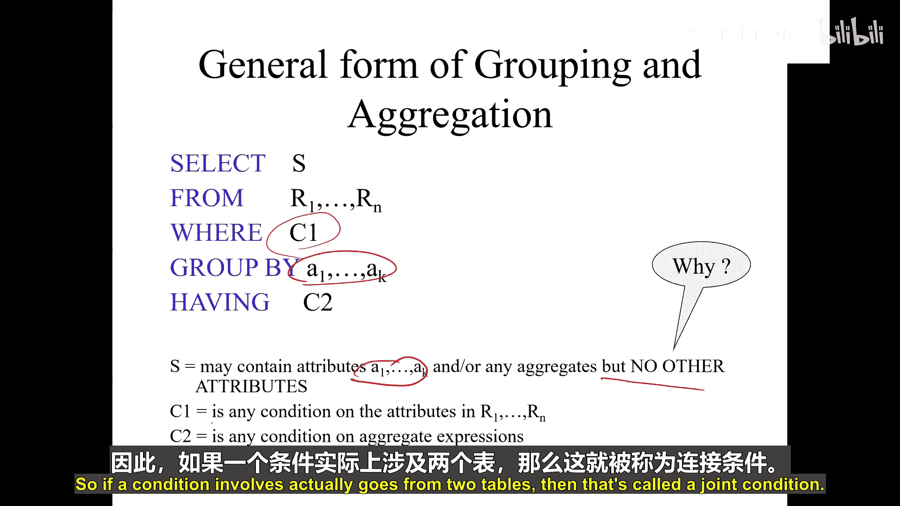

So more precisely， there are actually two kinds of drawing conditions。 The first one is。

The examples we saw earlier。ok 啊。Okay， work the eraser doesn't work。Anyway。

 so this is a E equality condition。 So this is most commonly used because we want to join。

 We want link matching table together。 The other drawing condition， which is， which is bitter。

 which is not as common。 It， for example， let's say， say， let's say， about the price is smaller than。

This say stock price。So for what， for whatever reason， I wantan to。

 I want to compare the price of the product with the price of the stock。 anyway， So so anyway。

 this may be meaningless， but anyway， this is a。This is also called join condition。

 but it's not equality。 Okay， this is sometimes called a theta join。 Theta join， okay。

So a theta join is involves essentially any inequality。 Okay。

 this is Theta joins are more expensive to handle right because you have to check equality joints are more common。

 And actually， this equality joint conditions。 is equality joins are also called natural joints because they are so natural。

 So， very intuitive。

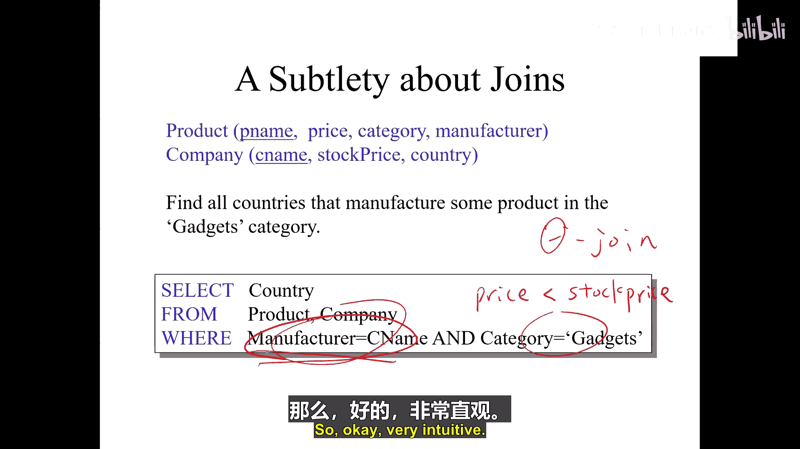

So now let's see a couple a few more complicated examples。 willll be using this example schema。

 And actually， if you go into Microsoft Azure and you create of course， Azure is from Microsoft。

 So if you create database， that will be a SQL server。 Okay， so that' SQL server is Microsoft。

 its a database product from Microsoft， if you create a SQL server instance。

 you can have a sample database， according to this schema。 okay。will not。

 So you can see this is actually a very typical design for regional database for a company。

 they organize information into several tables。 So for example， here， this is a product table。

 and every table has a primary key。 And this is actually fold the recommendation。

 for the product table， the Pk or the primary key is the product I D。 Okay， and there is also a。

 let's say， let's a sales order detail table。 So they actually they order the sales into in the two level structure。

 They have a sales order header and a sales order detail。 Okay。

 the idea that every order may contain multiple product。 okay。And the， the。

 the sales order header table contain information about each order。

 and the detailed table contains the product inside each order。 Okay。

 so the sales order detail table has a foreign key， referencing the primary key in the product table。

 So this is another constraint。 We talk about primary key is a unique。Constraint， namely。

 all the values in the table must be unique。 Forign key is a inter table constraint。

 So for in this case， the foreign key constraint is is actually from this column add product I D to this one。

 Okay， so this means that any value for any ty in the sales order detail table is product I D。Must。

Appear in the product table。 Okay this makes actually makes sense， right， because you don't。Its。

 it doesn't make sense to have a。A order detail order detail that refers to a product that doesn't exist。

 right this， if this happens， something must be wrong。

 so the the nice thing about a foreign cont is that the database will make sure that this constraint is satisfied。

 So namely if you， there are two things can happen that they can prevent two kinds of operations from happening。

 The first one is if you want to insert a order detail typo in the order detail table that refers to a nonexistent。

Product， then this insertion will be rejected。 Okay， the other option is， if we want to delete。

A product from the private table for which there still exist。All your details。That refer to it。

 namely， if the this product is， this product is still needed by some order detail， then this。

 this deletion will be rejected。 Okay， so this two kind of operations the。

 the system will guard against。Okay。😊，诶。Okay， so coming back。 Yeah。 So， yeah。 and finally。

 there is also a customer table。 And this every order also have a custom I D， which is a foreign key。

 referring to the primary key of the。Of the of the customer table， okay。嗯。

So I think if I'm not mistaken， I think the foreign keytraint must refer to a primary key。

 You cannot refer to a non primary key column。 Okay， so here。

 all the foreign key contraint are referring to primary keys。 so product I D。

 this a foreign key referring to the product I D custom I D。 there is another  one。 I think。 Yeah。

 the sales order I D refers to the primary key。Of the sales order handle table and the customer I D refers to the primary of the table。

 Okay， this is also for efficiency reasons。 Remember that the system will guard against any operations that violate the constraint to。

 to be able to check whether operations violate the constraint。They need， they need index。 so， so。

 so that's why it's， it's， it's a requirement that the following key constraints must refer to a primary key。

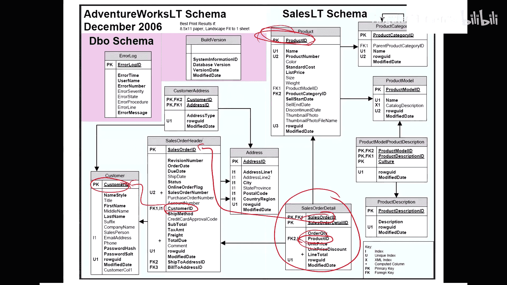

Okay， so let's see some more examples on this more complicated schema。First one。

 I want to find the total price of each order， return sales order ID and a total price。

 and the column name should be total price okay。This is not too difficult。

 This is just a just a group by。 Okay， the answer is written on the next slide without joins。

 simply a group by。 Okay， select sales order I D， and then we do a， you do a sum。Unni price times。

 order， quantity， times any discount。 and rename this。Okay， at total price。

 and will do a group by sales order。 So for each order， compute total sales。Okay， second one。

 find the total price of each order where the total price is greater than 10000。Okay。

 so know that this is a condition on the aggregate。It's not a condition on the original attribute。

 So， so this require this cause for。A having class。 Okay， so this same as the first one。

 But with this having class okay。嗯。Third one， the final total price on the black products of each other。

 where。The total price is greater than to 10000。 So this is example illustrating the difference between having and where。

 So the black products， this is a condition on the original attribute。 So this。

This should be written in the where class， and this should be written in the having class。

This also needs a drawing， because whether a product is black or not。

 this is not in the not in the sales order table。 It's in the product table。 the color is here。

 color is here。 So So this requires a join。 So this is a join plus a group by and plus having。

 So this is a bit complicated。

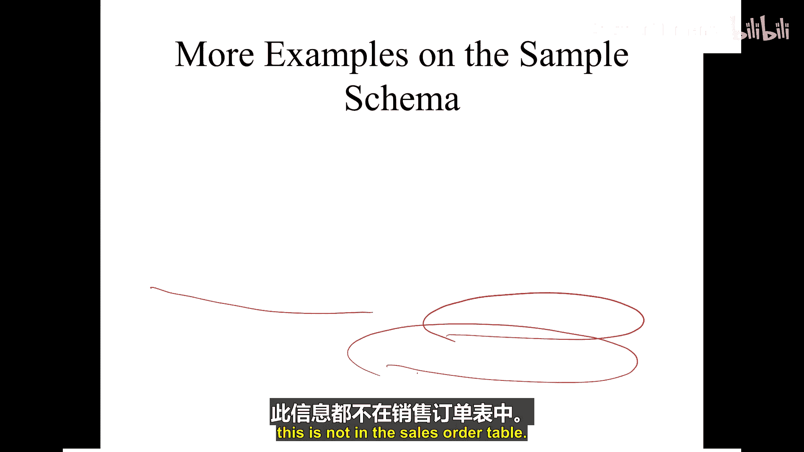

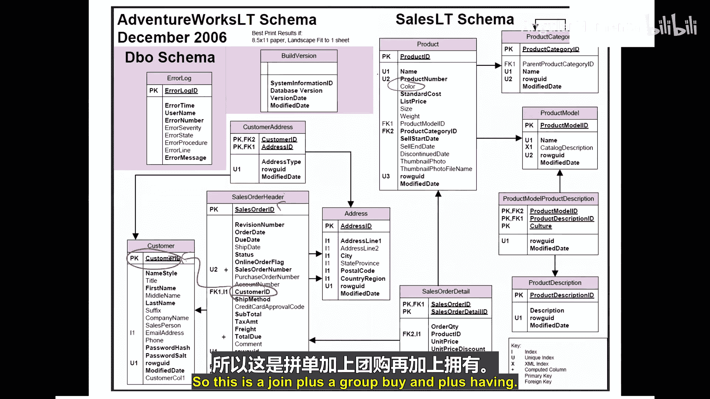

We are doing a join between these two tables and the join condition is that the product I D must match。

 So here we have to use the table name as a prefix。To， to disambiguate。For the color。

 there's no need because there's only one column named color。And the rest of the same。

 the rest of the same， okay。

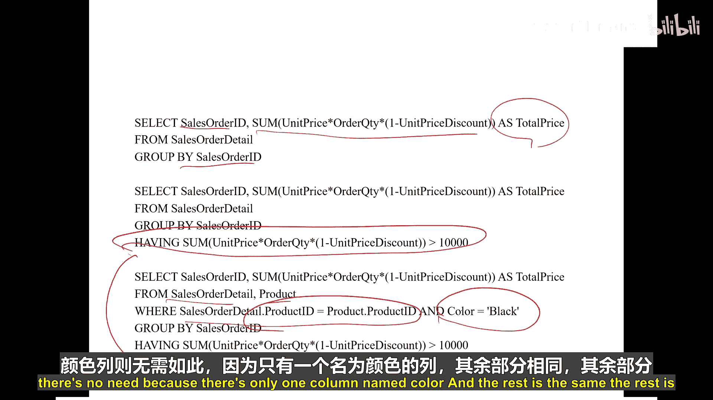

Alright， so， so we talk about joins。 So this， in fact， the。

 the all the joins we saw we have seen so far。 they are called inner joins。 Okay。

 if a joins inner join is that that's the default case。 So we don't。

 you don't have to explicitly say that it's a inner join。 when。

 when we say joins by default inner join。 but then there is also a， but there is also outer joins。

 Okay， so this for outer joins， then。😊，You will have to specify that explicitly。 Okay。

 so before talking about outer drone， let's look at this example and to motivate why the situation where we need outer drone instead of the standard inner drawing。

First let me so first recall that you know there are two ways to specify a join。

 so this the second way is the one that we have seen so far which uses which doesn't really need this join keyword explicitly。

 which simply write a join condition inside the where clause。The first one is also fine。

 this is using the drawing keywords， explicitly joining two tables and then this on keywords specify the join condition。

 okay the join condition。😊，So this， these two are the these two are are equivalent。 however。

 one problem with this， this inner join is the following。 Okay， Okay。

 so this is a join between two tables。 product and product and purchase， right。

 and the join condition is the name must match name product matches the name。

Mach the product name in the purchase table， okay。However， if。If there is a product。

That is never sold。 Okay， that is never sold。 that if。

 if a product doesn't appear at all in the purchase table， then remember the semantics join， right。

 semantic join will try to， will check every pair。But if this product doesn't appear on one side in one table。

 then this product will not appear in the final result。

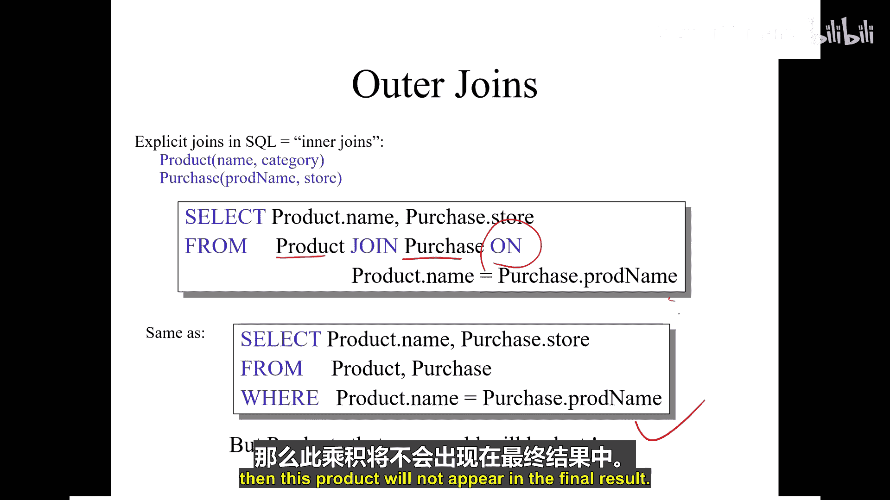

So， of course， this depends on your intention。 In some cases， you don't want this table。

 this product to appear。 And in that case， in in that case， this is fine。 However。

 in other situations， you want to know that they。

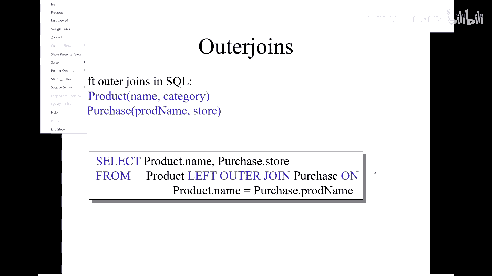

Do not join。 You want to know this fact， name， namely this for social products， this products。

Do not appear in the， on the other side。 In this case， if you want to know。This fact。

 then you can now use an inner drawing， inner drawing。

 we will not tell we will not be able to tell you this fact。 In that case， we use a outer drawing。

 Okay， so unlike inner drawing， outer drawings are asymmetricsymmetric。

 and because because this is this because we are checking whether one side tables on one side appears on the other。

 So this is asymmetricsymmetric operation。 So there is also the distinction between left outer drawing and the right outer drawing。

 And there is also actually full outer drawing。 Okay， let's look at left outer drawing first。

 in this example， we need a left outer outer drawing， because we want to preserve all the。

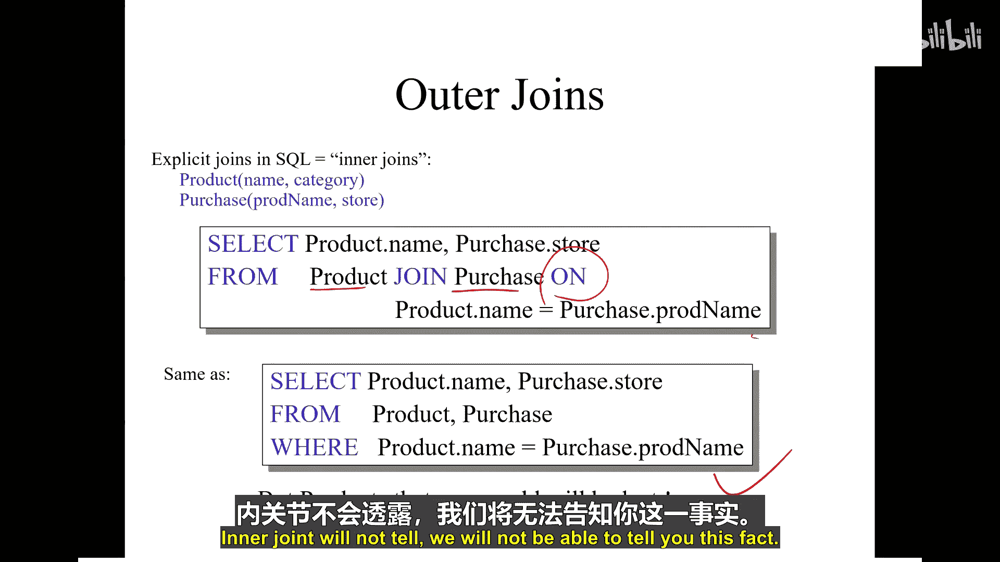

We want to preserve all the products。 So even if they don't appear on the other side。

 So this is a left out drawing。 So here we cannot， we have to use this drawing keywords explicitly together with left out drawing。

 Okay， so let's see example。

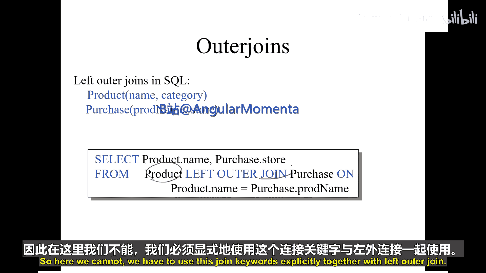

So in this case。Okay， so this one， one click。 the start。

 the third tuple doesn't appear in the purchase table， right， A gizmo and camera the。

TheyThey have appeared， they have both appeared。 so if we did a inner join。

 we would not have this role okay。However， if we do a left outer join， this row will be preserved。

 namely for any temple。For any couple on the left hand side， it will generate at least one result。

 Okay， so even if it doesn't match anything， For example， one click doesn't mean anything。

 then it will still appear。 However， the the the corresponding attribute。

 in the other table will be now。If it matches two， for example， camera， then it still appears twice。

 Okay， so the actually the only difference between inners and outer drawings is that it will make sure that everything on the left hand side will appear at least once okay。

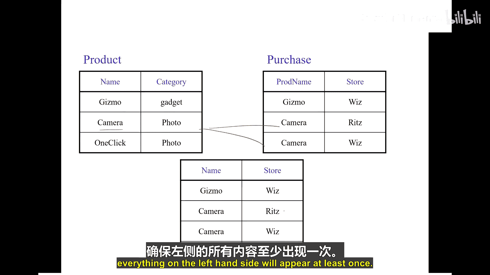

So yeah， here's one application。 suppose we have two tables， a product and purchase same as before。

 We want to find， we want to compute for each product。 the total number of sales in September。 Okay。

 for each product， the total number of sales in September。

 if we do the standard drawing plus grew by， we would have the。

 we would miss a so what what might go wrong。So， yeah， so if a product as。

 as similar to the pre example， if a product。

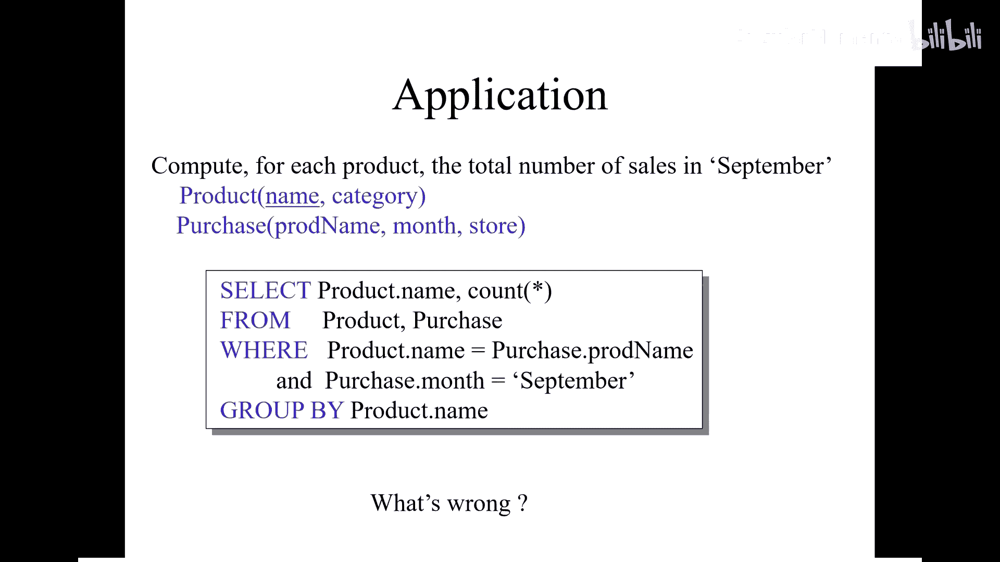

Is never sold in the September in the month of September。 then we will not know。 We will not know。

 But ideally， if that's the case， which， we should return 0。 Okay， So in that case。

 if we replace by replace that by outer drawing。 and then we will also get product who。

 whose Who sales is 0 in in in in the。Who is not sold at all。 Okay， we will have a zero there，嗯。

So yeah， so another example。 So let's say for each customer。

I want to find the total quantity of black products bought。Report the customer ID， first name。

 last name and total quantity。So this is a fairly complicated example involving multiple tables。嗯。

So for each customer we want to find the total quantity of all black products so there are two couple of notes the first inner joints are community and associate the order doesn't matter。

 however outer drones are not because outer joints are ACsymmetric so we need to pay attention we cannot switch the two sides okay。

The joints are processed from left or right and force by parentthesis。 Okay。

 so there are so for this company query， we can， we can first write a query plan or a join tree。

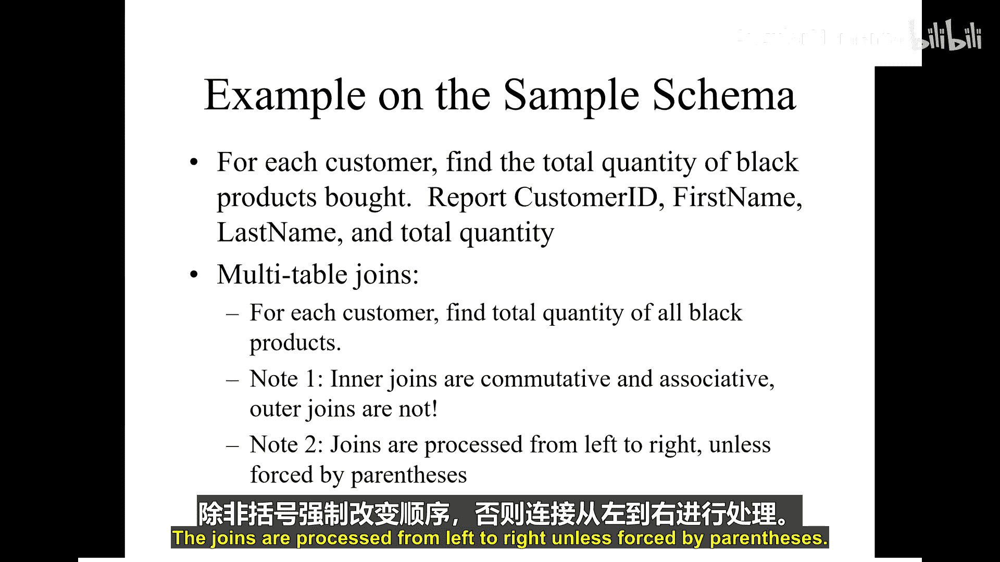

So we first join。The product table with all detail so that we can have the all details with only black product。

 because the query only the query is only interested in black products。

And then we can join the order detail table with the order header so that because the order detail doesn't have the customer information。

 the custom ID is in the order header， so we we join these two together。And finally。

 we join with customer to report the other information about customer。

 the custom ID we already have it， however， the name and the name。

 the name and address and everything else is stored in the in the customer table。

Here we want to use auto drawing for the last one， because if a。

Because intention is if a customer has not bought any black product。

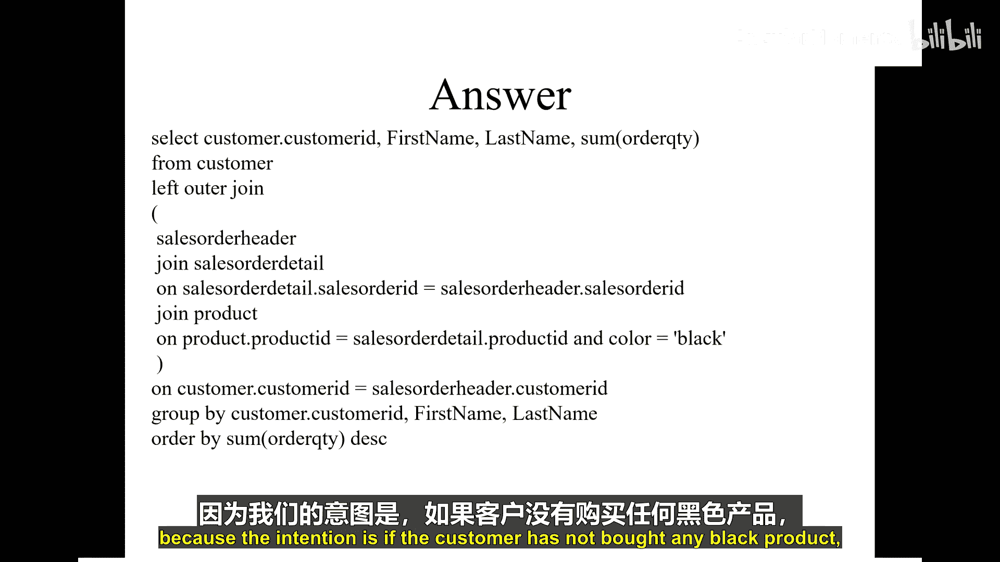

We want to know that fact。 So if we used， if we use the inner join。

 then these customers would not appear at all。 So we have no way of knowing that they exist even。

 So this， this， it is better to use a outer join。Okay。

 so this is the SQL query following our queryrry plan。It looks fairly complicated。 but anyway。

 let's let's look this， let's look at Read together。 So we first perform a join。 Okay。

 this is a join between three tables， namely this part okay。😊。

Because the inner joins are the order doesn't matter。 So it doesn't really matter how you write it。

 Okay， so we just join them in any order we want， and we write the join condition here Okay。

 and also the selection condition。 And then the the the last join。The order matters。

 So we make sure that the customer is the left hand side。

 and this result is on the right the right hand side。 And that's the joint condition。 and then。

Finally， we do a group by。U。To compute the sum， okay？Because we also want to report the name。

 first name， last name。Remember that， you know， the system only allows you to put an attribute here if it is also in the groupai clause。

So although it looks redundant， right， because if two roles have the same I D， if two customers。

 if two roles have the same customer customer I D， they must also have the same name。

So it's also it looks a bit redundant to include this two in the group by。 However。

 it is a requirement bicycle。Because we want to have， if you want to write this in the selection。

 in the select clause， the first name， last name。You must also include them in group by。 Okay。

 so this is not very elegant， but it is a requirement。 Okay， by anyway， when we go to sportsseq。

 you can see that it doesn't have this problem Okay， which is very nice。 and finally。

 we do we do a order order by。Okay。诶。Okay， so to summarize the out joins。

 The out joins are asymmetric。 So the left and right out joints。

 there is also a full full out joint to it includes。😊，Ts from both sides， even if there's no match。

 Okay， So so this is the outer joins， full outer joins。 they outer join， they are symmetric。Okay。

Okay， so this is the alternative answer to use a。Right outer drawing。 Okay， in circle， if。

 if a drawing is out drawing， then you don't have to say outer because when you say left or right。

You cannot， It cannot be an inner join。 In joinance。 there's no left or right。

 so you can omit the outer keywords。This is actually same same as before。

 except that we we use the right join so that we don't need the parenthees because if there are no parenthees。

 then the joins will be will be processed from left to right in the order in which they appear in our query。

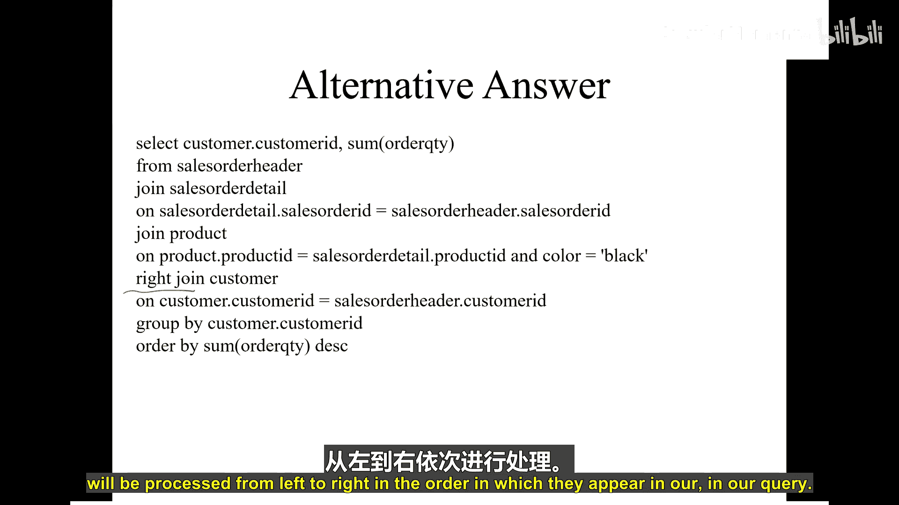