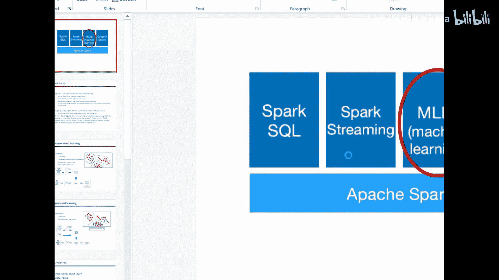
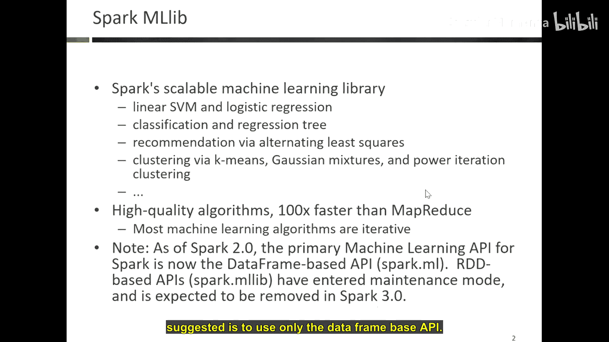
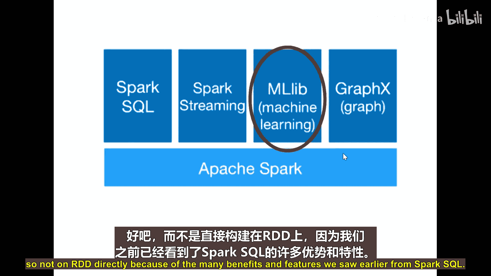
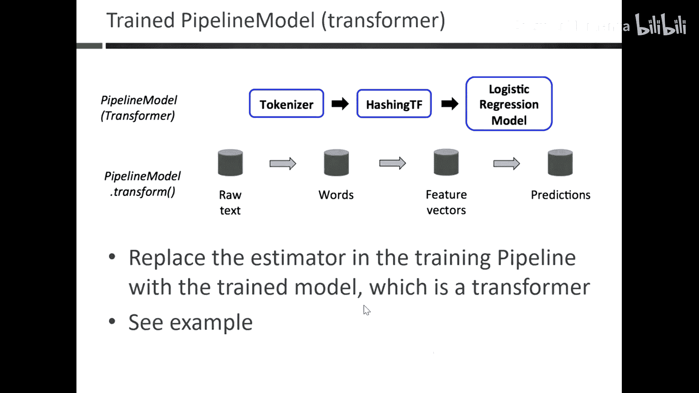
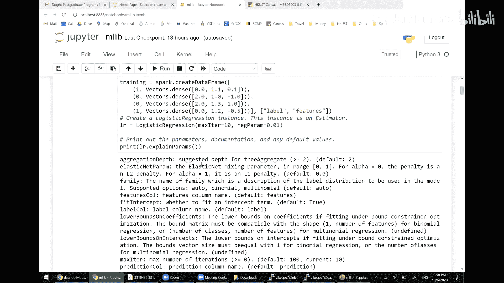

# 【香港科技大学】基于Spark的大数据计算--Big-Data-Computing-with-Spark-p11-05-03-03-机器学习与MLlib--BV1V8FmzuEHf_p11-

ML Li， the machine learning library。Okay， so in fact。

 the spark has two versions of the machine learning library。 ones called Ml Lib。

 the otherwise simply called M in fact， M Li is based on RDD the other one is Ml Lib Ml is based on the data frame Okay。

 and actually the as a spark 2。0 or the primary machine learning API is already the data frame based API。

 name spark M the RDD based API have entered the maintenance mode and expected to be removed in spark 3。

0 So I think in spark3。0 already you know the suggestion is to use only the data frame based API Okay so this picture is actually outdated okay。

 the M the machine learning library。

Already on top of Sprse， Okay， so not on RDD directly。

Because of the many benefits and features we saw earlier from SprsL。

Okay， anyway， this is not a machine learning course。

 There is another machine learning course that you probably many of you are taking。 but anyway。

 just to put us on the same page， Let's go quickly through the。Typical pipeline。

A typical machine learning pipeline， okay？So in fact， there are two largest speaking。

 there are two categories of machine learning libraries， machine learning algorithms。

 one is called supervised learning， the other one is the other one is called unsupervised learning so in supervised learning the data has labels okay examples of supervised learning include prediction classification and regression etc cea。

 so they typically go through the following pipeline so we have raw data which may be text documents。

 images etc cetera， and then they have labels， and then we need to convert them into feature vectors。

 because all the machine learning algorithms， they cannot deal with this different kinds of data directly。

 they only work on vectors okay feature vectors and then going through a machine learning algorithm which will produce a model okay。

This is the model of the training result and then during testing phase， during the testing phase。

 we have a new text， new document or image， and then this will go through the same process。

Converting them into feature vectors。 And then we， we feed them into a model。

 and this will give us the expected label。So yeah， in unsupervised learning。

 this is largely the same except that we don't have labels， okay， everything else remained the same。

 namely the raw data text documents will be converted to features。

 factors and then going through a machine learning algorithm which produce a model and then during the testing phase it's the same pipeline okay。

Okay， so so in fact， the machine learning library in Spark is at at least interface is the same as the side kit。

 Okay， the the popular machine learning library in Python and they have borrowed many of visa features。

 namely transformers as similar measuresters and types。 So you you have familiar with this package。

 Then it， it is very straightforward to use that in Spark。 although you know。

 with all the benefits of scalability of Spk。Okay， so there are the two。There are two。

Type of objects in in in in machine learning， machine learning machine learning library。

 one is called transformers。 The other one is called estimators。 Okay for a transformer。

 a transformer converts one data frame to another。 So this is really the same as the transformations in in the data frame or or RD right It transforms one Df data frame to another。

 examples of transformers include， for example， a model。

 So a model will transform a data frame to another frame in particular。

 the input data frame contains must contain I D as well as the feature vector and out output data frame。

Well contain this column called a label， Okay， so this is used， for example。

 during the testing phase。The other transformer transformer is a feature transformer。

 so this is used during this step。So namely from raw data to feature vector。

 So this is also a transformer in this case， the input data frame has， for example， text Okay。

 or it doesn't have to be text， but this is can be one example。

 The output is usually in the form of a feature vector together， of course， with an I。Okay。

 estimator。 So estimator， the input to estimator is a data frame， and the output is a model。 Okay。

 so for example， the training algorithm will be an estimator。

 So the the output of output of estimator is not data frame。 The output of the estimator is a model。

 So it's a is essentially a spark object， is object。 The model itself， of course。

 mostly consists of the coefficients。 For example， coefficient in the neural network or coefficients in regression in the in the linear model。

 etc cetera。 depending， of course， this will be different for different machine learning models。Okay。

 so a a transformer must implement a method called transform， of course。

 but typically which SQL the machine learning library has already provided many transformers。

 you can just use them directly， this is saying that if if you define a new one yourself。

 then you must implement a method called transform， Similarlyly for estimator。

 the library already has many training algorithms implemented as estimators。

 if you want to implement a new training algorithm algorithm yourself。

 then you need to you must implement a method called fit in which you implement the training algorithm。

So here is one example， you know logistic regression is an estimator。

 so this is the training algorithm， so the training algorithm is actually implemented inside this function called fit。

This function will will return a logistic regression model so which is a model so the model is a transformer and this training algorithm is a estimator so the estimator essentially means that this algorithm tries to estimate the best coefficients of the model。

Okay， so both transform transformers and estimators may have actually always have a lot of parameters。

 Okay， you know， in some so some even claim that machine learning is the art of the art of parameters。

 So parameters。 how to tune them is very important and to make this more convenient they， they。

 they define parameters as an object and you can set parameters to both transformers and estimators。

Okay， and I we' will see examples later。So now let's walk through one example of of a logistic regression training process anyway。

 so you should have learned about logistic regression in your machine learning course。 but anyway。

 for the purpose of this course all we have to know is that this is model is a non nonlinear function that maps setting data to a number between0 and1 okay and then we interpret anything greater than 0。

5 essentially we interpret this as a probability greater than 。5 then we return one。

 otherwise will return zero okay so。The training pipeline looks like this。

 the raw data is just a string Okay so this will will be stored in the data frame。

 but this data frame only has one column which is a string。And， and then we will this will。

 the first step is the feature extraction。 the convert raw data into feature vectors。 For this step。

 we use a tokenizer。 So namely well， this actually has two steps from raw data to the feature vectors。

 The first step is the tokenizer， namely， we're gonna break this。

 break a string into a list of words。This is first step。 Okay。

 this is actually is just same as split， Okay， but anyway， in the library。

 in the machine learning in the ML library and they introduces tokenizer。😊。

Which is defined as a transformer。 It transforms one data frame into another data frame。

The second step is the hashing transformation， so what they do is that they're going to apply compute hash function on every word。

 converting every word which is string really every string into integer into integer。

And then it and then the， so essentially， every unique words correspond bound to a dimension。

 So this is a very high dimensional feature vector。 And the value of the vector is a frequency。

 frequency of the words。 How many times this word appears okay。This is also implemented already。

 this is called hashing TF， another transformer and and and then from this。

 the feature vector to the model， this is the training algorithm right So this is an estimator。

 So in general for any pipeline is is always takes the following form the initial data is in the data frame。

 then going through a bunch of a list of transformers and find the last step is estimator。

 The est will return a model。 The model itself is the model itself is a transformer a transformer okay。

In the。AndAnd the when you have assembled the whole thing， okay。The whole， the whole pipeline。

 the pipeline itself， if you look at the input， the input is data frame and output is a transformer is a model。

 So the whole pipeline can be considered as a estimator。Estator because the input is their frame。

 output is the transform， okay。The the model， once it is trained together。

 once it's trained is actually consist of the same pipeline。

 except that the last step is replaced by the trained model。 Okay。

 so namely all the tokenizer Hshing Tf， they remain the same。 Okay。

 they are both still as transformers。 and the last step。This training algorithm， which is estimator。

 will be replaced by the train model。 The model itself is still a transformer。

 the model itself because the model， the model takes a data frame as input and produce predictions。

 which is another data frame。 so now the pipeline is transformer transformer transformer。

 Every step is transformer。 So the whole pipeline is still a transformer。

 because the input is data frame， the output is also a data frame。 Okay， yeah。

 so the replace estimator in the training pipeline with training model， which is a transformer。 Okay。

 so now let's see the example。😊。

So okay， so let's you know， use a very simple example first without using without using the raw data。

 we just assume that the data is already in a vector form。 So just you know。

 we first look at each step in isolation and then I will then we will assemble everything together to form a training pipeline and in testing pipeline okay。

Alright， so the， the vector is is is defined in the library。 Okay， in the lean lean al G。

 So linear al G bra library。 Okay， but anyway， what is really happening is that vectors are just just nu array。

 Okay， same as N array， standard Python N array。 dense vectors。 Okay。

 the sports vectors are different。 sports vectors are implemented as as a dictionary。 Okay。

 are keyboard pairs。Okay， dense vector are simply arrays。

 so this is how we create a data frame consisting of two columns。😊，The first one is the labels。 Okay。

 the second one is the features， okay。And we give we give them the following names Okay。

 so this so far we have， we haven't really used the machine learning library except that we are using the vector type okay。

And then we're gonna create a logistic regression instance。 Okay， this instance is an estimator。 So。

 so when when whenever say logistic regression or linear regression or， you know。

 decision tree or whatever。 this refers to the training algorithm。 Okay。

 so this instance of training algorithm。 Okay， so I instance of the training algorithm。

 you any training algorithm， as well as any model has， as mentioned， has a bunch of parameters。

 You can specify the parameters at creation time， you can also specify them later， you know。

 there are different ways to do that。 So here I'm showing in this example。

 where are setting this parameters at construction time。 Okay。

 so every parameter actually also has a default value。 you don't have to specify them。

 If you don't specify them。 they will take their default values。 So of course， different。😊，Models。

 different training algorithms may have different parameters。

 So here this for largest regression and the the most， the two most important parameters。

 one is the max iteration。 how many iterations。Do you want your 20 algorithm to go to go through？

 And this is a regularization parameter。 Okay， Ill again。I'm not going to explain that， but。

 you know， hopefully， you know。You， you know what it， what it is from your machine learning course。

 Okay， anyway， this is a fairly important parameter。Okay啊。In addition to these two。regression。

 the training algorithm has many other parameters。 Okay。

 you can actually print them out by using explain parameters。 Okay， so。

 so this not only printhouse parameters and there are default values， but also documentation。

 Okay yeah， so there are a whole bunch of them。 Okay， you can。 anyway， you can read them yourself。

 This also can be different， different for different training algorithms。 Okay。Yeah， okay。Alright。

 so now we can train a model。 Okay， by calling the fit method directly。Remember， every estimator。

 every training algorithm has to have this fit。Method implemented。 Okay。

 so training is this data frame， Con training data。 so it， it， it must contain two columns。

 at least one is label， ones features， Okay， you can change this name the names of the columns。

 think they are in the parameter list。哎。Okay， yeah， for example。

 there is one parameter called the features call。 And this is the name of the features column and default features。

 So if you use the default value， then your input data frame must have a column called features。

 It also must have a column called label。 Okay， unless you tell the training algorithm that your data has a。

Different column name， okay。So in this case， our data has this expected column name so we can just call fit directly and this will return a model。

 return model。And then we can print it out。 This is， well， this is something that we cannot now。Yeah。

 okay。 there's some some very basic information。 We have three features。

 How many classes to two classes， because it's a logistic regression。

 and the coefficients are stored。 The true and coefficients are stored in this member coefficients。

 And you can also print them out。 This is a list of coefficients， because we have three，3 features。

 right。😊，Yeah， okay，1，2，3 dimensional feature。 So three features。 So we have three coefficients。

 Okay， three coefficients。 alright。呃。Yeah， so as we consider。

 many parameters associated with this training algorithm。 So instead of， instead of。

 so make to make things more convenient， you can also specify the parameters using a Python dictionary。

 Okay， as a prim map。 Okay， so they design this way of that you can， you know， if you。

After several days of back and forth， you have found very particular good set parameters。

 You want to save that then you can save that as a python dictionary and then you can load it later。

 so that you don't have to manually know write all these parameters those valuable parameters that you have tried you have spent a lot of time tuning So anyway。

 this is simple example， where in my dictionary， only specify one parameter。

 but you can specify many as many as you want。Okay。

 this is one way know that prep map is just a standard Python dictionary。

 so you can use a variety of ways to set or change the values of these parameters。 Okay。

 this is during construction， then you can update You can you can also use the update method。诶。Okay。

So you can also change the。Output column name， right， So remember that this for regression。

 the output is a probability right， And by default， it will add one column called called probability。

 right the。The output。Yeah， the probability column。 So default value is probability。 right。

 So it will add one column called probability in the output。 If you don't like that column name。

 you can， you can change it to something else。 This is also a parameter in this training algorithm。

Okay， so yeah。 so now you can train， you can train again using this new parameters by telling the training by telling the fit method that you you that that you want to use this parameters。

 Okay， then the results looks slightly different as before because。You know。

 the iterations have been changed and also the regular regularization parameter is also different。

 So you might see different training results， coefficients。O。Okay， this is the。Example of training。

 and then let's go to the testing phase。 let's prepare some testing data for the testing phase。

 Your testing data must have at least two columns。 ones called I D。 The other one is called features。

 Okay， so the features in the same and I D yeah， I D must be unique okay。Okay。

 so now you can call the transform method in your train model。 right， We have train two models。

 Model 1， model 2， Model 1， model 2， they have been trained using slightly different parameters。

So yeah， you you can run your， you can apply your training model on the same test data。

 and this will give slightly different results。Although the probabilities are slightly different。

 but the predictions turned out to be the same。So for logistic question。

 it actually returns a data frame with three new columns called raw prediction probability and prediction。

 The raw prediction is actually just the result of linear transformation。

 the linear linear combination using the coefficients， probability is， is， is the normalized one。

 Okay， so that the add up to one。 Okay， so if you know the formula you should know that this is just the。

E raised to power of raw prediction。 And then you normalize that。 Okay。

 so this is a number between 0 and1。Okay， so the the other difference between these two models is that this column message is different because model 2。

Was trained using a different parameter。 right， So the model knows。

 the model knows that my the output column should be called my probability instead of probability。

 Okay， you can also change these names。 But anyway， these are minor things。Yeah。Okay， allright。

 so now let's so this example is just one step， right。

 So we assume we already have data is already in a feature vector form form。

 this is which is not the case in practice。 So that's why we need this pipeline。 Okay。

 this pipeline can make things very committed。 of course， By the way， don't have use pipeline。

 you can always do every step yourself manually namely tokenizer the hashing Tf and the training。

 you can do it one step step by， step by step manually but assembling them in a pipeline can make things much easier because as we can see。

 the training pipeline and the train pipeline。 They are really similar。

 except that only the last step is different okay。Okay， so now let's assemble the pipeline。

 the let's first prepare some testing training data。 and the data is the is in this form has。

 it has three label， three columns。 I D text and label。 Okay， here， the text are just strings。

We need to convert this raw data into the feature vector。 So we need to do that。

 We need to do two steps， tokenizer and hashing T F in both are。

Provided already by the machine learning library， one is caragonizer， the other one is the Hhing T F。

 so we can so we can just create an instance on ours from this from the talk from the provided library。

 okay。So when you initialize a instance of of any of the transform transformers。

 remember to specify the input and output the color。 Okay。

 so this is actually how you assemble pipeline。Okay， so this is saying that， okay。

 for this tokenizer。You should this topr should be looking for a column called text as the input column。

 which indeed exists here。And out of the column should be called worse， worse。对。

So we can actually check， of course you don't have to do you have don't have to do this in your actual in in your final final product。

 final pipeline， but anyway this is to check whether each step is working as expected。

 so namely if we。Call the transfer method。 Invoke the transfer method onto the training data。

 It will produce one。 It will。Essentially， read this column text called text and produce a new column called words。

So what it does， is simply split。Split every string into a list of words。

The same can actually be achieved by using data frame API directly。 right same thing namely。

 we do a select star and split。😊，The， the the text column and then give it a new words。 So。

 so what this tokenator does is really the same as this spark this spark code。But anyway。

 the benefit of using tokenr is that it can be assembled into pipeline， well this cannot。All right。

 so now we're going to。And the second step in the pipeline， which is the hashing transformer。

 So similarly， you， when you initialize， when you create an instance of this transformer。

 you need to tell， tell him to tell tell the the M lip， Which column is the input column。

 which one is output column Okay for the input column， you know， I make things more general。

 I'm saying that。 okay， the input column is the tokens output column because this will be invoked right after the tokenizer and output columns is feature。

So now I can still check it by manually invoking these two steps first first I do a tokenizer。

And then I do the caing T F。 Okay， and then the result will have two columns。 by words。

 this is result of the tokenizer。 And this one is the features is the。Is a hashing T F。 Okay。

 the hashing T F will return a column where the where the type is a sparse vector。 Okay。

 Sprse vector。 so so sparse vector has the following form。 The first one is dimensionality。

 How many dimensions we have。 And then it follows by the coordinate not coordinate the dimensions in which the coordinates the the dimensions of the non0 dimension9。

0 dimensions。 Okay， let me sorry， the indices of the non0 dimensions。 So namely， these one，2，3，4，5。

 These  five dimensions are 9，0。 all the others are 0。 So this is a very sparse vector。 And actually。

 these are the simply the hash hash values of the of these words。 You can see ABC D there are。

5 distinct words。 Okay， so we have1，2，3，4，5，9，0 dimensions。Spark appears twice。

 so in this dimension we have a two for the other dimensions we have only we have one。啊。Alright。Okay。

 so， so here I'm so， so， so this is。 So I can actually。Get the first。Roole of this result。

 You can see。 You can indeed verify that this is a sparse vector。 Okay， this is vector。 when you do。

 when， when you use show， it will print sparse vector in a nice form like this。Okay。

 but under the hood， it's actually a space vector is actually is is a。

 is the same it's just a dictionary。 Okay， except that it has additional number of attributes。

 the number， number dimensions， okay。And the rest is a dictionary。Alright。

 so now we are ready to assemble the whole pipeline， okay。So we create a estimator。

 which is training algorithm， This is actually this last that last stage in the pipeline。Okay。

 so now to assume the pipeline， we simply construct the pipeline by telling him what the stages are。

 right， did this consider three stages by using the stages parameter。 we can， we can tell him。

 we can tell the we can we can construct the pipeline。Okay。

 the members of this stages are simply the instances that you created earlier。

 The case concern is that the first。The last one must be must be an estimator。 and the these one。

 these stages must be estimate must be transformers。

To recall that the hope pipeline will be still be considered， can still be considered as a。Etator。

 because it accepts a data frame and produce a model in the end。 Okay， the whole thing is estimator。

In fact， as long as the last one is estimator and the whole pipeline is estimator。嗯。

So what what it does， what the SQL will do is it will just invoke these status one by one Okay why it will asend well。

 well， why this pipeline will work as expected because exactly you have defined your tokenizer。

You have defined the input and out columns。 Well， okay， the input column of tokenizer is text。

 which exist， right which exists is text， which exists in your training data。 And the input。

 the output of tokenizer， the output column of tokenizer will be the input column of hashing T F and output column ofing TF will be the input column to the training algorithm。

 So this is how they will this is how they are assembled。 How things will work out as expected。Okay。

 and then we can call the whole pipeline by calling its fit method， yes。And都 like。かして。呃，我这个段。Yeah。对。

大都放。呃，拜拜呃，这个。嗯。Right， you can， yeah， you can also So for in the example。

 I'm using two standard transformations， but you can also create your customized transformations But when you create your customized transformations。

 you have to define your transform method。So namely。

 the pipeline will just call the transfer method of each stage， one by one。

And then it will call the fit method。Of the last step of last stage。 Okay。

 so each one of stages must have a well defined transform method Okay exactly。Exactly， yes， yes。

 So if you， if you define your own， you have to define， implement and implement the transform method。

ok。If you similar if you define， if you want to implement your own training training algorithm。

 you you have to define new class， which implements a fit method。Allright， so。Okay。

So now let's prepare some test document， which are unlabeled ID texttypos， okay。So， so now that。

 you know， so the nice thing about pipeline is that you don't have to call the transform method explicitly。

 You just call pipeline。 You just call the fit method of the whole pipeline。And pipeline will。

 will call the transform method of these stages on your behalf。So similarly， in the testing stage。

 you just call the transfer method of the whole。Of the whole pipeline。 Okay， so now this model is a。

Model of a pipeline。 Okay， so this model， because this model is the the result of the fit method of the whole pipeline。

 So it will inherent。All the stages， all the transformation stages。Okay。

 so that's also included in the training model。 So when you call model dot transform。

 it will go through the same stages， except the last one。In the last stage。

 it will invoke the trend logistic regression model。So that's why what we are talking about here。Os。

So this is the training， this is the training pipeline， and this is the training pipeline。

 So the previous stages are all preserved， except the last one。

 the last stage the training algorithm is will be replaced by the trained model okay so that the benefits is clear that。

 you know， you don't have to write all the previous stages again because they are there they remain the same they remain the same in the training pipeline and as well as in the trained pipeline。

Okay， so let's see some example。Yeah， so。When you call model or transform test， Okay。

 you on testing data， then actually all these columns， you can see the words。 This is the result。

 This is a column added by tokenizer。 And this is the column added by hashing T F。

 and the other ones are added by the trend model。ok。O。Alright， so hopefully this actually this。

 the same framework also is the same as the side kit turn package。

Although the difference is that the difference that inside this training algorithm spark spark the machine learning ML library has its own implementation。

 It's highly parallel。 It's highly parallel。 so namely every every iteration。

 So because here we're talking about logistic logistic regression。 use the decent method。

 and they compute the gradients all in parallel。 Okay。

 so this is much more scalable compared to Python's machine learning library。

Okay。But anyway， the interface is very similar， okay。

