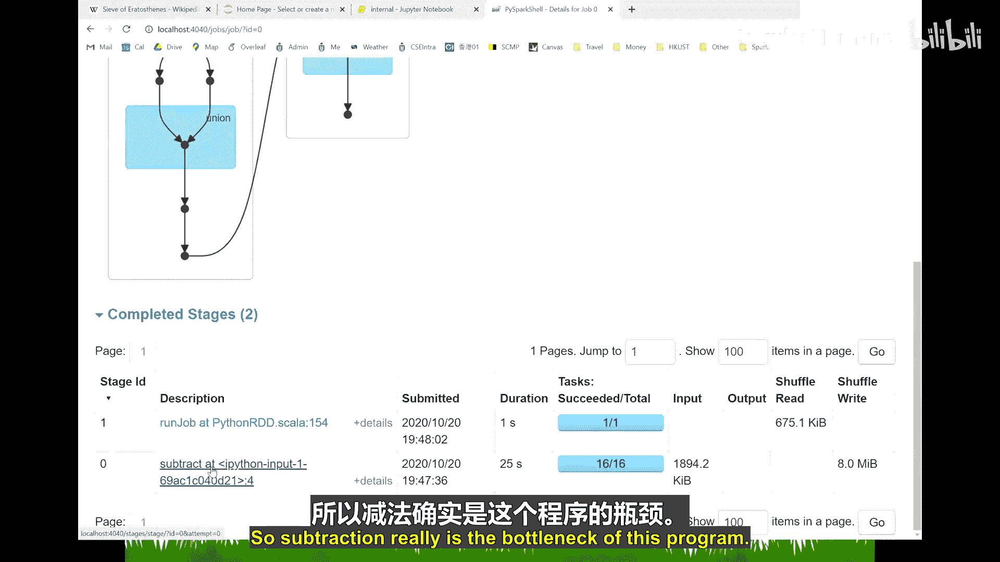
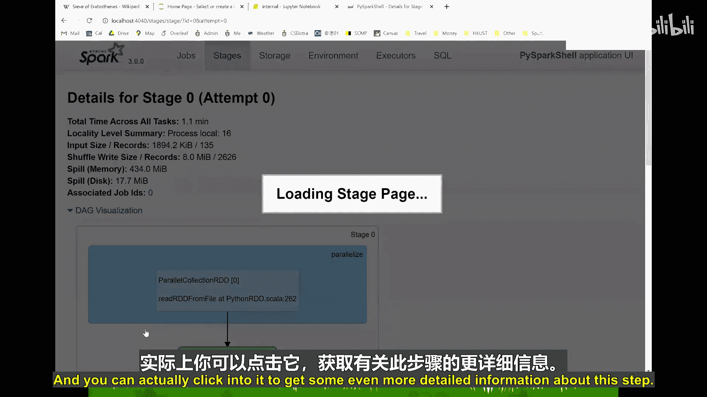
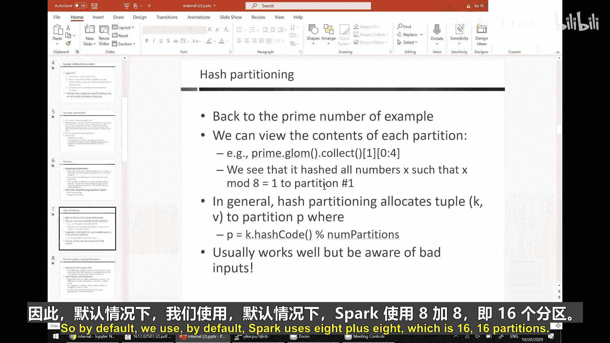
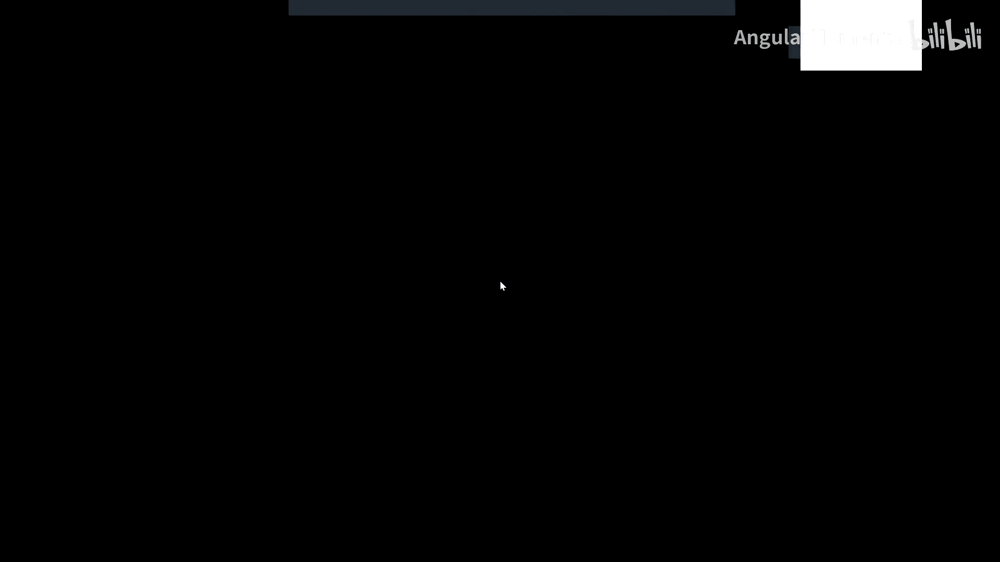
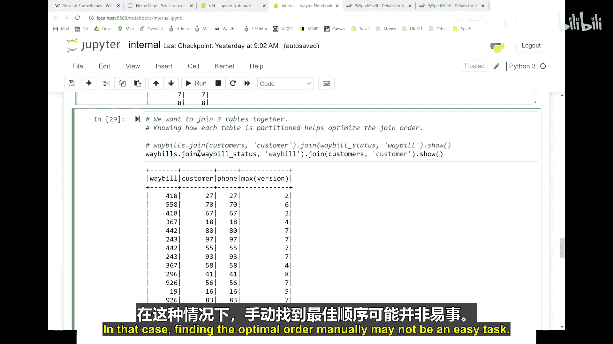

# 【香港科技大学】基于Spark的大数据计算--Big-Data-Computing-with-Spark-p12-06-01-03-示例-查找素数--BV1V8FmzuEHf_p12-

Alright， so this example is very basic and mathematical。

Problem or computational mathematical problem， namely finding prime numbers。 Okay。

 and the method we're gonna use this is this ancient method。Invent by the， invented by the Greeks。

 Okay， this is known as the， the sea of Arro。A rotthes， okay， anyway。

 so this algorithm is actually very simple。 And it actually remains the best method when you want to find a large number of primes when you want to build a table of primes。

 Okay， if you want to check for a particular number， whether that is a prime number or not。

 there are better and more efficient algorithms and actually there was a breakthrough in computer science。

 which there was that was which prove that you know。

 checking whether a number is prime can be done in polynomial time。

 that breakthrough was was was made in 2006 2003。 Okay the famous prime in P paper。 Okay， but anyhow。

 if you want to construct the table of all primes。 then this remains this ancient thousand year old method remains the most efficient one。

 and it's actually also easier is very easy to make it。😊，Parale。

 So the idea of algorithm is very simple。 You know， we start by listing all the numbers from 2 to n。

 where n is the size of your prime table。 or okay， you want to find find all the primes up to integer N。

And then it goes into it proceeds in number in a number of steps。 Okay， in the first step。O。

So in the first prime， in the first step， the method keeps 2。

 which is the smallest integer in this table and then cross out all the multipo of  two。

 And in the second step， it keeps 3， which is currently the smallest integer， right。

 and then cross out all the multipo of  three。 And the next step is okay， the next step， the next。😊。

Smallest integer remaining in the table is 5。 So it keeps 5。

 but crossing out all the multiples of five。 Okay， and then you do this step by step until。

And then all the primes will remain。 Okay， so the correctness of the algorithm should be obvious because2 is a prime。

 And if， but when two is a prime if two is a prime， all is multiplepo cannot be primes。 Okay。

 and then three is a prime， but multiplepo of three is， all the multiplepo of three are not primes。

 are composite numbers。 So essentially， this is this method doesn't really find prime is find all the composite numbers。

 and then then delete all these composite numbers and what remains must be a prime number。 Okay。

 so I'm saying this is easy to parallel because all these steps can be done in parallel。 So namely。

 I can I can find all the multiplepo of two。😊，Except the first one， Okay， and cross them out。

 I find all the multiple of the three。 cross them out， but except first。

 except the first multiple three。 But then you， you know， if。

 if we want to make this parallel for the next one， which is 4， if you do。

 if we do this sequentially， we can skip 4 because four has already been cross out。😊，However。

 if we want to make this parallel， you know， we cannot really make use of this。

 here is this organization。 so namely every step has to be done in independently， So for 4。

 we also do do the same thing， namely， we keep4， then cross out all the multiples of four okay So namely the8。

8，12，16， etcter。 Although this step would be redundant。 Okay， because in the sequential version。

 we don't we can skip for， However， in the parallel version， you know， we will have some redundancy。

 this is often the case for many parallel algorithms namely if we really want the best running time。

 the best parallel running time， we may have to sacrifice the total amount of work a little bit。

 So namely we might do a little bit more work。 So two very important notion， in。😊。

In parallel algorithms is the notion of。Work depths and work， okay。Des。And work。

 So so these two terms are actually borrowed from circuits， a circuit， namely。

 how do we compute a function using hardware。 So this is actually the very basic model of of computation and depth of circuit is。

 you know， the essentially， the the length of the longest path in the circuit from input to output。😊。

And this depth determines essentially the time。 right， if you want to evaluate function by a circuit。

 how much， how much time do you have to wait until the output is available once you give the input。

Because， you know， although circuits are very fast， like with the， the。

 the computation travel very at at speed of light。 Still it's bound is， is bounded is。

 is is bounded by the speed of light。 right So， so， so there are still some latency So there。

 so therefore the depths correspond to the latency。

 how much time you need to wait and the work essentially is the total amount of。😊，Gates。

 the circuit has， which correspond to both the， you know， fabrication costs of the circuit。

 as well as the power consumption。 how much power you need。 So in very often， these two。

 you cannot achieve the best for both。 There's the trade off。 if you want the best debt。

 you may need to pay a little bit more work。And and etc cetera。 Okay， so for sequential algorithms。

 you can， you can consider them as favoring work over depth。 if you want to do things。

 if we can do things sequentially like this algorithm， we would try to。

 we can actually minimize the amount of work needed。 We can skip other the come。

 We can skip 4 for them 4，6，8， This numbers or also 9， right。😊，All the company numbers。 however。

 this sequential algorithm will have a long depth， long， parallel time。Anyway， theres a trade off。

 And for， for computations that involve a lot of data， we often favor depths。

 favor the parallel time。 We want to minimize that as far as possible。 Okay。

 so now let's see how we can implement this using spark。Let's suppose that our table size is 5，500。

000 and we first。You know， write down the table of all numbers from2 from 2 to n。 So we。

 we can do that by you by creating RDD with all integers from 2 to n。

 So here this 8 is this optional argument that tells spark how many partitions you want to have。

 Okay so。Sose here， I yeah， I know I have more than8 cores。 So I just say 8， but this can be set。

According to your system con configuration， you can also use the default value。Okay。

 and then I cache it。So now I want to find find all the compositeing numbers。 Okay。

 so how do I do that， I want to do all these steps in parallel。 Okay， so more precisely。

 we're gonna do this by using a flat map over this RDD called all all numbers。 Okay。

 so is flat map essentially blows up each number to all its multipo except itself。😊，Okay。

 so for example，2 will be blown up to 4，6，8。10， etc cetera。 And3 will be blown up to 6，9，12。

 And then also4 is included。4 is blown up to a 12，16， etc cetera。 Okay， so this is done by F math。

 The Lada function is a mapping X to a list of numbers， which are all multipo of x， except X itself。

 okay。this is range， this range function is the status standard Python range starting from 2 x all the way to n。

 and the step size is like x。Okay， let me delete this first for now。Okay， and then。Still。

 let's run it。 Okay， and then after this is computed， the composite numbers is RDD， and then we do。

 then we do a subtraction。 Okay， sub all numbers subtract composite。

 and that will give us all the prime numbers。 Okay， all the prime numbers。Okay。

 so this aim is pretty large， it will take a while。😊，um。But now too long。

 I think it's 30 some seconds。Alright， okay， done。 So indeed， we have the first。 we have。

 we are printing out the first 10 prime numbers。😊，Oh， not necessarily the smallest。

 And for reasons that I will。Explain in a minute。 Okay， in a minute。But anyway。

 all these numbers are prime。 So it is as as least correct， because。Although the order。

May not be necessarily increasing or decreasing。Alright。

 so if you still remember what I discussed last time。 So last week。

 when we talked about cloud computing， when you initialize。

 when you when you create class will create a spark cluster。 there are there are two important ports。

 Okay， I don't I don't know if you can still remember one is port， of course， here A888 is。

 is the Jupiter notebook the Jupyter port， but there are two other spark port， one is a0， a0。

 the other one is 4，0，4，0， okay。😊，A 0， a 0 is it will show the status of the cluster。 Okay。

 so if you run a cluster page port， A 0， a0 can give you all the information about cluster。

 How many worker knows it has， How many are alive， How many are dead and etc cetera。 And then。

 but if you run in local mode， then that port is not available。 because it's no cluster。

In either the classroom mode or the standal alone mode， port 4，0，4。

0 is always available as soon as you launch your first application。 Okay， which for example。

 might be a Jupyter notebook。 Okay， if you submit another standal alone application to spark。

 that's also application。 If you have multiple application running in in running concurrently。

 then the second application will be available at port 4，0，4，1。 So 4，0，4，0，4，0，41。

 you just add these numbers， okay。If you run it on your local a laptop。

 these ports are already available。 In my case， I'm running spark on my server in in the server room。

 So I need to forward all these ports to my laptop。 So if you use2 T as your。As your S S， SH client。

 then you can do port forwarding。Oh， not， not should be tunneling。

 There's but it's sometimes it's also called forward。 Then you forward this parts to your laptop。

 Okay， so then you can get information。About。Okay， so now I just do local host 4，0，4，0。 Okay。

 so this will give me the information about the application running， which is a。

 which is my Jupiter notebook。Okay。you can诶。See that。 So every application。食事。ok。

So every application may consist of a number of jobs。 Okay。

 and later we'll see that every job will correspond to one action one action。

 because the transformation doesn't really trigger any real work。 The actions will。

 So each action will trigger a job and the job is essentially computing or evaluating a linear graph returning something to the user。

 Okay， so is so this actually correspond to the job I had I just did， which is， which is。

Which is this take， right， so this take is the only action in my program。 So this triggers in job。

 And then if you click into it， you can actually see the linear graph。

 So it's actually a very useful tool for debugging your program。

 So it's just good idea of how how a linear graph looks like， Okay， so know that if you。

 when you look at this linear graph， you may not see exactly the transformations you have done because for example。

We never， we have never done a union， right， but it it says union here， okay。So the。And we also。

 we have done a subtraction， but we don't see。Subtraction， okay so， so。

 so what is really going on is that so for some transformations。

 the the method available in Sp is simply nothing but a but body wrapper around another。

 another method。 and then then during when building the linear graph。

 they will actually just compile your， your program into other primitives。 Okay， but anyway。

 this is the if you if you， if you hover your your mouse over these things。

 then you can actually you can look look at， you can see the the actual references to this R RDD。

 right， So every RD has a has a reference， even if here。

 we don't have explicit references to this inter intermediate R。😊，嗯。And okay。

And a green dot means that this R is cached。 Okay， so it says this RD is cached。 Okay， the other one。

 this is not。 So this is， this， this， this actually refers to the source source file。

 although it's actually not a file is just a Tython list。

 So this Tyon list but it is also did shown as a as a read RD from file。 And this is the file。

 So this is original list。 this is actually the list of Tython list。

 And this one is the cache RD all number R。 Okay，So。So what really happens is， okay。

 then then we there， there are the flat map， which makes a map。哦。Okay， anyway was one So so。

Map doesn't explicitly is not explicitly shown。 Okay， instead， we have subtract here。 Okay。

 so this is actually， this RD refers to the result of the subtract。

 So what is really being done is is they they first do a union。 Okay。

 they when they performs the subtraction。 They first union is2。 Okay。

 you union all numbers together with composite。 However， they add a annotation。

 they add a flag to each element in composite。 So namely you can think of them as a minus sign。

 so they they they put a plus sign on every element in the first RD and they plus a negative sign in front of every element in the second RD。

 and then they union them。 and then they will do what is called a partition by essentially。

 it is a shuffle。 the result is a shuffled RD okay。Okay， so by anyway。

I will try to explain this memorial detail later。 but this give you a a rough idea of， of。

 of how this linear graph looks like。 But anyway， this is not the main point I want to make here。

 we will talk to， we will talk about how this linear graph is actually executed later。

 The point I'm trying to make here is， okay， so the whole job took。27 seconds， okay？

And it's actually divided into two stages。 First stages fines only by one second。

 and second stage is 25 seconds。 Like the majority of time was spent。In the second stage。

 And this correspond to subtract。 So subtraction really is the bottleneck of this program。

 And you can actually click into it。

To get some even more detailed information about this， this step。 Okay， of course， this is。

 this is the linear graph for this particular stage or this particular operation name a subtraction。

 But anyway， I think the most important， most in the most informative Inmous page or table is actually this one。

😊。

Okay， so this shows that the detail information about the tasks。 Okay。

 what is the task tasks is actually refers to the to the work done by each exe。

 where each where one ex correspond to one CPU core。 Okay， so my server actually has 48 core。

 So I can actually have。48 tasks running in parallel。 but here I only have 16， Okay， 16。 So I will。

 we will see why this is 16 in， in in a minute。 when we remember， I have8 partition in the beginning。

 right， so， but 16 is eight times 2。 Okay， but anyway， I can think the the the the。😊。

The most alarming， okay， point I want to make is， is among these 16 tasks。 So all look fine。

 except one。 Okay， so which means that this really is an unbalanced partitioning。 Okay。

 or the the workload is is allocated to the exeor so the exs in an unfair fashion。

 So one worker or one task has much more work to do than the others。 Okay。

 so the exeor who receive this task was very unfortunate。 Okay。

 and this single task essentially became the bottleneck of the whole computation。 So essentially。😊。

Most of the time， only one worker is working and the other all the other name namely maybe all the other 47 course。

 if you course were idling。 Okay， so this is really a waste of time。 Okay， a waste of resources。Okay。

 so now let's go back and and and to to the code to examine why。 So why， why this is happening。

 So why do we have one task that is that is significantly that has a significantly higher amount of work than the others。

 Okay， to do that we're gonna need this very useful method， map partitions。 Okay。

 we already saw the applications， mapitions previously where we， where we know， you know。

 for the computing pie example， right， there we need this because we， because we need to run。

We need to have。 We need to set a different sees， random seed for every different worker。 So。

 and so in general， whenever you want to do something。We， we， we。

 whenever you want to do some partition specific tasks。 Okay， we're gonna need this function。 Okay。

 map partitions or map and map map partition with index。 Okay。

 the only difference that is this map part with index allows you to do something different。

 depending on the index， depending on the index or essentially the label of this of of the partition。

So here we use this to get the protection size。 Okay remember that this remember that the syntax of the map partition is that it it accepts a user defined function。

 and this user def must accept a iterator as input and it must return another iterator。

 and the way to return another list as the iterator is to use yield。 so in general。

 we would put yield inside the loop and then every element yielded in the loop will be put into the list。

 Okay However， here we only need to we only want to find a size of each partition。

 So we only have one yield。 So essentially this returns a list consisting of a single element。

 which is the size of the list。 so that's。😊，that's what this user defined function called partition size does。

 It takes a list as input and returns a returns the size of the list。 Okay， returns the size you。

 we can， you cannot， you cannot use， you cannot use return here that would trigger an error。 Okay。

 because my partition by definition。 it is list in a list out。 Okay。

 except except that in this special case， the the out output list only has one element。

 which is the size of the list。 Okay， so we just return the length of the list corresponding to this iterator。

Okay， then when you call this map partition， this， this is still a transformation。

 It will convert a RDD with， let's say 8 partitions in this example into another RDD。

 and the resulting RD has size 8。 one for each partition。 Okay， so this can be seen here。😊，Okay。

 so this is the first result of the first print。 So we indeed， okay。

 those things at least initially worked very worked as expected。 So the all number， the first RDD。

 the all numbers， RDD is perfectly balanced， okay， Yeah， almost semi perfect plus-1 right。

 people take one1，1 one number because n is not a multiple of 8。😊，Yeah， because we don't have one。

 right， we start from， we start from two。 So the first part is slightly smaller， Okay。

 but essentially it's perfectly balanced。😊，Okay， so now let's look at the second RDD。

 which is composite。So now you can see where。Where， where the problem。A rise where the problem arose。

 right， So this RDD is， is completely out of balance。Okay， the first RD。

 the first partition has the majority of the elements in this RDD called composite。

 Okay remember that this composite is simply simply consist of all the company numbers， right。

 so which are obtained by doing a flat map computation。 Okay， and， and。

 and then the and the last four predictions have have even just have have nothing in it。 Okay。

 so why is this happening。Okay， alright， so remember it， okay。

 this figure linear graph may also be helpful。 Oh， okay， Okay， okay， yeah， here here it is。 So this。

 this RD is the all numbers RD， right， And so actually this one is the same as because we do a split later。

 So this one is also all numbers。 And this one is the。Composite。RDD， okay。

 and then they will do a subtraction between the two。 Okay， and this one is， is obtained by flat map。

 Okay， although it's how flat map is， but。Internally。

 it's also implemented as a map because it's just the only difference between map and F map is in map is  one to1。

 right， F map is 1 to any，1，2，0，1，21 and1 to any。 Okay， you can you can， you can。

The output can be an arbitrary number of elements。Okay， however， both map and Fl map。

 they are their are transformations。Without without shhouffling。 Okay， so namely this， this。

 no matter whether you do map or flat math， it's on the partition level is。

 is is all it's both one to one， right， one partition in and one partition out。

 namely all the workers will work on partitions independently without ever synchronization without any synchronization or communication。

 So every worker gets one partition data。Does this map or fly map and produce an output。

 So if there are other transformations， this can be pipeline。 So because then。

 because then the workers， even they even， even they have different speeds。

 they don't have to wait for each other so they can just do the。

Carry on the pipeline as fast as they can。 So this is actually very good idea to fully utilizing the computing resources。

😊，However， for this problem， this strategy turned out to be problematic because， as you can imagine。

The the all numbers， this， this is initial RDD。 The numbers are in are increasing order。 right。

 So when you do this fly map， when you blow up the numbers。The first partition。They are multiples。

 okay。They have a lot of multis below N on the hand， if you look at the the the。

 the last are the last part or the last four parts， they are multipos。

 They are all greater than n because the second half multiply by two is already。😊，Greater than N。

 so they have nothing in it。 So that's what that's that that explains this， this fact that。

After this fly map， this RDD is highly unbalanced。 Okay。

 so namely one worker has to do a lot of work， has to do a lot of work compared to the other， okay。

Alright， so now how do we。How do we fix the problem。嗯。Well， the idea is very natural。 right。

 So now okay， so， so， so so this unbalancedness is。So I should say that this still。

 this flat map doesn't really。Has is not really the bottleneck， although it is out of balance。

 because the F map is still all the work is done internally， right independently。 The next step。

 subtraction is really the bottleneck which is indeed verified by this information go back one Yeah。

 okay， so namely this subtraction that they took 25 seconds out of 20 out of  total 26。 Okay。

 and the reason is that remember subtraction is really the set semantic subtraction。

 So it remove all duplicates duplicates union is not in our union simply pushed together without removing duplicates。

 this is false efficiency concerns because you know。

 if the user doesn't care about duplicates simply putting them together can be very can be very efficient。

Because removing duplicates is very costly， because if you want to remove duplicates for any elements。

 you need to check whether it exists as some other partition。

 so removing duplicates which is done in subtraction needs a shuffle operation。 Okay。

 so namely all this elements will be shuffle around so that the same elements will be handed to the same worker and the web worker can remove all the copies of any duplicate。

 except one。 the same thing is happening here for subtraction，So， in fact， in。

 in this LEDD composite， we have a lot of duplicates because， you know， we because in the flat map。

 for example。Maybe let's say 8，8 appears。Twice， right，8 is a multiple 2。8 is also。

 also a multiple of4。 Okay， and similarly， 12 appears twice。12。

 the multiple three is also a multiple of4， Also a multiple 6，12 period three times。 Okay。

 so there are many duplicates here。 and all numbers。 there's this no duplicates here。 but anyhow。

 all the numbers in composite together with numbers in all numbers will be shuffled around so that the same elements will be handed to the same worker。

 which will check whether each number in all numbers appears at least once in composite。 if it does。

 it will be subtracted。 Okay， so this required a shuffle。

 shuffle operation requires communication because things have to be communicated to given to be given to the same worker and that。

😊，Requires not only CPU memory， but also networking cost。 so， so， so， for this example。

 I'm running it on my， on one machine。 This only involves inter CPU core communication。

 So this is already pretty efficient。 If you run this on a cluster is， this becomes even slower。

 Okay because that involves inter inter machine communication。Okay， so namely one worker。

 the first worker， worker number 0。 Unfortunately， he has to， you know， shuffle all these operations。

 And we， we will talk about shuffling in more detail， which is actually not that easy。 It's。

 it's quite costly。 So this is， is this， this explains why， you know。

 one worker has a lot has a lot of work to do。 So he has to essentially。当然是。So this worker。

 not only he has to generate all these numbers， but also have to shuffle them。Okay。

 so how do we fix it。Well， I sort of already gave out the solution， which is to repetition。 Okay。

 so namely after we have computed all the composite numbers， we repetition it。😊。

OkayBecause we know that after this one， all number is out of balance， we need to reppartition it。

 So know that this。Doesn't solve， doesn't reduce the cost of flat map。 F map still the work。

 The work is distributed unevenly。 Okay， the first worker has a lot had a lot of work to do。 However。

 because this is， this was not the bottleneck。 So it， it's not the major issue。

 The major issue is the subtraction。By repetitioning or rebalancing。This composite RDD。

 we are able to reduce， reduce the cost of the。Suffle all the subtraction of stuff significantly。

 Okay， so let's try it。Okay， hopefully it will run faster。Okay。Okay， so yeah。

 so we have some other collections。 yeah， so this， this was the was all this testing this code。

 anyways， because each one has collect。Okay， but anyway， the point here is， okay。

 so now after adding this three step， we are able to reduce the total time from 27 seconds to only 10 seconds。

 So yes that's a pretty sizable improvement。😊，If you look into it。Now， we see that， okay。

 it now has one more stage。 Pri， we only have two stages。 We have now we have one more stage。

 and that stage is called Co a less。 Okay， we didn't really use coal S。

 This is because Coes is actually the underlying implementation primitive。For repetition。 Okay。

 actually， coalesce it's also available。 You can call coalesce directly。

 But repition is easier to is easier to do。 So， so we have an additional step， which is repitioning。

But however， this additional  five second cost is worth it because that reduced the cost of subtraction from 25 seconds to4 to only 4 seconds。

 Okay， so although we pay an actual step here， we are able to reduce the total one in time。

 And indeed， this was reduced to only 4 seconds， because now the work is now the work is very balanced。

 Okay， very balanced。 Okay， so we have 16 tasks。 essentially is 8 plus 8， the first8 tasks。

 they all took 0。6 seconds and the the next a tasks， they all took 44 seconds。4 seconds。So it's。

 so it's very， very， very balanced。 Okay， so if if actually， if you add up the total time。

 total machine time， the new version of the algorithm。😊，Actually did， actually did more work。

Because we had an additional coales step。And if you work out the math， Similarlyly。

 it's here is four times 8。 totalt machine time is four times four times 8， roughly 3032 seconds。

 like previously， only worker， only one worker was doing most of the work。 And that took 25 seconds。

 So this is another example of a， of a depth work trade off。 right， we have， we do more。

 we we now do more work。 but we are able to reduce the depth。 So this is reflects。😊，In。

 this results in a shorter wall clock time。We can also， again， check to see to verify that indeed。

 every， every。Worker is every partition is balanced。Okay， so indeed， this is to our all numbers。

 and this is the composite。 Okay， so after repetitioning。😊，After repitioning， this is all composite。

 this composite R is also。Fairly balanced。 Okay， it's also actually perfectly balanced。not perfectly。

It's not perfect， but it's， it's quite balanced。 Okay， and the why it's not perfect。

 it's because in retriitioning， where the the the system actually uses uses some heuristics to shuffle things around。

 So if you aim at perfect balance it may not be necessary and but involve some more work。

 So they use some heuristics to try to， you know， achieve a good balance without too much。

We mentioned earlier that the RDD is partitioned。 should be partition into more partitions than the number than the number of workers。

 And the idea is that if you have more parts， then the system can do some dynamic low balance， right。

 So if some workers is fast， then。Once this worker finishes his own work。Task。

 we can assign more tasks。 So if we have exactly same number of tasks as the number of workers， then。

You know， if some some workers fast， then they will become idle after finishing its job。

 But you don't also， you don't want to have too many per partitions because the master note is in charge of managing allocating these tasks to。

 to the partition to the workers。 So the overhead will also increase if you have more partitions。 So。

 yeah， so， so therefore， the general rule of thumb。 Rule of thumb is， is， you know。

 three times three times number of worker node。Okay。So RDs are are stored in partitions。

 And when performing computations are on on RDDs， these partitions can be operated in can be operated on in parallel。

 And this essentially is true for all the transformations that doesn't involve a shuffle。

 This includes like a map Fl map。啊。So what else。A filter。 right， yeah， and， and， and。

 and all these examples， okay。So of course， we get better parallelism them when the partitions are balanced。

When RD are first created， the partitions are balanced， and this is indeed。

 was indeed verified by our the first one okay。This， this is perfectly balanced。 So， however。

 purchase may get out of balance after certain transformations， especially after things like fly map。

 because fly map maps one to any any arbitrary number。 And so if things are， if。

 if care is not taken properly， then the RDD may get out of balance。Okay。

 and we saw this example and and we saw how data was partitioned。

 So F map essentially blows up each element into different numbers of elements。

 turning it into an RD with partitions having very different sizes。

 And this is why one partition had most data and took the greatest amount of time。

 and the the fix is to to re data。 And the secondly improved version had to do more work。

 but this reduced the overall time because it achieved a better resource utilization。😊，Okay。

 so let's talk about some properties of partitions or partition data partition in general。 So first。

 partitions never span multiple machines， namely the So namelytys in the same partition are going be on the same machine。

 okay。However， it's possible， for one machine to hold multiple partitions。

 This is actually often the case because we have more partitions。

 The suggestion is to have more partitions than the number of workers。

Each machine in the cluster contains yeah， okay， the number of partitions to use is configurable by default is the equal to the number of cores on all the ex nodes。

 Okay， except that when you load an RDD from a HDF S file in HD F S you know。

 the data is already partitioned。 so when you load it it just the same as the number the the number of blocks in HD F S。

 Okay， so W A SB is just refers to the file system Microsoft Azure。Okay。So know that So。

 one important point I want to emphasize is that。Any any RD is always partitioned。However。

 the partitioning method or what we call a parter。May or may not exist。 Okay， for any given RDD。

 Okay， so this， we can again， look at this example of prime number computation。 so now it。

 let's look at the the the， the the， the， let's look at the， the last RDD， which is prime。

 how this one is partition。 So we looked at all numbers and composite。 and let's look at prime。 Okay。

 so this partition the sizes seems a little bit weird。 is， it's。It appears to be。Random。

 but not quite。 Okay， it's， it has this distinct pattern of alternating between 0 and a big number。

 except this， we have one here。 Okay， so it's， it's definitely not random。 Okay。

 it seems to have some pattern。 And why do we， why are we seeing these protection sizes after prime。

Okay。Alright， so， so， no， you know， to get idea how why this prime are part this way。

 let's look into it。 Okay， let's look， for example， let's check the， let's check。 okay， let's check。

 Oh， no there's not there's nothing here， right nothing in in the first partition。 Okay。

s nothing in partition 0。 So let's look at the first， let's look at the first four numbers of。

 of partition number one。 Okay， okay， partition number one。 Okay， so how do we get a， how do we get。

The elements from a particular partition。We cannot use take in this case。

 we can still use take because because it's nothing in the in the in the first petition。

 If we use take， we automatically get the first numbers， the first four numbers in the import1。

 But how， how about how about this， this single element in production number two we can use take if you take。

 you have to use， you have to first take the first 569 numbers and then then then you can you can never find it in your browser。

 so the idea is to use glm hopefully you can still remember what what glm does we we saw this earlier。

 So what glm does is it will convert an RD into the glm is， by the way。

 still a transformation is not action。 Gm transforms one RD into another RD。

 except that now this new RD。😊，Has just one list for every partition。 So for example， here。

 prime is just RD of many of all primes。 It's huge list。After G， it becomes a R DD of only。

8 elements， because prime has eight parts。 After Gm， this already only has8 elements。However。

 each element is now a list。 So Gm essentially gives you way to partition the data according to the parts。

 So it's because partition partition is is purely internal。

 You cannot see it from the user side unless you use the G unless you use a Gm。😊。

So now we can collect。 So after this collect， we have a list of lists。A list of this。

where each list correspond to one partition。 So then one correspond to list number one， which is。

Corresponding to proficient number one。 Okay， so this will give us a list。

The list of numbers in project 1。 So and now I can print。 let's say， for example， the first four。

Okay， and these are the first four， similarly， we can print。嗯。2。This correspond to。Well。

 the protection number two only has one element， which is 2。 Okay， in this case， we can also get so。

 so now we can， we can pick an arbitrary partition to look at， to look into。

 So this columnm allows us to do that。Of course， our point is not just to be able to look at it。

 We want to find a pattern。 So， the reason why this party is partition in this， in this weird。

 weird way。So， any。Special pattern。 Can you guys。Find， for example， in partition1。

 we have these four prime numbers。Okay， in partition2。I have。Only a single number， which is2。

 which is also also a prime number in Part 3， I have， I have these， these numbers。Okay， by the way。

 I should also print the。How many how many purchase do we have，1，2，3，4。It's 16， right。16， okay， so。

 yeah。 so before talking about Ti， let's let me first explain why， why， all number。

 all number and composite they have only they both of had 8 partitions。 but prime has 16， okay。

So this is actually use， this is actually convention used by spy Spk because there is actually no subtraction primitive in Sp。

 Subtraction is you is implemented essentially as a， as a， as， as a， as a union， okay。So。

 so in general， if， if this operator has two input R and one out RD Okay。

 and this operation maybe be union， maybe subtraction， maybe join。

 right join is exactly more is a better example。 So you have two input R，1 out RD by default spark。

The number of parts in the resulting RD will be will have the partition number will be the。

Some of the part numbers of the two input R。 Okay， so here we have a partitions from each RD。

 So the resulting RD has 16 parts。 this actually makes a lot of sense。 because you have two input R。

 So possibly the output RD will have size twice as input as as the input1。

 So it's naturally we have should have more parts。 But anyway， all these operations， you can。

 you can specify a different。😊，Parttition number， if you want。 Okay anyway。

 so this is just the convention that we have 16 partitions in the resulting early。Alright。

 so now why， so why it is part this way。 Okay， and so hopefully by if you are very sensitive to numbers or。

😊，In particular number theory。 Okay， so if I， if you， if I real earlier。A good math mathematician。

 You can， You can soon see that all these numbers， for example， here， they are。3， modular 16。ok 你唔理。

They have remainder 6， They have remainder 3 when divided by 16。 for example， Section 3， of course。

 is 196，16 plus 3， right，67 is。64 plus 3 and 83 is 88 plus 3。 So they are， they， they， they both。

 all of them have remainder 3 when divide by 16， similarly for。Parttition number one。

All these numbers have remainder one。When divided by 16。Okay。😊，1797，1，1，3。

 and how about production number 2。Or same thing。Except we only have this one number。Why。Well。

 because2 is the only prime number that have remained 2 when divided by 16。

 All the other numbers having this property， there are company numbers。

 They are all even numbers first of all， so。So essentially， this means that， you know。

 when this brings us to the， this brings us to this point。 So essentially when essentially how this。

 how this RDD is partitioned。 this RDD is partitioned by what we call a hash partitioning。

 So more precisely。😊，What we what Spet does is it will compute the first compute the hash code。

If K is already an integer， then its hash code is just itself。 Okay， if K is not an integer。

 for example， string。The hash code function will compute Comp is hash。 Okay。

 so for all the common data types， Python or Java has already an implementation of hash code。 Okay。

 so namely， it's， it's， it's the some function that converts the data。

 no matter what type it has into an integer。 Okay， because many other operations relied on some operations on the hash code。

 Okay， this also means that if if you build an RDD of。A user defined data type。 Okay。

 then you must define the has code function yourself。 Okay， suppose， for example。

 if you define a new object， you build up your on， on your own。

 and then you build RD consisting of this。Custom objects。

 you need to define this hash code function correspondingly in order to perform any shuffling or partitioning operation。

And then we then after computing， after finding hash code of this。Element。

 spark simply uses the modular operation where it does a module module operation。

 but does a mod operation on number predictions here。 The number number predictions is 16。 So we be。

 So it does a Ma 16。Okay。啊。Right， okay。Exma6 yeah， there's some discussion on in chat here。

 as I mentioned， the the， the， the prime RD is a result of two Rs。 right， So by default。

 we use by default， Spk uses8 plus 8， which is 1616 partitions。

Okay。So this usually works well。 However， there are certain scenarios where things can get out of balance。

ok啊。So， let's see。Some other example， okay。Let's see wherere。Okay， so。You can let let me。 Yeah。

 So I think this， let's， let's， let me first jump ahead to discuss shale operation。

Because the shuffle operation is。Is is， is closely related to hash partitioning。嗯。

So we mentioned this shuffle many times already。 Okay， essentially。

 sh operation is used to implement what is known as why dependencies， namely where。

 where things where part data from different parts need to talk to each other。

In order to complete this in order to complete this transformation， examples include， for example。

 repetition， of course， coalesce and join and also not union， union is not because in union。

 we don't remove duplicates subtract， its an operation that involve the shovle。 So whenever you know。

 you know， you need to。You need to data from different publisher need to talk to each other。

 We need a shelf operation。Okay， so how the how spark actually implements a shuffle。 So it's， its。

 it actually generates two sets of tasks。 So if you look really， look at the shuffle operation。

 is's very similar to the shuffling step in map reduce actually internally， spark uses very the same。

 essentially the same idea。 It generates two sets of tasks。

 one set of map map tasks and one set of reduce tasks。 Okay， the map tasks will be we need。

 we use the map tasks to organize data。 So in so if so essentially before the shuffle。 let's say。

 let's say we want to do a， for example， reduced by key。😊，收。Spark internally， as issue worker note。

 first abuse a hash table to perform the grouping。 Okay， the grouping。

 How do we group things It use the same hash partitioning。 Okay， so namely， for example。For example。

 if we if the target RDD has 16 partitions， it will compute the hash code for every element。

Compute is target target number。And then put that element into the corresponding slot in the hash table。

 namely， in the map， the math task has builds a hash table with 16 slots。Because of the target。

RDD has 16 per partitions。 It will compute the target target partition number and put element into that slot in the hash table。

 That's what the map task does。Of course， if the hatch table is too large。

 spark will spill these tables to disk， incur additional overhead。

 So that's why it's important to have a balanced partitioning。Okay。And， and then after the。

 after the hash table is built。S the， the， the， the map task will send all elements inside the same slot。

 because all everything in the same slot have the same destination。 Then they， for example。

 the first slot。Is slot number 0。 Spark will the map task will send everything in that slot in slot 0 to partition 0。

 actually， to worker number0。 actually， because we are we are using the same set of machines to。

 to do both math and task so each so the slot number 0 will be sent to machine number 0。 Okay。

 so if we are talking about the machine 0， machine 0 itself， then slot 0 will be sent to itself。

 right， in in that case， it can save a little bit of communication。 But in general。

 for the other 15 slots。 they need to send each slot to a different worker。

 so slot  one to worker one slot 2 to work to worker 2。😊，And then at the reduced side， okay。

W it's not physically still the same， save， same set machines， But logically。

 each worker has both runs the both task mask， a map task and as well as a reduced task。

 So for the reduced side， worker number 0， will receive slot 0 from worker 0。

 which is it will also receive slot  one from worker。😊，S 0 from worker 1。

 it will receive slot 0 from work worker 2， sur namely worker 0 has all the data。

From slow number 0 from all the workers。 Okay， so because the hatch partitioning。

Has this property that。If， if 2 k， two data，2 keys are the same。

 then they must have the same target protein number。But not vice versa。 Okay。

 because we have more key values than the number predictions。 But that's okay。

 as long as the same keys are sent to the same worker， then that worker can internally do the thing。

 So more， so more precisely for each slot in a reduced task， it will。😊，Essentially。

 do a sorting or another。Level of hash partitioning that that that partitions this into into a larger has table in order to find duplicates。

 Okay， or in the in in case of reduced by key， we into find all the cable of pairs with the same key。

 If we do a drawing， right we want to find all the pairs with the same drawing key etc cea。

 So all these shelf operations we only differ in the very last step， right。

 how the reduced task can combines combines elements with the same key，For subtract。

 it simply removes the element if it has it also appears in the in the other RD okay。So， now， let's。

Go back to the examples。不是不是O。诶你。Any specific example of shuffling。Yeah。

 hopefully so after let's first go over examples。 And if you still have questions， we can。

 we can give more。 I can give more examples。ok 诶 so。Right， okay， so this， let's。

 so this example shows this concept that every R RDD is partition， but it may not have a partitioner。

 Okay， so let's， so in this example， we create it。 We create an RDD。 It's actually a pair。

 key value pair because later on we will do some key value pair operations on it。

 except that here the key value they are they are just the same。 and partition number is4。 Okay，So。

Okay， let this is the first print。 We will look at the parter。Every RD is always partition。

 but it may or may not have partitioner。 So for the first one， it says， okay， none。 Okay。

 So what do we， So what does it mean， none， no partitioner。

 So is this means that this is maybe just an RD that has just been。

Created from a file or from a Python list。 Okay， so in this case， spark simply partition data。

 according to the original order from the input。Because the input data in the in the input in the in the in in。

 But because from the source， the data may not be any in any order or may not be any pattern。 So， So。

 so spark knows。How the source does not know how it is partitioned。Essential。

 a partitioner is simply the rule by which Spark uses to partition data。When the data is first。

 when the RDB is first constructed， there's no rule。 Beta made part arbitrarily。 So initially。

 there's no part。But it is still partitioned， because when we do glm collect。

 we can examine how things are partitioned。 Okay， in this case， we have。😊，eight。8 elements。

 And indeed， we have four partitions。 Each partition contains。2 elements。 So it is still partitioned。

 except that there's no rule。 like， there's no rule。There's no rule of the partitioning。Okay。

 so next， we're gonna do a reduced by key。 So this is a sharp operation。 Okay， so what it does is。

 is it is， is this is reduced by key， right， and then。😊，So， of course， in this example。

 all the keys are distinct because the key and value they are the same。 all the keys are distinct。

 So the reduced bi key doesn't really do anything。However， it does involve a shuffle because well。

 Spk doesn't know that all the kids are distinct。 So it will still run a shuffle operation。 We。

 we will do the shuffling and the shuffling operation is done。Its done as I as。

 as follows as we we described， it will compute。The hash code for each key。Well。

 they are all integers。 So the hash code is just the integer itself。 and it will then do a mod for。

 right， because the partition number here is for4 partitions。

 So they namely 8 divide by4 is remainder 0。 right， so so namely。

 it will compute remainder of all these integers。When divided by4。

 and that will be their target partition number， okay。In。

 and this can be indeed verified by checking how the resulting RD is partitioned。 Okay， so namely。

 we have this one， okay。Well， this one still has four partitions because， you know。

 this reduce by key is1 RDD E，1 RDD R。 so the partition number is the same。 still four partitions。

 So now let's look into it。 The first partition， indeed， has all the keys。😊。

That have remainder 0 when divided by4。 made up multiples of4。 Okay， in this case。

 it's actually unbalanced because， you know， I intentionally。

 intentionally put many numbers that are multiples of4。 Okay。

 this part number one has only one key metal pair And the key is a multiple multiple4 plus  one。

 Okay， and part2 and partition 3 have nothing in it。so啊。So this， I hope this is serve as。

 as example of shuffling， where the reduce task doesn't really do anything because there's nothing to reduce。

 right， because all the keys are distinct。 However， if so now let's just。Just so let's see I。

 I just add this one。 Okay， I add 1，8 here。 let's we can run this again。 Now we have2，8，2，8。

2 pairs with the same key 8。 So now these two8s。😊，These novic these two pairs are combine into one okay。

 and the value will be added because I do an addition。 Okay so what it does。

 what happens under the hood is that you know， the still， this is very unbalanced。

 So this is not very good strategy also I can say that this data is not very good。

 is sometimes we we use the word aversarial namely this data is create by a bad guy。 Okay。

 by tier who may want to screw up your performance。 So he may if if attacker。

 if the a knows that you are just using the default had function， use the default shuffle operation。

 then he can create a lot of integers with the same。With the same partition target。

 with the same target。Okay， on the video side， all these keys develop pairs will be sent to worker number 0。

 worker number 0 will internally。Possibly do another sorting。

 actually not sorting is well build another hash table to look for。

Key to look for key pairs with the same key。 In this case， these have the same key， Both8， right。

 and then this will be combined。 this will be re reduced into into one into  one kilo pair 8 plus 8 is 16。

 The others have nothing to reduce。 They will， they will remain unchanged。And this key will be。

 this cable pair will be sent to worker number one， because the key is one key is， is is。

 is a multiple of is a multiple 4 plus one。 So it is sent to worker number one。

 And if there is another safe， there is another one here。 and then this both。Okay， so these。

 this will be sent。So these， these two ones。 Okay， this one，1， this one then。

 although originally they reside in different worker notes， they reside in different partitions。

 but the shuffer will shuffle both into to the same worker node， which is。

 which must be worker number one because the target is always decided by the hash partitioner。Okay。

And indeed。We may check the parter again。 So its now its not no longer none。 It has a parter。Okay。

 and when when we have a part， we can even look at its partition function。

 So we look at RD do part do part function。 and we can tell it， and tell me that is。

 is's portable hash referring to the default hash function being used。

So now this example hopefully shows that， you know it's possible for RDAD to have no practitioner to start with。

But then after certain certain operation。It has its may。

Acquire a practitioner because we have done a reduced IT。嗯。On the other hand。

If we do a operation that doesn't involve a shuffle， for example， let's see。

I do RDD equal to RDD dot map。 Okay， I don't know， lambda。Just let's do a tri tri know。

 I should do a key pair， right Re the same key value everyone， okay。Okay， this must be a ta。

So t zero。😔，And T1， plus one。第。Okay， and then let's say we print the parter again。Okay， see。

 so you can see that after map。😊，Well， we still have no per because the map just faithfully。

Keep the original parting。 Orin， we don't have any part。 So after that， we don't have。

 we still don't have any Part。 However， after reduced by key。

 Sp know that the resulting already must be hash partitioned。 right so it will remember this fact。

 because this can be helpful for future operations， which we will see later。Okay。So， next example。😊。

Yeah， okay， so after this thing， we do， let's suppose we do another map。 Okay。

 let's do do another map。 So where is that， okay。Okay， so we' do another map。

 So this map is the same as this map， okay。Yeah， same as this map， however。

So we would imagine that Mac doesn't affect the pering。 However， if you look at this case。It's none。

 So we have lost the per， even though this map doesn't really change the keys。So namely。

 after this math， R TD1 should still be hash partitioned because all the kids are the same。O。

So why did Spark lose the containerer。So its see iss none here， okay。Wow。

 there are good reasons for that。😮，Only in this particular example do we keep the keys， However。

 in general， in general。You may do some arbitrary operations on the key。

 maybe maybe let's maybe in the multiply by some weird number， okay。Spark doesn't know。

 doesn't really know what you are really doing with the keys。 He spark。

 you may or may not change the keys。 so if you change the keys。

 then the hash protectioning will not be valued because all the keys are different， all。

 all the keys might have different values， okay。So that's why we also need this math values。

 We actually， we saw this earlier in the page rank example。 Okay， in that example， we simply said。

 okay， if you only change the value。But don't， but， but not the key。

 you can use the meta values this， this makes things easier because you don't have to say that I don't change the value。

 I only change。 I don't change the key。 I only change the value。 You only say I I。

 you only tell about how the value is changed。However。

 there is actually a performance difference between math and between math and math values。

 So in math values。After this this。Transformation， if we print the partition of RDD2。

 it's still hash。 So namely， if you do map values， Spk knows that for sure。

 you cannot change the key。 So the same partitioner must still be validd。Okay， so， so， so， so， so。

 although let's okay， if we change， let's change it back。So this two transformations。 So this map。

And this enough values。 they result in the same RDD， right。Because the map and map values what。

 what they are doing， They are the same。 Okay， however。呃。

A subtle difference or a technical difference is that。Map will just lose any perer this RDB may have。

On the other hand， net values will retain the particular。 Okay。

 so this is actually a very important difference。This will not make your program incorrect in any way。

 because the RD are the same。 However， it will have a performance difference。

So hash partitioning is not the only partitioning method。

 The The other one is called range partitioning。 Okay， so this is used when we do a sort。 Okay。

 so here in this example， R D ED is the original RD， okay。Actually。

 the particular of the RDD doesn't matter because we are going to do a sort。After the sort we can do。

 yeah。 So yeah， sort by key right， So 1，4，8，12696 and 240 and etc cetera。

 So now you can see that this is partitioned by range So namely。

 you can see that we can see that the first one is from  one to 8， Second one is from 12 to 96。

 And this one is 2 to 40 to 400。 And this is 800 to 800。 Okay。

 so now you can see that the range partitioner range partitioning is also not perfectly balanced。

 Okay， so this may appear string because， you know， after sorting。

 you could partition the RD in the balance fashion。 Okay， and this actually goes back to how to how。

😊，Spark does sorting。 Okay， sorting essentially is actually not a very easy task。

 If you think about it， if it's， you can now run a traditional algorithm like merger sort or insertion sort。

 and we will talk about sort how sorting is done next time when we discuss algorithms。 Okay， anyhow。

 next time we will explain why after sorting this is。The resulting RD is sort of balanced。

 but not quite。 And this actually， there is a very good reason for that。Okay， but anyway。

 in a range parter， spark stores essentially the boundary。 how each two consecutive partitions。

 how they are separate， how they are separate by values。啊。And yeah， we can indeed check。

 So the part of RD after sorting is a， is a range part。 And if we do another math values still。

 the range part is retained because。Spark knows that math values will not change the value。

 We will not change the key。 So the original， the original part must still be valid， okay。Yeah， okay。

 I， so let's just recap what of what examples tell us。 So the parter。The percent of a resulting RDD。

Can。Inherent， okay from the parent。 So this happens when the transformation。

When the transformation does not affect the RD。 right， So in this case， the has that in this case。

 is inherented from the parent R RDD， okay。Okay， so。

 and then there's other cases where the part will be automatically set。 Exles include， for example。

 some operations on automatically result in the RD with a known practitioner for when it makes sense。

 So this actually is talking about two cases， namely when if the operation involve a shuffle。

 then the resulting RD will have a hash part。When this operation involves the sorting。

 then the resulting R will have a range part。 So it's essentially it's， it's， it's， it's。

 you can consider as a side effect， side effect of this operation。嗯。Yeah， so yeah， these two cases。

So， however， there are certain cases， especially when the data is。Created by an anniversary。

 in this case， the default behavior or the default protection function may not work as desired。

 So let's go back to example actually， the same question was asked during the break。

 So here is one example。Okay， so here I created data 1。 Okay， data 1 is essentially from 0 to n。

Add another0， yeah， So like I create two copies of this list and cancate them together and data 2 and 16。

 so so the step size is 16。 So it consists of all the multiple of 16 and data 2 is consists of all the multiple of 8。

 Okay， And then I just zip them together to to create a RD。 So each key appears twice。

 each key appears twice。 And each key is a multiple of 16。And the values doesn't。

 The values do not matter anyway。 Okay， and then we do， we check the partitioning。 very balanced。

 good， right， because indeed， this is RD that is just created。 Okay。

 It is perfectly perfectly balanced。 And then I do reduce by key。😊。

And then check production size again now it's very bad， it's highly unbalanced，😊，And why， well。

 because all the keys are multiples of 16。 So the reduced by key will involve a shuffle that uses the mod。

Operator to compute the target target partition。And all the keys are multiple to 16。

 They all have remainder 0， when divide by 8。 So that's why after reduced by key。

 this RD is is out of balance， completely out of balance， okay。So well， how do we do it。

 There are there there are there are there are two ways。 So if one way is okay。

 I I don't want to fix this I don't care about the shuffle I only care about the resulting R。

 I want that RD to be good to be balanced to be partition in a balance way in this case。

 we simply can simply reition it Okay however， this time when you reition it。 Okay， okay， so yeah。

 so there's two way to repition repartition RD， the one is use reition method。 Okay， however。

 this repition method will not use any partitioner。 Okay。

 so what reition does is simply it will shift things around so that so that the partition are balanced。

 So after reition the RD will not have。APartitioner。 that's what reportition does。

 It simply maintains a balance， okay。If you want to keep the repitioner， okay， for example， you want。

 you want this to be hash partitioned。You can use repition by O。

 repition by will use the he same we will use the hash partitioner。However。

 if we simply do reetition by 8， this will not really change anything， right， because because you。

 when you reition by by 8， then it still use modular 8。

 So still after repetition is not really balanced because everything will stay in in re mini partition。

One easy way to fix is just， just to use a different number。 and then。It will。Be balanced because。

 you know， all these multiples of 16。 But when divide by 9， the remainder will be anything。 right。

 So that's one way。 The other， right， So if we insist that we still really want a partitions。

 How do we do it， Well， we can use。We can use a。So we can use a， we can use a custom。

A hassh function or potential function。 So here I define custom qua function by simply x mode 9。

 Okay， mod 9。But， of course， the， you may think this is。

 this must be an error because I only have a partitions。 If you do more 9。

 It will generate results between 0 and 8。 that's 9 possibilities。 but you don't have 9 partitions。

 I only have a partitions。 I still。I still want the resulting RD to have a partitions。

 So what really happens is that spark will first apply your heart function。

And then it will apply another mod 8。 Okay， so to ensure that the target number is between 0 and production number -1。

 Okay， but anyway， this already fixed problem， because if you do a mod 9 first。Things will be。

 you know， messed up。 right， so they these multiple this multiples of 16 may have any remainder1 divided by 9。

 And then you， then they then you do another mod 8。 then things will be shuffled round evenly okay。

 so this is an example of， of， of rep partition， However， this doesn't fix the this problem。

 You know， namely when you do the reduce by key， this still results in an unbalanced。RDD。

Unfortunatelyly， for all these operations that involve a shuffle。

 Spark allows you to use a custom production function。😊，So this， for example， here， if you， so this。

 if you supply a custom printed function， that's like like F。During the reduced B key operation。

 then。It will avoid this out of balance RDD completely， namely during the shelf operation。

 it will use your custom function function。For，ling。

 So it will be balanced throughout the entire operation。 So this last message is actually the best。

 the best one。 It involves any， any skillness during the in during any intermediate results， okay。

 it will give you a the result resulting RD im balanceance in a balanced fashion directly。 okay。嗯。So。

 okay， any questions。Okay， good。Alright， so， so yeah。 So the next example is， is let's see。😊，Okay。

 so this is an example that shows what， what are the what。

 what the benefits are when we retain the particular， Okay， especially earlier we earlier。

 we we mentioned that。 Okay， the difference between map and math values is that although they achieve they give you the same RD in terms of the content。

 one will remove the particular， the other will retain the particular。 So what's the。

 so what's the benefit of， of having this， this， having this this difference。Okay。

 so now this illustrated in this in this example okay so I first create two RDDs A and B and of course they both neither has a partitioner and then I do a reduced by key on a so now a has a hash partitioner right？

And similarly， I do a reduced by K and B， B also have a hash partition， okay， so。So， so now。

 so now let's do a join。 Okay， to join A， join B， Okay， A join B。 So the result is C， Okay。

 and then C has still has a partitions。 So this seems to contradict what I said earlier。

 what I said earlier that when you have two already in1 R out， right。

 So this will this will double the partition number。 And indeed， if I just comment out this two。

Operations。Okay， Arab because well， of course， it doesn't have a practitioner right。

Comment these out as well。So now C has 16 partitions。Okay。

 so why I didn't really do anything for the drawing。 There still a drawing。 but after。I essentially。

 if I have done some pre processing to A And B so that they have the same parter。Okay， in this case。

 the joint operation。Will not increase the production number。Making things even。

More if we even weirder， weirder， I I change one of the， one of the prefer number to one of RD to 9。

 until let's see what happen。Okay，17 this time。Okay， so still， I， I do the same pre processing。 Okay。

 They are both。De by reduced by key。 But then this join。

 this time still has essentially double the total number parts okay。The。

 the situation where the protection number remains the same only happens when they are both hash partitioned and they both have the same part number。

 So， so under this very special case。Do we see the， the， the fact， though。

 Do we see the scenario where the joint operation doesn't increase the number of partitions okay。

Okay， so now this brings us back to what， what this parter， what effect this part have for。

For data for operations。Yeah， so this slide we early discussed earlier right O So math values math land values。

 they will retain the particular， okay。Okay， so so this really involves this。

 So this are some examples to show， you know， if you talk about join operation。

 which involves two RD in this case， in this case， okay， so now this one。 Okay， yeah， in this case。😊。

The joy may or may not involve a shovle。So this brings us back， brings us to this concept between。

The difference between a narrow dependency and y dependency。 Okay。

 so what you mean by narrow dependency and y dependency。 So for a narrow dependency is is anything。

 any transformation that can be done independently by all all workers。 Okay。

 so this includes a map filter or even union or flat map。

 all these operations are narrow dependencies， they can be done by workers independently and pipeline。

 Okay， so namely if you have map， filter， map， map flat map union， they are。

 they are all chain together， they can all be pipeline。

 namely one worker will be in charge of one going through the whole type life of one position and all workers can run in parallel independently okay。

However， when you have when you when your operation involve the shuffle operation。

 then this is called a y dependency。 Okay， Y dependency examplesles include group by key。 Okay。

 so this this involves a shuffle。 However， if you are performing a joint operation。

 This may or may not。 this may correspond to a narrow dependency。

 it may correspond to a y dependency depending on whether the two RDDs are coitioned。

 So what do mean by co。Oh， there's two。2 conditions， both of which have to be satisfied。

 Condition one is that both RD must have the same number partitions。 Okay， okay， so in example。

 they both have three。 And second， they must have the same partitioner。

 Either they have both have hash parter or they are both。Partition by range parter。

 Okay in particular， if they have both partition by range parter。

 the boundary values must also be the same。 So this actually happens rarely。

 So the most common case is that both both are hash partitioned and they have the same number of partitions。

 So in this case， the drawing will become a narrow dependency without a need of shuffle because。

 you know， remember， for a joint operation， we need to match。Anmen killed pair with the same key。

 because they are now co partition。 So there's no need to sh at all。 then then because worker。

 this worker simply merge these two partitions and then， you know。

 pairing uptys with the same key and thats it。 no inter worker communication is needed okay。

Nowo depend can be much more efficient because there is no shuffle operation， okay。

And this is also why retaining the parter is important。 So let's see， for example。

 we can look at this example。We do， we first do a join between two RDs pages and visits。

 And then we do a reduce by key。 Okay， so in this example。

 also reduce by key in general reduced by key may or may not be a wide dependence。

 It may or may not involve a shuffle。 In this case， it doesn't。 because after the join。

 the resulting RDD is hash partitioned is hash partitioned by key。So namely。

 if two typess have the same key， they must。Stay together in the same partition。 So therefore。

 if you do another reduced by key， then spark is actually pretty clever。

 Sp knows that no shuffling is needed because the shuffle will not doing change anything。

 elements with tops with the same key。 They are already together。 So in this case。

 output of the joint is already partitioned is is already has partitioned。

 So reduce by key doesn't really change anything。😊，So actually， if we do a sort is the same thing。

 So as long as it， as long as it is partitioned， then the radio by key will not involve a shuffle。

Okay， however， if you look at the second example， we do a drawing， followed by a map。

 followed by readers by key。 So in this case， the map will lose the knowledge about partitioning。

 because spark。Because your map may or may not change the key。 if it change the key。

 then the original partitioner cannot be valued anymore。 So a shle operation is needed。

So this example also illustrates the benefit of using map values。

 although map values may may not really do anything may not really change R DD。

 but it retains the partitioner because it tells Sp explicitly that I'm not gonna change your value change your keys。

 So your original original partition must still be valid。 So therefore。

 if the next operation is reduced by key， then it doesn't need a shuffle。

 it becomes a narrow dependency。Yeah， so just to summarize。Yeah， so。Yeah， so these operations。

 map values， map flat math， flatm values or filter。 they will retain the parent parter。

 And similarly， a joint operation will result in RD with a hash partitioner and the other cases will。

 will lose the partitioner。 Okay， however， if so， however， in general， as a rule thumb。

 you should always try to retain the parter because retaining the parter will potentially make the next operation more efficient。

Okay。Alright， so that's all O I have about。嗯。Okay， yes， I have some other。 Yeah。 Okay。

 So we talk about and RDDs are partition in in in R TD。 So how about data frames， The data frames。

 They are also RDD。 So they are also partitioned。 However， they， it's， it's。诶。

Partitioning in data frame is actually more flexible。 So in RD， you can only partition by key。

 But in the data frame， you can partition by any column。 Okay， so， so let's look at example。😊。

So I first create RDD。 So here， I'm not specifying the number of partitions。

 So Spark uses a default value， which is a number of cores。 My server has 480 cores。 So it's。

 is's 48 partitions。 although really， I have less， I have very a small number of。elementsments。

So the majority of partitions are empty。For little frame， you cannot， There's no glm。

 You cannot examine how things are partition。 However， you can。

 you can retrieve the underlying RD and see that RD。 how that RD is partitioned okay。

So this example shows that you can rep partition data frame。In a way， very similar to RDDs。

 except that you can now reition by any， by any column。 Okay。

 so here we I rep partition by column number one， okay。

Recall that one action will trigger the evaluation of one linear graph。

 and the linear graph will be will be will be will be evaluated by by spark。

 So to compute the evaluate lit graph spark first device into what， what is。

 what are known as stages。 Okay， so this is actually also why this is also what you saw here in this。

嗯。Okay， so this is one stage。 That's what also what you saw here。

 You have a number of different a number of stages in the linear graph。 Okay。

 and how the how are the stages decided， they are decided precisely by the Y dependencies。

 That's why spark needs to distinguish between the narrow dependencies and y dependencies。 Okay。

 and the boundary， as soon as you reach a y dependency one stage finishes and the next one starts okay and。

In this example， we have three stages。 and because we have two Y dependencies。 Okay。

 and then within one stage， all the operations are pipeline。 Okay， so namely， for example。

 if we look at stage 2， one worker will be in charge of。

Mapping this protection C into this project D and then union this protection D into portion F。

 and one worker will be in in charge of this pipeline， etc cetera。 Okay， so within a stage。

 there's no communication between the workers and and all the tasks will be done independently。 Okay。

 in the pipeline fashion， however， at the end of any stage， the workers will will all have to stop。

 They have to wait。Until the last task is finished before starting the next shuffle of operation。 So。

 so that's why it is important to minimize the number of shuffle operation。

 not only because they are expensive。 but also because of the synchronization overhead。

 it's especially when you have a lot of workers， when you have hundreds of workers， hundred of tasks。

 Okay， and， and essentially， the stage cannot finish the entire state cannot finish until the last task is okay。

 so that's why it is important to minimize number of shuffles。

 because they create a synchronization barrier， okay。Okay。呃。Yeah， we talk about shuffle operation。

 And so， yeah， so this is an example of， of， of， of page rank。 is's actually a good。

 good time to revisit it。😊，历史啊。R弟D。Okay， when we did， when we saw， when we looked at the example。

Earlier， we did not really emphasize the difference between， between using a map and math values。

 Okay， so now we can actually see the real effect。 So in this version， I just use a map except that。

 you know， the key doesn't really change。ok。你取 run。

Remember we here we do 10 iterations of the page rank computation。So， yeah。

 the result is not important。 but what I want to see is。Is the。Is the linear graph。 Okay。

 now is the second application running。 So it， is information is available at port 4，0，4，1。ok 啊。

There's only one job， right okay。It has a whole bunch of stages，20 stages。Well more precisely is 21。

 because theres a stage 0。 Okay，20， essentially because every iteration has two stages。

 namely every iteration involves twole operations。 Now， let's change this to。Map values。Okay。

 so systematically， it doesn't really change anything the same thing， okay。😊，However。

 now let's go to this stage。Okay， second one， Which ones。Okay， this is。 okay， this one。ok。Okay。

 from 21 to 32， Okay，12，12 stages。 So almost half of the first version， okay。Essentially。

 because now in the， in the improved code， every iteration only has one shuffle。 Okay。

 so that's why the number of stages have been reduced by half。 Okay， So why， Because when we use map。

The part is lost。 So that means they this essentially essentially the this is lost when you do the next join operation。

 joining links with ranks。 ranks is not positioneded。

 So this join will be a will be a wide dependency， it will involve shuffle。 However。

 if we use math values。 Then the parter is kept。And is on key， right， is on the key， right。

 So and similarly， links， what about links， Lis is also the result of good by key。

 So links is also per。Which is also in it is important to have math values here。 Oh No， okay。

 so this this doesn't matter。 So's say here the links is always per， is always partitioned。

And so this join will be a narrow dependency because both RD are， are co part。 So therefore。

 only this one reduced by key。 this involved shuffle。This join is not a doesn't have a shuffle。

Fla map， of course， is a narrow dependency and map values is narrow dependency。 So in iteration。

 only one operation required shuffle。 So that results in in a reduction in the number of number of stages。

 Okay， so it you should all， it should also be able to see a significant reduction in terms of running time。

 Okay， although the time should not be cannot be reduced by half because， you know。

 still the the amount of work is the same。 it's just that。The number shuffles is reduced。 So yeah。

 of， of course， the actual performance improvement will depends on a lot of factors。 but the number。

 the number of shuffle operations is an important one。Okay， so。So， the next example is。

Its actually a kind of a。A real example。Is a real。Question， which I receive from phone express。

 Okay so they have these three tables that they want to join together。 Okay， so essentially。

 they have they have three table。 This is the way bills。

 I have simplified example from the real one from the real one。

 But they are only keeping the most important columns。

 So every so the way build table is the data frame between two frame on the will bill number and the customer number。

 Okay， this is a data frame that is partition by way bill。 Okay。

 this essentially the primary key of this table。 and there is another customer table that required that stores all the customer information。

 and this is partitioned by customer customer I D， okay and phone number address， etc ceter。

 So I'm o meetinging the other columns。And there is is another table， which is called Wabi status。

 So namely， every time the Wabi has a new status， it will add a new row to this table with is a version number When this package know。

 passes through a checkpoint。 Okay， then it will add a new row to this table。

 And this is also partition by Wabi。 Okay， and now they want to join them together。

This is a three way join。And there are， of course， there are corresponding only two options。Okay。

 so yes， the， the for example here， But you can ignore the。

 the data preparation part on only focusing on， only focusing on the join。 Okay， this is a join。呃。

Because its the three table join， right， you can either join， for example。

 We with customer and then join with We status or you can join We join with We status and then join customer。

 Okay， however， there is actually a difference between the two join orders。

 the second one is much better。 Okay， so let's see why， Okay， so if， let's see if the first one。

 of course， they result results in the same result because okay， I yeah， I need to run this first。😊。

啊。And then， of course， the results in the same， same output， because the drawing is。

 is associative and comm。 right， so you don't the result doesn't depend on the order。 However。

 the performance does because when you let's consider the first drawing order。

 we join way bills with customer。 And this is a natural join and between between these two tables。

 way bill and and the customer on the customer column。 Okay， so this is a natural join。 however。

 because。This way table， the data frame is partitioned by Webi， right。

 So in order to perform in in order to do this join， We has to be shuffled actually。Yeah。

 it's a way we has to re shuffle。 This one doesn't have to shovled because it's already partitioned by customer。

 okay。But anyway， one table will be shuffled。 And then the resulting。

The data frame after the join will be a data frame that is， that is joined by。

 that is partitioned by customer。Customer， and then when you join the resulting data frame with the last。

T补。And this is another natural join on Webi。 Okay， so， so this is not as another join on We Bill。

 And this will result in two shuffles。Okay， both join will be a wide dependency requiring a shuffle。

 However， if we do it the other way。 Okay， so namely， we first join waybis with waybi status。

 So namely， we join the first one and the third data frame first。

This is a narrow dependency because both are partition by wave。 Okay， so namely this。

This join will be central people will essentially be free because they say the data frames are co partitioned。

 So and then the next the second join will still require shuffle。 But anyway。

 we can reduce the number of shuffles from two to one。

 so this this is a better way of writing the three way join。 So in fact。

 in in in commercial databases like oracle， a major job， the query。

 the query the optimize does is to optimize the join order the join order join order is a very important。

 very important problem that the community have devoted a lot of efforts to But unfortunately。

 for spark， they haven't done anything join order。 they simply follow the order。

 the programmer has written。 So so essentially， as a programmer， you have the response。😊。

But responsibility to find the optimal join order。 although I expect that in the near future。

 they will start to consider， you know， to consider ways to optimize the join order。

 because not every programmer is able to write to find the optimal way。 The optimal order。

 especially when you have。Many tables that you want to join together。 Okay， in that case。

 finding the optimal finding the optimal order manually may not be an easy task。

