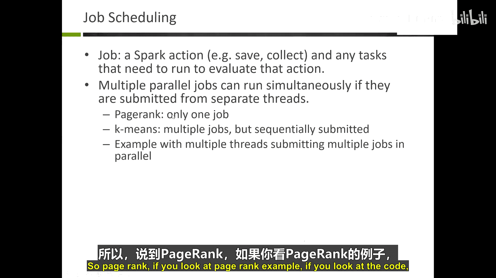
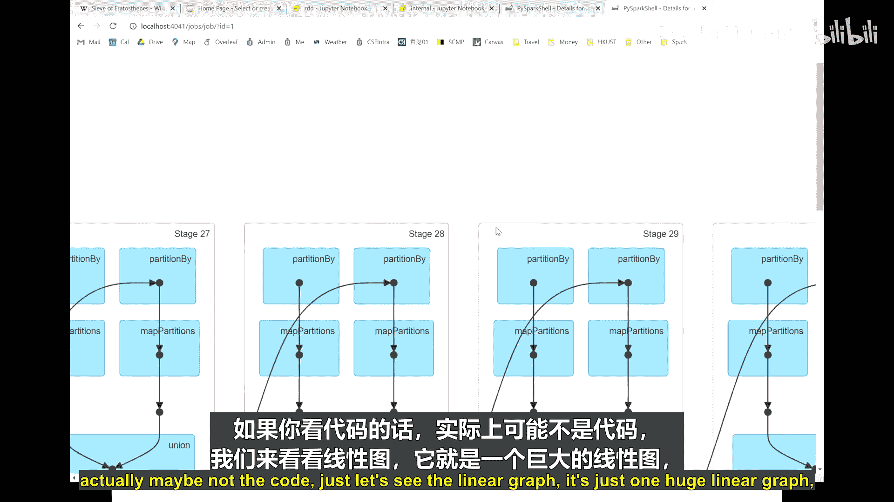
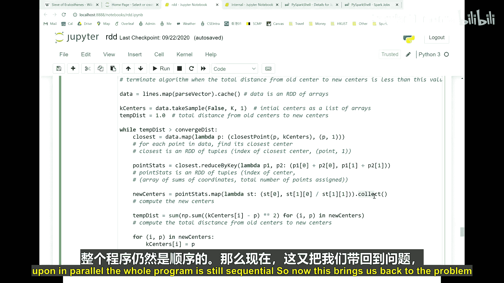
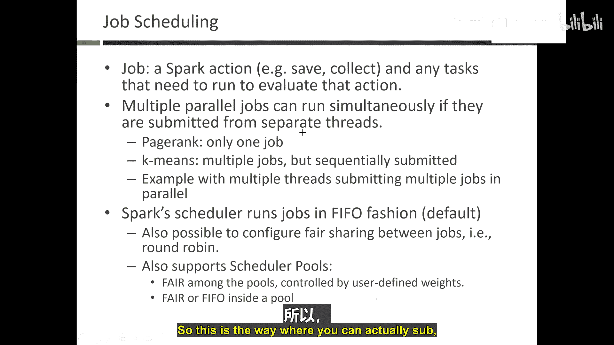
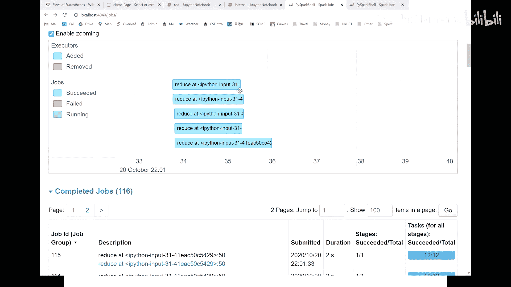
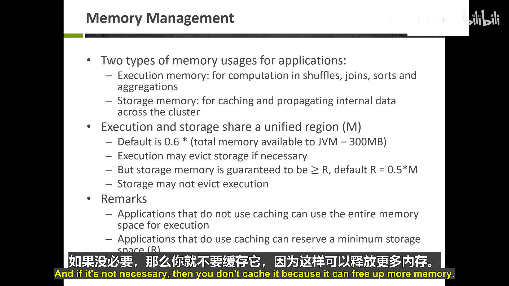

# 【香港科技大学】基于Spark的大数据计算--Big-Data-Computing-with-Spark-p13-06-02-02-作业调度--BV1V8FmzuEHf_p13-

Spark is designed to be a multi user environment。 so this is because although for this course。

 you can create your own cluster， you have your own dedicated computing environment when you go out。

 work for a real company typically is， is one cluster shared by all users。

 So namely all each user can submit a job。 And then。

 and the this cluster is shared is shared among many different jobs。 So so it's also。

We also need to talk about how spark schedule and multiple jobs that has submitted collectively concurrently。

 okay。So a job is any action action， like， say or collect any any tasks that need to run to evaluate to to complete that action。

 Okay， so multiple parallel jobs can run simultaneously if they are submitted from separate threads。

 Okay， separate threats。 Okay， so。Yeah， so let's， let's。However， for all these examples。

 we have seen earlier。 we we have seen so far。 We don't really have multiple threads。

 We because youre just one user， right， youre just one single user。 and you may submit multiple jobs。

 But all these jobs are will be run sequentially。 Okay， so because let's let's。

 let's first look at examples。 So page rank， if you look at page rank example。

If you look at the code， actually， maybe not the code。

 just let's see the linear graph is just one huge linear graph。 And if you。

 when you look at the code for page rank。

Inside the loop， you don't have any action。So， in fact。

 this loop will finish in in almost in almost no time because what this loop does is nothing but construct the linear graph。

 So it uses a loop to construct this linear graph that consists of 10 or 20 stages。

 depending on how you whether you use Mac math values。

The only action in the page rank the example is， is this top。 Okay， so essentially， it uses。

 uses this loop to just construct the linear graph。

 And then it triggers the computation of the whole graph by this only action in the whole program。

 There's only one job in page rank。😊，The other example is， is like is。

 is quite different in K means clustering。 Okay， so this one， can， you can see multiple jobs。

 And the reason is that if you look at this， this program inside the loop， there is a action。

 which is。Which is。Some， okay， so this is an action。So what the difference between these two。

2 programs that this one has multiple jobs。 but every job is kind of small。

 Every job only has a small linear graph。 that involves the map reduced by， by key。And another map。

 Oh， know。 So this one is us disconnect collect。 This is the only action。So this one will this。

 this in this program， this loop will actually does a lot of work。😊，In fact。

 any action will be blocking in the sense that once once spark ceases this action。

 it will block your driver program。 Okay， your driver program will need to wait until this action is completed。

Because this action will return something， right， and in， and in most cases。

 this return value is actually useful。 And this this in this in this example。

 the return value is new centers and new centers will be used in the very next。😊，Statement， so。

You have to wait anyway。 so， but anyway， when Spar sees any action。

 it will block your driver program from further advancing。

 and you have to wait until that action is completed。 Okay。

 so that essentially means that within the same driver program， there's no， between the jobs。

 there's no parallel parallelism。 Okay， all the jobs will be executed sequentially one after the other。

 because essentially， if you look at the whole， if you look at the driver program。

 it is a standard sequential python program。Except that when completing each action。

 the partitions will be will be computed， will be operated upon in parallel。

 the whole program is still sequential， okay。

So now this brings us back to the to the， to the question that yeah， So okay， let me。

 let me finish this。 So the spark cellular will run the jobs in the first in first hour fashion。

 Okay， that that's the default behavior。 actually， it will。 So the actions。

So even if so if so if if if multiple users are submitting jobs to submitting jobs to the same spark cluster and the jobs will done。

 the jobs will be evaluated sequentially in the5 in the first in first hour fashion。 So namely。

 before the previous job is finished， the next job cannot start。 And actually。

 if I could also by default a job will try to use as many processors as possible。

 because as long as there are enough partitions right and all the workers will be utilized。

So this essentially means that all the jobs will one job will， will， will will。

Will occupy other worker node。Okay， so this also brings us back to the next question， which is。

 suppose you are the only user。 And what if you have multiple jobs that you want to run in parallel。

 Okay， so namely if if you have multiple jobs and suppose each job doesn't have enough parallel of them。

 Supp you have a cluster of of， of 100 machines。 and each job in your program only can use 10 machines。

 But because the jobs are done sequentially， then how do you make use of all the100 machines。

 So that brings back to to to the to。To the， to the next question， which is user level threading。

 Okay， so this is the way where you can actually where you can actually run multiple jobs at the same time。

Okay，This is illustrate illustrated in the next example。Okay， so in this kind of made up example。

 I just created this example just this is the computing pie。

 I create example just for the sake of illustrating how to。Complete multiple jobs。

 multiple jobs from the same application， from the same user in parallel。 Okay in parallel。 Okay。

 so now suppose I have， I want to run this five jobs。 although in in the example。

 all five jobs are the same。 except that they have a different seed。 Okay， so anyway， just。

 this is just just for the illustration purpose。 Okay。

 each job is defined via a via a V function via a do job function。 Okay。

So inside this do job function， its a， it is a standard spark program in that which involves a map part with index and reduce。

 reduce it is action。 So this is， in fact， a job okay。

 to illustrate how to do things slightly differently。

 for every job I use a different I use a different function in inside my part with index。 Okay。

 so the this code is a bit ugly。 anyway， I just do it for illustration purpose。

 so so I can I create five differentyon functions。 the only difference is that I use different seed。

 which is manually written。 Okay，Then I create a list of functions。And then for every job。

 I use a different function together with math partitions。 Okay so。Anyway。

 I just create five different jobs， okay。Although they are not really that different。Okay。

 so now because as I said， every action spark action is blocking。 Okay， not every action。

 Every statement in Python is blocking。 right， they to be done sequentially。 So the only way to to。

 to achieve to run things in parallel is to use user level threading。

 namely you to use the to use the thread threading library package from Python。嗯。So， so this is。

 this part is actually just a standard Python multi threading library。

 So what I did is to create a list of threads， a list of threads for every thread I define is I， I。

 I associate with this do job function with argument I。 Okay， so that every thread。

 So thread I is doing do job I Okay， I have five。 So I want to run， essentially。

 I want to run this five functions，5 do job functions in parallel in parallel。😊，🤧咳。In the threading。

 multi threading library of Python， after you have defined a thread， you can cause start。

 So this start is non blocking。 namely， it will start a thread in the background。

 while the main program can proceed。 So if this look will run， will finish， will finish in no time。

 So， and， and but then five threads will be spawned in the background。

 while the main program can continue。However， I don't want the main main main program to continue because the main program has to wait for the five threads running in parallel to finish。

 so in the main program， I simply say wait。 this is done by the drawing command。 Okay。

 so this is completely unrelated to sparkrse join， Spe join is the relation operator join here。

 this join means this join is used in the threading。 Okay。

 so namely name the it tells the main program to wait for that thread to finish to finish。 Okay。

 so I wait for all threads to finish。Okay， to illustrate the difference。 Okay。

 so now let's first use。48 partitions。 Okay， so I use all workers in my， on my server。没有。Okay。

 so now let's see。Alright， okay。Zoom in large enough。 You can see the effect。 So what happens is。

 so all these five jobs are submitted almost at the same time。 Okay， almost at the same， same time。

 indeed， that's what we did here。 I start threads withint loop。 this start， This is non blocking。

 So this loop will finish finish immediately。 and it will start all these five jobs。 Okay。

 so the these five jobs are all。All start at the same time， roughly the same time。

 But they finish at different times。 This is because。不是。This is because。嗯嗯。O那么。Okay。

 this is because each job is using all the 48 worker node。 the workers， My server has 48 core。

 So each job， because sparkar will schedule the jobs in the first in first out fashion。

 So the first one will。Occuped all the 48 workers。 and the second job。

 And the other four will have to wait。 Okay， they are submitted。 They have started。

 but they cannot make any progress。 They have to wait until the first job is done。

 and then they can start。 And then etc cetera。 Okay， but things will。Change slightly。

If I change this。Maybe let's say， let's say 12， okay。Alright， so this is， this one looks different。

 Okay， so I now I use 12。 So each worker uses each job uses 12 workers。 I has 12 parts。

 he only use 12 can use 12 parts can only use 12 workers so that the first。

 So they are still submitted at roughly the same time。

 But then the first four can now run in parallel because everyone only needs 12 workers。

 I have 48 in total， so I can run all the four can run the first four jobs in parallel。

 But the last one still need to wait because no worker is left。Then after some worker is done some。

 after some job is finished， then the fifth， the last job can start。 Okay。

 and the last one will finish。Slightly faster， because there are some， some， because for example。

 because some workers might finish their job earlier。

 And as soon as because I have 12 positions and 12 workers。

 So if some worker can finish its job earlier， they can start running。

 they can start working on the last job。 So that so that's why we see this duration for the last five。

 fifth job， slightly shorterer。 because some， some worker can start before their respectiveing job is done。

So now let we， let's， now let's look at how scheduling is done within a job。

 So one job can consist of first work， one job can consist of multiple stages。

And the stage can only start after all its parent stages have have have completed。

 So that's why it's important to minimize number of stages because of the weighting。

So each stage can have multiple tasks， so one task for each for one task for each partition okay and but each partition may have a pipeline pipeline of transformations。

嗯。So Spark will assign tasks to machines based on data locality so essentially it tries to communicate code instead of communicating data。

 so what happens is so if a task needs to process a position that is available in memory on a node。

 then we send the code of task to that node and there are different levels of locality that have been that are being considered by spark。

 including know data when data is in the same JVM Java which machine as running code or when the data is on the same node or within when data is on the same rack of servers or the last one。

 any refers to data maybe anywhere else。 So this is this is designed for a heterogeneous cluster where different nodes may have different speed。

 So what happens is that okay so。Of course， initially data is partitioned。

 one worker had one partition。Okay， okay， we mentioned the number of partitions maybe more than1 workers of some worker。

 So one worker may have multiple partitions， maybe two or three partitions。

 So the workers will start running。 this will running they assign task on on their first partition and on their second partition。

 But because the computers， the machines may have different speeds。

 So some workers will finish their task sooner than the others。 Okay So in that case。

 Sp has to make a decision， right， So because once worker is running out of tasks。

 they you can assign another task to to this idle worker。 However。

 this will involves this will involves data communication， right， because the data。

 the worker wants to work on belongs to other slow worker that worker hasn't finished all。Task yet。

 So in this case， Sp actually sets a timer So you actually waste for waste a waste a little bit to see whether that worker。

 that slow worker can can can cash on So if the worker can that slow worker can cash on then it will not assign reassign the task from the slow worker to the fast worker because that involves data communication。

 so you actually reuse some fairly complicated criteria in deciding how to assign how to assign how to reassign tasks。

 Okay just give you another example。 suppose you have a fast worker。

 you have slow worker The fast worker is already done with all its tasks。

 The slow worker still has two partitions Yeah to start In that case， a spark will not wait。

 will immediately assign one of the partitions to the fast worker by communicating。

By sending data to the fast worker and slow worker may still has one left。 right。

 so but if the slow worker only has one partition left to to work on。

 then Spark will actually wait for a little bit because it。Wants to minimize communication cost。Yeah。

 so yes， yeah。 So we will wait for wait for， wait， wait a bit。 And that can be configured。

 So so in general， fine tuning， a cluster may not be that easy。

 So it may need some experience and the the cluster manager may need to make some fine tuning of the parameters in order to optimize the performance。

😊，So lastly， I just a quick some quick。overview of man of memory management。 Okay。

 because your memory is very， it's a very valuable resource and and。😊。

There are two types of memory being used by spark one is called execution memory。

 The other one storage memory。 So the execution memory is useful for essentially shuffles。 Okay。

 costly。 And remember that shuffle needs to build hash tables on both the map side and reduce side and that has table can be very costly can be very costly。

 So the， the others。 So that needs a lot of memory。😊，The other type of type of memory is storage。

 So this type of memory is useful for caching results。 Okay， so remember， for any R， you。

 you can tag it as persistent， persistent or unpers。 If R is persistent。

 it will be stored into storage memory， okay。So between the two， of course。

 execution memory is more important because without execution memory， you know。

 you cannot people they cannot even do shuffles。 what they can。

 But then the cash tables will have to swapped out and that that will create that will lead to a performance degradation。

 Okay， so the policy is that execution memory may evic storage if necessary。

 so which which means that which means that even if you cash an R。

 that RD is not guaranteed to be in memory。 It may be swapped out to disk。啊。Rightise。

 but storage may not evict execution。 Okay， and the。And yeah， and there's， there's some。

's some prim default parameters。 For example， St memory is guaranteed to be at least half of M。

 half of memory。Et cetera， okay。So applications that do not use caching can use the entire memory for memory space for execution。

 So that's， this is also important。 This is also a reason why caching by default is off because all all Rs by default are not cached unless you explicitly cash them because caching will because not caching them will free up more memory for execution。

 things will become more efficient。 Okay， so really， you need to。

 as a programmer you decide which are are the ones you need to cash。 And if it's not necessary。

 then you don't cash it because it can free up more memory。

