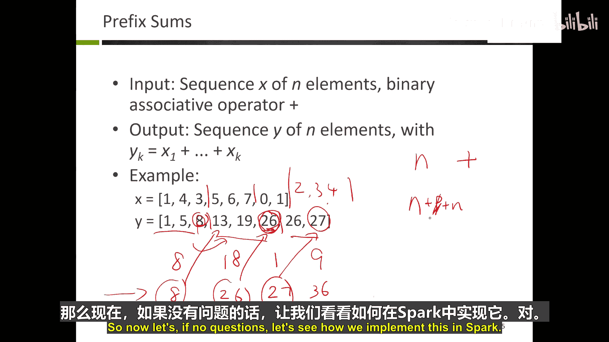
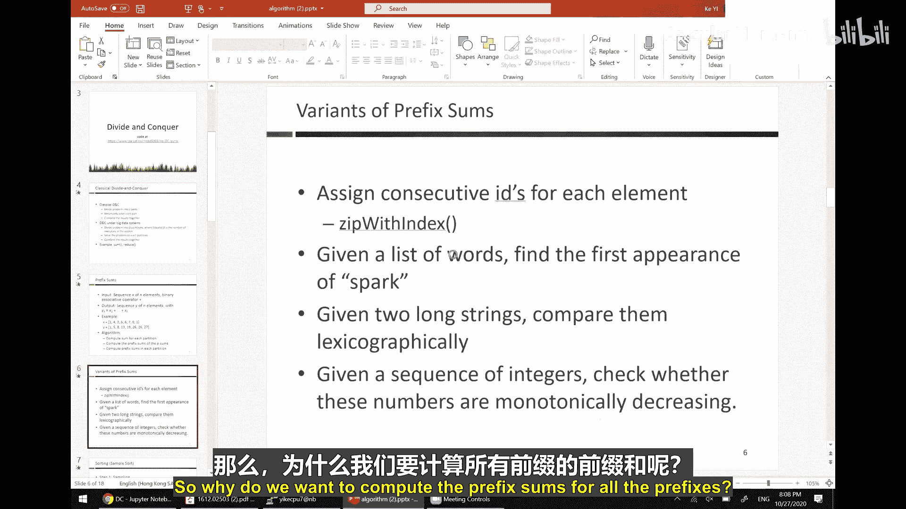
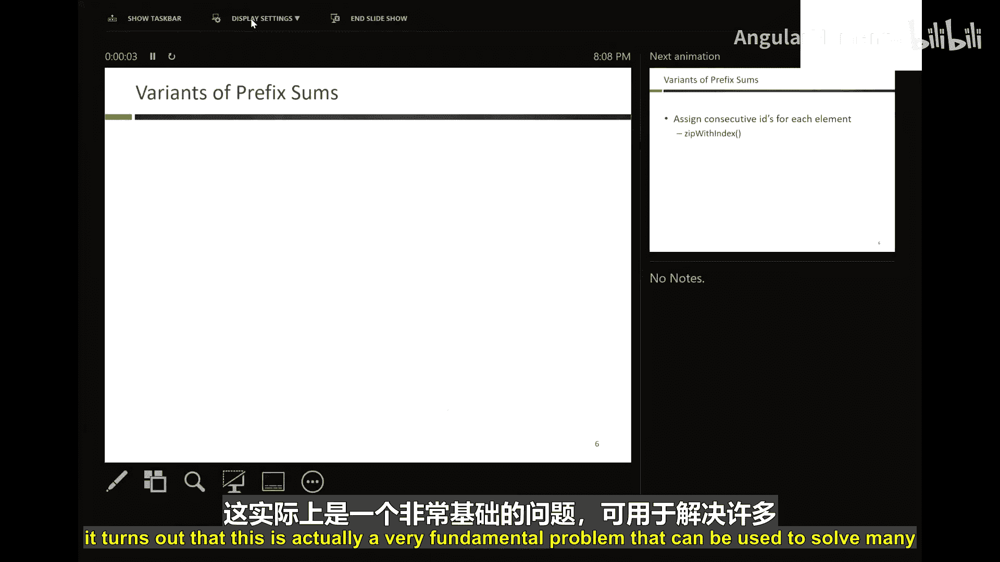
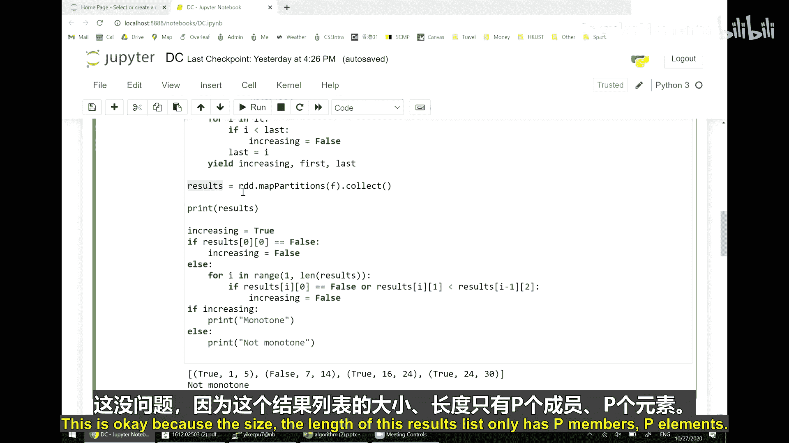

# 【香港科技大学】基于Spark的大数据计算--Big-Data-Computing-with-Spark-p14-07-01-03-令人尴尬的并行问题--BV1V8FmzuEHf_p14-

This topic， with design， I will cover three different kinds of techniques based on divine conquer graph and streaming algorithm and streaming algorithm。

 because they depending on the type of data we are dealing with different techniques are are needed。

 Okay， so essentially， divine conquer， we're gonna need this technique for data that is stored in RDD right or or the data frame。

Graph algorithms， essentially we dealing with graph data because， you know， if the data， if the。

 if we are dealing with a graph problem， it's not so easy to divide a graph into two pieces。 Okay。

 so this graph algorithm call for different techniques。 And finally。

 we will discuss streaming algorithms， of course， well discuss that after we together with spark spark streaming。

 which is a streaming component of spark。 similar for graph algorithms， we need some more tools。

 in particular， we will be need， we will be needing graph frame， Okay。

 graph frame is a third party package for spark， is not incorporate into spark yet， but it's always。

 is always available。 It's actually better than graph X。

 which is the sparks native library for graph computation。😊，And we will go， we will。

 we will discuss more more details when we， when we go there， okay。Alright， so so in fact。

 we have already seen many examples of algorithms。 we have， we have done like things like word count。

 you know， K means paid rank。 These are all algorithms， however。

 so these algorithms or more or these problems are those that we call embarrassingly parallel。 Okay。

 which essentially means that。It'll be embarrassing if you don't know how to parallelize them because they are very easy to parallelize。

 essentially， if you look at， for example， K means， so we are。

 we can decompose the algorithm into many independent tasks where we have one task for each point and the and the task for this point in iteration is merely finding near neighbor right among the K centers because K is small every task is very small。

 Okay， so we have many， many independent problems and one problem。

 one independent problem for each item for each item in our data set。

 So so these problems are very easy to parallelize。 Okay。

 so we have seen we have seen we when we have done we have done many of them。😊，So， however， today。

 we're gonna see some problems that are not so easy to parallel， at least not so obvious。 Okay， so。

 in fact， there is a huge literature on parallel algorithms from both theory to practice。 In fact。

 the history of parallel algorithms go back to the early 80s。 So， in fact。

 parallel algorithms was a very major research direction topic in the in the 80s and early 90s。 Okay。

 and however。This topic somehow died out。 Okay， and they gave way to distribute algorithms。 Okay。

 so there is actually very technical and subtle difference between parallel algorithms and distribution algorithms。

 both。Involve some sense of parallelism。 However， the fine difference between the two kinds of algorithm is that。

 you know， though there's no clear separation between the two is sometimes can be considered subjective。

 However， a broad speaking parallel algorithms are those that are designed for what are called tightly coupled。

 tightly coupled architectures， things like GPU。 You have many cores that are share a common memory or multi system where you have multi cores that share have a shared system。

 and， and these。Many core on GPU or not or multi cores and on same CPU， they。

 they have very similar run run run speeds。 In fact， in in in the， if you look at the earliest。

Parallel model of computation， which is known as P ran or parallel run。 So this in this model。

 it is assumed that all the processors will run in in in in the completely synchronous fashion in lock step。

 so namely in time step1， every processor can perform one job， one uniform computation。

 And then in next step and all， all steps will perform the next computation。 So， so， so。

 so this is known as a tightly coupled architecture。😊，On the other hand。

D algorithms are designed for loosely coupled architectures， things like the Internet， for example。

 or a you know， a wireless wireless network where there is substantial delay in terms of communicate in terms in terms of sending packages and more importantly。

 on these processors may run have very different speeds。 Okay。

 this is partly caused by the heterogeneous nature of the environment。

 the computing speeds in the individual processors as well as the delay or the latency communication。

 because because if for example， in a wireless environment or on the Internet。

 So the the point to part communication the delay may differ a lot from one processor to another。

 So the PR model where where it is。S that all the processes run in a synchronous fashion。

 So this doesn't hold。 Okay， so， in fact， in a purely distributed computation model， it it is。

 it is not assume at all， the relative speeds of the processes。 So namely。

 there can be an arbitrary delay in。1 in in in one processor and messages may even get lost。 Okay。

 so in， so， so， so in that， in that case， even proving that the algorithm is correct is non trivial。

 Okay， so that's the pure that's that's in that's on the other extreme of， of， of， of the spectrum。

Okay， however， as technology evolves， especially with the introduction of the map reduce framework。

 Had doop and Spark， it is has been realized that， okay。

 so neither extreme can capture the reality very well。 So the reality for example。

 for the big data environment is a a cluster of machines。

 right and where each machine may have multiple processors and multiple each processor may have multiple course。

 this is not entirely tightly coupled， because， you know， we are indeed talking about。

Different machines that are that communicate， which is。

 which is other through through possibly Internet。There is not entirely loosely coupled either。

 right， because， you know。All the machines sit in one warehouse in the data center。

 So there is some kind of guarantee in terms of the communication delay。

 So its somewhere between the tightly coupled model and loosely coupled model。 So。

 so the distinction between parallel algorithms and algorithm also start to be blurry。

 so therefore when people talk about parallel distributed table tend to use these two words exchange interchangeably So so so so when we say when we when you say parallel algorithm algorithms。

 you know， we don't really emphasize the the distinction between the two So essentially we are talking about a hybrid model somewhere in between tightlyd model and loose model。

 So essentially this model essentially is what reduce or spark is is working under So we are。

On the on on a closer level， on on a higher granularity。

 they are synchronized right between each rounds of macroreuce， things are synchronized in in spark。

 this correspond to the stages， we talk about last time if remember， at the end of stage。

 the stage is defined by a y dependency So which correspond to a shuffle。

 when we reach a shle applications the one stage finishes and all the process all all the tasks have to finish before we can declare that this stage is done and the next stage can start So if you look at the stage level or if you if you are talking about macro。

 every round macro reduce， they are synchronized。 so on on on a higher level of granularity。

 things are synchronized， however， if you go one level below。 if you look look。😊，To one stage。

Every petition will be handled by one worker。And all these partitions are done in a pipeline fashion。

 independently。Right， so so， in fact， we， we mentioned that the number of tasks should be more than the number of number of workers so that。

 you know， the scheduler can schedule tasks to the processors at run time， dynamic。

 depending on how fast the processors are。 so fast processor may be able to process more tasks than the slower workers。

 So essentially if you look into the stage then think the things are not synchronized And the the processor can run at their own speeds and faster workers can do more work。

 Okay， so essentially， this is a hybrid model between parallel and and and algorithm。

So this also actually calls for new ideas in algorithm design。 So the。

 so neither the techniques for pure parallel algorithms or pure digital digital algorithms are completely。

App applicable， however， many ideas that people developed。

 Okay from either the parallel world or digital the world。

 then there can still be use here after some modification which and we will see many of examples today。

Okay， so。You know， well， if you have a major in computer science。

 you should be quite familiar with this technical divine conquer。 And this is very。

 this is one of the very basic commonly used algorithm design techniques。

 Okay so the classical example is is probably merge sort Okay merge sort or quick sort quick sort。

 there are both examples of conquer。 So let's talk about merge sort merge sort first right in merge sort。

 we have an array we want to sorted in classical divine conquer in every step in the of recurt。 know。

 we divide array into two parts in twos equals。 And then we we recursively solved the problem on each half。

 So here the problem sorting。 So we recursively sort each half。

 So at the end of So after the two sub problems have been solved we have sorted each half。

 right So now we have two。😊，sorted runs。 and we need to， we need to merge them together。

 so that's correspond to the last step combined two results together。

 which in the case of merge sort is a merging is the merging algorithm we have two sorted runs。

 We merge them into one sort run。 So the algorithm is is actually pretty easy， right。

 you have a pointer pointing to the current smallest element from the two runs and every step you compare to an output smaller one and the advanced pointer。

 So this combined step can be done in linear time。 Okay。

 so if the con step can be done in linear time。 then name the of n time。

 then whole recur will give you a。Total time of en log。 Okay en log。

 So this is a classical divine conquer。 So however， if we do this。

If you use this classical device conquer， this is not very efficient for a big data system。

 so essentially， it will lead to log levels of of recurt。And， and， and the bottleneck essentially in。

 is in the third step。 right， So if you still think about this， if you， if you plan to， let's say。

 implement merge sort， Okay， let's say using spark or for any cluster computationation。Then okay。

 the the the。After， you know， having sorted two halves， how do you merge them into one。Well。

 this merging can only be done by one worker because the merging algorithm is inherently sequential。

 right So if you look， if you record the algorithm， we have two pointers right pointing。

 have two pointers pointing to the smallest element of the two runs。

 Every time we compare the two I the smaller one advanced pointer。

 And then we compare the next one and etc cetera。 until we reach the end。

 So this is a sequential algorithm， This can be you can only you can only use the one processor to do this job。

 The other P- one processors will sit idle。 Okay， so you we cannot make use of this all the processor available。

 So therefore， as a result。If you call， let's say sort by key or sort by anything。 right， So in Spk。

 this is available。 That's the Spk sorting method。They are not using more sort。

 Okay is said exactly because of because of this this reason。

 Mo sort is a classical is a binary divine and conquer algorithm。

 This is not efficient for a big data system where you have。

P processes where P can be much larger than two。 so well， if you only have， you know， one process。

 one or two processes， this may be okay， but you know， you have a lot of them， this is。

The system utilization will will be very low。Okay， so in order to make use of all the P processors。

 we should not use binary conquer。 We should use a multi way divine conquers。

 namely in the first in the in the even starting from division step。 Okay。

 in the first step then conquer， we divide the problem into P pieces。 Okay。

 where P is equal to the number of workers in our system。 So it's not a binary conquer。 Okay。

 by dividing the problem into many pieces we can increase the the utilization of the whole system。

However， for algorithm like merge sort， although dividing an array into P that's a trivial。

 you can just divide it evenly。The hard， the hard part is how to combine。 Now。

 instead of only two sorted runs at the end of the sub problems， we have P sorted runs。

 and we need to merge P sorted runs into one single output。Output sorted sequence。

 How to do this using many processes in parallel。 This is not easy。 Okay， so， so。

 so this is why more sort is not used in Sp。 Okay or or how do okay， instead。

 a multi way divine con version of quick sort is used。

 and we will talk about that algorithm later later today。呃 okay啊。

So we're actually jumping ahead a little bit。 They sorting exactly one of the difficult problems。

 you know， to， to difficult algorithms to to parallelize for the B data system。

 some simpleer examples。 So like some or reduced。 this can be easily done， using multi way conquer。

 And for example， if we do some， for example， both RDD and data frame has this function。 has this。

Method， and by the way， both some and reduce their actions because they， they。

 they return something to to the user in the case of thumb is the sum of all the elements in your in your RDD。

 So how does when you call， when you call some， how does spark compute the sum。Spark doesn't。

 you know， of course， doesn't compute the sum by sequentially adding elements together。

 That will be too slow。 Instead， it ask， it it partitions the RDD interpretationitions， right。

 So that's always has as how RD is is stored。Anyway。

 and then what it does is it gives one partition to one processor and that processor will compute the sum for that partition。

 so compute the sums on the partition level first。And then。The worker， after computing the sum。

 the local sum of all elements in its own partition。

 it will send this partialel sum to the master node。And master node。 then we'll add them together。

 Okay， so this is done internally by spark。 You don't have you you cannot see the process。

 but this is how it done。 Okay， similarly if I reduce this simple， you know。

 multi way event conquer can be used to compute reduce。 And， of course。

 this achieves the perfect parallelism。😊，Okay。So next。

 we're gonna see a a more example that is less obvious。 how to parallelize it。 So namely prefi sum。

 Okay， so computing a single sum that's easy。 that's very easy to do with multi and conquer。

 how do we do that， So the essentially， if you look at the problem。

When when we when you first look at the problem， this problem seems to be a made up problem that is designed to screw up。

 Okay， to force you into using the sequential algorithm， okay。

So the prefix sum problem is defined as follows。 The input is an array。 Okay。

 lets you can imagine that this array is stored in RDD and the output is also array。 Okay。

 of the same size as the input the output elements in the output array in this case is y are defined as the as the name suggests as the prefix sums of the input array。

 So namely y 1 So y1 is the same as x1， y2 is x1 plus x2。

 y3 is x1 plus x2 plus x3 and so on so forth。 So every y every element in the y array is this prefix sum of the first k elements。

 So of course， you know， in the classical model of computation。 if you are programming this on your。

😊，Laptop， let's say using Python， This is easy。 Its trivial。 You just compute this pre sum1 by one。

 Its a is's a trivial linear time algorithm。However， this algorithm is inherently sequential。

 You cannot run this If you run this in spark then this。At any time。

 only one you can only make use of make use of one worker。 so the good question is。

 how do we parallelize this， this problem。で thisあけの。Okay。So， of course。

 we want to use a multiway divine conquer。So the idea is the following， right， we， we。

 we want to divide the。 Let's see， let's， let's use this again， use this example。 simple example。

 Suppose we have。For simplicity， have three partitions， and they are partitioned in this way。 Okay。

 the first two partitions have three elements。 and last one has two elements， Okay， so。So naturally。

 we we also partition the output array Okay in the same fashion，3，3，2。 Okay， However。

 the goal is to compute all these perfect sums in parallel， making use of all the processor。

 processor available okay。😊，Well， for the first part is easy， right。

 The first part doesn't have to wait。 The first part can start immediately。

 We can you can write a call to just run the sequential algorithm。 right to compute the first。

 at least the first three， first three pre sums can be computed easily by the by one worker by the first worker in the inner time。

 sequentially， that's that's no problem。 However， if we run the sequential algorithm。

 then the second worker has to wait until the first worker is done because 13 is 13。

 supposedly is 8 plus 5 right you add 5 to the last pre sum of the first worker。

 right you have to wait until the first worker is done okay。😊，However， the。Idea is， okay。

 we should let worker to start as soon as possible。 Okay So therefore， so。

We're gonna ask the first worker to compute 8。As soon as possible and then send this partial sum。

 this local sum 8 to the second worker， okay。So that's the worker， too can start。

As early as possible， okay。How about worker3， worker 3 needs this thing。 Okay， this is， this thing。

26。 Okay， so it seems that we still， we still have to wait until worker 2 is done。

 Walker 2 has to wait until worker 1 has computed 8 is number 8。Okay，However。

 the observation is that， okay， this what is this 26。 Well。

26 is nothing but the sum of all numbers in the first two partitions in the first two partitions。

 So if we can somehow compute this sum， this 26， as early as possible， then worker 3 can also start。

 Okay， So， so therefore， the idea of the algorithm is to divide this process into two steps。

 In step 1， we're gonna compute。Okay we， we're gonna compute these numbers。 Okay。

 this a 26 so that all the workers can start computing their own pre sums as early as possible。 Okay。

 and in in the second step， we compute pre preface sums within each partition。

The second step is easy。 How do we do the first step quickly。Well the idea is you don't have to wait。

 Okay， this， for example， to compute 26。You okay， so yeah， okay， so let's just add another。

 add another partition2， let's say 2，2，3，4。 Okay， and then we also need to compute27。 Okay。

 so these three sums， where 8 is all numbers in the first partition。

26 all numbers in the second part in the first two partition and 20 say。

27 is the sum of the first three per partitions。 So the idea is， okay， in step 1。

 we first ask each worker to compute the sum of its partition。 so namely。

 we are first compute the first worker computes 8， which is the sum of the all numbers in the first partition and the second worker compute the sum of5。

6 and 7s， which is 18 okay。😊，And then worker 3 will compute one。 Okay。

 And the last one doesn't really matter。 we don't really need it。 But anyway。

 it's for the sake of completeness。 let's say this is， this is 9， okay。

So I first compute the partition sum， like the sum of each partition。 this。

 all of these problems are independent， right so they can be done easily。😊。

And then I gonna I'm gonna ask these。Workers to send their local sums to the their partition sums to the master node。

 to the master node。After having， after after having obtained these four partition sums。

 then the master node can compute the prefi sums on the partition level。 So namely。

 it computes 8 and a plus。😊，8818 is 26， and then 26，26 plus1 is 27。 and then 27 plus 9 is  36， okay。

So that for this。Prefix custom， prefix some computation。 I'm gonna just use a sequential algorithm。

 why， because there are only P of them。 I where P is number pro。 P Well is at most a few hundred。 so。

 so that's okay。 and this can be done by the master node okay。And then， I'm gonna。

Send this8 to the second worker。 so that second worker can start is prefi sum computation。

 I send 26 to the third worker and send 27 to the last worker。

 and then and then in the in the in the next step， Each worker can compute the prefi sums。

 in their own partition。 They are all in parallel。So if you look at this algorithm， you know。

 compare with the sequential algorithm。 We are indeed doing more work。 It's roughly double the work。

 because if you look at the。Nowive secret algorithm。 we， we perform roughly in。Additions。

 more precisely in in my san additions。In this algorithm， we have two steps right， in the first step。

Every partition， we compute the sum of every partition that require roughly an additions。

And then I compute the and compute this。 I compute these per。The perfect sum on the partition level。

 that's roughly P P minus-1 partitions。Well so that's P partitions。And in the net， in the last step。

 I compute the pre sums within each partition。 That's another roughly and partition。 piece is small。

 so we can ignore that。 So roughly the amount of work compared with previously is twice as many。

 So we， we do twice we we double the work。 However， now the new algorithm is， is highly parallel。

 we can make use of all the all the computing resources。O。So any questions about the algorithm。Okay。

So now let's if no questions， let's see how we implement this in Spark。

Right， how however， because this is we will we will know we don't want to modify the source code of spark。

 right if you if if if if the developers， Okay， or if developer want want to support this， you know。

 natively， they they can actually implement it， they can modify the source code and implement this algorithm using both the master node and and worker node。

 however， as if we want if we as a user want to implement a new algorithm that is not available and without modifying the source code。

 we have no control over the master node。 and master node is controlled by the system。 as a user。

 we have no control。 However， we do what we have control is the driver program。

 So so we can use the driver program to。To take the role of master node。

 And then we can still implement this algorithm， although we don't have control over the master node。

Okay and this is how we do it。Okay。😊，Alright， so we're gonna do is using RDD because yeah。

 So this is actually the actually， for many low level algorithms， it's easier。

 still easier to use RDD， okay。So we're gonna need this math partitions because here we want to do something on the partition level。

 So for any， for any task that involves work involves。Some computation on the part level。

 we need this function， map or map part was index。嗯。Okay， so remember。

 the first step in the algorithm is to compute the partition sums。

 namely the sum of Lms in each partition。 for that， we can simply use a map partition。 Okay。

 map partition more precisely this function expects a user defined function F and the user defined function F must have the following signature。

 the input parameter is itertor that gives us the entry point to elements in each partition。

 And then it returns returns another list。 However， in this case， the output list is just one sum。

 right So we just yield the sum。 But anyway， you have to use yield okay。😊，And then。Okay。

 let's run the first step。 run the first step first。 Okay， to get idea， okay。So， we have。8 elements。

8 elements， right， So we have four partitions。 So every partition has four two elements。

 So after the this step， we have computed the。Partition sums， 5，8， Yeah，5，8，13 and1。 Okay。

 by map map partitions。Okay， so now I'm going to essentially simulate going be simulating the master worker。

 the master， the master's work， so here we just do it here remember everything you do here in your Python program。

Is done by the driver program。 Okay， so it this is， this is just a standard python。

 right we sequentially compute the perfect sums on the partition level。 Okay， this is okay， because。

There are not many too many partitions anyway。 Okay。

 so now this is we are re usinging the same array， same list。 sums。 Okay， sums now we are。I add。

Every element to the perfect sum。 Okay， so this will。So after this。

 sums will become the pre sums on the protection level。 Okay， on the part level。Okay， the next。

 the last step is we're going to still use a spark。

 We're going to compute the pre exams within each partition， like within each partition。

How do we do that， We need map partitions with index。

 So why do we need with in this with index version。Because， you know， if。

 because each partition should start with a different prefi sum。 if you look at this， okay。

Because worker， the first worker 0， right start from 0。 worker 1 start from 5。 I know。

 worker2 start from 13， right， and worker 3 start from start not not 13 work。Yeah。

 the start from the pre。 So worker 0， start from 0。 worker 1， start from 5。 worker 2， start from 13。

 right， worker 3， starting start from。26， 26。 Okay， so namely。

 each worker starts from I I better also print this as well， okay。

So after this sum will be the prefim。 So this， I need to send this。Perfect time to worker 0。 Oh no。

 send0 to worker 0， send send 5 to worker 1，13 to worker 2，262 to worker 3，27 is not needed。

何最に totalさん。Okay， so that's why we need map partition with index。

 because we need to know the function G needs to know which partition I'm working on so that I know where to start。

So， yeah， for clarity and declaring this as a global variable， essentially。This global variable。

 this global list sums will be packaged into the enclosure。 still remember that we talked about this。

Previously put into the closure。 and then this will be broadcasted into all workers。

 So every worker has a copy of thumbs。You can also use a broadcast variables。 But yeah， they are。

 they are similar。Okay。Now， if the， so， so when for math partitions was index， the the。

The function G has two parameters。 The first one is the index， the secondwise iterator。

 So from the index， we get to know which partition I'm working on。 So if， if we are working。

 if we are working on partition 0， then starting point 0。 Otherwise。

 the starting point is sums index -1。O。Okay， this is what we discussed。Okay。

 so S will be the starting point。 And then we iteratively add the elements in this partition to S and then yield every individual intermediate result as the pre okay。

 so here yield is inside the four loop。 So this function G will return list。 Okay， actually。

 the size of list is same as the size of output list is the same as input list。 Okay。

 and this will be the output。 Okay， so。😊，This is how we can implement this multi way event conquer for solving this prefix sum problem。

So this looks like a completely made up problem。 So why do we want to compute the pre sounds for all the prefixes。

 Well， it turns out that this is actually a very。

Fundamental problem that can be used to solve many other problems。 Okay。

 so let me just give you some examples。 actually， the first one is actually a special case。 Okay。

 so in R D， there is a method called zip with index。So what does this do， Okay， so this。

 what this does is it will It will So the input is an RD。

 and the output will be a a paired R a paireds So what it does is it will assign a it will assign consecutive Is for each element。

 Okay， so this is actually very common commonly needed task for example。

 you want to add a primary key to alls in your table or for any reason you just want I while the original data has duplicates。

 So you cannot use the original value as their I because they have duplicates。

 you want to assign some new I and so this not only assign unique I。

 but the I are also consecutive namely simply you know， give I0，1，2。

3 other the way to N1 to all elements so this。Sounds like a very trivial task。 however。

 it turns out that the only way to solve this problem is to use perfect sum。 Of course。

 when using perfect sum， the input array X。Con consist of all ones。 Okay， so x is is 1，1，1，1，1，1，1。

 And why the output is 1，2，3，4，5，6，7，8。 Okay， so this is， you know， you don't， in some sense。

 you don't even need the input X， right， because all the integers I want。 you， I just want to。

As assign I D is 1，2，3，4 to the elements in RDD。 However， it turns out there's no easy easier way。

 You just， you can the only way to do it is to run this algorithm。 to run the perfect sum algorithm。

Of course， this algorithm can be simplified because if all the elements in X are 1， you know。

 you don't need to。 the sum of each partition is simply。😊，The size of each partition。 Okay。

 you just compute， you just compute the size of each partition， and and return that。

 And then the remaining steps are the same， okay。So this is one one application。

The second application is， for example， if alreadyD stores。

 essentially anything that has to do with ordering， then it it it it。

 it can be modeled as a prefi sound problem。 So， for example， consider this a problem。

 You are given a list of words and you are asked to find the first appearance of a particular word spark。

 again， you know the。If sequentially， this is a trivial problem。 right。

 you just start from beginning and check every word。 is this spark。

 is this spark is this spark and you stop until you hit the first appearance of this word。 However。

 this is sequential。 This is not， this is not efficient in parallel， how do we do this， Well。

 this looks like nothing related to the perfect time problem However。

 is still can be solved using essentially the same idea。 Okay so namely。

 I first solve the problem for each partition， right， So namely for each partition。

 I find its first appearance of of this word。 or reports。Nothing。

 if the partition has doesn't K where， it returns， you know nothing。

 And then after each I have solved this problem on each partition。

 I send this partial results to the master node and a master node can return the first successful return value。

Okay， so for， for example， if I have four parts，4， four parts。And the the first one may say nothing。

 We know and know。 and And if a part had contains the world， it will return its position。 Okay。

 suppose is its position is somewhere。 I don't know you know， 21。 it is 21 position。

 And then this one is。localally it is2。 And then we can find。

 we can we can just return this position。 So in addition， if you run。

 if we also want the global position。 So in addition to returning。 no， each partition。

 each position should also return the partition size。 I suppose partition size， this is 100。

 and this one is 90。 And then we know that the position of the first appearance of spark is at position211。

Right， okay， yeah。 So we， we add this number and this number and this them together。

 And then we can find the global position of the first appearance。 Okay， so essentially， although it。

 it is， it looks differently from the specific exam problem。

 it can be solved using essentially the same， same idea。😊，Okay。another example is。String comparison。

 okay supposeose we have two very long strings。 Each string is stored in in RDD。

 and we want to compare them likeographically Leographically by likeographically byographic comparison of strings。

 we mean that you know we first compare the first letter if they are different。

 then we can already tell which one is greater， which one is smaller。

 if they are same we we move on to comparing the next Okay but by definition。

 if you can do the comparison by definition， this is a sequential process。 right。

 So in the in the worst case， know， the two strings。

 they are all the same until maybe the very last letter。 in that case。

 you have to wait until your sequential algorithm start from the beginning and reach all the way to the end。

 So that's very slow process。 by using essentially the same idea， we can we can solve this problem。

We first compare the two strings partition by partition。 and then the suppose， again， we have， know。

 let's say four partitions and the results of the partition， there are three cases， you know。

 either they are equal or they are smartuger than or。你鬼似的。Okay。

 so these are the partial comparison results。 And we send this partial comparison results to the master node and the master node。

What what the master knows should do is， you know just。Return the first non equal result。 right。

 so namely， we solve the problem on the partition level。The last example is monotonity checking。

 We are given a string， a sequence of integers。 we want to check whether these numbers are monotonically。

 let's say， decreasing or increasing whatever， okay。

 so namely whether they are strictly are are they are decreasing over a sequence。So how do we。

How do we do this using divine conquer？ Well， this is not exactly a perfect sign problem。

 but it can be solved using this multi way divine conquer idea。 So namely， we can we。

 we divide them into。And let's say parts， I first check whether this。

Sequence is monotton within each partition。 if there's any violation within each partition。

 then we can already tell we can already， we can already detect that。 However， you know。

 there are this boundary cases that cannot be detected by a partition level by a partition level。

 I know， we have to So in next step。 This essentially correspond to the combined step。

 combined step in divine conquer， right we we compare this boundary。Elements and check。

 making sure that that that they are also monitor。 Okay。

 and I actually have code for this last example okay。

Just to image to give an idea of how to actually do it in Spk。Okay， so there's mono monotononicity。

 monoton say checking。So this is actually slightly more complicated because， no。

 if you think about it， how， how， how can we implement this。Easily in spark。 so， so， so essentially。

 for every partition， we should not just ask monoonicity checking because we also need to check the boundaries elements in the next step。

 So essentially， we're gonna need each。Worker to give us。3 results。 namely first。

 you tell me whether。Whether whether numbers inside the partition， they are monitorton or not。 Okay。

 they may be the local result of this problem on the partition。Second。

 you need to tell me you need to return the boundary elements so that I can later do my checking on on the on the next level。

 Of course， you can do this separately。 However， it's gonna not。

 it's not gonna be very efficient because we can actually combine the tools。

 two stuff in India combine the。Combs two steps into one。 and we only run one map partition， okay。

Okay， so this is how I implemented this。😊，Still use map partitions with the user different function F。

 So inside this F， I need to remember。 I need to return to3，3 things。 In the end。 This is a bulling。

 indicating whether。嗯。🤢，Items are monitor or not within the partition。

 as well as the first and the last element。 Okay， we're gonna do， we're gonna。

 we're gonna find all three answers。 We within one pass over the list。 Okay， so this is。

 this is more efficient。 Of course， you can do this using two passes， but it's not。

 but it's better to combine them into one okay。Well， the first element is it， is， is it。

 The first element is simply the first element in the list in the pointed by this iterator。

 So first is simply the first element in the iterator。

And then I initialize last to be the same as first。 I increase this bullying is initialized to true。

 okay。And then， and then I'm gonna go through the iterator because I have already caught next once on it on the iterator。

 So when you when， when we start this loop， I will start from the second one。 Okay， second one。

 I T is the iterator。In牌上。Okay， and so if I is greater small than less。

 So that means we are violating the monitor property。 So I said this too false okay。

I cannot break because I， I still need to read find the last one。 So I continue the loop and。

 and reassign last reassign I to last。 Okay， so when the loop finishes last will be indeed the last element in the iterator okay。

Okay。And then I return the three， three results。 Okay， so that's the essentially the device step。

And the combined stuff is， is， is done here。嗯。So first， I collect the results。

 The results is a list of triples， a list of list of triples， a list of triples。嗯。So need。

 I need to go through the list and check any， any， any increasing any。

 any of his bullolean variable is false。 If anyone is false， then the whole thing is false。Okay。

And meanwhile， I need to check whether for every two adjacent partitions， whether the。

Last element in the private partition is smaller than the first element in the next partition。

So so that's why I have this the boundary case， because the first partition 0 iss nothing to check。

 So I only need to check this bulloleing variable。Starting from the second one， namely。

Protition number one， I compare。 I first check whether it is， is locally monot or not。 or and。

 and the， meanwhile， also also check the two boundary elements。

 Okay this I 1 is the first is the first element in protection I and I minus2，1。

2 is the last element in prediction I-1 So if this wireless the condition， I said is too false。Okay。

 and then this is the and this is one illustration。 So at the end of the first step， the results。

Are a list of triples。 Okay， the first one indicates whether they are monitor or not internally。

 Okay， the first one is true， right。Yeah， this is。14 numbers。 So this is true。 Okay。

 and this one is false。 so false and true， true。 And meanwhile， it returns the。1，5。

 the first and last 7，14，7，14。Et cetera， okay。So the combined step is entirely done by the driver program。

 This is okay because this， the， the， the size， the length of this results list。Only has P P members。

 P evidence。

