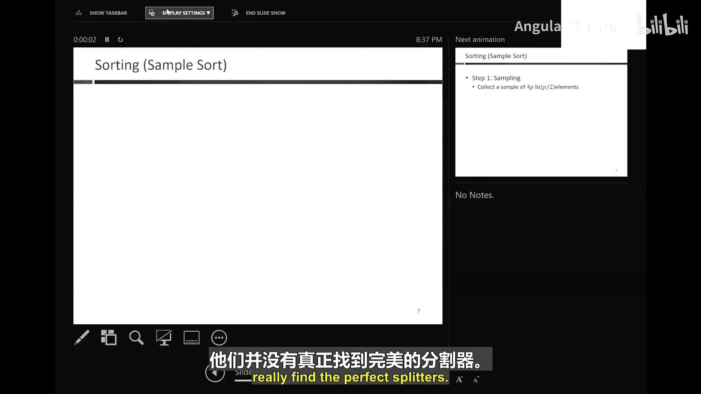
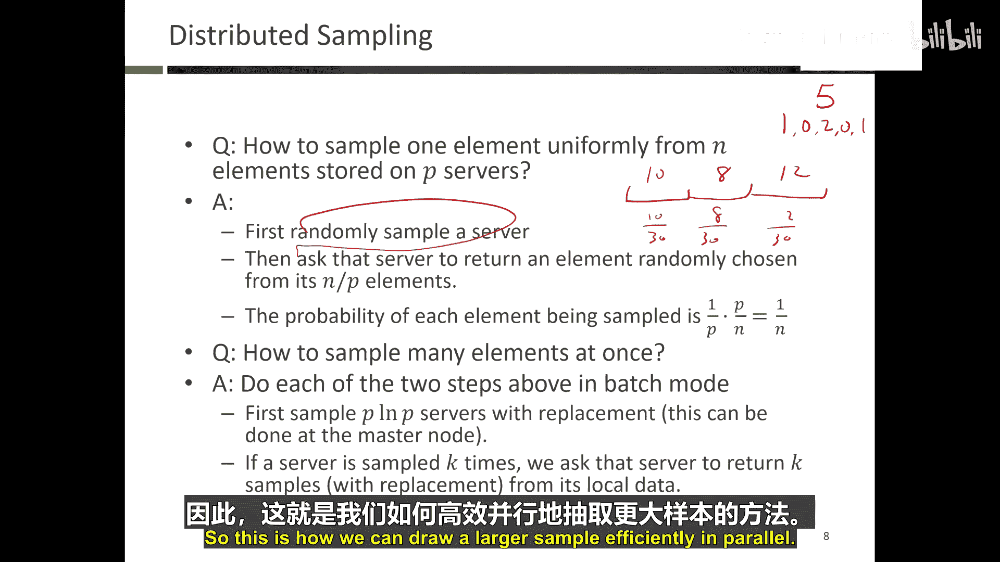

# 【香港科技大学】基于Spark的大数据计算--Big-Data-Computing-with-Spark-p15-07-02-02-样本排序--BV1V8FmzuEHf_p15-

Okay。So， yeah， so now it's time to talk about sorting。 Okay， so how do we sort an RDD。

 So which is a very。Basic algorithm。 Okay， so the as mentioned。M sort is not so easy to parallelize。

 to use multiway divine conquer to do merge sorting， however， quick sort， as we will see is easier。

 Okay， if you still remember I don't know if you remember， remember how quick sort works。

 in quick sort， we randomly pick element right， and which is used as splitter right and then we compare every element with splitter。

 which splits array into two parts and the smaller those smaller than splitter will put into the left subre the left subproble and elements greater than splitter will put into the right sub problemble。

 And then we recursively sort is two array。 So that's how quick sort works。

 Okay So compare with more sort， the division step is not perfectly balanced in more sort。

 the dividing step is always perfect。Because we can divide the array because in in most sort。

 we don't care about the order in the divide in the in the division step。

 then we we combine them later。 In quick sort， However， the split is actually random。 it may you。

 if you are， if you have bad luck， your splitter happens to be the smallest element。 right。

 then your partition is very unbalanced。 You have nothing on the left hand side。

 everything on the right hand side。 Okay， however， there is some good good analysis showing that on average or in expectationation the total cost of the algorithm is still just in log in。

 So intuitively it means that right if your splitter is not too bad。May not be the best。 right。

 The best splitter is the medium that split arranged to equal hs。 But if suppose it's not that good。

 but it's not that by bad either。 the splitter is somewhere， you know， somewhere。

Your splitter split array somehow here。 So it is， is a 25，75% split。 Okay， so this is May。

 this is a average quality splitter。 Okay， so in that case， of course， this is not。

 this is not perfectly balanced。 However， however， when we you continue to do this kind of split。

 this  one，2，3 splits， then the total number recurion level is still log n， right。

 although it is not log2， but it log base for over3 n。😊，So the， you。

 you're gonna have more levels that， you know， only larger bycon factor。 So this is， of course。

 I will not have time to do the formal proof this is beyond the scope of of this course。

 But intuitive， this is the reason， intuition in this reason why， you know。

 quick sort still works well on average。 Okay， on average。

 assuming that the splitters are randomly chosen。Okay。However， for this。

The the fact that Microsoftsot works well on average， crucially relies on the fact that。

We will do this。Many times。 we're gonna， we're gonna pick splitters rhythm into two hals and then recur recursively solve the problem until I have just one element left。

 Okay， so this that relies on the fact that we are doing this many times。

 we are picking many splitters。 Okay， however， if for， for multi way divine conquer。

 we cannot simply put pick one splitter remember in multi way conquer ideally。 So okay， so yeah。

 suppose。Somehow magically， we can pick P1 perfect splitters by perfect splitters。 we mean that。

 okay， suppose this is my RD。😊，After using this P-1 splitters， I can split。Okay， this my RD into。

 in this case， five equal pieces。ok。First， suppose that I have。

 I have these four splitters somehow chosen magically。 Okay， if I have these splitters。

 then I can sort the RDD very easily， how。I first broadcast these force glitters to all the workers。

 Okay， so namely， say this。so啊。Okay， so this， this is the RDD before sorting。

 So this RDD is is is unsorted。 So namely， there's no ordering between elements within one prediction。

 no ordering for elements for from different predictions， right， theres no order at all。

 I broadcast this four magic splits to other worker node。 So every。

 every worker will have these force splits。ok。And then， what。I ask each worker to do。 Yes， okay。

 for example， worker number 0， worker number 0 will compare every element in the partition。 Okay。

 with this first splitters。 Okay， and decide and find the two split okay。

 the first splitters need to be sorted。 Okay， this can be easily done。 Okay， let's suppose this。

 the first element falls between the first and the second splitter。 okay。

Then the worker knows that this， this element should go to。

Partition number one in the sorted in the sorted RD okay。Suppose it as an example。

 suppose this element。Is greater than all false filters Then then this。

 then the worker knows that this element should go to。Partition number 4 right in the sorted R。

So essentially， by comparing a element with the false bers， the worker knows its target。

 is destination， where I should go。And then after finding the destination for every element。

It's just a shuffle。 You just a shuffle。 We use the shuffle。

A our our operation to route all elements to their target。Okay。

Because we assumed that these four magic sulators are perfect， namely every partition in a target RD。

 they have equal size。 So so so this is， so this this results in a balanced partition。

 So every worker will have the same amount of work。😊，In the in the in in the last step。

After shuffling， every worker simply sorts the elements。ok。Internally， inside the petition。

And then the entire RDD will be sorted。 Okay， so essentially。

 it is a very degeneative version of quick sort， where we only have one level of recur。

 We in quick sort， we have many levels level of recur here， we just want have one level。

 assuming we have this magic status。 Okay， after one level of device conquer。 Then we have。

 we can sort the whole， the whole array， okay。😊，Alright， so now the， of course， key question。

 key question is， how do we find these magic splitters So well remember that we want them to be splitting the array R into equal pieces。

 So essentially， we want this to be， we want the first one to be， in this case is the， you know。

 the 20 percentile， right， the 40 percentile。 And this is 6 percentile and 80 percentile。 We。

 we need this percentiles。😊，How do we find the percent house？We can sort， of course。

 but then we are going back to the same problem。 We we cannot make any。

 we will not be making any progress。 So we have to find this percentile without sorting。 Okay。

 this is。Not so easy， right， This， this actually doesn't。 is not I it not any easier than sorting。

 So it seems that we are still back to square one。 We haven't。 We haven't really made any progress。

Well， however， the crucial observation is that， well。We don't need perfect splitters。

 It is okay for the splitters to be slightly off。 For example， it's okay for this to be maybe 18%。

 And this one maybe a 41%。 And this one is 61， is 61。And this one is， I don't know。 it's 78， So it's。

 it's， it's， it's maybe slightly off。 Okay， so what， what are the consequences for if。

 if they are slightly off。Well， nothing， nothing too serious， right， In the end。

 we have an RDD that is not perfectly balanced。But that's okay。

 right as long as they are not too unbalanced。Okay， so this is actually why we saw last time， right。

 last time internally， we talk about internals of spark。😊，We。

 we talk about hash partitioning and range partitioning。 right If for hash partitioning。

 we know exactly how how how it works。 It uses the hash code mod K。 and then we can， and。

 and spark actually follow that rule strictly strictly。

 and we can when we we know exactly what kind of items can be found for any given partition。However。

 for root parting。You know if you still remember the sorting is after the sort by key。

 you can see that。呃。Right， so， so。I have this already have。10 10 elements and four partitions。

And the first protection has three elements，2，2 and one。 Okay， so if this。

 this is not properly balanced， right， because we can make things better， right。

 Because for perfectly balanced protectioning the protection sizes should differ by at most one if if things are perfectly balanced。

 we could we， we should， you know。We should have four partitions。 each of 2。 But now is 3，2，2，1。

 Okay， and the reason why we have not， we don't have perfect balance balance is exactly due to the sorting algorithm being used by spark。

 so we don't have。We don't have。 We have， they。你。They， they don't really。

Really find the perfect splitters， okay。Okay， so now we， we know that， you know。

 perfect balance is not necessary anyway。 Okay， as we can already， we can verify from the example。

 So this means that we can use a different approach to find the splitters。 And this is by sampling。

 Okay， and this is why the sorting algorithm is also called sample sort。 Okay。

 so it's actually a generalization of quick sort。

Allright。However， okay， so we are actually not quite done yet because naive sampling doesn't really work out It's not that good。

 because。Because， you know， let's say if you have， let's just。Consider a concrete example。

 Suppose I have lets say，1000。Elements in my R TD。 And I want to pick nice glitterers。 Okay。

 I want to per into 10 pieces。If I simply sample nice splitters at random。Then actually， if you。

 there are some very nice analysis， it shows that actually， with high probability。

 two splitters will be very close。😊，Well， if you look at any， if you look at an the with nice b。

 we have。10 gaps， right if you look at average length of any gap。Of course， on average。

 it should be some it should be 100。 Okay， the gap， however。

It can be shown that with high probability， smallest gap。Is pretty small。Okay， this you can。

 you if you don't。We believe you can write your write a little Python program and and try it out。

 If you sample 9 elements out of 1000， then the gap， the smallest gap。

 I mean the smallest gap can be very small。 and also， the largest gap can be very large。

 So there is actually formula that the largest gap with higher probability the largest gap is roughly okay。

 suppose I have n elements in total。 I have P partitions。 So on average。The gap is N over P， right。

 And that's also the average protein size， however， with high probability。

The largest gap is under the order of。On the order of。嗯。Yeah， N over P times the log of P。

 So iss a log factor larger than average。Okay，So if you plug in the concrete values， for example。

 be too small， let's say， let's say n is n is a's n is a million。Okay， and P is， let's say， 100。

 okay。Then log T is roughly， you know，7 or 8。 So， so that means the， the largest。

 the largest partition or the， the， the， there's gonna be one worker whose workload。

 whose workload is eight times the average。 Okay， that will become the bottleneck of your algorithm of your computation。

 Okay， and things will become even worse when you have more， when when you have more partitions。

So why do we have this， Why do we have this result？ So this actually follows from a。

Very classical probabilistic game known as balls and beans。 Okay， so what is balls and beans game。

 Okay， suppose， you know， we have。😊，诶。The end beanss。And in both。Okay。

 so I throw these N balls into this N bins。 So we know that， of course， on average， every has one。

1 ball。 However， the largest bin with high probability will have login balls。Okay。

 so theres some nice analysis showing that this actually happened with high poverty。😊，Well。

 more precisely is is log N over log log n。 Okay， so this is the more。

 this is the more precise result。 But anyway， log log n is very small， So we often ignore that。

 So we just say that， you know， if you throw n balls into N bins。

 then very likely the largest bin we have log in balls。 although average is only one。 Okay。

 so so this means that this is this is often used as a。Classical argument saying that， you know。

 when you do low balancing。 this is the boss and beanss game is a very commonly is a very common problem in low balancing because the simplest lowbal in technique is random。

 I just throw my jobs to this workerser randomly， however， this shows that this is not fair。

 right So very likely one worker will have a lot more job than the average worker。

 So this means that this， this is often used as a justification for more sophisticated low balancing strategies。

 You cannot simply do random。 run robin is much better， okay。呃。Okay， however。

 here we cannot use run robin because we don't really have time。

 We don't have the time to find the splitters。 Okay。

 so randomly picking the P splitters or P minus1 splitters doesn't really lead to a good。

 balanced results。 So what we， what do， what do people do。Actually。

 the idea was the idea was motivated by again by quick sort。

 So if you read the literature about quick sort， of course， the。

 the most commonly used version of quick sort is to pick the splitter randomly。😊，However。

 in some optimized version of Quick sort， they don't pick just one splitter。Randomly。

 they actually pick three。 They first pick three spliters， okay， and then。They。

 they choose the middle1 as splitter。So now now you can imagine this is known as the one out of three technique。

 So this results in the more balanced partitioning of the array into two hals。

 So you can imagine why So why this is better， right， So you， you can。

 you can just imagine generating three random numbers between0 and1。

 well and returning the middle one。😊，OkaySo the the distribution of the middle random number。

Out of three， we will have a we will have a distribution that that looks like。This。哎。😊。

It's not precisely normal distribution but similar， It's anoial。 Okay which is similar to normal。

 So that means， well， if you just pick one， if you pick generate one volume number between 0 and1。

 of course， the distribution is is uniform。 the number may land anywhere between 01。 However。

 if you pick three and return the middle1 then if it's more concentrated around 0。5。

 So we essentially the same idea also works also explains why this one out of three techniques is better。

 right in quick sort， they pick three elements， pick  three splits and use the middle 1 and discard the the smallest one and the largest one In fact。

 the same idea used in many many judging by judging。System， for example， you know， in the in the。

 in in Olympia， right in in the in diving competition， they remove right， There are six judges。

 Every judge gives one score。 They remove the two lowest score。 They remove the two high score。

 and then take the average of the middle ones。 So this is considered to be more stable right。

 by remove by removing the outliers。Okay， so finally， coming back to the sorting problem。

 So how do we select these split these splitters in a more stable fashion。

 So the idea is to sample more。 right so similar to quick sort。 instead of sample one， we sample3。

 and then pick one。 we pick middle one。 So here。😊，If you need P1 splitters。You sample more。 Okay。

 so so I'm not gonna。 I't， I don't have to explain this。But anyway。

 this is beyond the scope of this course， anyway， but anyway， that， but anyway， this。

 this actual log factor actually is。Arises from the balls and beanss game。

 like The ball and beans game。 the largest bin has log and balls。

 And then so that means if you want a balance parting， you also need to， you also need to。Okay， yeah。

 So let me say that again。 So for in in the standard balls and beanss game。

I have N ball N beans and N balls， okay。And then if I throw this n balls into this n bins。

 then the highest， the largest bin will have login balls。

 so so is not very balanced because the average is one。 However。

 if I increase number of balls from N to N login， right， So now I have。

More ball than a number beings。Okay， in this case， the average is login， the average login。 However。

 if you have n log n balls thrown into n bins， then you you can show。

 then one can show that with high probability， even the largest bin only has two login balls。

 Okay it's still larger but only larger by effect of two from average。 Okay， so intuitive。

 this means that if you have a small number of balls， only n balls。 And then if。

 if you throw them randomly to the n bins， things are very likely to be unbalanced。However， you。

 if you have a lot of ball， a lot more boss， N times login boss。

Log in times more than the number bins。 and you throw them randomly。 Now。

 the allocation will likely be balanced。 Okay， since this also goes back to some very classical theory in in statistics。

 Okay， so essentially when also is also relate to the， to the to the law of large numbers。

 so essentially when the population increases， then many of the statistical properties will get more stable。

So essentially， this is is， is why is why we sample more elements。O呃。😊，Right， okay， so， so。

 so now after sampling so many elements。 by by the way， this is still a small number because。

 you know， P just a few hundred and P times log P log P times 4， maybe a few thousand。 Okay。

 so we take this sample from the RD。 And then。And then。And then I sort the sample。

 So this is done by the master node the masters node source this P log P。Randomly chosen。Elements。

And the master node will partition the sample perfectly。😊，诶。😊，More precisely， this is， this is。

 this means that we're gonna pick the I times 4 log P over tooth element in the sample as speechs。

 So why， Because I need P partitions。 So I partition these into P P partitions。

 So each partition has four times log P over  two。 So divide this sample size by P。😊，So， namely。

 this splitters。Will partition the sample perfectly in a balanced way。

 And in the hope that if the if this， if this splitters partition the sample perfectly。

 then they can also partition the whole RDD。 Well， not perfectly， but something close。😊，So these。

 then these will be chosen as the splitters， and then they will be broadcast to our machines。

 And then the， as I mentioned earlier and the。Each worker will partition the elements within each partition using the splitters and then you know。

 use a shuffle step to to to route the elements to the target and the claim that the partitions will be balanced more precisely with high probability。

Each part only contains at most four times the average， four times the average。 Okay， so but。

 by the way， this is just a worst correspond。 the， the actual performance。

 the actual distribution is more balanced。And finally， we sort each petition。Okay， finally， another。

 the， the， the， the， the remaining technical issue is how do we actually do the sampling， Okay。

 because we are， if we are just sampling from an array， that's easy。

 If we have a array of size size size size N。 all I have to do is to generate a random index and then just go。

 go there directly。😊，However， here we don't have a array。 We have an RDD， which is partitioned。Well。

 if the partitioning is balanced， then we can also do the sample very easily。 right， Yeah， yeah。

 I just。I I okay， you yeah。Because already is partitioned。 So we， we have to do this by two steps。

 We first randomly sample a server， or I should say sample partition。

And then I will ask that partition to return element randomly chosen from its own elements。

 So this is assuming that all the partitions have each every partition has an over P elements。 Okay。

 and then the probability of each element being sampled will be one over P。

 namely that partition must be sampled。 and then that particular element must be sampled。

 So the the sample will be uniform。 Okay， so this is actually for the case where the partitions areition partitioning is balanced。

 if the partitioning is not balanced。 you need to， we need to do a little bit more。

 So in the first step， we have to do a weighted sampled。 So for for example， if。

If the initial RDD is not perfectly balanced， Okay， the partitioning， for example。

 if it has maybe three partitions， the partition sizes are maybe 10，8 and 12。 Okay， So how do we。

 how do we sample element from this RDD。 I need to first sample a partition。 However， the part。

 the partitions have different sizes。 So what do we do what we should do is to do a weighted sampling first。

 namely I first compute the whole the size of the whole RDD， which is 30。

 right And then with probability 10 over 30。 I pick partition 1。P part 0。 Okay。

 with probability 8 over 30。 I picked part 1 with probability 12 over 30。 I picked part number2。

I use this I use the partition sizes as the weights to do a weighted sampling of the partition。

And then in the next step， suppose， you know， this， this part is sampled。

 Then I pick each of the 12 elements in that part with equal probability。 And then this。

 this will give us give me a uniform， random sample。Okay。However， this is only this can be only。

 this can only be used。For sampling one element。However， for， for for sorting， we need many samples。

 we， we need P log P elements in the sample。 We cannot do this one by one。 This is just too slow。

 So the idea is to do each of the two steps in the batch mode。 Okay， so we we first decide。

We need to first sample this partitions。P log P times or namely， how many samples you need。

 You sample this so many times。But we will not do the second step yet。 So namely。

 we we batch the first step for all the samples together。 Okay， essentially essentially。

 we simulate the first step for every sample。 So now， So， for example， again， using this using this。

 using this example， I have three partitions。Suppose I need， I need， I need five samples， okay。

We cannot do this one by one。 Then this is this is， this is too slow。 This is sequential。

 What I do is first， the master node simulates the first step for all five samples。 namely， Okay。

 for the first sample， I need to decide the partition。

 I still use these as weights to sample the partitions。 Okay， suppose， you know。

 for the first sample， I decide that it should come from partition 1。 So I just write down one。 Okay。

 but I don't。Take。The element。Any particular element yet。 I just write down。 Okay。

 for the first sample， it comes from partition 1。 And then I simulate the process again。 namely， I I。

 I do away the sample from the thick partitions。 And suppose the second partition， the second sample。

 I decide that it must it comes from partition 0。 And for the third one， it comes from 2。

 and then 0 and and1 okay。😊，So namely， I first decide where which petitions should contribute my five samples in this case。

It turns out that， you know， position 0 will contribute  to。 Pro 1 will contribute to。

 Prodition 2 will contribute。1， okay。And then in the next step。

 I'm gonna ask my workers to get me those samples。 Okay。

 so namely worker 0 will be responsible for drawing two samples from position 0。

 worker 1 will be responsible for for drawing two items from position 1 and worker 2 will be responsible for drawing one sample from portion 2。

 And all this can be done in parallel。 Okay， So this is how we can draw a larger sample efficiently in parallel。

