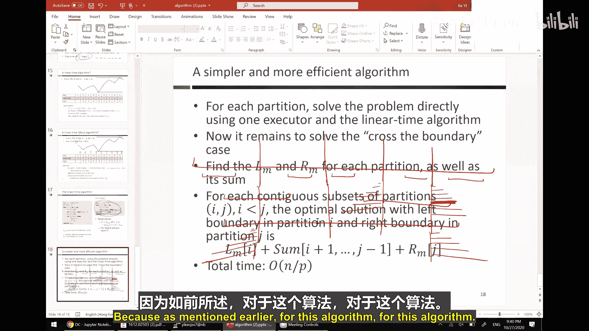
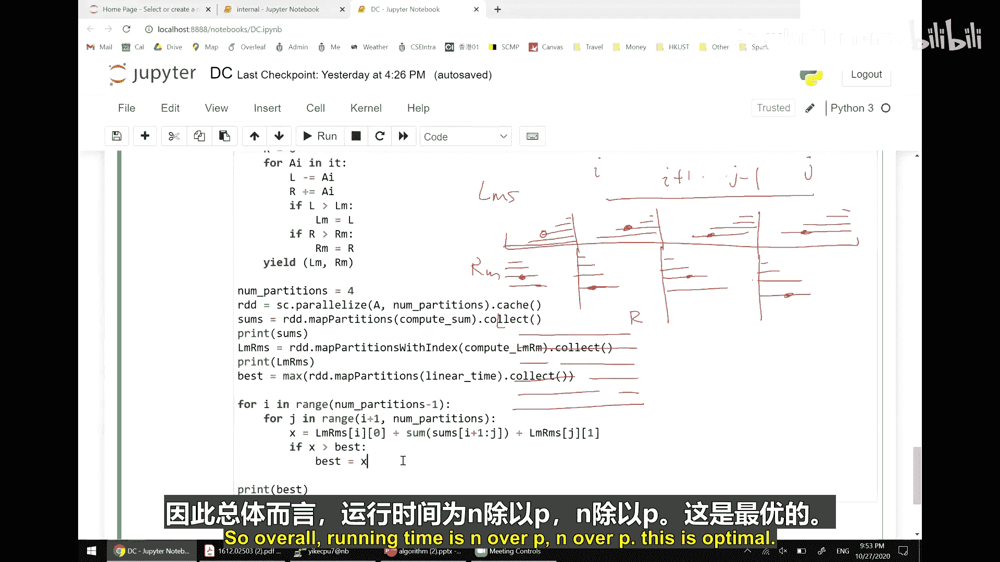

# 【香港科技大学】基于Spark的大数据计算--Big-Data-Computing-with-Spark-p16-07-03-02-A_二分分治算法--BV1V8FmzuEHf_p16-

Alright， so this is the last example of divine conquer。Actually。

 a very classical problem known as maximum sub， okay。So， if you read the。

If you have ever read a book， introduction to algorithms。 So this is exactly the。

The the Bible for algorithm design。 this is the first example they use for， for divine conquer。嗯。

So the setup is the following。 We are given a a ray。Containing both positive and negative numbers。

Okay。So the application scenario is where， you know。

 the these numbers represent the net profit of a company over the years。 Okay。

 this is just one example。And the goal of the problem is to find these。

The span of years in which the company earned the most。Okay， so， of course。

 the the bru force algorithm。For this problem is to。To， to enumerate。All the possible intervals。

 like， for example， for any interval， For example， from 3， from year3 to year 5， I compute the。

 I compute the sum。😊，Then over all the intervals， I find a maximum。 So this is the。

 this is the bru force algorithm。 This algorithm will spend N cube time， right。

 because there are there are N。 there are， there are O N square intervals。

 And for every interval for every sub。 I spend O N time to compute sum。

 So this is O N times N times N， this is。😊，In cube。 Okay， so this is very slow。

 A a small improvement。Of this algorithm is okay， if you compute。2 intervals。

That only if you differ by one element， for example。From 35， we have already compute sum。

 then from 3 to 6， you just need to add one more。 right， So this is actually a perfect sum problem。

 if you， if you can， if you can realize。 So namely， I compute the intervals in the following way。

 namely from I first compute 1，1 and then 1，2， and then 1。

3 all the way to 1 n and this will just I just， this is just the perfect sum problem， right。

 I spend O N time to compute the compute sum for all these intervals。😊，And then I， I do 2，2。

 and then 2，3。And 2，4， and all the way to 2 n。 And they do 3，3， and then 3，4。And all the way to 3 N。

 Okay， so then I only spend constant time for computing the sum of each interval。

 but still I have I have n square intervals。 So the running time is still n squared。Okay。

 so it's not very efficient。Okay。So how do we solve this problem by divine conquer， Okay。

 I first show you how the classical binary divine conquer works。So I divide orura into two halves。

 okay。Recursively solve the problem on each half。So here， by recursively solving each half， I mean。

 I find the interval。 I find the best interval within each half。 So， for example， here。

 in the first half， you know， probably the best interval is just 5，5，5。😊，I think it's just 5，5。

5 to 5。 Okay， So this is a tiny interval。AndIn the second half， the best interval is probably。

 I think this one， Okay， from 6 to 8。So namely。Solve the two star problems。

 I find the optimal solution within each half。Of course。By solving the two sub problems。

 I'm still missing one case， which is， what if the best intervals。Sppans both side problems。 indeed。

 for this particular， on this particular example， the best interval is from 5 to 8。

 So this is the global optimal solution。 right so， but this case is missed。 This case is missed。

 in in this in the two star problems。 Okay， so， so。

 so therefore the third case have to be has handled by the combined。So only to consider K3。So。

 however， the K 3 is actually much easier than the general problem because so if we are。

 if we are told that we only need to consider intervals that cross the cut。

 So that means it must start from somewhere in the left half。

 and it must end as somewhere in the right half in the in the， in the right half。

 So that means if we want to optimize if want to maximize the sum of interval like this。

 we may just as well maximize each half。Because this interval must spend this cut。

 So if we want to maximize whole thing， we should maximize this part。Okay， the this part。

And we maximize this part independently。 Okay， so how do we maximize each part。This is another。

 you know， sub pre sum problem， right， For example， to maximize this part， I compute 5 to 5，4 to 5，3。

2，5，2，2，5，1 to 5。 And then this， I spend linear time computing all these prefi sums。

 And they find the best one。 for the right half， I compute 6 to 6，6 to 7，6， to 8，6， to 9。

 And these four possibilities。😊，Among the four possibilities， I find the best one。

 and then I combine combine the two。 And this will find the option solution for， for the for the for。

 for for the last case。Okay， so yeah， we just maximize this too independently。 and then， and then。

 and then that's it。 Okay， and actually the， the， the， the。

 the pseudo code of the whole algorithm is listed here。 So this is first， I divide problem two hals。

 I P Q is the index of the splitting line。Solve the two helps recursively。

 So M1 is optimal solution from the left。 Sub problem。

 M2 is option solution from the right sub problem。And then I。

 I use the perfect sum to find L M and R M。 What is L M L M is the L M is the left part。

 the best solution。The best interval in the left half and R M is the best solution in the right half。

 okay。How do we find LM and RM Well it this fairly straightforward for the left part。

 I go from Q down to P。 Okay remember that this the whole algorithm is recursive right。

So an queue is is speakingtting line。 And every time I add one。

 So this is just a standard prefi sum rotation。 and then find the best one。 Similarlyly。

 for the right half。I go from Q plus1 to R， and。Compe these pre exams and then find the best one。

And then now we have covered all three cases。 The global optimal solution is the best。

Solution from the these three cases。 Okay， so this is the classical algorithm。

 If you read the introduction to algorithm book， this， this algorithm is actually。啊。Describe there。

 This is actually their first example of a divine conquer algorithm。Alright， alright。

 analysis is fairly straightforward， fairly standard。

We divide each problem into two sub problems of equal size of size n over 2。

And then the last N is coming from this part。 right， the two pre sum computation。

 This takes linear time。😊，And this recurrence solves to unlock it。However。

 this is a binary divine conquer algorithm。 How do we implement this on star， if we want to。

 if we implement this algorithm on spark， this is not very。Efficient。Because， you know。

 if you look at level one， right， we divide them into two hs。And。And and， and and， and。

 and find the the solved。 and and， and then we need to do this the two prefi sum con。

Or if we do this naively， then this only can only we can only， We can only use two exeors。

And the time is an over2 we run this in parallel， but then all other exeors will be idle。

A smarter way is to realize that L M and R M can be founded by the perfect exam。 will we just。

Compute all the paper and and return the best one。 Then then we can make use of all processes， Okay。

 so。This， then this， this time is very， the time is good because by making use of all P processes。

 the time can be reduced to an over P。However， with， however， this recurt has to continue， right。

 because we do a binary conquer every step in level 2， we have。

 we're gonna have four subs and solve two prefi sum for each array。And each sub has size n over 4。

 We can make sure that each has the same number of partitions， so。

So more precisely on the next level， on the next level， Okay。

 we have four sub problems for each sub problem， we need to solve actually two pre two pre we need to solve one perfect sub problem。

 So for here， I need to solve pre sum on this level。 And this in this direction。 for this one。

 I need to solve pre perfect sum in the other direction。 Okay， so I also assign P over four machines。

Qu to each sub problem。But then the sub but then the problem size is， is also an over4。

 So the time is still an over4 divided by P over4， which is N P。 So time is still the same。

So essentially， the idea is。You know， the problem， the， the number of workers。

That I allocate to a sub problem should be proportional to the， to the problem size。

So that a time the time needs to say， okay？Then we can do this recursgent level by level。

 The total running time will be， will be this for each level I spend。 So each level is actually。

 So the whole thing， the whole algorithm is actually balanced。 Okay， however， the in。

 the inefficiency comes from the fact that we are doing a binary demand and conquer。

So we have log P levels of recur。So why is log P Because every time the problem size reduced by a factor 2。

 right。But then we can stop as soon as， as， as soon as， as soon as we have P sub problems。

 when we have P sub problems。Okay， we have P problems。

 We just allocate one processor to each to each to each side problem。 So initially。

 we have one one P problem。 and then we do recur until we have P P of them every time the number size problem double。

So we have log P levels of recur。 Okay， so this is， this is running time N over P times log P。

 There is actually a very simple algorithm。Even better than divine conquer。 but this。

 this one doesn't use use divine conquer。 And this algorithm can solve this problem in just linear time in the sequential linear time。

 So I'm not， I'm not gonna。S you why this algorithm works。 why it is correct。 I'm gonna， I。

 I'm only gonna give you the algorithm。 Okay， so。The algorithm exactly very simple。

 is only consists of these， you know， five lines of code。 Okay。

 so I'm gonna illustrate how this works。So。Okay， so the algorithm actually only needs one，1 variable。

 Okay， so， so， so， for example， let me run this algorithm on this on， on， on this example。So I。

 I keep a variable that remembers a running sum。 So initial， so the first one is negative 3。 So I。

So the value of the variable will be inactive with 3。

And the only rule I'm using is that whenever this this variable becomes negative。

I'm gonna reset it to 0。 Okay， so after。Seeing that my variable has a value of negative 3。

 I'm gonna reset it to 0。 Okay， so to 0。 Okay， so namely after processing year  one。

 my variable has value 0。Okay， so Ill now， I now process year 2。 Year 2 is 2。 So 0 plus 2 is 2。 Okay。

 so 2， okay。I should keep this。 Okay， yeah， okay。So two will be a potential candidate for the answer。

 Okay， the maximum sum， the maximum， the maximum interval sum。Okay， for year 3 data， I。

 the year 3 is one。 So I add one to 2。 Now I have3。 Okay，3 is better than two。 So so two will be。

 will be， will be forgotten。 And the the， the best solution I found so far is 3。 Okay。

 so which correspond to2， which corresponds to actually，2 to2 plus  one。Okay， now for year four。

 I'm going to add this negative4 to three， which be up negative one。Remember， the rule is。

 whenever the variable becomes negative。I reset it to 0。 Okay。

 so now that means after year 4 has been processed， My variable has value 0。Okay。So I do this。 I， I。

 I do。 I， I continue doing this。0 plus 5 is 5，5 is positive。 Then I don't reset it。

 but 5 becomes another candidate。In this case，5 is better than3。 So actually 3 will be forgotten。

 I only remember 5。And5 plus 2 is 7， 7， exactly even better than 5。

 So 7 replaces our current best solution。And 7 plus 91 is 6，6， no better than 7。 So， so we continue。

 and 6 plus 3 is 9。 Okay， nice， but even better。 So 9 will be the。😊，Current best solution。

And 9 plus negative1 is 8。唔该합니다。So a very simple linear time algorithm is actually the same as a prefi。

 the same as a standard prefi sum algorithm， except that whenever the prefi sum becomes negative。

 I'm gonna reset it to 0。😊，And the claim is that the largest。

Running some encountered during the process will be the optimal solution。 Okay。

 So linear time actually only uses one variable。 Okay， actually， maybe two variables，11。

1 is the current best solution found so far。 and the other one， The other one is is the running sum。

 Okay， the solar is written here。 So essentially V is the running sum。

 every time I just add the current number to V。 And if it is better than V max， I update the V max V。

 whenever V is negative， I reset it to0。 okay。So it's not that easy to see why this is why this always finds the optimal solution。

 but it's not that difficult either。 Okay， you just have to。So the intuition is， okay， so。

 so this blue curve。Is the perfect sums。 Okay， is the perfect sum。 Okay， so namely it's， it's。

 its star from 0 and then goes to negative 3 and then goes to negative 1 and。

 and then 0 and negative 3， and negative to 4， etc cetera。 So this is the perfect sum。😊。

What's the optimal， What does the optimal solution correspond to。The optimal solution。

 namely the largest interval sum， is actually。The peak。

 the difference between the peak and the valley， because this is， you know， at this point。

 the company， the net profit is， is， I don't know。 is， is negative 4， right。

 And then it goes up to positive 5。 Okay， so this is so from year 5 to year 8。

 The company has made a net profit of， of 9。 So this namely。Namely the， the。

 the difference between a valley and a fall and a peak after the valley corresponds to the optimal solution。

 Okay， so now。You you can appreciate why the reason why I want to reset to 0。 So namely。

 whenever I reach a value， I need to start from 0， because what I care about is the relative increase from a value to a peak。

 so now whenever I reach a value， that's my new starting point。

 I start from scratch because I can forget all the losses。

 I have I have made the company has made in previous years。

 because I want to find the largest interval anything before the interval。

 anything after the interval they are irrelevant。 So any value should be a new starting point。

 So whenever I becomes whenever running sum because negative I can reset that to 0。😊。

So this is intuition。 But， of course， this is not a formal proof for the formal proof。

 you can read either read my slides or can you can read the introduction to algorithm a textbook。😊。

All right。But unfortunately， this is inherent sequential algorithm。 Okay。

 although it looks like perfect sum。We cannot use the pre sum algorithm to parallelize it because because。

 the crucial difference is， is this step， okay。Namely， whenever the prefi sum。

 whenever the running sum become negative， I reset I reset that to 0。 I。

 we don't know how to parallel like this。 Okay this， this steps。

 this step make this algorithm inherently sequential。But anyhow。

We can combine this algorithm together with multi way event conquer to。😊，To。

 to obtain the most efficient algorithm for this maximum subway problem。 Okay， so the。

 the idea is the following。 Okay， I want to。Do multi way divide conquer， right， So this is my array。

 I don't want to just divide to two parts。 This will， This will lead to a log in log P levels recur。

 which can be very inefficient。 And it's actually not easy to implement it。

The way that the algorithm might described earlier here。嗯。

You have to very carefully allocate your workers to according to the level levels of recur。 So it's。

 it， it's definitely non trivial to implement this algorithm on spark。However， we have an even。

Better and simpler algorithm by using multi way demand conquers。 So how do we do that。

We're gonna divide them into， let's say。For let's make one more okay。So， let's say。

I divide them into five pieces，5 partitions。Okay， so still I can， my。

 a first step is to solve the problem on each partition inside each partition。 namely。

 I find the best solution。In this partition， I find best solutionion here， I find bus lotion here。

 I find best lot here， and that's that right okay。How do we solve， how。

 how do we solve the problem on on each partition， Well， each part， I only have one worker， right。

 so I can use this simple sequential algorithm linear time。 Okay So I use。 I run。

 I run this algorithm， very simple algorithm here。Yeah。

 I run this simple algorithm on each partition。 So this will， this will find me all these sub。

 all the sub problems， all the opt solutions for each， for each partition。However， Im， Im。

 I'm missing a lot of cases。 right， I I， I'm missing any interval that spans two or more partitions。

 For example， I， may， I missed a solution like this。I may miss a solution like this。

 I may miss a solution like this。Okay， there are many cases I miss it。

But then the observation is that， okay， all these cases are actually nothing but generalizations of case 3 in the binary conquer。

 So namely， if you look at an interval like this， that spans partition 0 and partition 1。

If I know that this case spans partition 0 and partition 1。

 what then this interval can again be decomposed into two independent pieces。 So namely。

 if I want to maximize this interval， I may just as well maximize this part and this part separately。

And each one is just a perfect sum。Of course， this is just still just one of the many cases I'm missing。

 How about this one。While this  one is similar， if this 1。

 I know that it spans these three partitions， like condition 2，3，2，3，4， right，2，3，4。

 Then I know that it must。C all elements， all numbers in partition0，1 in Port 3。 Okay， so this this。

 there's no freedom there， no choice。 This interval must。Cover all these numbers。

 The only freedom is here。And。Here， right， so we just still need to。

 we just need to maximize each part separately。 Okay， so namely， for this case。

 I just find the best interval， namely for， for， for all things like this。I find the best one here。

 and then I find the best。Inter here and then combine them together with every all numbers in in this partition。

 And the best one must be the best one。か in this case。And。Another example。

 suppose this interval in this case， this exps all intervals or all partitions。

 How do we find optimal solution for this case， Well， it must。

Cover all numbers in the middle three partitions。 So the only freedom is this part， this part。

 this right， left end and the right end。 So similarly， I need to find for all these。Prefiect exams。

 I find the best one for all these prefi prefi exams。 I find the best one， and combine them， okay。😊。

And， actually。I don't have to do this twice。 I just need to do it once。N nameamely the best。

 suppose one， suppose this， this， this one is the best。 Okay， among all then this。

This interval can be used for both cases。Okay， so this now this is this is the algorithm。

We so this algorithm is pretty easy to implement in Spk。 And I actually have a。Implementation。

You can read that。Okay， so， yeah， so this， so first I have some other code， which you can also read。

 This is the classical divide conquer using pure Python， okay。And this is the linear time algorithm。

 okay。I actually， I write， this is written in a way so that we can call it for each partition using math partition。

😊，Maapmatic。 Okay， so namely it， it's， it， it simply follows。It's it's， it's strictly。

Follows follows this algorithm。 Okay， and this is actually also just。

Need to make one pass over the list。 Okay， so V Max initialize to my negative infinity。

 V is running sum。 And then we iterate through the list。Add V AI to it If V is better than V V Max。

 I keep it。Whenever it becomes negative， I reset it to0 and finally return V max。

I use yield instead of return so that I can use it inside， inside。Inside a。Ma partition， okay。But。

 of course， I can also call it directly， except that it is returning a list。

 So have a iterator instead of a single element。 But this list only has one element anyway。

 So I can return the。 I can return the first one， which is also the only one in the list。Alright。

 so this is the whole spark algorithm。 It's actually not very long。

So let's say I have four petitions。This is my okay， where is my input， Okay， this is still the input。

 okay。Then I create RDD。 and then first compute the sum。

 So this is the same as before Comp the sum for each partition because as mentioned early later。

 for this algorithm。

For this algorithm。

So， for example， for， for， for this case。After funding the optimal solution for this left end。

The opt solution for the right end， I also need to， you know。

 add everything in the middle three per partitions。 So I need the sum for each part later anyway。So。

 so that's why I've， that's why I need to。Compute the part， the partition sums。 Okay。

 the sums are actually printed here。 So these are the partition sums。I here the example is， is。

 is this。 So I part this into。Yeah， three pieces and4 four partitions。 So。

 so sums is the partition sum。Okay。And then for L M， R Ms， L M， R M。 So what is are R L M R M。

 So this is the same as。In the binary case。Yes， for， yeah， for this algorithm， okay。However， for。

 so this is the binary case。 right， but here I have。Many。Partitions， okay。

 so each L M and R M L R M L M L M R Ms this， this， this is actually a list。 This is actually a list。

 So what it does is the following let's do some im。 so I have is RDB， I partitions into。

 let's say four partitions。😊，嗯。L M refers to。呃。Okay， L M refers to。To be。To the best solution， Okay。

 for example， this one， the best solution in each partition。 Okay， so these are the。

 these are the L Ms。几。😊，For I this one。 And then well actually， for the last one。

 I there's no need to compute。 whatever anyway， I I' gonna compute it。AndAnyway。

 so these are the L Ms。And for the R Ms。It's， it's the other side， the right side side。 Okay。

 actually， for this， this is for each part， I I also do that。 Okay， maybe the best one。

For for each partation， I remember the best。Right。Perfect that， okay。The reason I do this is I I， I。

 I want to compute both for each position。 I want to compute both the L M and R M in one shot。 Okay。

 this is。A more more efficient way。Of， of doing， of of computing this。嗯。So more precisely。

 I compute LM RMs， and they are actually combined into one list。As a list of couples。

By usings with index。Where my user define function is compute L M R M。 I need index。

 because I need to。呃No。啊。呃 see啊。Yeah， I need to know okay， so the， the easier side is。Yes， let's see。

Yes， is the is the R M is easier to find。 right RM is simply a perfect sum。 Okay， so namely。

 for to compute the R M， I initialized the pre sum to R and then I go through the list and compute Comp the perfect sum and update R M whenever I find a large。

 I find a greater R。 Okay， so for computing R M in one pass over the partition is easy。😊，However。

 the L M for a partition is not so easy to find if， of course， it will be it's conceptually easy。

 but were gonna need to traverse the partition。In the reverse order。 Okay， well。

 one way to do that is a。ItGo through the list。And build another list。

 and then traverse that list in the reverse direction。This is not efficient。

In terms of both time and space， we need to create another list。But then the trick is， okay。

 remember， I have already computed the sum for each partition in this， in this list sums。😊。

And namely for from sums from this list， I know this total sum of all numbers in the position。 Okay。

 so I can use the trick of。Converting the incrementing operation into a document operation。

 So namely， I start with the with the with the sum of all numbers in the partition。😊。

So this is the why I， I do I use partition， my partitions with index。 So so that I know the sum。

 I can retrieve the sum of of this， of this partition from the global variable sums。

 because this sum， the partition sums have already been computed previously by in this step。😊，Okay。

 so namely start L， the initial value of L is。Everything， okay， so initial value， yes。For example。

 here， the initial value is everything。 Okay， in this partition。 Then every time I do。

A decrement operation。 I I decrement AI name the， the the element in the list from L。

Then essentially， we are computing this， the， the， the left， the left inside。

 perfect sounds in the reverse direction， okay。So， hopefully， you can。

You can see what I'm doing here。 So and why I'm doing why why I am doing this。

Then I can combine the compute computation of L M and R M in just one pass。 Okay， this is。

 this is a more efficient way of implementing this algorithm。Okay。😊，After this one pass。

 I have both L I， L M and R M， the best。Namely， the best。

The best L M and the but best R maybe somewhere here， okay okay。嗯。So essentially。

 what I'm doing is so in the very first step， I have the L is nothing。 And R is is the entire thing。

 this is L。 and this is R。 And then every after processing an element in the list。

 the L grows by one， but R decrement by by by by， by number。 and then。😊，有没有。Okay， so essentially， Im。

 so I'm by making one pass over the list， what I computed is， you know， for the， for the。

 for the perfect sum， I compute this in the， in the original order。 And then for the suff sums。

 I computed in the opposite in the opposite direction， okay。

The trick is con is the trick is to convert the incrementing operations。

Replace that by decrementing operation。O。Okay， any questions。Okay， alright， so lastly， I need to。

 the last step is to combine。 The last step is to。Combine all of these cases。so啊。嗯。Alright， okay。

 I think I missed once。That okay， yeah， okay。 and and the for for the problem for the numbers within partition。

 I call my linear time algorithm。 So this， I just do my partitions with。

I don't need the index because I run the same algorithm on each partition with each partition and then return the best one。

 So， so this best is the best solution from each partition。😊，So lastly， I need to consider the the。

 the， the， the， the crossing predictionition cases， right， so。Namely。

 there are many cases to consider， but。You know， the absolute number is not large anyway。 because。

 yeah， Okay， so now for every I J， I is smaller than J。 So this means that I'm， I'm now I'm。

 I'm trying to cover the case where this interval。 start from protection I and ends in prediction J。

 Okay， I want to find the best interval。For this case， start。Importation I and N the import J。

For any interval following in this case， we know that。We know that， you know。

 it must cover all elements from partition I plus1 to partition J-1， okay。诶。Yeah， okay。

 except that here I。I think啊。Oh， yeah。 Okay。 So yeah。

 So for every all numbers between I plus 1 to prediction J nice1， these。

 all these numbers are are included。 So that's why I have。This。Namely。

 you remember the sums list this has the partition sums。 So from I plus 1 to J -1。 Okay。

 so tireung convention is that it the last one is not is not included。

 right so this actually means partition I plus1 all the way to partition J -1。 Okay。

 I get cover all these numbers。 And then for the left piece。The best interval。

 the best perfect sum is， is import I。 So 0 is， is the left part， okay。And。

 and then partition J is the， is the RM right max， Okay， R max。And this is a potential candidate。

 Okay， for this case， and then compare with best。 And if it's better， then update best。好right。Okay。

 so this is a。whole algorithm for， for the perfect sum for， for this maximum subway。

 the running time is。As you can see， just N。 it's because it can only consists of one step of recur。

 It just just one divine conquer step。 right， let's see for， for this computing sum。

 this is an over pay time， right， because。Each part has N ORP elements。 We compute a simple sum。

For this one， compute LM， this is this is a linear time process。 So it's also an overP time。

And this step is also linear time for N over repeat time。And this is negligible， right， because。

We only have a array of P。 So this is actually P square time， but P is small。

 P is much smaller than anyway。 So this is negligible。 So overall， running time is N over P。

 N over P。 This is optimal。

