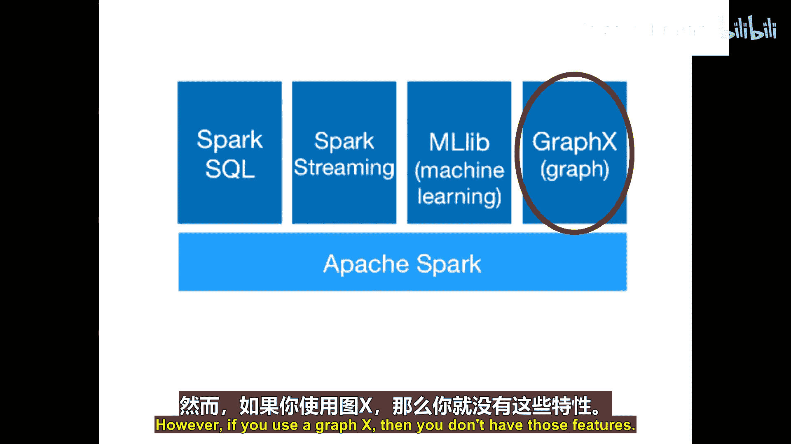
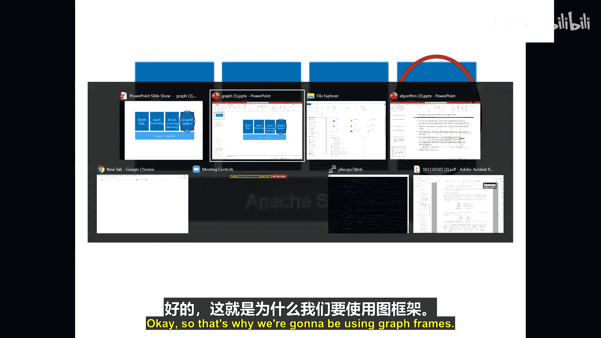
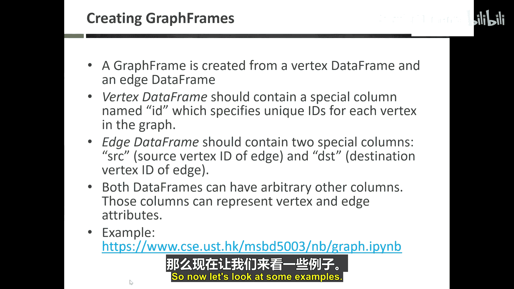
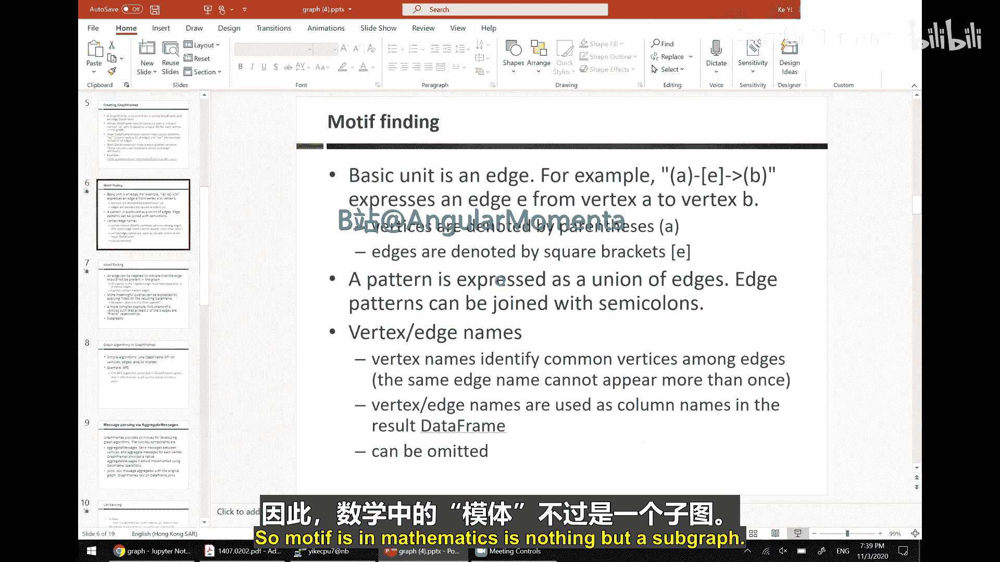
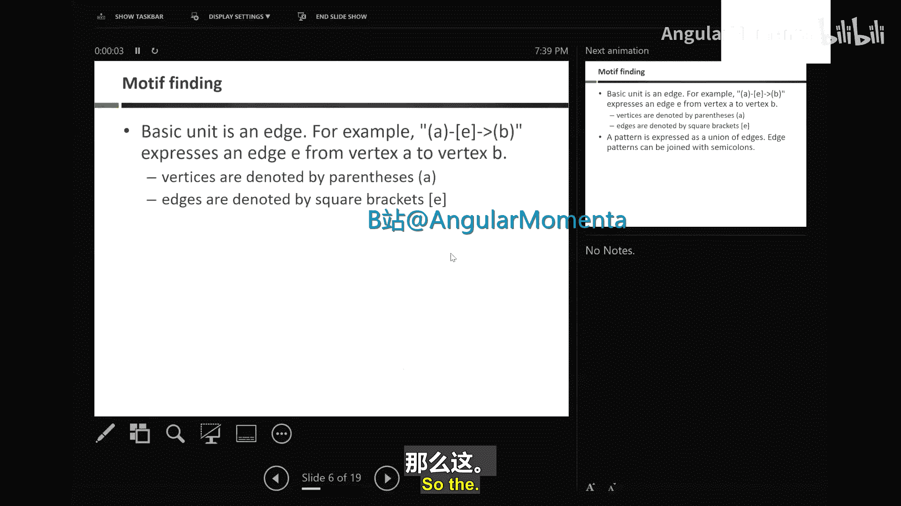
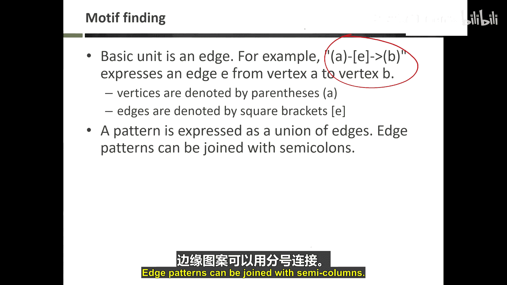
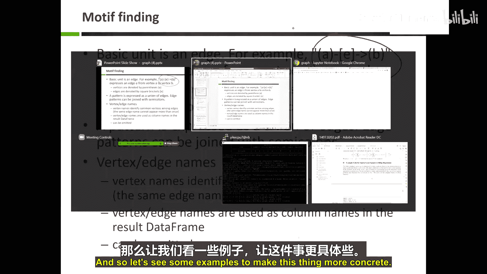
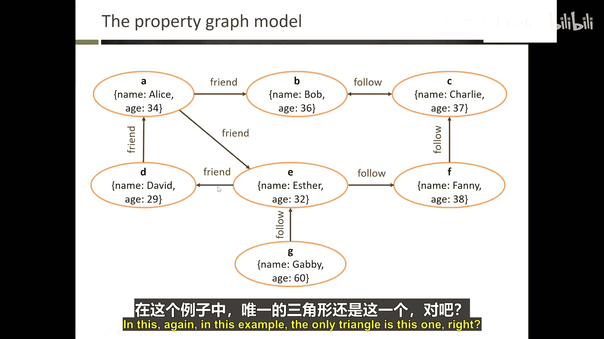
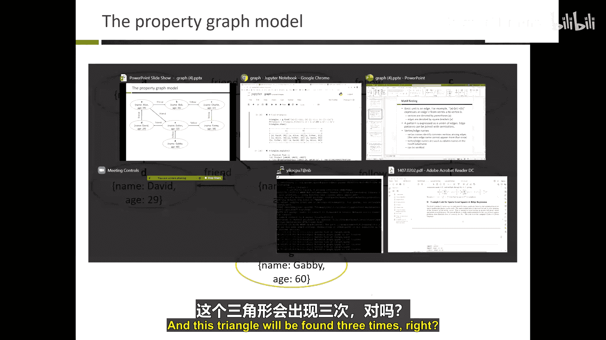
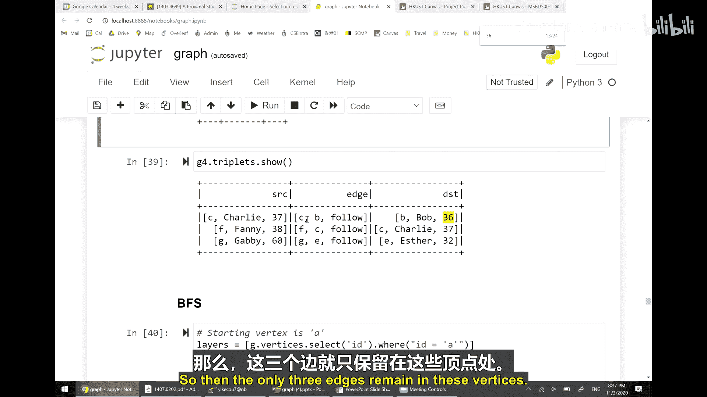

# 【香港科技大学】基于Spark的大数据计算--Big-Data-Computing-with-Spark-p17-08-01-04-GraphFrames基础--BV1V8FmzuEHf_p17-

Okay， so before talking about the graph algorithm， we need to introduce more to small libraries。

 Okay， packages。For is especially designed for graph processing。 Okay。

 because graph data has its unique features that cannot be easily dealt with by using only RDD or or data frames。

 So Sparks own libraries called graph X。Gra X is built on top of RDDs， so。

And so it's actually the in the old model， okay。The the trend is， is is similar for。

 let's say for M L Li。 We mentioned that the， the older version。

 M L lip is built was built on top of RDD， but then the newer version is built on top of spark Sql on data frames because of many。

 you know， nice features， including both flexibility and performance and performance reasons M L。

 the spark Sql based machine learning libraries is much better。Actually。

 the same thing is happening for graph X。 However， I don't really know the reason why they haven't done that。

 Graph X remains a library built on top of RDD directly。 So it's it's。

 it's actually both performance and flexibility is not very good。AndFurthermore。

 it only supports Sca。 So we don't have a Python interface for graphics。Unfortunatelyly。

 there is the third priority package called graph frames。 Okay。

 graph frames is built on top of data frames。 Okay， so instead。

 we will be using graph frames and but the graph frames is not bundled together with spark。

 So you have to install it yourself。😊，The installation instructions are also available on canvas。

 Okay， so you can contact the T A if you have trouble installing graph frames。 Okay。

 It's actually not that too difficult， hopefully。Okay。So when reading the documentation。

 they are saying that they， okay， the eventual plan is to integrate graph frames into spark。 However。

 the currently they are still separate。 Okay， but still separate。

 but graph frames is written entirely on top of data frames。 they they。

 they don't really make any modifications to the kernel， which means that。If you update。

 if you upgrade spark， graph frame still works。 So graph frames actually works for any version of spark any version of Sp sql。

 I should say。 and and another benefit is that when they， when when there are any。

 when there are any further improvement in Sp sqL in particular， the optimizeizer。

 If there are any further know new rules being added to spark sqs optimizeizer。

 all the benefits will be inherited by graph frames。 Okay， but however， if you use graph X。

 then you don't have those features。

Okay， so that's why。We're gonna be be using graph frames。

 And graph frames also has a Python interface， So which is pretty nice。😊。

So。So in， and in addition to performance， the the graph frames。

 because it is built up because it is built on top of data frames。

 it inherenthers many flexibility features or expressiveness。 because you know， we talk about。

Real graph data in a particular application。 You don't only have the structure of the graph。 Okay。

 very often， you have other attributes。 Okay， for example， this example。

 this example shows a very tiny， you know， very tiny social network。 Okay。

 so in in this in this case， in this example， the vertices represent users and the edges represent their relationships。

 Okay， you can imagine scenarios， in which both the vertices and edges may have other properties。

 other attributes。 For example， here， users may have the name A age or maybe address， phone number。

 whatever。 you can have multiple attributes associated with the veres。 And similarly for the edges。

 they can represent。Different types of of relationships， like friendship or follows。

 or they have a co authorship， or maybe they have a buyer seller relationship。

So you can imagine different kinds of relationships attached to these edges。

 So both edges and the veres may have other attributes。

 So this makes the data frame or the relation model much。Suitable to store data like this。

 So to store graph data like this。 So these graphs are also called label graphs。 Okay， were both。

Watch this and edges may have additional labels。Another example is knowledge graph， right。

 so in in knowledge graphs， you know， the the entities in the real world are modeled as veres。

 and their relationships。 including both relationships and also， you know， properties。

 They are modeled as edges。 So knowledge graph can also be modeled can also be stored as a labeled graph。

Okay。啊。so啊。Okay， so now let's look at some examples。

Yeah， yeah。 So in any Jupiter， Jupyter notebook using graph frames， you need to add this jar file。

 Okay， as your in your first line so that you can use， you can。呃， import。From graphs。ok。Okay。

 so this example shows how to create this example social network graph in graph frames。 Okay。

 so it consists any graph frames， any graph frame consists of two data frames。

 one is for the vertices and the other one for the edges。 Okay， so so you can see that the。

I do a graph editor data frame is。Nothing but a。Special data thing with a designated column called I D。

 together with any number of optional。😊，Columns， okay。

 so these optional columns can be used to store any other attributes of the vertices。

And the I D columns is mandatory， and it has to。Be unique。 So all these ideas has to be unique， okay。

So， in fact， when creating this data frame， we are not using graph frame at all。

 This is the standard。 This is just a standard method for creating a a normal， a regular data frame。

Similarly， for edges， okay， for edges for for for the edge data frame。

 it is nothing but a special data frame with two mandatory columns， source， S。

 RRC and DS S T destination。So this data frame must have its two columns。

Together with any number of optional columns like this one relationship， okay。By the way。

 all the graphs in graph frames， they are directed。 so namely。And there are the distinction between。

 theres a distinction between source and destination。

An edge from A to B doesn't mean that there must be an edge from B to A， Okay， back to B， B to A。

 So all A are directed。Well， if you want to model undirect graphs。

 you create two like two edges in the opposite opposite directions。Okay。

 after creating a vertex data frame and S data frame。

 then you can create a graph frame by calling the constructor from the graph frame package by。😊，By。

 by calling graph frame and supplying it with the vertex data frame and data frame。

 And G will be a graph frame。 Okay And these two vertes and edges will be members of the graph frame。

 Okay， so so namely G do veres gives you the vertex data frame。

 G dot edges give you the edges data frame。 And so they are still just regular data frames。

 which means that you can apply any standard data frame operation on them。 For example。

 you can use show。Okay， so I can see that they are just standard and regular data frames。O。Okay。

 this， yeah。 So G whats this。 And G dot edges are just regular data data frames。

 which means that you can use any delivery API on them。 For example， here， we use the filter。

 future condition is as source equals to a。 Okay， so recall that this is just。St this。

 this condition is sequL。 So so that's why I'm using a single equality sign。

This is following the SQL syntax。So it it it will give us all the edges。

 all the outgoing edges from a okay。So this is doing count， right， This essentially gives us the。

Our degree， our degree from vertex a。Because the edges also have optional columns。 You can， you can。

 you can do more complicated queries like this one。 So this will count the number of followers of C。

 right So who follows C。So namely， the condition is that destination is C。

 and then the relationship is follow。And then I do account。So， indeed啊。C。

 I C has two followers and B and F， B and F。呃。So， of course。

 this is just using the standard data frame API。 Well， graph frame。

 the package has some additional features。 For example， it has a all degrees number。

 So it will give you the out the degrees of all watches， okay。😊，So this。

 our degrees is itself another data frame。 Okay， it consists of two columns， A， D and L degree。

Since this is additional attribute。From a graphic。Similarly， in degree， okay。

 you can list the in degrees of all veres by just using this one。Okay。ButHowever。

 as mentioned that graph frame is implemented on top of data frame。 So。

 so both our degree and in degree are actually translated into standard data frame API。

 So namely more precisely， they are both。They are， so neither of them is materialized。 So namely you。

 when you create a graph frame， these two tables， two， these two frames are actually not computed。

This actually makes sense， because why do they compute it before you actually need them。

 So this is still following the lazy computation。Idea of spark in general。 Okay， So。

 so when you created the a graph frame， these data frames are merely defined。 They are not computed。

 So when you， they are computed only when you call some action on these two data frames， like show。

This action will trigger the computation of our degree and in degree。 Okay。

 and you can actually look at the physical plan。 So namely， they do a scan， a projecting。

 a projection plus a aggregation。 So essentially， what。😊，What it does is， exactly。

So what graph frame has done is， is nothing but， you know， defining， for example， in degree as。

 as a sequence of data frame operations involving group by count and renaming the columns。

 So this is where I manually compute the in degree。 Okay。

 by using group by destination account and then rename the columns and then。By looking。

 by examining the physical plan， you can see that this is。

Exactly same as the physical plan of in degrees。 So this actually verifies our。

 verifies the claim that in degree。Indeed in graph frame is nothing but a wrapper over this sequence of data frame operations。

Okay， well， they are， they are not being lazy because， you know， as mentioned。

 they want benefit from all organizations underlying graphing， underlying a spark sequel。啊。Similarly。

 yeah， I haven't。 I haven't run this。 Okay， so let me。不然。Okay， so this。

 you can further check whether they are materialized or not。

So serialize essentially means that it is not cached it is not materialized。

 So namely the in by default for is just a data frame， not materialized。When you， you。

 you can still cash in degrees， this is nothing but another data frame and then。

This time it becomes decentized， which means that it is it is material， materialized， okay。嗯。

The whole graph frame， the whole graph frame can be materialized when you call G dot cache， then。

 then both the ver this data frame and edit the frame will be materialized。However。

 for the in degree and output， they are still not materialized。Okay。嗯So。Another useful view。

 a useful feature provided by graph frame is this triplet view of the graph。

 So this gives you the full picture， all the information of the graph。😊。

That includes both the structure as well as any additional property。So what this does is。

 is it lists all the edges1 by one together。 In addition to the I。

 it also lists all the additional columns。 So now you can have full。

 you can have the full information about every edge， okay。But， of course， there are。

 there is a lot of redundancy。 for example， you know， you know， A appears twice。

 but then this means that all the additional， all the other actual columns are also replicated。 So。

 so therefore， this triplets is also not materialized by default， not not materialized initially。

 Okay， so what it does that when you， when you call a action on this triplet view。

 it will perform a bunch of joins。 It will join。It will join， for example。

 join the edge data frame with the which the vertex data frame to retrieve all these additional columns。

 so it's。诶 you can。Actually， do you know G that triple do。T。Let's not explain。Explain。

So you can see it， it's it's a bunch of drawings， right， one drawing。嗯。呃， only关装嗯，然后。Yeah。

 there's another drawing。 I think at least three。 Yeah，2 yeah。two joints， right。

 because every edge has two ver。 So for every to retrieve the source destination to to retrieve other attributes for the source。

 retrieve other information for the destination that records to two joints。ok嗯。Yeah， motive is。

Actually， they， they borrow this term。They borrow this term from bioinformatics。 so motive is。

In mathematics， is nothing but a subgraph。

嗯。So the。

It turns out this application， this application is very useful in bioinformatics。

 where they are given a for example， a protein network， which is a graph。

 which is a is actually a labeled graph。 The vertices are labeled representing different proteins and I don't know。

 I don't know about informmatic。 But anyway， they want to find a particular pattern and and they call it motif。

 Okay， and so the so so essentially mo a motif is a special pattern that one is looking for inside a larger graph。

 Okay and this pattern involves includes both structures as well as labels and labels can be both the vertices can also as well on the edges。

 Okay， so the basic unit of in a motif is a edge。 and an edge is represented as a stream。😊，Okay。

 so this is， so in fact， they represent in， in graph frames。

 They represent whole moif as a big string。 Okay， they use the string to represent the pattern they are looking for inside the big graph。

 And each the basic unit in the pattern is is is edge and represent as as follows。

 they use parenthees。To denote a vertex。 and they use a square bracket to denote a edge。 Okay。

 so this represents a edge E from vertex A to vertex B。Okay。

 and the pattern is expressed as a unit of edges。 edge patterns can be joined with semi columns。

 Okay， and so let's see some examples to make this thing more concrete。

Okay， so as the first example， let's say we are looking for a very simple pattern。

 which is bidirectional edges。 I know。 So remember that in graph frames， you know， the graph。

 the graphs are directed。 same namely， the edge going from A to B。

 doesn't mean that there is edge going back from B to A。 Okay。

 so if you want to represent bidirectional edges， you need to include edges，2 edges。

 one in each direction。So now suppose we are， we want to。

 we want to find all such bidirectional edges， edges。Going from A to B， as well as from B to A。 Okay。

 so this can be can can be easily implemented。 Let's comment this out first as this mo finding。呃。

Method by by calling find。 Okay， so find is the motive finding method in graph frames。

 and then it takes a parameter， which is a string representing the pattern。 So it says that okay， I。

 my， my， my， my mot。Consist of two edges，1 edge going from A to B， the other one from B to A。

 So know that the edge label of edge is omitted。 Okay， so that means we don't care。 Okay， the label。

 the label can be the label on the edge can be any can be anything。 or it's actually instead what we。

 when we write here， when we， when we omit the label or the name of an edge or vertex。

 It means that it that it is not needed in in it is not in it not needed in either the output or in representing the。

Patter， okay， if we write a name for a vertex or edge， then it is included in the output。 Meanwhile。

 we， we may also we may also， we can also use it to represent the structure property of the motive。

 So here， of course， it two as means that they must represent the same vertex。嗯。So we can run that。

 So if the graph we are using it still， there's a simple example graph here。

 So here you can see that the only bidirect edge is this one， right from B to C， Bob to Charlie。

However， you can see here this returns to results。Which actually are referring to the same to the same by direction edge。

 Okay， theyre actually same thing。 maybe it's just one， so， so the it that the， the order is swapped。

 Okay， this actually makes sense， because， you know， when you write this pattern。

A and B are different A And B represent different vers。 indeed， you know， in in one example。

 A C A is Charlie and the other So A is Bob。 So they they indeed they they can be considered as two different results。

 although logically they are really the same thing。

 So to remove duplicates or to remove this logical duplicate we can add a filter。 for example。

 this is just one example， you can also use let's say A I is greater than B I Okay。

 or you can use a name is smaller than B， any tie breaker will will work， any tie breaker will work。

 Well， however， using name is a dangerous because you know， if two people have have same name know。

 then you will miss those edges。 So it's better to use I D as a tie breaker as a tie breaker because I D are guaranteed to be。

有呃 unique。So when we add this tiebreaker， then we can remove the duplicates。

 and only one edge remains where A's I D must be smaller than Bs I D。

So this is what this is the first simple example。 You can in the second example， we find。

We can use Mo finding to find all triangles。Okay， so more precisely， because the graph is directed。

 so edits are directed。 What we are looking for is more precisely directional triangles， namely。

There is edge from A to B， and there's edge from B to A。

 and there theres edge from back from C back to A。 So it's actually a direct the cycle， direct cycle。

 Okay， similarly， if we don't have this， we don't， if we don't have this tiebreaker， then。

Every triangle will be found three times because you can rotate the triangle three times。 So in this。

 again， in this example， the only triangle is this one。 where A E B， A E， B， right。

 and this triangle will be found three times D A， E， A， E， D A E， D A Okay， you can break the tie。

 you can remove duplicates by adding this tie breaker。

 A must be smaller than D and a must be small than C， So namely A must be the smallest。

 Okay so this will remove all duplicate。 Similarlyly。

 you can also require to A to be the largest or C to be the smallest or C to be the largest。

 Any tie breaker will work。😊。

Okay。So I'm saying， so I earlier said that this is some new functionality provided by graph frame。

 but however。How multi finance is implemented。You can you， you can。

 you can actually look into how it is implemented by， by using triangles do triangles explain， Right。

 So So which is triangle， Well triangle is the result of this mo finding。 Okay。

 so it's a resulting the data frame okay， you can see that is its。

 it's actually nothing but another very complicated spark query。 Okay。

 so if you really look into that。 You can see that it is done by and one，2。3，5，6。seven， okay。No，1，2。

3，6 joins is is is done by 6 joins。 So why 6 joins。 Okay， essentially， what。

 how they implement this triangle finding is to take this edge relation。Join it。

 join it with self on where the joy condition is， you know， the destination of the first。

 the destination of the first edge must be equal to the source of the second edge。 And then the。

 the destination of the source of the second edge must be equal to the source of the。

Third edge and then in the destination of the third edge must equal to the source of the first edge。

 So for the triangle， they they already， they already need three joints，3。Iry joins。 I create。

 this is called self going because it's joining the edge relation with itself， okay。

But why do we need？Three other joins。You can look at output。 The output doesn't really。

 doesn't only tell you the I Ds of the three vertices in the triangle。

They also tell you all the other attributes。 Okay， so namely Alice， the name as well as the age。

 And this is， this information is not store in the actual relation。

This information is stored in the vertex。Data， so， so after finding A E D。

 after finding the three I Ds， the I Ds of the three verses。

 they need another three joins to retrieve。The other attributes associated with the veres。 Okay。

 so if you countt， you should be able to find three joins。6 joins。 Okay， so alright， right， okay。

 okay， I see。 So， for the triangle。 So so for the to to form a triangle。

 they join the first edge data frame with second edge frame。

 they join the second and then join with the third one。

 And the the last one is actually not performed by a joins last last one is performed by just a equality filter。

😊，So namely， the first， the， the， the source of the first edge must equal to the destination of the third edge。

Because after two joins， we have already joined three data three edge relations together。

 we have all we already essentially they it finds all the length three paths。 Okay， so this by。

 this is done by two joins。😊，And then it checks whether this length three pass actually form the cycle。

 And the last one doesn't need to join。 The last one is just a filter。 It's a equality check。 right。

 So it's actually yeah， So it's  five joins plus a filter condition。

 The filter condition must be some must be somewhere， okay。Anyway。

 and then they they use three other joints to perform the。To， to retrieve the other conditions， okay。

Okay， alright， so that' this is triangle finding。Okay， the next， Okay， they also support negation。

 okay。The edge， an edge can be negated to indicate that the edge should not be present in the graph。

 Okay， so this is， so so so they they can， they can use this to find some particular patterns in the graph。

 Okay， so， for example， if we want to find all the one way edges。 Okay， one way edges。 So namely。You。

 you have an edge from a going to B。 and then you have， you don't have edge from B back to a。Okay。

In this case， you can， then you can， you can find all the one way edges right one direction from a to E。

A to E right， no， no add from E to A。 Yeah， okay。So the。

 the introduction of negation is actually very important because without negation。

 there are certain patterns you cannot find， for example， one way edges。

 you cannot find one way edges。And more fundamentally， you。

 you one can show that by allowing negation， you can actually implement the whole relation relational algebra。

 Okay， so essentially， the entire SqL can be can be can be all the functionalities in SQL can be handled by motive binding。

 Okay， so if you have studied mathematical logic you should you you， you。

 you will know that by allowing both union and all this hard conjunctions。😊，Tother with negation。

 you can express the entire first order logic。 So every。

 any graph pattern that can be represented by first order logic can be captured by mo finding。 Okay。

 so that's why the introducing in including negation is very important。Yeah， so yeah。 so the。

 the power of mo finding lies in the fact that it's the motive finding will still just replace return data frame。

 So that means you can apply any other operations， any other data frame operations on the result of the mo finding。

 So， for example， if we want to say that we want to find all the，Is we want to find， Yeah。

 So this is okay， I want to find all the bi directional edges where。Wherere one of the。

Were one of the。呃。One of the advertisements have age greater than 36 okay。So this。

 this can be done as follows。 Okay， with did this find find， first find all the by direction edges。

 And then I do a filter because this， this returns data frame。

 you can apply any other data frame operations on that。And the even more。

The even more beautiful thing is that。You know， you don't really have to worry about efficiency。

Indeed， this is a very bad way of writing of this is a very bad way of executing the query because。

 you know。We potentially have a lot of edges， but maybe only a few works。

 only a few persons in that my social network can pass this future condition。 So therefore。

 if we really execute the mot finding first and then do the filter， this can be very， this。

 this can be very slow。 This is not very smart way because， you know， Mo finding。

 as we saw earlier involves a lot of joins。 right So in this one。Involves， I think， should be， yeah。

 this too is one drawing。 and then。A and B， So this involve three joins。 Okay。

 even every join all the joints are very， very， very expensive。

 So we want to minimize the cost of the join。However， because find this whole mo finding。

 no matter how many drones it involves， it is nothing but it still a it is just still a big transformation。

 Okay， so it's no action。 and theater is another transformation。 Okay， the only action is this show。

 So what when spark， when you execute this， this line， this will send the entire query。

 this entire in the entire query to Sp SqL。In Sp SQqL after accept the query will come will will will par your query。

 construct logic plan and then optimize it。So， and this is a predicate。

 And we learned that pred can be pushed down， right， can push down， push down over the joints。

And this fine， although it is doesn't use drawing explosive is nothing but a bunch of drawings。 Okay。

 and this credit can be pushed down over the drawings。 So that means after optimization。

 Spark will actually run this one first will run the filter first。 namely it it first find all the。

Okay， so more precisely， we we need。呃。We need to do a drawing between。2 copies of edge， right。

 So namely on the first copy of the edge relation， the destination will be applied this condition。

 And then on the second copy of the edge relation， the source will be applied as field condition。

 So this filter function will be actually push pushed to two data frames to two relations。

And then but， but I've actually， this full are。Physically， the same thing， but logically。

 they are different。 And this field condition is applied on different columns。

 One is on the source and one， the other one is on the that， on the destination。Okay。

 and you can actually check this to vary to confirm our conjecture。Where is this filter， Okay。

 this filter。Yes， as future is。Is here。 Okay， age is greater than 36， okay。

Yeah there should be another one。Okay， yeah。 So this， yeah， here is one。 and there is。

 Here is another one。Okay啊 so yeah， so。Yeah， so that means that you don't really have to worry about how the query is written。

 The optimizer will be able to find not， not necessarily the best， but a， they will try。

 They will try their best to find a to， to optimize your query。

 the next example is a fairly complicated one， okay。

This is also a good opportunity to to introduce another useful function in SQL。 In SQL。

 there is this thing called case when okay。😊，This is quite， quite powerful because what is so in Sql。

 there's no if them because essentially， you can only do the same thing on all the rows on the table。

 You cannot say that I do certain things。 I I I， I， I， I， I。

 I do one thing on some on some rows I do some other things on some different things on some other rows。

 That's not possible。 You can only do different things on different columns。 However。

 all the rows must be treated the same way。😊，However， with the help of this case。

 when keyword clause， you can， you can essentially do different things on different roles。

 depending on their value。 And similarly， this has been also migrated to spark SQL。

 this is the when and otherwise functions， okay。Allright。

 so what what is the task this task is the following。

 so of still we are given a graph stored in graph frames， we want to find chains of four veres。😊。

Such that， at least two of the three edges are friend。Okay。

 so this is a very quite complicated requirement condition。

 have we have we first to find all the chains of forward， ABC，D， Okay， and then this。

For watches will have three edges，3 edges。 and and， our， and， and our graph in our graph， both the。

Edges and labels， the edges also have labels。 They in this example。

 we have two two types of edges friendend and follow。 and amount of three edges。

 I want at least two of them to be friend。 The third one can be either friend or follow。 Okay。

 so this is， this is the pattern we are looking for。 So this。

 I think this is actually a nice example， illustrating the by combining both mo finding together with other stand with other functionalities provided by Sprsql。

Okay， so the first step is easy。 The first step is just to find chains。 So this is the。

 this is this is what multi finding is designed for。 So we say， just say A to B， B to C， C to D。

 And in this case， we also add variables， variable names to the edges。Why， because later on。

 our condition。Need to be checked against the labels on the edges。 So we need this label。

 We need these edges to be in the result， to be in the resulting data frame of mo finding。

So we not only， we don't， we don't we don't we do not only。 we don't only need these verse。

 We also need the edge information on on the edges E1 into and E 3。 Okay， so it's just a chain。

 right， So we don't want a to。We， we don't want A and D to be the same thing。 right Otherwise。

 we would be finding a cycle。 So we also add this condition。Okay， so actually， in this definition。

 this， this is not。Re this is not precisely defined， right， for example。

 Maybe the user won also need the fact that A And C should not should should be different。

 So if we hear we do not have that， which which which and I think we should have that because you know the the intuitive meaning of chain is you don't repeat。

 but okay， so if we one that you we can add that， you know and。诶诶。I think we should have。

 We should have that。 A stock3 and。M B is not equal to。敌。That's all right。嗯。Yeah。

 A And B cannot be the same thing because A And B are from same edge in you know。

 graphs should not have self cycles。 Okay， so this is， this doesn't make sense。Of course。

 in some special graphs， self cycles are also allowed。 but you know， when we say simple graphs。

 when we say that a graph is simple， we do not allow self cycles。 So if we。

 if we don't have self cycles， then these three conditions are the only ones。

 the only ones we need to check。😊，I think。Yeah， okay。

 then we can make sure that the chain will not repeat the same vertex， okay。

So now we have found all the chains of four vers， okay。

The next step is to check against this condition。 right， At least two of the three edges are friends。

At least these two， three of the three edges are friends。 So， of course。

 this more than one way of doing this。 I'm just showing one of the ways。 This is， in fact。

 this is this is， this is。This message is more general， it can be more easily extended let's say。

 to other conditions similar like this。Alright， so the first step is to convert。

The edge into a indicator，0，1， where once means this edge is a friend。 Fri edge。

0 means this edge is some other edge。 Okay， and then we add these indicators together。

 And then that will be， they will can count how many friendship edges we have among the three edges。

Okay， to do that， I introduce this function。 this friend to one。 Okay。

 so as the name suggests it converts any friendship edge into a one。 Otherwise it0。 Okay。

 it is define it is define as as a lambda function。 Okay， actually。

 you can also define friend to one using explicit function fashion D E F okay。

 but this is a simpler more conci way。 Okay， but anyway。

 friend to one is not a variable is well it's a variable pointing to a function。 So it's a function。

 while in everything the so a variable can represent anything even even a function。 Okay。

 this E will will refer to a column。 Okay， a column in the data frame。 Okay and and。

 and so as as so let's ignore this first。 Let's， let's look at the how we can use。😊，to one， Okay。

 so this we use frame to one inside select。 Okay， when we use a function inside select。

 then both input and output must be a。Column， okay must be a column。 Okay So， so， so therefore。

The input， for example， this one is， we just take E1。 remember。

 this chain 4 is a resulting data frame of this moif finding。

 And E1 is one of the one of his columns。 Okay， so， and， and so， and so are E2 and E 3。

 So this refers to the the first， the column representing the first edge E1。And this is the second。

 And this is the third and three edges。 for each one of them。 I， I， I。

 I put or put it into the I give it a give to the friend to one function。 Okay。

 so this is the input column。And the output column is。Is specified by the when function。 Okay。

 So actually， the when when the when function is defined in the， in the spark sl。Function。

 okay inside this package。 Okay， so， in fact， all the standard sQL functions have been ported into spark Sql。

O啊。So the wave function has two parameters。 The first one is a condition。 actually。

 is's a condition in on the columns in condition on the columns。 Okay， so the condition is okay。

 to check whether friendship。 Okay， so namely so E is a remember。 So E is。Okay， so yeah。So let's see。

 let's look at the output。 Okay， so it's important to understand the format of the resulting data frame of any mo finding。

 Okay， the the output， this is has the following form。It actually has a nested structure。

 nest schema。 So this is again where you know， in general， yourq supports a semi structured schema。

 So name a Json file。 So mainly you can have sub columns inside the column。

 So this is this is how it looks like。 So the the columns are just the columns will correspond to the variables inside your mo pattern。

 In this case， we have A And B。 That's two columns。 However。Inside each column， we have sub columnns。

 The sub columnns correspond to。The I D， as well as other fields in the， in the edge in the vertex。

 So let me add that example， Let's see。 we also include E okay。Okay。

 so when whenever we add H E here， then this E will also be included in the output。

 So know that you cannot have。2 ease。 Okay， so that will be。Actually， an error。 Okay， so in fact。

 they， when， when， when graph frame， when graph frame tries to compile。

 to tries to interpret your pattern， it forbids。A edge variable to appear more than once。 Okay。

 so why， because it doesn't make it doesn't really make sense to for a edge variable to appear more than once。

 because remember， a edge variable represents a edge。And the same variable represent the same。

Thatdge。Okay， but that doesn't make sense because every pattern involves a number of edges and all these edges are supposed to be unique。

 are supposed to be different。 So it doesn't really make any sense to have two variables。

 two different， very， two different edge variables okay so they they actually they do， they do favor。

 They check that。 If they don't， they don't touch that Instead。

 they require they are to the same edge。 Then every funding will return nothing。So so， but anyway。

 because this。Doesn't mix this anyway。 So they also they they will。So they will check that for you。

So therefore， the only application， the， the only use for a edge variable is to include this edge in the output output。

Okay， and now。To retrieve the sub columns， we can use the。诶。The dot format， right， for example。

 this is you can see a dot I D。O。啊， show。Okay， so I need only be。 if I want other things like E。

Relationship。Then I， I get this follow。 Okay， so you， you can use the the， the dot to。

Retrive the subfield to retrieve the sub columns。 So that's how we。That's， that's。

 that's how we do that here。 So here E is already a is already a column。 Okay， E is already a column。

 and so。The relationship retrieved the sub column under this edge column。 edge column。

 And we check that this would be equal to French friend， okay， and。And if this condition is true。

 then the， the return one。 So that's the second parameter。Of when。 And then it。

 you can optionally follow it up。 follow can append a otherwise， actually， the wins can be chain。

 So if you have if else， if else， if else， that means if you have three cases。

 three possibility more than two more than one more than two cases， you can have you can。

 you can use multiple wins。And okay， so， alright， so we're almost done。

 So now this friend to one function will translate。 So so I mentioned this， this。

 this function can be used to， you know， do do do different things to different to different roles。

 namely， if that row is a friendship role， then it's one otherwise become 0。😊，Okay， and then we。

Rename is resulting column to F1， F 2 and F 3。 And the reason that if you don't do rename， you。

 you have no way to refer to it。In the next step， okay。So after this， we have two。

 we have three new columns， F1， F2 M3， right， because we preserve all the columns。

 but then we add three new columns。And then we can do where simply add them up。

 This should be at least equal at least 2。 And then I project on the four columns， A B， A B， only AB。

C， D， Okay， well， if we don't project， let we can actually take a look。Look at the whole whole thing。

 the whole result。 So we can see we have A E1， B， E2， C， E 3 D and E1。

 E2 E 3 have been converted to F 1， F to F 3 F to F1 F23 are are all0 and ones indicating whether it a friendship or a friend or a follow in this for example。

 here， friend friend follow， So one So motive finding is one way to find to build subgraphs。

 But this is not very efficient because motive， as we have seen it involves a lot of joins So so finding is only efficient when you are looking for a particular small pattern。

 for example， a triangle or less for chain or a bydirect edge things like that。

 if you will simply want to shrink graph to a smaller graph。

Then it it should use subgraph construction。 Okay， so multifin is to look for a pattern that which can appear many times。

 Subgraph refers to the fact that you you just want to， you know。

 make the graph smaller by focusing on a particular on a smaller portion。 So it's it's， it。

 it only returns one sub graph。 So in this case， we can use。

So this actually this is nothing special here to find us to build a subgraph。

 we simply build a new data frame know， consist of the selected veres and edges。 however， you know。

 things care has to be taken because because when you， for example。

 when you construct a new graph frame， graph frame doesn't really check any doesn't really check any consistency。

 Okay， So this is illustrate in the following example。

 suppose I want to we are only interested in the subgraph in which the users are older than 30 and edges of type frame。

 So I want to find all the old friend， you know， smaller， smaller social network。Okay， well。

 that's easy， right， that appears to be easy with I first。

 I filter out all the vers where the age is within than 30。

 and then I filter out all the edges where the friendship， where the relationship is the friend。😊。

And then， I simply built。A new graphic。Okay， so this appears to be okay， right， indeed， if we。

 if we look at G2， G2 is the sub graph。Indeed， all the people。oldld guys。 Okay。

 and all the friendships， all the relationship， relationships are friend。Yeah， it looks fine。

 however。😊，This graph is actually inconsistent。 Okay， there are。

 there are there are two ways a graph can be inent inconsistent。The first one is less serious。

 which where which。We， which， which calls about the case where a vertex can be isolated。 Okay。

 so namely， this vertex exist， but theres no edge connecting to it。 for example， right G， Okay， G。

 poor guy right， no edge connects to G。 indeed， if we look at this， right， this only edge。

Our on G is a follow edge。 So G becomes the isolated boortex。 Oh this this case is actually O。

 because。In some graphs， in some graphs， if what is isolated while is isolated， is it。

 it may not be very useful， but it cannot be said to be in in inconsistent。However。

 the other type of inconsistency can be serious。Where an edge may connects。呃。呃。Connects呃。Yeah。

 graph frame does not check right if an edge connects to。Connects to existing veres。

 So namely an vertex may connects to a non exist， non exist， non existing vertex。 Okay， so。

 for example。嗯。O， E to D。 you can check E to D， this edge。D doesn't exist， why because。

D is a young guy at 29， so he doesn't pass the filter so。

 but graph frame that doesn't check when you construct the graph frame。 Actually。

 this constructor doesn't do anything。It only declares and it only tells graph frame that okay， I'm。

 I'm now constructing a new graph and watches are stored in V ， and edges are stored in E2。

 I'm not guarantee。 So So graph frame is not responsible to check whether my data is consistent or not。

Okay， so that's why you know， something has to be done to make to ensure consistency so。

So if you don't do this， you can still run certain things。 For example， you can still do in degree。

 I haven't， yeah， haven't done this okay。嗯。So in degree still works because remember。

 in degree is nothing but group by on the edge relation。

 It doesn't really doesn't even look at the vertex data frame。

 So that in degree will tell you D still has in degree 1， even though D doesn't even exist in veres。

 Okay， however， this inconsistency may cause certain may cause troubles when you run other more complicated operations or algorithms on on the graph。

Okay， so how do we clean， make sure remove all the inconsistencies。 Okay。

 we only care about the second one， which is an edge must connect existing veres。Well。

 the way to do is to use what we now call a semi join。 Okay。

 this is a new type of drawing we haven't introduced。 Okay， but this is also quite useful。 it is。

 although it is called a semi join， It's actually a filter。 Okay， it's called a drawing。

 but it's actually a filter， except that it filter condition。😊，Is performed by a join。 Okay。

 so what does semi join though， Okay， Se join similar to out out join， It is also asymmetric。

 So that's why we there is a distinction between left semi join and right semi join。😊。

In left semi join， we are this is actually a filter on the left hand side of the data frame。

 So when we do E2 join V2 great， E2 join V2。 So E2 is on the left hand side。

 So E2 will this result the， the result of the semi semi join is a must be a subset of E2。

And the future condition is， is expressed as a drawing condition。 Okay， so namely the， so namely。

The E2 source， any edge in E2 is source must。Match the I D some。

 the I D of sub vertex in the right right hand side， a data frame。对。嗯。It's。

 is the difference between a semi join and a inner join or utter join is。It doesn't。

It the output doesn't include any attribute， any column on the right right hand side。 Okay， so。

 for example， here， V2 also has you know name and age。 these columns will be ignored。 So the only。

 the only the only。Place where we need the right hand side relation or data frame is in checking this join condition。

 making sure that this join condition is true on at least one row in the right hand side data frame。

 So that's why we say that although it is called a join is more like a filter。 except that here。

 the filter condition is more complicated。 The future condition is saying that okay。

 you must match at least one of my roles on the right hand side。 So， so therefore。

 this is essentially making sure that the source of every edge must appear in the vertex data frame。

And then we that followed that by another semi joint and making sure that the destination also appears。

In the vertex data frame。ok。😊，And then we can do the。 And then now our graph is consistent。

 So actually， only two edges。Among the four pass this condition， A E and A B。A E and A B。

 And the other one， they have D。 So they are， they have been removed。Okay。

 a couple of questions from chat。 Is it It is like exists。Yes， exactly。 So in Seequco。

 there is a clause called exist。 Okay， but actually， in Cequco， there is also semi John。 Okay。

 but exist also works。😊，嗯。Second question， can we use the left outer and then use a。Filter， yeah。

 that also works。 You can。 You can use the left outer join， and then you remove。Well。

 if in that case， you can， you， you may just use a inner join。

 You use inner join and then you project on the columns on the left hand side。 So essentially。呃。Yeah。

 okay。 So so that means you can also use the inner join。 This so namely， lets say we do， for example。

 The first one can be written as E1 drawing E 2。You don't know wait ignore that。

 This is just inner drawing， and then you project。Select on。Source and that it。 Okay， but this is。

 this is， this is， this is lower， right， because in a inner join。

 you also retrieve all the other columns of the。Right， right hand side。Data frame。

 because in inner drawing will preserve all the column will， will， will keep all the columns。

 which is unnecessary anyway， okay。But you are right。 You can also。So actually。

 in linear in relational algebra， only inner join is necessary。 Both out join and semi join。

 they can be， they can be replaced。 They can be replaced with inner join。

 plus other standard operations like like like projection。 Al and semi join。

 They are only introduced for convenience and performance。 Okay， so they are not really necessary。😊。

Okay， so let's see。Another more啊。Complicate example。 Okay。

 so this is we want to build a subgraph based on edges of type follow。

Pointing from an old user to a young user， okay。啊。So， of course。

 there are multiple ways of doing this here。 I show how to use multifin。 Of course， this here。

 the motive is really simple is is one edge you can you don't have to use multifin。 Actually。

 when we do find A E B， this is simply returns the triple view。 We can also use triplets。 anyway。

 this is just one example showing that you can you can can do you can use different ways to achieve the same same result。

 even in terms of the performance。 they are all the same because they correspond they correspond to the same query plan。

 Okay， so don't we have to worry too much about which particular way I should use which is precisely the beauty of Ssql。

😊，Okay， we find this simply find all edges， A E， B， and then edge type must be follow。A， the source。

 the age of the source must be greater than the age of the destination。 Okay。

 from older user to young user。And then I select E do star。 Okay， so essentially。

 this is a way to select all the sub columns inside a column。 Okay， so this is a result。

Please all the follow edges。And now I， so， yeah， so in this subgraph construction。

 I don't have any restrict on the edges。 Okay， but of course， if the vertices have been removed。

 all the incident edges should be removed as as well。 So this is for consistency reasons。 So。

 so that's why we， we only need。 we have to， we can。

 we can only keep vertices that appear in the edges。So this is done by7 join plus a union。 Okay。

 the first one finds all the fines， all the。'm sorry， find all the edges for the。

 find all the voicees that that appear at as the source of at least one edge。 Okay， so namely。

 I find all the edges。Jorawing with the E4 is all the edges that have survived。 Okay。

 and the I D must match the source。 and it is left semi join。 Okay， left semi join。Okay。

 I think they support both left and the score semi and the left semi。 You know。

 they know people may make mistakes， right， so they。They make this thing very user friendly。

So left semi join。 and also， we also need to keep watches that appear as the destination of the of the edges。

 So that's the what the second thing is。 Second semi joins doing。 And then I do a union。

 do a distinct because remember a union doesn't remove duplicates。

 is its is simply combining the two data frames together。Okay， so， so this is。

 this is actually resolving the first kind of inconsistency， which is not necessary。 right if。

 even if we don this， we just may have some isolated watches。 Okay， this is not big issue。

 But if you want to make things nicer， right， clean up your data， then you can， can。

 you can do this to only keep watches that appear in the edges。And now we can construct the graph。

Okay， so that's， that's G4。 And then we can take a。

 take a look at of the whole picture of the tripist view of， of the。Of the the subgraph。

 So name only three edges ring men and these vers okay。

