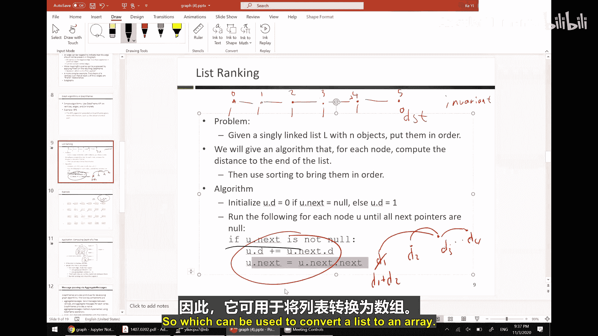
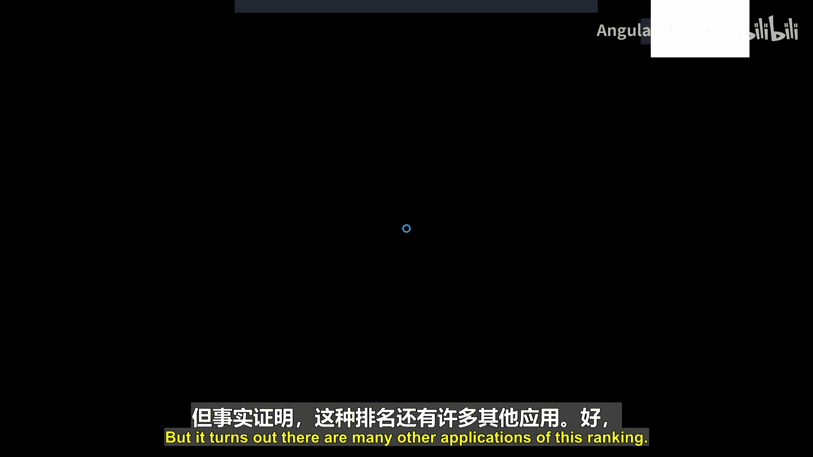
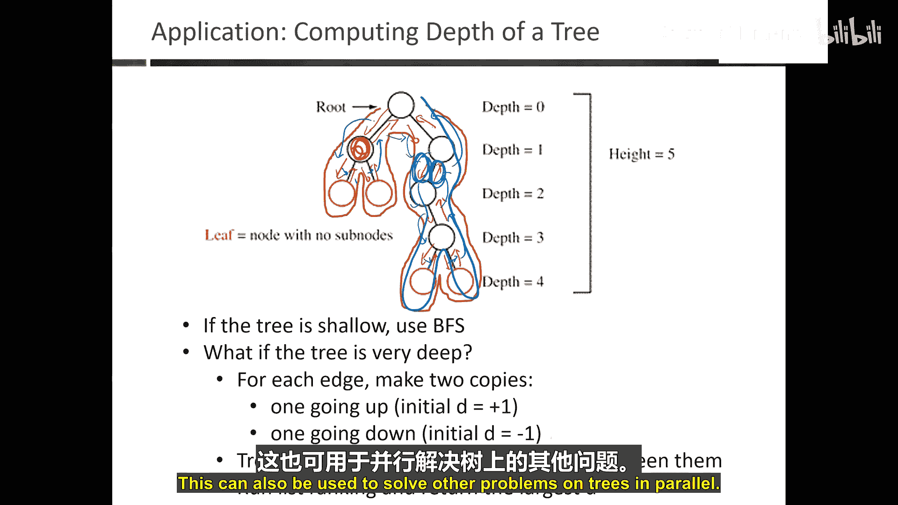

# 【香港科技大学】基于Spark的大数据计算--Big-Data-Computing-with-Spark-p18-08-02-02-广度优先搜索--BV1V8FmzuEHf_p18-

So now we will move on to graph algorithms。 Okay， so mainlyly more complicated graph operations。

 know this is I the second part of big data algorithms。 We talked about divide and conquer。 However。

 for graph data， it's very hard to divide。 So， in fact。

 it is known as NP hard problem to divide a graph into two pieces So as to minimize the number of crossing edges。

😊，If you simply divide a graph arbitrarily， then there can be a lot of crossing edges。

 So this will not be very efficient for many divine conquer algorithm。 You want to， you know。

 cross as few edges as possible。 But that， but that time that problem turned out to be NP hard right So it's very。

 very， very， very difficult。 So therefore， people have to investigate other approaches to dealing with graphs。

So。Many， of course， this is， there's a huge literature on efficient graph algorithms and actually making them parallel is even more challenging。

 And， in fact， there is very， there is a very there is a conjecture。 name so namely。

 the conjecture says that there are certain graph problems。😊，That is inherently sequential。 Okay。

 inherently sequential。 So， of course， when theoreticalians talk about this。Lower bounds。

 though talking about this negative results。 They are talking about the worst case。 So namely。

 you cannot hope to solve the problem。In the worst case， in all cases， there are namely。

 there are certain hard instances that are difficult to solve。 So in one， in fact。

 one of the problem that is considered， that is conjectured to be。Sequential， inherently。

 is this simple problem known as B， F S。 Okay， so what is B， F S。 is breakfast search。 Okay。

 so namely， you start from the one vertex and you explore their neighbors in a layer by layer by layer fashion。

 So， for example。😊，Suppose A is my source verortex。 I start from A， I start doing B F S。

 So A is in layer 0。 and then in layer 1， I visit all the immediate neighbors or one half neighbors of A。

 in this case is this B and E only B yeah， only B and E， right because A has only two outgoing edges。

 So B and E will be in layer 1。 And then from our my layer  one voicees。

 I will go and visit there H  one neighbors。 So the namely we're gonna reach the hub 2。😊。

Neighbors of A in this example， the neighbors of B and E includes C， and F。And D， C，D。

 So C FD will be in my in the layer 2 namely H 2 They are the H two neighbors of8。

 And then I do this iteratively。 every time I explore one layer。

 So this is called a breakfast search because we， because we want to。😊，We want to。We want to visit。

 We want to want， we want to check this。 We want to visit the。呃。We， we， you know， we。

Want to visit this layer by layer。 We want to， we want。 we focus on bread first。 Okay， so， of course。

 this one， the performance of this algorithm depends on the structure of the graph。 So if， if you。

 you can imagine if the graph is。😊，It is。If if the gravel looks like， you know。This one， Okay。

 I'm sorry。 So it's like a long chain。Then the BFS can be very bad， right。So if， of course， this。

 this B F S will work better when the graph is shadow， Naly。

 there is a important parameter for graphs is known as die the diameter。😊，Okay。

 the diameter of the graph， diameter， the diameter of graph is defined as the length of the longest shortest pass。

 Okay， so this is bit confusing is the length of the。Longest shortest pass。 Okay。

 the long short pass， namely how many hops do you need at most to be able to reach from anywhere to anywhere else。

 Okay， so this this is defined as diameter of the graph。

 So the number of steps or the number of parallel steps of B F S will be equal to the diameter of the graph。

 Okay， and for many graph， for example， social social network， there is a famous result or。

Famous claim， namely the namely the degree， the。A 6 degree separation namely essentially is is is claiming that social networks have diameter 6。

 namely you can reach anywhere it can reach anybody in the world by at most，6 hubs。 so。

 so this is a famous claim， saying that essentially saying that for many real world。

 especially social networks， the diameter is small。 Okay diameter small。

 So that's why B F S is is is good。 Its easy can be easily parallel。

 can easily parallelzable for such graphs。 However， there are other cases。 Okay。

 where the graph can be can have a very large diameter in those cases。

 B F S will be very inefficient。😊，But anyway， let's first look at the low diameter case， okay。😊。

The low diameter case。So， so let's see how this can be implemented graph in graph frames。Namely two。

Iplement B I S。 So know that B F， S also find short task in terms of number hubs for starting from a starting source vertex。

Okay， so this is actually my B F S， my own in implementation。

 although square frame actually provides its own B F S in implementation， which is more efficient。

You can call it directly， but just as an example， I'm going to show you how to implement an algorithm like B Fest on your own。

 know， suppose your projects is about implementing another graph algorithm。Okay。

So the in the BF S is。Simple， it's not that hard to implement。 Okay， however， it， it's not that easy。

 You cannot simply do it by using one one bicycle query。 it， it has to， you have。

 you have have a loop Okay， because you， youre gonna， we're gonna。

 we're gonna explore the graph layer by layer， okay。So layer 0。

 layer 0 only consists of one single vertex， which is my source。 Okay。

 so so that's why I'm just gonna do that by using select select I D where I D is a。

 So we are treating a as my source。 so this returns a data frame。

 although I know that this data frame only consists of one vertex。 Okay， and I put that into a list。

 So this is a python list， except that this python list consists of data frames。 Okay。

 so it's a list of data frames。😊，Okay， initially this list only has one layer， Okay。

 and it' it's layer it's also also called layer0。Okay。

 so one important operation in implement in in implementing B F S is to be able to check whether a v tax has been already visited or not。

Okay， for example， in this， in this case， you know， after exploring layer 2。

 we need to go to layer 3， right when we go to layer 3， say D is in layer 2。 but A is。

 A is a neighbor of D， So D will try to visit a。But A is a source。 A is already visited。

 So similarly， F will be try to visit C。And C is， and C also is already visited in later 2。 So。

 so namely A A so is， its called brief search B F S。

 So namely a a vertex is considered visited only when it is visit it the first time when you try to visit it vertex the second time this attempt should should should should fail because the second time you visit。

 you must。😊，You cannot reach it via a shorter pass。

 The first time you reach a verortex that must correspond to the short path。

So that's why we also need to remember all the vertices that have already been visited。

 So we use this visited。 This is another data frame consists of only one column。

 which is I D So initially only the source is visited。😊，Okay， so I'm now。

 now I'm gonna enter this loop。 Okay， every iteration of the loop will explore one layer， okay。

And the termination condition is the last layer is empty。 theres nothing to check anymore。 So this。

 this is the last layer。 Okay count 0。Now， from the current layer。

 we want to get all the one half neighbors okay。So that we do this by using a join， okay。

 by using a join。 So namely this is the last layer， right。

 this last layer of the Is of divorces in the last layer。And I join with all the edges。

 Okay join with all edges。 And the condition is that I D is the source of the edges。Okay。

 so it will return me a data frame consisting of。Coning of。Actually， a bunch of columns， right。

 It has the I D， the destination and other attributes of the edge。 So here of course， here。

 we don't need the other attribute， okay。But again， you don't have to worry about that。

 You don't need to do the project here becauseco will do that for you。

 And they will realize that you never need。 You don't。 You never check the。The， the。

 the relationship type， either a friend or follow。 So this is not needed。

 although you are not projecting on it explicitly， it will be projected out。

 It will point column pruning， known as column， known as column pruning。Okay。Alright。

 so now D1 will consist of all the one hop neighbors okay。Actually， is， is， is the。

 is the destination is a destination column of， of， of， of， of the1。 Okay。

 so that's why I'm projecting on destination and do and then give it a new name， I D。

 And then I take away。😊，Take away all the waters that have already been visited。 Okay， and finally。

 do a distinct okay。So why do I also need need a distinct， Because， you know， this， this join。

 you know， suppose two ves are trying to。From every vertex will will try to get his one home neighbors。

 if， if two different verses。Are trying to reach the same verortex。Well。

 this vertex will appear twice because every so each the two edges。

 they will both be included in the drawing result。 So it will this I this common vertex will appear twice in the destination column in the drawing result。

 So that's why I also need a distinct。Okay， so， and then D2 consists of all the。 Now。

 D 2 has all the new newly visited。😊，V this in this layer without duplicates。So now I can add it。

As the next layer， Okay， I add that to the layer list。And for visit， I also do a union。 Okay。

 so for this one way， there's no need to remove duplicates。Because I have already guarantee that。

 you know， these， all the veres in D2 are new。 right。

 So we have already subtracted anything that has already been visited。

 So here I there's no need to do。To remove， to do distinct。

So that's actually can save with a one shuffle operation then。

You can see that when when I write layer 0 is very it's very efficient it's very fast because layer 0 doesn't really depend on anything。

 so the digital graph is not executed。 so they only compute layer zero。

 so that's why it returns very returns。😊，Immediately for layer one， layer two。

 it takes a bit more time。Okay， for layer 3 is empty。 So， and the whole thing will stop。However。

 this way of writing this program is not very efficient because every layer I do count。

 right So so essentially every all all the layers will be computed multiple times。

 right will compute layer 3， it will recompute layer 0， layer 1， layer 2 layer 3。 Yeah。

 the better ways is to cache， right， So I should have added I should have cached all the intermediate data frames。

 for example， yeah。I think the right way to do that is to cache D2。 So D2 is is。I should cache D2。

 right， I should add a cache there。To make things。More efficient。

So that you don't recompute the same data same layer many times。O。嗯。Yeah。

 probably visit should also be cached。O。Yeah， okay， okay。 so we have seen how to implement B F， S。

 And we may also mention that B， F S is efficient。If the diameter of the graph is small， because the。

In B F S， we do we explore the graph layer by layer from each layer to the next layer。 this is。

 if this is parallel， right， because we do every， we explore every layer by a join operation。

 A join is a shuffle， right， So the join operation is parallel can be implemented efficiently。

 although it's not although it requires a shuffle operation。

 but it can be done in parallel using spark。 However，😊，From layer， from， from。

 from layer to next layer。And to the next layer， this is sequential。 right。

 You can You have to finish layer I before you go to layer I plus one。 So。

 so if the diameter of the graph is， is large， then B F S is not efficient。 Okay， so in fact。

 in general， the problem is， is， is quite difficult， right， So how to use how to do conduct B， F S。

Or more precisely， how to。Find short test in a graph with large diameter efficiently imp parallel。

 This is a very， very difficult problem。 However， in the extreme case。

 where the diameter is n as long as large as possible， this problem can be actually solved。

 using a quite clever algorithm called list ranking。 So in the extreme case。

 the graph degenerates into a single line， right， So namely， we have the graphs test。

 the supporting structure。Okay， so namely， it's just a single line， okay。And we want to。

 the source is the first one。 So this is why the source。 And this is why the destination。 Okay。

 we want to find the path。 Okay， so more precisely， we want to essentially traverse this list。

This is actually a fundamental problem in computer science because， you know。

 if if you are C S major， you must have taken a data structure course and the two very。

Most basic data structures that we use for any program， one is called linked list。

 The other one is called array， right， and the difference between the two is， you know。

 in a linked list， you can insert elements inside the list efficiently。

 You can that can be done in constant time。 On the other hand。

 inserting element in the array is very costly。 you have to move everything。

 shift everything behind this inserted element One position to the right。 the benefit of array。

 on the other hand， is you can， you can， you can do lookups very efficiently。 Let's say you。

 I want to go to position 1012。 Then you can go there the constant time。😊。

But this is very inefficient in the list。 right， You have to start from the head。

 and then traverse the。A1 by one until you reach， until you reach the desired position。

 And so so there's trade offs between these two structures。 So it's， so it's so it's， it's。

's actually a common task to convert these two data。Well converting a array to a list is trivial。

 right， Coning a array to a list， you just， you know。

 build these pointers between any two adjacent elements in in the array。

 This can be even done in parallel。 right So converting a array to a list is very easy。

Converting a list to a。 This is easy if you want a sequential algorithm。 You can start from the head。

 Traverse the list one by one， and then build a array incrementally， So that can be done by easily。

 However， how to do this in parallel。 This is not easy。

 how do you convert a list to a array using a parallel algorithm。

 this is actually one of the one one of the most classical algorithms in parallel computation， right。

 how to this is known as list banking， how to convert a list to a array。 and difficulty is that。

 you know， you， although pictorially， when you look at the list， it looks like this。 However。

 when it is actually storedor in memory， it can be anywhere。The the。

 the node can be anywhere in memory， right is is it's a completely mess by only looking at any neighbor of the list。

 you have no idea where they go to It looks like you have to star from the head and do it one by one using a sequential algorithm that appears to be the only way。

Only the only way to convert a list to a。 So namely to convert list array。 But it。

 it turns out that there is a very clever algorithm that can do this very efficiently in parallel。

Okay， so the problem of this， this ranking is the following。

 you are given a a singlely linked list with an objects。 I want to put them in order。 Okay。

 put them in order。So essentially， the to solve this problem， it， it suffice to find the position。

 to find the position of every element。 So namely， I need to find this position。 The source。

 let's say， I will just put position And this is one。 This is 2， and this is 3。😊，4 and 5， okay。

So if I can somehow magically find these labels， then I'm done okay。嗯。

And then I can use sorting to bring them to， to bring them to bring them in Oh， well， in。

 on on a single machine， once you have position numbers， you can， you can， you。

 you can just put them into the target position。Directly in parallel and in S or in a cluster。

 you have to do sorting。 Okay well， you don't have to do sorting。 You can， you can。

 you can do a chaling to put them into the right position。

But now the key question is how to find these position numbers， okay。Well。

 this position numbers are not easy to find。 I'm gonna， I'm gonna。

 I'm gonna do it the other way around。 Okay， so I don't find 0，1，2，3，4，5。 I find the。So this is。

I find 0，1，2。3，4 or 5， okay。So namely， I find a distance。To destination。

And find a distance to destination。 While these are really equivalent。

 If you can find distance to that to destination。You can find the position number very easily。

 Okay So why。 So now I now I reduce this problem down to finding the distances to destination for every vertex in mind。

In my list， O， in my list。We're gonna do this by iterative algorithm， of course。

 But this iter algorithm will be parallel。 So it has a few iterations， a small number of iterations。

 But every iteration， we can do things in parallel。More precisely how we do it。

 we first initialize distance to 0。 If the next neighbor is nothing。 So namely， initially。

 only the destination vertex has a0 as is distance， which is correct。 Okay， for the other distances。

 I start with one。 So namely， I don't have these distances in the beginning， I have。1，1，1。

 everywhere。Okay。Okay， of course， these are all are all wrong， except this one。

 So this one is correct， right。嗯。Okay， this one is correct。呃。Okay， well。

 so the question in the chat for the projects are， there any sample template for presentation。 Well。

 there's no template raise is， just just。Present what you have done in in the project I the the contents will be similar to well。

 we should cover all the necessary component， right， So the problem definition and for the projects。

 you know， what algorithm you are implementing and the experimental results and so on so forth。

 for wide projects， you know， the your problem definition， the data you are using。

 the technologies and the system architecture and it will be nice to also have a demo right if you have one。

😊，Okay。All right。Okay， so coming back to this list ranking algorithm。 So yeah， initially。

 this is how we initialize things。 This can be done easily in parallel， right。

 Because we just check whether a node has a next neighbor。Or whether I know it's last one or not。

 if it's last one， we know it。If it's not the last one， we just set to one。 Okay， of， of course。

 these are not the correct distances yet。Okay， now the algorithm is actually very simple。 It just。

This， this only the three lines of code。 We run this three lines of code on every verortex。

In parallel。 Okay， so what is this， what is this what is this code doing， So it says。If every。

 if this node， okay， remember， we run this for every node you。 if this node has a next neighbor。

I'm gonna do the following。 So first，2 two steps。 First step is I will add my neighbors the distance to my。

 to myself。And then， I will skip it。So namely， I set my neighbor to be my I update my change my neighbor to。

 to point to my neighbor's neighbor。Okay， so， for example。Let's suppose I run this on my。

 on my small list。 Okay， let's say first one， let's say when we run this little piece of code on the first node。

 Okay， of course， its next neighbor is not now， is's not nothing。 So I。

 Ill add my neighbors D to myself。 So namely this one becomes a two。可以。

And then I will update my pointer， My next， my neighbor's pointer to。

 to point to point to my next neighbor's neighbor。 next next。 My next next is is。Is this one， right。

Okay， is it。 So now I'm actually modifying my graph。 Okay， my， my modifying my my graph。

 So now this list， this one will point to this guy。😊，O。找一下吧。Yeah， okay。 and， of course。

 I'm gonna do this for every node in parallel。 Okay， so namely for this one。

 I'm gonna do the same thing。 I check whether it has a neighbor or not。 Yes， it has a neighbor。

 So add my neighbor's D to myself。 So this one also become the two。😊，And meanwhile。

 I update my pointer。 Now， this points to。This guy。可。😊，And so on so forth。

 So I do this So for every vertex。 So this， this also becomes the two。 And then this pointer becomes。

becomes。This one， okay， and this becomes a two。And then， this becomes。Okay， this one。

And this one also becomes， okay， oh， no， this one， for， for this one。

 I add my neighbor's distance to myself， which is 0。 Okay， so 0 is， so this is still one。

 But then I update this to my neighbors neighbor， which is nothing。 So this。

 this one will be removed。啊你。Okay， so this is after the first iteration here by iteration。 I mean。

 I run this piece of code on all the node。 This I I call this one，1，1 iteration or one round。

 After the first first round， my list looks like this。 It's not really a list now。

 but it's a graph in general， okay。😊，Okay， so I， this finished the first round。 And I， I I。

 I do it again。 I do the whole thing again。I namely。

 I run the same piece of code on all the nose again。Okay now， let's see how my graph。

 My list changes。 Okay， I run this on this node。 It has a neighbor。 Okay， this， this neighbor。

 new neighbor is now this guy。 Okay， I add my neighbor's D to myself 2 plus 2。

 So this becomes a floor。Okay， and then I update my pointer to my to be my neighbor's neighbor。 Okay。

 so now this pointer now becomes。Pos to this。ok。Okay， hopefully you can see where the magic happens。

For this， for this， for this note， I run the same piece of code。I my neighbor's distance to myself。

 So this becomes also a four。And then I update this pointer to now。Jump all the way to this guy。ok。

I run， I update this。 I update this the， So。The its neighbor is has has D1。 So this becomes a。3。

And then， it's。Pointer now becomes， okay， I'm sorry。 this becomes okay， with that。

 So now this becomes my neighbors。Neighbor， nothing， right， that this。Neighbor used to be this guy。

 but this guy has no neighbor， so。The neighbor， the next， the next is becoming。now。 okay。

 so it's not because now。 And now of this， for this thing， neighbors distance 0 added to myself。

 so it doesn't change。 Now， I update to my neighbors neighbor。 Sos nothing。 Okay， so not nothing。

For this one， this is already has already no neighbors。

 So I no need to run anything on this code on this node。That finishes the third round。No。

 the second round。 okay， second round。Okay， now I go to the third round。 I do this again。 So for。

 for this time， these four boes have no neighbors already。 So I don't have to run anything。

So only on run， I only run the code on this2。So，4。1 plus 4， which is 5。Okay， now neighbors， neighbor。

 nothing。Then 4 plus  zero is four neighbors， neighbor， nothing okay。And now I'm done。 Okay。

 so now after three runs。 Okay three runs， I completed the consultation of all distances and which are obviously correct。

 Okay， of course， this is correct on this example。 So why is this correct。Always， okay， so the。

 the key observation is that， you know。Is the this algorithm maintains the following invariant。 Okay。

 So initially， my list looks like this， right， and my distances are all one。

 except the last one okay。The invariant I'm maintaining， So I call this invariant。 Okay。

 this is a very common technique in algorithm analysis to show that algorithm is correct。 namely。

 I maintain this condition。 Okay， this property， this invariant I'm maintaining in the algorithm is that for any verortex。

 if you add up all the distances of node reachable from this vertex。

Then it gives you the correct distance。 Okay， so what would mean by reachable， right， for example。

 if I go start from the first one， then I can reach everybody， right。

 and the claim is the claim the environment says that if you add up all these these。

 all these distances that will give you the correct distance to this vertex。😊，Which is obvious。

 right， Because the initial one can reach everybody。 And it is also the first one。 So distance is 5。

😊，And also， the last one is also correct。 The last one cannot reach any， cannot reach anyone。

 So it's distance 0。😊，Okay， the the invariant holes initially， this should be quite obvious。 Okay。

 so now I only need to argue that this invariant is maintained after each。operation like this。Why。

 because， you know。Suppose that this distance D1， this is D D2 and and， and， and and and。

 and and so on so forth。 recall that before this operation。

 this is the environment if the environment holds that So that means D1 plus D 2 plus D3， you know。

 plus D for whatever this will give the correct distance for D1 for the first one。So now this。

 look at what is code， what this code is doing。 This code is saying that， okay， I'm updating D1，2。

 D1 plus D2。But meanwhile， I'm changing， I'm skipping D2。 So， of course， the sum stays unchanged。😊。

Okay， so therefore， this environmentvari still is maintained。And at the end of the algorithm。

 there's no pointers。 So no， no one can reach anybody else。Again。

When plug into this environmentvariant， that means all the distance， all the distances must be。

 must have been computed correctly。Okay， so this is the long as the least banking algorithm。

 And why this efficient。 Well， because， you know， you can easily from you can easily see from example。

 the step size。Doubles every time。 right after initially， the step size is one。 after round one。

 the step size is 2。 It has a jump size 2， and then it's 4， and it's 8。

 So the step size doubles every time。 every round。 So how many round do we need log and okay。

So that's， that's a small number of parallel runs。 Okay。

 so that's why this is considered a efficient， efficient algorithm。However。

 the amount of work is more。 The amount of work is the total amount of work is a is。

 is N time log because every run every I do something for every vtex。 This is slower than the。

Tribute sequential algorithm， which traverses this whole thing。 So again， this is not surprising。

 Like for any parallel algorithm， we always do more work， but in exchange for a much smaller。

 parallel time。 Okay， there naive sequential algorithm has N work O work。 But the。

 but the running time is also in， because you have to do it one by one sequentially。

 which is very inefficient in a parallel world。Okay， any questions？Okay， so now let's look at the。

Implementation。In spark。Okay， it turns out I it's。It's not。Very difficult to do it。so啊。Okay。

 I first initial initialize my， my my list。 So， so I'm， so I'm suppose I， I'm assuming that I'm。

 I'm giving。嗯。Okay， the question， chat after the algorithm， it will not be the linked list anymore。

 How can we retrieve elements。Yeah， so after the algorithm， what we have are。These position numbers。

 right，0，1，2，3，4，5。 So I can just put them directly to the target。 Now， I now I get a array。

The question， the question is to the problem here is to convert a list into a race。Okay。

 and we indeed， once we have these position numbers or the distances， then I can。

 I can build the ray easily in parallel。And that this requires just a shuffle。ok。呃。Okay。

 som so here for illustration purposes， I'm using。I'm using this integers as the as the Ids or the labels of this of this elements。

 So essentially， I'm representing my linked list as a graph。 Okay， although it's very special graph。

 it it's a chain So these are the edges。 That means that0 points of5，1 points0，3 points4， etc cetera。

 So I intentionally omitted to， that which instead， you know。

 these labels are not necessarily consecutive。 They are just labels。 They can be any anything。

 any integer string or whatever， right， so they can be they are just labels。 okay and。😊。

In particular， I use negative one to denote nothing to denote the end to to to to denote nothing。

 Okay， so the now， the now pointer。Okay， yeah， from this。

 we don't actually immediately see which one is the head。

It doesn't really matter and the algorithm will figure out the head where the head is in the end。

Okay， so now I create create a data frame， create a data frame with with and this will be edges。

 so this is just creating data frame with this as the source， this as a destination。 the vertices。

 Okay， the vertices are all the sources。😊，ok嗯。嗯。So that's where were。

 So that's why we do either select source and rename the column as I D。

 And then remember that I need to initialize the distances。

 So I will initial distances along the way。 Okay， so the rule is the distance， if。

If E the destination is negative one。 So that means if this edge has， if this edge is， is this one。

 So this means that this is， this is， this is the last vertex already。 So the initial D is 0。

 Otherwise is one。 and then rename is columns D。 Okay。

 just to be consistent with my algorithm description。Okay， and for technical reasons。

 I'm gonna add another dummy edge in the end， which which goes from which a dummy vertex。

 which has label negative1。 And this things is also 0。 Okay。

 and this will be it will be clear later why I need this dummy vertex also in the vertex list。

O this I D is next to one。 That means this I D doesn't。This du me this du me I this。

This is not a real， real vertex。 Okay， this is dummy one。Okay， so we I read， I combine buy the two。

 and then。This is this is the vortex。And this is the edge relations。 This is a data frame。

 and this is the vertex data frame， initially。Okay， so now I go to this loop。 Okay。

 every iteration correspond correspond to one round。So I'm gonna use the triple view。 Okay。

 because triple will give us。The D， the infr all attributes for the source and as well as destination。

Yeah， for this 1， I remember to catch it。 Okay， so， okay， so although when we describe our algorithm。

 you know， when we， when I showed how the algorithm runs， I modify my list in place。 However。

 data frames are immutable。 You cannot change the frame。

 So the only way to change it is to create a new data frame。😊，So that's why how， that's how we do it。

 We cannot really modify the pointers， but we can create a new one。 Okay。

 so how to create create a new one。 So I'm going just do this。I have the triplet view。

 The triple view contains the I D， as well as the。Other attributes， in this case is D。

 So we have all this information available in the triples view。Okay， so I select the source。

The source， So the tri view has a hierarchy structure， right， the， the。

 the top level columns are source。Edge。Destination， and that， but then we need the source as I D。

 So I I I， I select the source I D of the source。And name it as the I D of the new。

 of the new result of the new data frame。嗯。So essentially what here what we are trying to achieve is okay a triple view looks like this right so this is a source。

 this is the destination and after this operation I want to add the distance of fascination to the distance of source and then this will be the new distance of the source so that's why。

😊，That's why I'm， I'm。I'm taking the idea of the source as a new I。 Okay， and the， and then I。

 I add up the distances。Of the source and destination。 And then that's the new D。

So this is already achieving the。It is already doing what algorithm is supposed to。Okay， so。

 so now let's， so why do I need。 So， yeah， here， if you can see， wem not checking for this condition。

 for this condition。 Yeah， for this you next is not no。 I'm not checking this condition explicitly。

 So I'm just doing this。Blindly， okay， for all every every vertex。 I'm doing this， okay。ok嗯。

So why so why this works。 Okay， you can， you can recall that here for the edge array。 Yeah。

 to the edge array。So。Yeah， so for the edge array。So when the， when the。

 when the destination is negative1， it always has this equal 0。 So even if I do， if。

 if I always do this， it doesn't， doesn't have any effect。 Okay so that's why we add this。

 We need to add this， add this dummy vertex into my vertex list。

So that I don't have to check whether the neighbor is。Empty or not。Okay， allright。

 so this is this step correspond to。This step， okay。I also need to update all the pointers。

 How do I update all the pointers， I cannot still， I cannot change it。

 but I can create a new set of edges。What are the， what do the new set of edit look like， Okay， well。

 it's just all the length two pass， right。A to B， B to C。 I keep A。keep the。

 I keep A as the new source。 I make C as a new destination。And that's it， right。Of course， if， if。

 if I， I， if I do， I only do this， I may， I will miss this edge， which is。Which is okay， from， from。

啊。Okay， so if I only do this， what I may missing is the following situation。

 So namely from one vertex。 and this one is already dummy。 so negative1。 Okay， so all。

 all these edges will be， will be。okay。Will be erased。 Okay， and this is not what we want。

 because we remember next one， I only remain only signal only denotes nothing， right， only knows。

this means that this one does doesn't have a neighbor。However， if we remove this， then we。

 we will not know whether this vertex has a has no neighbor or not。

 So that's why we need to keep all the edges where the destination is next to one。So namely， if I。

 if I already have a something like this in the original of algorithm。In the main memory algorithm。

 this simply says to nothing。 Okay， but in this case。

 we still need to remember that its neighbor is negative1。By doing this。

 we don't have to check the condition in the iterations。Okay。嗯。Okay， alright。

 so this is the implementation。 This is slightly。 the implementation is slightly tricky。

 but the algorithm ideas should shouldn't be very difficult to understand。Okay。

So after running the algorithm， the V has the following result。 right， So as you can see， it is。

From  one to 5， I should be correct。系啊。For example， the idea of the D D value for 0 is one。Indeed。

0 to 5。And 5 to 91， right So 0 is actually the second to last element。 Okay， so the distance is。

 is one。 Okay， the last one is 5。嗯。Okay。So any questions？All right。Let me cleared the notation。Okay。

 so this is this ranking。So which can be used to convert a list to a array。

 But it turns out there are many other applications of list ranking， okay。

Essentially， the observation is that。The observation is that。The observation is that， okay。

 it can compute。Not just a distance in terms of hops。 It compute essentially a perfect sum or s sum。

 right because so in this algorithm， when I initialize these initial Ds， I set them to 0，1，1，1，1，1。

 but I can do anything， right， So I this doesn't have to be  one。doesn' it's not working。

 But anyways， I can it to anything。 Let's say this is， this will be a two。

 This will be a negative one。 This will be a， there will will be a 4。 This will be an negative。

 I don't know 2。 And this is  one。 Okay， And then if I still run the same algorithm。

What I end up in the end is the suffix sum， right， So namely， this will be a two in the end。

 This will be  two plus negative1， which is one， and this will be a 5。1 plus5 is5。

 And this will be 5 plus next to2， which is 3。 And this is， this is4， okay。Because this algorithm。

Doesn't depend on the initial D is being one at all。 Okay。

 so it can compute the s sums for every node so namely， can we can add any anything that is after。

Okay， similarly， you can also compute the pre sum。 and they are the same thing。

 If you compute after you have compute suff sum， you can also compute whole sum and whole sum minus the suff sum。

 you get the pre sum。 right So you can also so this is we we。

 we learn about prefi sums last time by divide conquer。

 So this can be considered as the graph version of pre sum where the data is given as a list not as a。

 If data is given as a， then we use conquer as we saw last time。

 when the data is given as a linked list， we can use this algorithm to compute the prefi sums okay。😊。

So as one application， we can， we can use this algorithm to find the depth of a tree。 Okay。

 so what is the depth of a tree， Well， depth of tree is。The depth of the deepest node， deepest leaf。

 for example， in this example， for example， in this tree， the depth is 4。

Some people use height height tree。 height is same as steps。 Okay。

 or depending on how you define things， height can be defined either 4 or 5， depending on how。

 how you， you count the nose or count the， the， the the links， the edges。But anyway。

 height and depth， they are the same thing。 And in many applications。

 it is useful to find the depths of a tree。 So if the tree is shallow， you can use BF S。

 right starting from root and traverse tree layer by layer And then after you know。

 five runs then you are done。 Okay， But what if the depth， tree is very steep。 In that case。

 B F S is gonna be very slow。 But then you can use this， this ranking。

 and this this ranking can always finish in login runs。 No matter how deep。😊，The tree is。😊。

How exactly， how do we use this ranking to solve to compute the depth of tree。Well。

 the list ranking only works on the list。 But here we are given a tree。 How do we。

 how do we translate this into a list problem， so the trick is the following。

 It is known as what is called aer tour。 Okay，er tour technique。

 So tour of the tree is is nothing but a what is known as， I think in order traveral。 Okay。

 so I visit the edges all the nose。 Okay， let's see let's say I visit all the edges in in order traveral。

 what's in order。 so we just look at the picture。 This， this is in order traveral。 So namely。

 I I first visit this this node。 and then recursively visits children and then come back and then visit this node。

 is children。 if there are any， and then。😊，Go back。 So this is in order traverse。 All。

 So if you have taken a data structure course， you should be。

 this should not should this should not be new to you。So the trick here is， okay。

 I'm gonna look at my tour。 Okay， my in order traveral。 So know that in this traveral， every edge。

 every edge is visited twice， Okay， once。😊，Top down and once bottom up。

 So top down correspond to the first time it is visited。 The bottom up。

 the upward direction correspond to the case where the whole sub is done。 Okay， so for example， here。

 if you look at this edge， the first time it is visited， we go down from the root。😊。

After its entire sub is traversed， I visit this note in the upward direction。

 So every edge is visited twice， once down， once up。 Okay， so I consider these two visits。

 I consider them as two copies of its edge。 So namely every edge has two copies，1。

1 copy going down and one copy going up。 Okay， so namely， I I， I， I I make。😊，2 copies of every edge。

So know that this is entirely parallel， right， because this is all independent。

 all independent for every age， I make two copies。 Every edge， I make two copies。ok。

Now I'm going to build the links between the copies of its edges。

The rule is very simple and actually very local。 So namely， if you look at。This node， O。

This note has a parent， has an and and two children。 The rule is the following。 The upward。

 the downward copy of the edge from my parent is gonna。Be my is gonna is。

Its neighbor in the list will be the downward copy of， of the edge to my first children。 Okay。

 first children。 So namely， let me use another color。Okay， I's see I click。 So。 So this red， they。

 they will， this， this copies of adding the tree will become nodes in my linked list。 Okay。

 so these are this， these red arrows。 They are the noses in my linked list。

And the blue ones will be the edges in my linked list。 So this will point to this one。Okay。

 and this will point to this one。And this will okay， this will point to this one。

This will point to this one and this will point to this one。可以。I don't know。

 I'm not sure if I make things。 I've made things clear。 Okay， so namely， for every node。

 I use this rules to build the links， to build a neighbor link neighbor relationship。

 or to define the neighbor relationship among these copies of the three edges。 Okay， so namely。

 this ones， the direction is wrong。嗯。Okayです。Okay， so let me show you another example。Okay。

 so this one will point to this， this point to this。This point to this。 this point to this。Okay。

 I do this for every node。 Okay， so namely， this will point to this。 This will point to this。

 This will point to this。This will point to this， and this will point to this。

So now you can see if I have done this or every node， I have one list， one big list。Okay。

 and this is list exactly following the order of my in order traveral。Okay， so finally。

 how do I assign initial Ds for every upward edge， every upward tree edge。

 The initial D is plus one for every downward tree edge， the initial D is negative one。

 So now if I run the list ranking algorithm。😊，If now least ranking algorithm。 suppose if I look at。

 for example。Okay， this edge， okay， this edge。And。No， let's， let's look at a better example， okay。嗯。

Yeah， okay， let's look look at this example。 So yeah， okay， no， let's look at this example。

 So this edge。Okay， so this edge， this is downward copy。 Okay， so this edge will what， So who。

 which no， which tree node are reachable， all these ones， right。So this the。

 the reachable nodes include。This part of the list。Okay， however， so。

 so it will add up all the these associated with this list。However， for everything。

In the sub of this of this， of this edge。We traverse them twice， like going down and going up。

 So this negative one and plus  one will cancel out。So the only thing that remain will be this one。

 Okay， namely the edges that only have been traversed once。

So the final D associated with this edge will be simply one， which correspond the to the depths。

 Okay， so this is known as the Oular tool technique， converting a tree problem into a list problem。

 Okay， so so that I can compute the depths。This， this can also be。

You solve other problems on trees in parallelo。

