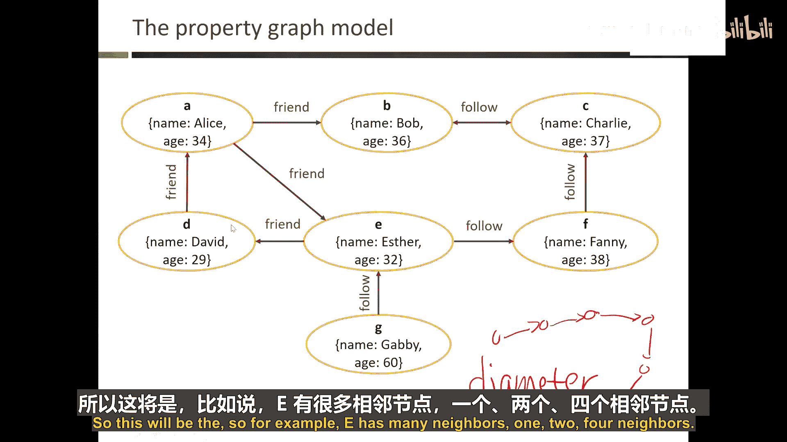
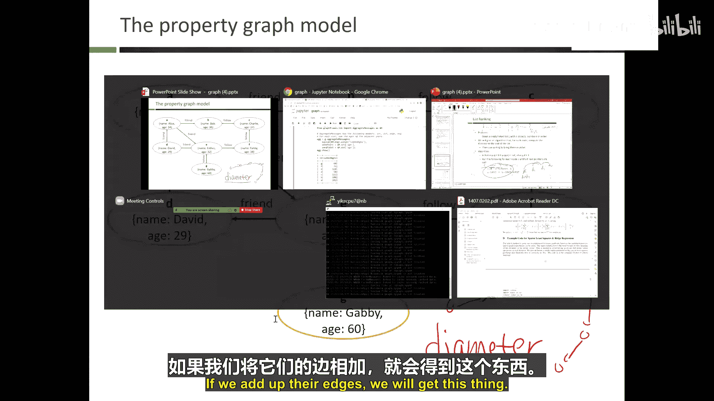
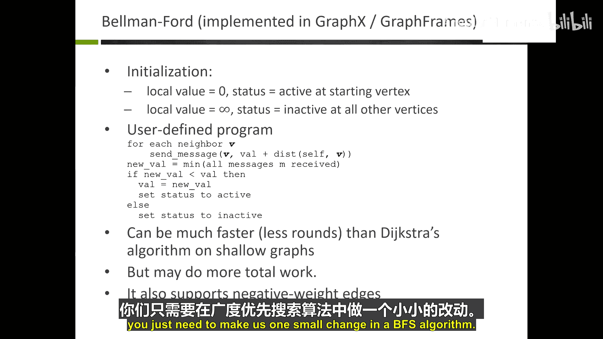

# 【香港科技大学】基于Spark的大数据计算--Big-Data-Computing-with-Spark-p19-08-03-02-Pregel模型--BV1V8FmzuEHf_p19-

诶。I'm gonna。Introduce this。So called fragile model of computation。 But before doing that。

 another primitive provided by a graph frame is this thing called aggregategregating message。 Okay。

 mass message passing via aggregate message。 So aggregate message provides a tool for you to send messages between whates along the edges。

 And then you can use this to aggregate messages sent to the same vertex。

 So let me give you one example to。To， to， to to illustrate what I mean here。嗯。

So message passing real aggregate messages so。Well， this is。

 I first to import that this is not in there directly， but it's in graph frames。

So it has it so suppose the the computation I want to do is just for， you know， illustration purpose。

 I want every。Person to。Addd up。The ages of。His or her neighbors。 Okay。

 where direction of the edges will be ignored。 For example， A has three neighbors， like B， E， D。

 and they have age 36，32 and 29。 I want to add up this33 edges，3 ages。Of course。

 I don't know whether I'm doing this， but this is this just one example。 Supp I want to add。

 add up the。Add up the some attributes， or maybe not addition or taking the max or would have some aggregation function。

 aggregates of the neighbors。I can do this by this primitive， as follows。

So I call aggregate messages on this aggregate message will have three。 Well， have a number。

Prirameterters， some are optional。 Some are necessary。

 The first one ist necessary is a compulsory parameter。 right。

 you need to use this to tell graph frame what you are So what you are aggregating。 Okay。

 so here we are doing a sum， right， So I'm saying。 So I'm gonna do a sum。 This is this is， in fact。

I this sum is actually the sum sum function defined by sparse equals functions。 Okay， so it's it。

Insside function is also called sum。 but， you know， to differentiate between Python's own sum。

 I call it。 I rename it as S Q L sum。 Okay， so this will， this is a sQl sum。

 So it takes a column as input and produce a column as output okay。

 but this column is must is a special column。 This the special column because here we what we want。

 we want to aggregate is。The ages， right， the ages of all the of all all the neighbors。

 So you can consider as a， consider this as a， as a special column provided by this aggregate message object。

 Okay， so this， this is a special object defined by graph frame。 It has a member called S G。 Okay。

 this has this number M S G。 So it contains the message sent to this。😊，Vortex。

And then in the following two optional parameters， you define messages。 One is called sent to source。

 The other one is called sent to destination。 So namely， you can send messages along。

Either direction sent to source is。Yes， what message you are sending to the source。 So here。

 because we are sending the age in both directions。

 So we we are saying that I'm gonna send my age attribute to both the source and the destination。

 so essentially what is doing this， What is happening。 when graph frame execute this。

 it will this for every edge for every edge。 So here I define both send to source and send to destination。

 So along every edge， graph frame will send two message， one send to the source。

 one send to the destination。 And in this case， the message itself is both age so the message contains the age。

 And then when you when you add them up， it will give you the aggregated message in this case is is the sum of ages。

 and I can can give you the new name， some ages。 So this。Is。

 this is actually a define a transformation， although it is a special type of transformation where the transformation is defined by message passing and aggregation。

 Okay， and then we can list the result。 So this will be the。So， for example。E，'s see。

 E has many neighbors，1，2。

Forour neighbors， if you add up their ages， maybe we get this thing okay。

嗯。So， however， this aggregation aggregategreg message is rarely use on self。

 It is more often used in this model called P。So what is pre？

Pro is actually another product from Google。 Okay， I， I mentioned this briefly in the first lecture。

 So the P is， is is Google's graph processing system。 graph processing system。 So it in Pro。

 they use this model called vertcentric computation。 So what is vertexcentric computation。

 So essentially， you， when you write or when you define a graph program program to be run a graph。

 you cannot write it， you cannot access the graph。😊，As if it were stored in something。

 a standard fragmentation， like a like a list， because that way， the algorithm will not be parallel。

 So you can only express the computation on the per vertex basis。 So namely。

 you write a program and the schedule will run your program on every vertex and they will run this on every all the vertices in parallel okay。

😊，So in inside a program， you can define one or any number of local variables together with a binary state。

 which is active or inactive。 Okay and P will execute your program in a run by round basis。 Okay。

 run by round basis in every round。😊，It consists of three steps。

 The first step is it every vertex will first aggregate messages from pres rounds。

 If verortex is inactive， it will be activated if some messages are received from thes round。 Okay。

 of course， in the first round， this step is nothing。

 This is this steps empty because no messages have been received from the pres round。😊，Okay。

 and then after aviating the messages received from the press round。

 each active vertex can update its local value and then send messages to neighbors to neighbors。

 Okay， and then finally， it optionally set its stay to inactive。 If a vertex inactive。

 then it will the system will not look at it。 Okay， unless it receives a message from its neighbors。

 okay。😊，So if you look at this， it's really very similar to it's very similar to map reduce right in the map reduce。

 we also have this three steps right first step is to receive the intermediate key value pairs。

 share the same key， and then in the map stage， we do computation in the next stage。

 we can send messages to other workers。😊，There are two differences。

 Deerence  one is that this is much fine is this operates at a much finer granularity because this。

 we're gonna run this on， on the per vortex basis。😊，In mapreuce。

 we run your mapuce program on the per worker basis。 Okay， so the granularity here is much finer。😊。

Okay， second is that here， the message can be can only be sent along the edges。

 you can only sent from source to or decision to source in mapuce， you can send to any worker。

 as long as you specify the key so so there are some similarities， but theres how some differences。

 Okay， so this is particular design for graphs。 because， you know， for graph algorithm。

 typically it only makes sense to send message messages along the edges。

 you don'ts no need to send to an arbitrary vertex。Okay， so that's the pressure model。 Okay。

 let's just first give you one example， a simple example， a page rank。How to。

 how to compute page rank using the pressure model。So啊呃。So initially， the local value is set one。

 which is initial paid rank， and the data is active for all vertices。And then the the vertex。

 the program written for every vertex simply looks like the following。 So first。

 I sum up all the messages received from the rank。 the messages will correspond to the contributions。

 remember that we in page rank in every iteration we update the page rank of a vertex by summing up all the contributions from my incoming neighbors。

 and then plus a a damping factor 0。85。 Okay， and then the value will be my new page rank。

 so in the next round， I'm gonna send my new contribution。

 which is my own page rank divide by my own our degree。 I send this to my all my outgoing neighbors。

 and this messages will be received by them。 in the next round。😊，Okay。

 so this is how we can simply can we can， how we simply can We can implement page rank。 Okay。

 so if you look at this， this have the same algorithm as we implemented earlier。

 except that there we use， we use the join and， and grew by。

 So here we are not using them explicitly。 we are。😊。

Implementing this algorithm inside this vertex centric model of computation。Okay。

 so now let's look at how this can be implemented in graph frame。Okay。

 this is prior a model of notation。Okay， so。Yeah， this is how we can implemented that。

 You can see using the project model， the the program is is even shorter than compare with using either data frame or RDD。

 okay。Okay， we first define a graph。 Okay， the same graph we we we， we use earlier。

So let's ignore this first。 I'm gonna explain why I need to do this later。 Okay。

 so I define the graph frame。 and for page rank， I so we just run for a fixed number of runs。

 Let's say 5。 Okay in the next time， I'm gonna show you how to run programs where there is a termination condition。

 So here， communication is very simple， just the max number of iterations。 Let's say 5。😊，Okay， so。

 so this form of defining a computation will be very common as， as。

 as you will see later in spark streaming， they also use this， use this kind。

 this format to define computation a lot。 So this is known as， as builder pattern。 Okay， so namely。

 you build your computation by specifying。A arbitrary number of parameters。

 and you can specify them in actually in an arbitrary order。 Okay， so the。

 the benefit of this is that when， when， when you want。

 when you build something that has many optional parameters。

 Then this builder pattern is easier to use。 you just specify the， the。

 which parameter you want to change you want to change from the default behavior okay。For example。

 max iteration is one optional parameter。 Okay， so we use this builder pattern to change the default。

Max number of iterations。Okay， so the next one， so the next one is called with vertex column。 Okay。

 so this naming means be weird by what it， what it really does is it correspond to。

It correspond to this line， okay。Crepon correspond to the first line， name namely， it defines what。

Should a vertex do with respect to all the incoming messages and how it should update its own。Value。

 its own local value。Well， first of all， we need to say how the local values are handled in graph。

 say。Well， in in the in the in the original model， Pra model， right you can。

 you just write a short program， a function for each program for each vertex。 So you， you can define。

 actually define a local variable。 So here we don't， we don't we cannot define local variable。

 So that's why were gonna embed any local variable as just as another additional column of the vertex of the vertex of the vertex data frame。

 Okay， so namely， it defines a new column called rank so this will be added as an extra column to the vertex to the vertex data frame。

😊，Okay， so this will serve the purpose as a local variable。

Because we're going to add this column to every vertex。 Every vertex has this attribute。

And the second parameter is initial value is just 1。0。

So here you have to use this lit function so that you can can turn this into a column right So because everythings a column。

 So this is a， this is the name of the column。 This is the initial value of the column， okay。

And the third parameter is the update rule。 How you update your local， your local variable。

 namely how namely how to update this column。In each。Okay， so the rule here is， you know。

 I'm gonna sum up all the message received。Times times 0。85 plus 0。15。 that's the rule。 Okay。

 so I me just copy that here。 The only thing that I have to consider to， to， to take care of。

 take to take care of is what if I receive no messages。 So in fact， even in this pseudo code。

 I should say to be entirely correct。 What should I do when no message is received。Well。

 when no message is received， that means you have no contribution coming in。

 So that means that means this， this parts should be 0。 and you only get this 0。15 this， this。This。

 this term。So we use this function coalce。 So know that this is。

 this is the spark equals function coalce。 Well， actually Sp has spark Sqel has two coalce functions。

 I personally。Think this is not a very good design。 they have very different purposes。 Okay， earlier。

 we， we use coalce or repetition。s actually， repetition is done via coalce。

 So coalce can be used to repition the data frame， but here in spark sqel here。

 This coalce is used to return the first column that is not now。 Okay。

 so it's complete something completely unrelated。 anyway， so here that's why we hear we inch。

 we import is coalce。 but we actually will override the other coalce。Anyway， well， if you。

 if you need both， you， you just give it a new name。So。

 so what this does is if first check if this is empty。 So if this is。

 if this is now is if this is empty， then it will simply return 0 and then multiply by 0。5。And and。

And then plus 0。0。15 okay？嗯。But before doing this， and there is also a。

You also also need to specify how you aggregate the messages because the verex may receive multiple messages。

 And this， this parameter。 Okay， in the builder function is actually necessary。 Its compulsory。

 You have to define the aggregation method。 Okay， so here I want to add them add up。

 So here I add them up。 Okay， if no messages， if this is nothing， then the sum also returns none。

 actually， is's not 0。 Okay， its none。So that's why we need to coalesce here。Okay。

 so essentially with vertical columns， this part correspond to the first line， okay。And then。

I also need to define what messages to send out in the next round。

 So this is this correspond to this line。 Okay， this line。

So now I realize that I also need our degree。 our degree。 So that's why I need to。

Reset my veres the data frame to G dot O degrees。 Okay， so G do L degrees， this is。

The same as the vertical data frame。 But with additional column known as our degrees。

 And then I build a new data frame。 Okay， with the new V now the new in the new V。

 I have this new column。Called our degree。 I need this because I need to。 I need this information in。

Deciding what message to send out in。For each vertex。

 So this is defined at using send message to destination。 Well。

 they also have send message to source。 So in case you want to send message。To the source， okay。

Inside this thing， you can use Pro dot source or P dot destination。

 So here we only need a source because we are sending messages from the source to the destination。

 right， and the message itself。Simply consists of one，1 term， which is the rank。

 the total rank of the source divided by the R degree of the source。O。And then finally， we can。

 you can do。run， okay。So after this， the。So the， the ranks will be computed and you can， you can。

 you can retrieve the result。 Okay， so。So this is the result， and the page rank computed。嗯。

So the the preal computation result is returned as data frame that consists of the original vertes vertex data frame。

Together with the with column， with worst column method that introduce。

 that may introduce a new column。 Okay， and the new column will， in this case。

 contain the computation result。Okay， so this is the fragile model in graph frame。

 that this is also available in graph X。Okay， so just to summarize how to use pressure model。

 you first use build builder pattern to describe the operations。 you call run to start a run。

 and it returns the data frame of veres from the last iteration from that iteration。

 So when a run starts， it expands the ver data frame using the column expression defined by with column vertex。

 So namely it it initialize this and then perform every round。And then it aggregate。 Well， yeah， it。

 I should say it。 And those additional ver properties can be changed during the pressure iteration。

 So it's the the update formula is written down here。啊。In iteration， there are three is。

 three phases， right， the first， the first phase is the message sending。 So actually。

 it runs this first。 Okay， it runs this first。 Oh， not not I。It actually， yeah， it， it's。

 it runs this one first and。And then it of course， But here。

 the messages refers to the messages received from previouss around， right， and then it。

So I think yeah， this should be。 this one should be the they actually， they run this first。 Okay。

 the aggregate message receive from thes run first。

 and then they update the local update update this new column。

 which is used to store the local values。 And finally， they sent new messages out。 okay。Okay。

 and yeah， this in， this should be。This should be the second step。Okay， and then along each edge。

 it will send messages That's last step。In everyone。Okay。Okay， any questions。 So this is。

This example is actually provided by graph frames graph frame as as one example。

So the last example is， again， B F S。 So for in for B F S， the P gra program is also very simple。

 Okay， the p algorithm looks like this。 it's so。Okay， yeah， I think， yeah the， yeah。

 the order is slightly wrong， yeah。I should do。 Yeah。 I should do this first。 Okay， and yeah。

 so so namely， it， it first aggregate all the messages received and the aggregation is minimum because initially。

 the local value will be 0 for all the ver。For the initial for the stocking vertex and。

 and its infinity for all other veres。 So this local value essentially is a。Distance。Okay。

 so initially， everybody else is infinity， but the source 0。

 And then the source will try to update its neighbors。 Okay， telling them， okay。

 you can be reached with this is  one， which is 0 plus  one。 Okay。

 so that's why that's what we mean by here by send messages to all its neighbors。Yeah， and then。

 and then， and then， and then after my neighbor has received my message， of course。

 other people may also try to update my neighbor。 And when my， my neighbor will take the best value。

 namely the minimum value。 Okay， minimum message received。

 And if the new value is smaller than its its current value， namely， it has found a new。

 a new shorter pass。 it will update its distance to the new value and sentence a test to active。

 And it will， again， try to update its neighbors。So， this is the。B F， S example。

 So how do we implement that in graph frame， Okay， so this is， of course， this is not the only way。

 but I I'm right I write this ways to illustrate the the scenario where you can define two columns。

 Okay， two additional columns。 So this is useful when you have multiple more than one local variable。

 So here one local variable is distance。The other local error is whether this vortex is active or not。

 okay。So how to whats the roof for updating distance。Well， initially， it's very easy。 If it's source。

 then 0， otherwise is some big number。 Okay， infinity。

 And then the rule for updating is okay for my message。 Okay， the application is this minimum， okay。

 if the。If this message is smaller than my current value， then I'm gonna update it。 Okay。

 Otherwise it's the same same the same old same result。For the active domain。

 for the active label flag， initially the source is true， otherwise is false。

And then the ugly rule is the same。 If the new distance is shorter then it becomes active。

 otherwise it' inactive。Okay， so you can say how to specify multiple local variables and specify the rules for updating these local variables。

Okay。Finally， the message is simply， again， from source to to destination。 Of course， there is。

 if the source is not active， then there's no message。 So only when source is active。

 I send a message and the message itself is the distance of the source plus  one。Okay。And， and yeah。

 and that's it。 And you when you run it。 when， when， when term。 So it。

 so here I don't specify a max iteration。 I will run it until no message is sent。 So in。

 in model of it will terminate when。In a round， in in when in a around， no message is sent。 Okay。

 so namely， all the boxeses are inactive。So the next question， the next problem。 Okay， also。

 the last one we want to discuss is short test。 This is really an extension。呃 of the BFS problem。

Because if all the。If all the distances。No， I'm sorry。 if all the edges have the same lens。

Then the shortest test problem and the B F S problems。Problem will be will be the same thing。

 will be the same pass。 However， if the shorts， if the edges have a different lens。

 then B F S may not find you the short pass。 B F S can only find you the short pass in terms of the number of hops。

 okay， and to find the short pass， the classical algorithm is this one called text algorithm。 Okay。

 so I won't have time to go through this algorithm。 Well， if you are a C S major。

 you should have already learn about this。 if you forget then you should go and go back and and review。

 Well， if you are not a C S major， you may not have seen this。 But anyway。

 let me just illustrate how this works on an example。Okay， so I will not prove why this is correct。

 The proof is more difficult， but I will try to give you some intuition why this is why this algorithm indeed finds the shortest has from a starting point So similar to B F S。

 we initialize the distances to infinity except the source S 0。 And， and by the way。

 this is a director graph this So this is actually more general。Okay。

 so the algorithm will have an iterations。 Okay， where n is number of vertices。

 So in every iteration， it will mark one vertex as， as done by done。 I mean。

 we have already found the short pass。 So in the first generation。

 only the source S is marked as done。 Okay， because it is obviously source to the self is the short pass。

 Okay， in the next generation So which vertex can we declare to be done。😊，Then that what idea is。

 okay， you just， okay。Oh sorry， I'm sorry， so。In in every eeration， first。

 the most recently done vertex。In this case， in the first integration。

 this case is just source zero S。😊，S will first try to update。 Well try to improve its neighbors。

 Okay， S has two outgoing neighbors。 T and y。 So S offers a pass of distance 10 to T。

 and 10 is better than infinity。 So T will update will update its local value to 10。

 And then y similar will also update is local value to 5， because0 plus 5 is 5。

5 is better than infinity。Okay， and then D algorithm will declare the current the vertex with the smallest distance to be done。

 Okay， so namely here， y will be done。 Okay， and the claim is that you know。

5 is the best possible is no， you cannot find any better pass。 any pass better than 5。

In the first step， this is kind of， this is actually easy to see， right， because。5 must be the。Small。

 shortest。Ege going out of S。 Okay， so any other pass reaching Y must be must have length at least 10。

 right， if you， if， if， if that pass goes via the other edge。

 So cannot be possibly better better than 5。 So this five must be the best one。

 You cannot possibly improve that。 So algorithm we will mark 5， we will mark Y S done。Okay。

 so that finishes the first iteration。 In the next generation。 again， two steps。 Step  one is the。

 the， the most recently marked vertex。 In this case。

 Y will try to improve its neighbors Y have three neighbors， T， X， Z， So it will try to update。

 improve all of them for T Y can offer a pass with distance 5 plus 35 plus 3。 So 5 plus 3 is 8。

8 is better than 10。 So10 will be improved to 8。😊，The other K cases will improve infinity to 5 plus 9。

14 in 5 plus to 7。 Okay， so， and then the algorithm will declare the vertex with the smallest distance。

As done， in this case， is Z， which with distance of 7。

And here is actually not that obvious why7 is optimal， but extra prove that this is optimal。

 Okay 7 code cannot7 cannot be improved any further。 Get 7 must be the short pass， okay。

 so but anyway， let's continue。7 will be markets done。 And then 7 Z will try to update。

 improve neighbors。 So Z has two neighbors。 S and X。Well， S is already done。 So we ignore that。

 And indeed，7 plus 7 is 14，14 cannot in is no better than 0。 and 7 plus 6 is 13。

 So 13 will replace 14 okay， and then。The vertex with the smallest D， which is 8， in this case。

 T and T will be marked as done。 Okay， so 8 will be marked done。 and then。

T will try to improve its neighbors。 T has two neighbors。 Y and X。 Y is already done。

 So so T will only will only try to improve x。 So 8 plus 1 is 9，9 is better than 13。

 and then 13 will be updated to to 9 and9 will be is only and also this the vertex with small D。

 which which is x。 So and， and then then we are done。 So we have found the shortest distance。 Okay。

 this only give the distance。 If you also want to function choice pass。

 every vertex simply remembers。The best option， where the best option came from。 Okay， for example。

 if you look at x， the first pass reaching x is from y with a distance of 5 plus 9 is 14。 So x。

At that point would would would remember why it was why who offered me the pass of 14。 However。

 later， will X has changed its mind because Z had offered a better pass of length 7 plus 6。

 which is 13。 So X will update its will update its will change its mind。 So x will remember that Z。

It was they who offered me my current best pass， wishes is。30。ButHowever。

 in the in the next in the last generation， T offered an even better pass， which is 8 plus  one 9。

 So x would change， would change his is might again， So remembering now that I should go with T。

 okay， so essentially， every every note remembers where my best option came from。

 And this must form a tree。 Okay， starting from S。 And this is called the short pass tree。

 And if you want to go from S。 So anywhere you just follow the tree。 Okay。

 this will give you the shortest pass。😊，Okay， so this is the the extra cell algorithm。Okay。

 this can be proved to be optimal it indeed find source has from source S to all the other veres。

But unfortunately， as you can imagine， this is highly sequential。

 This is runs in a sequential manner because every step， only one vertex will update its neighbors。

 And after that， I need to find the vertex with a smallest D。 Okay， so this， and。

So one natural idea is， okay， the first step seems to be paralyzable， right。

 I would just ask everybody to update their neighbors。😊，At the same time。 Okay， so essentially。

 everybody tries up their， their neighbors， and they can all do in parallel。 Okay， however。

This will destroy， will destroy the correctness of that algorithm， because remember。

 the order in which the ver are marked done。 depends on the sequential execution of the iterations because this these this distance will change every time a vertex is marked done。

 Okay， for example， when 5 is done then the 10 becomes a Infin becomes 14 and infin 7。

 And then if we performed updates at same time， then it not clear how we should financial test。Okay。

But however， it has been proved that。 So if we， if we run this， okay， if we update。

 if we ask all the voltage to perform the improvement to perform updates simultaneously， okay。

You can still guarantee crackness as long as you do this。Aleratively， until nothing can be improved。

 Okay， so， so in， so in code， the algorithm will look very similar， almost the same as the B。

 F S algorithm。It's actually a very surprising result that this such a simple algorithm will just work。

 and it still give you optimal solution。 Okay， so if you compare this algorithm with the B F S algorithm。

 the only difference is this one。 Okay， in B F S here is one。

 because every other every edge has length1， so here we just replace that one by the actual distance of that edge from this note to my neighbor。

 Okay， So so essentially this can be considered as a just a general version of B F S。 Okay。

 it's very similar。 just changing is one difference。 However。

 it turns out that this can be used to find short test。

 and you just run this until all the notess have become inactive。 Okay。

 so let me give you one example。😊，Okay， in this case， we even have。Edges with negative weight。 Okay。

 so that algorithm doesn't work if there are negative weight weight， negative weights， because。

 right， if there are negative weights， for example， let's say if the weight of this guy is。

 I don't know if this is。Let's say is okay， not not this one。 if the weight of this is negative9。

 Okay， and then the D D algorithm would make a mistake mistake in the very first iteration。

 because in the first iteration， Dx algorithm will。

 will will declare 5 to be optimal because 5 is the smallest D， among all the among all the voices。

 However，5 is not optimal， right， because if this edge has a weight of negative 9。

 then a better better path is S T Y and that distance is one1 is smaller than 5。

 So D algorithm needs assumption that all the edges have。😊，Part of non negative ways， okay。

This algorithm， actually known as Belman 4d。 Okay， this handles also handles negative。

 negative weight edges。So。Okay， so initially， only a is active。 The others are inactive。 Okay。

 because they have distance infinity。 Remember that the algorithm is essentially same as B say。

 same as B F S， except that except for the for the single difference where we change this one to the actual distance of the edge。

😊，Okay， the only active edge， vertex a。We will try to update its neighbors。 Okay。

 so we do just do just do the updates。 So B is update to 6。 And this is update to 7。 Okay。

 using the same rules as as in the B， F S。And then 6 and 7， or B And D will become active。

 And A will become inactive。 Okay， so every time the verortex has send messages to his neighbors。

 it will become inactive。 remember， and every for every word。😊。

Every time a vertex receive the message， the， the vertex will be activated。Okay。

 so in the next generation， both B And D will up there， will up their neighbors simultaneously。 Okay。

 so theyly the same messages in parallel out to all their neighbors。 So that means a neighbor may。😊。

Receive two messages，In the same manner as in the B， F S algorithm。 Okay， So for example， here， yeah。

 C will receive two messages，1 from B，1 from D， because C is a neighbor of both B， B， both B and D。

After receiving two messages， C will will do comparison， right， C will。Take this take the better one。

 More precisely， the message from B will be 6 plus 5 and 6 plus 5， which is 11。

 and the message from D will be 7 plus negative 3， which is 4。4 is smaller。

 So C will update itself to 4。 Similarlyly， E has two two options。 One is one is 6 plus negative4。

 which is 2。 and 7 plus 9 is 16。 So two is better。 Okay， So after this iteration。

 C And E will become active and B And D will become inactive。

 There are still active versus in in in a graph。 So iterations will continue。😊，in this time。

 this time， C N E will try to update their neighbors simultaneously。So see， in this case， it， it's。

Its， is， iss all the all iss all。 right So B， A， A， B， D， Let's consider a first。 So A has。😊。

One incomming message。2 plus with 4。 So 4 is not better than 0。 So 4 will be ignored。

 and a remains inactive。And B has two incoming messages，4 plus negative 2， So which is 2 and2。Okay。

 B here this， this direction is here。 So yeah， B only has one message incoming message。 So it's2。

And D has。Oh， D has no incoming messages。 So， so B will be updated to 2。

We still have one active message， active vtex。So two。Will update C。 Well try C。 So 2 plus 5，7。

 no better than 4 and 2 plus negative 4， which is negative 2。 So this will be ugly to negative 2。

 Yeah， yeah， this， this should be marked red。 and this will be marked blue。 Okay。

 and  two plus 8 is 10。 So yeah。Yeah， so the in the last in the So after this。

 after this re iteration， E is the only active verortex。😊，And finally， he will try to update。C。

 negative 2 plus7， which is 5， not better。Nive 2 plus 2 is 0。 No better， so。

And that it will become inactive and nobody else is activated。 and the algorithm will terminate。

 Okay， so this is how this algorithm runs。As you can see that， indeed。

 we can perform parallel updates。 Every active verortex will update their neighbors in parallel。😊。

So it can be but。However， you can can show that in the worst case。It requires an iterations。 Okay。

 so， so namely， in the very worst case， it can still be very bad。 However， for most real world。

 for most real world shallow graphs。嗯。It can be much faster。The number runs taken。

Needed by Bowman Ford is much， much， smaller than M。Texas algorithm will need any its。

 This one will need much less less， however。In the very， very worst case。

 it can take still take any iterations， but that almost never happens in practice。

 So this can be much faster in parallel， although it， it does involve more work。

 So as you can see that。Yeah， it does involve involve more involve more total work。

 because there can be a lot of active veres in each round。 And index Dex algorithm， only one node。

 one world text is active in each iteration。 Okay， so again， this is a trade off。

 if you want better parallel time。 you have to do more work。 Okay。

 so this is we have seen this phenomenon quite number， quite a number of times。Okay， and， and。

 and lastly， it also supports negative weight edges。

 While X algorithm cannot handle negative weight edge edges。Okay， so I don't have code for this one。

 because it's really。Almost identical to B F S。 So I， I leave， leave this as a exercise for you to。

 to， to write the code yourself。 You just need to you know make us one small change in the B。

 F S algorithm。😊。

