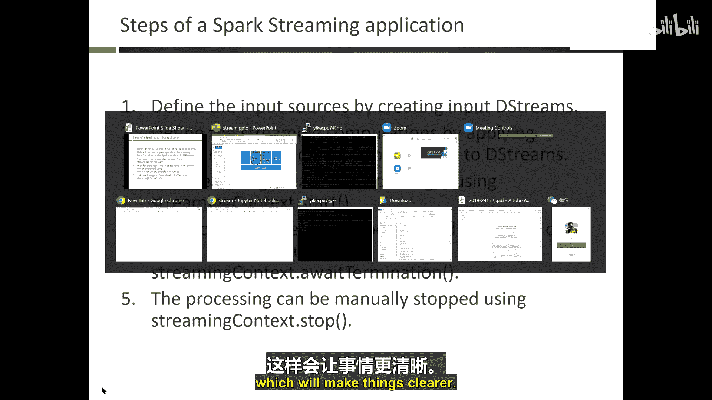
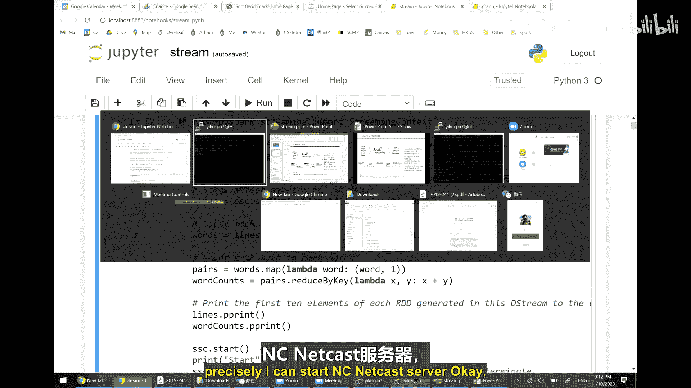
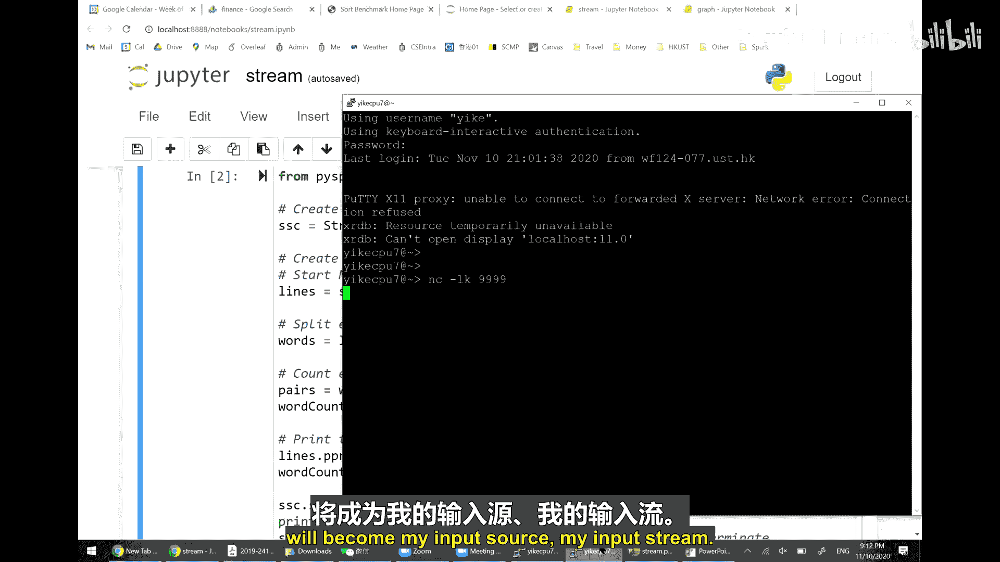
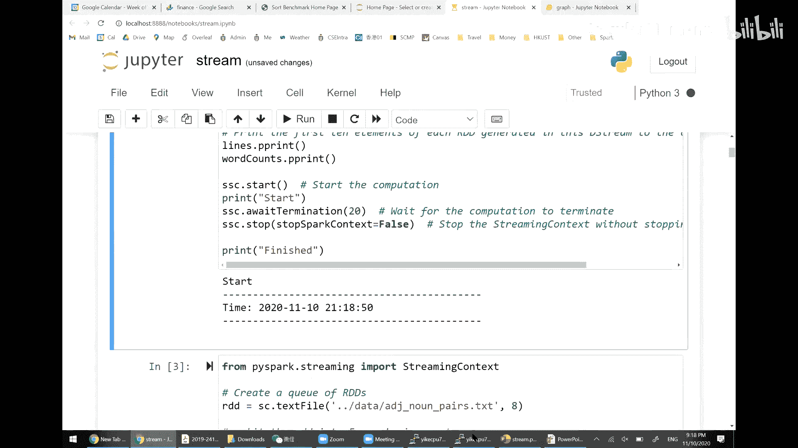
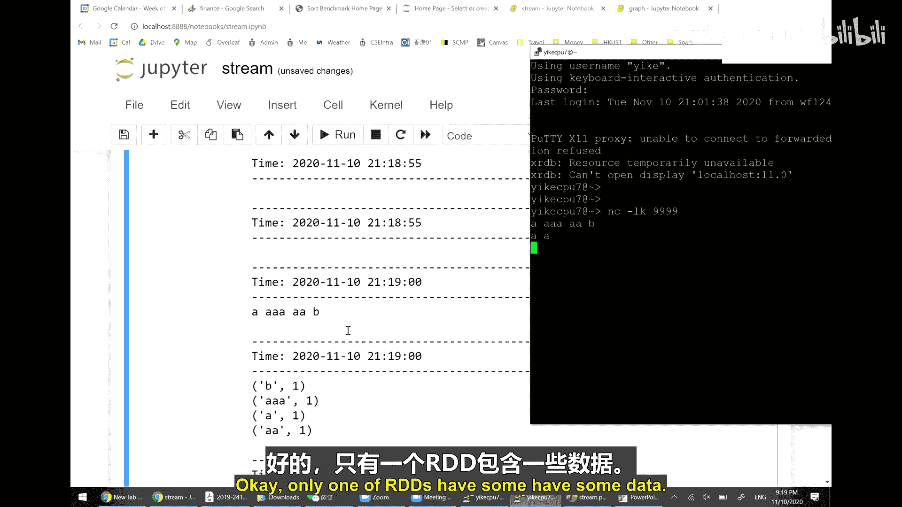
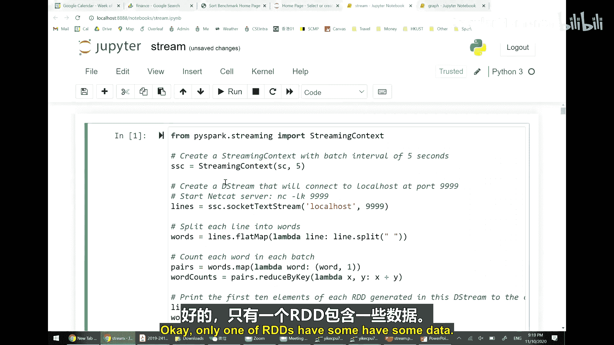
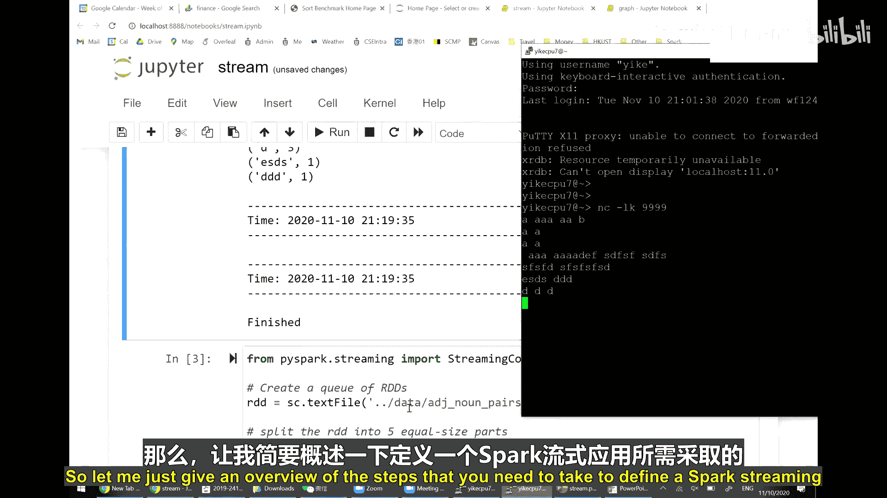
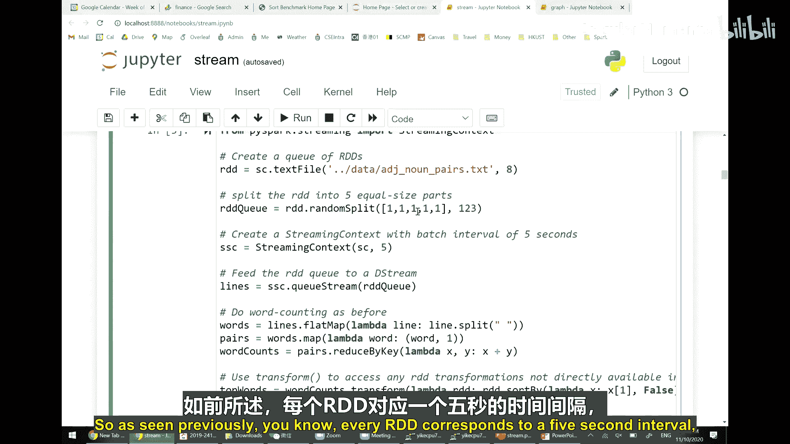
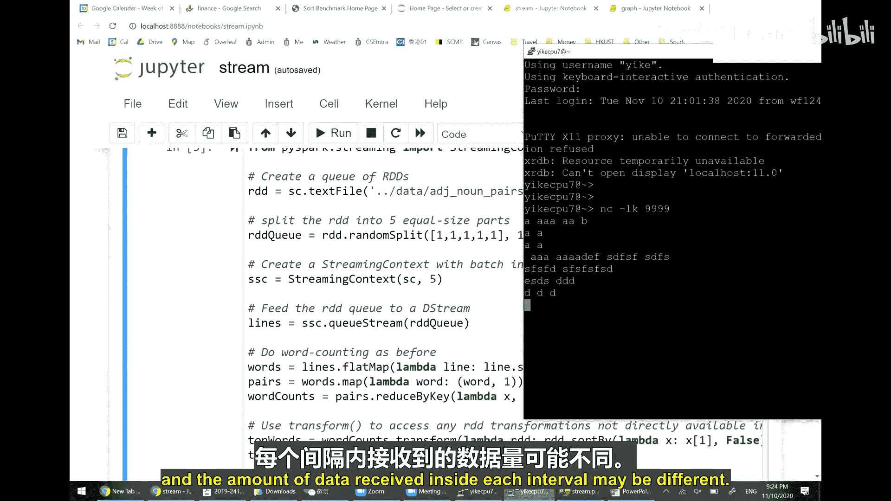
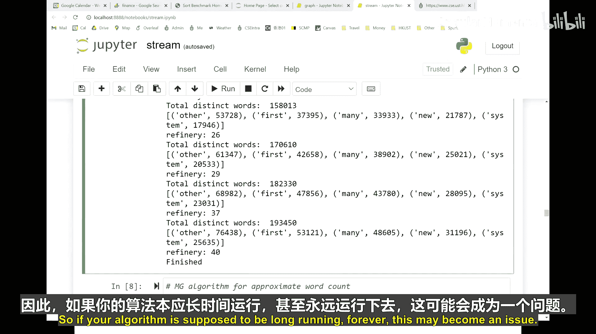

# 【香港科技大学】基于Spark的大数据计算--Big-Data-Computing-with-Spark-p20-09-01-03-首例分析--BV1V8FmzuEHf_p20-

So actually similar to machine learning and graph processing the streaming component of spark has is also being migrated from RDD to to to spark SqL okay the the the SQL based streaming component is actually called structured streaming。

 structure streaming。 This is this is actually still in development Its not quite stable yet。

 this is actually structure streaming is the most active most actively developed component of spark。

 So theres still some features being being fine tuned。 So and and also the streaming component。

 structure streaming is is not a is not there is not intention as a complete replacement of spark streaming。

 So we we will discuss both the R。D based streaming component。

 as well as the Sprs sqL based streaming component。Well， the other two。

 like machine learning and graph X and graph， the SQL based will completely replace the RDD based APIs。

Streaming not there yet。 but， but， but but， but but things are moving。All right。So。

We mentioned that streaming your social velocity is。

 is another very important calculation of big data and because many real world analytical。

Tasks are should be done in real time。 right， So as， as data arrives。

 we need to make decisions in real time。 and any delay would。Imply missed business opportunities。

 okay。嗯。Actually， also，'s talk， he also mentioned that， you know。

 one of the important features of A B is to support real time analytical processing。

 right we want to， we don't want to delay the decision until until the next day， okay。So it spark。

 so actually we've also mention a fllink briefly next time。

 but we should take a different approach because spark was initially designed as a batch processing system。

 and streaming was added after the batching part is done。 So， so the the， the。

 the approach they take is to you know， run streaming and processing on top of batch。

On on top of batch processing。 So， so， so still want to leverage on the effort they have devoted to RDDs。

 So what they do is is therefore to consider any stream as a sequence of RDD。

 So this is also known as the the mini batch approach。

 so they are still divide them into batches although the batches here are smaller。

 right so typically when we talk about RD， maybe at least a few a few hundred mac big here。

 these mini batches can be much smaller。 And every mini batch correspond to a potentially small small time interval。

 maybe just a few seconds， okay。So what they do is to divide a stream into many mini batches。

 Every mini batch is an RDD。 and the whole stream， it will be called a D stream。 Okay， also。

 standing for discretized streams。 So they are not continuous。

 but chopped up but chopped up into chunks。 Okay every chunk correspond to one time interval。

 and you can define the length of the interval。 Okay so of course， there， of course。

 there will there will will be a tradeoff because spark is is very good at batch processing。

 So if the mini batches are larger， then they you have better。

 better performance higher throughput you can process more data， you having more parallel。 However。

 larger batches also imply longer latency。 you have to wait until a batch。

 mini batch is finished before you can。😊，In before you can include this interval， this batch。

 mini batch into your computation。Okay， and after having defined this D streams。

 then you can still apply almost every transformation that was available on RDs to a D stream because a D stream is nothing but a sequence of RDDs。

 So， for example， you can do it can apply a map or flat map on a D stream and that will result in that that that will produce another D stream and the new D stream is nothing but applying this operation on every。

😊，RDD that comprise this D D stream。 So for， for， for example。

 we can write a streaming algorithm streaming a program to do word count。

 I namely we want to count number words for every mini batch。 Then you can。

 you can do a fly map and then do a group by and then they can do count。😊，Okay。

 so let me just illustrate this by。Show you the example code。Which will make things clearer。

Okay， so the streaming entry point is a streaming context or S S C。 Okay。

 starting for spark streaming context。 Okay， this is the streaming streaming entry point。

 when you unlike S C spark context。 if you run your program in a jupyter notebook or the interactive shell S C。

 right spark context is already initialized。 You can just use it directly。 but for streaming context。

 you have to initialize this yourself because you know。

 you have the system doesn't know the the batch in the batch， the batch lens。

 so so that you can when you initialize your streaming context。

 you have to tell spark the interval lens how long you want your each batch to be。

 So here the I want each batch to be 5 seconds。😊，Okay， you can， you actually。

 we create a streaming context out of a spark context。 So S C is a spark context created for you。

 Okay， so we can build a streaming context out of it。😊，Okay， so a streaming context。

 So for any streaming application， streaming application， we can。The， the， the input can。

Come from a variety of sources。Okay can come from a variety of sources， including Kafka F or H F S。

 Okay， you， you can also read the file as， as a as a streaming source and and the output can be a database can be also can can be can be simply the console can be a database can or can of be a file in the H F S or can be some other。

You know， B B I applications， for example， show you draw you a graph or histogram or et cetera。 Okay。

 so for the first one， I'm gonna use a socket， a stream a network socket as my streaming input。Lux。

 there is a tool called called netcast server。 and then you can。

 you can then you can use this tool to type characters and。

 and then this type these characters will be fed into a socket and which will be streaming input。

And so more precisely， I can start。呃。

N c嗯。That cast over I。Now， is the port。 Now， everything I type here will be will be will will will become my input source。

 my input stream。

Okay， so then so this defines my streaming input。 So so my streaming input will be listening at port999。

9。 So then what， whatever I type in that server will be sent into the streaming input。

 And this defines my input these stream lines。 So this is required that this is an a sequence of RDD1 RDD for every batch for every 5 seconds。

Okay， so suppose I want to do word count， word count for every batch is almost identical to the RD computation where we use a flat map。

 to map to， to map the line to words and then map the words into a key value pair。

 and then I do a reduce by key。 Okay，s same as before。 So if， in fact。

 these three lines are the same。 exactly the same。 except that。😊，Words pairs。

 What kinds they are no longer R Ds。 They are now these streams。 Okay， however。

 all the transformations R T Ds are still available on these streams。 Okay what。

 what spark will perform is simply。呃可。Yeah， I simply perform this these operations on on， on。

 on each RD。Okay， again， and and similar to RD， all these are transformations， no， no actions。

 So they only defend a linear graph。 They define a linear graph。

Which will be applied on every RDD industry。嗯So。啊。To get output， we must use action。 however。

 in the case of streaming。Theres actually no action。 So even you， even when you print something。

 when you collect something， when you take something。

 it's not an action because streaming application is supposed to be long running。 you。

 you define the whole thing。All all transformations， transformation。

 as well as actions as any print or output operations or write to disk or or write to a file or write to another stream。

 These， all of them have be defined before you can start your streaming application。 So therefore。

 there is actually no print。 There is P print。 Okay， Stan for maybe parallel print。I don't know。

 Okay， So anyway。 So this will print the first elements of HD in this D stream to the console。 Okay。

 so I will print lines as， as well as the word counts。 Okay， so these are also。Not actions。

 They will not trigger the actual computation。 The only thing that triggers the whole computation is SC dot start。

 Okay， and still， this is not really considered an action because， you know， an RD。

 an action will block your driver program。 when， when， when we say I want to take and then。

This will action will trigger the con， and your driver program will wait until this action is finished。

 and then you can。You can do do do do whatever that will follow this action。

A streaming application is supposed to be long running。 So be long running in the background。

 So this will start a computation in the background。 Okay， so， so， so， so so as a。

 as a tactical note， your。Your laptop should have at least two cores in order to run it because the streaming application will take will use。

 use at least one core and your driver program will will actually continue。

 So that's why I want to print start to know that my streaming application has has started。And also。

 when does it finish。 Well， this will never finish， actually。

 because streaming application is supposed to be supposed to be long running。 But however， you know。

 when we debug， when we， when we are writing the code。

 We don't want to you kill my Jupyter notebook and restart curve every time I。

 I try to run my program， especially when there's a bug， you know， I want to I want it to stop。

 So you can use this wait termination。 So this will be blocking。

 this will block your driver program from advancing and we will wait for 20 seconds， okay。😊。

And then after that， you have to stop， stop your spark context。 Okay， stop context。And well。

 if you don't stop it， you can still run it， but you can now run again because the previous spark streaming contact has not been stopped。

 Okay， so that's why it's， is's actually good， good habit to stop the streaming context。 Okay。

 by default， the streaming context will also stop the associated spark context。But however。

 since we want to run it multiple times， we don't want to stop the streaming the the spark context。

 So we set this stop spark contact be false so that I can rerun it， rerun this program。

 If I also stop the spark context， then S C will be stopped。

That I have to restart my Jupiter notebook， which is not very convenient。And finally。

 I print I print finished so that I know my driver program is done。Okay。

 so let me first run it to get some intuition。Of how a streaming application works。

 So start has started。 So I better type something here。 Okay， A a。

AAB okay。II was bit too slow。 but anyway， they should be there。 Okay， say there。 Okay。

 and also the word count， okay。F I was so slow。 Okay， Only only one of RDD have I have have some。

 have some。

Data， but anyway， let's try again。Okay， so now you can get some idea for for every。

 So it's actually nothing but a sequence of RD computations and all RD computations are the same。

 Okay are defined by the same linear graph。😊，Okay， so that's it。 So let me just。

呃。是。Give an overview of the steps that you need to take to define a spa streaming application。

You first define the input sources by create by creating an input D stream。 In this example。

 I the input B stream is just the。Is its a socket。 can never suckcket。Okay。

 and then you define the streaming computation by applying transformations and output operations。

 So here， no， we don't call them actions because we don't want to confuse them with RD actions。

 we just call them output operations， because they don't。 They are not actions。

 They don't trigger computation。They say for define。What output is， Okay， and then the。

 we can start the start streaming program by calling streaming contact or start。 Okay。

 and then in the driver program。 Okay， well， in a real application， you can just。

You can just leave it because they then your streaming application will be running in the background forever。

 Okay， however。😊，During。Development， we wait for the processing to be stopped manually or by using a wait termination。

 And finally， we， we stop the processing by stop the stripping context， okay。嗯。

There are some notes to be noted， points to be noted。 So once a contact has been started。

 no new streaming am can be set up or added to it。 Okay， so namely。

 you have to define everything before your course start。Once the account has been stopped。

 it cannot be restarted。 so if you want to restart， you have to create a new streaming context。One。

 only one stream contact can be active in the JVM at this same time。

The stop by default also stops the spark context。 Okay。

 used to stop only the streaming context set optional parameter of stop called stop Sp context to false。

AThe spark contact can be reused to create multiple streaming contacts as long as the previous one is stopped。

 Okay， so that's why I stopped the streaming contacts。 I have to stop it。Before I can rerun it。

And finally， interrupting the streaming program in the share or Jupyter notebook cannot properly clean up the streaming tasks。

 Okay， so even if you run manually， you have to shut down the kernel and reopen the or you have to restart the kernel。

 So that's why， you know， that that， that's why is the common practice is。

 is to to wait a certain certain time long time。 you don't。 you do not forcefully interrupt it。 Okay。

 next， as you can see that。You know， typing， you know， from the terminal is not a very good idea to。

 to test your program。 So， so that's why when you， when you when。

 when we are writing a speed streaming program， which we， it's， we can。

 we can use another streaming source。 actually a very convenient streaming source is just a sequence of RDs。

 because speed stream。😊，Itself is a is a sequence of RDs。

 So they also provide this convenient streaming input so that you can。You， you can。

 you can very easily control what is inside each RD。 Okay， so here is one example。😊，Well， well。

 we let's say we first read a potentially big file。

 This is the additive non pair file we use many times。Many times already。 Okay。

 so we can read that into。Spark as RDD。 And then we split the RDD into， into five equal size parts。

Okay， by using random split。 Okay， so this1，1，1，1 simply means that they have equal， Yeah。

 they have E equal size。But they don't have to be equal。 So as， as in previously， you know。

 every RDD corresponds to a5 second interval and。

The amount of data received inside each interval may be different。 Okay， so here， yeah。

 they don't have to be equal。 but anyway， I certain equal here in this example。

 this is the random number， the seed in the random number generator。

Okay， and this is same as before。 Okay， so now to specify for the source。

 the to separate the input stream， I use Q stream。 Okay， Q stream。 So this expects a list of RDs。

 a list of RDs， which is exactly what random split can do when the split returns a list of RDs and that can be used。

😊，To define my input stream。 Okay， so now line， now you can do whatever you can do previously。

 So what it does， what streaming will do is it will simulate。 Okay。

 so it will simulate the stream input by reading data from this list of RDs more precisely it will read the first RD and feed that into your streaming program。

And wait for5， wait for5 seconds。 then feed the next RDD into your streaming program。

 So it simulates the in the the exact situation where your streaming program is receiving a sequence。

 a stream of RDD。😊，Okay， and then you can do whatever you want to as before。

So here we do the work count as before， and。A new。A new。Method， I want to。Talk about is。

I want is is transform。 Okay， so although spark has nicely， I think。

 in defined every possible transformation that is available on RD and migrated them to these streams。

 But in case you want to do something that is not available。

 you can use this generic method called transform。 So what how it works is the following。 So it。

 you can define any function。😊，The function will check the RDD as input， Pro RD as output。

 so then you can do whatever you want on each RDD in your D stream。 For example， here。

 I want to sort。 I want to sort by the frequency word frequency。 So I do RDD sort by this thing。

 Okay， and then P print。 So I call it top words。 And then I can。Rund this。

 so it will you for every five seconds， I receive RDD from the list of RDDs。

 and then I do the word count， you know， sort by frequency and then print them out into the to the console。

Okay。嗯。Okay， finished。So the reason I want to print finish in the end that is that， you know。

 if you are familiar with Juter no， no Jupyter notebook。If you just finish， then。

You cannot tell whether if you don't print finish in the end， you cannot tell whether this。

 because if you， we， if we， we， we don't print finished， then I think。Yeah。

 maybe maybe maybe you don't have to。 But but anyway， it it's。

 it's good to mark the end of the streaming program。Okay， so yes， some other notification。Notes。嗯。

So input stream are these streams representing the stream of input data received from streaming sources。

 Okay， every input stream is associated with a receiver。 So each receiver will require a core。

 So you need to allocate more core than the number of input streams。 Okay， so essentially。

 each streaming application will use at least one core。 and your driver program use uses another。

Okay， yeah， we have already seen some basic streaming sources like， like file like RDQ or socket。

 There are some other advanced sources like Kaf car F and kinineesis。In this case。

 we are combining streaming computation together with batch computation。 Okay。

 so this is can be very useful。 And is actually a nice feature of spark。

 My spark combines both batch computation with streaming computation。 So here the task。😊，Where。

 where we want to solve is find the most positive words in Windows of 5 seconds from streaming data。

 So what mean by positive。 Okay， so， in fact， we have a， we have a dictionary called this dictionary。

😊，ok。Yeah， so it's just some random dictionary I downloaded。 It。

 it has a sentiment score for every word。 negative score means it's negative， a positive word。

 A positive word means this word is positive。 A is positive。 A broad is positive。😊，No know。

 abuse is negative， Okay so。And then， by。If a word appears multiple times in a window。

 I will multiply that。 So essentially， I want to。F， find the。

 the most passive world in terms of in terms of the total sentiment score。 Okay。

 so this is an example where we combine streaming computation together with special quo。

 because the this sentiment dictionary will be stored in LED。Alright。

 so the sentiment will be read from the file as RD。 and then we do a power line。

 So we split that into a key value pair。 The key will be the word。

 the value will be the sentiment score okay。And then I define the streaming computation。

 This is same as before， Same as before， okay。The， the， how to compute the know the happiest words。

 Okay， so this involve a join。 Okay， we do that by using transform。Yeah。

 I think I don't know whether join has been supported now。 But anyway， even if we do not。

 we can embed that into transform so I can do a join between a this stream and R DD。

So this effect is to join every。Interval， every mini batch with with。With this RD， okay， no。

 with word sentiment。 Okay， so I do word sentiment join R。

 this RDD stands for every every RDD in the D stream。 So I do a join。 This is RD join。

 This is not a spark join。 This is not sequQl join。 So it is RD join。 So it will join on the key。

 So in but in both cases， the key is the word right for war sentiment。😊，The key is the word self。

For word count， the key is the word。 and the value is the count。 so I do a join。 Okay。

 and this will return a。RDD of tas， Okay， and the the。

 the key of the tapo is still the word and the value of thetypo now has two components。

 One is the count。 The other one is the sentiment score。

 right because this is join between two RD Bs。1 value from eachDD。 So the。

 the total sentiment score will be the product of the two。 Okay， so why。Imit now I。

 I I also swap the order。 So the sentiment score will be the key and the word will be the value。

 Okay， the reason I， I， the reason I do that is now I can simply use re sort by key okay。可以。😊。

Then I do P print。And。And that's it， okay？So， every 5 seconds。Defins a。Yeah， okay。

 so you can see the。Good words。 and that good and popular words will appear at the top。All these。

Comput examples are。Called。Stateless， okay， what do you mean by stateless。

 So this means that the obvious examples， word count or happiest word， they simply。

Perform RD competition on every mini， on every mini batch。There's no correlation。诶 between。

Different mini batches。 So namely， information is not preserved from the previous batch to the next。

 So this is called stateless。 It's no state。 Nothing to remember。 Okay。

 so this is considered easy because。Then a streaming computation is nothing but a sequence of。

RDD computations。 we are really， we are not really introducing anything new。 Okay， and in practice。

 this is also。😊，You know， very， very restricted you， you cannot。We don't have。

 We don't have anything to。 We don't。 We cannot remember anything。So， for example， this can only。

 if you don't have any state， you can only do word count on a per window base on a per interval basis。

 For example， if I want to compute the the the accumulated word count。

 How many times this word has appeared so far from starting from beginning of stream。

 And this can be very useful and actually， many， most applications。

 most streaming applications are stateful。 They need to remember something from from the past。 Okay。

 So， so， so。So this， then we come to a stateful streaming consultation。 And。

 and the way spark support state is， is still they， they use RD。 they they can， you can， you can。

 you can， you can maintain the state information in the RD as a sequence of key value pairs。 Okay。

 so let me illustrate this by by， by showing this example of stateful word count。 So namely。

 I'm gonna need to remember， I need to， I need to compute the accumulated count for every word Since the beginning of the stream。

Okay， for any state computation， I need to provide a checkpointing directory because this state has to be stored in a reliable place。

 Okay， if state is lost， then entire thing is lost。 actually。

 something I didn't mention is that for graph for。And for啊。For the pre model computation of graphs。

You also need to provide a checkpointing directory。嗯。This is done。Here， okay。Check point。To actually。

 the reason is that， remember， as I mentioned earlier。

 the pressure model defines a iterative computation until some conditions met until no active node。

 So， so that this linear graph is actually not static spark does not know in advance how many iterations will be needed。

 right so it spark doest have the entire linear graph。

 So it will have to do it iteration by iteration on the fly。 So therefore。

 it has to be has to have a something to stored inter state。 So if so， so。

 so that if one some machine breaks down during one iteration。

 Sp doesn't have to go back to the very beginning。 so the same thing happens for a stateful computation。

As far as stayful。Stateful。Streaming computation， okay。Okay。Alright okay。Okay， so this is same same。

 same same as before we are using a RQ as our interest stream。Okay， let's skip this function first。

 And then， okay， so now I define this RDD or not RD this D stream。No， this is RDD。

 This is called running count。 It will be an RDD。 Okay， however， it is defined from a D stream。 Okay。

 so let's see lines is a D stream， right， lines D stream。 I do a flat map。

I still result in this stream。 And then I do a map。Still is result in a resulting in a D stream。

 But the next method is called update state by key。 Okay， update state by key。 So this will。

This will。So， this will。Allow you to define the rules for updating your state。 Okay。

 for updating your state。 So initially， the state is empty。 nothing。 No key repairs。 Okay。

 the rule of applying your function is the following， okay。SoSo this function， this your your。

 this is， this is a user defined function。 and this user defined function must have to。😊，2啊。Input。

 okay，2 parameters。 The first one is new values。 Okay， no， no the approvallural form。 And then the。

 the second one is running count。 Okay， so what it does is that spark will invoke your update function on every distinct key。

That is associated with this， with this D string。We call that map will return D strip。

 a sequence of RDs。 And for every RDD， it will call this update update by key。

 And for every distinct key， it will call your update function。

 because there can be multiple key value pair with the same key。 right。

 So all these values will can be can be accessed from this new values。

 So new new value is is actually a list is a list of values the list of values associated with each distinct key。

 Okay， however， in this example， because we have already done。 oh， okay， so yeah， okay。

 in this example， another difference is I did not do the reduced by key。😊。

I did not do the reduced by key。You reduce by key So here I simply do the。 I only did。Map。

 And this is exactly because I can do the。Samation in my ability function。Okay。

 so I will just return。 So the， the return value of this function is the new value associated with that with that key。

 Okay， and that this will be stored in the state。 So the update， the whole this， this， this。

 this whole function will return an RDD， which represents the state。 Okay， what is remember。

 So namely the running count。Okay， and this function defines， just says that， okay。

 for every distinct key， I'm gonna update that。 I'm gonna update is running count to this number。

 Okay， what's this number， So it's the， So this is the Python sum。 Okay。

 the Python sum I Python sum very naturally supports this form。

 So it's the first parameter is the list。 So it it will add up everything in the list。😊。

And then you can optionally add another value。 Okay， what's this another value。 I mean， in this case。

 its， it's， its the current running count。So if this key， if。

 if running kind is not because initially right， the state is empty。Mty is different from 0。Okay。

 so namely the so initially， when the， when this key， the。

 if this key doesn't exist in the in the state。The corresponding value will be none。 is's not0。

 So that's why we need to check if running account is none。 Okay。

 so that so that that this means this word。Doesn't exist in my state。

 but this the word appears in the new batch， okay。In this case， the running count is none。

 So I reset， I set I set that to 0。 and then I can then add any new values。

 any new counts to the running count。Okay， this is a bit confusing and any， any questions。Okay。

 so essentially what this does is okay， me me let me。Give you a concrete example。 Okay， so。

 so let's suppose for the first batch， the first batch coming in， I have1， A 2 A's and B。 Okay。

 so after the map， after the map。 this batch， this mini batch will consist of a key pairs that look like this the key。

 the key is the where， the value is count and the value must be one right the value must be one。

 And then this a function will be， will be invoked on every distinct key in this new batch， namely。

 it will be invoked on a once it will be invoked on B once okay。Let's first invoke on a。

 when we invoke on a， the running count will be equal to the current value of this key in the state。

 But the state is empty， So when， when you when when when we invoke this function。

 when we invoke is up function on a， running count will be none。 Okay， and new values。

 What's new values， new values will be the least。Consisting two ones。

 and then it will return the sum of the two list plus 0。 So it will return 2。 So after that。

 So this is， this is the the batch， okay。And this is the state。After that， state will store a2 okay。

And it will also invoke this function on B。 In that case。

 new value is still running time is still none。 New values will be just a single list of what's 1，1。

 And then it will return B。 It will remember B1 there。 Okay， and that finish the first batch。 Okay。

 let me give you one more1 other example。😊，So now suppose the second batch is done。 Okay。

 second batch is donely after the map， let's suppose second batch is a。1， A1 and C 1， C 1。 Okay。

 it will invoke this your function。On a once and C， once， it will not invoke the function on B。

 because B doesn't appear in the batch。But that's okay。 right， the state for B will not change。

Anyway， okay， so when we， when we。When we invoke this on a。What's running count。When it看 C2， right。

What's new values， New values is one and1。And then so it will update it will return one plus1 plus2。

 which is4， so this will be updated to four okay。And， and then it will next。

 it will invoke it on C when it invo when it is invoked on C， runningning count is none， Okay， none。

So I check any kind when， when it's not， I set up set it to 0 and the new values will be 1，1。 Okay。

 so I return the function returns 2。 right so after the second batch has been processed。

 the state will be。Will consist of three K pairs， ABC， A 4， B1， C 2。 So that。

 that's how we can accumulate the running counts by using state。

In the state can be accessed by running counts。 And this is， is a。This is a。Oh。

 this is this is this is another。D stream。 Okay， this is another D stream。 Okay， yeah。All right。Okay。

 any。Questions， okay。hel let me。Run this。And， and then I still do a sort， right。

 And then to print the， the print， the， the print， the。The top。Word， the top the most frequent words。

However， here， they are sorted by the total count。Okay， the total counts。

 So you can see that the the total the running counts keep increasing， okay。Over time。So I here。

 I also print the。The RD dot account， right， So those， this RD is， is print results。 Okay， so for。

 for each RD， I do the following。 So for each RD is something that you can。Define on D stream。

 It will。It will do the following for each RD， okay。So I， I do this because I， I I。

 I want to print something else other than the RD itself。 Okay。

 so if you just want to print RD for every batch， you simply。

 you can simply use P print if if you want to print something more or you do。

 you want to do what do anything on the per RD basis， you can use for each RDD。 I print。

 I print the total。Essentially， this is the size of a state。

How many kilo pairs are stored in the state。 And this is the top five。

 and this is looking up the frequency of a particular word。

 let's say some you know random word called refinery and and we can we can we can retrieve its frequency。

 It running count over time。ok。呃。That running count is Dstream。 Yeah。

 but running count is also Dstream。耶稣啊。Right， when it can also a D D stream。 Yeah。

 it produce a sequence of R RDDs。 because RDD are immutable。 right， So， so that's why they have to。

 you have to spark has to use the new RD to store the updated state okay， but， of course。

 the previous RDs will no longer be needed and they will be recycled。 Okay However。

 logically speaking。Every for， any stateful computation。So every state is also a sequence of RDs。

 And you， you have to create a new RD for every batch。

For create a new state for every for every batch， okay。ok嗯。Any questions so far， okay？

So this is actually how how we can do。Stateful computation。 Okay， we can accumulate something from。

 We can remember something from past from from from the past。嗯。However。

 as you can see that one issue with this any with this， actually。

 any state computation is that the size of the state will keep growing as in this in this example。

 the size of the state is the number of distinct distinct words we have ever seen。

If the stream is infinite or the state can， the size of the state can grow unbounded。 indeed。

 in the example， we see that the size of state can grow。

 So if your algorithm is supposed to be long running， okay。For， this may become an issue。

 you will eventually run out of space。

