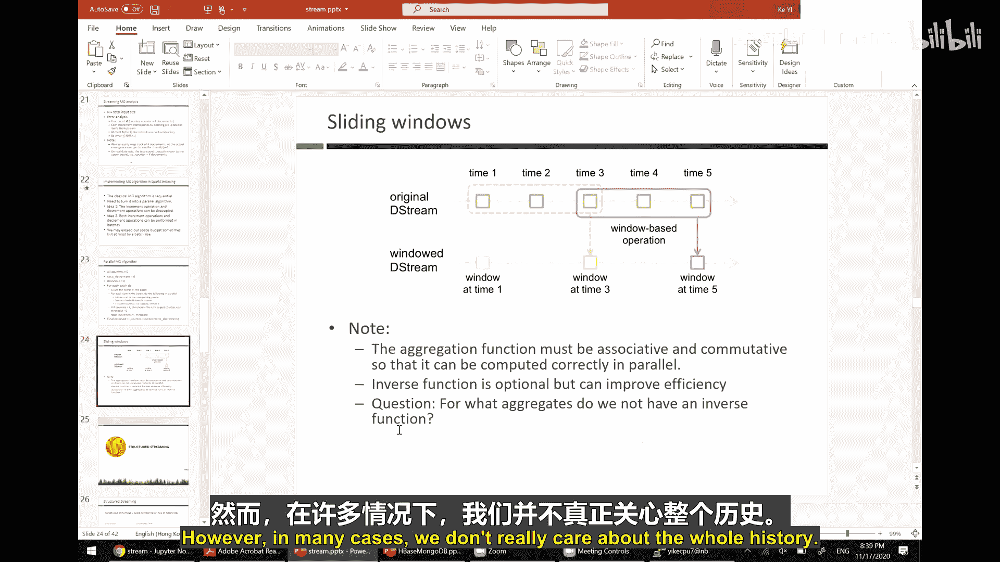
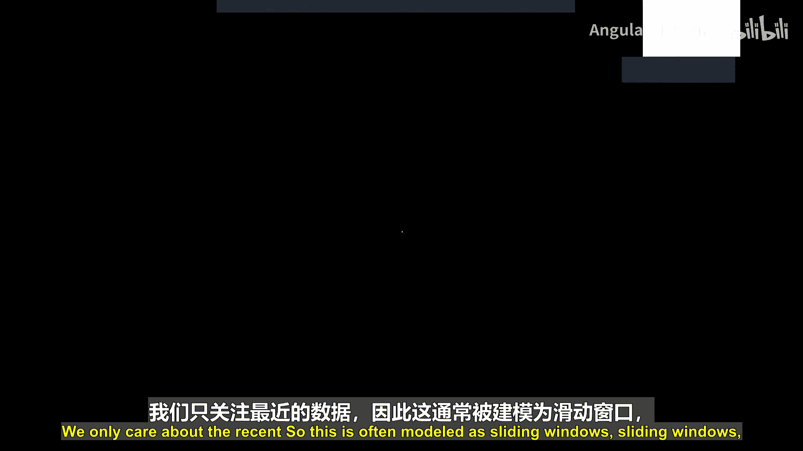
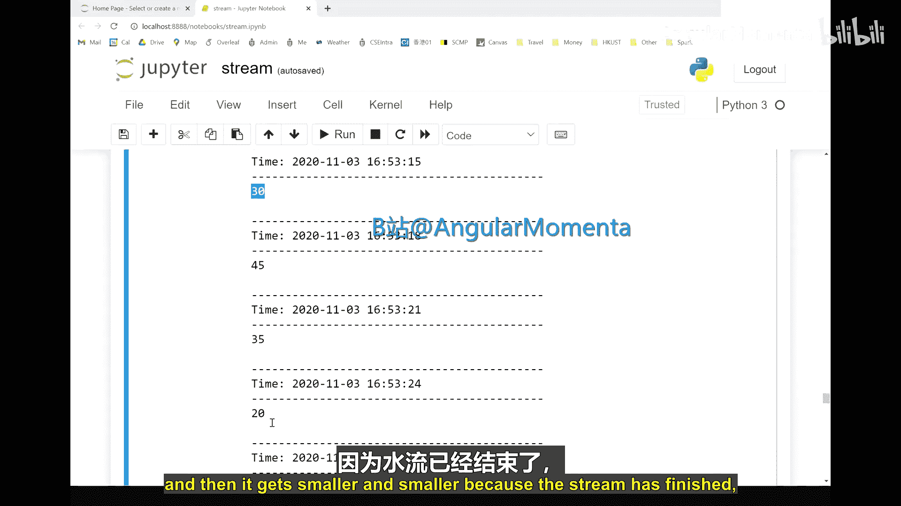

# 【香港科技大学】基于Spark的大数据计算--Big-Data-Computing-with-Spark-p21-09-02-02-示例-缺失卡片--BV1V8FmzuEHf_p21-

So essentially， streaming algorithms is an algorithm that uses bounded space。

 the space usage doesn't grow， doesn't depend on the length of the stream。Okay， just to motivate。

 let me first give you a a very simple example of a， of a streaming algorithm is's actually a puzzle。

 Okay， and probably some of you have seen this。 Okay， so it's called a missing card puzzle。Okay。

 suppose I have a deck of 52 cars。 I， I， I take one out and pass the rest。

 the other 51 cars back to you。And suppose you only have a very basic calculator， namely。

 you can do some simple arithmetic。But very bad memory。 you cannot remember。

 you cannot possibly remember every car that I that that you have seen。 though， though the， the job。

 the， the task is to find out which cars is missing。With just one pass over the 51 cars。

 Okay This is exactly the streaming model， right， If the na with will simply remember every car I have seen。

And this algorithm， this di algorithm， needs space that grows as a stream in。

 as as the length of stream grows。 So this is naive algorithm is， is not， is not streaming。

But there is actually a very clever algorithm for solving this with this constant space。

How to do this exactly。 Well the idea is， is very simple。 Okay。

 let's first number the cars from 1 to 52。😊，In any way you want， Okay。

 so namely every card is represented by a number from 1 to 52。I know that if no car is missing。

I know that the， the correct sum will be just。You know， I go from 1，52。 right， Well， there。

 there is a formula is， is to。1 53， right， Okay， so that's the formula that everybody knows。

 So if a one card is is missing， then I cannot recover some。But I can recover the difference。

And the difference exactly tells me which cars is missing。 So I just need to count。

 I just need to encounter or not count a sum。 I just need to compute some of the 51 cars that are remain that that that remain。

 And then I can come by comparing with the expected with the correct sum。

 I can know which cars is missing。Okay。呃。There's a question in the chat these regard， what is this？

Yeah， lines is also D stream。 Yes， D stream， D stream is just a sequence of RDDs。 Okay。

1 RDD for every batch， for every mini batch。Okay， so one simple extension。

 what if there are two missing cars， Okay， and then this doesn't work。Because by computing the sum。

 we can only know the sum of the two missing cars， okay。Another idea with okay。

 let's compute not only the sum， but also。The product。Okay， because， you know。Well。

 this may be difficult， but I can still compute expected。Product， if no car is missing。 Okay。

 and then I maintain two。Well maintain a sum and also maintain a product。Then I can figure out。

 I can have to。 then I will have two equations。 I know X plus y is something。 right。

 I know X multiplly by what is something。However， this doesn't really work。😊，Okay， why？Well。

 because this number will overflow。Because even for 5，52， this is，52 factorial。

 You can now this will easily overflow。 The trick is we don't do this。 I compute。😊。

The sum of squares。ok。Well， there is also a formula of that， which is one， six times。

N times n plus1 times 2 n plus1， okay。So I， anyway， you can look。

 can look it up from any mathematics for actually， any Olympian math book， Okay， so。😊。

I compute the sum。 I compute the sum of squares。 Then I still have two equations。

 name I know there are some， and I know there are。Sum of squares， Okay。

 and then solving this can give us the solutions。And this， I only need two variables。 Okay。

 so this is also a streaming algorithm。Nly， as long as the space needed。

 it doesn't depend on the length of stream， then it is considered a streaming algorithm。Okay。

 so yeah， so a streaming algorithm is anyone that makes one pass over in data using a small amount amount of memory can compute something in the end。

 So this first algorithm that is considered a streaming algorithm is this famous algorithm known as reservoir sampling。

 reservoir sampling。 Okay， so this is also set to be one of the algorithms that every data scientist should know。

 okay。😊，So how does this work， Okay， so， what is this use used for。

 It is used to maintain a sample of size of certain size from all elements in the stream so far。

 okay。This algorithm is actually， very simple。😊，It first appeared in Donna Cruz book。

 the Art of Comp programminging。 however， he attributed this algorithm to a guide known called Waterman。

To an unknown date。 But algorithm would， anyway， algorithm is very simple。

 So we first keep the first S elements in the stream and N。

Is set to S and will correspond to the length of the stream。Okay， for any new element。

 we do the following。So so we at first set n equal to first increment n。And。

I know that every element should be sampled with probability S over N。 right， So I will you。

 I will I will。I will， I will sample the new element exactly with this probability。

So if this new element is sampled， then currently， I will have2，1， too many sample， right， So I will。

 I will kick out the element chosen randomly from my current sample。Otherwise。

 I would simply throw away into the new element。 Okay。

 so this is known as the reservoir sampling algorithm。 Just， let me just give you one example。

 Suppose my first three elements are ABC。 So initially， my sample is just ABC。And then D comes in。

So with probability sample size is 3， right， so with probability 3 over4， I kick D。 I sample D。

 in that case， I will use D to replace any one of them， any one or3 with equal probability。

 So I replace a with probably one third B probably one third C probably probably 1，1，1 third。

 supposeuppose B is kicked out。 Okay， and the。Replaced by D。 Okay。

 suppose the next element is E with probability 3 over 5 I sample E。Okay， with probably 2，2 over 5。

 I don't sample it。 If I don't sample it， my current sample is not change。 doesn't change。

 Suppose I doesn't sample it。And next guy is F with now with probability 3 over 6。 I sample it。

 If I sample it， I need to。Kick out an element randomly from my current sample。

 Sose a is click out then F。And that's it。 So this is rather of our sampling algorithm。Okay。

 so perhaps this is the first streaming algorithm。Okay， have some chat messages。ok 啊。Okay， so。

I want to also mention this because if you search the Internet reservoir sampling， actually。

 many of the proofs are actually incorrect。Okay， this is the famous。 Okay， this is the。A famous Tful。

For， for trusting any source you find on the Internet。 Okay。

 and the reason why they are wrong is that they any all So this proves only prove that。

Every element is sampled with the correct with the with with the same probability。 Okay。

 this is often used as example for， for mathematical induction。 Okay。

 and this is a very simple proof by induction often used to， to for even for。

 for high school students。 However， this proof is not correct because。

Have having the say having the crack probability is only a necessary condition for being a random sample。

 So this is one counter example。 suppose let's consider another different algorithm。

 I simply divide elements into groups of S and pick one group randomly。 So suppose， you know， S is。

Again， S is 3 and n is 6。 So I divide my six elements into two groups。 I pick one group。

 as my sample。Then if you look at every element。That element will be sampled with probably one half。

 right So every element will be sampled with same probability。 However。

 this algorithm certainly doesn't return random sample because theres high correlation between the elements being sampled or not。

 Okay， so this is。En no sufficient condition for random sampling。

 So the actual cry proof will rely on the fiser ya shuffle。 Okay， so I will not discuss this。

 but you can find this， find the crack proof。 so luckily， the authorative pages。Got this one。

 correct。 For example， Wikipedia， you know。Stuck overflow。 So these websites have the correct proof。

 So now coming back to our word count example， you know， you know， in a word count example。

 I don't want。My state to grow indefinitely， I want to bang state size。But unfortunately。

 this means that。I thought there is a negative result saying that this cannot be done If you want to remember the exact count for every word。

 your state has to grow。 Okay， so we're gonna settle for a approximate solution。

 We're gonna remember the approximate count for every word。

And this turns out to relate to another interesting puzzle in the literature known as the majority problem。

 Okay， so here it's not really a streaming algorithm because here we are。

 you are allowed to make two passes over the sequence。 Okay。

 So the problem is to identify to find a majority if there is one。OkayFor example， I give you。

 I give you a sequence of of letters。 I want to I ask， is， is there is there a majority Okay。

 if there is one， then you can you should find it， if there's no if there's no majority。

 you just say no okay so in fact， this problem was first mot by voting So for example， you know。

 whenever we do when when when we do vote counting。

 the standard algorithm is you know we keep a tally for every candidate。

 and then we just keep running count however， suppose there are many candidates you don't have。

 don't even have a piece of paper。 you cannot remember。

 you cannot afford to keep a tally for every candidate。 supposeupp you only have very limited memory。

 So how do we identify how how do we decide if there is a candidate winning the majority of the。

Winning the winning the majority of the votes by majority。

 we mean that its appear its frequency exceeds half n over2。Okay。

 it turns out that there is a very simple algorithm and very elegant algorithm for solving this problem using only one counter。

 okay。😊，This appears to be quite surprising that this can be done。How do we， how do we do it， Okay。

 the algorithm goes like a this。Let me illustrate that on this example。I only use one counter。 Okay。

 to do this， but I will make two passes over the sequence。I will say， okay。

 I will I see the first letter， which is a。 So I will say this A has now one vote， okay。Next one。

 still a， So I。Change that to2。Okay， and then okay，2，2 A。 And next one is B， okay。

Well B is different from a。I should write B1， right， that's a standard algorithm。

 But if I keep doing this， I will have。I'm bounded the state。 I have， I need， I need a paper。 so。

 but I wish I don't have。 So I cannot do that。 So instead of remembering B1， I。

 I decrement the count of a， okay。I decre that back to one。Okay。Next one。

 C still C is different from a。 I decrement the count of a。 Well， then I have nothing left。Okay。

And then next ones D， D1。And B B is different from D。Nothing left a。A1 a。A 2。

 and two Bs will remove these two ways。 And then I have 1，2，3，4，5，6， a，6 As。And then CCD。

 they are all different from a。 So a will become a two。And another a 3。M B2。And 3， a。5， okay。

So this finish my first pass。 So the claim is that after the first pass， if there is a majority。

 it must be this guy。ok。By the way， I'm not claiming that this must be the majority so if。It。

 it may happen that， you know， I suppose I have， let's say， you know， B， B，5，5 B。So that a will。

 this will be dec to 0。 And then I have a new F。 So if my sequence looks like this。

 then F will survive， right， F will be the surviving letter， but F is clearly not a majority。

But this doesn't violate my claim。 My claim is only if there are a majority。

 then that one must be able to survive until the end。Okay。Indeed， in this example， this there。

 there's no， no majority。 You can check。 A is not， is no longer a majority。

 if I add these letters in the end。Okay。嗯。So， so therefore， we， we we， we can， we can， we can verify。

That a is indeed the majority。 So if in the first case， if I do not have this。

 then a would survive and a 5， right， And then in the second pass， I can't how many times a appears。

I I， I only come A， ignore the rest and check whether that exceeds in over 2。 If yes。

 I report a to be a majority， otherwise， I say no。In the second case。

 I verify if F is a majority and indeed， F is not。 So I would say no majority。

So this is a famous majority counting algorithm using only one counter。But， unfortunately。

There is a negative result saying that if you only allowed one pass， then this problem is。

 is unsolvable。 Okay， you cannot possibly find a majority with constant space。

 constant memory with within one pass。However， it turns out that although we cannot solve this problem exactly。

 we can solve it approximately。 And this is known as the Mira G algorithm。 Okay。

 so this uses up to K counters， and it can solve the problem。

Approximately up to an error of n over K plus one。 Okay。

 so a larger K is the smaller the error will be。 Let me， let me illustrate how this algorithm works。

 okay。嗯。Suppose case 5。 And these are the counts for different。Items， okay。

 now suppose I have a new item coming in。This item is 6 and 6 exist in my counter list。

 So I simply incr its corresponding counter。If the next element is 4， right。

 if I add add 4 into my list of counters， I will exceed my budget。 My case is 5。

 I can only use at most five counters。 But now I have 6， So what I do。

 I will use the idea is the same as the majority count example， you know。

 in the majority counting example， when we I when when I see a new item。

 I decrement the reason why this works is that if a majority exist。It will。

 this documents will not eliminate this this， this element because every document operation correspond to the elimination of two items。

 which must be different。 So， for example， if I have a 5 here at at this point， I see another B。

I throw B away and dec 5 to 4。 So this is equivalent to eliminating 1， A and 1 B。

 So every dec correspond to the elimination of two two items that are different So they are can be at most N over two dec operations。

Okay， and so if a appears more than an over two times， it must be able to survive。 Okay。

 so that's the reason why this majority algorithm can retain the majority if it exist。Okay。

 so similarly， here， we use same idea。 When I have more than K items。

 more than K counters in my list， I decrement all counters by one。

So this will guarantee to reduce the number counters needed back to K or even smaller。And that's it。

 And that's the algorithm。 This algorithm doesn't make doesn't make a second pass。 Okay。

 it only makes one pass whenever see existing item， I increment counter。 Okay。

 if is items monitored in increment counter if。If。If。Okay， if it is not monitor。

 but then I have more than K items。 I decrease all count by one。

And why this has an error of at N over K plus 1。But use the same argument。

 because every every decrease， every decrease operation will eliminate is equivalent to eliminating K plus 1 different items here。

 I do dec。 So I delete one copy of 1，1 copy of 3，1，4，1，6，1， a，1，9。 So K plus 1 items are eliminated。

 and they are all different。 So in total， I do at most， this many decrease operations。

 so that means and every decrease， every decrease operation will decrease distinct items。

 K plus 1 distinct items。 So if you look at every item。

It will is counts will be will be decreased by at most this thing。 Okay。

 so that's why the the frequencies， the counters will have at most an error of N plus an over plus actually。

 all these counters will be underestimate because we never increase a counter without without actually seeing a copy。

And we， but we may decrease counter sometimes。 So all these counts will be underestimate。 Okay。

 the true count must be within this range。 It， it is at least。

 it at least equal to counter and at most equal to counter plus the total number of dec。Operations。

And the total number document operations is at most n over K plus 1。 Okay。

 so the error will be at most n over K plus 1。 Okay， so this is the mystery mystery gr algorithm。

 if the if if the larger K is the smaller error will be okay， So， for example， if if K is 100。

 then your error is only， you know，0，1%。 So this is can be a very accurate algorithm。

 but still it cannot keep the exact kind。Okay， a couple of notes。

 The first one is we can easily keep track of the number of dec operations。 The actual number。

 the actual number of dec can be smaller than this。 Now， this is the upper bound。

 right because you know， let's in the so。😊，In the you， in， in， in， in the very best case。

 all elements are， are are the same。 Then we never do decment。 And in this case。

 we can get the exact kind of a。So the number of document operations will depend on the actual data。

 but it will be an over K plus one in the worst case。

 But the actual number can be smaller so we can keep track of that so that we can。

 we can shrink this interval on the actual data， okay。On many really data sets。

 the true count is usually closer to the upper bound。 So namely。

 although we can guarantee that the count is within this range for really data sets。

 the upper bound is more accurate。 The the true count tends to be closer to the upper bound。

 It's not the lower bound。 So if we， you are required if we are required to make a guess we want to we we usually guess the true count to be the upper bound。

this tend to be closer。Essentially， the intuition is suppose and some item， let's say。

 appears very often。 So it will never leave the it will never be kicked out。 So it's never。

 it will never become zero。 So when it is never0， it will be deced every time。 So， so， so。

 so therefore counter plus number of decal operations will be closer to the true count。 So however。

 when we actually want to implement this algorithm in spark。

 We realize that this is equation algorithm， right， we we have at any time in time。

 we can only process one item。 and this is not efficient。

 This is not utilizing all the computing power we have in the cluster。

 So we have to design a you know parallel version of of this algorithm in particular。

 we want to design an design version that works for the。The the mini batch mode of spark streaming。

 recall that in spark streaming。 like we have， we have， we have a， we。

 we divide the stream into many， mini batches。And each batch， is busy batch is stored as a RD。

 and we can process this RDD by many workers together。Toge， so therefore。

 the idea to turn this into a parallel algorithm uses the following the two two observations。 First。

 both the increment operation and dec operation can be， well， this two operation can be decoupled。

 so although when we describe the algorithm we say that， okay， we we do one increment。

And check if we， if we have too many counters， If， yes， I do decrement。ButHowever。

 I can do multiple increments。 Suppose I have， let's say 3。Items coming in together。

 I'll just incr three counters in parallel。 And this can be done in parallel and very easily。

 And then I check whether I have too many counters。 And if if yes。

 I gonna do multiple dec operations at the same time。 Okay。

 so let's say suppose I have three items coming in together， say 4，5，6。 then then we have  one to。

 we have 6。😊，7， we have 7 counters。 And that our budget is only 5。 So I。

 I need to keep performing operations until I have only K 9，0 on K，9， Okay，90 counters left。

 But all these dec operations can also be done together。

 so essentially every we we first do all the increment operations。Together in parallel。

 And then I do all the dec operations in parallel together。 So that's what I mean。

 decoupling these two operations。 idead number two is that okay。

 as when we have decoupled these two operations， both can be done。😊，I parallelel okay。And， in fact。

 the incremental operation is the same as standard word count。

 we just add one to our to the word count in the state， the same as a。

 the same as the state for word count for document。

 There's one thing that we need to figure out how many equipment we want to do。 So essentially。

 The problem is following。 right right， we have， say we have8 counters。I need to find the。

Third smallest。 I， I need to support the third smallest。The third small country is2。

 That means I need to do two di operations in order to reduce three counters to 0 so that my。

 I have only 590 counts left。 So this is。Exactly the selection problem。

 we talked about at the beginning of the course。 thats the selection problem。 namely given a K。

 I want to find a case smallest counter。 Okay， and we already know how to do this。

And combining these two ideas， we can implement this algorithm。In spark streaming。Okay。嗯。Okay。

 so the the I， we are， we are， we will still use a state to store the counters。 Of course。

 But by now， we need to do both increment and decrement。 Okay。

 so for the increment is same as before， namely， we have a bunch of new values in the batch。

And we we just add them into the running count。 Okay， and then we need to do the decrement。But we。

 we won't do it you know one at a time。 That's gonna be very inefficient。 So the idea was。

 as I mentioned， I need to find the case smallest counter。And we'll set that as a threshold。

And then we who gonna do this decrement together in parallel using this updated function。Okay。

 how do I find this？ Yeah， of course， we could have used。

Our selection now with a medium time selection， which can be more efficient。

 But anyhow here in this example， I just do something lazy。 So namely， I， I did a sorting。right yeah。

 okay， so because essentially， because for this application， I also want to print the top。

 the harvestest， the most popular words anyway。 So I want to， I need to do a sort anyway。

 So after sorting， I can find the case smallest case smallest very easily。

 so that's why what I did here。😊，I did a sort， and then I simply take the。The case smallest。Right。

 yeah。 Okay， So how， how do I find the case smallest。I use this function zip with index。

 what does this do， This will just attach consecutive integers。0，1，2，3，4。

 to all the items in the RDD。 And then I do a lookup。 Okay， So I find Kate the smallest。 Okay。

 so yeah。And this is going to be， this is very efficient after we have sorted the RDD， okay。Alright。

 so this is the basic idea。 Of course， I'm only making some details。

 but you can check the details yourself。Okay， and this is the illustrating of how it can run。

 Yeah as you can see the， the total number 15 words。 Okay。

 so this is essentially the size of the state。嗯哼。😊，So know that is is slightly higher than K。 K。

 Alright， K is 10000。 but the here is is slightly more more than that。

 This is because we decoup all the increments and and and dec。 So after all the increments。

 we may temporarily exceed our space， our space budget。 but not too much。 like the the at most。

 we use K plus the size of one batch。 and then we do decre。😊。

Which can immediately get the size of state back to K。 Okay。

 so of every batch we temporarily exceed our budget， but at most a batch size。 And then we can get。

 get it back。 So it's always just a little more than 10000。😊，Okay。

 and in this example and in the example， I also print out。 So as I mentioned， the this， this。

 the as this， this algorithm can can can is guaranteed to enclose the true count inside the range。

 So counter is lower bank counter plus the number of dec operations is high is the upper bound。

And indeed， so it is。 Okay， for example。Yeah， so it says that other the the is count must be between these two numbers and。

Okay， so another very useful construct is Windows， Okay， because。

Because it's in many many applications where in many applications。

 we don't really care about the whole history， right So if we care about the whole history。

 we have to use some clever algorithms to， you know， ban the side of state。 However， in many cases。

 we don't really care about the whole history。 We only care about the recent。

Data， so this is often modeled as sliding windows。 Okay， sliding windows， namely。

 I want to compute some function or only in the past， say 10 minutes。 Okay。

 so this is called sliding window。 So what it what what can what what it does is you have to define2 two parameters。

1 is the length of the window。 and one， the other one is the step size。 Okay， I think this is it is。

 this is better illustrated by the example。

ok。😊，So this is。不是。Okay， so this is this example of a siding window， okay。

So I first created a streaming contact with a batch interval of three seconds。 Okay。

 so every mini batch is three seconds。And then I perform this reduce by window。 Okay。

 this is just one example。 They have other aggregation functions that are available。 So here is one。

1 example， just the reduce。 I compute  one aggregate per window。 per sliding window。

 And the first parameter 9 is the lens of the sliding window， namely is 9 seconds。

And the the the the step size is 3 seconds。 Actually。

 both these two parameters parameters must be a multiple of the batch size because the batch is the smallest unit of。

 of data that can be handled by spark streaming。 So this is essentially is this means that my sliding window consists of three batches。

 And I gonna slide every。Every， every one batch。 So so this is illustrated in this picture。 Okay。

 so so here every batch is three seconds。 and this is sliding window。

 and I do one computation for every， every for every sliding window。😊。

I update the result every three seconds。ok。So here is how it works。 So for this example。

 I created a Q of RDDs， Okay， where each RDD simply reach batch simply consists of five eyes。

 So 5 zeros， followed by 5，1， followed by 5，2s and 5，3s and 5，4s5 and 5，4s。 Okay。

 and then I do this sliding window computation。😊，So namely。

 this is the first window only consists of the first batch。 So the sum is 0。

 And then the next white window is the first batch and the second batch。 So it's no。

 the first batch only。 So it's 5。 this one is， is no， iss nothing。 Okay， empty window。

And this is the first and second batch。 So the sum is 15，51s plus 52s。 Okay， and this is batch 1，2，3。

 and the total is 30， and then 45。 And then it gets smaller and smaller because the stream has finished。

😊。

